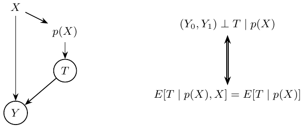
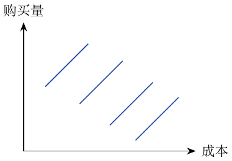
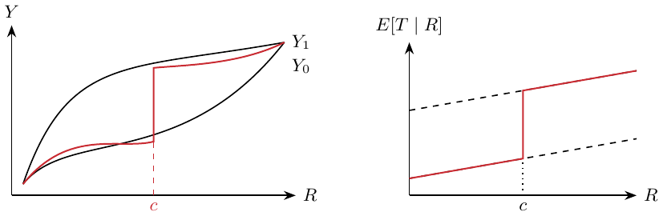
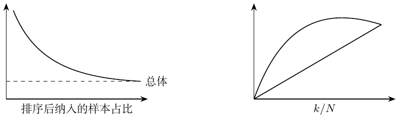
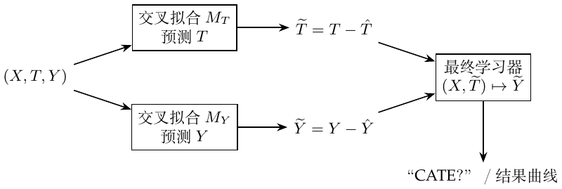
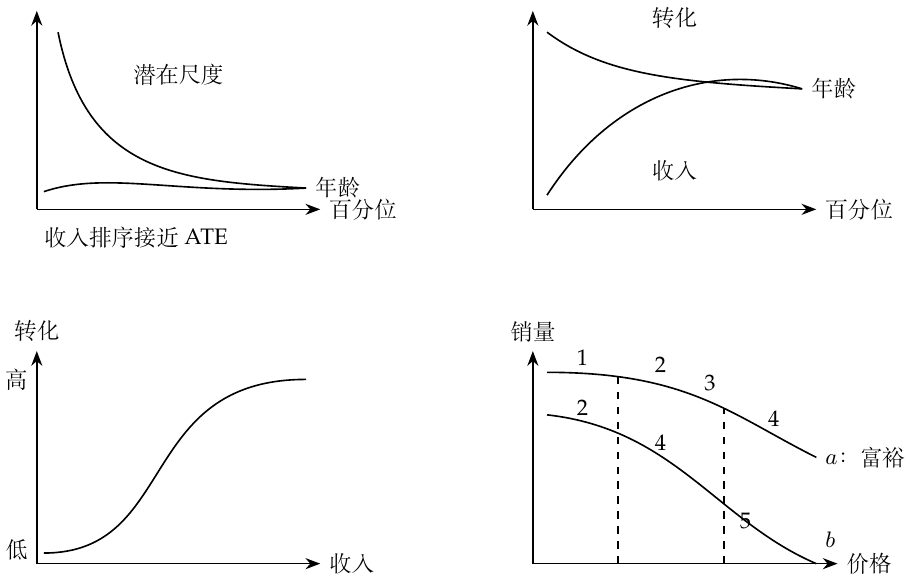
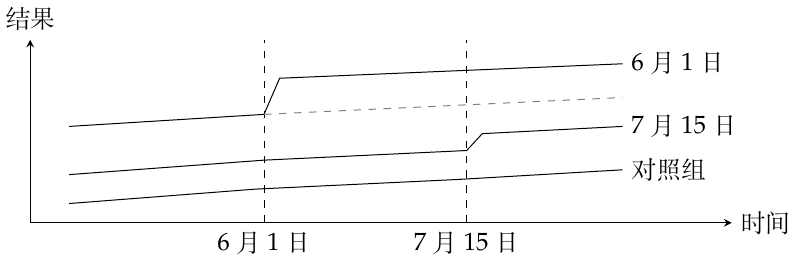
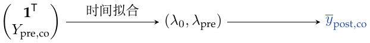
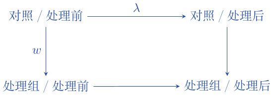

# 因果推断学习笔记：Brave and True

第1至25章与附录 · 中文校订排印版

黑、红、蓝对应原笔颜色。紫色标注原笔记错误；橙色标注补充条件或待确认问题。识别和翻译错误直接改正。保留原公式、个人直觉与箭头关系。

**颜色显示：** GitHub会去掉正文CSS颜色；完整颜色请看[PDF](Brave-and-True-Chinese.pdf)。公式可直接编辑，图像保留原箭头颜色。中英文使用同一套校注编号。

---

# 第1章：因果推断入门

*原扫描页码：Chapter1-23.pdf, p. 1*

$`T_i`$ 表示是否接受处理，$`Y_i`$ 是观测结果。笔记把“现实（分组）”与“真相”作了区分。
``` math
\mathrm{ATE}=E[Y_1-Y_0],\qquad \mathrm{ATT}=E[Y_1-Y_0\mid T=1].
```
ATE 是平均处理效应；ATT 是已接受处理者的平均处理效应。因果量来自潜在结果之差。观测到的相关关系可分解为
``` math
\underbrace{E[Y\mid T=1]-E[Y\mid T=0]}_{\textcolor{blue}{\text{相关关系}}}
=\underbrace{E[Y_1-Y_0\mid T=1]}_{\textcolor{blue}{\mathrm{ATT}}}
+\underbrace{E[Y_0\mid T=1]-E[Y_0\mid T=0]}_{\textcolor{blue}{\text{偏差}}}.
```

<div class="original-ink" style="color: #244DA8" data-ink="blue" aria-label="Original blue ink">

**我的批注。** 偏差为零时，相关关系代表 ATT；再用箭头把 ATT 连到 $`E[Y_1-Y_0]`$，标作“因果关系”。

</div>

**原笔记的指向关系。**

> <span style="color: #244DA8">偏差 $`=0`$：相关关系代表 ATT</span> $`\textcolor{blue}{\longrightarrow}`$ $`\mathrm{ATT}`$

> <span style="color: #244DA8">可转为因果关系（原笔记箭头）</span> $`\textcolor{blue}{\longrightarrow}`$ $`E[Y_1-Y_0]`$；条件见下方校注

<div class="review-note" style="color: #B45A00" data-ink="ReviewOrange" aria-label="Qualification / unresolved point">

**补充条件／待确认（B1-004）：选择偏差为零识别的是 ATT，不一定是 ATE**

*来源：Chapter1-23.pdf, pp. 1*

这条箭头确实出现在原笔记的蓝色批注中。$`E[Y_0\mid T=1]-E[Y_0\mid T=0]`$ 为零时，相关关系 $`=\mathrm{ATT}`$。若要进一步把 ATT 换成 ATE，还需 $`E[Y_1-Y_0\mid T=1]=E[Y_1-Y_0]`$；处理与两个潜在结果均独立的随机分配是一个充分条件。实际上，$`\mathrm{ATE}=P(T=1)\mathrm{ATT}+P(T=0)\mathrm{ATU}`$。

*参考：* [教材第1章](https://matheusfacure.github.io/python-causality-handbook/01-Introduction-To-Causality.html).

</div>

# 第2章：随机实验

*原扫描页码：Chapter1-23.pdf, p. 1*

随机实验可以消除偏差。图中把已有条件与潜在结果的联系（需要消除）和处理与观测结果的联系（需要研究）分开。RCT 给出

<div class="original-ink" style="color: #244DA8" data-ink="blue" aria-label="Original blue ink">

``` math
(Y_0,Y_1)\perp T,\qquad E[Y_0\mid T=0]=E[Y_0\mid T=1]=E[Y_0],
```
因此选择偏差项为零。

</div>

**原笔记的指向关系。**

> <span style="color: #244DA8">RCT 提供这一条件</span> $`\textcolor{blue}{\longrightarrow}`$ $`(Y_0,Y_1)\perp T`$

> <span style="color: #244DA8">需要消除的联系</span> $`\textcolor{blue}{\longrightarrow}`$ 已有条件 $`\longrightarrow`$ 潜在结果

> <span style="color: #244DA8">需要研究的联系</span> $`\textcolor{blue}{\longrightarrow}`$ 处理 $`\longrightarrow`$ 观测结果

# 第3章：统计学回顾

*原扫描页码：Chapter1-23.pdf, p. 2*

估计量的标准误写作 $`\mathrm{SE}=\hat\sigma/\sqrt n`$，其中
``` math
\hat\sigma^2=\frac{1}{N-1}\sum_i(x_i-\bar x)^2.
```
样本量更小 $`\Rightarrow`$ 标准误更大 $`\Rightarrow`$ 置信区间更宽。原假设是处理组与对照组的分布均值相等。两组各自的置信区间即使重叠，均值之差仍可能显著不为零。<span style="color: #244DA8">蓝色批注区分了两组均值各自的 95% 置信区间与两组均值之差。</span>

笔记把 $`p`$ 值写作 $`P(\text{data}\mid H_0)`$：在 $`H_0`$ 下，观测到当前数据或更极端数据的概率，并提醒第一类错误。置信水平被描述为估计值与总体参数之差不超过某一范围的概率。置信水平更高 $`\Rightarrow`$ 区间更宽 $`\Rightarrow`$ 精度更低。显著性水平是第一类错误的概率。

**我的直觉。** 若 $`p`$ 值很小，那么在 $`H_0`$ 下极不容易出现的数据却出现了，说明 $`H_0`$ 可能不对。<span style="color: #244DA8">把样本算出的 $`p`$ 值与理论上预先选定的显著性水平比较。</span>

**原笔记的指向关系。**

> <span style="color: #000000">$`\mathrm{SE}=\hat\sigma/\sqrt n`$</span> $`\textcolor{black}{\longrightarrow}`$ $`\hat\sigma^2=(N-1)^{-1}\sum_i(x_i-\bar x)^2`$

> <span style="color: #244DA8">各自的置信区间</span> $`\textcolor{blue}{\longrightarrow}`$ $`T=1`$ 或 $`T=0`$ 组均值的 95% 置信区间

> <span style="color: #244DA8">差值仍可能显著</span> $`\textcolor{blue}{\longrightarrow}`$ 两组均值之差

<div class="review-note" style="color: #B45A00" data-ink="ReviewOrange" aria-label="Qualification / unresolved point">

**补充条件／待确认（B1-005）：抽样概率与置信区间覆盖率**

*来源：Chapter1-23.pdf, pp. 2*

原笔记的简写需结合抽样来理解。对于独立同分布样本的均值，$`\widehat{\mathrm{SE}}(\bar X)=s/\sqrt n`$；这不是所有估计量通用的标准误。$`p`$ 值是 $`P_{H_0}\{S\text{ 至少与 }S_{\rm obs}\text{ 一样极端}\}`$，不是 $`P(H_0\mid\text{data})`$。95% 置信区间程序的重复抽样覆盖率为 $`P_\theta\{\theta\in C(X)\}=0.95`$。小 $`p`$ 值提供反对原假设的证据，并不从逻辑上证明原假设为假。

*参考：* [教材第3章](https://matheusfacure.github.io/python-causality-handbook/03-Stats-Review-The-Most-Dangerous-Equation.html).

</div>

# 第4章：图模型

*原扫描页码：Chapter1-23.pdf, p. 3*

$`A\to B`$ 表示 $`A`$ 影响 $`B`$；依赖关系沿箭头传递。

1.  链：$`A\to B\to C`$。边际上 $`A\not\perp C`$；给定已知的中间变量 $`B`$ 后，路径被阻断：$`A\perp C\mid B`$。

2.  叉：$`A\leftarrow C\to B`$。未条件化时，$`A\not\perp B`$；给定 $`C`$ 后，$`A\perp B\mid C`$。

3.  碰撞点：$`A\to C\leftarrow B`$。边际上 $`A\perp B`$；给定 $`C`$ 后，$`A\not\perp B\mid C`$。

混杂偏差还可能涉及混杂因素的代理变量，以及不能直接测量的变量。

**我的总结。** 混杂偏差来自没有控制住的开放路径，例如 $`X\leftarrow W\to Y`$，同时存在 $`X\to Y`$。选择偏差来自多余的条件化：控制共同结果会打开路径，控制因果路径上的中间变量则会阻断部分因果作用。例子中 $`X`$ 是教育，$`Y`$ 是工资，$`W`$ 是投资。碰撞点图为 $`X\to W_2\leftarrow Y`$、$`W_2\to W_1`$ 和 $`X\to Y`$，“投资”写在 $`W_1`$ 旁；中介图则是教育先影响 $`W`$，再影响工资，同时还有教育到工资的直接箭头。笔记说控制 $`W`$ 对这里的分析也有负面影响。

<div class="center">


原扫描第3页：链、叉、碰撞点；下方依次为混杂及两种不当控制。

</div>

**原笔记的指向关系。**

> <span style="color: #000000">额外控制共同结果，打开路径</span> $`\textcolor{black}{\longrightarrow}`$ 碰撞点 $`W_2`$，或其后代 $`W_1`$

> <span style="color: #000000">额外控制，阻断部分因果路径</span> $`\textcolor{black}{\longrightarrow}`$ $`X\to W\to Y`$ 中的中介变量 $`W`$

<div class="review-note" style="color: #B45A00" data-ink="ReviewOrange" aria-label="Qualification / unresolved point">

**补充条件／待确认（B1-006）：图上的分离与统计依赖**

*来源：Chapter1-23.pdf, pp. 3*

以上是原笔记的三节点路径规则。在因果 Markov 性质下，若不存在其他开放路径，阻断路径可推出所写的独立关系。开放路径允许依赖，但若不另加忠实性（faithfulness）条件，并不必然产生依赖，因为效应可能相互抵消。调整中介变量会阻断部分总效应，属于过度控制；调整碰撞点则可能产生选择偏差。

*参考：* [教材第4章](https://matheusfacure.github.io/python-causality-handbook/04-Graphical-Causal-Models.html).

</div>

# 第5章：线性回归的作用

*原扫描页码：Chapter1-23.pdf, p. 4*

对个体 $`i`$，写作 $`Y_{1i}=Y_{0i}+k`$，目标是估计 $`k`$。一元回归为
``` math
Y_i=\beta_0+kT_i+u_i,\qquad \hat\beta_1=\frac{\operatorname{Cov}(Y_i,T_i)}{\operatorname{Var}(T_i)}.
```
图中的直线从 $`T=0`$ 时的截距，连到 $`T=1`$ 时的“截距加 $`k`$”（原图画的是负斜率）。当 $`T`$ 随机分配时，其回归系数就是 ATE。

多元回归用来处理影响 $`T_i`$ 的多个因素：
``` math
y_i=\beta_0+kT_i+\beta_1X_{1i}+\cdots+\beta_KX_{Ki}+u_i.
```
<span style="color: #244DA8">$`X`$ 是辅助协变量。</span> 此时
``` math
k=\frac{\operatorname{Cov}(Y_i,\widetilde T_i)}{\operatorname{Var}(\widetilde T_i)}.
```

<div class="original-ink" style="color: #244DA8" data-ink="blue" aria-label="Original blue ink">

**我的批注。** 先把 $`X`$ 能解释的部分去掉，取残差 $`\widetilde T`$；剩下的就是 $`X`$ 解释不了的部分。

</div>

本来需要多元回归，却在一元回归中漏掉变量时，考虑正确模型
``` math
\mathrm{Wage}_i=\alpha+k\,\mathrm{Educ}_i+A_i'\beta+u_i,
```
其中 $`A_i`$ 是能力。遗漏变量的计算为
``` math
\frac{\operatorname{Cov}(\mathrm{Wage}_i,\mathrm{Educ}_i)}{\operatorname{Var}(\mathrm{Educ}_i)}=k+\beta'\delta_{\mathrm{Ability}}.
```
<span style="color: #244DA8">$`\delta_A`$ 是把能力对教育回归得到的系数向量。</span><span style="color: #C92B32">多出来的项就是遗漏变量偏差（OVB）。</span> 若所有混杂因素都纳入，就没有 OVB。**旁注：** RCT 打破这层关系；回归则控制它，使其固定。

<div class="center">


原扫描第4页：二元处理回归，保留原图的负斜率。

</div>

**原笔记的指向关系。**

> <span style="color: #244DA8">先用 $`X`$ 预测，再取无法解释的部分</span> $`\textcolor{blue}{\longrightarrow}`$ $`\widetilde T=T-\widehat{E[T\mid X]}`$（此处为线性投影）

> <span style="color: #244DA8">遗漏项是能力</span> $`\textcolor{blue}{\longrightarrow}`$ $`A_i^{\prime}\beta`$

> <span style="color: #244DA8">能力对教育回归</span> $`\textcolor{blue}{\longrightarrow}`$ $`\delta_A`$

> <span style="color: #C92B32">OVB：遗漏变量偏差</span> $`\textcolor{red}{\longrightarrow}`$ $`\beta^{\prime}\delta_A`$

<div class="review-note" style="color: #7A2B91" data-ink="ReviewPurple" aria-label="Original-note correction">

**原笔记纠错（B1-007）：残差回归的方向**

*来源：Chapter1-23.pdf, pp. 4*

原笔记黑色句子中的回归方向写反了，蓝色批注已指向正确做法。令 $`P_X`$ 包含截距，取 $`\widetilde T=(I-P_X)T`$，则 $`\hat k=\widetilde T'Y/(\widetilde T'\widetilde T)`$。反过来把 $`X`$ 对 $`T`$ 回归，得不到这个残差。

*参考：* [教材第5章](https://matheusfacure.github.io/python-causality-handbook/05-The-Unreasonable-Effectiveness-of-Linear-Regression.html).

</div>

<div class="review-note" style="color: #B45A00" data-ink="ReviewOrange" aria-label="Qualification / unresolved point">

**补充条件／待确认（B1-008）：回归调整仍需要因果识别条件**

*来源：Chapter1-23.pdf, pp. 4*

纳入所有混杂因素，还需结合一致性、重叠性、条件可交换性及合适的调整模型。所写的 OVB 恒等式使用了 $`\operatorname{Cov}(\mathrm{Educ},u)=0`$。即使相关协变量都已测量，加性线性模型仍可能设定错误；在效应异质时，加入协变量也不会自动识别未加权的 ATE。

*参考：* [教材第5章](https://matheusfacure.github.io/python-causality-handbook/05-The-Unreasonable-Effectiveness-of-Linear-Regression.html).

</div>

# 第6章：分组与虚拟变量回归

*原扫描页码：Chapter1-23.pdf, p. 5*

异方差是指在不同协变量取值下，结果的方差不相同。分组越细，组内样本越少；分组减少变异，但系数标准误可能增大，$`t`$ 统计量变小。各组的回归应按组内处理变量的方差加权。

处理为虚拟变量时（笔记举例：“是否为12年教育”），
``` math
\mathrm{wage}_i=\beta_0+\beta_1T_i+e_i.
```
$`T=0`$ 时，期望等于截距；$`T=1`$ 时，等于截距加 $`\beta_1`$。IQ 为连续变量时，
``` math
\mathrm{wage}_i=\beta_0+\beta_1T_i+\beta_2\mathrm{IQ}_i+\beta_3\mathrm{IQ}_iT_i+e_i.
```

<div class="original-ink" style="color: #244DA8" data-ink="blue" aria-label="Original blue ink">

- $`\beta_0`$：$`T=0`$、IQ $`=0`$ 时的期望。

- $`\beta_1`$：IQ 为零时，$`T`$ 增加一单位的影响（其他项均为零）。

- $`\beta_2`$：$`T=0`$ 时，IQ 增加一单位的影响。

- $`\beta_3`$：$`T=1`$ 时 IQ 也有回报；当 $`\beta_3>0`$，这一组的回归斜率更大。

</div>

分析 $`T_i`$ 的系数，需要算各组对总系数的贡献：按教育年限分组（笔记以12年为例），求相应的类别教育／处理差异 $`C(\mathrm{educ})[T_i]`$。

有更多协变量时，目标系数是各虚拟变量子组效应的加权平均：
``` math
E\!\left[\{E[Y_i\mid T=1,G_i]-E[Y_i\mid T=0,G_i]\}\,w(G_i)\right],\qquad
w(G_i)\propto\operatorname{Var}(T_i\mid G_i).
```
<span style="color: #244DA8">权重取决于子组内 $`T_i`$ 的分布。旁注要求求出教育分组和 IQ 分箱的处理差异。</span>

**原笔记的指向关系。**

> <span style="color: #000000">二元处理从0变为1</span> $`\textcolor{black}{\longrightarrow}`$ 此回归中的 $`E[Y\mid T=1]-E[Y\mid T=0]=\beta_1`$

> <span style="color: #244DA8">IQ 也改变 $`T=1`$ 组的斜率</span> $`\textcolor{blue}{\longrightarrow}`$ 交互项系数 $`\beta_3`$

<div class="review-note" style="color: #B45A00" data-ink="ReviewOrange" aria-label="Qualification / unresolved point">

**补充条件／待确认（B1-009）：子组回归权重需归一化**

*来源：Chapter1-23.pdf, pp. 5*

若每组有独立截距、共用一个处理系数，则 $`\beta=\sum_g P(G=g)v_g\tau_g/\sum_gP(G=g)v_g`$，其中 $`v_g=\operatorname{Var}(T\mid G=g)`$。等价地，原笔记外层期望中的权重为 $`w(g)=v_g/E[v_G]`$。这一般是按方差加权的效应，而不是通常的 ATE；因果解释还需要组内调整有效。

*参考：* [教材第6章](https://matheusfacure.github.io/python-causality-handbook/06-Grouped-and-Dummy-Regression.html).

</div>

# 第7章：控制混杂因素之外

*原扫描页码：Chapter1-23.pdf, p. 6*

本章讨论控制特定变量的后果。在 $`X\to Y\leftarrow T`$ 中，研究 $`X\to Y`$ 时控制 $`T`$，可以把 $`X`$ 的作用看得更清楚，降低其估计方差。第二幅图是 $`B\to A\to X\to Y`$ 及 $`B\to Y`$：$`A`$ 只与 $`X`$ 相关，$`B`$ 则同时与 $`X`$、$`Y`$ 相关。<span style="color: #244DA8">批注说加入仅与 $`X`$ 相关的 $`A`$ 会增大方差（原手写标的是 $`Y`$ 的方差）。</span>
``` math
\hat\sigma^2=\frac{1}{n-2}\sum_i(y_i-\hat y_i)^2,\qquad
\operatorname{Var}(\hat\beta_2)=\frac{\hat\sigma^2}{\sum_i(x_i-\bar x)^2}.
```
旁边的黑色文字写道：“标准误与 $`X`$ 的方差成反比。”<span style="color: #244DA8">样本的变化越大，标准误越小。</span>

没有控制共同原因而产生的是混杂偏差；控制共同结果，或控制因果路径上的变量，会产生选择偏差。

#### 不当控制与参与行为。

若处理影响结果是否为零，RCT 下均值之差具有因果解释。笔记将其分为参与效应与正结果中的效应：
``` math
\begin{align*}
E[Y\mid T=1]-E[Y\mid T=0]
={}&\{P(Y>0\mid T=1)-P(Y>0\mid T=0)\}E[Y\mid Y>0,T=1]\\
&+\{E[Y\mid Y>0,T=1]-E[Y\mid Y>0,T=0]\}P(Y>0\mid T=0).
\end{align*}
```
<span style="color: #244DA8">旁注把第一部分标为结果为正的概率变化，并区分顾客“是否参与”和“消费能力”。</span> 只分析参与者时，

<div class="original-ink" style="color: #244DA8" data-ink="blue" aria-label="Original blue ink">

``` math
\begin{align*}
E[Y_{i1}\mid Y_{i1}>0]-E[Y_{i0}\mid Y_{i0}>0]
={}&\underbrace{E[Y_{i1}-Y_{i0}\mid Y_{i1}>0]}_{\text{参与者中的因果效应}}\\
&+\underbrace{E[Y_{i0}\mid Y_{i1}>0]-E[Y_{i0}\mid Y_{i0}>0]}_{\text{选择偏差}}.
\end{align*}
```
最后一项比较参与者与未参与者［批注结尾被扫描边缘截去］。

</div>

配图为 $`X\to T_1\to Y\to T_2`$，另有 $`X\to T_2`$。<span style="color: #C92B32">$`T_1,T_2`$ 用红色标为不当选择／控制：“不要控制！”</span>

<div class="center">


原扫描第6页：改善精度的控制、处理变量的预测因素，以及红圈标出的不当控制。

</div>

**原笔记的指向关系。**

> <span style="color: #244DA8">只与 $`X`$ 有关；加入后增大方差（原文）</span> $`\textcolor{blue}{\longrightarrow}`$ 第二幅图中的 $`A`$

> <span style="color: #244DA8">同时与 $`X`$、$`Y`$ 有关</span> $`\textcolor{blue}{\longrightarrow}`$ 第二幅图中的 $`B`$

> <span style="color: #C92B32">不当控制：不要条件化</span> $`\textcolor{red}{\longrightarrow}`$ 下方图中的中介 $`T_1`$ 和碰撞点 $`T_2`$

> <span style="color: #244DA8">参与效应</span> $`\textcolor{blue}{\longrightarrow}`$ $`P(Y>0\mid T=1)-P(Y>0\mid T=0)`$

> <span style="color: #244DA8">选择偏差</span> $`\textcolor{blue}{\longrightarrow}`$ $`E[Y_0\mid Y_1>0]-E[Y_0\mid Y_0>0]`$

<div class="review-note" style="color: #B45A00" data-ink="ReviewOrange" aria-label="Qualification / unresolved point">

**补充条件／待确认（B1-010）：精度、不当控制与参与行为**

*来源：Chapter1-23.pdf, pp. 6*

在同方差的一元 OLS 中，$`\mathrm{SE}(\hat\beta)=\sigma/\sqrt{\sum_i(x_i-\bar x)^2}`$：标准误与处理变量变异的平方根成反比。多元回归应使用残差化后的处理变量和正确的残差自由度。这里的方差直觉针对处理效应估计量，并非说 $`\operatorname{Var}(Y)`$ 本身发生了变化。参与效应分解假设 $`Y\ge0`$（或结果只可能为零和正数）；若无额外假设，两个代数分量不能分别解释为因果效应。

*参考：* [教材第7章](https://matheusfacure.github.io/python-causality-handbook/07-Beyond-Confounders.html).

</div>

# 第8章：工具变量

*原扫描页码：Chapter1-23.pdf, pp. 7–8*

假设
``` math
Y_i=\beta_0+kT_i+\beta W_i+u_i,
```
其中 $`T`$ 是处理，$`W`$ 是混杂变量。当 $`W_i`$ 不可观测时，拟合 $`Y_i=\beta_0+kT_i+v_i`$，其中 $`v_i=\beta W_i+u_i`$。此时 $`\operatorname{Cov}(T,v)\ne0`$，所以 $`k`$ 的估计有偏。<span style="color: #244DA8">未观测项携带着联系 $`T`$、$`Y`$ 的信息。</span>

引入工具变量 $`Z`$：它与 $`T`$ 相关，只通过 $`T`$ 影响 $`Y`$，且 $`\operatorname{Cov}(Z,v)=0`$。图为 $`Z\to T\to Y`$、$`W\to T`$、$`W\to Y`$。因此
``` math
\begin{align*}
\operatorname{Cov}(Z,Y)&=\operatorname{Cov}(Z,\beta_0+kT+v)\\
&=k\operatorname{Cov}(Z,T)+\operatorname{Cov}(Z,v)=k\operatorname{Cov}(Z,T),\\
k&=\frac{\operatorname{Cov}(Z,Y)}{\operatorname{Cov}(Z,T)}
=\frac{\operatorname{Cov}(Y,Z)/\operatorname{Var}(Z)}{\operatorname{Cov}(T,Z)/\operatorname{Var}(Z)}.
\end{align*}
```
分子、分母都是回归系数。<span style="color: #244DA8">分子是简约式（reduced form）系数：$`Z`$ 只经过 $`T`$ 对 $`Y`$ 产生的影响。</span>

**我的微积分直觉。**
``` math
k=\frac{dY/dZ}{dT/dZ}=\frac{dY}{dZ}\frac{dZ}{dT}=\frac{dY}{dT}.
```
若工具变量是二元的，Wald 估计量为
``` math
k=\frac{E[Y\mid Z=1]-E[Y\mid Z=0]}{E[T\mid Z=1]-E[T\mid Z=0]}.
```
笔记将其理解为：把 $`Z\to Y`$ 的变化换算回 $`T\to Y`$ 的作用。

#### 工具变量的使用。

例子中，$`Z_0`$ 为 qob（出生季度），$`T`$ 为教育，$`W`$ 为能力，$`Y`$ 为工资，另有变量 $`Z_1,Z_2`$。写出的要求是：(1) $`\operatorname{Cov}(Z,T)\ne0`$，可直接用数据检验；(2) $`Y\perp Z\mid T`$，后面打了问号，并写“$`Z`$ 仅通过 $`T`$ 影响 $`Y`$”。<span style="color: #C92B32">**作者的红色更正：**“不准确，Chapter 09 中更正。”</span> 因此这里保留的是作者后来已否定的旧说法，而非认可这一条件独立假设。

先回归 $`T\sim Z_0`$，检查第一阶段关系；再回归 $`Y\sim Z_0`$，看简约式关系。方法一是取两个回归系数之比。方法二是 2SLS：

1.  将 $`T`$ 对 $`Z_0,Z_1,Z_2`$ 回归。

2.  将 $`Y`$ 对拟合后的 $`T`$ 及 $`Z_1,Z_2`$ 回归；图中用 $`(Z_0,Z_1,Z_2)`$ 代指拟合后的 $`T`$。

<span style="color: #244DA8">代码旁注说可以指定 $`T\sim Z_0`$，因为其他项会在第二阶段自动加入。</span> 用作比较的 OLS 写作 $`Y\sim T+C(Z_0,Z_1,Z_2)`$。

当 $`T`$ 与 $`Z`$ 的相关性很弱时，OLS 与 2SLS 的估计不同，标准误较大［末尾括号内的词无法辨清］。2SLS 在有限样本中偏向 OLS，偏差方向与 OLS 相同；2SLS 一致，而 OLS 不一致。工具变量越多，偏差越大；工具变量过多时，2SLS 越来越像 OLS。

<div class="center">


原扫描第7–8页：工具变量、处理、混杂因素与结果。

</div>

**原笔记的指向关系。**

> <span style="color: #244DA8">联系 $`T`$、$`Y`$ 的信息</span> $`\textcolor{blue}{\longrightarrow}`$ $`v_i=\beta W_i+u_i`$

> <span style="color: #244DA8">简约式：$`Z`$ 经过 $`T`$ 影响 $`Y`$</span> $`\textcolor{blue}{\longrightarrow}`$ $`\operatorname{Cov}(Y,Z)/\operatorname{Var}(Z)`$

> <span style="color: #C92B32">不准确；Chapter 09 中更正</span> $`\textcolor{red}{\longrightarrow}`$ 原先提出的条件 $`Y\perp Z\mid T`$

<div class="review-note" style="color: #7A2B91" data-ink="ReviewPurple" aria-label="Original-note correction">

**原笔记纠错（B1-011）：排除限制不是观测结果的条件独立**

*来源：Chapter1-23.pdf, pp. 8*

作者的红色更正是恰当的。排除限制是 $`Y(t,z)=Y(t)`$，并需结合工具变量外生性；一般并不是 $`Y\perp Z\mid T`$。图中条件化碰撞点 $`T`$ 会打开 $`Z\to T\leftarrow W\to Y`$。因此，一个有效工具变量在给定处理后，仍可能与观测到的 $`Y`$ 相关。

*参考：* [教材第9章](https://matheusfacure.github.io/python-causality-handbook/09-Non-Compliance-and-LATE.html).

</div>

<div class="review-note" style="color: #B45A00" data-ink="ReviewOrange" aria-label="Qualification / unresolved point">

**补充条件／待确认（B1-012）：IV 比值与有限样本结论**

*来源：Chapter1-23.pdf, pp. 7, 8*

在所写的常斜率模型中，协方差比值来自 $`\operatorname{Cov}(Z,v)=0`$ 与非零的第一阶段。导数约分适合帮助理解一条可微的单一路径，不能作为随机、异质 IV 模型的一般证明。通常的 2SLS 一致性要求有效且足够强的工具变量，以及维数固定的常规渐近条件；弱工具或工具过多时，不能无条件声称一致。这里的 $`Z_1,Z_2`$ 应理解为纳入的外生控制变量，在两个阶段都保留。

*参考：* [教材第8章](https://matheusfacure.github.io/python-causality-handbook/08-Instrumental-Variables.html).

</div>

# 第9章：不依从与局部平均处理效应

*原扫描页码：Chapter1-23.pdf, pp. 9–10*

依从者（compliers）服从分配；从不接受者（never-takers）始终不接受处理；总是接受者（always-takers）始终接受处理；违抗者（defiers）则反着做。在 $`Z\to T\to Y`$、$`W\to T`$ 和 $`W\to Y`$ 中，从不接受者与总是接受者削弱第一阶段。<span style="color: #244DA8">蓝色直觉说明：例如从不接受者会把简约式中的结果差异拉向对照状态。</span>

现在潜在结果有两个自变量：$`Y_i(t,z)`$；笔记以 $`T_i=1,Z_i=0`$ 时的 $`Y_i(1,0)`$ 为例。潜在处理 $`T_{0i}`$ 对应 $`Z_i=0`$。

#### 原笔记列出的 IV 假设。

1.  $`(T_{0i},T_{1i})\perp Z_i`$ 且 $`(Y_i(T_{1i},1),Y_i(T_{0i},0))\perp Z_i`$。$`Z`$ 与潜在处理无关，不同工具变量组中的人具有可比性。

2.  排除限制：$`Y_i(1,0)=Y_i(1,1)=Y_{i1}`$，$`Y_i(0,0)=Y_i(0,1)=Y_{i0}`$。工具变量只能通过处理影响结果。

3.  $`E[T_{1i}-T_{0i}]\ne0`$：存在第一阶段，工具变量确实会影响处理。

4.  原扫描写作 $`T_{1i}>T_{0i}`$，并说明打开工具变量会提高接受处理的概率。

#### 推导 Wald 目标量。

原笔记起初把下面的比值标为“ATE”：
``` math
\frac{E[Y\mid Z=1]-E[Y\mid Z=0]}{E[T\mid Z=1]-E[T\mid Z=0]}.
```
利用排除限制和随机分配，
``` math
\begin{align*}
E[Y_i\mid Z_i=1]&=E[Y_{i0}+T_{i1}(Y_{i1}-Y_{i0})\mid Z_i=1]\\
&=E[Y_{i0}+T_{i1}(Y_{i1}-Y_{i0})],\\
E[Y_i\mid Z_i=0]&=E[Y_{i0}+T_{i0}(Y_{i1}-Y_{i0})].
\end{align*}
```
分子为
``` math
\begin{align*}
E[(Y_{i1}-Y_{i0})(T_{i1}-T_{i0})]
=E[Y_{i1}-Y_{i0}\mid T_{i1}>T_{i0}]P(T_{i1}>T_{i0}),
\end{align*}
```
分母为 $`E[T_{i1}-T_{i0}]=P(T_{i1}>T_{i0})`$。所以比值为
``` math
E[Y_{i1}-Y_{i0}\mid T_{i1}>T_{i0}].
```
<span style="color: #C92B32">**作者的红色批注：**这个平均处理效应还附带一个条件：依从。</span> IV 只识别依从者的处理效应。依从者满足 $`T_{i1}>T_{i0}`$；从不接受者满足 $`T_{i1}=T_{i0}=0`$；总是接受者满足 $`T_{i1}=T_{i0}=1`$；违抗者与分配方向相反。

**原笔记的指向关系。**

> <span style="color: #244DA8">从不接受者／总是接受者削弱第一阶段</span> $`\textcolor{blue}{\longrightarrow}`$ $`Z\longrightarrow T`$

> <span style="color: #000000">工具变量各组具有可比性</span> $`\textcolor{black}{\longrightarrow}`$ 工具变量外生性假设

> <span style="color: #000000">工具变量只通过处理影响结果</span> $`\textcolor{black}{\longrightarrow}`$ $`Y_i(t,0)=Y_i(t,1)`$

> <span style="color: #C92B32">这个条件表示依从</span> $`\textcolor{red}{\longrightarrow}`$ 最终条件期望中的 $`T_{i1}>T_{i0}`$

<div class="review-note" style="color: #7A2B91" data-ink="ReviewPurple" aria-label="Original-note correction">

**原笔记纠错（B1-013）：非严格单调性与 LATE 的名称**

*来源：Chapter1-23.pdf, pp. 9, 10, 23*

原假设写了 $`T_1>T_0`$，但随后列出的类型包含 $`T_1=T_0`$。总体条件应改为几乎处处 $`T_1\ge T_0`$，且 $`P(T_1>T_0)>0`$。在联合工具变量外生性和排除限制下，令 $`C=\{T_1>T_0\}`$，分子为 $`P(C)E[Y_1-Y_0\mid C]`$，分母为 $`P(C)`$。比值是 LATE，而非总体 ATE。第23页模糊断点回归也应使用同样的非严格单调条件。

*参考：* [教材第9章](https://matheusfacure.github.io/python-causality-handbook/09-Non-Compliance-and-LATE.html); [Imbens–Angrist，LATE 识别](https://www.nber.org/papers/t0118).

</div>

# 第10章：匹配

*原扫描页码：Chapter1-23.pdf, pp. 11–12*

按混杂因素分组估计 ATE 时，对各组处理效应加权。按样本量加权会更偏向大组，即使该组的处理变异很小；这里标为“非参数估计”。<span style="color: #244DA8">按方差加权时，方差较大的组权重更大；这与线性、参数回归更强调高变异协变量的做法相联系。</span>

#### 分层。

如果 $`X`$ 造成混杂，就把 $`X`$ 相同的观测分在一组。在 $`(Y_0,Y_1)\perp T\mid X`$ 下，
``` math
\begin{align*}
\mathrm{ATE}&=\int\{E[Y\mid X=x,T=1]-E[Y\mid X=x,T=0]\}\,dP(x),\\
\widehat{\mathrm{ATE}}&=\sum_{k=1}^{K}(\bar Y_{k1}-\bar Y_{k0})\frac{N_k}{N}.
\end{align*}
```
<span style="color: #244DA8">蓝色批注是在协变量取值 $`\{x_1,\ldots,x_K\}`$ 上取平均。</span>

#### 匹配估计量。

用观测之间的距离定义相似程度，再比较接受不同处理的相似／邻近个体。<span style="color: #C92B32">旁边记了 K 近邻。</span><span style="color: #244DA8">定义距离时，对坐标作标准化：$`(x_i-\bar x)/\sqrt{\operatorname{Var}(x)}`$。</span>
``` math
\widehat{\mathrm{ATE}}=\frac1N\sum_i(2T_i-1)(Y_i-Y_{j(i)}).
```
<span style="color: #244DA8">$`j(i)`$ 是另一个处理组中与 $`i`$ 最相似的观测。</span><span style="color: #C92B32">$`2T_i-1`$ 根据个体所属的处理组调整正负号。</span>

#### 匹配偏差及修正。

对处理组，考虑
``` math
\widehat{\mathrm{ATET}}=\frac1{N_1}\sum_{i:T_i=1}(Y_i-Y_{j(i)}),\qquad
\textcolor{blue}{\mu_0(x)=E[Y\mid X=x,T=0]}.
```
中心化偏差写作
``` math
E[\sqrt{N_1}(\widehat{\mathrm{ATET}}-\mathrm{ATET})]
=E[\sqrt{N_1}\{\mu_0(X_i)-\mu_0(X_{j(i)})\}],
```
它不一定趋于零。<span style="color: #244DA8">乘上 $`\sqrt{N_1}`$ 会把偏差放大。</span><span style="color: #244DA8">蓝色解释比较的是 $`X_i`$ 对应个体未处理的潜在结果（因为 $`i`$ 已接受处理，所以是反事实）与 $`X_j`$ 对应个体实际观测到的未处理结果；用 $`X_i\approx X_j`$ 希望二者未处理结果也接近。</span> 对估计量作修正，使其收敛：
``` math
\widehat{\mathrm{ATET}}_{\mathrm{bc}}=
\frac1{N_1}\sum_{i:T_i=1}\left[(Y_i-Y_{j(i)})-
\{\hat\mu_0(X_i)-\hat\mu_0(X_{j(i)})\}\right].
```
<span style="color: #244DA8">$`\hat\mu_0`$ 可以用最小二乘等方法估计。</span> 局部 LS 修正不改变匹配估计量原本的目标。

**维数灾难。** 协变量越多，匹配距离越大，因为每个小格子里的观测更少。

**原笔记的指向关系。**

> <span style="color: #244DA8">对协变量取值求平均</span> $`\textcolor{blue}{\longrightarrow}`$ $`\int \tau(x)\,dP(x)`$

> <span style="color: #C92B32">按处理组调整符号</span> $`\textcolor{red}{\longrightarrow}`$ $`2T_i-1`$

> <span style="color: #244DA8">另一处理组里最相似的个体</span> $`\textcolor{blue}{\longrightarrow}`$ $`j(i)`$

> <span style="color: #244DA8">已处理个体未处理时的反事实均值</span> $`\textcolor{blue}{\longrightarrow}`$ $`\mu_0(X_i)`$

> <span style="color: #244DA8">观测对照个体的对应均值</span> $`\textcolor{blue}{\longrightarrow}`$ $`\mu_0(X_{j(i)})`$

> <span style="color: #244DA8">修正中心化偏差</span> $`\textcolor{blue}{\longrightarrow}`$ 减去 $`\hat\mu_0(X_i)-\hat\mu_0(X_{j(i)})`$

> <span style="color: #000000">特征更多，匹配距离更大</span> $`\textcolor{black}{\longrightarrow}`$ 每个格子内的观测更少

<div class="review-note" style="color: #B45A00" data-ink="ReviewOrange" aria-label="Qualification / unresolved point">

**补充条件／待确认（B1-014）：匹配偏差与目标量**

*来源：Chapter1-23.pdf, pp. 11, 12*

相关偏差应为 $`B_N=N_1^{-1}\sum_{i:T_i=1}[\mu_0(X_i)-\mu_0(X_{j(i)})]`$，所以中心化后的偏差是 $`\sqrt{N_1}B_N`$；原笔记只写一个 $`i`$，是对该平均的简写。近邻估计一致，不代表根号 $`N`$ 尺度的偏差就可忽略。偏差修正需要合适的光滑性、重叠性及一致的回归逼近。按样本占比加权以 ATE 为目标，按处理方差加权一般对应另一个平均量。

*参考：* [教材第10章](https://matheusfacure.github.io/python-causality-handbook/10-Matching.html); [Abadie–Imbens，偏差修正匹配](https://www.nber.org/papers/t0283).

</div>

# 第11章：倾向得分

*原扫描页码：Chapter1-23.pdf, pp. 13–14*

处理混杂偏差的另一种办法，是用一个介于0和1之间的数概括混杂因素。图为 $`X\to p(X)\to T\to Y`$，并有 $`X\to Y`$。这一页把 $`(Y_1,Y_0)\perp T\mid p(X)`$ 与下面的平衡恒等式用双向箭头相连：
``` math
E[T\mid p(X),X]=E[T\mid p(X)].
```

**我的例子。** 两个人，一个已处理，一个未处理。若接受处理的概率相同，即使他们的 $`X`$ 不同，也可以比较。
``` math
\begin{align*}
E[T\mid p(X),X]&=E[T\mid X]=p(X), &&\text{因为 }p(X)\text{ 是 }X\text{ 的函数},\\
E[T\mid p(X)]&=E[E[T\mid p(X),X]\mid p(X)]\\
&=E[p(X)\mid p(X)]=p(X).
\end{align*}
```

#### 逆倾向加权（IPW）。

条件差异可以改写为
``` math
\begin{align*}
E[Y\mid X,T=1]-E[Y\mid X,T=0]
={}&p(X)E\!\left[\frac{Y}{p(X)}\,\middle|\,X,T=1\right]\\
&-\{1-p(X)\}E\!\left[\frac{Y}{1-p(X)}\,\middle|\,X,T=0\right].
\end{align*}
```
<span style="color: #244DA8">?</span>**我的理解。** 我们观测到个体 $`i`$ 接受了处理，但 $`i`$ 接受处理的概率只有由 $`X`$ 决定的 $`p(X_i)`$。给每个观测到的处理个体乘上 $`1/p(X_i)`$ 来修正。若 $`p(X_i)`$ 很小，该观测在未加权的结果分布中占比不足，就用概率倒数提高其代表性。$`T=1`$ 和 $`T=0`$ 的权重分别为 $`1/p(X)`$ 与 $`1/(1-p(X))`$。这样重建“人人都处理”的总体（$`Y_1`$）和“人人都不处理”的总体（$`Y_0`$），两者之差就是 ATE。

笔记写出的加权方差为
``` math
\hat\sigma_w^2=\frac{\sum_{i=1}^n w_i(Y_i-\hat\mu)^2}{\sum_{i=1}^n w_i}.
```
但倾向得分估计 $`\hat p(X)`$ 本身也有误差。随意加入并非混杂因素的协变量，可能使倾向得分估计变得非常不稳定。已处理者估计出的处理概率可能高于未处理者。页底提醒：倾向权重超过 20% 会增大方差（此阈值按原文保留）。

#### 倾向得分匹配。

用 $`p(X)`$ 替代原本的匹配距离。作者评语是“这个不是很好”。处理预测更准确，不一定使因果估计更好，反而可能增加方差。处理组与未处理组的倾向得分分布若缺乏重叠，匹配就会有问题。

<div class="center">



原扫描第13页：倾向得分图及原有双向箭头，其含义在校注中加以限定。

</div>

**原笔记的指向关系。**

> <span style="color: #000000">平衡恒等式：分别展开两边</span> $`\textcolor{black}{\longrightarrow}`$ $`E[T\mid p(X),X]=E[T\mid p(X)]=p(X)`$

> <span style="color: #000000">对观测处理组加权</span> $`\textcolor{black}{\longrightarrow}`$ 构造人人都处理的 $`Y_1`$ 总体

> <span style="color: #000000">对观测对照组加权</span> $`\textcolor{black}{\longrightarrow}`$ 构造人人都未处理的 $`Y_0`$ 总体

<div class="review-note" style="color: #7A2B91" data-ink="ReviewPurple" aria-label="Original-note correction">

**原笔记纠错（B1-015）：平衡不等价于可忽略性**

*来源：Chapter1-23.pdf, pp. 13*

原图的双向箭头并不是逻辑等价。对真实的二元处理倾向得分 $`e(X)=P(T=1\mid X)`$，恒等式 $`E[T\mid e(X),X]=E[T\mid e(X)]`$ 成立。条件可交换性 $`(Y_0,Y_1)\perp T\mid X`$ 可推出 $`(Y_0,Y_1)\perp T\mid e(X)`$。要在目标总体上识别两个处理状态的均值，还需重叠性；但上述条件独立命题本身不需要重叠性。相同倾向得分平衡的是协变量分布，并不意味着两个具体个体的潜在结果完全相同。

*参考：* [教材第11章](https://matheusfacure.github.io/python-causality-handbook/11-Propensity-Score.html).

</div>

<div class="review-note" style="color: #B45A00" data-ink="ReviewOrange" aria-label="Qualification / unresolved point">

**补充条件／待确认（B1-016）：结果的加权离散程度不是 IPW 估计量的方差**

*来源：Chapter1-23.pdf, pp. 13, 14*

$`\sum w_i(Y_i-\hat\mu)^2/\sum w_i`$ 衡量结果的加权离散程度，并非 IPW ATE 估计量的抽样方差。倾向得分已知时，定义 $`\psi_i=T_iY_i/e_i-(1-T_i)Y_i/(1-e_i)`$；独立同分布样本下，其样本均值的方差估计为 $`s_\psi^2/n`$。若干扰函数需要估计，则应使用恰当的影响函数或其他有效推断方法。原笔记的 20% 是没有说明归一化方式的经验提醒，不是通用阈值。

*参考：* [教材第11章](https://matheusfacure.github.io/python-causality-handbook/11-Propensity-Score.html).

</div>

# 第12章：双重稳健估计

*原扫描页码：Chapter1-23.pdf, p. 15*

结合线性结果回归与倾向加权，估计给定 $`X`$ 时处理和对照的差异：
``` math
\begin{align*}
\widehat{\mathrm{ATE}}={}&\frac1N\sum_i\left[\frac{T_i\{Y_i-\hat\mu_1(X_i)\}}{\hat p(X_i)}+\hat\mu_1(X_i)\right]\\
&-\frac1N\sum_i\left[\frac{(1-T_i)\{Y_i-\hat\mu_0(X_i)\}}{1-\hat p(X_i)}+\hat\mu_0(X_i)\right].
\end{align*}
```
其中 $`\hat p(X)`$ 估计倾向得分（例如用 logistic 回归），$`\hat\mu_1(X)`$ 和 $`\hat\mu_0(X)`$ 分别估计 $`E[Y\mid X,T=1]`$ 和 $`E[Y\mid X,T=0]`$。<span style="color: #244DA8">第一个平均估计 $`E[Y_1]`$，第二个估计 $`E[Y_0]`$。倾向模型与结果模型只需有一个正确。</span>

<div class="original-ink" style="color: #244DA8" data-ink="blue" aria-label="Original blue ink">

**我的代数解释。** 对 $`E[Y_1]`$，
``` math
\widehat E[Y_1]=\frac1N\sum_i\left[\frac{T_i\{Y_i-\hat\mu_1(X_i)\}}{\hat p(X_i)}+\hat\mu_1(X_i)\right].
```
若 $`\hat p`$ 错了，但 $`\hat\mu_1`$ 正确：$`T_i=0`$ 时第一项为零，$`T_i=1`$ 时它的均值为零，所以剩下回归预测。原笔记简写为 $`E[\hat\mu_1(X_i)]=Y_i`$。

也可以改写为
``` math
\widehat E[Y_1]=\frac1N\sum_i\left[\frac{T_iY_i}{\hat p(X_i)}-\frac{T_i-\hat p(X_i)}{\hat p(X_i)}\hat\mu_1(X_i)\right].
```
若结果模型错误、倾向模型正确，则给定 $`X_i`$ 时 $`T_i-\hat p(X_i)`$ 的均值为零，修正项的期望因此消失。

</div>

最后提醒：理论与数据都要正确；即使从单个模型入手，也尽量使用 DRE。

**原笔记的指向关系。**

> <span style="color: #000000">把两种方法结合</span> $`\textcolor{black}{\longrightarrow}`$ 结果回归 + 倾向加权 $`\longrightarrow`$ 双重稳健估计量

> <span style="color: #244DA8">第一组括号估计 $`E[Y_1]`$，第二组估计 $`E[Y_0]`$</span> $`\textcolor{blue}{\longrightarrow}`$ 两者相减即为 ATE

> <span style="color: #244DA8">倾向模型错误、结果模型正确时</span> $`\textcolor{blue}{\longrightarrow}`$ 第一种写法中的残差均值抵消

> <span style="color: #C92B32">原笔记星号条件：$`E[T_i-\hat p(X_i)]=0`$</span> $`\textcolor{red}{\longrightarrow}`$ 另一种写法；需给定 $`X_i`$ 才能据此抵消

<div class="review-note" style="color: #7A2B91" data-ink="ReviewPurple" aria-label="Original-note correction">

**原笔记纠错（B1-017）：双重稳健的抵消依赖条件期望**

*来源：Chapter1-23.pdf, pp. 15*

原文 $`E[\hat\mu_1(X_i)]=Y_i`$ 不是恒等式。若 $`\mu_1`$ 正确，则 $`E[T(Y-\mu_1(X))/q(X)\mid X]=0`$。若倾向得分 $`e`$ 正确，则对任意固定函数 $`m`$，$`E[TY/e-(T-e)m(X)/e\mid X]=\mu_1(X)`$。对两个处理状态分别应用，再平均。这里需要一致性、条件可交换性、重叠性及恰当的估计控制；对 ATE，“结果模型正确”指两个处理状态的结果回归都正确。

*参考：* [教材第12章](https://matheusfacure.github.io/python-causality-handbook/12-Doubly-Robust-Estimation.html).

</div>

# 第13章：双重差分

*原扫描页码：Chapter1-23.pdf, p. 17; placed before Chapter 14 on pp. 16 and 18*

双重差分用于评估宏观干预的效果。$`D`$ 表示处理，$`T`$ 表示时间；$`Y_D(T)`$ 是在时期 $`T`$、处理状态 $`D`$ 下的潜在结果。

#### 两种比较及其问题。

处理组的目标为 $`E[Y_1(1)-Y_0(1)\mid D=1]`$，即比较同一时期处理与未处理的结果；其中 $`Y_0(1)`$ 是反事实。处理前，$`E[Y_1(0)\mid D=1]=E[Y_0(0)\mid D=1]`$。前后比较用干预前的结果代替干预后未处理的结果；但若有时间趋势，这两个未处理潜在结果未必相同。

在干预后作处理组／对照组比较：
``` math
E[Y(1)\mid D=1]-E[Y(1)\mid D=0].
```
它用对照组干预后的未处理结果估计处理组的反事实。<span style="color: #244DA8">蓝色批注提醒：这种比较也可能失败。</span>

将两种比较结合：
``` math
\begin{align*}
\widehat{\mathrm{ATET}}={}&\{E[Y(1)\mid D=1]-E[Y(1)\mid D=0]\}\\
&-\{E[Y(0)\mid D=1]-E[Y(0)\mid D=0]\}.
\end{align*}
```
<span style="color: #244DA8">连接箭头给出等价理解：实验组的“后减前”，再减去对照组的“后减前”。旁注记了带交互项的线性模型、未知方差，以及“检查平行［趋势］”。</span>

**原笔记的指向关系。**

> <span style="color: #244DA8">同一干预后时期的反事实</span> $`\textcolor{blue}{\longrightarrow}`$ $`Y_0(1)\mid D=1`$

> <span style="color: #244DA8">前后比较可能失败</span> $`\textcolor{blue}{\longrightarrow}`$ 未处理潜在结果也可能随时间变化

> <span style="color: #244DA8">弯曲连接箭头的另一种读法</span> $`\textcolor{blue}{\longrightarrow}`$ $`(\text{处理组后期}-\text{处理组前期})-(\text{对照组后期}-\text{对照组前期})`$

<div class="review-note" style="color: #B45A00" data-ink="ReviewOrange" aria-label="Qualification / unresolved point">

**补充条件／待确认（B1-018）：平行趋势是识别假设**

*来源：Chapter1-23.pdf, pp. 16, 17, 18*

两期 ATT 需要无预期效应以及 $`E[Y_0(1)-Y_0(0)\mid D=1]=E[Y_0(1)-Y_0(0)\mid D=0]`$，还需一致性、无溢出及可比的群体构成。这是关于未处理结果均值趋势的条件；它既不识别每个人的反事实，也不要求对 $`d=0,1`$ 都满足完全独立。前期检验不能证明未来仍满足平行趋势。组内变换消除的是加性的、不随时间变化的效应；固定效应的因果估计仍需外生性，通常为 $`E[e_{it}\mid X_{i1},\ldots,X_{iT},U_i]=0`$。

*参考：* [教材第13章](https://matheusfacure.github.io/python-causality-handbook/13-Difference-in-Differences.html); [教材第14章](https://matheusfacure.github.io/python-causality-handbook/14-Panel-Data-and-Fixed-Effects.html).

</div>

# 第14章：面板数据与固定效应

*原扫描页码：Chapter1-23.pdf, pp. 16 and 18*

面板数据在多个时间反复观测同一个人，固定个体身份，避免固定特征造成的混杂偏差。笔记把固定效应模型理解为控制个体因素的办法［扫描中写有一个简短的“IV”缩写］。

回顾 DID。对处理城市，干预后的未处理反事实可用“其干预前未处理结果 + 未处理城市随时间的变化”估计：
``` math
Y_0(1)\mid D=1
=Y_0(0)\mid D=1+\{Y_0(1)\mid D=0-Y_0(0)\mid D=0\}.
```

于是 $`\widehat{\mathrm{ATT}}=Y_1(1)\mid D=1-\widehat Y_0(1)\mid D=1`$：第一项已知，第二项估计。例子旁注提到在 DMA 投放广告的效果。

平行趋势意味着处理分配与潜在结果随时间的增长无关。原扫描写作 $`(Y_d(t)-Y_d(t-1))\perp D`$。
``` math
y_{it}=\beta X_{it}+\gamma U_i+e_{it}.
```
<span style="color: #244DA8">$`y_{it}`$ 是个体 $`i`$ 在时间 $`t`$ 的结果，$`X_{it}`$ 是随时间变化的处理／协变量，$`U_i`$ 是一组无法观测、但不随时间变化的特征。</span>

#### 面板数据的局限（续页上方批注）。

<div class="original-ink" style="color: #244DA8" data-ink="blue" aria-label="Original blue ink">

面板数据不能解决反向因果：原因和结果互相增强，固定效应无法控制这种关系。它也不能消除随时间变化的未观测混杂因素。

</div>

#### 线性面板模型的残差化。

对于两组特征 $`X_1,X_2`$，
``` math
\hat y=\hat\beta_1X_1+\hat\beta_2X_2.
```
图中的特征矩阵以观测为行、特征为列。

1.  将 $`y`$ 对第二组特征回归：$`\hat y^*=\hat\gamma_1X_2`$。

2.  将 $`X_1`$ 对 $`X_2`$ 回归：$`\hat X_1=\hat\gamma_2X_2`$。

3.  取残差 $`\widetilde X_1=X_1-\hat X_1`$ 和 $`\widetilde y=y-\hat y^*`$。

4.  将结果残差对特征残差回归，得到 $`X_1`$ 的系数。

#### 组内变换（within transformation）。

计算 $`\ddot Y_{it}=Y_{it}-\bar Y_i`$ 和 $`\ddot X_{it}=X_{it}-\bar X_i`$，再将 $`\ddot Y_{it}`$ 对 $`\ddot X_{it}`$ 回归。因为 $`\bar U_i=U_i`$，固定效应消失：
``` math
\begin{align*}
Y_{it}&=\beta X_{it}+\gamma U_i+e_{it},\\
\bar Y_i&=\beta\bar X_i+\gamma\bar U_i+\bar e_i,\\
Y_{it}-\bar Y_i&=\beta(X_{it}-\bar X_i)+\gamma(U_i-\bar U_i)+(e_{it}-\bar e_i),\\
\ddot Y_{it}&=\beta\ddot X_{it}+\ddot e_{it}.
\end{align*}
```
<span style="color: #244DA8">这样去掉了所有不随时间变化的未观测特征。</span> 对通胀等时间效应，可为每个时期加入一个虚拟变量；随时间变化的因素也可能重要。按个体分组后，对偏差求和：固定特征的偏差总和为零，体现它在同一个体内部不变。

图中画了多条平行的“购买量—成本”直线。固定效应模型给每个城市拟合一条线，并假定不同条件下的因果效应相同。

<div class="center">



原扫描第18页：各城市内部平行的购买量—成本直线，保留蓝色。

</div>

**原笔记的指向关系。**

> <span style="color: #000000">反复观测同一个人</span> $`\textcolor{black}{\longrightarrow}`$ 固定个体特征

> <span style="color: #244DA8">个体 $`i`$ 在时间 $`t`$ 的结果</span> $`\textcolor{blue}{\longrightarrow}`$ $`y_{it}`$

> <span style="color: #244DA8">处理随时间变化</span> $`\textcolor{blue}{\longrightarrow}`$ $`X_{it}`$

> <span style="color: #244DA8">未观测特征不随时间变化</span> $`\textcolor{blue}{\longrightarrow}`$ $`U_i`$

> <span style="color: #244DA8">$`\bar U_i=U_i`$</span> $`\textcolor{blue}{\longrightarrow}`$ 组内变换消除固定效应

# 第15章：合成控制

*原扫描页码：Chapter1-23.pdf, pp. 19–21*

面板方法需要分解到个体的数据。如果只有聚合数据，或者找不到相似的对照单位，就把若干单位组合成一个相似单位。

共有 $`J+1`$ 个单位。单位1接受处理，$`2,\ldots,J+1`$ 未接受处理，组成供体库。$`Y_{jt}^{I}`$、$`Y_{jt}^{N}`$ 是单位 $`j`$ 在时间 $`t`$ 有干预和无干预的潜在结果。处理从 $`T_0`$ 开始。对 $`t>T_0`$，
``` math
\tau_{1t}=Y_{1t}^{I}-Y_{1t}^{N}.
```
<span style="color: #244DA8">已处理结果是事实，未处理结果是反事实；效应是时间的函数。</span> 给定权重 $`W=(w_2,\ldots,w_{J+1})`$，
``` math
\widehat Y_{1t}^{N}=\sum_{j=2}^{J+1}w_jY_{jt}.
```
<span style="color: #244DA8">可用回归选择这些权重：最小化干预前处理单位与供体加权平均之间的平方距离。</span>

#### 把合成控制看作回归。

用供体州构建一个虚拟加州。矩阵以年份为行、州为列，元素为香烟销量。将加州序列设为 $`Y`$，其他州序列设为 $`X`$，回归 $`Y\sim X`$。例子中的权重有 $`-0.436`$ 和 $`-0.032`$（39个州对应39个权重）。<span style="color: #244DA8">它们的加权和就是虚拟州，权重的选择使虚拟州与处理州尽量接近。</span>

<div class="original-ink" style="color: #244DA8" data-ink="blue" aria-label="Original blue ink">

这样很容易过拟合：虚拟州在干预前几乎与加州重合，干预后却剧烈波动，甚至超过加州。笔记提到 Ridge 或 Lasso 回归。手写的规模比较是“$`T`$ 大，$`N`$ 大”［无法明确其本意是哪种不等关系］。

</div>

#### 避免外推。

前述过拟合归因于外推：权重把观测推到了数据范围以外。施加凸组合约束。合成控制仍为 $`\widehat Y_{1t}^{N}=\sum_{j=2}^{J+1}w_jY_{jt}`$，但选择 $`W`$ 来最小化
``` math
\|X_1-X_0W\|_V=
\left\{\sum_{h=1}^{k}v_h\left(X_{h1}-\sum_{j=2}^{J+1}w_jX_{hj}\right)^2\right\}^{1/2},
\qquad w_j\ge0,\quad\sum_{j=2}^{J+1}w_j=1.
```
两幅图分别画出：从供体点无约束外推到三角形外的处理点；以及将拟合限制在供体凸包内。

$`v_h`$ 反映各变量在匹配处理单位和合成控制时的重要性；不同 $`v_h`$ 会得到不同权重。可把各变量标准化为均值零、方差一，或给更能预测 $`Y`$ 的变量更高权重。这里的实现给各变量同等重要性：定义损失函数，用 SciPy 做二次优化，要求权重和为一，并将每个权重限制在 $`[0,1]`$。得到的权重稀疏、较小，且和为一（原手写示例向量含多个零及一个约为 $`0.3852`$ 的元素）。

#### 显著性与安慰剂比较。

采用 Fisher 精确／置换检验的思路。对39个州逐一重新拟合合成控制、估计效应。加州给出真实干预的估计，其他州给出安慰剂效应。若没有处理的州也出现很大效应，就有问题。干预后的变异大于干预前；一些单位在干预前就拟合不好，应剔除。用下式设置前期拟合阈值：
``` math
\mathrm{MSE}=\frac1N\sum_t(Y_t-\widehat Y_t^{\mathrm{synth}})^2.
```
笔记的检验步骤是算出各州效应，再计算
``` math
p=\frac1N\sum_j\mathbf1\{\hat\tau_{\mathrm{California}}>\hat\tau_j\},
```
并提醒加州的效应为负。<span style="color: #244DA8">蓝色批注说只有一个州的效应“比加州高”，给出 $`p=0.0286`$，认为加州的干预效应很极端（有效）。</span>

<div class="center">


原扫描第20页：外推与凸包约束，按原图几何关系示意。

</div>

**原笔记的指向关系。**

> <span style="color: #244DA8">事实与反事实</span> $`\textcolor{blue}{\longrightarrow}`$ $`Y^I_{1t}`$ 与 $`Y^N_{1t}`$

> <span style="color: #244DA8">效应是时间的函数</span> $`\textcolor{blue}{\longrightarrow}`$ $`\tau_{1t}`$

> <span style="color: #244DA8">用回归寻找这些权重</span> $`\textcolor{blue}{\longrightarrow}`$ $`\widehat Y^N_{1t}=\sum_jw_jY_{jt}`$

> <span style="color: #244DA8">前期几乎完美拟合也可能过拟合</span> $`\textcolor{blue}{\longrightarrow}`$ 合成单位在干预后大幅波动

> <span style="color: #000000">对每个州重复同一程序</span> $`\textcolor{black}{\longrightarrow}`$ 加州：实际效应；其他州：安慰剂效应

> <span style="color: #000000">干预前拟合很差</span> $`\textcolor{black}{\longrightarrow}`$ 设置前期 MSE 剔除阈值

<div class="review-note" style="color: #B45A00" data-ink="ReviewOrange" aria-label="Qualification / unresolved point">

**补充条件／待确认（B1-019）：聚合面板与合成控制的识别**

*来源：Chapter1-23.pdf, pp. 19, 20*

面板也可以由城市或州的聚合数据构成，并不要求个体层面数据。合成控制还需要供体未受处理、无溢出／预期效应，以及把干预前后未处理结果联系起来的可信稳定关系。凸权重限制了供体凸包之外的外推，但本身不能消除过拟合，也不能保证因果识别。无法辨清的 $`T,N`$ 大小批注应作为提醒，而非已证明的样本量规则。

*参考：* [教材第15章](https://matheusfacure.github.io/python-causality-handbook/15-Synthetic-Control.html).

</div>

<div class="review-note" style="color: #B45A00" data-ink="ReviewOrange" aria-label="Qualification / unresolved point">

**补充条件／待确认（B1-020）：安慰剂检验的尾概率与分母**

*来源：Chapter1-23.pdf, pp. 21*

负效应对应的单侧尾部应是 $`\hat\tau_j\le\hat\tau_{\rm CA}`$，即“更负”，而不是“更高”。在均匀分配下，精确秩检验为 $`p=\#\{j:S_j\le S_{\rm obs}\}/J_{\rm eligible}`$，包含实际分配；抽样置换可用 $`(1+b)/(B+1)`$。精确性需要分配机制／可交换性的依据，并统一使用统计量和筛选规则。扫描中的信息不足以重建 $`0.0286`$；观察性研究中的安慰剂排名并不自动是 Fisher 精确检验。

*参考：* [教材第15章](https://matheusfacure.github.io/python-causality-handbook/15-Synthetic-Control.html).

</div>

# 第16章：断点回归设计

*原扫描页码：Chapter1-23.pdf, pp. 22–24*

一个断点能告诉我们什么效应？令 $`R`$ 为驱动变量，在阈值 $`c`$ 处不连续地分配处理：
``` math
D_i=\mathbf1\{R_i>c\}.
```
<span style="color: #244DA8">低于 $`c`$ 时处理为零，高于 $`c`$ 时处理为一。</span> 因而 $`R>c`$ 时观测 $`Y_1`$，$`R<c`$ 时观测 $`Y_0`$。图中潜在结果曲线 $`Y_1,Y_0`$ 光滑，观测曲线在阈值处从 $`Y_0`$ 切换到 $`Y_1`$。例子画年龄与所有死亡／机动车死亡／自杀之间的关系，寻找断点。

若潜在结果的均值光滑，左右极限相同，例如
``` math
\lim_{r\to c^-}E[Y_{1i}\mid R_i=r]=\lim_{r\to c^+}E[Y_{1i}\mid R_i=r].
```
因此观测结果的跳跃识别
``` math
\begin{align*}
&\lim_{r\to c^+}E[Y_i\mid R_i=r]-\lim_{r\to c^-}E[Y_i\mid R_i=r]\\
&\quad=\lim_{r\to c^+}E[Y_{1i}\mid R_i=r]-\lim_{r\to c^-}E[Y_{0i}\mid R_i=r]\\
&\quad=E[Y_{1i}-Y_{0i}\mid R_i=c].
\end{align*}
```
原笔记称之为局部平均处理效应。<span style="color: #244DA8">**我的批注。** 这是一个局部随机实验，最接近 RCT。</span>

用断点两侧斜率不同的线性回归估计处理效应：
``` math
y_i=\beta_0+\beta_1r_i+\beta_2\mathbf1\{r_i>c\}+\beta_3\mathbf1\{r_i>c\}r_i.
```
<span style="color: #244DA8">低侧直线对应前一部分，高侧加上指示项和交互项。</span> 下一页把 $`\beta_0`$ 看作左极限，$`\beta_0+\beta_2`$ 看作右极限，$`\beta_2`$ 看作断点效应。用标准误判断显著性。

#### 核加权。

RDD 很依赖线性回归的外推。拟合可能过于照顾远处观测，反而在断点处拟合不好。应给距离阈值更近的观测更高权重。三角核为
``` math
K(R,c,h)=\mathbf1\{|R-c|<h\}\left(1-\frac{|R-c|}{h}\right).
```
<span style="color: #244DA8">指示函数只保留 $`c\pm h`$ 内的观测，第二个因子随离 $`c`$ 的距离增加而减小。使用 WLS，即加权最小二乘。</span>

#### 模糊断点回归。

在阈值处，处理不一定确定地从0变为1，可能只是处理概率跳跃。把是否跨过阈值作为 IV；忽略不依从，会把处理估计拉向零。图中处理概率发生跳跃，结果也对应跳跃。原文假设所有 $`i`$ 都有 $`T_{1i}>T_{0i}`$，没有负向变化［原说明较简略］。Wald 比值为
``` math
\frac{\lim_{r\to c^+}E[Y_i\mid R_i=r]-\lim_{r\to c^-}E[Y_i\mid R_i=r]}
{\lim_{r\to c^+}E[T_i\mid R_i=r]-\lim_{r\to c^-}E[T_i\mid R_i=r]}
=E[Y_{1i}-Y_{0i}\mid T_{1i}>T_{0i},R_i=c].
```
旁注区分了单纯估计 RD 断点与使用 IV 估计。

续页写“大 $`p`$ 值表示不显著，效应较小”［这是作者简写，显著性与效应大小并不等价］。McCrary 检验查看驱动变量分布是否聚集：阈值附近有没有尖峰？

<div class="center">



原扫描第22–23页：黑色为潜在结果曲线；红色观测曲线在阈值处切换。

</div>

**原笔记的指向关系。**

> <span style="color: #244DA8">局部实验，最接近 RCT</span> $`\textcolor{blue}{\longrightarrow}`$ $`E[Y_1-Y_0\mid R=c]`$

> <span style="color: #244DA8">阈值以下的回归</span> $`\textcolor{blue}{\longrightarrow}`$ $`\beta_0+\beta_1r_i`$

> <span style="color: #244DA8">阈值以上的回归再加上</span> $`\textcolor{blue}{\longrightarrow}`$ $`\beta_2+\beta_3r_i`$

> <span style="color: #244DA8">指示函数：仅用 $`c\pm h`$ 内的数据</span> $`\textcolor{blue}{\longrightarrow}`$ $`\mathbf1\{|R-c|<h\}`$

> <span style="color: #244DA8">离阈值越远，权重越小</span> $`\textcolor{blue}{\longrightarrow}`$ $`1-|R-c|/h`$

> <span style="color: #000000">处理概率的跳跃作为第一阶段</span> $`\textcolor{black}{\longrightarrow}`$ 结果跳跃除以处理跳跃：模糊 RD 的 Wald 比值

<div class="review-note" style="color: #7A2B91" data-ink="ReviewPurple" aria-label="Original-note correction">

**原笔记纠错（B1-021）：解释截距前，先将驱动变量中心化**

*来源：Chapter1-23.pdf, pp. 22, 23*

按原公式，$`m(c^-)=\beta_0+\beta_1c`$，$`m(c^+)=\beta_0+\beta_1c+\beta_2+\beta_3c`$，所以跳跃为 $`\beta_2+\beta_3c`$。令 $`r_i=R_i-c`$，并使用 $`1\{r_i>0\}`$，才能得到笔记所说的截距解释和跳跃 $`\beta_2`$。

*参考：* [教材第16章](https://matheusfacure.github.io/python-causality-handbook/16-Regression-Discontinuity-Design.html).

</div>

<div class="review-note" style="color: #B45A00" data-ink="ReviewOrange" aria-label="Qualification / unresolved point">

**补充条件／待确认（B1-022）：RD 的局部性、模糊依从与密度检验**

*来源：Chapter1-23.pdf, pp. 22, 23, 24*

清晰 RD 在两个潜在结果均值连续、阈值两侧都有支持的条件下，识别阈值处的 ATE；把它严格理解为局部随机化，是更强的解释。模糊 RD 还需非零的处理概率跳跃、局部排除／外生性及单调性。其简约式等于第一阶段跳跃乘依从者 LATE；这是目标量的缩放关系，不能普遍断言任何朴素估计都向零偏。McCrary 检验针对阈值处密度的不连续，而非附近任何尖峰，也不能证明 RD 的所有假设。

*参考：* [教材第16章](https://matheusfacure.github.io/python-causality-handbook/16-Regression-Discontinuity-Design.html); [McCrary，驱动变量密度检验](https://www.nber.org/papers/t0334).

</div>

<div class="review-note" style="color: #7A2B91" data-ink="ReviewPurple" aria-label="Original-note correction">

**原笔记纠错（B1-023）：不显著不意味着效应小**

*来源：Chapter1-23.pdf, pp. 24*

原页顶端这一步推论不成立。$`\hat\tau/\mathrm{SE}(\hat\tau)`$ 这样的检验统计量同时取决于效应大小和估计精度。估计值很大但标准误也很大，仍可能得到很大的 $`p`$ 值。应报告估计值与区间；仅凭不显著，不能说明效应很小或不存在。

*参考：* [教材第3章](https://matheusfacure.github.io/python-causality-handbook/03-Stats-Review-The-Most-Dangerous-Equation.html).

</div>

# 第二部分：应用

# 第17章：预测模型基础

*原扫描页码：Chapter1-23.pdf, p. 25*

机器学习估计 $`E[Y\mid X]`$，即给定 $`X`$ 的结果期望，得到 $`\widehat E[Y\mid X]`$。模型过于复杂就会过拟合。交叉验证图将训练数据、测试数据和未见过的数据区分开。还要区分预测与策略。笔记另记了估计量和极大似然。

<span style="color: #244DA8">$`R^2`$ 用于评价连续结果模型，描述模型解释了多少结果变异。</span> 原文范围为 $`(-\infty,1)`$，并提醒它衡量相对于均值预测的表现。<span style="color: #244DA8">树越深，训练集 $`R^2`$ 越高，但测试集 $`R^2`$ 可能下降，这就是过拟合。</span>

`pandas.qcut` 按预测值的分位数分箱，也就是模型分群。收益策略可以设阈值，决定是否交易／放贷，以及投入多少金额。

**原笔记的指向关系。**

> <span style="color: #000000">ML 从数据学习</span> $`\textcolor{black}{\longrightarrow}`$ $`\widehat E[Y\mid X]`$

> <span style="color: #244DA8">深度增加，训练拟合变好，测试拟合变差</span> $`\textcolor{blue}{\longrightarrow}`$ 过拟合

> <span style="color: #000000">决策阈值</span> $`\textcolor{black}{\longrightarrow}`$ 是否放贷，以及投入多少

<div class="review-note" style="color: #7A2B91" data-ink="ReviewPurple" aria-label="Original-note correction">

**原笔记纠错（B1-024）：R 平方的范围应包含完美拟合**

*来源：Chapter1-23.pdf, pp. 25*

结果不是常数且 $`R^2=1-\mathrm{SSE}/\mathrm{SST}`$ 时，完美预测给出 $`R^2=1`$，所以范围为 $`(-\infty,1]`$。含截距的样本内 OLS 满足 $`0\le R^2\le1`$；样本外 $`R^2`$ 可以为负。结果方差为零时，需另作约定。

*参考：* [教材第17章](https://matheusfacure.github.io/python-causality-handbook/17-Predictive-Models-101.html).

</div>

# 第18章：异质处理效应与个性化

*原扫描页码：Chapter1-23.pdf, p. 26*

与普通 ML 不同，这里的目标是进行干预，并预测干预的效果。考虑 $`E[Y\mid X,T]`$，其中 $`X`$ 是不能控制的外在特征（原文举例为销量），$`T`$ 是处理（如价格）。优化 $`\arg\max_T E[Y\mid X,T]`$。

从 ATE 转向 CATE。二元处理的 ATE 为 $`E[Y_1-Y_0]`$；连续处理时，笔记用 $`E[y'(t)]`$，即结果对处理的导数。相应的条件版本为
``` math
E[Y_1-Y_0\mid X],\qquad E[y'(t)\mid X].
```

<div class="original-ink" style="color: #244DA8" data-ink="blue" aria-label="Original blue ink">

**我的批注。** 加上条件 $`X`$，对每个 $`X`$ 分别求期望，再制定个性化策略。

</div>

预测弹性就是估计 $`\partial Y_i/\partial T_i`$，近似为
``` math
\frac{Y(T_i)-Y(T_i+\varepsilon)}{T_i-(T_i+\varepsilon)}.
```
但同一个人的这两个结果不能同时观测，这就是因果推断的问题。一元处理的回归 $`y_i=\beta_0+\beta_1t_i+\beta_2X_i+e_i`$ 中，导数只有 $`\beta_1`$，弹性对所有人都一样。加入交互项：
``` math
y_i=\beta_0+\beta_1t_i+\beta_2X_i+\beta_3t_iX_i+e_i,
\qquad \frac{\partial\hat y_i}{\partial t_i}=\hat\beta_1+\hat\beta_3X_i.
```
<span style="color: #244DA8">交互项使 CATE 随协变量变化。</span><span style="color: #C92B32">$`\beta_1,\beta_3`$ 决定导数关系。</span> 笔记还写了有限差分 $`\{y(t+\varepsilon)-y(t)\}/\varepsilon`$，以及实践中的一单位近似 $`\hat y(t+1)-\hat y(t)`$。

**原笔记的指向关系。**

> <span style="color: #244DA8">给定 $`X`$，分别求平均</span> $`\textcolor{blue}{\longrightarrow}`$ 个性化策略

> <span style="color: #C92B32">交互项</span> $`\textcolor{red}{\longrightarrow}`$ $`\beta_3t_iX_i`$

> <span style="color: #244DA8">协变量使效应发生变化</span> $`\textcolor{blue}{\longrightarrow}`$ $`\hat\beta_1+\hat\beta_3X_i`$

<div class="review-note" style="color: #B45A00" data-ink="ReviewOrange" aria-label="Qualification / unresolved point">

**补充条件／待确认（B1-025）：因果条件均值与弹性的单位**

*来源：Chapter1-23.pdf, pp. 26*

策略目标是 $`\arg\max_t E[Y(t)\mid X=x]`$；只有在一致性、可交换性及重叠性下，才等同于优化观测条件均值。$`X`$ 必须是处理前变量，例如过去销量，而非受今天价格影响的销量。原尺度导数表示敏感度；弹性为 $`(t/y)\,\partial y/\partial t=\partial\log y/\partial\log t`$。一单位差分只有在线性响应下才等于导数，否则需说明它为何是合适近似。

*参考：* [教材第18章](https://matheusfacure.github.io/python-causality-handbook/18-Heterogeneous-Treatment-Effects-and-Personalization.html).

</div>

# 第19章：评价因果模型

*原扫描页码：Chapter1-23.pdf, pp. 27–28*

目的是预测与排序（分组）。用非随机数据估计因果模型，比较：

1.  $`\mathrm{sales}_i=\beta_0+\beta_1\mathrm{price}_i+\beta_2X_i+\beta_3X_i\mathrm{price}_i+e_i`$，线性模型（特征项可以是矩阵）。

2.  $`\mathrm{sales}_i=G(X_i,\mathrm{price}_i)+e_i`$，用回归树。检查 $`R^2`$，判断是否过拟合。

3.  用随机数预测，作为安慰剂比较。

弹性模型按对处理的敏感程度给个体排序。在每个分组中，用一元回归 $`y_i=\beta_0+\beta_1t_i+e_i`$ 估计弹性：
``` math
\hat\beta_1=\frac{\sum_i(t_i-\bar t)(y_i-\bar y)}{\sum_i(t_i-\bar t)^2},
```
其中 $`\bar t`$ 为处理均值，$`\bar y`$ 为结果均值。

#### 累计弹性曲线。

按预测弹性排序，最敏感的排在前面。先估计第一组的斜率，再不断加入后面的组，直到全部观测都纳入，曲线到达 ATE：
``` math
\widehat{y'}(t)_k=\hat\beta_k=
\frac{\sum_{i=1}^{k}(t_i-\bar t)(y_i-\bar y)}{\sum_{i=1}^{k}(t_i-\bar t)^2}.
```
笔记中的目标是 $`\widehat{y'}(t)_k>\widehat{y'}(t)_{k+a}`$，并且差异要大。草图向总体效应下降，表示排序区分得好的模型更理想。

#### 累计增益曲线。

``` math
\widehat F(k)=\hat\beta_k\frac{k}{N}
=\frac{\sum_{i=1}^{k}(t_i-\bar t)(y_i-\bar y)}{\sum_{i=1}^{k}(t_i-\bar t)^2}\frac{k}{N}.
```
图中把弯曲的增益线与直线基准比较。构造置信区间时，标准误为
``` math
S_{\hat\beta_1}=\sqrt{\frac{\sum_i\hat\varepsilon_i^2}{(n-2)\sum_i(t_i-\bar t)^2}}.
```

<div class="center">



原扫描第27–28页：左为累计斜率，右为累计增益与直线基准。

</div>

**原笔记的指向关系。**

> <span style="color: #000000">特征项可以是矩阵</span> $`\textcolor{black}{\longrightarrow}`$ $`\beta_2X_i`$ 和 $`\beta_3X_i\mathrm{price}_i`$

> <span style="color: #000000">不断加入排序后的组</span> $`\textcolor{black}{\longrightarrow}`$ 纳入全部观测时，累计斜率到达总体效应

<div class="review-note" style="color: #B45A00" data-ink="ReviewOrange" aria-label="Qualification / unresolved point">

**补充条件／待确认（B1-026）：用可识别的效应评价排序**

*来源：Chapter1-23.pdf, pp. 27, 28*

排序模型的拟合与评价应分开。分组一元斜率在随机化评价样本上（或经有效调整后）才有因果含义，不能仅因模型在观察数据上训练就获得因果解释。每个 $`k`$ 都应在前 $`k`$ 个观测内重新计算 $`\bar t_k,\bar y_k`$。价格效应为负时，“最敏感”指更负或绝对值更大；原笔记正值递减曲线的约定需相应调整符号。所写标准误假设误差独立同分布、同方差且模型线性，给出的是逐点区间，不是整条曲线的同时置信带。

*参考：* [教材第19章](https://matheusfacure.github.io/python-causality-handbook/19-Evaluating-Causal-Models.html).

</div>

# 第20章：即插即用估计量

*原扫描页码：Chapter1-23.pdf, pp. 29–31*

作者将本部分标为“翻译参考”。此前通过可比的处理组和对照组得到 ATE。这里原文写 $`Y(0),Y(1)\perp X`$［独立关系中的条件／分配符号与上下文不符］。现在问：处理对谁更有效，谁更敏感？
``` math
\tau_i=Y_i(1)-Y_i(0),\qquad
Y_i^{\mathrm{obs}}=\begin{cases}Y_i(1),&t=1,\\Y_i(0),&t=0,\end{cases}
```
``` math
\mathrm{ATE}=\tau=E[Y_i(1)-Y_i(0)]=E[\tau_i],\qquad
\mathrm{CATE}=\tau(x)=E[Y_i(1)-Y_i(0)\mid X=x]=E[\tau_i\mid X=x].
```
在 $`y_i=\beta_0+\beta_1t_i+\beta_2X_i+\beta_3t_iX_i+e_i`$ 中，拟合效应为 $`\hat\tau(x)=\hat\beta_1+\hat\beta_3x`$。<span style="color: #244DA8">蓝色批注说，效应不涉及 $`\beta_2`$；但若 $`X`$ 与结果无关，$`\beta_1,\beta_3`$ 会有偏。</span>

结果预测的 MSE 是 $`E[(Y_i-\hat Y_i)^2]`$。这里希望最小化的却是处理效应误差，原文写作
``` math
E[(\tau(x)-\hat\tau(x))^2]=E[(Y_i(1)-Y_i(0)-\hat\tau(x))^2].
```

#### 二元处理的变换结果。

引入 $`Y_i^*=2Y_iT_i-2Y_i(1-T_i)`$。在各半的随机分配下，$`T\perp(Y(0),Y(1))`$，所以 $`E[TY(t)]=E[T]E[Y(t)]`$。另外 $`Y_iT_i=Y_i(1)T_i`$，$`Y_i(1-T_i)=Y_i(0)(1-T_i)`$。因此
``` math
\begin{align*}
E[Y_i^*\mid X_i=x]
&=2E[Y_i(1)T_i\mid X_i=x]-2E[Y_i(0)(1-T_i)\mid X_i=x]\\
&=2E[Y_i(1)\mid X_i=x]\,0.5-2E[Y_i(0)\mid X_i=x]\,0.5\\
&=\tau(x).
\end{align*}
```
非随机分配时，引入倾向得分 $`e(X_i)`$，在相应的条件独立假设下使用
``` math
Y_i^*=Y_i\frac{T_i-e(X_i)}{e(X_i)(1-e(X_i))}.
```
若已知随机处理概率为 $`p`$，则用 $`p`$ 代替 $`e(X_i)`$。原扫描用红线强调的推导，是展开条件期望：
``` math
\begin{align*}
E[Y_i^*\mid X_i=x]
={}&\frac{E[Y_i(1)\mid X_i=x]E[T_i\mid X_i=x]}{e(x)}\\
&-\frac{E[Y_i(0)\mid X_i=x]E[1-T_i\mid X_i=x]}{1-e(x)}=\tau(x).
\end{align*}
```
从累计增益曲线来看，变换后的目标提供了个体处理效应的无偏但噪声很大的估计。数据量大时，这个问题会减轻。

#### 连续处理。

目标为 $`\tau(x)=E[\partial Y_i(t)/\partial t\mid X=x]=E[\tau_i\mid X=x]`$。草图为需求随价格向下倾斜。线性斜率估计为
``` math
\hat\tau(x)=\frac{\operatorname{Cov}(Y_i,T_i)}{\operatorname{Var}(T_i)}
=\frac{\sum_i(Y_i-\bar Y)(T_i-\bar T)}{\sum_i(T_i-\bar T)^2}.
```
在随机处理下，对单个观测定义
``` math
Y_i^*=(Y_i-\bar Y)\frac{T_i-\bar T}{\sigma_T^2}.
```
设 $`V_i=(T_i-\bar T)/\sigma_T^2`$。推导使用 $`E[V_i\mid X_i=x]=0`$、$`E[T_iV_i\mid X_i=x]=1`$，以及
``` math
E[T_i(T_i-\bar T)\mid X_i=x]=E[(T_i-\bar T)^2\mid X_i=x],
```
还使用 $`E[T_ie_i\mid X_i=x]=E[T_i\mid X_i=x]E[e_i\mid X_i=x]`$。在 $`X_i=x`$ 时，若 $`Y_i=\alpha+\beta T_i+e_i`$，
``` math
\begin{align*}
E[Y_i^*\mid X_i=x]
&=E[(Y_i-\bar Y)V_i\mid X_i=x]\\
&=E[(\alpha+\beta T_i+e_i-\bar Y)V_i\mid X_i=x]=\beta=\tau(x).
\end{align*}
```
笔记提出的连续处理推广写作
``` math
Y_i^*=(Y_i-\bar Y)\frac{T_i-M(T_i)}{\{T_i-M(T_i)\}^2},
```
旁注说明 $`M`$ 估计 $`E[T_i\mid X_i=x]`$。<span style="color: #C92B32">作者红色批注说这个分母会带来数值问题；这里想要的只是相对排序，而非数值解释。</span>

对于非线性关系，作者写“还没办法”，随后提出 $`D_i=1/P_i^\alpha`$，于是 $`\log D=-\alpha\log P_i`$。

**原笔记的指向关系。**

> <span style="color: #000000">CATE</span> $`\textcolor{black}{\longrightarrow}`$ 加入处理与协变量的交互项

> <span style="color: #244DA8">代数上，效应中没有 $`\beta_2`$</span> $`\textcolor{blue}{\longrightarrow}`$ $`\hat\tau(x)=\hat\beta_1+\hat\beta_3x`$

> <span style="color: #C92B32">最小化处理效应风险</span> $`\textcolor{red}{\longrightarrow}`$ $`E[(\tau(X)-\hat\tau(X))^2]`$

> <span style="color: #C92B32">展开条件期望（原红色下划线）</span> $`\textcolor{red}{\longrightarrow}`$ 在所列假设下，$`E[Y^*\mid X=x]=\tau(x)`$

> <span style="color: #000000">连续处理的目标</span> $`\textcolor{black}{\longrightarrow}`$ 需求对价格的斜率

> <span style="color: #C92B32">数值困难；只需要相对排序</span> $`\textcolor{red}{\longrightarrow}`$ 所提议的分母 $`\{T_i-M(T_i)\}^2`$

<div class="review-note" style="color: #7A2B91" data-ink="ReviewPurple" aria-label="Original-note correction">

**原笔记纠错（B1-027）：随机分配的独立性涉及处理，而非协变量**

*来源：Chapter1-23.pdf, pp. 29*

原扫描确实写了 $`(Y(0),Y(1))\perp X`$。这不能使处理组具有可比性。随机分配应写 $`(Y(0),Y(1))\perp T`$；调整观察数据时，则使用 $`(Y(0),Y(1))\perp T\mid X`$ 并要求重叠性。CATE 可以随 $`X`$ 变化。

*参考：* [教材第20章](https://matheusfacure.github.io/python-causality-handbook/20-Plug-and-Play-Estimators.html).

</div>

<div class="review-note" style="color: #7A2B91" data-ink="ReviewPurple" aria-label="Original-note correction">

**原笔记纠错（B1-028）：CATE 风险与个体效应风险不同**

*来源：Chapter1-23.pdf, pp. 29*

令 $`\Delta=Y(1)-Y(0)`$，$`\tau(X)=E[\Delta\mid X]`$。对于独立于评价噪声的预测 $`f(X)`$，$`E[(\Delta-f(X))^2]=E[(\tau(X)-f(X))^2]+E[\operatorname{Var}(\Delta\mid X)]`$。交叉项因条件中心化而消失。因此两种风险有相同的最小化解，但除非条件效应方差为零，二者数值并不相等。

*参考：* [教材第20章](https://matheusfacure.github.io/python-causality-handbook/20-Plug-and-Play-Estimators.html).

</div>

<div class="review-note" style="color: #B45A00" data-ink="ReviewOrange" aria-label="Qualification / unresolved point">

**补充条件／待确认（B1-029）：变换结果究竟对什么无偏**

*来源：Chapter1-23.pdf, pp. 30*

在条件可交换性和 $`0<e(X)<1`$ 下，$`E[Y^*\mid X]=\tau(X)`$；这是精确的条件均值保证。若要说对固定个体的个体效应具有设计无偏性，还需在随机分配下给定该个体的潜在结果。大 $`N`$ 无法修复缺乏重叠，也不能消除逆权重导致的无限方差／重尾问题。公式推导中的期望分解必须在给定 $`X`$ 后成立。

*参考：* [教材第20章](https://matheusfacure.github.io/python-causality-handbook/20-Plug-and-Play-Estimators.html).

</div>

<div class="review-note" style="color: #B45A00" data-ink="ReviewOrange" aria-label="Qualification / unresolved point">

**补充条件／待确认（B1-030）：连续处理的证明需要条件矩**

*来源：Chapter1-23.pdf, pp. 31*

若 $`E[Y\mid T,X=x]=a(x)+\tau(x)T`$，定义 $`m(x)=E[T\mid X=x]`$、$`v(x)=\operatorname{Var}(T\mid X=x)>0`$ 和 $`\ell(x)=E[Y\mid X=x]`$，则 $`E[(Y-\ell(X))(T-m(X))/v(X)\mid X=x]=\tau(x)`$。每个 $`x`$ 下随机化分布相同时，使用全局处理矩就足够。若使用同一样本中的 $`\bar T,\bar Y`$，笔记的有限样本期望证明只是近似；应按具体情况使用总体矩、交叉拟合及一致性条件。

*参考：* [教材第20章](https://matheusfacure.github.io/python-causality-handbook/20-Plug-and-Play-Estimators.html).

</div>

<div class="review-note" style="color: #7A2B91" data-ink="ReviewPurple" aria-label="Original-note correction">

**原笔记纠错（B1-031）：单个残差的平方不是处理方差**

*来源：Chapter1-23.pdf, pp. 31*

两个问题都在原手写公式中。干扰函数的输入应为 $`X_i`$，即 $`r_i=T_i-\hat m(X_i)`$。除以 $`r_i^2`$ 后，所提目标变成 $`(Y_i-\bar Y)/r_i`$，在残差接近零时可能爆炸，并不是一般无偏的 CATE 目标。上方的条件矩目标使用 $`v(X_i)`$ 作分母。另一种思路是：以 $`r_i^2`$ 为权重拟合 $`\widetilde Y_i/r_i`$，它等价于 R-loss；$`r_i=0`$ 时应保留未作除法的原始损失形式。

*参考：* [教材第20章](https://matheusfacure.github.io/python-causality-handbook/20-Plug-and-Play-Estimators.html); [Nie–Wager，R-learner](https://arxiv.org/abs/1712.04912).

</div>

<div class="review-note" style="color: #7A2B91" data-ink="ReviewPurple" aria-label="Original-note correction">

**原笔记纠错（B1-043）：无关协变量不会自动导致 OLS 有偏**

*来源：Chapter1-23.pdf, pp. 29*

原蓝色旁注中“无关”二字可辨，旧英文曾把含义译反。在正确设定、$`E[e\mid T,X]=0`$ 且设计矩阵满秩的 OLS 中，无关协变量本身不会使 $`\hat\beta_1`$ 或 $`\hat\beta_3`$ 有偏：给定设计矩阵，$`E[\hat\beta]=\beta`$。它可能降低精度。偏差需要其他机制，例如遗漏混杂、模型设定错误、测量误差或正则化。$`\beta_2`$ 从处理导数中消去这一代数观察仍正确。

*参考：* [教材第5章](https://matheusfacure.github.io/python-causality-handbook/05-The-Unreasonable-Effectiveness-of-Linear-Regression.html); [教材第20章](https://matheusfacure.github.io/python-causality-handbook/20-Plug-and-Play-Estimators.html).

</div>

# 第21章：元学习器

*原扫描页码：Chapter1-23.pdf, pp. 32–33*

这些是估计 CATE 的 ML 方法。笔记说在非随机数据上拟合、随机数据上验证，又补充必须先去掉混杂。目标是 $`E[Y_i(1)-Y_i(0)\mid X]`$，连续处理时则为条件导数。

#### S-learner（“Go-Horse Learner”）。

用一个 ML 模型 $`M_S`$ 估计 $`\mu(X,T)=E[Y\mid T,X]`$。以 $`(X,T)`$ 拟合，然后把同一个 $`X`$ 分别与 $`T=0`$、$`T=1`$ 输入模型，两次预测之差得到 CATE。累计增益曲线可以检查过拟合，调节 `max_depth`。

缺点是容易把处理效应压向零。S-learner 是带正则化的 ML 模型，正则化会限制估计出的处理效应。如果其他协变量预测能力很强，模型甚至可能完全不用处理变量。

#### T-learner.

把数据分开，可以避免处理变量被彻底忽略。分别拟合
``` math
\mu_0(x)=E[Y\mid T=0,X=x],\qquad \mu_1(x)=E[Y\mid T=1,X=x],
```
再估计 $`\hat\tau(x)=M_1(x)-M_0(x)`$。流程图将处理组和对照组交给不同模型，再将同一个 $`X`$ 输入两个模型，预测结果相减。

<div class="original-ink" style="color: #244DA8" data-ink="blue" aria-label="Original blue ink">

**我的批注。** 分开之后，每份数据也变少。例如 $`T=0`$ 数据很多，可以拟合得很好；$`T=1`$ 数据很少，为避免过拟合，就只能用简单模型。这样正则化又和效应估计发生矛盾。

</div>

#### X-learner.

第一阶段类似 T-learner；再增加一层来拟合填补出的效应，并使用倾向模型。

1.  拟合 $`\hat M_0(x)\approx E[Y\mid T=0,X=x]`$ 和 $`\hat M_1(x)\approx E[Y\mid T=1,X=x]`$。<span style="color: #C92B32">红色批注认为 $`T=0`$ 与 $`T=1`$ 下的关系可以不同。</span>

2.  将观测结果与预测出的缺失结果作差，填补处理效应：
    ``` math
    \hat\tau_i^{(0)}=\hat M_1(X_i)-Y_i\quad(T_i=0),\qquad
    \hat\tau_i^{(1)}=Y_i-\hat M_0(X_i)\quad(T_i=1).
    ```

3.  拟合效应模型 $`\hat M_{\tau0}(x)\approx E[\hat\tau^{(0)}\mid X=x,T=0]`$ 和 $`\hat M_{\tau1}(x)\approx E[\hat\tau^{(1)}\mid X=x,T=1]`$。

4.  将二者组合：
    ``` math
    \hat\tau(x)=\hat M_{\tau0}(x)\hat e(x)+\hat M_{\tau1}(x)\{1-\hat e(x)\}.
    ```

流程图将两个结果模型交叉用于另一组，构造 CATE 伪结果，再拟合两个模型，最后用倾向得分 $`PS(X)`$ 组合。<span style="color: #C92B32">红色批注说，$`e(X)`$ 较大意味着 $`T=1`$ 的数据更多，对应结果模型更准，所以应给更大权重。</span> 这里指的是为另一组效应回归提供反事实填补的结果模型。

<div class="center">


原扫描第32–33页：S、T、X 三种学习器的指向关系。

</div>

**原笔记的指向关系。**

> <span style="color: #000000">先去掉混杂</span> $`\textcolor{black}{\longrightarrow}`$ 非随机数据拟合，随机数据评价

> <span style="color: #244DA8">分组后，各组数据变少</span> $`\textcolor{blue}{\longrightarrow}`$ 处理组数据少，需要更强正则化

> <span style="color: #244DA8">矛盾：既要简单拟合，又要估计效应</span> $`\textcolor{blue}{\longrightarrow}`$ 避免过拟合与正则化偏差

> <span style="color: #C92B32">实际结果与填补的缺失结果作差</span> $`\textcolor{red}{\longrightarrow}`$ X-learner 的两组伪效应

> <span style="color: #C92B32">$`e(X)`$ 大：处理数据多，$`M_1`$ 更准确</span> $`\textcolor{red}{\longrightarrow}`$ 给 $`M_{\tau0}(X)`$ 更大权重

<div class="review-note" style="color: #B45A00" data-ink="ReviewOrange" aria-label="Qualification / unresolved point">

**补充条件／待确认（B1-032）：元学习器的识别与 X-learner 权重**

*来源：Chapter1-23.pdf, pp. 32, 33*

S、T、X 学习器都需要一致性、条件可交换性、重叠性及充分的估计精度，才能识别 CATE。X-learner 中，较大的 $`e(x)`$ 有利于准确估计 $`M_1`$，再为对照组填补缺失的处理结果，因此可给 $`M_{\tau0}`$ 更高权重。选择 $`g(x)=e(x)`$ 是有用的组合规则，但并非普遍的最小方差选择。正则化可能使效应收缩，但偏差并非总向零。

*参考：* [Künzel 等，元学习器](https://arxiv.org/abs/1706.03461).

</div>

# 第22章：去偏／正交机器学习

*原扫描页码：Chapter1-23.pdf, pp. 34–36*

笔记引用了2016年的“Double Machine Learning for Treatment and Causal Parameters”。ML 用于估计干扰参数。现有数据因特征互相关联而有偏；以销量为例，价格、温度、成本、星期几等关系可能很复杂。

#### Frisch–Waugh–Lovell.

对 $`\hat Y=\hat\beta_1X_1+\hat\beta_2X_2`$，$`X_1,X_2`$ 为特征矩阵（每列一个特征，每行一个观测），原文称 $`\hat\beta_1,\hat\beta_2`$ 为行向量。按下列步骤可得到相同的 $`X_1`$ 系数：

1.  将 $`Y`$ 对 $`X_2`$ 回归，得到 $`\hat Y^*=\hat\gamma_1X_2`$。

2.  将 $`X_1`$ 对 $`X_2`$ 回归，得到 $`\hat X_1=\hat\gamma_2X_2`$。

3.  取 $`\widetilde X_1=X_1-\hat X_1`$ 和 $`\widetilde Y=Y-\hat Y^*`$。

4.  将 $`\widetilde Y`$ 对 $`\widetilde X_1`$ 回归，恢复 $`\hat\beta_1`$。

所以 $`(Y-\widehat{Y\sim X})\sim(T-\widehat{T\sim X})`$ 可以估计下式中的 $`\tau`$：
``` math
Y_i-E[Y_i\mid X_i]=\tau\{T_i-E[T_i\mid X_i]\}+\varepsilon_i.
```

#### 加强版 FWL：用 ML 估计 ATE。

``` math
Y_i-\hat M_Y(X_i)=\tau\{T_i-\hat M_T(X_i)\}+\varepsilon_i.
```
<span style="color: #C92B32">$`\hat M_Y`$ 估计 $`E[Y\mid X]`$，是去噪模型，解释 $`X`$ 带来的 $`Y`$ 变异。</span><span style="color: #C92B32">$`\hat M_T`$ 估计 $`E[T\mid X]`$，是去偏模型，去除与 $`X`$ 相关的处理分配偏差。</span>

1.  用灵活的 ML 回归 $`M_Y`$，从特征 $`X`$ 估计结果 $`Y`$。

2.  用 $`M_T`$ 从 $`X`$ 估计处理 $`T`$。

3.  得到残差 $`\widetilde Y=Y-M_Y(X)`$ 和 $`\widetilde T=T-M_T(X)`$。

4.  将结果残差对处理残差回归：$`\widetilde Y=\alpha+\tau\widetilde T`$。

笔记称为“两次预测，一次回归”；$`\tau`$ 是因果 ATE 参数。

<div class="original-ink" style="color: #244DA8" data-ink="blue" aria-label="Original blue ink">

**我对过拟合的解释。** 若 $`M_Y`$ 过拟合，它不只拟合了 $`Y`$ 与 $`X`$ 的关系，还吞掉了一部分 $`Y`$ 与 $`T`$ 的关系。因果关系被结果模型吸收，没有留给残差回归，因此最后的效应偏向零。若 $`M_T`$ 过拟合，它解释了过多 $`T`$ 的变异，剩下的处理残差方差很小，最后效应估计的方差就很大。旁注将此与倾向得分预测过准／过于极端、违反正值性联系起来。

</div>

为解决过拟合，把数据分成 $`K`$ 折。每次用其余 $`K-1`$ 折训练 ML 模型，在留出的一折上计算残差。合并所有折的预测／残差，再拟合 $`\widetilde Y=\alpha+\tau\widetilde T`$。

#### CATE 与 R-learner。

让斜率随 $`X`$ 变化：
``` math
Y_i-M_Y(X_i)=\tau(X_i)\{T_i-M_T(X_i)\}+\varepsilon_i.
```
最后一层回归可为 $`\widetilde Y_i=\alpha+\beta_1\widetilde T_i+\beta_2X_i\widetilde T_i+\varepsilon_i`$。最终模型用 $`M(\mathrm{Price}=1,X_i)-M(\mathrm{Price}=0,X_i)`$ 估计销量效应。<span style="color: #C92B32">底部红色标记为“R-learner”。</span>

#### 非参数双重／去偏 ML。

对于价格与销量这样的连续关系，写作
``` math
Y_i=\hat M_Y(X_i)+\tau(X_i)\{T_i-\hat M_T(X_i)\}+\hat\varepsilon_i.
```
整理残差：
``` math
\hat\varepsilon_i=\{Y_i-\hat M_Y(X_i)\}-\tau(X_i)\{T_i-\hat M_T(X_i)\}.
```
最小化残差平方，得到因果 R-loss 并估计 CATE：
``` math
\begin{align*}
\hat L_n(\tau)&=\frac1n\sum_{i=1}^n\left[\{Y_i-\hat M_Y(X_i)\}-\tau(X_i)\{T_i-\hat M_T(X_i)\}\right]^2\\
&=\frac1n\sum_{i=1}^n(\widetilde Y_i-\tau(X_i)\widetilde T_i)^2\\
&=\frac1n\sum_{i=1}^n\widetilde T_i^2\left(\frac{\widetilde Y_i}{\widetilde T_i}-\tau(X_i)\right)^2.
\end{align*}
```

<div class="original-ink" style="color: #244DA8" data-ink="blue" aria-label="Original blue ink">

**我的理解。** 这就是用任意预测模型预测 $`\widetilde Y_i/\widetilde T_i`$，权重为 $`\widetilde T_i^2`$。

</div>

“哪里是非参数？”这里区分非参数和非线性。基本方程 $`\widetilde Y_i=\tau(X_i)\widetilde T_i+e_i`$ 对残差处理仍是线性的。Double ML 对非线性 CATE 关系给出局部线性近似，相当于寻找某个 $`X_i`$ 处的导数。

## 尚未完成的非线性推广

*原扫描页码：Chapter1-23.pdf, p. 38 main discussion, then facing-page supplement p. 37*

**作者标注：未完成。** 标题为“Non-Scientific Double/Debiased ML”。作者希望从个体数据点出发，得到反事实预测（“CATE？”）乃至整条结果曲线。把
``` math
\widetilde Y_i=\tau(X_i)\widetilde T_i+e_i
```
替换为
``` math
\widetilde Y_i=\tau(X_i,\widetilde T_i)+e_i.
```
笔记说这是一个较特别的函数，可以用 ML 估计：先预测 $`\widetilde T_i`$，再用它和 $`X`$ 拟合 $`\widetilde Y`$。可以用任意 ML 模型，尤其提到 LGBM。一处手写预测标签是“price”，旁边函数却为 $`\hat\tau(X_i,\widetilde T_i)`$；这个标签与实际建模的结果变量不一致。

测试集按与训练集相同的流程处理。旁注还提到后续交叉预测，将模型预测平均为一个值［前面的简短实现缩写无法从扫描中确定］。

流程图使用两个交叉拟合的处理模型和两个结果模型，得到 $`T`$ 残差、$`Y`$ 残差，再与 $`X`$ 一起交给最终 CATE 模型。缺点：(1) 正则化使效应偏向零；(2) 结果依赖具体 ML 方法。提升树不容易给出光滑预测，也不擅长外推到未见过的价格，在那里可能得到奇怪的预测。

#### 对页的逐步补充。

设 $`Y`$ 为销量，$`T`$ 为价格，$`X`$ 为协变量。用五折 LGBM 交叉预测估计 $`\hat Y\sim X`$ 与 $`\hat T\sim X`$。计算 $`\widetilde Y=Y-\hat Y`$、$`\widetilde T=T-\hat T`$。用 $`(\widetilde T,X)`$ 拟合 $`\widetilde Y`$，可采用 LGBM，将最终模型记为 `finalM`。

预测时，给定 $`X`$，用五个 LGBM 模型得到 $`\hat T'`$。原手写步骤说用 $`\hat T'`$ 减去新设定的处理 $`T_{\mathrm{new}}`$，形成 $`\widetilde T'`$。这里的新处理是一个反事实值。将 $`(\widetilde T',X)`$ 输入最终模型，对每个 $`T_{\mathrm{new}}`$ 得到 $`\widetilde Y'`$。笔记还说可以输入零作为参照残差。再把预测基线 $`\hat Y`$ 加回 $`\widetilde Y'`$，得到最终结果曲线。这一补充是在解释尚未完成的构想，并未将其视为已验证的估计方法。

<div class="center">



原扫描第37–38页：交叉预测、残差与尚未完成的最终学习器。

</div>

**原笔记的指向关系。**

> <span style="color: #244DA8">预测结果</span> $`\textcolor{blue}{\longrightarrow}`$ 第36页残差方程中的 $`\hat M_Y(X)`$

> <span style="color: #244DA8">预测处理</span> $`\textcolor{blue}{\longrightarrow}`$ 第36页残差方程中的 $`\hat M_T(X)`$

> <span style="color: #244DA8">R-loss：R-learner 最小化的损失</span> $`\textcolor{blue}{\longrightarrow}`$ $`\hat L_n(\tau)`$

> <span style="color: #000000">残差对残差回归</span> $`\textcolor{black}{\longrightarrow}`$ 由 FWL 恢复 $`X_1`$ 的系数

> <span style="color: #C92B32">去噪模型</span> $`\textcolor{red}{\longrightarrow}`$ $`\hat M_Y(X)`$

> <span style="color: #C92B32">去偏模型</span> $`\textcolor{red}{\longrightarrow}`$ $`\hat M_T(X)`$

> <span style="color: #244DA8">结果模型过拟合</span> $`\textcolor{blue}{\longrightarrow}`$ 吸收处理信号，残差中的效应可能缩小

> <span style="color: #244DA8">处理模型过拟合</span> $`\textcolor{blue}{\longrightarrow}`$ 处理残差变异缩小，效应估计方差增大

> <span style="color: #244DA8">预测目标与权重</span> $`\textcolor{blue}{\longrightarrow}`$ $`\widetilde Y_i/\widetilde T_i`$，权重 $`\widetilde T_i^2`$

> <span style="color: #000000">未完成：替换线性的残差关系</span> $`\textcolor{black}{\longrightarrow}`$ $`\widetilde Y_i=\tau(X_i,\widetilde T_i)+e_i`$

> <span style="color: #000000">假想的反事实价格</span> $`\textcolor{black}{\longrightarrow}`$ 对页预测步骤中的 $`T_{\rm new}`$

<div class="review-note" style="color: #B45A00" data-ink="ReviewOrange" aria-label="Qualification / unresolved point">

**补充条件／待确认（B1-033）：残差回归的目标不总是 ATE**

*来源：Chapter1-23.pdf, pp. 34, 35*

部分线性模型 $`Y=\theta T+g(X)+\varepsilon`$、$`E[\varepsilon\mid T,X]=0`$ 支持常数因果斜率。二元处理效应异质时，合并后的残差 OLS 目标是 $`E[e(X)(1-e(X))\tau(X)]/E[e(X)(1-e(X))]`$，一般不是 ATE。交叉拟合减少使用自身观测造成的过拟合，但不能替代可交换性、重叠性、矩条件或干扰函数收敛率条件。对 partialling-out 得分，一个充分的余项条件是 $`\|\hat m-m\|_2(\|\hat\ell-\ell\|_2+\|\hat m-m\|_2)=o_p(n^{-1/2})`$。有关区别见 DML 第4.1、5.1节。

*参考：* [Chernozhukov 等，DML 第4.1节](https://arxiv.org/html/1608.00060v7#S4.SS1); [Chernozhukov 等，DML 第5.1节](https://arxiv.org/html/1608.00060v7#S5.SS1).

</div>

<div class="review-note" style="color: #7A2B91" data-ink="ReviewPurple" aria-label="Original-note correction">

**原笔记纠错（B1-034）：仅靠 R-loss 不能识别局部导数**

*来源：Chapter1-23.pdf, pp. 36*

这个说法在原笔记中确实存在，也延续了教材中过强的表述。最小化条件 R-loss 得到 $`\tau^*(x)=\operatorname{Cov}(T,Y\mid X=x)/\operatorname{Var}(T\mid X=x)`$。条件响应为线性时，它等于处理导数；但对一般非线性的 $`E[Y\mid T,X]`$，并非如此。例如 $`Y=T^2`$、$`T\sim U(0,1)`$ 时斜率为 $`1`$，导数却是 $`2t`$。对 $`x`$ 使用非参数灵活拟合，本身并不意味着在处理 $`t`$ 上做了局部化。

*参考：* [Nie–Wager，第2节（R-loss）](https://arxiv.org/html/1712.04912v4#S2); [教材第22章](https://matheusfacure.github.io/python-causality-handbook/22-Debiased-Orthogonal-Machine-Learning.html).

</div>

<div class="review-note" style="color: #7A2B91" data-ink="ReviewPurple" aria-label="Original-note correction">

**原笔记纠错（B1-035）：预测残差的减法方向写反了**

*来源：Chapter1-23.pdf, pp. 37*

第37页的减法方向是原笔记错误：训练使用 $`\widetilde T=T-\hat m(X)`$，预测也必须使用 $`\widetilde T_{\rm new}=T_{\rm new}-\hat m(X)`$。反转符号会改变拟合关系。第38页标为“price”的输出应是结果残差预测 $`\widehat{\widetilde Y}`$，因为最终学习器预测的是销量残差。

*参考：* [教材第22章](https://matheusfacure.github.io/python-causality-handbook/22-Debiased-Orthogonal-Machine-Learning.html).

</div>

<div class="review-note" style="color: #B45A00" data-ink="ReviewOrange" aria-label="Qualification / unresolved point">

**补充条件／待确认（B1-036）：保留非线性构想的未完成性质**

*来源：Chapter1-23.pdf, pp. 37, 38*

作者标为“未完成”是合适的。给定函数 $`m,\ell`$，固定 $`x`$ 时变换 $`r=t-m(x)`$ 可逆：若一致地拟合 $`f(x,r)=E[Y-\ell(X)\mid X=x,T-m(X)=r]`$，可重建 $`E[Y\mid x,t]=\ell(x)+f(x,t-m(x))`$。称其为因果响应还需可交换性和支持条件；其导数或两个剂量之差才是效应。任意的残差 S-learning 不会自动继承 R-loss 估计量的正交性／收敛率保证，未见过的处理取值则需要无数据支持的外推。

*参考：* [教材第22章](https://matheusfacure.github.io/python-causality-handbook/22-Debiased-Orthogonal-Machine-Learning.html).

</div>

<div class="review-note" style="color: #7A2B91" data-ink="ReviewPurple" aria-label="Original-note correction">

**原笔记纠错（B1-041）：矩阵乘积须与给定的排列约定一致**

*来源：Chapter1-23.pdf, pp. 18, 34*

原扫描把观测放在 $`X_j\in\mathbb R^{n\times p_j}`$ 的行上，并称系数为行向量。按此约定，维度相容的公式应为 $`\hat Y=X_1\hat\beta_1^{\mathsf T}+X_2\hat\beta_2^{\mathsf T}`$，而非 $`\hat\beta_1X_1+\hat\beta_2X_2`$。也可改用列系数向量，写成 $`X_1\hat\beta_1+X_2\hat\beta_2`$。拟合投影为 $`\hat Y^*=P_{X_2}Y`$ 和 $`\hat X_1=P_{X_2}X_1`$。这是对矩阵方向的修正，FWL 残差化论证不变。

*参考：* [教材第5章](https://matheusfacure.github.io/python-causality-handbook/05-The-Unreasonable-Effectiveness-of-Linear-Regression.html).

</div>

# 第23章：效应异质性与非线性

*原扫描页码：Chapter1-23.pdf, pp. 39–40*

处理效应异质性（TEH）指不同个体的处理效应不同。例子研究一个潜在连续结果：
``` math
\begin{align*}
Y_{\mathrm{latent}}&\sim N(-4.5+0.001\,\mathrm{income}+\mathrm{nudge}
+0.01\,\mathrm{nudge}\cdot\mathrm{age},\ 1),\\
\mathrm{nudge}&\sim B(0.5),\qquad \mathrm{age}\sim G(10,4).
\end{align*}
```
收入分布写作 $`G(20,2)`$。<span style="color: #244DA8">收入的加性系数对所有人都相同；年龄才是划分异质处理效应的变量。</span> 定义 $`\mathrm{conversion}=\mathbf1\{Y_{\mathrm{latent}}>0\}`$，阈值旁写了“50%”。原文给出的真实 ATE，在潜在尺度为1.4，转化结果为0.394。转化不是线性的。

#### 几幅草图的意思。

对潜在结果的效应，按年龄排序的累计效应曲线起点很高，随后下降至 ATE；按估计收入排序则一直在 ATE 附近。对转化的效应，年龄和估计收入都表现出处理效应异质性。即使收入在潜在尺度不与处理交互，它仍强烈预测转化。

第三幅图把转化概率画成估计收入的 S 形函数，低端标低转化率，高端标高转化率。两端曲线较平，处理效应都较小。最后的文字比较写“高转化／高基础转化率，处理效应低”，接着又写“低转化，高基础转化率，处理效应高”。

#### 第二个例子：价格响应。

销量—价格图有两条向下的非线性曲线，分别为 $`a`$、$`b`$ 两种人；$`a`$ 标为富裕者。价格区间不断提高时，图上 $`a`$ 的下降量约为1、2、3、4，$`b`$ 为2、4、5。效应既依赖类型（$`a`$ 或 $`b`$），也依赖价格，不能简单按一个固定弹性排序。最后建议变换价格，使它与 $`Y`$ 线性，例子写作 $`-(\mathrm{price}^{4})`$；指数未完全辨清。

<div class="center">



原扫描第39–40页：潜在尺度与转化尺度的排序、饱和效应，以及类型／价格依赖。

</div>

**原笔记的指向关系。**

> <span style="color: #244DA8">对每个人都有相同的加性效应</span> $`\textcolor{blue}{\longrightarrow}`$ 潜在方程中的 $`0.001\,\mathrm{income}`$

> <span style="color: #244DA8">划分处理效应的变量</span> $`\textcolor{blue}{\longrightarrow}`$ $`0.01\,\mathrm{nudge}\cdot\mathrm{age}`$ 中的 $`\mathrm{age}`$

> <span style="color: #000000">收入也可能呈现处理效应异质性</span> $`\textcolor{black}{\longrightarrow}`$ 转化尺度的效应曲线

> <span style="color: #000000">处理效应同时依赖类型和价格</span> $`\textcolor{black}{\longrightarrow}`$ $`a,b`$ 的销量曲线；单一固定排序有问题

<div class="review-note" style="color: #7A2B91" data-ink="ReviewPurple" aria-label="Original-note correction">

**原笔记纠错（B1-037）：所写模拟不能产生引用的转化效应**

*来源：Chapter1-23.pdf, pp. 39*

原笔记的不一致可追溯到教材的文字与代码不一致。按 Gamma 的形状—尺度参数化，所写收入的均值为 $`40`$，不是 $`4000`$。教材代码用的是 $`\mathrm{income}=100G(20,2)`$ 和 $`\mathbf1\{Y_{\rm latent}>0.1\}`$；报告的 $`0.39477`$ 是模拟的处理组减对照组差异。潜在尺度 ATE 为 $`1+0.01E[\mathrm{age}]=1.4`$。按手写中未经放大的数据生成过程，基线潜在均值约为 $`-4.46`$，因此不能推出约50%的转化率或所引用的转化效应。

*参考：* [教材第23章](https://matheusfacure.github.io/python-causality-handbook/23-Challenges-with-Effect-Heterogeneity-and-Nonlinearity.html).

</div>

<div class="review-note" style="color: #7A2B91" data-ink="ReviewPurple" aria-label="Original-note correction">

**原笔记纠错（B1-038）：基础转化率低不一定意味着效应大**

*来源：Chapter1-23.pdf, pp. 39*

重复出现的“高基础转化率”和笼统的“低转化、高效应”结论都在原扫描中。设潜在均值为 $`a`$、处理平移量 $`\delta>0`$、正态噪声方差为一、阈值为 $`c`$，则转化效应为 $`\Phi(a+\delta-c)-\Phi(a-c)`$。当 $`a\to-\infty`$ 或 $`a\to+\infty`$ 时，效应均变小，在中间区域最大。作者前面“两端平缓”的直觉才是与此一致的。

*参考：* [教材第23章](https://matheusfacure.github.io/python-causality-handbook/23-Challenges-with-Effect-Heterogeneity-and-Nonlinearity.html).

</div>

<div class="review-note" style="color: #B45A00" data-ink="ReviewOrange" aria-label="Qualification / unresolved point">

**补充条件／待确认（B1-039）：幂变换是一个模型设想**

*来源：Chapter1-23.pdf, pp. 40*

价格变换是尝试性的建模思路，手写指数尚未完全辨清。只有曲线的函数形式支持这种选择时，变换 $`q=h(p)`$ 才能将其线性化。若 $`E[Y\mid p,x]=a(x)+b(x)h(p)`$，价格效应仍为 $`b(x)h'(p)`$，所以变换后价格的斜率恒定，不代表原价格效应恒定。应保留作者关于 $`a/b`$ 类型与价格共同影响排序的洞见。

*参考：* [教材第23章](https://matheusfacure.github.io/python-causality-handbook/23-Challenges-with-Effect-Heterogeneity-and-Nonlinearity.html).

</div>

# 第24章：双重差分的发展与问题

## 面板数据与双向固定效应

*原扫描页码：Chapter24-25.pdf，第2、1页；第1页接续第2页底部的假设。*

**面板数据：**在不同时点重复观测同一个单位。例子同时比较不同时间、不同地区的单位。图中有早期受处理组（6月1日）、晚期受处理组（7月15日）和对照组；另有一条较浅的轨迹，标为*TWFE预测／反事实*。

<div class="center">



按手绘轨迹重建的示意图，不代表具体数值数据。

</div>

按干预开始日期 $`g`$ 给单位分组（例中分为三组）。

> <span style="color: #000000">干预开始日期</span> $`\textcolor{black}{\longrightarrow}`$ 队列标签 $`g`$

笔记写出的目标为
``` math
\operatorname{ATT}=E[Y_1\mid t>g]-E[Y_0\mid t>g].
```

<div class="review-note" style="color: #B45A00" data-ink="ReviewOrange" aria-label="Qualification / unresolved point">

**补充条件／待确认（B2-003）：明确队列—时间目标量**

*来源：Chapter24-25.pdf, pp. 2*

更精确的定义是 $`\operatorname{ATT}(g,t)=E[Y_t(g)-Y_t(\infty)\mid G=g]`$，其中 $`g`$ 是受处理队列，$`t`$ 是处理后的时点。还需说明处理从 $`t=g`$ 开始，还是只在其后开始。总体ATT还需要明确聚合权重。

</div>

模型为
``` math
\mathrm{Install}_{it}=\tau D_{it}+\gamma_i+\theta_t+e_{it}.
```
这里 $`i`$ 表示单位，$`t`$ 表示时间，$`e_{it}`$ 为噪声；$`\gamma_i`$ 对应单位，$`\theta_t`$ 对应时间。<span style="color: #244DA8">用OLS估计，得到**双向固定效应（TWFE）**模型。</span>

#### 我的批注。

<span style="color: #244DA8">同时控制所有特征。</span>

> <span style="color: #C92B32">两组、两期</span> $`\textcolor{red}{\longrightarrow}`$ TWFE就是DiD。

<div class="review-note" style="color: #7A2B91" data-ink="ReviewPurple" aria-label="Original-note correction">

**原笔记纠错（B2-002）：固定效应究竟控制了什么**

*来源：Chapter24-25.pdf，第2页*

单位固定效应吸收单位之间不随时间变化的差异；时间固定效应吸收某一时点对所有单位共同发生的冲击。它们不能控制任意的、因单位而异且随时间变化的混杂因素。可加性与识别假设仍然重要。

</div>

> <span style="color: #000000">TWFE结果模型</span> $`\textcolor{black}{\longrightarrow}`$ 用同一组固定效应对结果与处理分别取残差。

笔记将残差化后的回归写为
``` math
\widetilde{\mathrm{Install}}_{it}=\tau\widetilde D_{it}+e_{it},
```
对应的去均值表达式为：
``` math
\begin{align*}
\widetilde{\mathrm{Install}}_{it}
 &=\mathrm{Install}_{it}
 -\underbrace{\frac1T\sum_{t=0}^{T}\mathrm{Install}_{it}}_{\textcolor{red}{\text{时间平均}}}
 -\underbrace{\frac1N\sum_{i=0}^{N}\mathrm{Install}_{it}}_{\textcolor{red}{\text{单位平均}}},\\
\widetilde D_{it}
 &=D_{it}-\frac1T\sum_{t=0}^{T}D_{it}-\frac1N\sum_{i=0}^{N}D_{it}.
\end{align*}
```

<div class="review-note" style="color: #7A2B91" data-ink="ReviewPurple" aria-label="Original-note correction">

**原笔记纠错（B2-004）：双重去均值需要加回总体均值**

*来源：Chapter24-25.pdf, pp. 2, 6*

对平衡面板，令 $`i=1,\ldots,N`$、$`t=1,\ldots,T`$，应使用
``` math
\widetilde z_{it}=z_{it}-\bar z_{i\cdot}-\bar z_{\cdot t}+\bar z_{\cdot\cdot},\qquad z\in\{Y,D\}.
```
其中 $`\bar z_{i\cdot}=T^{-1}\sum_{s=1}^Tz_{is}`$、$`\bar z_{\cdot t}=N^{-1}\sum_{j=1}^Nz_{jt}`$、$`\bar z_{\cdot\cdot}=(NT)^{-1}\sum_{j,s}z_{js}`$。加回总体均值后，各行、各列均值才都为零。遗漏它只会使每个变换后的变量平移一个常数；若最后的回归另含截距，斜率不变。但这仍不是精确的固定效应残差，且无截距回归不一定给出相同斜率。非平衡面板应使用实际的固定效应投影，而不能直接套用这个简单公式。

</div>

## 失效：处理效应异质性带来的问题

效应异质时，TWFE经常有偏。没有时间效应的固定效应模型写为
``` math
y_{it}=\tau D_{it}+\gamma_i+e_{it}.
```
笔记列出的假设包括：

1.  **函数形式：**效应不随时间异质变化（常数效应）；协变量线性进入；固定效应可加。

2.  **严格外生性：**平行趋势；无预期效应；无未观测的时变混杂；过去的处理不影响当前结果（无延续效应）；过去的结果不影响当前处理（无反馈）。

第二项接在左页，由主页面底部的箭头连接。

> <span style="color: #000000">第2页底部的严格外生性列表</span> $`\textcolor{black}{\longrightarrow}`$ 第1页接续：预期、混杂、延续效应和反馈。

<div class="review-note" style="color: #B45A00" data-ink="ReviewOrange" aria-label="Qualification / unresolved point">

**补充条件／待确认（B2-005）：严格外生性与DiD假设**

*来源：Chapter24-25.pdf，第1、2页*

静态固定效应回归中的一个标准条件是 $`E[e_{it}\mid D_{i1},\ldots,D_{iT},\gamma_i]=0`$（同时也以其他回归变量为条件）。平行趋势和无预期效应是DiD使用的潜在结果限制，并不与整张列表互相等价。通过改变模型与目标量，可以允许动态处理效应。

</div>

*原扫描页码：Chapter24-25.pdf, p. 3.*

接上：假设治疗效果存在时间异质性，而且反应是渐进的，例如从 $`0.1,0.2,\ldots`$ 开始，每天增加。这时TWFE估计的ATT会有偏。 图中早处理组记为 $`1`$，晚处理组记为 $`2`$，从未处理组记为 $`3`$。把TWFE分解成多个 $`2\times2`$ DiD，可得：
``` math
1-3:\ \checkmark,\quad
2-3:\ \checkmark,\quad
1-2:\ \checkmark,\quad
2-1:\ \text{??}
```
每个比较的第二项是对照。**我的直觉：**当早期组 $`1`$ 被用作对照时，模型以为未处理结果 $`Y_0`$ 会沿该组先前的趋势平行上升。

> <span style="color: #244DA8">估计出的未处理轨迹</span> $`\textcolor{blue}{\longrightarrow}`$ 蓝色曲线是晚处理组的 $`\widehat Y_0`$。

<div class="center">


</div>

此示意图恢复“比较方式指向曲线”的关系；曲线高度仅用于说明。

笔记将下面的简写归于Goodman–Bacon（2019）：
``` math
\operatorname*{plim}_{n\to\infty}\widehat\tau^{\mathrm{TWFE}}
 =\mathrm{VWATT}-\Delta\mathrm{ATT}.
```

> <span style="color: #244DA8">Bias：ATT随时间变化的程度</span> $`\textcolor{blue}{\longrightarrow}`$ $`\Delta\mathrm{ATT}`$

<span style="color: #244DA8">若效果随时间增加（如图），Bias向下；反之亦然。**我的提醒：**当效果为负且随时间递减，即变得更负时，估计甚至会出现正负号错误！</span>

<div class="review-note" style="color: #B45A00" data-ink="ReviewOrange" aria-label="Qualification / unresolved point">

**补充条件／待确认（B2-006）：偏差方向的说法针对图示比较**

*来源：Chapter24-25.pdf，第3页*

图解释了把已经受处理的单位当作对照造成的污染。总体TWFE偏差的方向和大小取决于各队列的效应、动态变化以及回归权重；该示意不是普遍成立的偏差符号定理。

</div>

## 事件研究设计

用事件时间指标改写TWFE。笔记中的提前项／滞后项展开如下（保留其系数与下标标签）：
``` math
\begin{align*}
Y_{it}={}&\tau^{-K}D_{ik}^{<-K}
 +\sum_{k=-K}^{-2}\tau^{\mathrm{lead}}D_{it}^{k}
 +\sum_{k=0}^{L}\gamma_k^{\mathrm{lag}}D_{it}^{k}\\
 &+\gamma_k^{L+}D_{it}^{>L}+\gamma_i+e_{it},\\
D_{it}^{k}={}&\mathbf1\{t-\mathrm{Cohort}_i=k\}.
\end{align*}
```

> <span style="color: #000000">$`D_{it}^{k}=\mathbf1\{t-\mathrm{Cohort}_i=k\}`$</span> $`\textcolor{black}{\longrightarrow}`$ 相对时期为 $`k`$ 时取1，否则取0。

> <span style="color: #244DA8">加入衡量单位距离开始受处理时期多远的变量</span> $`\textcolor{blue}{\longrightarrow}`$ 事件时间指标 $`D_{it}^{k}`$。

这里标为*部分改进*。

<div class="review-note" style="color: #7A2B91" data-ink="ReviewPurple" aria-label="Original-note correction">

**原笔记纠错（B2-007）：完整的提前项／滞后项回归**

*来源：Chapter24-25.pdf，第3页*

省略基准期 $`k=-1`$ 的常见设定为
``` math
\begin{align*}
Y_{it}={}&\alpha_i+\theta_t+\beta_{<-K}\mathbf1\{t-G_i<-K\}\\
&+\sum_{k=-K}^{-2}\beta_k\mathbf1\{t-G_i=k\}
+\sum_{k=0}^{L}\beta_k\mathbf1\{t-G_i=k\}\\
&+\beta_{>L}\mathbf1\{t-G_i>L\}+e_{it}.
\end{align*}
```
从未受处理单位的所有事件时间指标均为零。原稿在单位效应前的分隔符不清楚，此处读作加号；不一致的下标则属于原稿记号问题。

</div>

<div class="review-note" style="color: #B45A00" data-ink="ReviewOrange" aria-label="Qualification / unresolved point">

**补充条件／待确认（B2-008）：仅加入事件时间指标仍不能解决效应异质性**

*来源：Chapter24-25.pdf, pp. 3*

在交错采用且效应异质时，一个提前项或滞后项系数可能混入其他相对时期的效应，表面上的处理前趋势也可能来自效应异质性。若要作因果解释，应使用明确构造有效队列比较的估计方法。

</div>

## 改进：更灵活的函数形式

*原扫描页码：Chapter24-25.pdf, p. 4.*

新模型给每个个体在每个时点分配一个处理效应：
``` math
\mathrm{Installs}_{it}
 =\sum_{i=0}^{N}\sum_{t=0}^{T}\tau_{it}D_{it}+\gamma_i+\theta_t+e_{it}.
```
参数太多。改为给每个组 $`g`$ 在每个时点分配一个效应：
``` math
\mathrm{Installs}_{it}
 =\sum_{g=0}^{G}\sum_{t=0}^{T}\tau_{gt}D_{it}+\gamma_i+\theta_t+e_{it}.
```
这里被标为更好的版本。进一步删去处理前系数和对照组系数，以减少参数：
``` math
\mathrm{Installs}_{it}
 =\sum_{g=q}^{G}\sum_{t\geq g}^{T}\tau_{gt}D_{it}+\gamma_i+\theta_t+e_{it}.
```
将 $`g<q`$ 的队列定义为对照。

> <span style="color: #244DA8">需要手动创建队列dummy，例如 $`(0,1),(1,0),\ldots`$</span> $`\textcolor{blue}{\longrightarrow}`$ 队列与时间交互的处理项。

<div class="review-note" style="color: #7A2B91" data-ink="ReviewPurple" aria-label="Original-note correction">

**原笔记纠错（B2-009）：需要显式写出队列与时间指标**

*来源：Chapter24-25.pdf，第4页*

对观测 $`(i,s)`$，所要表达的展开应为
``` math
Y_{is}=\alpha_i+\theta_s+
\sum_{g\in\mathcal G}\sum_{t\geq g}\tau_{g,t}
\mathbf1\{G_i=g\}\mathbf1\{s=t\}+e_{is}.
```
队列指标与日历时间指标不可省略。这里修正的是公式记号，不是识别假设。

</div>

<div class="review-note" style="color: #B45A00" data-ink="ReviewOrange" aria-label="Qualification / unresolved point">

**补充条件／待确认（B2-010）：对照队列必须提供未处理比较**

*来源：Chapter24-25.pdf, pp. 4*

若 $`g`$ 是实际的采用日期，较早队列可能已经受处理，不能自动当作未处理对照。应采用从未处理单位，或在相关比较窗口内尚未处理的单位，并配合相应的平行趋势与无预期效应假设。教材示例把观测窗口结束后才采用的队列标为对照组。

</div>

仍然存在的限制：

1.  效果会随时间变化，之前没有考虑这一点。

2.  DiD和TWFE要满足平行趋势假设；这个限制很强。

> <span style="color: #000000">DiD与TWFE</span> $`\textcolor{black}{\longrightarrow}`$ 需要相应的平行趋势限制。

# 第25章：合成双重差分

## 面板数据的表示

*原扫描页码：Chapter24-25.pdf, p. 5.*

多个单位、多个时期，受处理与未处理观测混合在一起。在 $`D`$ 中，**行为时间，列为单位**：
``` math
D=\begin{pmatrix}
0&0&0&\cdots&0&0\\
0&0&0&\cdots&0&0\\
\vdots&\vdots&\vdots&&\vdots&\vdots\\
0&0&0&\cdots&1&1\\
0&0&0&\cdots&1&1
\end{pmatrix}.
```
最后几列对应受处理单位。

> <span style="color: #000000">采用后出现1的列</span> $`\textcolor{black}{\longrightarrow}`$ 受处理单位

笔记称其为*一次性处理*，并用星号强调：单位一旦受处理，就不再回到未处理状态。

<div class="review-note" style="color: #B45A00" data-ink="ReviewOrange" aria-label="Qualification / unresolved point">

**补充条件／待确认（B2-011）：四块矩阵要求共同的处理区块**

*来源：Chapter24-25.pdf, pp. 5*

图中的四块表示要求所纳入的受处理单位共享一个处理前／处理后的划分。若采用时间交错，应像后面的笔记那样，先构造有效的队列或时期子面板。

</div>

#### 表示1：合成控制。

将上面的矩阵概括为四块：
``` math
D=\begin{pmatrix}0&0\\0&1\end{pmatrix},\qquad
Y=\begin{pmatrix}
Y_{\mathrm{pre,co}}&Y_{\mathrm{pre,tr}}\\
Y_{\mathrm{post,co}}&Y_{\mathrm{post,tr}}
\end{pmatrix}.
```
pre表示处理前，post表示处理后，co表示对照组，tr表示处理组。

#### 表示2：DiD。

用长表表示：各列记录单位、时间、结果、是否属于处理组，以及是否已经开始接受处理。 可观测结果为
``` math
Y=\begin{pmatrix}
Y(0)_{\mathrm{pre,co}}&Y(0)_{\mathrm{pre,tr}}\\
Y(0)_{\mathrm{post,co}}&Y(1)_{\mathrm{post,tr}}
\end{pmatrix},
```
并且
``` math
\operatorname{ATT}=Y(1)_{\mathrm{post,tr}}
-\underbrace{Y(0)_{\mathrm{post,tr}}}_{\text{缺失}}.
```

## 回顾DiD与合成控制

*原扫描页码：Chapter24-25.pdf，第6、7页；第7页补充两幅比较示意图。*

DiD回归为
``` math
Y_{it}=\beta_0+\beta_1\mathrm{Post}_t+\beta_2\mathrm{Treated}_i
+\beta_3\mathrm{Treated}_i\mathrm{Post}_t+e_{it}.
```
其假设是
``` math
E[Y(0)_{\mathrm{post,co}}-Y(0)_{\mathrm{pre,co}}]
=E[Y(0)_{\mathrm{post,tr}}-Y(0)_{\mathrm{pre,tr}}].
```
即若没有处理，对照组和处理组具有相同趋势。

将估计量写成可与SDID比较的形式：
``` math
\widehat\tau^{\mathrm{did}}
=\operatorname*{argmin}_{\mu,\alpha,\beta,\tau}
\left\{\sum_{i=1}^{N}\sum_{t=1}^{T}
[Y_{it}-(\mu+\alpha_i+\beta_t+\tau D_{it})]^2\right\}.
```
笔记将它与去均值联系起来：
``` math
\begin{align*}
\widetilde Y_{it}
&=Y_{it}-\overline Y_i-\overline Y_t
=Y_{it}-T^{-1}\sum_{t=0}^{T}Y_{it}-N^{-1}\sum_{i=0}^{N}Y_{it},\\
\widetilde D_{it}
&=D_{it}-\overline D_i-\overline D_t
=D_{it}-T^{-1}\sum_{t=0}^{T}D_{it}-N^{-1}\sum_{i=0}^{N}D_{it}.
\end{align*}
```
这与合成控制很像，但没有权重。

> <span style="color: #000000">对 $`Y`$ 和 $`D`$ 去均值</span> $`\textcolor{black}{\longrightarrow}`$ 固定效应的最小二乘目标函数。

<div class="review-note" style="color: #7A2B91" data-ink="ReviewPurple" aria-label="Original-note correction">

**原笔记纠错（B2-004）：再次出现的双重去均值遗漏**

*来源：Chapter24-25.pdf, p. 6*

应加回总体均值，并统一求和上下限；见前面的B2-004校正。

</div>

合成控制使用处理前结果估计权重：
``` math
\widehat w^{\mathrm{sc}}
=\operatorname*{argmin}_{w}
\|\overline y_{\textcolor{blue}{\mathrm{pre,tr}}}-Y_{\mathrm{pre,co}}w_{\mathrm{co}}\|_2^2,
\qquad \sum_iw_i=1,\quad w_i>0\quad\forall i.
```

<div class="review-note" style="color: #7A2B91" data-ink="ReviewPurple" aria-label="Original-note correction">

**原笔记纠错（B2-012）：应允许零对照权重**

*来源：Chapter24-25.pdf, pp. 6, 8, 10*

标准单纯形约束为 $`w_i\geq0`$、$`\sum_{i\in\mathrm{co}}w_i=1`$；同理，$`\lambda_t\geq0`$、$`\sum_{t\in\mathrm{pre}}\lambda_t=1`$。允许零权重。开单纯形 $`w_i>0`$ 可能排除最优解。第8、10页的手写约束还遗漏了求和号：并非每个权重都等于1。下文公式恢复了权重总和为1的本意。

</div>

$`Y_{\mathrm{pre,co}}`$ 是 $`T_{\mathrm{pre}}\times N_{\mathrm{co}}`$ 的结果矩阵：列为单位，行为时期。向量 $`w_{\mathrm{co}}`$ 的大小为 $`N_{\mathrm{co}}\times1`$。$`\overline y_{\mathrm{pre,tr}}`$ 的每个分量，是某个处理前时点上处理组单位的平均结果。

#### 我的批注。

<span style="color: #244DA8">给处理组拟合一个合成对照，类似线性回归。</span>处理后，用对照组结果与已经拟合的权重计算：
``` math
y_{\mathrm{sc}}=Y_{\mathrm{co}}\widehat w^{\mathrm{sc}}.
```
这给出了 $`Y(0)_{\mathrm{post,tr}}`$ 的良好估计，因此
``` math
\widehat\tau=\overline y_{\mathrm{post,tr}}-\overline y_{\mathrm{post,sc}}.
```
也可以改写为
``` math
\widehat\tau^{\mathrm{sc}}
=\operatorname*{argmin}_{\beta,\tau}
\left\{\sum_{i=1}^{N}\sum_{t=1}^{T}
(Y_{it}-\beta_t-\tau D_{it})^2\widehat w_i^{\mathrm{sc}}\right\}.
```
处理前的拟合给出对照组权重；每个处理组单位的权重为 $`1/N_{\mathrm{tr}}`$。

> <span style="color: #244DA8">没有总体截距 $`\mu`$，也没有单位固定效应 $`\alpha_i`$</span> $`\textcolor{blue}{\longrightarrow}`$ 上面的SC加权回归目标函数。

#### 左页的图形直觉（第7页）。

DiD图将轨迹平移，构造平行比较；手写批注说，这在图示例子中放大了效果。SC图则从处理前数据得到权重，形成一个合成的、未受处理的处理组。处理后继续用同一组权重计算结果，并以两个处理后结果之差估计效果。图中曲线在处理前贴合，处理后分开。

> <span style="color: #000000">处理前拟合</span> $`\textcolor{black}{\longrightarrow}`$ 权重 $`\widehat w`$

> <span style="color: #000000">处理后的对照结果与同一组权重</span> $`\textcolor{black}{\longrightarrow}`$ 合成的处理后结果，再与处理组结果求差。

<div class="center">


按原笔记草图重建的示意图。

</div>

## 将两者结合：合成DiD

*原扫描页码：Chapter24-25.pdf，第8页与第10页上、中部。*

<span style="color: #C92B32">$`\star`$</span> 星号标题将合成控制的加权目标与DiD固定效应目标结合起来：
``` math
\widehat\tau^{\mathrm{sdid}}
=\operatorname*{argmin}_{\mu,\alpha,\beta,\tau}
\left\{\sum_{i=1}^{N}\sum_{t=1}^{T}
[Y_{it}-(\mu+\alpha_i+\beta_t+\tau D_{it})]^2
\underbrace{\widehat w_i^{\mathrm{sdid}}}_{\textcolor{red}{\text{单位权重}}}
\underbrace{\widehat\lambda_t^{\mathrm{sdid}}}_{\textcolor{red}{\text{时间权重}}}\right\}.
```

#### 时间权重。

用对照组处理前结果拟合其处理后平均结果：
``` math
\widehat\lambda^{\mathrm{sdid}}
=\operatorname*{argmin}_{\lambda}
\|\overline y_{\textcolor{blue}{\mathrm{post,co}}}
-(\lambda_{\mathrm{pre}}Y_{\mathrm{pre,co}}+\lambda_0)\|_2^2,
\qquad \sum_t\lambda_t=1,\quad\lambda_t>0.
```

- $`Y_{\mathrm{pre,co}}`$ 为 $`T_{\mathrm{pre}}\times N_{\mathrm{co}}`$ 矩阵，行为时间、列为单位。

- $`\overline y_{\mathrm{post,co}}`$ 是 $`1\times N_{\mathrm{co}}`$ 行向量，每个分量是某个对照单位在处理后各时期的平均结果。

- $`\lambda_{\mathrm{pre}}`$ 是 $`1\times T_{\mathrm{pre}}`$ 行向量，为每个处理前时期指定一个权重；$`\lambda`$ 是时间权重。

第8页底部用于替代划掉文字的矩阵草图，沿时间维度相乘：在矩阵上方添加一行1表示截距，再用加权的处理前各行拟合 $`\overline y_{\mathrm{post,co}}`$，从而得到 $`\lambda_t`$。

<div class="center">



</div>

#### 单位权重。

第10页顶部的小图用 $`\lambda`$ 连接“对照／处理前”与“对照／处理后”，用 $`w`$ 连接“对照／处理前”与“处理组／处理前”，从而得到相应的处理组／处理后比较。

<div class="center">



</div>

``` math
\begin{align*}
\widehat w^{\mathrm{sdid}}
=\operatorname*{argmin}_{w}\ \big\{
&\|\overline y_{\textcolor{blue}{\mathrm{pre,tr}}}
-(Y_{\mathrm{pre,co}}w_{\mathrm{co}}+w_0)\|_2^2\\
&+\zeta^2T_{\mathrm{pre}}\|w_{\mathrm{co}}\|_2^2\big\},
\qquad \sum_iw_i=1,\quad w_i>0,\\
\zeta&=(N_{\mathrm{tr}}T_{\mathrm{post}})^{1/4}
\widehat\sigma(\Delta_{it}),\\
\Delta_{it}&=Y_{it}-Y_{i,t-1}.
\end{align*}
```
其中 $`\Delta_{it}`$ 是一阶差分，$`\widehat\sigma(\Delta_{it})`$ 是其标准差。

**我的批注。**

> <span style="color: #C92B32">$`L_2`$惩罚让非零权重分布得更广</span> $`\textcolor{red}{\longrightarrow}`$ $`\zeta^2T_{\mathrm{pre}}\|w_{\mathrm{co}}\|_2^2`$

> <span style="color: #244DA8">与之前SC相比：（1）有截距；（2）有 $`L_2`$ 惩罚</span> $`\textcolor{blue}{\longrightarrow}`$ SDID的单位权重拟合。

> <span style="color: #244DA8">有截距</span> $`\textcolor{blue}{\longrightarrow}`$ $`w_0`$

原稿的实现说明写的是：在*$`\overline y_{\mathrm{pre,tr}}`$ 前添加一行1*作为截距，再做回归。

<div class="review-note" style="color: #7A2B91" data-ink="ReviewPurple" aria-label="Original-note correction">

**原笔记纠错（B2-013）：截距应放在设计矩阵中**

*来源：Chapter24-25.pdf, pp. 10*

在单位权重拟合中，$`\overline y_{\mathrm{pre,tr}}`$ 是长度为 $`T_{\mathrm{pre}}`$ 的向量，设计矩阵应为
``` math
X=[\,\mathbf1_{T_{\mathrm{pre}}}\ \ Y_{\mathrm{pre,co}}\,].
```
应在预测变量中添加一*列*1，而不是给结果向量加一行。拟合 $`(w_0,w_{\mathrm{co}})`$ 时，只约束并惩罚对照单位的权重，不惩罚截距。相比之下，第8页时间权重采用行向量表示，因此在 $`Y_{\mathrm{pre,co}}`$ 上方添加一行1是正确的。

</div>

<div class="review-note" style="color: #B45A00" data-ink="ReviewOrange" aria-label="Qualification / unresolved point">

**补充条件／待确认（B2-014）：应使用对照组处理前数据估计尺度**

*来源：Chapter24-25.pdf, pp. 10*

标准SDID使用对照单位在处理前时期的结果一阶差分来估计 $`\widehat\sigma`$。若使用处理组的处理后结果，处理效应可能影响正则化尺度。笔记中的四次方根因子 $`(N_{\mathrm{tr}}T_{\mathrm{post}})^{1/4}`$（指数为正）是正确的。

</div>

处理组单位与处理后时期分别使用均匀权重 $`1/N_{\mathrm{tr}}`$ 和 $`1/T_{\mathrm{post}}`$。**我的直觉：**SDID相比SC，更关注干预近期起效果的数据。

<div class="review-note" style="color: #B45A00" data-ink="ReviewOrange" aria-label="Qualification / unresolved point">

**补充条件／待确认（B2-015）：SDID直觉中的字迹仍有歧义**

*来源：Chapter24-25.pdf，第10页*

上面按时间接近程度理解是可能的，但原句中间几个字仍不清楚。数学上，时间权重使加权后的对照组处理前结果能够预测其处理后结果；它不会依据观测与某个未知处理效应有多接近来选数据，也不一定只选最近的时期。

</div>

## 时间效应异质性与交错采用

*原扫描页码：Chapter24-25.pdf，第10页下部，随后接第9页补充。*

SDID可以方便地估计各个时期的效应：重复运行即可。下面手写矩阵中0和1的下标表示时期。

#### <span style="color: #C92B32">时间效应异质性。</span>

例子为
``` math
D=\begin{pmatrix}
0_1&0_1&0_1\\0_2&0_2&0_2\\0_3&0_3&1_3\\0_4&0_4&1_4
\end{pmatrix}.
```
对整个矩阵使用SDID，可得第3、4期的平均ATT。

> <span style="color: #000000">完整矩阵 $`D`$</span> $`\textcolor{black}{\longrightarrow}`$ SDID：第3、4期的平均ATT。

若要分别估计这两期，则用
``` math
D_1=\begin{pmatrix}0_1&0_1&0_1\\0_2&0_2&0_2\\0_3&0_3&1_3\end{pmatrix},
\qquad
D_2=\begin{pmatrix}0_1&0_1&0_1\\0_2&0_2&0_2\\0_4&0_4&1_4\end{pmatrix}.
```

#### <span style="color: #C92B32">交错采用：左页补充。</span>

笔记给出
``` math
D=\begin{pmatrix}
0_1&0_1&0_1\\0_2&0_2&0_2\\0_3&0_3&1_3\\0_4&1_4&1_4
\end{pmatrix}.
```
第一种拆分为
``` math
D_1=\begin{pmatrix}0_1&0_1&0_1\\0_2&0_2&0_2\\0_4&1_4&1_4\end{pmatrix},
\qquad
D_2=\begin{pmatrix}0_1&0_1&0_1\\0_2&0_2&0_2\\0_3&0_3&1_3\end{pmatrix}.
```
将 $`D_1`$ 的ATT赋予权重 $`2/3`$，将 $`D_2`$ 的ATT赋予权重 $`1/3`$。

> <span style="color: #000000">按时期拆分原处理矩阵</span> $`\textcolor{black}{\longrightarrow}`$ 第4期有两个受处理单元，第3期有一个：权重为 $`2/3`$、$`1/3`$。

也可以按受处理队列拆分：
``` math
D_1=\begin{pmatrix}0_1&0_1\\0_2&0_2\\0_3&0_3\\0_4&1_4\end{pmatrix},
\qquad
D_2=\begin{pmatrix}0_1&0_1\\0_2&0_2\\0_3&1_3\\0_4&1_4\end{pmatrix}.
```
下面的例子写道：加州受处理12年，其他单位8年 $`\times3`$。加权计算为
``` math
\mathrm{ATT}_0\frac{12}{36}
+\left(\sum\mathrm{ATT}\right)\frac13\frac{3\times8}{36}.
```
这里保留了作者按处理持续时间加权的例子。

<div class="review-note" style="color: #B45A00" data-ink="ReviewOrange" aria-label="Qualification / unresolved point">

**补充条件／待确认（B2-017）：受处理单元的权重决定聚合目标**

*来源：Chapter24-25.pdf, pp. 9, 10*

权重 $`2/3,1/3`$ 按受处理的单位—时期单元计数。同理，$`12/36`$ 与 $`24/36`$ 按已观测的处理持续时间，平均加州与其他三个单位的效应，每个单位、每个时期的权重相等。其他目标总体可能需要不同聚合权重。各子面板都应使用真正未受处理的对照观测。

</div>

## 安慰剂方差估计

*原扫描页码：Chapter24-25.pdf, p. 11.*

笔记描述SDID相比SC有更小的误差棒。SDID同时利用结果在时间和单位之间的变化，使置信区间改善，而且适用于只有一个受处理单位的情形。

<div class="review-note" style="color: #B45A00" data-ink="ReviewOrange" aria-label="Qualification / unresolved point">

**补充条件／待确认（B2-018）：精度并非总能提高**

*来源：Chapter24-25.pdf, pp. 11*

SDID在适当设计下可以提高精度和稳健性，但其有效标准误并不保证总比SC小。估计权重本身也带来不确定性，因此普通加权回归输出的标准误并不自动等于SDID的标准误。

</div>

轮流假设每个对照单位接受了处理，用SDID估计其安慰剂ATT。笔记写为
``` math
\widehat V_{\tau}^{\mathrm{placebo}}
=B^{-1}\sum_{b=1}^{B}
\left(\widehat\tau^{(b)}-\overline\tau^{(b)}\right)^2,
\qquad
\tau\in\widehat\tau^{\mathrm{sdid}}
\pm z_{\alpha/2}\sqrt{\widehat V_\tau}.
```

> <span style="color: #000000">安慰剂ATT估计值的方差</span> $`\textcolor{black}{\longrightarrow}`$ SDID安慰剂方差 $`\widehat V_\tau`$，再构造置信区间。

括号中批注：和SC一样。

<div class="review-note" style="color: #B45A00" data-ink="ReviewOrange" aria-label="Qualification / unresolved point">

**补充条件／待确认（B2-019）：定义安慰剂均值与区间约定**

*来源：Chapter24-25.pdf, pp. 11*

对 $`B`$ 个安慰剂估计，定义 $`\overline\tau^{\mathrm{pl}}=B^{-1}\sum_b\widehat\tau^{(b)}`$，并令
``` math
\widehat V^{\mathrm{pl}}=B^{-1}\sum_b(\widehat\tau^{(b)}-\overline\tau^{\mathrm{pl}})^2.
```
若定义 $`z_p=\Phi^{-1}(p)`$，正态近似区间应为 $`\widehat\tau\pm z_{1-\alpha/2}\sqrt{\widehat V^{\mathrm{pl}}}`$。手写的 $`z_{\alpha/2}`$ 也可能约定为正的上尾临界值，但原稿未说明。置信区间是具有覆盖率声明的随机集合，并不保证每次实现出的区间都包含 $`\tau`$。

</div>

<div class="review-note" style="color: #B45A00" data-ink="ReviewOrange" aria-label="Qualification / unresolved point">

**补充条件／待确认（B2-020）：单个处理单位的安慰剂推断需要假设**

*来源：Chapter24-25.pdf, pp. 11*

安慰剂方法从对照组借用噪声信息。它要求不同单位的噪声可比较（SDID论文的这一论证要求跨单位同方差），有适当的对照样本，并能合理使用相应的分布近似。若处理单位的噪声变异不同，方法可能失效。多个单位受处理时，每次安慰剂分配应保持相同的处理组规模。

</div>

# 附录：去偏与预测

*原扫描页码：Chapter24-25.pdf, p. 12.*

页首把非随机数据的处理与**倾向得分**、**正交化**联系起来。

## 通过正交化去偏

> <span style="color: #244DA8">与第22章相同</span> $`\textcolor{blue}{\longrightarrow}`$ 正交化／对变量取残差。

所有特征包含在 $`X`$ 中。

1.  取第一组特征，拟合
    ``` math
    y_i=\theta_0+\theta_1X_{1i}+e_i.
    ```
    得到残差
    ``` math
    y_i^*=y_i-(\widehat\theta_0+\widehat\theta_1X_{1i}).
    ```

2.  用第一组特征预测第二组：
    ``` math
    X_{2i}=\gamma_0+\gamma_1X_{1i}+e_i.
    ```
    得到残差
    ``` math
    X_{2i}^*=X_{2i}-(\widehat\gamma_0+\widehat\gamma_1X_{1i}).
    ```

3.  用特征残差回归结果残差：
    ``` math
    y_i^*=\beta_0+\beta_2X_{2i}^*+e_i.
    ```

## 通过倾向得分去偏

*原扫描页码：Chapter24-25.pdf, p. 13.*

> <span style="color: #244DA8">见第11章</span> $`\textcolor{blue}{\longrightarrow}`$ 倾向得分加权。

对每个单位加权。二元处理时，
``` math
w_i=\frac{T}{P(T=1\mid X)}+\frac{1-T}{1-P(T=1\mid X)}.
```
原稿把下式标为*连续*：
``` math
w_i=\sum_{k=0}^{K}\frac{\mathbf1\{T=k\}}{P(T=k\mid X)}.
```

<div class="review-note" style="color: #7A2B91" data-ink="ReviewPurple" aria-label="Original-note correction">

**原笔记纠错（B2-021）：所写扩展适用于离散类别**

*来源：Chapter24-25.pdf, pp. 13*

这个表达式用于取值为 $`0,\ldots,K`$ 的离散处理。对于真正连续的剂量，常见连续模型在某个单点上满足 $`P(T=k\mid X)=0`$；广义倾向得分方法使用条件密度，并需要另行明确剂量—反应目标量与估计方法。

</div>

#### 我的直觉。

<div class="original-ink" style="color: #244DA8" data-ink="blue" aria-label="Original blue ink">

受处理概率很高却未受处理的单位，本质上与处理组很像，但观测上属于对照组，可用于估计 $`Y_0\mid T=1`$。

</div>

<div class="review-note" style="color: #B45A00" data-ink="ReviewOrange" aria-label="Qualification / unresolved point">

**补充条件／待确认（B2-022）：ATE与ATT的权重不同**

*来源：Chapter24-25.pdf, pp. 13*

在一致性、条件可交换性与正值性成立时，上面的逆概率权重对应ATE比较。若目标为ATT，处理组权重应为1，对照组权重为 $`e(X)/(1-e(X))`$，并作适当归一化。高倾向得分的对照单位有助于代表处理组的协变量分布，但它并不真的就是受处理单位。

</div>

没有倾向得分时，可以用机器学习估计接受处理的概率。一个简短数值例子提到20%、0.2，以及“收到邮件”记为 $`1`$；这一行的其余字迹不清。

<div class="review-note" style="color: #B45A00" data-ink="ReviewOrange" aria-label="Qualification / unresolved point">

**补充条件／待确认（B2-023）：邮件例子仍有字迹无法辨认**

*来源：Chapter24-25.pdf, pp. 13*

保留可辨认的数值，不从缺失文字中推测额外的概率计算或因果结论。

</div>

#### 倾向得分的弱点。

1.  倾向得分很小时（$`e<0.05`$），权重过大，相当于该观测重复出现太多次，对去偏后的数据集影响很大。笔记提到人工裁剪。<span style="color: #244DA8">**高方差。**</span>

2.  **正值性或共同支持：**处理单位与控制单位的特征之间必须有足够重叠。重叠过少时，用倾向得分消除相关性的效果不好。

<div class="original-ink" style="color: #C92B32" data-ink="red" aria-label="Original red ink">

人工干预不太好，可能引入过多主观偏差；不要外推到正值性不成立的人口子集。

</div>

<div class="review-note" style="color: #B45A00" data-ink="ReviewOrange" aria-label="Qualification / unresolved point">

**补充条件／待确认（B2-024）：大权重与样本裁剪**

*来源：Chapter24-25.pdf, pp. 13*

二元ATE加权中，$`e`$ 很小时膨胀的是处理单位的 $`1/e`$ 权重；$`e`$ 接近1时膨胀的是对照单位的 $`1/(1-e)`$ 权重。针对重叠不足，可以按事先规定的原则裁剪样本，但这会改变目标总体，必须报告。良好的倾向得分预测本身并不能证明因果可交换性。

</div>

## 当预测失效时

*原扫描页码：Chapter24-25.pdf, p. 14.*

预测与因果。这一页只有标题，下面没有更多笔记。
