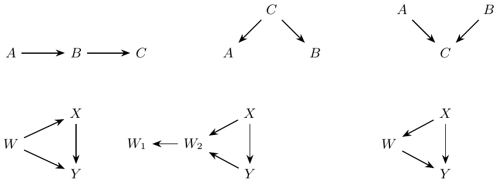
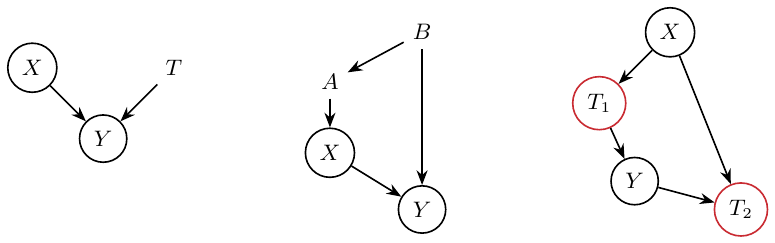
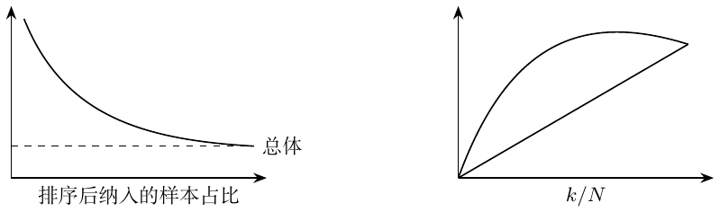
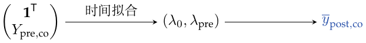
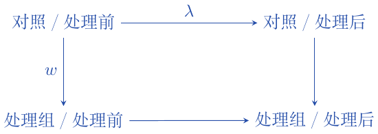
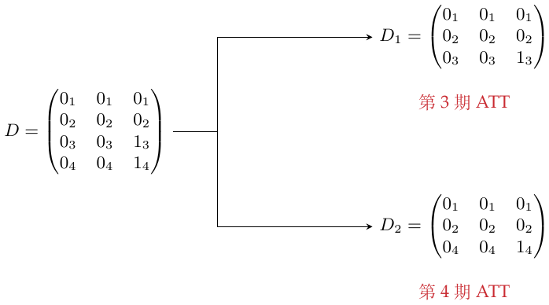
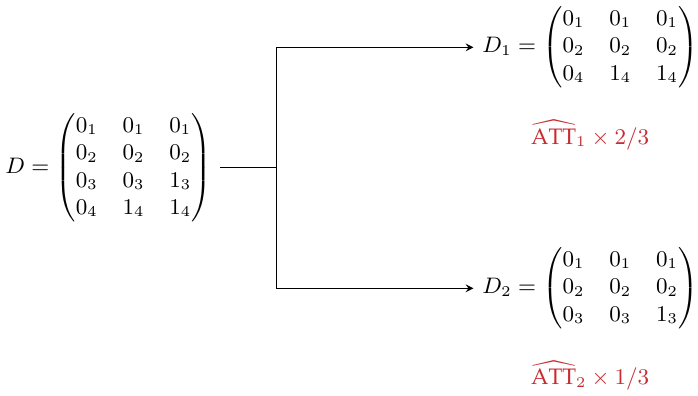
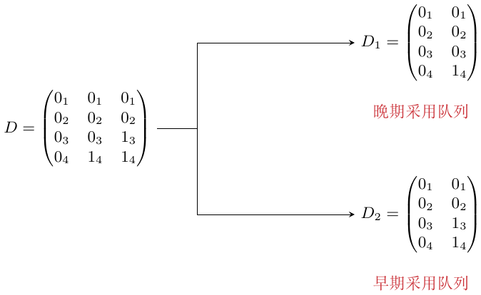

# 因果推断学习笔记：Brave and True

第 1–25 章与附录

Ming · 中文版

# 第1章：因果推断入门

$`T_i`$ 表示是否接受处理，$`Y_i`$ 是观测结果。我把实际分组与潜在结果所刻画的因果关系区分开。
``` math
\mathrm{ATE}=E[Y_1-Y_0],\qquad \mathrm{ATT}=E[Y_1-Y_0\mid T=1].
```
ATE 是平均处理效应；ATT 是已接受处理者的平均处理效应。因果量来自潜在结果之差。观测到的相关关系可分解为
``` math
\underbrace{E[Y\mid T=1]-E[Y\mid T=0]}_{\textcolor{blue}{\text{相关关系}}}
=\underbrace{E[Y_1-Y_0\mid T=1]}_{\textcolor{blue}{\mathrm{ATT}}}
+\underbrace{E[Y_0\mid T=1]-E[Y_0\mid T=0]}_{\textcolor{blue}{\text{偏差}}}.
```

> 偏差项为零时，相关关系给出 ATT。若还要进一步得到 ATE，处理者的平均效应必须等于总体平均效应；处理与两个潜在结果独立的随机分配是充分条件。
> ``` math
> \text{bias}=0\ \Longrightarrow\ \text{association}=\mathrm{ATT}
> \quad\xrightarrow{\ (Y_0,Y_1)\perp T\ }\quad \mathrm{ATE}.
> ```

# 第2章：随机实验

随机实验可以消除偏差。我的图解把需要消除的联系与需要研究的处理效应分开，并用 RCT 连接到所需的独立性条件。

<div class="center">



</div>

# 第3章：统计学回顾

对于独立同分布样本均值，估计标准误为 $`\mathrm{SE}=\hat\sigma/\sqrt n`$，其中
``` math
\hat\sigma^2=\frac{1}{N-1}\sum_i(x_i-\bar x)^2.
```
样本量更小 $`\Rightarrow`$ 标准误更大 $`\Rightarrow`$ 置信区间更宽。原假设是处理组与对照组的分布均值相等。两组各自的置信区间即使重叠，均值之差仍可能显著不为零。<span style="color: #244DA8">要区分两组均值各自的 95% 置信区间与两组均值之差。</span>

$`p`$ 值是在 $`H_0`$ 下，检验统计量至少与观测值一样极端的概率；这是抽样概率，并非 $`H_0`$ 为真的概率。95% 置信区间程序在重复抽样中有95%的区间覆盖固定的总体参数。在数据和方法不变时，置信水平更高 $`\Rightarrow`$ 区间更宽 $`\Rightarrow`$ 精度更低。显著性水平控制第一类错误的概率。

**我的直觉。** 若 $`p`$ 值很小，那么在 $`H_0`$ 下极不容易出现的数据却出现了，说明 $`H_0`$ 可能不对。<span style="color: #244DA8">把样本算出的 $`p`$ 值与理论上预先选定的显著性水平比较。</span>

# 第4章：图模型

$`A\to B`$ 表示 $`A`$ 影响 $`B`$。以下三节点图采用因果 Markov 性质，并假设没有其他开放路径。依赖关系描述通常的忠实情形：开放路径允许依赖，但效应抵消也可能使依赖消失。

1.  链：$`A\to B\to C`$。边际上 $`A\not\perp C`$；给定已知的中间变量 $`B`$ 后，路径被阻断：$`A\perp C\mid B`$。

2.  叉：$`A\leftarrow C\to B`$。未条件化时，$`A\not\perp B`$；给定 $`C`$ 后，$`A\perp B\mid C`$。

3.  碰撞点：$`A\to C\leftarrow B`$。边际上 $`A\perp B`$；给定 $`C`$ 后，$`A\not\perp B\mid C`$。

混杂偏差还可能涉及混杂因素的代理变量，以及不能直接测量的变量。

**我的总结。** 混杂偏差来自没有控制住的开放路径，例如 $`X\leftarrow W\to Y`$，同时存在 $`X\to Y`$。多余的条件化有两个不同问题：控制共同结果会打开路径，产生选择偏差；控制中介会阻断部分总因果效应，属于过度控制。例子中 $`X`$ 是教育，$`Y`$ 是工资，$`W`$ 是投资。碰撞点图为 $`X\to W_2\leftarrow Y`$、$`W_2\to W_1`$ 和 $`X\to Y`$，“投资”写在 $`W_1`$ 旁；中介图则是教育先影响 $`W`$，再影响工资，同时还有教育到工资的直接箭头。因此，以总效应为目标时，不应控制这个中介 $`W`$。

<div class="center">


链、叉、碰撞点；下方依次为混杂及两种不当控制。

</div>

# 第5章：线性回归的作用

对个体 $`i`$，设 $`Y_{1i}=Y_{0i}+k`$：这里考虑常数处理效应，目标是估计 $`k`$。一元回归为
``` math
Y_i=\beta_0+kT_i+u_i,\qquad \beta_1=\frac{\operatorname{Cov}(Y_i,T_i)}{\operatorname{Var}(T_i)}.
```
当 $`T`$ 随机分配时，两组均值之差就是 ATE，因此二元 $`T`$ 的总体回归系数也是 ATE。

<div class="center">



二元处理的两个拟合值相差 $`k`$，这里用 $`k<0`$ 示意。

</div>

多元回归把与 $`T_i`$ 相关的多个因素纳入：
``` math
y_i=\beta_0+kT_i+\underbrace{\beta_1X_{1i}+\cdots+\beta_KX_{Ki}}_{\textcolor{blue}{\text{辅助变量}}}+u_i.
```

> <span style="color: #244DA8">我的理解：先用 $`X`$ 预测 $`T`$，再取残差</span> $`\textcolor{blue}{\longrightarrow}`$ $`\widetilde T=(I-P_X)T`$：<span style="color: #244DA8">$`X`$ 解释不了的那部分 $`T`$</span>；$`X`$ 包含截距

残差化的处理变量提供了估计其回归系数时使用的变异：
``` math
k=\frac{\operatorname{Cov}(Y_i,\widetilde T_i)}{\operatorname{Var}(\widetilde T_i)}.
```
这里的协方差表达式对应总体线性投影；样本中的相应表达式为 $`\hat k=\widetilde T'Y/(\widetilde T'\widetilde T)`$。

本来需要多元回归，却漏掉变量而使用一元回归，会发生什么？考虑常数效应的线性模型
``` math
\mathrm{Wage}_i=\alpha+k\,\mathrm{Educ}_i+\underbrace{A_i'\beta}_{\textcolor{blue}{\text{能力项}}}+u_i.
```
在 $`\operatorname{Cov}(\mathrm{Educ},u)=0`$ 下，遗漏能力得到
``` math
\frac{\operatorname{Cov}(\mathrm{Wage}_i,\mathrm{Educ}_i)}{\operatorname{Var}(\mathrm{Educ}_i)}
=k+\underbrace{\beta'\delta_A}_{\textcolor{red}{\mathrm{OVB}}}.
```

> <span style="color: #244DA8">把能力 $`A`$ 对教育回归</span> $`\textcolor{blue}{\longrightarrow}`$ $`\delta_A`$：这一投影的系数向量

<span style="color: #C92B32">多出来的项就是遗漏变量偏差。</span> 在这个正确设定的线性模型下，纳入混杂变量就能消除这一遗漏变量项。

> RCT 切断处理与混杂因素的关系；回归则在比较时控制这些因素，使其固定。

这里的因果解释使用了已说明的常数效应模型和外生性。若存在效应异质性，或调整模型并不合适，调整后的回归系数不一定等于未加权的 ATE。

# 第6章：分组与虚拟变量回归

异方差是指在不同协变量取值下，结果的方差不相同。分组越细，组内样本越少；分组减少变异，但系数标准误可能增大，$`t`$ 统计量变小。把分组回归合为共同处理系数时，组的样本占比与组内处理方差都进入权重。

处理为虚拟变量时（例如是否达到12年教育），
``` math
\mathrm{wage}_i=\beta_0+\beta_1T_i+e_i.
```
$`T=0`$ 时，期望等于截距；$`T=1`$ 时，等于截距加 $`\beta_1`$。IQ 为连续变量时，
``` math
\mathrm{wage}_i=\beta_0+\beta_1T_i+\beta_2\mathrm{IQ}_i+\beta_3\mathrm{IQ}_iT_i+e_i.
```

> - $`\beta_0`$：$`T=0`$、IQ $`=0`$ 时的期望。
>
> - $`\beta_1`$：IQ 为零时，$`T`$ 增加一单位的影响（其他项均为零）。
>
> - $`\beta_2`$：$`T=0`$ 时，IQ 增加一单位的影响。
>
> - $`\beta_3`$：$`T=1`$ 时 IQ 也有回报；当 $`\beta_3>0`$，这一组的回归斜率更大。

分析 $`T_i`$ 的系数，需要算各组对总系数的贡献：按教育年限分组（例如12年），求相应的类别教育／处理差异 $`C(\mathrm{educ})[T_i]`$。

有更多协变量时，目标系数是各虚拟变量子组效应的加权平均：
``` math
E\!\left[\{E[Y_i\mid T=1,G_i]-E[Y_i\mid T=0,G_i]\}\,w(G_i)\right],\qquad
w(g)=\frac{v_g}{E[v_G]},\quad v_g=\operatorname{Var}(T\mid G=g).
```
<span style="color: #244DA8">权重取决于子组内 $`T_i`$ 的分布。还要计算教育分组和 IQ 分箱的处理差异。</span>

在各组分别有截距、共用一个斜率的回归中，归一化后的系数为 $`\sum_gP(G=g)v_g\tau_g/\sum_gP(G=g)v_g`$。组内调整有效时才有因果解释；这个方差加权效应不一定等于通常的 ATE。

# 第7章：控制混杂因素之外

本章讨论控制特定变量的后果。在 $`X\to Y\leftarrow T`$ 中，研究 $`X\to Y`$ 时控制 $`T`$，可以把 $`X`$ 的作用看得更清楚，降低其估计方差。第二幅图是 $`B\to A\to X\to Y`$ 及 $`B\to Y`$：$`B`$ 同时与 $`X`$、$`Y`$ 相关；控制 $`B`$ 后，$`A`$ 是 $`X`$ 的额外预测变量。<span style="color: #244DA8">加入 $`A`$ 可能减少 $`X`$ 剩余的变异，使其系数估计方差增大。</span>
``` math
\hat\sigma^2=\frac{1}{n-2}\sum_i(y_i-\hat y_i)^2,\qquad
\widehat{\operatorname{Var}}(\hat\beta_2)=\frac{\hat\sigma^2}{\sum_i(x_i-\bar x)^2}.
```
同方差一元 OLS 的标准误为 $`\widehat{\mathrm{SE}}(\hat\beta_2)=\hat\sigma/\sqrt{\sum_i(x_i-\bar x)^2}`$。<span style="color: #244DA8">样本变化越大，标准误越小。</span> 多元回归要使用控制其他变量后的残差变异，以及相应的残差自由度。

没有控制共同原因而产生的是混杂偏差；控制共同结果可能产生选择偏差；控制中介则会阻断部分总效应。

#### 不当控制与参与行为。

若处理影响结果是否为零，RCT 下均值之差具有因果解释。当 $`Y\ge0`$ 时，可将均值差分为参与部分与正结果条件均值部分：
``` math
\begin{aligned}
E[Y\mid T=1]-E[Y\mid T=0]
={}&\{P(Y>0\mid T=1)-P(Y>0\mid T=0)\}E[Y\mid Y>0,T=1]\\
&+\{E[Y\mid Y>0,T=1]-E[Y\mid Y>0,T=0]\}P(Y>0\mid T=0).
\end{aligned}
```
<span style="color: #244DA8">第一部分是结果为正的概率变化，并区分顾客“是否参与”和“消费能力”。</span> 只分析参与者时，

> 
> ``` math
> \begin{aligned}
> E[Y_{i1}\mid Y_{i1}>0]-E[Y_{i0}\mid Y_{i0}>0]
> ={}&\underbrace{E[Y_{i1}-Y_{i0}\mid Y_{i1}>0]}_{\text{参与者中的因果效应}}\\
> &+\underbrace{E[Y_{i0}\mid Y_{i1}>0]-E[Y_{i0}\mid Y_{i0}>0]}_{\text{选择偏差}}.
> \end{aligned}
> ```
> 最后一项比较两种人群的未处理潜在结果：会在处理下参与者，与会在未处理下参与者。上面的代数分量不会仅因处理随机化就分别成为因果效应。

配图为 $`X\to T_1\to Y\to T_2`$，另有 $`X\to T_2`$。<span style="color: #C92B32">$`T_1,T_2`$ 用红色标为不当选择／控制：“不要控制！”</span>

<div class="center">


改善精度的控制、处理变量的预测因素，以及红圈标出的不当控制。

</div>

# 第8章：工具变量

假设
``` math
Y_i=\beta_0+kT_i+\beta W_i+u_i,
```
其中 $`T`$ 是处理，$`W`$ 是混杂变量。当 $`W_i`$ 不可观测时，拟合 $`Y_i=\beta_0+kT_i+v_i`$，其中 $`v_i=\beta W_i+u_i`$。此时 $`\operatorname{Cov}(T,v)\ne0`$，所以 $`k`$ 的估计有偏。<span style="color: #244DA8">未观测项携带着联系 $`T`$、$`Y`$ 的信息。</span>

引入工具变量 $`Z`$：它与 $`T`$ 相关，只通过 $`T`$ 影响 $`Y`$，且 $`\operatorname{Cov}(Z,v)=0`$。图为 $`Z\to T\to Y`$、$`W\to T`$、$`W\to Y`$。因此
``` math
\begin{aligned}
\operatorname{Cov}(Z,Y)&=\operatorname{Cov}(Z,\beta_0+kT+v)\\
&=k\operatorname{Cov}(Z,T)+\operatorname{Cov}(Z,v)=k\operatorname{Cov}(Z,T),\\
k&=\frac{\operatorname{Cov}(Z,Y)}{\operatorname{Cov}(Z,T)}
=\frac{\operatorname{Cov}(Y,Z)/\operatorname{Var}(Z)}{\operatorname{Cov}(T,Z)/\operatorname{Var}(Z)}.
\end{aligned}
```
分子、分母都是回归系数。<span style="color: #244DA8">分子是简约式（reduced form）系数：$`Z`$ 只经过 $`T`$ 对 $`Y`$ 产生的影响。</span>

**我的微积分直觉。**
``` math
k=\frac{dY/dZ}{dT/dZ}=\frac{dY}{dZ}\frac{dZ}{dT}=\frac{dY}{dT}.
```
若工具变量是二元的，Wald 估计量为
``` math
k=\frac{E[Y\mid Z=1]-E[Y\mid Z=0]}{E[T\mid Z=1]-E[T\mid Z=0]}.
```
我的理解是：把 $`Z\to Y`$ 的变化换算回 $`T\to Y`$ 的作用。

#### 工具变量的使用。

例子中，$`Z_0`$ 是出生季度，$`T`$ 是教育，$`W`$ 是能力，$`Y`$ 是工资。相关性 $`\operatorname{Cov}(Z,T)\ne0`$ 可从第一阶段检查。<span style="color: #C92B32">我后来的修正：“$`Z`$ 只通过 $`T`$ 影响 $`Y`$”是排除限制，不是 $`Y\perp Z\mid T`$；第9章用潜在结果重新表述。</span> 给定 $`T`$ 反而可能打开碰撞路径 $`Z\to T\leftarrow W\to Y`$。

先回归 $`T\sim Z_0`$，检查第一阶段关系；再回归 $`Y\sim Z_0`$，看简约式关系。方法一是取两个回归系数之比。方法二是 2SLS：

1.  将 $`T`$ 对 $`Z_0,Z_1,Z_2`$ 回归。

2.  将 $`Y`$ 对拟合后的 $`T`$ 及 $`Z_1,Z_2`$ 回归：
    ``` math
    Y\sim\underbrace{\widehat T}_{\text{用 }Z_0,Z_1,Z_2\text{ 拟合}}+Z_1+Z_2.
    ```

<span style="color: #244DA8">公式接口可以指定 $`T\sim Z_0`$，因为其他项会在第二阶段自动加入。</span> 用作比较的 OLS 写作 $`Y\sim T+C(Z_0,Z_1,Z_2)`$。

第一阶段很弱时，IV 估计会不精确。在工具变量有效、足够强且数量固定的常规渐近设定下，2SLS 可以一致，而 OLS 仍不一致。有限样本中的 2SLS 可能偏向 OLS；加入过多弱工具变量会加重这一问题，不能仅凭工具数量增加就认为偏差单调下降。

<div class="center">


工具变量、处理、混杂因素与结果。

</div>

导数约分是我对可微单一路径的直觉；本节常斜率模型的依据是上面的协方差推导。两阶段设定中的 $`Z_1,Z_2`$ 是纳入的外生控制变量，两个阶段都要保留。

# 第9章：不依从与局部平均处理效应

依从者（compliers）服从分配；从不接受者（never-takers）始终不接受处理；总是接受者（always-takers）始终接受处理；违抗者（defiers）则反着做。在 $`Z\to T\to Y`$、$`W\to T`$ 和 $`W\to Y`$ 中，从不接受者与总是接受者削弱第一阶段。<span style="color: #244DA8">例如从不接受者会把简约式中的结果差异拉向对照状态。</span>

现在潜在结果有两个自变量：$`Y_i(t,z)`$；笔记以 $`T_i=1,Z_i=0`$ 时的 $`Y_i(1,0)`$ 为例。潜在处理 $`T_{0i}`$ 对应 $`Z_i=0`$。

#### IV 假设。

1.  $`(Y_{i0},Y_{i1},T_{0i},T_{1i})\perp Z_i`$. 工具变量各组的潜在结果与潜在处理具有可比性。

2.  排除限制：$`Y_i(1,0)=Y_i(1,1)=Y_{i1}`$，$`Y_i(0,0)=Y_i(0,1)=Y_{i0}`$。工具变量只能通过处理影响结果。

3.  $`E[T_{1i}-T_{0i}]\ne0`$：存在第一阶段，工具变量确实会影响处理。

4.  单调性：几乎处处 $`T_{1i}\ge T_{0i}`$。存在依从者，所以 $`P(T_{1i}>T_{0i})>0`$。

#### 推导 Wald 目标量。

考虑 Wald 比值：
``` math
\frac{E[Y\mid Z=1]-E[Y\mid Z=0]}{E[T\mid Z=1]-E[T\mid Z=0]}.
```
利用排除限制和随机分配，
``` math
\begin{aligned}
E[Y_i\mid Z_i=1]&=E[Y_{i0}+T_{i1}(Y_{i1}-Y_{i0})\mid Z_i=1]\\
&=E[Y_{i0}+T_{i1}(Y_{i1}-Y_{i0})],\\
E[Y_i\mid Z_i=0]&=E[Y_{i0}+T_{i0}(Y_{i1}-Y_{i0})].
\end{aligned}
```
分子为
``` math
\begin{aligned}
E[(Y_{i1}-Y_{i0})(T_{i1}-T_{i0})]
=E[Y_{i1}-Y_{i0}\mid T_{i1}>T_{i0}]P(T_{i1}>T_{i0}),
\end{aligned}
```
分母为 $`E[T_{i1}-T_{i0}]=P(T_{i1}>T_{i0})`$。所以比值为
``` math
E[Y_{i1}-Y_{i0}\mid T_{i1}>T_{i0}].
```
<span style="color: #C92B32">这个平均处理效应有一个条件：依从。因此它是 LATE，而非总体 ATE。</span> IV 只识别依从者的处理效应。依从者满足 $`T_{i1}>T_{i0}`$；从不接受者满足 $`T_{i1}=T_{i0}=0`$；总是接受者满足 $`T_{i1}=T_{i0}=1`$；违抗者与分配方向相反。

# 第10章：匹配

按混杂因素分组估计 ATE 时，对各组处理效应加权。按样本量加权会更偏向大组，即使该组的处理变异很小；这里标为“非参数估计”。<span style="color: #244DA8">按方差加权时，方差较大的组权重更大；这与线性、参数回归更强调高变异协变量的做法相联系。</span>

#### 分层。

如果 $`X`$ 造成混杂，就把 $`X`$ 相同的观测分在一组。在 $`(Y_0,Y_1)\perp T\mid X`$、一致性与重叠性下，
``` math
\begin{aligned}
\mathrm{ATE}&=\int\{E[Y\mid X=x,T=1]-E[Y\mid X=x,T=0]\}\,dP(x),\\
\widehat{\mathrm{ATE}}&=\sum_{k=1}^{K}(\bar Y_{k1}-\bar Y_{k0})\frac{N_k}{N}.
\end{aligned}
```
<span style="color: #244DA8">在协变量取值 $`\{x_1,\ldots,x_K\}`$ 上取平均。</span>

#### 匹配估计量。

用观测之间的距离定义相似程度，再比较接受不同处理的相似／邻近个体。<span style="color: #C92B32">K 近邻。</span><span style="color: #244DA8">定义距离时，对坐标作标准化：$`(x_i-\bar x)/\sqrt{\operatorname{Var}(x)}`$。</span>
``` math
\widehat{\mathrm{ATE}}=\frac1N\sum_i(2T_i-1)(Y_i-Y_{j(i)}).
```
<span style="color: #244DA8">$`j(i)`$ 是另一个处理组中与 $`i`$ 最相似的观测。</span><span style="color: #C92B32">$`2T_i-1`$ 根据个体所属的处理组调整正负号。</span>

#### 匹配偏差及修正。

对处理组，考虑
``` math
\widehat{\mathrm{ATET}}=\frac1{N_1}\sum_{i:T_i=1}(Y_i-Y_{j(i)}),\qquad
\textcolor{blue}{\mu_0(x)=E[Y\mid X=x,T=0]}.
```
中心化偏差写作
``` math
B_N=\frac1{N_1}\sum_{i:T_i=1}\{\mu_0(X_i)-\mu_0(X_{j(i)})\},\qquad \sqrt{N_1}B_N,
```
它不一定趋于零。<span style="color: #244DA8">乘上 $`\sqrt{N_1}`$ 会把偏差放大。</span><span style="color: #244DA8">我比较的是 $`X_i`$ 对应个体未处理的潜在结果（因为 $`i`$ 已接受处理，所以是反事实）与 $`X_j`$ 对应个体实际观测到的未处理结果；用 $`X_i\approx X_j`$ 希望二者未处理结果也接近。</span> 减去这个偏差的估计：
``` math
\widehat{\mathrm{ATET}}_{\mathrm{bc}}=
\frac1{N_1}\sum_{i:T_i=1}\left[(Y_i-Y_{j(i)})-
\{\hat\mu_0(X_i)-\hat\mu_0(X_{j(i)})\}\right].
```
<span style="color: #244DA8">$`\hat\mu_0`$ 可以用最小二乘等方法估计。</span> 局部 LS 修正不改变匹配估计量原本的目标。

**维数灾难。** 协变量越多，匹配距离越大，因为每个小格子里的观测更少。

偏差修正依赖重叠性、光滑性和恰当的回归逼近。样本占比权重针对 ATE，方差权重一般对应另一种平均效应。

# 第11章：倾向得分

处理混杂偏差的另一种办法是倾向得分 $`p(X)=P(T=1\mid X)`$。图中连接 $`X\to p(X)\to T\to Y`$，并有 $`X\to Y`$。二元处理的平衡恒等式为
``` math
E[T\mid p(X),X]=E[T\mid p(X)].
```
若 $`(Y_0,Y_1)\perp T\mid X`$，这个平衡性质使调整可缩减到 $`p(X)`$：$`(Y_0,Y_1)\perp T\mid p(X)`$。识别两个处理状态的均值还需 $`0<p(X)<1`$ 的重叠性。

**我的例子。** 两个人，一个已处理，一个未处理。若接受处理的概率相同，即使他们的 $`X`$ 不同，可在这一得分组内比较；这里平衡的是分布，并非保证这一对个体的潜在结果相同。
``` math
\begin{aligned}
E[T\mid p(X),X]&=E[T\mid X]=p(X), &&\text{因为 }p(X)\text{ 是 }X\text{ 的函数},\\
E[T\mid p(X)]&=E[E[T\mid p(X),X]\mid p(X)]\\
&=E[p(X)\mid p(X)]=p(X).
\end{aligned}
```

#### 逆倾向加权（IPW）。

条件差异可以改写为
``` math
\begin{aligned}
E[Y\mid X,T=1]-E[Y\mid X,T=0]
={}&p(X)E\!\left[\frac{Y}{p(X)}\,\middle|\,X,T=1\right]\\
&-\{1-p(X)\}E\!\left[\frac{Y}{1-p(X)}\,\middle|\,X,T=0\right].
\end{aligned}
```
<span style="color: #244DA8">?</span>**我的理解。** 我们观测到个体 $`i`$ 接受了处理，但 $`i`$ 接受处理的概率只有由 $`X`$ 决定的 $`p(X_i)`$。给每个观测到的处理个体乘上 $`1/p(X_i)`$ 来修正。若 $`p(X_i)`$ 很小，该观测在未加权的结果分布中占比不足，就用概率倒数提高其代表性。$`T=1`$ 和 $`T=0`$ 的权重分别为 $`1/p(X)`$ 与 $`1/(1-p(X))`$。这样重建“人人都处理”的总体（$`Y_1`$）和“人人都不处理”的总体（$`Y_0`$），两者之差就是 ATE。

结果的加权离散程度为
``` math
\hat\sigma_w^2=\frac{\sum_{i=1}^n w_i(Y_i-\hat\mu)^2}{\sum_{i=1}^n w_i}.
```
但倾向得分估计 $`\hat p(X)`$ 本身也有误差。随意加入并非混杂因素的协变量，可能使倾向得分估计变得非常不稳定。已处理者估计出的处理概率可能高于未处理者。我的提醒是：权重很大，例如超过二十，会增大方差；二十是实践提醒，并非通用阈值。上面的加权离散程度不是 IPW ATE 估计量的抽样方差。

#### 倾向得分匹配。

用 $`p(X)`$ 替代原本的匹配距离。我在这里的担心是：这是否真正改善因果比较？处理预测更准确，不一定使因果估计更好，反而可能增加方差。处理组与未处理组的倾向得分分布若缺乏重叠，匹配就会有问题。

<div class="center">


倾向得分调整：在所述假设下联系平衡与条件可交换性。

</div>

# 第12章：双重稳健估计

在一致性、条件可交换性与重叠性下，结合结果回归与倾向加权，再对 $`X`$ 取平均：
``` math
\begin{aligned}
\widehat{\mathrm{ATE}}={}&\frac1N\sum_i\left[\frac{T_i\{Y_i-\hat\mu_1(X_i)\}}{\hat p(X_i)}+\hat\mu_1(X_i)\right]\\
&-\frac1N\sum_i\left[\frac{(1-T_i)\{Y_i-\hat\mu_0(X_i)\}}{1-\hat p(X_i)}+\hat\mu_0(X_i)\right].
\end{aligned}
```
其中 $`\hat p(X)`$ 估计倾向得分（例如用 logistic 回归），$`\hat\mu_1(X)`$ 和 $`\hat\mu_0(X)`$ 分别估计 $`E[Y\mid X,T=1]`$ 和 $`E[Y\mid X,T=0]`$。<span style="color: #244DA8">第一个平均估计 $`E[Y_1]`$，第二个估计 $`E[Y_0]`$。一致性要求倾向模型或两个处理状态的结果回归这一组模型正确，并恰当控制估计误差。</span>

> **我的代数解释。** 对 $`E[Y_1]`$，
> ``` math
> \widehat E[Y_1]=\frac1N\sum_i\left[\frac{T_i\{Y_i-\hat\mu_1(X_i)\}}{\hat p(X_i)}+\hat\mu_1(X_i)\right].
> ```
> 若 $`\hat p`$ 错了，但 $`\hat\mu_1`$ 正确：$`T_i=0`$ 时第一项为零，$`T_i=1`$ 时它的均值为零，所以剩下回归预测。抵消依赖条件期望：对非零的候选倾向函数 $`q`$，$`E[T\{Y-\mu_1(X)\}/q(X)\mid X]=0`$。
>
> 也可以改写为
> ``` math
> \widehat E[Y_1]=\frac1N\sum_i\left[\frac{T_iY_i}{\hat p(X_i)}-\frac{T_i-\hat p(X_i)}{\hat p(X_i)}\hat\mu_1(X_i)\right].
> ```
> 若结果模型错误、倾向模型正确，则给定 $`X_i`$ 时 $`T_i-\hat p(X_i)`$ 的均值为零，修正项的期望因此消失。

我的实践偏好是尽量用 DRE 把两类模型结合起来；识别假设和数据质量仍要检查。

# 第13章：双重差分

双重差分用于评估宏观干预的效果。$`D`$ 表示处理，$`T`$ 表示时间；$`Y_D(T)`$ 是在时期 $`T`$、处理状态 $`D`$ 下的潜在结果。

#### 两种比较及其问题。

处理组的目标为 $`E[Y_1(1)-Y_0(1)\mid D=1]`$，即比较同一时期处理与未处理的结果；其中 $`Y_0(1)`$ 是反事实。处理前，$`E[Y_1(0)\mid D=1]=E[Y_0(0)\mid D=1]`$。前后比较用干预前的结果代替干预后未处理的结果；但若有时间趋势，这两个未处理潜在结果未必相同。

在干预后作处理组／对照组比较：
``` math
E[Y(1)\mid D=1]-E[Y(1)\mid D=0].
```
它用对照组干预后的未处理结果估计处理组的反事实。<span style="color: #244DA8">我在这里提醒自己：这种比较也可能失败。</span>

将两种比较结合：
``` math
\begin{aligned}
\widehat{\mathrm{ATET}}={}&\{E[Y(1)\mid D=1]-E[Y(1)\mid D=0]\}\\
&-\{E[Y(0)\mid D=1]-E[Y(0)\mid D=0]\}.
\end{aligned}
```
<span style="color: #244DA8">等价地，实验组的“后减前”，再减去对照组的“后减前”。线性模型纳入处理与时间的交互项，估计其不确定性，并检查平行趋势。</span>

识别条件是未处理结果的均值趋势平行：
``` math
E[Y_0(1)-Y_0(0)\mid D=1]=E[Y_0(1)-Y_0(0)\mid D=0].
```
再结合无预期效应、一致性、无溢出和可比的群体构成，可识别 ATT。检查前期趋势有帮助，但不能证明未来的反事实趋势。

# 第14章：面板数据与固定效应

面板数据在多个时间反复观测同一单位。固定个体身份后，可用个体固定效应消除加性且不随时间变化的特征。

回顾 DID。对处理城市，干预后的未处理反事实可用“其干预前未处理结果 + 未处理城市随时间的变化”估计：
``` math
E[Y_0(1)\mid D=1]=E[Y_0(0)\mid D=1]+E[Y_0(1)-Y_0(0)\mid D=0].
```

于是 $`\widehat{\mathrm{ATT}}=\widehat E[Y_1(1)\mid D=1]-\widehat E[Y_0(1)\mid D=1]`$：第一项已知，第二项估计。例子旁注提到在 DMA 投放广告的效果。

平行趋势约束的是前述未处理均值的变化，并非每个个体潜在结果的恒等式。面板模型为
``` math
y_{it}=\beta X_{it}+\gamma U_i+e_{it}.
```
<span style="color: #244DA8">$`y_{it}`$ 是单位 $`i`$ 在时期 $`t`$ 的结果，$`X_{it}`$ 随时间变化，$`U_i`$ 无法观测且不随时间变化。</span>

#### 面板数据的局限。

> 面板数据不能解决反向因果：原因和结果互相增强，固定效应无法控制这种关系。它也不能消除随时间变化的未观测混杂因素。

#### 线性面板模型的残差化。

对于两组特征 $`X_1,X_2`$，
``` math
\hat y=X_1\hat\beta_1+X_2\hat\beta_2.
```
特征矩阵以观测为行、特征为列。

1.  将 $`y`$ 对第二组特征回归：$`\hat y^*=P_{X_2}Y`$。

2.  将 $`X_1`$ 对 $`X_2`$ 回归：$`\hat X_1=P_{X_2}X_1`$。

3.  取残差 $`\widetilde X_1=X_1-\hat X_1`$ 和 $`\widetilde y=y-\hat y^*`$。

4.  将结果残差对特征残差回归，得到 $`X_1`$ 的系数。

#### 组内变换（within transformation）。

计算 $`\ddot Y_{it}=Y_{it}-\bar Y_i`$ 和 $`\ddot X_{it}=X_{it}-\bar X_i`$，再将 $`\ddot Y_{it}`$ 对 $`\ddot X_{it}`$ 回归。因为 $`\bar U_i=U_i`$，固定效应消失：
``` math
\begin{aligned}
Y_{it}&=\beta X_{it}+\gamma U_i+e_{it},\\
\bar Y_i&=\beta\bar X_i+\gamma\bar U_i+\bar e_i,\\
Y_{it}-\bar Y_i&=\beta(X_{it}-\bar X_i)+\gamma(U_i-\bar U_i)+(e_{it}-\bar e_i),\\
\ddot Y_{it}&=\beta\ddot X_{it}+\ddot e_{it}.
\end{aligned}
```
<span style="color: #244DA8">这样去掉了所有不随时间变化的未观测特征。</span> 对通胀等时间效应，可为每个时期加入一个虚拟变量；随时间变化的因素也可能重要。个体内去均值后的变量总和为零；这一中心化恒等式对时变变量也成立。固定特征消失，是因为其每个去均值值都为零。因果解释仍需外生性，通常为 $`E[e_{it}\mid X_{i1},\ldots,X_{iT},U_i]=0`$。

图中画了多条平行的“购买量—成本”直线。固定效应模型给每个城市拟合一条线，并假定不同条件下的因果效应相同。

<div class="center">


各城市内部平行的购买量—成本直线，保留蓝色。

</div>

# 第15章：合成控制

若找不到与处理城市或州相似的单个对照单位，就把多个未处理单位组合为合成对照。城市、州的聚合数据本身也可以组成面板。因果比较需要供体未受处理、无预期效应或溢出，并有可信的稳定关系连接干预前后的未处理结果。

共有 $`J+1`$ 个单位。单位1接受处理，$`2,\ldots,J+1`$ 未接受处理，组成供体库。$`Y_{jt}^{I}`$、$`Y_{jt}^{N}`$ 是单位 $`j`$ 在时间 $`t`$ 有干预和无干预的潜在结果。处理从 $`T_0`$ 开始。对 $`t>T_0`$，
``` math
\tau_{1t}=Y_{1t}^{I}-Y_{1t}^{N}.
```
<span style="color: #244DA8">已处理结果是事实，未处理结果是反事实；效应是时间的函数。</span> 给定权重 $`W=(w_2,\ldots,w_{J+1})`$，
``` math
\widehat Y_{1t}^{N}=\sum_{j=2}^{J+1}w_jY_{jt}.
```
<span style="color: #244DA8">可用回归选择这些权重：最小化干预前处理单位与供体加权平均之间的平方距离。</span>

#### 把合成控制看作回归。

用供体州构建一个虚拟加州。矩阵以年份为行、州为列，元素为香烟销量。将加州序列设为 $`Y`$，其他州序列设为 $`X`$，回归 $`Y\sim X`$。例子中的权重有 $`-0.436`$ 和 $`-0.032`$（39个州对应39个权重）。<span style="color: #244DA8">它们的加权和就是虚拟州，权重的选择使虚拟州与处理州尽量接近。</span>

> 这样可能过拟合：虚拟州在干预前几乎与加州重合，干预后却剧烈波动。供体序列较多时，可考虑用 Ridge 或 Lasso 正则化回归。

#### 避免外推。

前述过拟合归因于外推：权重把观测推到了数据范围以外。施加凸组合约束。合成控制仍为 $`\widehat Y_{1t}^{N}=\sum_{j=2}^{J+1}w_jY_{jt}`$，但选择 $`W`$ 来最小化
``` math
\|X_1-X_0W\|_V=
\left\{\sum_{h=1}^{k}v_h\left(X_{h1}-\sum_{j=2}^{J+1}w_jX_{hj}\right)^2\right\}^{1/2},
\qquad w_j\ge0,\quad\sum_{j=2}^{J+1}w_j=1.
```
两幅图分别画出：从供体点无约束外推到三角形外的处理点；以及将拟合限制在供体凸包内。

$`v_h`$ 反映各变量在匹配处理单位和合成控制时的重要性；不同 $`v_h`$ 会得到不同权重。可把各变量标准化为均值零、方差一，或给更能预测 $`Y`$ 的变量更高权重。这里的实现给各变量同等重要性：定义损失函数，用 SciPy 做二次优化，要求权重和为一，并将每个权重限制在 $`[0,1]`$。这个例子的权重较稀疏，且和为一（示例向量含多个零及一个约为 $`0.3852`$ 的元素）。

#### 显著性与安慰剂比较。

采用受置换检验启发的安慰剂比较。对39个州逐一重新拟合合成控制、估计效应。加州给出真实干预的估计，其他州给出安慰剂效应。若没有处理的州也出现很大效应，就有问题。干预后的变异大于干预前；一些单位在干预前就拟合不好，应剔除。对所有分配统一应用前期拟合阈值：
``` math
\mathrm{MSE}=\frac1N\sum_t(Y_t-\widehat Y_t^{\mathrm{synth}})^2.
```
算出各州效应后，再计算
``` math
p=\frac1{J_{\rm eligible}}\sum_{j\in\mathcal E}\mathbf1\{\hat\tau_j\le\hat\tau_{\mathrm{California}}\},
```
其中 $`\mathcal E`$ 包括所有合格分配及实际分配。加州效应为负，所以数的是至少同样负的效应。<span style="color: #244DA8">例子中，加州相对于安慰剂效应显得很极端。</span> 称它为精确 $`p`$ 值还需分配机制或可交换性依据；在观察研究中，安慰剂排名本身是一种诊断。凸权重限制外推，却不保证反事实拟合正确。

<div class="center">


外推与凸包约束的几何示意。

</div>

# 第16章：断点回归设计

一个断点能告诉我们什么效应？令 $`R`$ 为驱动变量，在阈值 $`c`$ 处不连续地分配处理：
``` math
D_i=\mathbf1\{R_i>c\}.
```
<span style="color: #244DA8">低于 $`c`$ 时处理为零，高于 $`c`$ 时处理为一。</span> 因而 $`R>c`$ 时观测 $`Y_1`$，$`R<c`$ 时观测 $`Y_0`$。图中潜在结果曲线 $`Y_1,Y_0`$ 光滑，观测曲线在阈值处从 $`Y_0`$ 切换到 $`Y_1`$。例子画年龄与所有死亡／机动车死亡／自杀之间的关系，寻找断点。

若两个潜在结果的均值在阈值处连续，且两侧都有支持，左右极限相同，例如
``` math
\lim_{r\to c^-}E[Y_{1i}\mid R_i=r]=\lim_{r\to c^+}E[Y_{1i}\mid R_i=r].
```
因此观测结果的跳跃识别
``` math
\begin{aligned}
&\lim_{r\to c^+}E[Y_i\mid R_i=r]-\lim_{r\to c^-}E[Y_i\mid R_i=r]\\
&\quad=\lim_{r\to c^+}E[Y_{1i}\mid R_i=r]-\lim_{r\to c^-}E[Y_{0i}\mid R_i=r]\\
&\quad=E[Y_{1i}-Y_{0i}\mid R_i=c].
\end{aligned}
```
这是阈值处的 ATE。<span style="color: #244DA8">我的直觉：断点附近的比较很接近局部随机实验。</span> 连续性论证本身并不意味着真的随机分配。

先中心化驱动变量 $`r_i=R_i-c`$，再允许断点两侧有不同斜率：
``` math
y_i=\beta_0+\beta_1r_i+\beta_2\mathbf1\{r_i>0\}+\beta_3\mathbf1\{r_i>0\}r_i.
```
<span style="color: #244DA8">低侧直线对应前一部分，高侧加上指示项和交互项。</span> 这时把 $`\beta_0`$ 看作左极限，$`\beta_0+\beta_2`$ 看作右极限，$`\beta_2`$ 看作断点效应。用标准误判断显著性。

#### 核加权。

RDD 很依赖线性回归的外推。拟合可能过于照顾远处观测，反而在断点处拟合不好。应给距离阈值更近的观测更高权重。三角核为
``` math
K(R,c,h)=\mathbf1\{|R-c|<h\}\left(1-\frac{|R-c|}{h}\right).
```
<span style="color: #244DA8">指示函数只保留 $`c\pm h`$ 内的观测，第二个因子随离 $`c`$ 的距离增加而减小。使用 WLS，即加权最小二乘。</span>

#### 模糊断点回归。

在阈值处，处理不一定确定地改变，而是处理概率跳跃。把是否跨过阈值作为 IV。在局部排除与外生性、非零第一阶段、连续性和单调性 $`T_{1i}\ge T_{0i}`$ 下，结果跳跃等于第一阶段跳跃乘依从者效应。Wald 比值为
``` math
\frac{\lim_{r\to c^+}E[Y_i\mid R_i=r]-\lim_{r\to c^-}E[Y_i\mid R_i=r]}
{\lim_{r\to c^+}E[T_i\mid R_i=r]-\lim_{r\to c^-}E[T_i\mid R_i=r]}
=E[Y_{1i}-Y_{0i}\mid T_{1i}>T_{0i},R_i=c].
```

较大的 $`p`$ 值表示数据没有提供强烈的拒绝原假设证据，不能据此判定效应很小。应同时看估计值和区间。McCrary 检验查看驱动变量密度在阈值处是否不连续，以诊断可能的操纵；它不检验所有 RD 假设。

<div class="center">


左为清晰 RD；右上为模糊 RD 的处理跳跃，右下为结果跳跃。黑色表示潜在关系，红色表示观测断点。

</div>

# 第二部分：应用

# 第17章：预测模型基础

机器学习估计 $`E[Y\mid X]`$，即给定 $`X`$ 的结果期望，得到 $`\widehat E[Y\mid X]`$。模型过于复杂就会过拟合。交叉验证要把训练数据、测试数据和未见过的数据区分开。还要区分预测与策略。相关概念还有估计量和极大似然。

<span style="color: #244DA8">$`R^2`$ 用于评价连续结果模型，描述模型解释了多少结果变异。</span> 结果不是常数时，范围为 $`(-\infty,1]`$，并提醒它衡量相对于均值预测的表现。<span style="color: #244DA8">树越深，训练集 $`R^2`$ 越高，但测试集 $`R^2`$ 可能下降，这就是过拟合。</span>

`pandas.qcut` 按预测值的分位数分箱，也就是模型分群。更细的策略从“是否参与”的阈值决定，走向“投入多少”的连续选择。

# 第18章：异质处理效应与个性化

与普通预测不同，目标是进行干预并预测其效果。令 $`X`$ 包含处理前特征（例如过去销量），$`T`$ 为价格。策略目标是 $`\arg\max_t E[Y(t)\mid X=x]`$。在一致性、条件可交换性和重叠性下，可从 $`E[Y\mid X=x,T=t]`$ 学习它。

从 ATE 转向 CATE。二元处理的 ATE 为 $`E[Y_1-Y_0]`$；连续处理时，用 $`E[y'(t)]`$，即结果对处理的导数。相应的条件版本为
``` math
E[Y_1-Y_0\mid X],\qquad E[y'(t)\mid X].
```

> **我的批注。** 加上条件 $`X`$，对每个 $`X`$ 分别求期望，再制定个性化策略。

这里把敏感度非正式地称为“弹性”，即估计 $`\partial Y_i/\partial T_i`$，近似为
``` math
\frac{Y(T_i)-Y(T_i+\varepsilon)}{T_i-(T_i+\varepsilon)}.
```
但同一个人的这两个结果不能同时观测，这就是因果推断的问题。一元处理的回归 $`y_i=\beta_0+\beta_1t_i+\beta_2X_i+e_i`$ 中，导数只有 $`\beta_1`$，弹性对所有人都一样。加入交互项：
``` math
y_i=\beta_0+\beta_1t_i+\beta_2X_i+\beta_3t_iX_i+e_i,
\qquad \frac{\partial\hat y_i}{\partial t_i}=\hat\beta_1+\hat\beta_3X_i.
```
<span style="color: #244DA8">交互项使 CATE 随协变量变化。</span><span style="color: #C92B32">$`\beta_1,\beta_3`$ 决定导数关系。</span> 也可以使用有限差分 $`\{y(t+\varepsilon)-y(t)\}/\varepsilon`$，以及实践中的一单位近似 $`\hat y(t+1)-\hat y(t)`$。

一单位差分只有在该区间响应足够接近线性时才适合作为导数近似。无量纲弹性是 $`(t/y)\,\partial y/\partial t=\partial\log y/\partial\log t`$。

# 第19章：评价因果模型

目的是预测与排序（分组）。可在非随机数据中作有效调整来拟合，再用独立的随机化数据（或另有识别依据且已调整的评价样本）评价。比较：

1.  $`\mathrm{sales}_i=\beta_0+\beta_1\mathrm{price}_i+\beta_2X_i+\beta_3X_i\mathrm{price}_i+e_i`$，线性模型（特征项可以是矩阵）。

2.  $`\mathrm{sales}_i=G(X_i,\mathrm{price}_i)+e_i`$，用回归树。检查 $`R^2`$，判断是否过拟合。

3.  用随机数预测，作为安慰剂比较。

弹性模型按对处理的敏感程度给个体排序。在每个分组中，用一元回归 $`y_i=\beta_0+\beta_1t_i+e_i`$ 估计弹性：
``` math
\hat\beta_1=\frac{\sum_i(t_i-\bar t)(y_i-\bar y)}{\sum_i(t_i-\bar t)^2},
```
其中 $`\bar t`$ 为处理均值，$`\bar y`$ 为结果均值。

#### 累计弹性曲线。

按预测弹性排序，最敏感的排在前面。先估计第一组的斜率，再不断加入后面的组，直到全部观测都纳入，曲线到达全样本斜率：
``` math
\widehat{y'}(t)_k=\hat\beta_k=
\frac{\sum_{i=1}^{k}(t_i-\bar t_k)(y_i-\bar y_k)}{\sum_{i=1}^{k}(t_i-\bar t_k)^2}.
```
我的排序目标是 $`\widehat{y'}(t)_k>\widehat{y'}(t)_{k+a}`$，并且差异要大。草图向总体效应下降，表示排序区分得好的模型更理想。

#### 累计增益曲线。

``` math
\widehat F(k)=\hat\beta_k\frac{k}{N}
=\frac{\sum_{i=1}^{k}(t_i-\bar t_k)(y_i-\bar y_k)}{\sum_{i=1}^{k}(t_i-\bar t_k)^2}\frac{k}{N}.
```
图中把弯曲的增益线与直线基准比较。构造置信区间时，标准误为
``` math
S_{\hat\beta_1}=\sqrt{\frac{\sum_i\hat\varepsilon_i^2}{(n-2)\sum_i(t_i-\bar t)^2}}.
```

<div class="center">



左为累计斜率，右为累计增益与直线基准。

</div>

每个前缀都要重新计算 $`\bar t_k,\bar y_k`$。向下的草图采用正收益约定；价格效应为负时，应按更负的斜率排序，或一致地变换符号。所示标准误是独立同分布、同方差线性误差下的逐点标准误，并非整条曲线的同时置信带。

# 第20章：即插即用估计量

此前通过可比的处理组和对照组得到 ATE：随机分配用 $`(Y(0),Y(1))\perp T`$，调整后的观察比较用 $`(Y(0),Y(1))\perp T\mid X`$ 并要求重叠性。现在我问：处理对谁更有效，谁更敏感？
``` math
\tau_i=Y_i(1)-Y_i(0),\qquad
Y_i^{\mathrm{obs}}=\begin{cases}Y_i(1),&T_i=1,\\Y_i(0),&T_i=0.\end{cases}
```
``` math
\mathrm{ATE}=\tau=E[\tau_i],\qquad \mathrm{CATE}=\tau(x)=E[\tau_i\mid X=x].
```
在 $`y_i=\beta_0+\beta_1t_i+\beta_2X_i+\beta_3t_iX_i+e_i`$ 中，拟合效应为 $`\hat\tau(x)=\hat\beta_1+\hat\beta_3x`$。<span style="color: #244DA8">主效应系数 $`\beta_2`$ 从这个差值中消去。我起初把无关的 $`X`$ 与效应估计偏差联系起来；但在正确设定、未正则化的 OLS 中，无关协变量并不必然造成偏差，可能只是降低精度。</span>

结果预测的 MSE 是 $`E[(Y_i-\hat Y_i)^2]`$。我的目标则是处理效应预测：
``` math
\min_f E[(\tau(X)-f(X))^2].
```

#### 补充说明。

令 $`\Delta=Y(1)-Y(0)`$，个体效应风险还多出与 $`f`$ 无关的一项：
``` math
E[(\Delta-f(X))^2]=E[(\tau(X)-f(X))^2]+E[\operatorname{Var}(\Delta\mid X)].
```
因此两种风险有相同最优解，却一般不相等。

#### 二元处理的变换结果。

引入 $`Y_i^*=2Y_iT_i-2Y_i(1-T_i)`$。在各半的随机分配下，$`T\perp(Y(0),Y(1))`$，所以 $`E[TY(t)]=E[T]E[Y(t)]`$。另外 $`Y_iT_i=Y_i(1)T_i`$，$`Y_i(1-T_i)=Y_i(0)(1-T_i)`$。因此
``` math
\begin{aligned}
E[Y_i^*\mid X_i=x]
&=2E[Y_i(1)T_i\mid X_i=x]-2E[Y_i(0)(1-T_i)\mid X_i=x]\\
&=2E[Y_i(1)\mid X_i=x]\,0.5-2E[Y_i(0)\mid X_i=x]\,0.5\\
&=\tau(x).
\end{aligned}
```
非随机分配时，引入倾向得分 $`e(X_i)`$，在条件可交换性与重叠性下使用
``` math
Y_i^*=Y_i\frac{T_i-e(X_i)}{e(X_i)(1-e(X_i))}.
```
若已知随机处理概率为 $`p`$，则用 $`p`$ 代替 $`e(X_i)`$。关键在于展开条件期望：
``` math
\begin{aligned}
E[Y_i^*\mid X_i=x]
={}&\frac{E[Y_i(1)\mid X_i=x]E[T_i\mid X_i=x]}{e(x)}\\
&-\frac{E[Y_i(0)\mid X_i=x]E[1-T_i\mid X_i=x]}{1-e(x)}=\tau(x).
\end{aligned}
```
我从累计增益曲线看到，这个变换目标很嘈杂。其保证为 $`E[Y^*\mid X]=\tau(X)`$，即给定 $`X`$ 平均后针对 CATE。随机分配下，给定一个人的潜在结果，它也可对该人的效应设计无偏。权重矩条件合适时，更多数据有助于平均噪声，但不能补救缺乏重叠。

#### 连续处理。

目标为 $`\tau(x)=E[\partial Y_i(t)/\partial t\mid X=x]=E[\tau_i\mid X=x]`$。草图为需求随价格向下倾斜。

<div class="center">


</div>

在 $`X=x`$ 的分组内，条件投影斜率及其样本对应量为
``` math
\hat\tau(x)\approx\frac{\operatorname{Cov}(Y_i,T_i\mid X=x)}{\operatorname{Var}(T_i\mid X=x)}
=\frac{\sum_i(Y_i-\bar Y)(T_i-\bar T)}{\sum_i(T_i-\bar T)^2}.
```
设条件均值对处理线性，$`E[Y\mid T,X=x]=a(x)+\tau(x)T`$。在各 $`x`$ 处具有相同随机处理分布时，记 $`\mu_T=E[T]`$、$`\mu_Y=E[Y]`$、$`\sigma_T^2=\operatorname{Var}(T)>0`$。对单个观测定义
``` math
Y_i^*=(Y_i-\mu_Y)\frac{T_i-\mu_T}{\sigma_T^2}.
```
设 $`V_i=(T_i-\mu_T)/\sigma_T^2`$。推导使用 $`E[V_i\mid X_i=x]=0`$、$`E[T_iV_i\mid X_i=x]=1`$，以及
``` math
E[T_i(T_i-\mu_T)\mid X_i=x]=E[(T_i-\mu_T)^2\mid X_i=x],
```
还使用 $`E[T_ie_i\mid X_i=x]=E[T_i\mid X_i=x]E[e_i\mid X_i=x]`$。在 $`X_i=x`$ 时，若 $`Y_i=\alpha+\beta T_i+e_i`$，
``` math
\begin{aligned}
E[Y_i^*\mid X_i=x]
&=E[(Y_i-\mu_Y)V_i\mid X_i=x]\\
&=E[(\alpha+\beta T_i+e_i-\mu_Y)V_i\mid X_i=x]=\beta=\tau(x).
\end{aligned}
```
我的推广尝试是把处理均值换成模型 $`m(X_i)`$：
``` math
Y_i^{*,\mathrm{try}}=(Y_i-\mu_Y)\frac{T_i-\hat m(X_i)}{\{T_i-\hat m(X_i)\}^2}.
```
<span style="color: #C92B32">方差很难估计。如果只需要比较排序，能不能不估计方差？</span>

#### 补充说明。

单个观测的残差平方不等于条件处理方差。在上述条件线性模型中，有效的矩目标为
``` math
\frac{\{Y_i-\ell(X_i)\}\{T_i-m(X_i)\}}{v(X_i)},\quad
\ell(x)=E[Y\mid X=x],\quad v(x)=\operatorname{Var}(T\mid X=x)>0.
```
它的条件均值为 $`\tau(x)`$。省去 $`v(x)`$ 后，排序针对的是 $`v(x)\tau(x)`$；只有额外条件下，例如 $`v(x)`$ 为正常数，才保留效应排序。尝试中的单个残差分母还可能在零附近爆炸。第22章给出相关的加权 R-loss 写法。

**非线性关系：目前还没有解决方式。** Maybe：$`D_i=1/P_i^\alpha`$，于是 $`\log D_i=-\alpha\log P_i`$。这是一个可以继续探索的变换，并非已经完成的一般解法。

# 第21章：元学习器

这些 ML 构造用于估计 CATE。在非随机数据上拟合仍要处理混杂，尽可能在独立随机化数据上评价。二元处理目标为 $`E[Y_i(1)-Y_i(0)\mid X]`$；因果解释需要一致性、条件可交换性与重叠性。连续处理的条件导数还需要适合剂量响应关系的模型。

#### S-learner（“Go-Horse Learner”）。

用一个 ML 模型 $`M_S`$ 估计 $`\mu(X,T)=E[Y\mid T,X]`$。以 $`(X,T)`$ 拟合，然后把同一个 $`X`$ 分别与 $`T=0`$、$`T=1`$ 输入模型，两次预测之差得到 CATE。累计增益曲线可以检查过拟合，调节 `max_depth`。

缺点是容易把处理效应压向零。S-learner 是带正则化的 ML 模型，正则化会限制估计出的处理效应。如果其他协变量预测能力很强，模型甚至可能完全不用处理变量。

#### T-learner.

把数据分开，可以避免处理变量被彻底忽略。分别拟合
``` math
\mu_0(x)=E[Y\mid T=0,X=x],\qquad \mu_1(x)=E[Y\mid T=1,X=x],
```
再估计 $`\hat\tau(x)=M_1(x)-M_0(x)`$。流程图将处理组和对照组交给不同模型，再将同一个 $`X`$ 输入两个模型，预测结果相减。

> **我的批注。** 分开之后，每份数据也变少。例如 $`T=0`$ 数据很多，可以拟合得很好；$`T=1`$ 数据很少，为避免过拟合，就只能用简单模型。这样正则化又和效应估计发生矛盾。

#### X-learner.

第一阶段类似 T-learner；再增加一层来拟合填补出的效应，并使用倾向模型。

1.  拟合 $`\hat M_0(x)\approx E[Y\mid T=0,X=x]`$ 和 $`\hat M_1(x)\approx E[Y\mid T=1,X=x]`$。<span style="color: #C92B32">$`T=0`$ 与 $`T=1`$ 下的关系可以不同。</span>

2.  将观测结果与预测出的缺失结果作差，填补处理效应：
    ``` math
    \hat\tau_i^{(0)}=\hat M_1(X_i)-Y_i\quad(T_i=0),\qquad
    \hat\tau_i^{(1)}=Y_i-\hat M_0(X_i)\quad(T_i=1).
    ```

3.  拟合效应模型 $`\hat M_{\tau0}(x)\approx E[\hat\tau^{(0)}\mid X=x,T=0]`$ 和 $`\hat M_{\tau1}(x)\approx E[\hat\tau^{(1)}\mid X=x,T=1]`$。

4.  将二者组合：
    ``` math
    \hat\tau(x)=\hat M_{\tau0}(x)\hat e(x)+\hat M_{\tau1}(x)\{1-\hat e(x)\}.
    ```

流程图将两个结果模型交叉用于另一组，构造 CATE 伪结果，再拟合两个模型，最后用倾向得分 $`PS(X)`$ 组合。<span style="color: #C92B32">我的理解是：$`e(X)`$ 较大意味着 $`T=1`$ 的数据更多，对应结果模型更准，所以应给更大权重。</span> 这里指的是为另一组效应回归提供反事实填补的结果模型。

<div class="center">


S、T、X 三种学习器的指向关系。

</div>

用倾向得分作这个组合权重是一条有用规则，并非普遍的最小方差选择。正则化偏差依赖学习器，并不总朝向零。

# 第22章：去偏／正交机器学习

参考“Double Machine Learning for Treatment and Causal Parameters”（2016）。ML 用于估计干扰函数。销量例子中，价格以及温度、成本、星期几等特征可能有复杂联系；混杂使朴素价格回归不可靠。

#### Frisch–Waugh–Lovell.

对 $`\hat Y=X_1\hat\beta_1+X_2\hat\beta_2`$，$`X_1,X_2`$ 为特征矩阵（每列一个特征，每行一个观测），$`\hat\beta_1,\hat\beta_2`$ 取列系数向量。按下列步骤可得到相同的 $`X_1`$ 系数：

1.  将 $`Y`$ 对 $`X_2`$ 回归，得到 $`\hat Y^*=P_{X_2}Y`$。

2.  将 $`X_1`$ 对 $`X_2`$ 回归，得到 $`\hat X_1=P_{X_2}X_1`$。

3.  取 $`\widetilde X_1=X_1-\hat X_1`$ 和 $`\widetilde Y=Y-\hat Y^*`$。

4.  将 $`\widetilde Y`$ 对 $`\widetilde X_1`$ 回归，恢复 $`\hat\beta_1`$。

所以 $`(Y-\widehat{Y\sim X})\sim(T-\widehat{T\sim X})`$ 可以估计下式中的 $`\tau`$：
``` math
Y_i-E[Y_i\mid X_i]=\tau\{T_i-E[T_i\mid X_i]\}+\varepsilon_i.
```

#### 加强版 FWL：用 ML 估计 ATE。

``` math
Y_i-\hat M_Y(X_i)=\tau\{T_i-\hat M_T(X_i)\}+\varepsilon_i.
```
<span style="color: #C92B32">$`\hat M_Y`$ 估计 $`E[Y\mid X]`$，是去噪模型，解释 $`X`$ 带来的 $`Y`$ 变异。</span><span style="color: #C92B32">$`\hat M_T`$ 估计 $`E[T\mid X]`$，是去偏模型，去除与 $`X`$ 相关的处理分配偏差。</span>

1.  用灵活的 ML 回归 $`M_Y`$，从特征 $`X`$ 估计结果 $`Y`$。

2.  用 $`M_T`$ 从 $`X`$ 估计处理 $`T`$。

3.  得到残差 $`\widetilde Y=Y-M_Y(X)`$ 和 $`\widetilde T=T-M_T(X)`$。

4.  将结果残差对处理残差回归：$`\widetilde Y=\alpha+\tau\widetilde T`$。

我的理解是“两次预测，一次回归”。在常效应部分线性模型 $`Y=\tau T+g(X)+\varepsilon`$、$`E[\varepsilon\mid T,X]=0`$ 下，$`\tau`$ 是因果斜率（二元处理时为 ATE）。二元效应异质时，合并残差回归针对的是 $`E[e(X)(1-e(X))\tau(X)]/E[e(X)(1-e(X))]`$。

> **我对过拟合的解释。** 若 $`M_Y`$ 过拟合，它不只拟合了 $`Y`$ 与 $`X`$ 的关系，还吞掉了一部分 $`Y`$ 与 $`T`$ 的关系。因果关系被结果模型吸收，没有留给残差回归，因此最后的效应可能偏向零。若 $`M_T`$ 过拟合，它解释了过多 $`T`$ 的变异，剩下的处理残差方差很小，最后效应估计的方差就很大。我把这与拟合倾向得分过于极端联系起来。但残差接近零也可能来自过拟合，并不能单凭它就判定真实倾向得分违反正值性。

为解决过拟合，把数据分成 $`K`$ 折。每次用其余 $`K-1`$ 折训练 ML 模型，在留出的一折上计算残差。合并所有折的预测／残差，再拟合 $`\widetilde Y=\alpha+\tau\widetilde T`$。

#### CATE 与 R-learner。

让斜率随 $`X`$ 变化：
``` math
Y_i-M_Y(X_i)=\tau(X_i)\{T_i-M_T(X_i)\}+\varepsilon_i.
```
最后一层回归可为 $`\widetilde Y_i=\alpha+\beta_1\widetilde T_i+\beta_2X_i\widetilde T_i+\varepsilon_i`$。最终模型用 $`M(\mathrm{Price}=1,X_i)-M(\mathrm{Price}=0,X_i)`$ 估计销量效应。<span style="color: #C92B32">R-learner。</span>

#### 非参数双重／去偏 ML。

对于价格与销量这样的连续关系，写作
``` math
Y_i=\hat M_Y(X_i)+\tau(X_i)\{T_i-\hat M_T(X_i)\}+\hat\varepsilon_i.
```
整理残差：
``` math
\hat\varepsilon_i=\{Y_i-\hat M_Y(X_i)\}-\tau(X_i)\{T_i-\hat M_T(X_i)\}.
```
最小化残差平方得到 R-loss。在所述识别条件下，它估计二元处理 CATE；若响应对连续处理线性，则估计条件斜率：
``` math
\begin{aligned}
\hat L_n(\tau)&=\frac1n\sum_{i=1}^n\left[\{Y_i-\hat M_Y(X_i)\}-\tau(X_i)\{T_i-\hat M_T(X_i)\}\right]^2\\
&=\frac1n\sum_{i=1}^n(\widetilde Y_i-\tau(X_i)\widetilde T_i)^2\\
&=\frac1n\sum_{i=1}^n\widetilde T_i^2\left(\frac{\widetilde Y_i}{\widetilde T_i}-\tau(X_i)\right)^2.
\end{aligned}
```

> **我的理解。** 这就是用任意预测模型预测 $`\widetilde Y_i/\widetilde T_i`$，权重为 $`\widetilde T_i^2`$。残差为零时使用未除开的平方损失，不计算这个比值。

**哪里是非参数？** 方程 $`\widetilde Y_i=\tau(X_i)\widetilde T_i+e_i`$ 对残差处理仍然线性，但 $`\tau`$ 可以灵活地随 $`X`$ 变化。对于真正非线性的处理响应，条件 R-loss 的最小化解为
``` math
\tau^*(x)=\frac{\operatorname{Cov}(T,Y\mid X=x)}{\operatorname{Var}(T\mid X=x)}.
```
这是条件投影斜率，并不自动等于某一处理值处的导数。这一区别引出下一步尝试。

## Non-Scientific Double/Debiased ML：未完成

**未完成。** 沿着教材的非线性构造，我想理清如何从个体数据点得到反事实预测——“CATE？”——乃至整条结果曲线。把
``` math
\widetilde Y_i=\tau(X_i)\widetilde T_i+e_i
```
换成对处理残差非线性的函数：
``` math
\widetilde Y_i=g(X_i,\widetilde T_i)+e_i.
```
先用 $`X`$ 预测处理并取残差，再用 $`(X,\widetilde T)`$ 拟合结果残差。可以尝试合适的 ML 模型，例子使用 LGBM；拟合输出为 $`\widehat{\widetilde Y}`$。

#### 我的逐步理解。

设 $`Y`$ 为销量，$`T`$ 为价格，$`X`$ 为协变量。

1.  用五折 LGBM 交叉预测得到 $`\hat Y=\hat M_Y(X)`$、$`\hat T=\hat M_T(X)`$，每折都由其他折训练的模型预测。

2.  计算 $`\widetilde Y=Y-\hat Y`$、$`\widetilde T=T-\hat T`$。

3.  用 $`(\widetilde T,X)`$ 拟合 $`\widetilde Y`$，将最终模型记为 `finalM`，或 $`\hat g`$。

4.  对新的 $`X`$，平均五个处理模型的预测，得到 $`\hat T'`$。对每个假想反事实价格 $`T_{\rm new}`$，使用
    ``` math
    \widetilde T'=T_{\rm new}-\hat T',\qquad \widetilde Y'=\hat g(X,\widetilde T').
    ```
    训练与预测必须使用同一残差方向。[^1]

5.  加回基线预测：$`\hat Y(T_{\rm new},X)=\hat M_Y(X)+\widetilde Y'`$。结果残差以零为中心；加回基线恢复结果水平。

这里得到的是结果曲线；效应还要通过两点比较或求导得到。我还没有完成这个非线性构造的因果论证。

下面用两折画出两类干扰模型共同的交叉预测关系；五折时重复同一原则。

<div class="center">


</div>

我想记住的缺点：正则化可能使因果估计收缩，具体 ML 算法也很重要。提升树给出阶梯式而非光滑曲线，也不擅长外推到未见价格，预测可能很奇怪。

> **补充说明：非线性拟合识别什么**
>
> 固定 $`m,\ell`$ 后，$`r=t-m(x)`$ 在给定 $`x`$ 时可逆。若一致拟合 $`g(x,r)=E[Y-\ell(X)\mid X=x,T-m(X)=r]`$，可重建 $`E[Y\mid x,t]=\ell(x)+g(x,t-m(x))`$。因果响应还需要可交换性与支持条件。这个灵活残差学习器不会自动继承 R-loss 的正交性或收敛率保证。交叉拟合控制使用自身观测造成的过拟合，识别假设和足够准确的干扰函数估计仍然必要。

# 第23章：效应异质性与非线性

处理效应异质性（TEH）指不同个体的处理效应不同。例子研究一个潜在连续结果：
``` math
\begin{aligned}
Y_{\mathrm{latent}}&\sim N(-4.5+0.001\,\mathrm{income}+\mathrm{nudge}
+0.01\,\mathrm{nudge}\cdot\mathrm{age},\ 1),\\
\mathrm{nudge}&\sim B(0.5),\qquad \mathrm{age}\sim G(10,4).
\end{aligned}
```
用 Gamma 的形状—尺度参数化，取 $`\mathrm{income}=100G(20,2)`$、$`\mathrm{conversion}=\mathbf1\{Y_{\mathrm{latent}}>0.1\}`$。[^2]<span style="color: #244DA8">收入的加性系数对所有人相同；年龄在潜在尺度上调节处理效应。</span> 潜在尺度 ATE 为 $`1+0.01E[\mathrm{age}]=1.4`$。例子模拟出的处理组减对照组转化差约为 $`0.394`$。转化是非线性的，因此它属于另一种效应尺度。

#### 几幅草图的意思。

对潜在结果的效应，按年龄排序的累计效应曲线起点很高，随后下降至 ATE；按估计收入排序则一直在 ATE 附近。对转化的效应，年龄和估计收入都表现出处理效应异质性。即使收入在潜在尺度不与处理交互，它仍强烈预测转化。

我的第三幅图把转化概率画成估计收入的 S 形函数。两端都平缓：基础转化率极低或极高时，同样大小的正向潜在平移作用很小；中间区域可能更敏感。因此，“基础转化率更低，效应就更大”只能是在曲线适当区间内的比较，并非一般规则。

#### 第二个例子：价格响应。

销量—价格图有两条向下的非线性曲线，分别为 $`a`$、$`b`$ 两种人；$`a`$ 标为富裕者。价格区间不断提高时，图上 $`a`$ 的下降量约为1、2、3、4，$`b`$ 为2、4、5。效应既依赖类型（$`a`$ 或 $`b`$），也依赖价格，不能简单按一个固定弹性排序。我的建模想法是尝试变换价格，例如 $`-(\mathrm{price}^{4})`$，使其与 $`Y`$ 线性。变换仍要符合响应形状，是有待检查的设想。

<div class="center">


潜在尺度与转化尺度的排序、饱和效应，以及类型／价格依赖。

</div>

#### 补充说明。

潜在均值为 $`a`$、正向平移为 $`\delta`$、噪声为单位正态、阈值为 $`c`$ 时，转化效应是 $`\Phi(a+\delta-c)-\Phi(a-c)`$，在两端都很小。若价格变换给出 $`E[Y\mid p,x]=a(x)+b(x)h(p)`$，原价格尺度上的效应仍是 $`b(x)h'(p)`$；变换后线性不意味着价格效应恒定。

# 第24章：双重差分的发展与问题

## 面板数据与双向固定效应

**面板数据：**跨时间重复观察同一个单位。这里同时比较不同时间、不同地区的单位。

<div class="center">


</div>

灰色虚线表示TWFE反事实轨迹。

按干预开始日期 $`g`$ 给单位分组。

> <span style="color: #000000">干预开始日期</span> $`\textcolor{black}{\longrightarrow}`$ 队列标签 $`g`$

约定 $`t=g`$ 为开始受处理的时期，队列—时间目标量为
``` math
\operatorname{ATT}(g,t)=E[Y_t(g)-Y_t(\infty)\mid G=g],\qquad t\ge g.
```
其中 $`Y_t(\infty)`$ 是始终不接受处理的结果。对队列—时间效应求平均时，还需指定权重。

模型为
``` math
\mathrm{Install}_{it}=\tau D_{it}+\gamma_i+\theta_t+e_{it}.
```
这里 $`i`$ 表示单位，$`t`$ 表示时间，$`e_{it}`$ 是噪声；$`\gamma_i`$ 对应单位差异，$`\theta_t`$ 对应共同时间冲击。<span style="color: #244DA8">用OLS估计，就得到双向固定效应（TWFE）：同时吸收单位不随时间变化的特征与共同时间效应。</span> 仅靠这两项不能控制因单位而异、又随时间变化的混杂。

> <span style="color: #C92B32">两组、两期</span> $`\textcolor{red}{\longrightarrow}`$ TWFE系数等于DiD差分。

> <span style="color: #000000">TWFE结果模型</span> $`\textcolor{black}{\longrightarrow}`$ 用同一组固定效应对结果与处理分别取残差。

对平衡面板，令 $`z\in\{\mathrm{Install},D\}`$：
``` math
\widetilde{\mathrm{Install}}_{it}=\tau\widetilde D_{it}+e_{it}.
```
``` math
\begin{aligned}
\widetilde z_{it}&=z_{it}-\underbrace{\bar z_{i\cdot}}_{\textcolor{red}{\text{时间平均}}}-\underbrace{\bar z_{\cdot t}}_{\textcolor{red}{\text{单位平均}}}+\bar z_{\cdot\cdot},\\
\bar z_{i\cdot}&=\frac1T\sum_{s=1}^Tz_{is},\qquad
\bar z_{\cdot t}=\frac1N\sum_{j=1}^Nz_{jt},\qquad
\bar z_{\cdot\cdot}=\frac1{NT}\sum_{j=1}^N\sum_{s=1}^Tz_{js}.
\end{aligned}
```
加回总体均值后，各行和各列的均值才为零。若省略这个常数，最终回归中的截距可以吸收平移；不含截距时，斜率可能改变。非平衡面板应使用固定效应投影。

## 困境：效果异质性下的失效

处理效应存在异质性时，TWFE系数未必等于我们想估计的ATT。先看静态模型
``` math
y_{it}=\tau D_{it}+\gamma_i+e_{it}.
```
**① 函数形式。** 共同的处理系数、所纳入协变量的线性关系、可加的固定效应。尤其是，单一的 $`\tau`$ 排除了随受处理时长而变化的效应。

**② 外生性与时间关系。** 静态回归需要检查严格外生性
``` math
E[e_{it}\mid D_{i1},\ldots,D_{iT},\gamma_i]=0,
```
以及相关问题：提前反应、不可观测且随时间变化的混杂、过去处理对当前结果的延续作用、过去结果对当前处理的反馈。这些检查与DiD中的平行趋势、无提前反应限制相互关联，但不能互相替代。若允许动态处理效应，需要相应的模型和目标量。

假设处理反应逐渐增加：$`0.1,0.2,\ldots`$，每天变化。将早期受处理组记为 $`1`$，晚期受处理组记为 $`2`$，从不受处理组记为 $`3`$。TWFE混合了若干个 $`2\times2`$ DiD比较：
``` math
1-3:\ \checkmark,\quad 2-3:\ \checkmark,\quad
1-2:\ \checkmark,\quad 2-1:\ \text{??}
```
第二个组充当对照。$`1-2`$ 使用组 $`2`$ 尚未受处理的时间窗。有问题的是 $`2-1`$：组 $`1`$ 已经受处理。

**我的理解：**若用早期受处理组作对照，它随时间变化的处理效应会被当成未处理趋势的一部分。蓝线表示由此估计的晚期组 $`Y_0`$。

<div class="center">


</div>

Goodman-Bacon分解可概括为
``` math
\operatorname*{plim}_{n\to\infty}\widehat\tau^{\mathrm{TWFE}}
=\mathrm{VWATT}-\Delta\mathrm{ATT}.
```

> <span style="color: #244DA8">ATT随时间变化所带来的偏差</span> $`\textcolor{blue}{\longrightarrow}`$ $`\Delta\mathrm{ATT}`$

<span style="color: #244DA8">在上图的比较中，效果随时间增加会污染对照趋势，使差分向下偏；效果递减时方向相反。若负效果变得更负，估计甚至可能连正负号都错！</span> 总体TWFE的偏离还取决于各队列效应与比较权重，不能仅由这幅图判断所有设计中的偏差方向。

## 事件研究设计

将单一处理指示变量换成事件时间指示变量，并以 $`k=-1`$ 为省略的参照期：
``` math
\begin{aligned}
Y_{it}={}&\alpha_i+\theta_t+\beta_{<-K}\mathbf1\{t-G_i<-K\}\\
&+\sum_{k=-K}^{-2}\beta_kD_{it}^k+\sum_{k=0}^{L}\beta_kD_{it}^k
+\beta_{>L}\mathbf1\{t-G_i>L\}+e_{it},\\
D_{it}^k={}&\mathbf1\{t-G_i=k\}.
\end{aligned}
```

> <span style="color: #000000">$`D_{it}^{k}=\mathbf1\{t-G_i=k\}`$</span> $`\textcolor{black}{\longrightarrow}`$ 处于相对时期 $`k`$ 时为1，否则为0。

> <span style="color: #244DA8">衡量单位距离开始受处理有多远</span> $`\textcolor{blue}{\longrightarrow}`$ 事件时间指示变量 $`D_{it}^{k}`$。

从不受处理单位的事件时间指示变量均为零。这只是部分改进：交错采用且效应异质时，lead/lag系数仍可能混入其他相对时期的效应，因果解释仍需要有效的队列比较。

## 改进：更灵活的函数形式

先试着让每个单位、每个时期都有自己的处理效应：
``` math
Y_{is}=\alpha_i+\theta_s+
\sum_{j=1}^N\sum_{t=1}^T\tau_{jt}\mathbf1\{i=j\}\mathbf1\{s=t\}D_{is}+e_{is}.
```
参数太多！改成按采用队列分组：
``` math
Y_{is}=\alpha_i+\theta_s+
\sum_{g\in\mathcal G}\sum_{t=1}^T\tau_{gt}\mathbf1\{G_i=g\}\mathbf1\{s=t\}D_{is}+e_{is}.
```
效果参数由“单位×时期”降为“队列×时期”。显式指示变量说明观测 $`(i,s)`$ 对应哪个系数。

再删除处理前以及对照队列的效应系数：
``` math
Y_{is}=\alpha_i+\theta_s+
\sum_{g\in\mathcal G_{\mathrm{tr}}}\sum_{t\ge g}\tau_{gt}\mathbf1\{G_i=g\}\mathbf1\{s=t\}+e_{is}.
```
这里 $`\mathcal G_{\mathrm{tr}}`$ 包含观测期内受处理的队列。对照在比较时间窗内必须尚未受处理：可以是从不受处理单位，或适当选择的尚未受处理单位。“采用日期更早”本身不能使队列成为对照。 [^3]

> <span style="color: #244DA8">手工建立队列虚拟变量：$`(0,1),(1,0),\ldots`$</span> $`\textcolor{blue}{\longrightarrow}`$ 队列与时期交互的处理项。

还有两点：

1.  处理效应会随时间推移而改变，之前的固定效果模型没有考虑。

2.  DiD与TWFE仍须满足相应的平行趋势限制。这个限制很强、很强。

# 第25章：合成双重差分

## 面板数据的表示

在多个时期观测多个单位。在 $`D`$ 中，行是时间，列是单位：
``` math
D=\begin{pmatrix}0&0&0&\cdots&0&0\\0&0&0&\cdots&0&0\\\vdots&\vdots&\vdots&&\vdots&\vdots\\0&0&0&\cdots&1&1\\0&0&0&\cdots&1&1\end{pmatrix}.
```

> <span style="color: #000000">采用后出现1的列</span> $`\textcolor{black}{\longrightarrow}`$ 受处理单位

**一次进入处理状态：**单位一旦受处理，就不会返回未处理状态。这里的四块表示还要求受处理单位共用处理前／后的分界。这些是设计限制；因果识别仍需关于未处理结果的假设。交错采用将在后面通过子面板处理。

#### 表示方法1：合成控制。

将观测组织为四块：
``` math
D=\begin{pmatrix}0&0\\0&1\end{pmatrix},\qquad
Y=\begin{pmatrix}Y_{\mathrm{pre,co}}&Y_{\mathrm{pre,tr}}\\Y_{\mathrm{post,co}}&Y_{\mathrm{post,tr}}\end{pmatrix}.
```
pre/post表示处理前／后，co/tr表示对照／处理组。

#### 表示方法2：DiD。

使用长表，列分别为单位、时间、结果、是否属于处理组、是否已经开始受处理。

观测到的四块与缺失的反事实为
``` math
Y=\begin{pmatrix}Y(0)_{\mathrm{pre,co}}&Y(0)_{\mathrm{pre,tr}}\\Y(0)_{\mathrm{post,co}}&Y(1)_{\mathrm{post,tr}}\end{pmatrix},
\qquad
\operatorname{ATT}=\overline Y(1)_{\mathrm{post,tr}}-\underbrace{\overline Y(0)_{\mathrm{post,tr}}}_{\text{反事实}}.
```
横线表示对受处理单位在处理后时期的单元格求平均。

## 回看DiD与合成控制

DiD回归及其平行趋势限制为
``` math
Y_{it}=\beta_0+\beta_1\mathrm{Post}_t+\beta_2\mathrm{Treated}_i
+\beta_3\mathrm{Treated}_i\mathrm{Post}_t+e_{it},
```
``` math
E[Y(0)_{\mathrm{post,co}}-Y(0)_{\mathrm{pre,co}}]
=E[Y(0)_{\mathrm{post,tr}}-Y(0)_{\mathrm{pre,tr}}].
```
若没有处理，两组的平均变化相同。

$`\widehat\tau^{\mathrm{did}}`$ 是下列最小化问题中的处理系数：
``` math
\min_{\mu,\alpha,\beta,\tau}\sum_{i=1}^N\sum_{t=1}^T
[Y_{it}-(\textcolor{blue}{\mu+\alpha_i}+\beta_t+\tau D_{it})]^2.
```
``` math
\begin{aligned}
\widetilde Y_{it}&=Y_{it}-\overline Y_{i\cdot}-\overline Y_{\cdot t}+\overline Y_{\cdot\cdot},\\
\widetilde D_{it}&=D_{it}-\overline D_{i\cdot}-\overline D_{\cdot t}+\overline D_{\cdot\cdot}.
\end{aligned}
```

> <span style="color: #000000">平衡面板中对 $`Y`$ 与 $`D`$ 去均值</span> $`\textcolor{black}{\longrightarrow}`$ 固定效应最小二乘目标。

这个形式与合成控制相似，但没有权重。

合成控制先用处理前结果拟合权重：
``` math
\widehat w^{\mathrm{sc}}=\operatorname*{argmin}_{w_{\mathrm{co}}}
\|\overline y_{\textcolor{blue}{\mathrm{pre,tr}}}-Y_{\mathrm{pre,co}}w_{\mathrm{co}}\|_2^2,
\quad \sum_{i\in\mathrm{co}}w_i=1,\quad w_i\ge0.
```
$`Y_{\mathrm{pre,co}}`$ 为 $`T_{\mathrm{pre}}\times N_{\mathrm{co}}`$：行是时间，列是单位。$`w_{\mathrm{co}}`$ 为 $`N_{\mathrm{co}}\times1`$。$`\overline y_{\mathrm{pre,tr}}`$ 的每一项是在某个处理前时点对处理组单位求平均。 <span style="color: #244DA8">让合成对照贴合处理组，这类似线性回归。</span> 对照单位的权重可以为零。

处理后，用加权对照预测缺失的结果，再平均处理后的差值。相应的SC回归目标也写在下面：
``` math
\widehat Y(0)_{\mathrm{post,tr}}=Y_{\mathrm{post,co}}\widehat w^{\mathrm{sc}}_{\mathrm{co}},\qquad
\widehat{\operatorname{ATT}}=\operatorname{average}_{t\in\mathrm{post}}
[\overline y_{t,\mathrm{tr}}-\widehat Y(0)_{t,\mathrm{tr}}].
```
``` math
\min_{\beta,\tau}\sum_{i=1}^N\sum_{t=1}^T
[Y_{it}-(\beta_t+\tau D_{it})]^2\widehat w_i^{\mathrm{sc}},
\qquad \widehat w_i^{\mathrm{sc}}=1/N_{\mathrm{tr}}\quad(i\in\mathrm{tr}).
```
<span style="color: #244DA8">与DiD相比，这个目标没有总体截距 $`\mu`$，也没有单位固定效应 $`\alpha_i`$。</span> 将差值解释为因果效应，需要合成比较在处理后的未处理结果上仍有效；处理前拟合接近本身并不能保证这一点。

#### 我的图解。

第一幅图中，平移对照组趋势来构造处理组的未处理轨迹，在这个例子里放大了效果。第二幅图用前事结果生成权重，组成虚拟的“未受处理的处理组”；再用这些权重计算后事均值，以两个均值之差作估计。

<div class="center">


</div>

## 将两者结合：合成DiD

<span style="color: #C92B32">$`\star`$</span> 先并列两个组成部分：
``` math
\begin{array}{ll}
\mathrm{SC}:&\displaystyle\min_{\beta,\tau}\sum_{i,t}[Y_{it}-(\beta_t+\tau D_{it})]^2\widehat w_i^{\mathrm{sc}},\\[2mm]
\mathrm{DiD}:&\displaystyle\min_{\mu,\alpha,\beta,\tau}\sum_{i,t}[Y_{it}-(\mu+\alpha_i+\beta_t+\tau D_{it})]^2.
\end{array}
```

> <span style="color: #000000">SC的权重与DiD的固定效应</span> $`\textcolor{black}{\longrightarrow}`$ 合并，并加入时间权重。

$`\widehat\tau^{\mathrm{sdid}}`$ 是以下目标中的处理系数：
``` math
\min_{\mu,\alpha,\beta,\tau}\sum_{i=1}^N\sum_{t=1}^T
[Y_{it}-(\mu+\alpha_i+\beta_t+\tau D_{it})]^2
\underbrace{\widehat w_i^{\mathrm{sdid}}}_{\textcolor{red}{\text{单位权重}}}
\underbrace{\widehat\lambda_t^{\mathrm{sdid}}}_{\textcolor{red}{\text{时间权重}}}.
```

#### 时间权重。

用对照组处理前的结果，拟合它们处理后的平均结果：
``` math
(\widehat\lambda_0,\widehat\lambda_{\mathrm{pre}})
=\operatorname*{argmin}_{\lambda_0,\lambda_{\mathrm{pre}}}
\|\overline y_{\textcolor{blue}{\mathrm{post,co}}}-(\lambda_{\mathrm{pre}}Y_{\mathrm{pre,co}}+\lambda_0\mathbf1^{\mathsf T})\|_2^2,
\quad \sum_{t\in\mathrm{pre}}\lambda_t=1,\quad\lambda_t\ge0.
```

- $`Y_{\mathrm{pre,co}}`$：$`T_{\mathrm{pre}}\times N_{\mathrm{co}}`$，行是时间，列是单位。

- $`\overline y_{\mathrm{post,co}}`$：$`1\times N_{\mathrm{co}}`$，对每个对照单位在处理后的时期求平均。

- $`\lambda_{\mathrm{pre}}`$：$`1\times T_{\mathrm{pre}}`$，每个处理前时期一个权重。

按这里的行向量写法，在矩阵上方加一行1来表示截距。拟合 $`(\lambda_0,\lambda_{\mathrm{pre}})`$，预测对照组的处理后均值：

<div class="center">



</div>

#### 单位权重。

两种加权方向的联系：

<div class="center">



</div>

``` math
\begin{aligned}
(\widehat w_0,\widehat w_{\mathrm{co}})
=\operatorname*{argmin}_{w_0,w_{\mathrm{co}}}\big\{&
\|\overline y_{\textcolor{blue}{\mathrm{pre,tr}}}-(Y_{\mathrm{pre,co}}w_{\mathrm{co}}+w_0\mathbf1)\|_2^2\\
&+\zeta^2T_{\mathrm{pre}}\|w_{\mathrm{co}}\|_2^2\big\},\\
\sum_{i\in\mathrm{co}}w_i&=1,\quad w_i\ge0,\\
\zeta&=(N_{\mathrm{tr}}T_{\mathrm{post}})^{1/4}\widehat\sigma(\Delta_{it}),
\qquad \Delta_{it}=Y_{it}-Y_{i,t-1}.
\end{aligned}
```
用对照组处理前结果的一阶差分估计 $`\widehat\sigma`$。

> <span style="color: #C92B32">$`L_2`$ 惩罚倾向于让非零权重分布得更广</span> $`\textcolor{red}{\longrightarrow}`$ $`\zeta^2T_{\mathrm{pre}}\|w_{\mathrm{co}}\|_2^2`$

在预测变量矩阵中加一列1：
``` math
X=[\,\mathbf1_{T_{\mathrm{pre}}}\ \ Y_{\mathrm{pre,co}}\,].
```
拟合 $`(w_0,w_{\mathrm{co}})`$，截距不受单纯形约束，也不加惩罚。

> <span style="color: #244DA8">有截距</span> $`\textcolor{blue}{\longrightarrow}`$ $`w_0`$

<span style="color: #244DA8">与SC相比：截距能改善对处理组轨迹的贴合，$`L_2`$ 惩罚则对对照权重作正则化。</span>

受处理单位与处理后时期分别使用均匀权重 $`1/N_{\mathrm{tr}}`$ 和 $`1/T_{\mathrm{post}}`$。 **我的直觉：**起初我把 SDID 相比 SC 的特点理解为，只关注干预近期起效果的数据。从时间权重的目标看，实际是用对照组的处理前结果去贴合处理后平均结果，因此有帮助的较早时期也可以获得权重，并不按离干预日期的远近直接分配。

## 时间效应异质性与交错采用

要分别估计每一期的效果，可以在不同子面板上重复运行SDID。0和1的下标标记原来的时期。

#### <span style="color: #C92B32">时间效应异质性。</span>

完整矩阵对应第3、4期的平均ATT。将它拆开，就能分别估计两期：

<div class="center">



</div>

#### <span style="color: #C92B32">交错采用。</span>

现在各单位开始受处理的时期不同。先按处理后的时期拆分：

<div class="center">



</div>

第4期有两个受处理单元格，第3期有一个，因此使用 $`2/3`$ 与 $`1/3`$ 的权重。每个子面板中的对照观测都须确实未受处理。

也可以按受处理队列拆分，并保留从不受处理单位作对照：

<div class="center">



</div>

例如，加利福尼亚受处理12年，另外3个单位各受处理8年：
``` math
\mathrm{ATT}_0\frac{12}{36}
+\left(\sum_{j=1}^{3}\mathrm{ATT}_j\right)\frac13\frac{3\times8}{36}.
```
这些权重对应观测到的受处理“单位—时期”单元格平均效应。若目标人群不同，聚合权重也可能不同。

## 安慰剂方差估计

在例子中，SDID的误差条比SC更小：同时调整单位与时间差异，能够减少结果变异。这可以提高精度，但并不保证在所有设计中都比SC有更小的有效不确定性。只有一个受处理单位时，安慰剂推断尤其有用。

依次假设各个对照单位受到了处理，用SDID估计它们的安慰剂ATT。

> <span style="color: #000000">安慰剂ATT估计</span> $`\textcolor{black}{\longrightarrow}`$ 计算其方差，再构造近似置信区间。

``` math
\overline\tau^{\mathrm{pl}}=\frac1B\sum_{b=1}^B\widehat\tau^{(b)},\qquad
\widehat V_\tau^{\mathrm{pl}}=\frac1B\sum_{b=1}^B
(\widehat\tau^{(b)}-\overline\tau^{\mathrm{pl}})^2,
```
``` math
\left[\widehat\tau^{\mathrm{sdid}}-z_{1-\alpha/2}\sqrt{\widehat V_\tau^{\mathrm{pl}}},\quad
\widehat\tau^{\mathrm{sdid}}+z_{1-\alpha/2}\sqrt{\widehat V_\tau^{\mathrm{pl}}}\right].
```
其中 $`z_{1-\alpha/2}`$ 是标准正态分位数。比较安慰剂效应的想法与SC相通。要让这个方差反映实际处理效应的不确定性，安慰剂单位与受处理单位的噪声特征须具有可比性。若有多个受处理单位，安慰剂分组应复制相同的组规模；普通加权回归的标准误不能替代这一步推断。

# 附录：去偏与预测

处理非随机数据的两条调整思路：倾向得分与正交化。

## 用正交化去偏

> <span style="color: #244DA8">第22章</span> $`\textcolor{blue}{\longrightarrow}`$ 正交化：对变量取残差。

所有特征记在 $`X`$ 中。

1.  用第一组特征回归结果，取残差：
    ``` math
    y_i=\theta_0+\theta_1X_{1i}+e_i,\qquad
    y_i^*=y_i-(\widehat\theta_0+\widehat\theta_1X_{1i}).
    ```

2.  用第一组特征预测第二组特征，取残差：
    ``` math
    X_{2i}=\gamma_0+\gamma_1X_{1i}+e_i,\qquad
    X_{2i}^*=X_{2i}-(\widehat\gamma_0+\widehat\gamma_1X_{1i}).
    ```

3.  将结果残差对特征残差回归：
    ``` math
    y_i^*=\beta_0+\beta_2X_{2i}^*+e_i.
    ```

## 用倾向得分去偏

> <span style="color: #244DA8">第11章</span> $`\textcolor{blue}{\longrightarrow}`$ 倾向得分加权。

对每个单位加权。第一个公式适用于二元处理；第二个推广到 $`0,\ldots,K`$ 个离散类别：
``` math
w_i=\frac{T_i}{e(X_i)}+\frac{1-T_i}{1-e(X_i)},\qquad e(X_i)=P(T_i=1\mid X_i).
```
``` math
w_i=\sum_{k=0}^{K}\frac{\mathbf1\{T_i=k\}}{P(T_i=k\mid X_i)}.
```
真正连续的处理则需要条件密度，并明确剂量—反应目标。

> 我的理解：倾向得分很高却没有受处理的单位，在特征上类似处理组，却被观测在对照组。它可以帮助估计处理组缺失的未处理结果。

这个直觉指向ATT比较：处理单位权重为1，对照单位使用 $`e(X)/(1-e(X))`$，并适当归一化。上面展示的逆概率权重则向总体分布平衡，用于ATE比较。两种因果解释都需要一致性、条件可交换性及相应的重叠性。

倾向得分未知时，以观测到的处理 $`T_i`$ 为响应训练模型，估计 $`P(T_i=1\mid X_i)`$。二元观测值与模型预测的概率是两种不同的量。 一个邮件小例子：20%（0.2）是概率，实际收到邮件记作1。概率为0.2不表示某个人必定收到邮件。

#### 倾向得分加权的弱点。

**① 权重过大。** 当 $`e<0.05`$ 时，受处理观测的权重 $`1/e`$ 很大：相当于出现很多次，对加权数据有很强的影响。对照观测若 $`e`$ 接近1，$`1/(1-e)`$ 也会很大。<span style="color: #244DA8">高方差。</span>

**② 正值性／共同支撑。** 处理组和对照组的特征须有足够重叠。不存在重叠时，加权不能凭空恢复缺失的比较。

> 我对手工删减观测持谨慎态度：主观选择可能引入偏差。不能外推到正值性不成立的人群子集。

预先规定的截尾可以应对有限重叠，但会改变研究人群，需要说明。仅仅预测处理状态准确，并不能建立因果可交换性。

## 当预测失效时

预测与因果。待续。

[^1]: 教材第22章文字把减法方向写反，并把结果残差预测标为“Price”；其代码采用反事实价格减预测价格。这里按代码与训练残差定义统一。

[^2]: 这是教材模拟代码的设定。教材文字以及我最初跟随文字记录的版本遗漏了100倍缩放，并用阈值0；所引用的转化差值对应代码设定。

[^3]: 教材的求和式和对照队列排序采用了示意性写法；其实现例子使用的是观测时间窗内尚未受处理的队列。
