# Causal Inference for the Brave and True

Chapters 1–25 and Appendix

Ming · English edition

# Chapter 1. Introduction to causality

$`T_i`$ is treatment intake; $`Y_i`$ is the observed outcome. I distinguish the observed assignment from the underlying potential outcomes.
``` math
\mathrm{ATE}=E[Y_1-Y_0],\qquad \mathrm{ATT}=E[Y_1-Y_0\mid T=1].
```
ATE is the average treatment effect; ATT concerns those who receive treatment. The causal quantity is the potential-outcome contrast. The observed association decomposes as
``` math
\underbrace{E[Y\mid T=1]-E[Y\mid T=0]}_{\textcolor{blue}{\text{association}}}
=\underbrace{E[Y_1-Y_0\mid T=1]}_{\textcolor{blue}{\mathrm{ATT}}}
+\underbrace{E[Y_0\mid T=1]-E[Y_0\mid T=0]}_{\textcolor{blue}{\text{bias}}}.
```

> When the bias term is zero, association gives ATT. To continue to ATE, the average effect among treated individuals must also equal the population average; random assignment of both potential outcomes is sufficient.
> ``` math
> \text{bias}=0\ \Longrightarrow\ \text{association}=\mathrm{ATT}
> \quad\xrightarrow{\ (Y_0,Y_1)\perp T\ }\quad \mathrm{ATE}.
> ```

# Chapter 2. Randomized experiments

Randomized experiments provide a way to remove bias. My sketch separates the link to eliminate from the treatment effect to study, and connects an RCT to the required independence condition.

<div class="center">

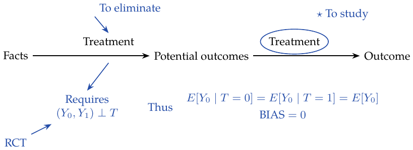

</div>

# Chapter 3. A review of statistics

For an i.i.d. sample mean, the estimated standard error is $`\mathrm{SE}=\hat\sigma/\sqrt n`$, with
``` math
\hat\sigma^2=\frac{1}{N-1}\sum_i(x_i-\bar x)^2.
```
Smaller sample size $`\Rightarrow`$ larger standard error $`\Rightarrow`$ wider confidence interval. The null hypothesis is that the treatment and control distributions have the same mean. Even if their individual confidence intervals overlap, their mean difference may still be statistically different from zero. <span style="color: #244DA8">Distinguish the 95% intervals for the two group means from the difference between those means.</span>

A $`p`$-value is the probability, under $`H_0`$, of a test statistic at least as extreme as the observed one. It is a sampling probability, not the probability that $`H_0`$ is true. A 95% confidence procedure covers the fixed population parameter in 95% of repeated samples. Higher confidence $`\Rightarrow`$ a wider interval $`\Rightarrow`$ lower precision, with the same data and method. The significance level controls the probability of a Type I error.

**My intuition.** If the $`p`$-value is very small, then the observed data would be very unlikely under $`H_0`$, yet they occurred, providing evidence against $`H_0`$. <span style="color: #244DA8">Compare the sample’s $`p`$-value with the significance threshold chosen theoretically.</span>

# Chapter 4. Graphical causal models

$`A\to B`$ means that $`A`$ affects $`B`$. For these three-node graphs, assume the causal Markov property and no additional open paths. The stated dependence patterns describe the usual faithful case; an open path permits dependence, while cancellations can eliminate it.

1.  Chain: $`A\to B\to C`$. Marginally $`A\not\perp C`$; conditioning on the known intermediate variable $`B`$ blocks the path: $`A\perp C\mid B`$.

2.  Fork: $`A\leftarrow C\to B`$. Without conditioning, $`A\not\perp B`$; conditioning on $`C`$ gives $`A\perp B\mid C`$.

3.  Collider: $`A\to C\leftarrow B`$. Marginally $`A\perp B`$; conditioning on $`C`$ gives $`A\not\perp B\mid C`$.

Confounding bias may involve proxy confounders and variables that cannot be directly measured.

**My summary.** Confounding bias arises from an uncontrolled open path, illustrated by $`X\leftarrow W\to Y`$ together with $`X\to Y`$. Extra conditioning has two different problems: conditioning on a collider can create selection bias by opening a path; conditioning on a mediator blocks part of the total causal effect (overcontrol). The example labels $`X`$ as education, $`Y`$ as wages, and $`W`$ as investment. The collider sketch has $`X\to W_2\leftarrow Y`$, $`W_2\to W_1`$, and $`X\to Y`$, with “investment” written alongside $`W_1`$; the mediator sketch has education feeding $`W`$, then wages, alongside a direct education-to-wages arrow. Controlling $`W`$ is therefore inappropriate when the target is the total effect.

<div class="center">

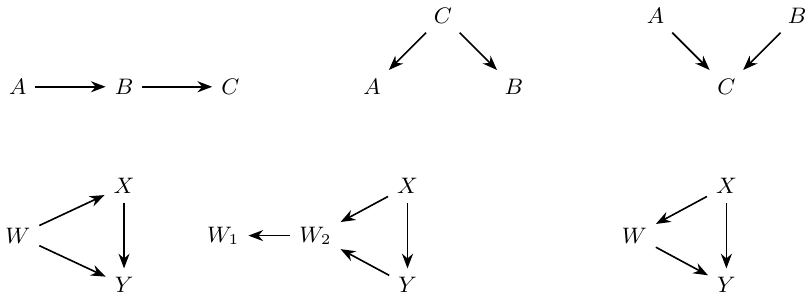

chain, fork, collider; followed by confounding and the two bad-control graphs.

</div>

# Chapter 5. The usefulness of linear regression

For individual $`i`$, suppose $`Y_{1i}=Y_{0i}+k`$: the treatment effect is constant, and the target is $`k`$. In a simple regression,
``` math
Y_i=\beta_0+kT_i+u_i,\qquad \beta_1=\frac{\operatorname{Cov}(Y_i,T_i)}{\operatorname{Var}(T_i)}.
```
With random assignment, the difference between the two group means, and hence the population regression coefficient on binary $`T`$, is the ATE.

<div class="center">


Binary treatment: the two fitted values differ by $`k`$, illustrated here with $`k<0`$.

</div>

Multiple regression accounts for the factors related to $`T_i`$:
``` math
y_i=\beta_0+kT_i+\underbrace{\beta_1X_{1i}+\cdots+\beta_KX_{Ki}}_{\textcolor{blue}{\text{auxiliary covariates}}}+u_i.
```

> <span style="color: #244DA8">My understanding: use $`X`$ to predict $`T`$, then take the residual</span> $`\textcolor{blue}{\longrightarrow}`$ $`\widetilde T=(I-P_X)T`$: <span style="color: #244DA8">the part of $`T`$ that $`X`$ cannot explain</span>; $`X`$ includes the intercept

The residualized treatment supplies the variation used for its regression coefficient:
``` math
k=\frac{\operatorname{Cov}(Y_i,\widetilde T_i)}{\operatorname{Var}(\widetilde T_i)}.
```
Here the covariance expression describes the population linear projection; its sample counterpart is $`\hat k=\widetilde T'Y/(\widetilde T'\widetilde T)`$.

What happens if a multiple regression is needed, but I omit a variable and use a simple regression? Consider the constant-effect linear model
``` math
\mathrm{Wage}_i=\alpha+k\,\mathrm{Educ}_i+\underbrace{A_i'\beta}_{\textcolor{blue}{\text{ability term}}}+u_i.
```
Under $`\operatorname{Cov}(\mathrm{Educ},u)=0`$, omitting ability gives
``` math
\frac{\operatorname{Cov}(\mathrm{Wage}_i,\mathrm{Educ}_i)}{\operatorname{Var}(\mathrm{Educ}_i)}
=k+\underbrace{\beta'\delta_A}_{\textcolor{red}{\mathrm{OVB}}}.
```

> <span style="color: #244DA8">Regress ability $`A`$ on education</span> $`\textcolor{blue}{\longrightarrow}`$ $`\delta_A`$: the coefficient vector of that projection

<span style="color: #C92B32">The extra term is omitted variable bias.</span> In this correctly specified linear model, including the confounders removes this omitted-variable term.

> An RCT breaks the relationship between treatment and confounding factors; regression holds those factors fixed when making the comparison.

The causal interpretation here uses the stated constant-effect model and exogeneity. With heterogeneous effects or an inadequate adjustment model, the adjusted regression coefficient need not equal the unweighted ATE.

# Chapter 6. Grouping and dummy regression

Heteroskedasticity means that outcome variance is not constant across the values of the covariates. With finer groups, the number of observations falls; grouping reduces variation, but coefficient standard errors can rise and $`t`$ statistics become smaller. When combining group regressions into a common treatment coefficient, both group size and within-group treatment variance enter the weights.

For a dummy treatment (for example, whether education reaches 12 years),
``` math
\mathrm{wage}_i=\beta_0+\beta_1T_i+e_i.
```
At $`T=0`$ the expectation is the intercept; at $`T=1`$ it is intercept plus $`\beta_1`$. With continuous IQ,
``` math
\mathrm{wage}_i=\beta_0+\beta_1T_i+\beta_2\mathrm{IQ}_i+\beta_3\mathrm{IQ}_iT_i+e_i.
```

> - $`\beta_0`$: the expectation at $`T=0`$, IQ $`=0`$.
>
> - $`\beta_1`$: the effect of one unit of $`T`$ when IQ is zero (all other terms are zero).
>
> - $`\beta_2`$: the effect of one unit of IQ when $`T=0`$.
>
> - $`\beta_3`$: IQ also has a return when $`T=1`$, making that group’s regression slope larger when $`\beta_3>0`$.

To analyze the coefficient on $`T_i`$, calculate each group’s contribution to the overall coefficient: group by years of education (for example, 12 years) and compute the corresponding categorical education/treatment contrast $`C(\mathrm{educ})[T_i]`$.

With more covariates, the target coefficient is a weighted average of the effect in each dummy-variable subgroup:
``` math
E\!\left[\{E[Y_i\mid T=1,G_i]-E[Y_i\mid T=0,G_i]\}\,w(G_i)\right],\qquad
w(g)=\frac{v_g}{E[v_G]},\quad v_g=\operatorname{Var}(T\mid G=g).
```
<span style="color: #244DA8">The weights depend on the distribution of $`T_i`$ within a subgroup. Calculate both the education and IQ-bin treatment contrasts.</span>

With group-specific intercepts and a common slope, the normalized coefficient is $`\sum_gP(G=g)v_g\tau_g/\sum_gP(G=g)v_g`$. Valid within-group adjustment gives a causal interpretation; this variance-weighted effect need not equal the ordinary ATE.

# Chapter 7. Beyond controlling for confounders

This chapter concerns the effects of controlling for given variables. In $`X\to Y\leftarrow T`$, controlling $`T`$ when studying $`X\to Y`$ can make the effect of $`X`$ clearer and reduce the variance of its estimate. A second sketch has $`B\to A\to X\to Y`$ and $`B\to Y`$: $`B`$ is related to both $`X`$ and $`Y`$; after adjusting for $`B`$, $`A`$ is an additional predictor of $`X`$. <span style="color: #244DA8">Adding $`A`$ can reduce the variation left in $`X`$ and increase the variance of its coefficient estimate.</span>
``` math
\hat\sigma^2=\frac{1}{n-2}\sum_i(y_i-\hat y_i)^2,\qquad
\widehat{\operatorname{Var}}(\hat\beta_2)=\frac{\hat\sigma^2}{\sum_i(x_i-\bar x)^2}.
```
For homoskedastic simple OLS, $`\widehat{\mathrm{SE}}(\hat\beta_2)=\hat\sigma/\sqrt{\sum_i(x_i-\bar x)^2}`$. <span style="color: #244DA8">Larger sample variation gives a smaller standard error.</span> In multiple regression the relevant variation is the residual variation after the other controls, with the corresponding residual degrees of freedom.

Confounding is the bias from failing to control for a common cause. Controlling a common effect can induce selection bias; controlling a mediator blocks part of the total effect.

#### Bad controls and participation.

For a treatment that affects whether the outcome is zero, an RCT makes the mean difference causal. For $`Y\ge0`$, decompose the difference into a participation component and a conditional-positive-outcome component:
``` math
\begin{aligned}
E[Y\mid T=1]-E[Y\mid T=0]
={}&\{P(Y>0\mid T=1)-P(Y>0\mid T=0)\}E[Y\mid Y>0,T=1]\\
&+\{E[Y\mid Y>0,T=1]-E[Y\mid Y>0,T=0]\}P(Y>0\mid T=0).
\end{aligned}
```
<span style="color: #244DA8">The first part is the effect on the probability of a positive outcome, and distinguishes customers’ participation from spending ability.</span> Restricting analysis to participants gives

> 
> ``` math
> \begin{aligned}
> E[Y_{i1}\mid Y_{i1}>0]-E[Y_{i0}\mid Y_{i0}>0]
> ={}&\underbrace{E[Y_{i1}-Y_{i0}\mid Y_{i1}>0]}_{\text{causal effect among participants}}\\
> &+\underbrace{E[Y_{i0}\mid Y_{i1}>0]-E[Y_{i0}\mid Y_{i0}>0]}_{\text{selection bias}}.
> \end{aligned}
> ```
> The last term compares the untreated potential outcome among those who would participate under treatment with that among those who would participate without treatment. The algebraic components above do not separately become causal effects merely because treatment is randomized.

The accompanying graph has $`X\to T_1\to Y\to T_2`$, and $`X\to T_2`$. <span style="color: #C92B32">$`T_1,T_2`$ are marked in red as bad selections/controls: “do not control!”</span>

<div class="center">


good precision control, treatment predictor, and bad controls (red circles).

</div>

# Chapter 8. Instrumental variables

Suppose
``` math
Y_i=\beta_0+kT_i+\beta W_i+u_i,
```
where $`T`$ is treatment and $`W`$ is a confounder. When $`W_i`$ is unavailable, fit $`Y_i=\beta_0+kT_i+v_i`$, with $`v_i=\beta W_i+u_i`$. Then $`\operatorname{Cov}(T,v)\ne0`$, so the estimate of $`k`$ is biased. <span style="color: #244DA8">The unobserved term carries information linking $`T`$ and $`Y`$.</span>

Introduce an instrument $`Z`$ related to $`T`$ and affecting $`Y`$ only through $`T`$, with $`\operatorname{Cov}(Z,v)=0`$. The graph is $`Z\to T\to Y`$, $`W\to T`$, $`W\to Y`$. Thus
``` math
\begin{aligned}
\operatorname{Cov}(Z,Y)&=\operatorname{Cov}(Z,\beta_0+kT+v)\\
&=k\operatorname{Cov}(Z,T)+\operatorname{Cov}(Z,v)=k\operatorname{Cov}(Z,T),\\
k&=\frac{\operatorname{Cov}(Z,Y)}{\operatorname{Cov}(Z,T)}
=\frac{\operatorname{Cov}(Y,Z)/\operatorname{Var}(Z)}{\operatorname{Cov}(T,Z)/\operatorname{Var}(Z)}.
\end{aligned}
```
Both numerator and denominator are regression coefficients. <span style="color: #244DA8">The numerator is the reduced-form coefficient: the effect of $`Z`$ on $`Y`$, operating only through $`T`$.</span>

**My calculus intuition.**
``` math
k=\frac{dY/dZ}{dT/dZ}=\frac{dY}{dZ}\frac{dZ}{dT}=\frac{dY}{dT}.
```
For a binary instrument, the Wald estimator is
``` math
k=\frac{E[Y\mid Z=1]-E[Y\mid Z=0]}{E[T\mid Z=1]-E[T\mid Z=0]}.
```
I understand this as turning the change from $`Z\to Y`$ back into the effect $`T\to Y`$.

#### Using an instrument.

In the example, $`Z_0`$ is quarter of birth, $`T`$ education, $`W`$ ability, and $`Y`$ wage. Relevance, $`\operatorname{Cov}(Z,T)\ne0`$, can be examined from the first stage. <span style="color: #C92B32">My later correction: “$`Z`$ affects $`Y`$ only through $`T`$” is an exclusion restriction, not $`Y\perp Z\mid T`$. Chapter 9 states it with potential outcomes.</span> Conditioning on $`T`$ can open the collider path $`Z\to T\leftarrow W\to Y`$.

Regress $`T\sim Z_0`$ to check the first-stage relationship, then $`Y\sim Z_0`$ to examine the reduced form. Method 1 takes the ratio of these regression coefficients. Method 2 is 2SLS:

1.  Regress $`T`$ on $`Z_0,Z_1,Z_2`$.

2.  Regress $`Y`$ on fitted $`T`$ and $`Z_1,Z_2`$:
    ``` math
    Y\sim\underbrace{\widehat T}_{\text{fitted from }Z_0,Z_1,Z_2}+Z_1+Z_2.
    ```

<span style="color: #244DA8">In the formula interface, one can specify $`T\sim Z_0`$ because the other terms are automatically added in stage 2.</span> The OLS comparison is written $`Y\sim T+C(Z_0,Z_1,Z_2)`$.

A weak first stage makes IV estimation imprecise. With valid, sufficiently strong instruments and a fixed number of instruments, 2SLS is consistent even when OLS is inconsistent. In finite samples it can be biased toward OLS; adding many weak instruments can worsen this problem, so the instrument count alone does not determine a monotone improvement.

<div class="center">

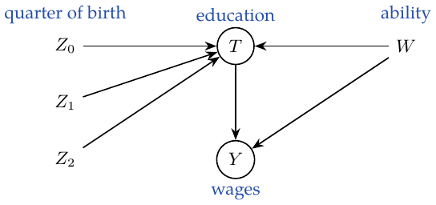

instrument, treatment, confounder and outcome.

</div>

The derivative cancellation is my intuition for a differentiable single path; the covariance derivation above supplies the argument for this constant-slope model. In the two-stage specification, $`Z_1,Z_2`$ are included exogenous controls and belong in both stages.

# Chapter 9. Noncompliance and local average treatment effects

Compliers follow assignment; never-takers never receive treatment; always-takers always receive it; defiers do the opposite. In $`Z\to T\to Y`$ with $`W\to T`$ and $`W\to Y`$, never-takers and always-takers weaken the first stage. <span style="color: #244DA8">For example, never-takers pull the reduced-form outcome difference toward the control condition.</span>

Potential outcomes now have two arguments: $`Y_i(t,z)`$; the written example is $`Y_i(1,0)`$ for $`T_i=1,Z_i=0`$. Potential treatment $`T_{0i}`$ corresponds to $`Z_i=0`$.

#### IV assumptions.

1.  $`(Y_{i0},Y_{i1},T_{0i},T_{1i})\perp Z_i`$. Instrument groups are comparable.

2.  Exclusion: $`Y_i(1,0)=Y_i(1,1)=Y_{i1}`$ and $`Y_i(0,0)=Y_i(0,1)=Y_{i0}`$. The instrument affects the outcome only via treatment.

3.  $`E[T_{1i}-T_{0i}]\ne0`$: the first stage exists; the instrument really affects treatment.

4.  Monotonicity: $`T_{1i}\ge T_{0i}`$ almost surely. Some individuals comply, so $`P(T_{1i}>T_{0i})>0`$.

#### Deriving the Wald estimand.

Consider the Wald ratio:
``` math
\frac{E[Y\mid Z=1]-E[Y\mid Z=0]}{E[T\mid Z=1]-E[T\mid Z=0]}.
```
Using exclusion and random assignment,
``` math
\begin{aligned}
E[Y_i\mid Z_i=1]&=E[Y_{i0}+T_{i1}(Y_{i1}-Y_{i0})\mid Z_i=1]\\
&=E[Y_{i0}+T_{i1}(Y_{i1}-Y_{i0})],\\
E[Y_i\mid Z_i=0]&=E[Y_{i0}+T_{i0}(Y_{i1}-Y_{i0})].
\end{aligned}
```
The numerator is
``` math
\begin{aligned}
E[(Y_{i1}-Y_{i0})(T_{i1}-T_{i0})]
=E[Y_{i1}-Y_{i0}\mid T_{i1}>T_{i0}]P(T_{i1}>T_{i0}),
\end{aligned}
```
and the denominator is $`E[T_{i1}-T_{i0}]=P(T_{i1}>T_{i0})`$. Their ratio is therefore
``` math
E[Y_{i1}-Y_{i0}\mid T_{i1}>T_{i0}].
```
<span style="color: #C92B32">The effect is conditional on compliance: this is LATE, not the population ATE.</span> IV identifies the treatment effect only for compliers. Compliers have $`T_{i1}>T_{i0}`$; never-takers have $`T_{i1}=T_{i0}=0`$; always-takers have $`T_{i1}=T_{i0}=1`$. Defiers run counter to assignment.

# Chapter 10. Matching

When grouping on confounders to estimate ATE, weight the treatment effect in each group. Weighting by sample size pulls the estimate toward larger groups, even though their treatment variation may be small; this is marked “nonparametric estimation.” <span style="color: #244DA8">Weighting by variance gives higher-variance groups greater weight; this is linked to linear, parametric regression and its emphasis on high-variance covariates.</span>

#### Subclassification.

If $`X`$ creates confounding, group by equal $`X`$ values. Under $`(Y_0,Y_1)\perp T\mid X`$, consistency, and overlap,
``` math
\begin{aligned}
\mathrm{ATE}&=\int\{E[Y\mid X=x,T=1]-E[Y\mid X=x,T=0]\}\,dP(x),\\
\widehat{\mathrm{ATE}}&=\sum_{k=1}^{K}(\bar Y_{k1}-\bar Y_{k0})\frac{N_k}{N}.
\end{aligned}
```
<span style="color: #244DA8">This means averaging over individual covariate values $`\{x_1,\ldots,x_K\}`$.</span>

#### Matching estimator.

Use distances between observations to define similarity, then compare similar or nearby individuals receiving different treatments. <span style="color: #C92B32">K-nearest neighbors.</span> <span style="color: #244DA8">Normalize a coordinate when defining distance: $`(x_i-\bar x)/\sqrt{\operatorname{Var}(x)}`$.</span>
``` math
\widehat{\mathrm{ATE}}=\frac1N\sum_i(2T_i-1)(Y_i-Y_{j(i)}).
```
<span style="color: #244DA8">$`j(i)`$ is the most similar observation from the other treatment group.</span> <span style="color: #C92B32">The factor $`2T_i-1`$ changes the sign according to which treatment group $`i`$ belongs to.</span>

#### Matching bias and correction.

For the treated group, consider
``` math
\widehat{\mathrm{ATET}}=\frac1{N_1}\sum_{i:T_i=1}(Y_i-Y_{j(i)}),\qquad
\textcolor{blue}{\mu_0(x)=E[Y\mid X=x,T=0]}.
```
The centering discrepancy is written
``` math
B_N=\frac1{N_1}\sum_{i:T_i=1}\{\mu_0(X_i)-\mu_0(X_{j(i)})\},\qquad \sqrt{N_1}B_N,
```
and need not converge to zero. <span style="color: #244DA8">Multiplying the discrepancy by $`\sqrt{N_1}`$ magnifies it.</span> <span style="color: #244DA8">I compare $`X_i`$’s untreated potential outcome (counterfactual because $`i`$ is treated) with $`X_j`$’s observed untreated outcome; $`X_i\approx X_j`$ is meant to make their untreated outcomes close.</span> Subtract an estimate of this discrepancy:
``` math
\widehat{\mathrm{ATET}}_{\mathrm{bc}}=
\frac1{N_1}\sum_{i:T_i=1}\left[(Y_i-Y_{j(i)})-
\{\hat\mu_0(X_i)-\hat\mu_0(X_{j(i)})\}\right].
```
<span style="color: #244DA8">$`\hat\mu_0`$ is estimated, for example by least squares.</span> A local LS correction does not alter the matching estimator’s original aim.

**The curse of dimensionality.** More covariates mean larger matching distances: each cell contains fewer observations.

Bias reduction relies on overlap, smoothness, and an adequate regression approximation. Sample-share weighting targets ATE; variance weighting generally targets a different average.

# Chapter 11. Propensity scores

Another way to address confounding is the propensity score $`p(X)=P(T=1\mid X)`$. The graph connects $`X\to p(X)\to T\to Y`$, with $`X\to Y`$. For binary treatment the balancing identity is
``` math
E[T\mid p(X),X]=E[T\mid p(X)].
```
If $`(Y_0,Y_1)\perp T\mid X`$, this balancing property lets us reduce the adjustment to $`p(X)`$: $`(Y_0,Y_1)\perp T\mid p(X)`$. Overlap, $`0<p(X)<1`$, is needed for the two treatment-arm means.

**My example.** Take two individuals, one treated and one control. If their probabilities of treatment are the same, I can compare them within that score group even if their $`X`$ values differ: the argument balances distributions, not every individual pair.
``` math
\begin{aligned}
E[T\mid p(X),X]&=E[T\mid X]=p(X), &&\text{since }p(X)\text{ is a function of }X,\\
E[T\mid p(X)]&=E[E[T\mid p(X),X]\mid p(X)]\\
&=E[p(X)\mid p(X)]=p(X).
\end{aligned}
```

#### Inverse propensity weighting (IPW).

The conditional difference can be rewritten as
``` math
\begin{aligned}
E[Y\mid X,T=1]-E[Y\mid X,T=0]
={}&p(X)E\!\left[\frac{Y}{p(X)}\,\middle|\,X,T=1\right]\\
&-\{1-p(X)\}E\!\left[\frac{Y}{1-p(X)}\,\middle|\,X,T=0\right].
\end{aligned}
```
<span style="color: #244DA8">?</span>**My understanding.** We observe treatment for individual $`i`$, but the probability that $`i`$ would be treated is only $`p(X_i)`$, determined by $`X`$. Give every observed treated individual weight $`1/p(X_i)`$ to correct for this. If $`p(X_i)`$ is small, that observation contributes little to the unweighted outcome distribution; increase its representation with the reciprocal weight. For $`T=1`$ and $`T=0`$, the weights are respectively $`1/p(X)`$ and $`1/(1-p(X))`$. This reconstructs a population in which everyone is treated ($`Y_1`$) and another in which everyone is untreated ($`Y_0`$), and ATE is their difference.

Weighted outcome dispersion is
``` math
\hat\sigma_w^2=\frac{\sum_{i=1}^n w_i(Y_i-\hat\mu)^2}{\sum_{i=1}^n w_i}.
```
But the estimated propensity $`\hat p(X)`$ itself contains error. Adding nonconfounding covariates carelessly can make the propensity estimator highly variable. Treated people may have a higher estimated probability of treatment than untreated people. My warning is that very large weights—for example, values above twenty—can inflate variance; twenty is a practical reminder, not a universal cutoff. This weighted dispersion is not the sampling variance of the IPW ATE estimator.

#### Propensity-score matching.

Replace matching distance with $`p(X)`$. My concern is whether this improves the causal comparison. Better prediction of treatment does not necessarily improve causal estimation and can increase variance. If treated and untreated propensity-score distributions lack overlap, matching encounters problems.

<div class="center">

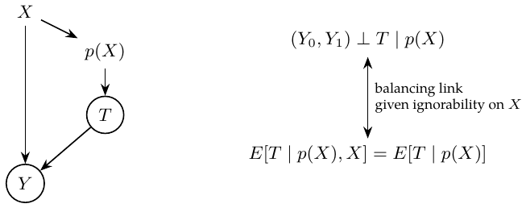

Propensity adjustment: balancing and conditional exchangeability are connected under the stated assumption.

</div>

# Chapter 12. Doubly robust estimation

Under consistency, conditional exchangeability and overlap, combine outcome regression and propensity weighting, then average over $`X`$:
``` math
\begin{aligned}
\widehat{\mathrm{ATE}}={}&\frac1N\sum_i\left[\frac{T_i\{Y_i-\hat\mu_1(X_i)\}}{\hat p(X_i)}+\hat\mu_1(X_i)\right]\\
&-\frac1N\sum_i\left[\frac{(1-T_i)\{Y_i-\hat\mu_0(X_i)\}}{1-\hat p(X_i)}+\hat\mu_0(X_i)\right].
\end{aligned}
```
Here $`\hat p(X)`$ estimates the propensity score (for example, using logistic regression), and $`\hat\mu_1(X)`$ and $`\hat\mu_0(X)`$ estimate $`E[Y\mid X,T=1]`$ and $`E[Y\mid X,T=0]`$. <span style="color: #244DA8">The first average estimates $`E[Y_1]`$ and the second $`E[Y_0]`$. For consistency, either the propensity model or both treatment-arm outcome regressions must be consistently estimated, with suitable control of estimation error.</span>

> **My algebraic explanation.** For $`E[Y_1]`$,
> ``` math
> \widehat E[Y_1]=\frac1N\sum_i\left[\frac{T_i\{Y_i-\hat\mu_1(X_i)\}}{\hat p(X_i)}+\hat\mu_1(X_i)\right].
> ```
> If $`\hat p`$ is wrong but $`\hat\mu_1`$ is correct, the first term is zero for $`T_i=0`$ and has mean zero for $`T_i=1`$, leaving the regression prediction. The cancellation is conditional: $`E[T\{Y-\mu_1(X)\}/q(X)\mid X]=0`$ for a nonzero candidate propensity $`q`$.
>
> Alternatively,
> ``` math
> \widehat E[Y_1]=\frac1N\sum_i\left[\frac{T_iY_i}{\hat p(X_i)}-\frac{T_i-\hat p(X_i)}{\hat p(X_i)}\hat\mu_1(X_i)\right].
> ```
> If the outcome model is wrong but the propensity model is correct, $`T_i-\hat p(X_i)`$ has mean zero conditional on $`X_i`$, so the correction vanishes in expectation.

My practical preference is to combine the two models with DRE; the identifying assumptions and the quality of the data still matter.

# Chapter 13. Difference-in-differences

Difference-in-differences evaluates the effect of a macro-level intervention. $`D`$ indicates treatment and $`T`$ time; $`Y_D(T)`$ is the potential outcome under treatment $`D`$ in period $`T`$.

#### Two comparisons and their problems.

The target among the treated is $`E[Y_1(1)-Y_0(1)\mid D=1]`$, comparing treatment and no treatment in the same period; $`Y_0(1)`$ is counterfactual. Before treatment, $`E[Y_1(0)\mid D=1]=E[Y_0(0)\mid D=1]`$. A before/after comparison uses the pre-intervention outcome to stand in for the post-intervention untreated outcome. This fails when there is a time trend: the two untreated potential outcomes need not coincide.

A treated/control comparison in the post period uses
``` math
E[Y(1)\mid D=1]-E[Y(1)\mid D=0].
```
It uses the control group’s untreated post-period outcome to estimate the treated group’s counterfactual. <span style="color: #244DA8">The blue annotation warns that this too can fail.</span>

Combine the two:
``` math
\begin{aligned}
\widehat{\mathrm{ATET}}={}&\{E[Y(1)\mid D=1]-E[Y(1)\mid D=0]\}\\
&-\{E[Y(0)\mid D=1]-E[Y(0)\mid D=0]\}.
\end{aligned}
```
<span style="color: #244DA8">Equivalently, the experimental group’s post-minus-pre change minus the control group’s post-minus-pre change. A linear model includes the treatment–time interaction; estimate its uncertainty and check parallel trends.</span>

The identifying condition is parallel untreated mean trends,
``` math
E[Y_0(1)-Y_0(0)\mid D=1]=E[Y_0(1)-Y_0(0)\mid D=0].
```
Together with no anticipation, consistency, no spillovers and comparable composition, this identifies ATT. Pre-period checks are useful but cannot prove the future counterfactual trend.

# Chapter 14. Panel data and fixed effects

Panel data repeatedly observe the same unit over time. Holding identity fixed allows additive time-invariant individual characteristics to be removed with individual fixed effects.

Recall DID. For the treated city, estimate its untreated outcome after intervention by its untreated outcome before intervention plus the untreated city’s change over time:
``` math
E[Y_0(1)\mid D=1]=E[Y_0(0)\mid D=1]+E[Y_0(1)-Y_0(0)\mid D=0].
```

Then $`\widehat{\mathrm{ATT}}=\widehat E[Y_1(1)\mid D=1]-\widehat E[Y_0(1)\mid D=1]`$: the first is known, the second estimated. The example annotation mentions the effect of advertising in a DMA.

Parallel trends concerns the untreated mean change, as stated above; it does not assert the same identity for every individual’s potential outcome. The panel model is
``` math
y_{it}=\beta X_{it}+\gamma U_i+e_{it}.
```
<span style="color: #244DA8">$`y_{it}`$ is the outcome for unit $`i`$ at time $`t`$, $`X_{it}`$ varies with time, and $`U_i`$ is unobserved and time-invariant.</span>

#### Limits of panel data.

> Panel data cannot solve reverse causality, where cause and effect reinforce one another; fixed effects cannot control this. They also cannot remove unobserved confounders that vary over time.

#### Residualizing a linear panel model.

For two groups of features, $`X_1,X_2`$,
``` math
\hat y=X_1\hat\beta_1+X_2\hat\beta_2.
```
The feature matrix has observations as rows and features as columns.

1.  Regress $`y`$ on the second feature group: $`\hat y^*=P_{X_2}Y`$.

2.  Regress $`X_1`$ on $`X_2`$: $`\hat X_1=P_{X_2}X_1`$.

3.  Take residuals $`\widetilde X_1=X_1-\hat X_1`$ and $`\widetilde y=y-\hat y^*`$.

4.  Regress the outcome residual on the feature residual, yielding the coefficient on $`X_1`$.

#### Within transformation.

Compute $`\ddot Y_{it}=Y_{it}-\bar Y_i`$ and $`\ddot X_{it}=X_{it}-\bar X_i`$, then regress $`\ddot Y_{it}`$ on $`\ddot X_{it}`$. Since $`\bar U_i=U_i`$, the fixed effect disappears:
``` math
\begin{aligned}
Y_{it}&=\beta X_{it}+\gamma U_i+e_{it},\\
\bar Y_i&=\beta\bar X_i+\gamma\bar U_i+\bar e_i,\\
Y_{it}-\bar Y_i&=\beta(X_{it}-\bar X_i)+\gamma(U_i-\bar U_i)+(e_{it}-\bar e_i),\\
\ddot Y_{it}&=\beta\ddot X_{it}+\ddot e_{it}.
\end{aligned}
```
<span style="color: #244DA8">This removes all unobserved characteristics that are constant over time.</span> For time effects, such as inflation, add one dummy for each period; time-varying factors may also matter. Demeaned values sum to zero within a person; this centering identity holds even for time-varying variables. The fixed characteristic disappears because each of its demeaned values is zero. Causal interpretation still requires exogeneity, typically $`E[e_{it}\mid X_{i1},\ldots,X_{iT},U_i]=0`$.

The sketch shows several parallel purchase-versus-cost lines. A fixed-effects model fits a line for each city and assumes a constant causal effect across conditions.

<div class="center">

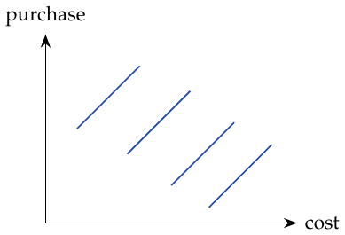

parallel within-city purchase–cost lines (blue).

</div>

# Chapter 15. Synthetic control

If no single control unit resembles the treated city or state, combine several untreated units into a synthetic comparison. Aggregate cities and states can themselves form a panel. A causal comparison needs untreated donors, no anticipation or spillovers, and a credible stable relation between pre- and post-intervention untreated outcomes.

There are $`J+1`$ units. Unit 1 receives treatment; units $`2,\ldots,J+1`$ are untreated and form the donor pool. $`Y_{jt}^{I}`$ and $`Y_{jt}^{N}`$ are the potential outcomes with and without intervention for unit $`j`$ at time $`t`$. Treatment starts at $`T_0`$. For $`t>T_0`$,
``` math
\tau_{1t}=Y_{1t}^{I}-Y_{1t}^{N}.
```
<span style="color: #244DA8">The treated outcome is factual and the untreated one counterfactual; the effect is a function of time.</span> For weights $`W=(w_2,\ldots,w_{J+1})`$,
``` math
\widehat Y_{1t}^{N}=\sum_{j=2}^{J+1}w_jY_{jt}.
```
<span style="color: #244DA8">Regression can be used to choose these weights: minimize the squared pre-intervention distance between the treated unit and the weighted donor average.</span>

#### Synthetic control as regression.

Build a virtual California from donor states. The matrix has years as rows, states as columns, and cigarette sales as entries. Set California’s series to $`Y`$, other states’ series to $`X`$, and regress $`Y\sim X`$. The example weights include $`-0.436`$ and $`-0.032`$ (39 weights for 39 states). <span style="color: #244DA8">Their weighted sum is the virtual state, chosen to minimize its discrepancy from the treated unit.</span>

> This can overfit: the virtual state almost coincides with California before intervention but fluctuates strongly afterward. Ridge or Lasso may help regularize a regression with many donor series.

#### Avoiding extrapolation.

Earlier overfitting is attributed to extrapolation: weights place observations outside the range of the data. Impose a convex-combination restriction. The synthetic control still has the form $`\widehat Y_{1t}^{N}=\sum_{j=2}^{J+1}w_jY_{jt}`$, but choose $`W`$ to minimize
``` math
\|X_1-X_0W\|_V=
\left\{\sum_{h=1}^{k}v_h\left(X_{h1}-\sum_{j=2}^{J+1}w_jX_{hj}\right)^2\right\}^{1/2},
\qquad w_j\ge0,\quad\sum_{j=2}^{J+1}w_j=1.
```
The drawings contrast unconstrained extrapolation from donor points to a treated point outside their triangle with a constrained fit inside the donor convex hull.

$`v_h`$ reflects each variable’s importance in matching treatment and synthetic control; different $`v_h`$ values yield different weights. Choices mentioned are standardizing each variable to mean zero and unit variance, or giving greater importance to variables that predict $`Y`$ better. The implementation here gives every variable equal importance: define a loss function, use SciPy quadratic optimization with weights summing to one, and constrain each weight to $`[0,1]`$. The resulting example weights are sparse and sum to one (the example vector includes zeros and an approximately $`0.3852`$ entry).

#### Significance and placebo comparisons.

Use a placebo comparison inspired by permutation testing. Refit synthetic control and estimate an effect for each of the 39 states. California gives the actual intervention estimate; the other states give placebo effects. If untreated states also appear to have large effects, that is concerning. Post-intervention variation is larger than pre-intervention variation; some units fit poorly even before intervention and should be excluded. Apply the same pre-period fit threshold to all assignments, using
``` math
\mathrm{MSE}=\frac1N\sum_t(Y_t-\widehat Y_t^{\mathrm{synth}})^2.
```
To compare the effects, compute all state effects, then form
``` math
p=\frac1{J_{\rm eligible}}\sum_{j\in\mathcal E}\mathbf1\{\hat\tau_j\le\hat\tau_{\mathrm{California}}\},
```
where $`\mathcal E`$ contains the eligible assignments, including the observed assignment. For a negative effect, count effects at least as negative. <span style="color: #244DA8">The example suggests that California is extreme among the placebo effects.</span> Calling this an exact $`p`$-value requires an assignment or exchangeability justification; a placebo rank in an observational study is otherwise a diagnostic. Convex weights restrict extrapolation but do not guarantee a good counterfactual fit.

<div class="center">


extrapolation versus a convex-hull restriction.

</div>

# Chapter 16. Regression discontinuity design

A discontinuity: what effect does it reveal? Let $`R`$ be the running variable, with treatment assigned discontinuously at cutoff $`c`$:
``` math
D_i=\mathbf1\{R_i>c\}.
```
<span style="color: #244DA8">Below $`c`$ treatment is zero; above it treatment is one.</span> Thus $`Y_1`$ is observed for $`R>c`$, and $`Y_0`$ for $`R<c`$. The figure draws smooth potential-outcome curves $`Y_1,Y_0`$, with the observed curve switching from $`Y_0`$ to $`Y_1`$ at $`c`$. The example plots age against all deaths / motor-vehicle deaths / suicide, looking for a discontinuity.

If both potential-outcome means are continuous at the cutoff and there is support on both sides, their left and right limits agree, e.g.
``` math
\lim_{r\to c^-}E[Y_{1i}\mid R_i=r]=\lim_{r\to c^+}E[Y_{1i}\mid R_i=r].
```
The discontinuity in observed outcomes therefore identifies
``` math
\begin{aligned}
&\lim_{r\to c^+}E[Y_i\mid R_i=r]-\lim_{r\to c^-}E[Y_i\mid R_i=r]\\
&\quad=\lim_{r\to c^+}E[Y_{1i}\mid R_i=r]-\lim_{r\to c^-}E[Y_{0i}\mid R_i=r]\\
&\quad=E[Y_{1i}-Y_{0i}\mid R_i=c].
\end{aligned}
```
This is the ATE at the cutoff. <span style="color: #244DA8">My intuition: comparisons very near the cutoff resemble a local randomized experiment.</span> The continuity argument alone does not assert literal random assignment.

Center the running variable, $`r_i=R_i-c`$, and use different slopes on either side:
``` math
y_i=\beta_0+\beta_1r_i+\beta_2\mathbf1\{r_i>0\}+\beta_3\mathbf1\{r_i>0\}r_i.
```
<span style="color: #244DA8">The low-side line is the first part; the high-side line adds the indicator and interaction.</span> Then $`\beta_0`$ with the left limit, $`\beta_0+\beta_2`$ with the right limit, and $`\beta_2`$ with the cutoff effect. Standard errors assess significance.

#### Kernel weighting.

RDD relies heavily on linear regression’s extrapolation. A fit can focus too much on distant observations and fit badly at the cutoff. Give observations nearer the threshold higher weight. The triangular kernel is
``` math
K(R,c,h)=\mathbf1\{|R-c|<h\}\left(1-\frac{|R-c|}{h}\right).
```
<span style="color: #244DA8">The indicator keeps only observations within $`c\pm h`$; the second factor decreases as distance from $`c`$ increases. Use WLS, weighted least squares.</span>

#### Fuzzy RDD.

At the cutoff, treatment need not switch deterministically: its probability jumps. Use cutoff crossing as an IV. With local exclusion and exogeneity, a nonzero first stage, continuity and monotonicity $`T_{1i}\ge T_{0i}`$, the outcome jump equals the first-stage jump times the complier effect. The Wald ratio is
``` math
\frac{\lim_{r\to c^+}E[Y_i\mid R_i=r]-\lim_{r\to c^-}E[Y_i\mid R_i=r]}
{\lim_{r\to c^+}E[T_i\mid R_i=r]-\lim_{r\to c^-}E[T_i\mid R_i=r]}
=E[Y_{1i}-Y_{0i}\mid T_{1i}>T_{0i},R_i=c].
```

A large $`p`$-value means the data do not provide strong evidence against the tested null; it does not establish a small effect. Inspect the estimate and its interval together. The McCrary test checks for a discontinuity in the running-variable density at the cutoff, as a diagnostic for possible manipulation. It does not test all RD assumptions.

<div class="center">


Sharp RD (left); fuzzy RD treatment and outcome jumps (right). Black curves show potential relations and red curves the observed discontinuities.

</div>

# Part II. Applications

# Chapter 17. Predictive Models 101

Machine learning estimates $`E[Y\mid X]`$, the expected outcome at a given $`X`$, producing $`\widehat E[Y\mid X]`$. An overly complex model overfits. Keep separate training data, test data, and unseen data. Distinguish predictions from policies. Related ideas: estimators and maximum likelihood.

<span style="color: #244DA8">$`R^2`$ evaluates a continuous-outcome model, describing how much outcome variation the model explains.</span> For a nonconstant outcome, its range is $`(-\infty,1]`$, with a reminder that it measures performance relative to the mean. <span style="color: #244DA8">As tree depth rises, training $`R^2`$ increases while test $`R^2`$ can decrease: overfitting.</span>

`pandas.qcut` divides model-predicted values into quantile bins, i.e. model segments. A more detailed policy moves from a participation threshold—whether to participate—to a continuous choice of how much to invest.

# Chapter 18. Heterogeneous treatment effects and personalization

Unlike ordinary prediction, the aim is to intervene and predict the effect. Let $`X`$ contain pre-treatment characteristics (for example, past sales), and let treatment $`T`$ be price. The policy target is $`\arg\max_t E[Y(t)\mid X=x]`$. Under consistency, conditional exchangeability and overlap, this can be learned from $`E[Y\mid X=x,T=t]`$.

Move from ATE to CATE. For binary treatment, ATE is $`E[Y_1-Y_0]`$; for continuous treatment, I use $`E[y'(t)]`$, the derivative of the outcome with respect to treatment. The conditional versions are
``` math
E[Y_1-Y_0\mid X],\qquad E[y'(t)\mid X].
```

> **My annotation.** Add the condition $`X`$: calculate the expectation separately for each $`X`$, then choose a personalized policy.

Here “elasticity” refers informally to sensitivity, $`\partial Y_i/\partial T_i`$, approximated by
``` math
\frac{Y(T_i)-Y(T_i+\varepsilon)}{T_i-(T_i+\varepsilon)}.
```
But both outcomes are unobservable for the same individual: the causal-inference problem. In a simple regression $`y_i=\beta_0+\beta_1t_i+\beta_2X_i+e_i`$, the derivative is only $`\beta_1`$, a common elasticity. Add an interaction:
``` math
y_i=\beta_0+\beta_1t_i+\beta_2X_i+\beta_3t_iX_i+e_i,
\qquad \frac{\partial\hat y_i}{\partial t_i}=\hat\beta_1+\hat\beta_3X_i.
```
<span style="color: #244DA8">The interaction makes CATE depend on the covariates.</span> <span style="color: #C92B32">$`\beta_1,\beta_3`$ determine the derivative relationship.</span> Another approximation is a finite difference $`\{y(t+\varepsilon)-y(t)\}/\varepsilon`$, followed by the practical one-unit approximation $`\hat y(t+1)-\hat y(t)`$.

A one-unit difference approximates a derivative only when the response is sufficiently linear over that interval. Dimensionless elasticity is $`(t/y)\,\partial y/\partial t=\partial\log y/\partial\log t`$.

# Chapter 19. Evaluating causal models

The purpose is prediction and ranking (grouping). One can fit on nonrandom data with valid adjustment, then evaluate on separate randomized data (or a separately identified, adjusted evaluation sample). Compare:

1.  $`\mathrm{sales}_i=\beta_0+\beta_1\mathrm{price}_i+\beta_2X_i+\beta_3X_i\mathrm{price}_i+e_i`$, a linear model (the feature terms can be matrices).

2.  $`\mathrm{sales}_i=G(X_i,\mathrm{price}_i)+e_i`$, using a regression tree. Check $`R^2`$ for overfitting.

3.  A random-number prediction as a placebo comparison.

An elasticity model ranks units by treatment sensitivity. Within a segment, estimate elasticity by a univariate regression $`y_i=\beta_0+\beta_1t_i+e_i`$:
``` math
\hat\beta_1=\frac{\sum_i(t_i-\bar t)(y_i-\bar y)}{\sum_i(t_i-\bar t)^2},
```
where $`\bar t`$ is mean treatment and $`\bar y`$ mean outcome.

#### Cumulative elasticity curve.

Sort by predicted elasticity, from most sensitive downward. Estimate the slope for the first group, then keep adding groups until all observations are included, where it reaches the full-sample slope:
``` math
\widehat{y'}(t)_k=\hat\beta_k=
\frac{\sum_{i=1}^{k}(t_i-\bar t_k)(y_i-\bar y_k)}{\sum_{i=1}^{k}(t_i-\bar t_k)^2}.
```
My ranking goals are that $`\widehat{y'}(t)_k>\widehat{y'}(t)_{k+a}`$ and that the difference be large. The sketch descends toward the overall effect and labels a well-performing ranking as preferable.

#### Cumulative gain curve.

``` math
\widehat F(k)=\hat\beta_k\frac{k}{N}
=\frac{\sum_{i=1}^{k}(t_i-\bar t_k)(y_i-\bar y_k)}{\sum_{i=1}^{k}(t_i-\bar t_k)^2}\frac{k}{N}.
```
The sketch compares a curved gain line with a straight reference. For a confidence interval, the standard error is
``` math
S_{\hat\beta_1}=\sqrt{\frac{\sum_i\hat\varepsilon_i^2}{(n-2)\sum_i(t_i-\bar t)^2}}.
```

<div class="center">

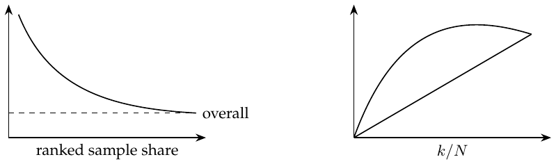

cumulative slope (left) and gain against a straight reference (right).

</div>

Recompute $`\bar t_k,\bar y_k`$ within each prefix. The drawn decreasing curve uses a positive-benefit convention; for negative price effects, rank by more negative slopes or change the sign consistently. The displayed standard error is pointwise under i.i.d. homoskedastic linear errors, not a simultaneous band for the entire curve.

# Chapter 20. Plug-and-play estimators

Previously, comparable treatment and control groups gave ATE: random assignment uses $`(Y(0),Y(1))\perp T`$, and adjusted observational comparisons use $`(Y(0),Y(1))\perp T\mid X`$ with overlap. Now I ask: for whom does treatment work better; who is more sensitive?
``` math
\tau_i=Y_i(1)-Y_i(0),\qquad
Y_i^{\mathrm{obs}}=\begin{cases}Y_i(1),&T_i=1,\\Y_i(0),&T_i=0.\end{cases}
```
``` math
\mathrm{ATE}=\tau=E[\tau_i],\qquad \mathrm{CATE}=\tau(x)=E[\tau_i\mid X=x].
```
With $`y_i=\beta_0+\beta_1t_i+\beta_2X_i+\beta_3t_iX_i+e_i`$, the fitted effect is $`\hat\tau(x)=\hat\beta_1+\hat\beta_3x`$. <span style="color: #244DA8">The main-effect coefficient $`\beta_2`$ drops out of this contrast. I initially connected an irrelevant $`X`$ to biased effect estimates; in correctly specified unregularized OLS, an irrelevant covariate instead need not create bias and may only reduce precision.</span>

Outcome MSE is $`E[(Y_i-\hat Y_i)^2]`$. My target is instead treatment-effect prediction:
``` math
\min_f E[(\tau(X)-f(X))^2].
```

#### Supplementary explanation.

Writing $`\Delta=Y(1)-Y(0)`$, the individual-effect risk differs by a term independent of $`f`$:
``` math
E[(\Delta-f(X))^2]=E[(\tau(X)-f(X))^2]+E[\operatorname{Var}(\Delta\mid X)].
```
Thus the risks have the same minimizer, but are not generally equal.

#### Transformed outcomes for binary treatment.

Introduce $`Y_i^*=2Y_iT_i-2Y_i(1-T_i)`$. Under 50/50 random assignment, $`T\perp(Y(0),Y(1))`$, so $`E[TY(t)]=E[T]E[Y(t)]`$. Also, $`Y_iT_i=Y_i(1)T_i`$ and $`Y_i(1-T_i)=Y_i(0)(1-T_i)`$. Therefore
``` math
\begin{aligned}
E[Y_i^*\mid X_i=x]
&=2E[Y_i(1)T_i\mid X_i=x]-2E[Y_i(0)(1-T_i)\mid X_i=x]\\
&=2E[Y_i(1)\mid X_i=x]\,0.5-2E[Y_i(0)\mid X_i=x]\,0.5\\
&=\tau(x).
\end{aligned}
```
For nonrandom assignment, introduce propensity $`e(X_i)`$, with conditional exchangeability and overlap, and use
``` math
Y_i^*=Y_i\frac{T_i-e(X_i)}{e(X_i)(1-e(X_i))}.
```
When treatment is randomized at a known probability $`p`$, substitute $`p`$ for $`e(X_i)`$. The key conditional-expectation calculation is
``` math
\begin{aligned}
E[Y_i^*\mid X_i=x]
={}&\frac{E[Y_i(1)\mid X_i=x]E[T_i\mid X_i=x]}{e(x)}\\
&-\frac{E[Y_i(0)\mid X_i=x]E[1-T_i\mid X_i=x]}{1-e(x)}=\tau(x).
\end{aligned}
```
My reading of the cumulative gain curve is that this transformed target is very noisy. Its guarantee is $`E[Y^*\mid X]=\tau(X)`$, so it targets CATE after averaging within $`X`$. Under randomized assignment, it is also design-unbiased for a fixed individual’s effect conditional on that individual’s potential outcomes. More data can average out noise when the weights have suitable moments; it cannot repair missing overlap.

#### Continuous treatment.

The target is $`\tau(x)=E[\partial Y_i(t)/\partial t\mid X=x]=E[\tau_i\mid X=x]`$. The sketch shows a downward demand-versus-price slope.

<div class="center">

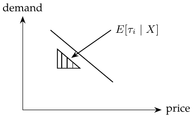

</div>

Within an $`X=x`$ stratum, the conditional projection slope and its sample counterpart are
``` math
\hat\tau(x)\approx\frac{\operatorname{Cov}(Y_i,T_i\mid X=x)}{\operatorname{Var}(T_i\mid X=x)}
=\frac{\sum_i(Y_i-\bar Y)(T_i-\bar T)}{\sum_i(T_i-\bar T)^2}.
```
Suppose the conditional mean is linear in treatment, $`E[Y\mid T,X=x]=a(x)+\tau(x)T`$. Under the same randomized treatment distribution at every $`x`$, write $`\mu_T=E[T]`$, $`\mu_Y=E[Y]`$ and $`\sigma_T^2=\operatorname{Var}(T)>0`$. For one observation define
``` math
Y_i^*=(Y_i-\mu_Y)\frac{T_i-\mu_T}{\sigma_T^2}.
```
Set $`V_i=(T_i-\mu_T)/\sigma_T^2`$. The derivation uses $`E[V_i\mid X_i=x]=0`$, $`E[T_iV_i\mid X_i=x]=1`$, and
``` math
E[T_i(T_i-\mu_T)\mid X_i=x]=E[(T_i-\mu_T)^2\mid X_i=x],
```
as well as $`E[T_ie_i\mid X_i=x]=E[T_i\mid X_i=x]E[e_i\mid X_i=x]`$. With $`Y_i=\alpha+\beta T_i+e_i`$ at $`X_i=x`$,
``` math
\begin{aligned}
E[Y_i^*\mid X_i=x]
&=E[(Y_i-\mu_Y)V_i\mid X_i=x]\\
&=E[(\alpha+\beta T_i+e_i-\mu_Y)V_i\mid X_i=x]=\beta=\tau(x).
\end{aligned}
```
My attempted extension replaces the treatment mean by a model $`m(X_i)`$:
``` math
Y_i^{*,\mathrm{try}}=(Y_i-\mu_Y)\frac{T_i-\hat m(X_i)}{\{T_i-\hat m(X_i)\}^2}.
```
<span style="color: #C92B32">The variance is difficult to estimate. If I only need a relative ranking, can I avoid estimating it?</span>

#### Supplementary explanation.

The squared residual of one observation is not conditional treatment variance. Under the conditional linear model above, a valid moment target is
``` math
\frac{\{Y_i-\ell(X_i)\}\{T_i-m(X_i)\}}{v(X_i)},\quad
\ell(x)=E[Y\mid X=x],\quad v(x)=\operatorname{Var}(T\mid X=x)>0.
```
Its conditional mean is $`\tau(x)`$. Omitting $`v(x)`$ instead ranks $`v(x)\tau(x)`$, so it preserves the effect ranking only with additional restrictions, for example constant positive $`v(x)`$. The attempted individual-residual denominator can also explode near zero. Chapter 22 gives the related weighted R-loss formulation.

**Nonlinear relationships: no solution yet.** Maybe use $`D_i=1/P_i^\alpha`$, hence $`\log D_i=-\alpha\log P_i`$. This is a possible transformation to explore, not a completed general solution.

# Chapter 21. Meta-learners

These ML constructions estimate CATE. Fit on nonrandom data only after addressing confounding, and evaluate on separate randomized data where possible. The binary-treatment target is $`E[Y_i(1)-Y_i(0)\mid X]`$. Causal interpretation requires consistency, conditional exchangeability and overlap. For continuous treatment, a conditional derivative needs a model appropriate for the dose-response relation.

#### S-learner (“Go-Horse Learner”).

Use one ML model $`M_S`$ to estimate $`\mu(X,T)=E[Y\mid T,X]`$. Fit with $`(X,T)`$, then pass the same $`X`$ through the model once with $`T=0`$ and once with $`T=1`$. The predicted outcome difference gives CATE. A cumulative gain curve can reveal overfitting; tune `max_depth`.

A possible weakness is shrinkage of the estimated treatment effect toward zero. An S-learner is a regularized ML model, so regularization restricts the estimated treatment effect. If other covariates have strong predictive effects, it may drop the treatment variable entirely.

#### T-learner.

Splitting the data addresses complete omission of treatment. Fit
``` math
\mu_0(x)=E[Y\mid T=0,X=x],\qquad \mu_1(x)=E[Y\mid T=1,X=x],
```
then estimate $`\hat\tau(x)=M_1(x)-M_0(x)`$. The diagram sends treatment and control data to separate models, then applies both models to the same $`X`$ and subtracts predictions.

> **My annotation.** Splitting also shrinks the data sets. For example, abundant $`T=0`$ data may support a good fit, but scarce $`T=1`$ data force a simpler model to avoid overfitting. Regularization then creates a tension with effect estimation.

#### X-learner.

The first stage resembles the T-learner; another stage fits the imputed effects and uses a propensity model.

1.  Fit $`\hat M_0(x)\approx E[Y\mid T=0,X=x]`$ and $`\hat M_1(x)\approx E[Y\mid T=1,X=x]`$. <span style="color: #C92B32">The relationships can differ for $`T=0`$ and $`T=1`$.</span>

2.  Impute treatment effects by differencing observed outcomes and predicted missing outcomes:
    ``` math
    \hat\tau_i^{(0)}=\hat M_1(X_i)-Y_i\quad(T_i=0),\qquad
    \hat\tau_i^{(1)}=Y_i-\hat M_0(X_i)\quad(T_i=1).
    ```

3.  Fit effect models $`\hat M_{\tau0}(x)\approx E[\hat\tau^{(0)}\mid X=x,T=0]`$ and $`\hat M_{\tau1}(x)\approx E[\hat\tau^{(1)}\mid X=x,T=1]`$.

4.  Combine them:
    ``` math
    \hat\tau(x)=\hat M_{\tau0}(x)\hat e(x)+\hat M_{\tau1}(x)\{1-\hat e(x)\}.
    ```

The flowchart crosses the two outcome models over to the opposite groups, constructs CATE pseudo-outcomes, fits two further models, and combines them using propensity $`PS(X)`$. <span style="color: #C92B32">My interpretation is a larger $`e(X)`$ means more $`T=1`$ observations and a more accurate corresponding outcome model, warranting greater weight.</span> This refers to the model supplying the imputed counterfactual used by the opposite group’s effect regression.

<div class="center">

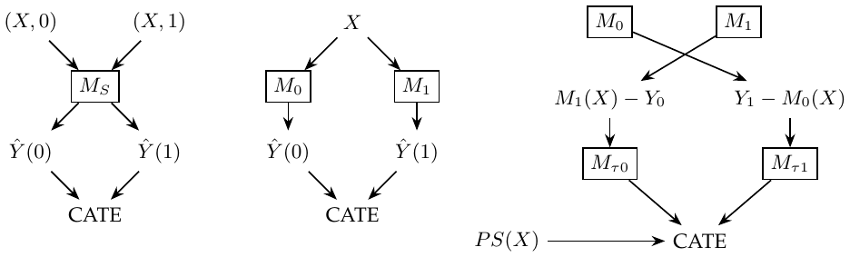

S-, T- and X-learner pointing relations.

</div>

Using the propensity as this combination weight is a useful rule, not a universal minimum-variance choice. Regularization bias can depend on the learners and need not always point toward zero.

# Chapter 22. Debiased / orthogonal machine learning

The reference is “Double Machine Learning for Treatment and Causal Parameters” (2016). ML estimates nuisance functions. For sales, the treatment price and features such as temperature, cost and weekday may have complex relationships; confounding makes a naive price regression unreliable.

#### Frisch–Waugh–Lovell.

For $`\hat Y=X_1\hat\beta_1+X_2\hat\beta_2`$, where $`X_1,X_2`$ are feature matrices (one feature per column, one observation per row) and $`\hat\beta_1,\hat\beta_2`$ are column coefficient vectors, the same coefficient on $`X_1`$ is obtained by:

1.  Regressing $`Y`$ on $`X_2`$, giving $`\hat Y^*=P_{X_2}Y`$.

2.  Regressing $`X_1`$ on $`X_2`$, giving $`\hat X_1=P_{X_2}X_1`$.

3.  Taking $`\widetilde X_1=X_1-\hat X_1`$ and $`\widetilde Y=Y-\hat Y^*`$.

4.  Regressing $`\widetilde Y`$ on $`\widetilde X_1`$ to recover $`\hat\beta_1`$.

Thus $`(Y-\widehat{Y\sim X})\sim(T-\widehat{T\sim X})`$ estimates $`\tau`$ in
``` math
Y_i-E[Y_i\mid X_i]=\tau\{T_i-E[T_i\mid X_i]\}+\varepsilon_i.
```

#### “FWL on steroids”: ML for ATE.

``` math
Y_i-\hat M_Y(X_i)=\tau\{T_i-\hat M_T(X_i)\}+\varepsilon_i.
```
<span style="color: #C92B32">$`\hat M_Y`$ estimates $`E[Y\mid X]`$ and acts as a denoising model, explaining variation in $`Y`$ due to $`X`$.</span> <span style="color: #C92B32">$`\hat M_T`$ estimates $`E[T\mid X]`$ and acts as a debiasing model, removing treatment-assignment bias associated with $`X`$.</span>

1.  Estimate outcome $`Y`$ from features $`X`$ with flexible ML regression $`M_Y`$.

2.  Estimate treatment $`T`$ from $`X`$ with $`M_T`$.

3.  Obtain residuals $`\widetilde Y=Y-M_Y(X)`$ and $`\widetilde T=T-M_T(X)`$.

4.  Regress outcome residuals on treatment residuals: $`\widetilde Y=\alpha+\tau\widetilde T`$.

I think of this as “two predictions, one regression.” In the constant-effect partially linear model $`Y=\tau T+g(X)+\varepsilon`$, $`E[\varepsilon\mid T,X]=0`$, $`\tau`$ is the causal slope (ATE for binary treatment). With heterogeneous binary effects, pooled residual regression instead targets $`E[e(X)(1-e(X))\tau(X)]/E[e(X)(1-e(X))]`$.

> **My overfitting explanation.** If $`M_Y`$ overfits, it captures more than the $`Y`$–$`X`$ relationship: it also absorbs some $`Y`$–$`T`$ relationship. The final effect can be biased toward zero because the outcome model has swallowed the causal relationship instead of leaving it for residual regression. If $`M_T`$ overfits, it explains too much variation in $`T`$, leaving little treatment-residual variance. The final estimate then has high variance. I connect this to an overly extreme fitted propensity. A near-zero fitted residual can be an overfitting symptom; it does not by itself prove that the true propensity violates positivity.

To address overfitting, split the data into $`K`$ folds. For each fold, train ML models on the other $`K-1`$ folds and obtain residuals on the held-out fold. Combine predictions/residuals for all folds and fit $`\widetilde Y=\alpha+\tau\widetilde T`$.

#### CATE and the R-learner.

Allow the slope to depend on $`X`$:
``` math
Y_i-M_Y(X_i)=\tau(X_i)\{T_i-M_T(X_i)\}+\varepsilon_i.
```
One final regression is $`\widetilde Y_i=\alpha+\beta_1\widetilde T_i+\beta_2X_i\widetilde T_i+\varepsilon_i`$. The final model estimates the sales effect by $`M(\mathrm{Price}=1,X_i)-M(\mathrm{Price}=0,X_i)`$. <span style="color: #C92B32">R-learner.</span>

#### Nonparametric double/debiased ML.

For a continuous relationship, such as price and sales, write
``` math
Y_i=\hat M_Y(X_i)+\tau(X_i)\{T_i-\hat M_T(X_i)\}+\hat\varepsilon_i.
```
Rearrange the residual:
``` math
\hat\varepsilon_i=\{Y_i-\hat M_Y(X_i)\}-\tau(X_i)\{T_i-\hat M_T(X_i)\}.
```
Minimizing its square gives R-loss. Under the stated identification conditions this estimates binary-treatment CATE, or the conditional slope for a response linear in continuous treatment:
``` math
\begin{aligned}
\hat L_n(\tau)&=\frac1n\sum_{i=1}^n\left[\{Y_i-\hat M_Y(X_i)\}-\tau(X_i)\{T_i-\hat M_T(X_i)\}\right]^2\\
&=\frac1n\sum_{i=1}^n(\widetilde Y_i-\tau(X_i)\widetilde T_i)^2\\
&=\frac1n\sum_{i=1}^n\widetilde T_i^2\left(\frac{\widetilde Y_i}{\widetilde T_i}-\tau(X_i)\right)^2.
\end{aligned}
```

> **My interpretation.** This is predicting $`\widetilde Y_i/\widetilde T_i`$ with any prediction model, using weights $`\widetilde T_i^2`$. When a residual is zero, use the undivided squared loss rather than forming the ratio.

**What is nonparametric about it?** The equation $`\widetilde Y_i=\tau(X_i)\widetilde T_i+e_i`$ remains linear in residual treatment, while $`\tau`$ can vary flexibly with $`X`$. For a genuinely nonlinear treatment response, its conditional R-loss minimizer is
``` math
\tau^*(x)=\frac{\operatorname{Cov}(T,Y\mid X=x)}{\operatorname{Var}(T\mid X=x)}.
```
This is a conditional projection slope, not automatically the derivative at a particular treatment value. The distinction motivates the next attempt.

## Non-Scientific Double/Debiased ML: unfinished

**Unfinished.** Following the textbook’s nonlinear construction, I am trying to understand how to obtain counterfactual predictions—“CATE?”—and an entire outcome curve from individual data points. Replace
``` math
\widetilde Y_i=\tau(X_i)\widetilde T_i+e_i
```
with a function nonlinear in the treatment residual,
``` math
\widetilde Y_i=g(X_i,\widetilde T_i)+e_i.
```
First predict treatment from $`X`$ and form its residual; then fit residual outcomes using $`(X,\widetilde T)`$. Any suitable ML model could be tried; the example uses LGBM. The fitted output is $`\widehat{\widetilde Y}`$.

#### My step-by-step interpretation.

Let $`Y`$ be sales, $`T`$ price, and $`X`$ covariates.

1.  Use five-fold LGBM cross-prediction to estimate $`\hat Y=\hat M_Y(X)`$ and $`\hat T=\hat M_T(X)`$, predicting each held-out fold with models trained on the others.

2.  Compute $`\widetilde Y=Y-\hat Y`$ and $`\widetilde T=T-\hat T`$.

3.  Fit an ML model to $`\widetilde Y`$ using $`(\widetilde T,X)`$; call it `finalM`, or $`\hat g`$.

4.  For a new $`X`$, average predictions from the five treatment models to get $`\hat T'`$. For each proposed counterfactual price $`T_{\rm new}`$, use
    ``` math
    \widetilde T'=T_{\rm new}-\hat T',\qquad \widetilde Y'=\hat g(X,\widetilde T').
    ```
    Training and prediction must use the same residual direction.[^1]

5.  Add the baseline prediction back: $`\hat Y(T_{\rm new},X)=\hat M_Y(X)+\widetilde Y'`$. The outcome residual is centered around zero; adding the baseline restores the outcome level.

This produces an outcome curve; an effect requires comparing two points or taking a derivative. I have not completed the causal justification of this nonlinear construction.

The two-fold diagram below shows the cross-prediction pattern used for both nuisance models; the five-fold procedure repeats the same principle.

<div class="center">

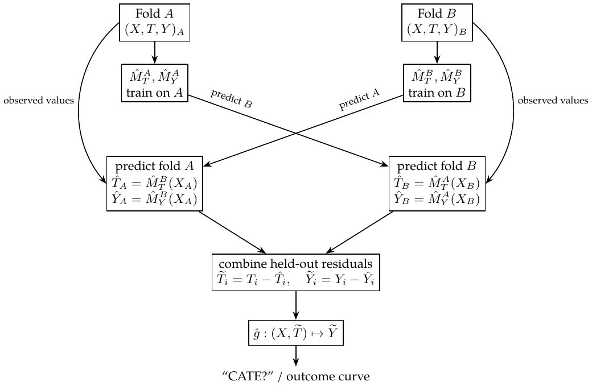

</div>

Drawbacks I want to remember: regularization can shrink the causal estimate, and the chosen ML algorithm matters. Boosted trees give stepwise rather than smooth curves and extrapolate poorly to unseen prices, where predictions can be strange.

> **Supplementary explanation: what the nonlinear fit identifies**
>
> For fixed $`m,\ell`$, $`r=t-m(x)`$ is invertible at fixed $`x`$. A consistent fit $`g(x,r)=E[Y-\ell(X)\mid X=x,T-m(X)=r]`$ reconstructs $`E[Y\mid x,t]=\ell(x)+g(x,t-m(x))`$. A causal response additionally needs exchangeability and support. This flexible residual learner does not automatically inherit the orthogonality or rate guarantees of R-loss. Cross-fitting controls own-observation overfitting; the identifying assumptions and adequate nuisance estimation are still needed.

# Chapter 23. Effect heterogeneity and nonlinearity

Treatment effect heterogeneity (TEH) means treatment effects differ among individuals. The example studies a latent outcome:
``` math
\begin{aligned}
Y_{\mathrm{latent}}&\sim N(-4.5+0.001\,\mathrm{income}+\mathrm{nudge}
+0.01\,\mathrm{nudge}\cdot\mathrm{age},\ 1),\\
\mathrm{nudge}&\sim B(0.5),\qquad \mathrm{age}\sim G(10,4).
\end{aligned}
```
Use $`\mathrm{income}=100G(20,2)`$, with Gamma shape–scale notation, and $`\mathrm{conversion}=\mathbf1\{Y_{\mathrm{latent}}>0.1\}`$.[^2] <span style="color: #244DA8">Income’s additive coefficient is the same for everyone; age modifies the treatment effect on the latent scale.</span> The latent ATE is $`1+0.01E[\mathrm{age}]=1.4`$. The example’s simulated treated-minus-control conversion difference is about $`0.394`$. Conversion is nonlinear, so this is a different effect scale.

#### What the sketches show.

For the effect on the latent outcome, the cumulative effect curve ranked by age starts high and declines toward ATE; the estimated-income ranking stays near ATE. For the effect on conversion, both age and estimated income show treatment-effect heterogeneity. Income is strongly predictive of conversion even though it does not interact with treatment on the latent scale.

My third sketch shows an S-shaped conversion curve against estimated income. Both ends are flat: when baseline conversion is extremely low or high, a fixed positive latent shift has little effect. The middle region can be more responsive. Thus “lower baseline conversion means a larger effect” is only a comparison within a suitable part of the curve, not a general rule.

#### A second example: price response.

The sales-versus-price sketch has two downward-sloping nonlinear curves for types $`a`$ and $`b`$. Type $`a`$ is labeled wealthy. Across increasing price intervals the drawn declines are roughly 1, 2, 3, 4 for $`a`$ and 2, 4, 5 for $`b`$. The effect depends both on type ($`a`$ or $`b`$) and on price, so ranking by one fixed elasticity is problematic. My modeling idea is to try transforming price, for example $`-(\mathrm{price}^{4})`$, to make the relation with $`Y`$ linear. The transformation must fit the response shape; it is a proposal to check.

<div class="center">


latent versus conversion rankings, saturation, and type/price dependence.

</div>

#### Supplementary explanation.

For latent mean $`a`$, positive shift $`\delta`$, unit normal noise and threshold $`c`$, the conversion effect is $`\Phi(a+\delta-c)-\Phi(a-c)`$, small at both extremes. If a price transformation gives $`E[Y\mid p,x]=a(x)+b(x)h(p)`$, the effect on the original price scale remains $`b(x)h'(p)`$; linearity in transformed price does not imply a constant price effect.

# Chapter 24: The Difference-in-Differences Saga

## Panel data and two-way fixed effects

**Panel data:** repeatedly observing the same unit over time. Here we compare units across time and across regions.

<div class="center">


</div>

The dashed gray path is the TWFE counterfactual.

Group units by intervention date $`g`$.

> <span style="color: #000000">Intervention start date</span> $`\textcolor{black}{\longrightarrow}`$ Cohort label $`g`$

Taking $`t=g`$ as the first treated period, the cohort-time target is
``` math
\operatorname{ATT}(g,t)=E[Y_t(g)-Y_t(\infty)\mid G=g],\qquad t\ge g.
```
Here $`Y_t(\infty)`$ is the outcome without adoption. Averaging cohort-time effects requires specifying the weights.

The model is
``` math
\mathrm{Install}_{it}=\tau D_{it}+\gamma_i+\theta_t+e_{it}.
```
Here $`i`$ denotes a unit, $`t`$ time, and $`e_{it}`$ noise. $`\gamma_i`$ captures unit differences and $`\theta_t`$ common time shocks. <span style="color: #244DA8">Estimating by OLS gives two-way fixed effects (TWFE): jointly absorb time-invariant unit characteristics and common time effects.</span> Unit-specific, time-varying confounding is not absorbed by these two effects alone.

> <span style="color: #C92B32">Two groups and two periods</span> $`\textcolor{red}{\longrightarrow}`$ The TWFE coefficient equals the DiD contrast.

> <span style="color: #000000">TWFE outcome model</span> $`\textcolor{black}{\longrightarrow}`$ Residualize outcome and treatment against the same fixed effects.

For a balanced panel, $`z\in\{\mathrm{Install},D\}`$:
``` math
\widetilde{\mathrm{Install}}_{it}=\tau\widetilde D_{it}+e_{it}.
```
``` math
\begin{aligned}
\widetilde z_{it}&=z_{it}-\underbrace{\bar z_{i\cdot}}_{\textcolor{red}{\text{time average}}}-\underbrace{\bar z_{\cdot t}}_{\textcolor{red}{\text{unit average}}}+\bar z_{\cdot\cdot},\\
\bar z_{i\cdot}&=\frac1T\sum_{s=1}^Tz_{is},\qquad
\bar z_{\cdot t}=\frac1N\sum_{j=1}^Nz_{jt},\qquad
\bar z_{\cdot\cdot}=\frac1{NT}\sum_{j=1}^N\sum_{s=1}^Tz_{js}.
\end{aligned}
```
Adding the grand mean makes the row and column means zero. If that constant is omitted, an intercept in the final regression absorbs the shift; without an intercept it can affect the slope. For an unbalanced panel, use the fixed-effect projection.

## Death: Failures over Effect Heterogeneity

With heterogeneous treatment effects, a TWFE coefficient need not equal the ATT we want. Start with the static model
``` math
y_{it}=\tau D_{it}+\gamma_i+e_{it}.
```
**1. Functional form.** A common treatment coefficient, linearity in included covariates, and additive fixed effects. In particular, a single $`\tau`$ rules out effects that change with time since treatment.

**2. Exogeneity and timing.** The static regression motivates checking strict exogeneity,
``` math
E[e_{it}\mid D_{i1},\ldots,D_{iT},\gamma_i]=0,
```
and the related issues of anticipation, unobserved time-varying confounders, carryover from past treatment, and feedback from past outcomes to current treatment. These checks are connected to, but not interchangeable with, the parallel-trends and no-anticipation restrictions used for DiD. Dynamic treatment effects require an appropriate model and target.

Suppose the response grows gradually: $`0.1,0.2,\ldots`$, day by day. Label the early-treated group $`1`$, the late-treated group $`2`$, and the never-treated group $`3`$. TWFE combines several $`2\times2`$ DiD comparisons:
``` math
1-3:\ \checkmark,\quad 2-3:\ \checkmark,\quad
1-2:\ \checkmark,\quad 2-1:\ \text{??}
```
The second group is the control. In $`1-2`$, use the window before group $`2`$ is treated. The questionable comparison is $`2-1`$: group $`1`$ is already treated.

**My intuition:** when the early-treated group is used as the control, its evolving treatment effect is mistaken for part of the untreated trend. The blue curve shows the resulting estimate of $`Y_0`$ for the late-treated group.

<div class="center">


</div>

Goodman-Bacon’s decomposition is summarized as
``` math
\operatorname*{plim}_{n\to\infty}\widehat\tau^{\mathrm{TWFE}}
=\mathrm{VWATT}-\Delta\mathrm{ATT}.
```

> <span style="color: #244DA8">Bias from changes in ATT over time</span> $`\textcolor{blue}{\longrightarrow}`$ $`\Delta\mathrm{ATT}`$

<span style="color: #244DA8">In the comparison drawn above, an increasing effect contaminates the control trend and biases the contrast downward; a decreasing effect reverses this direction. With negative effects that become more negative, even the estimated sign can be wrong!</span> The aggregate TWFE discrepancy also depends on cohort effects and the comparison weights; this picture does not determine its sign in every design.

## Event-study design

Replace the single treatment indicator with event-time indicators, omitting $`k=-1`$ as the reference period:
``` math
\begin{aligned}
Y_{it}={}&\alpha_i+\theta_t+\beta_{<-K}\mathbf1\{t-G_i<-K\}\\
&+\sum_{k=-K}^{-2}\beta_kD_{it}^k+\sum_{k=0}^{L}\beta_kD_{it}^k
+\beta_{>L}\mathbf1\{t-G_i>L\}+e_{it},\\
D_{it}^k={}&\mathbf1\{t-G_i=k\}.
\end{aligned}
```

> <span style="color: #000000">$`D_{it}^{k}=\mathbf1\{t-G_i=k\}`$</span> $`\textcolor{black}{\longrightarrow}`$ One in relative period $`k`$, zero otherwise.

> <span style="color: #244DA8">Measure how far a unit is from treatment start</span> $`\textcolor{blue}{\longrightarrow}`$ The event-time indicator $`D_{it}^{k}`$.

All event-time indicators are zero for never-treated units. This is only a partial improvement: with staggered adoption and heterogeneous effects, these lead/lag coefficients can still mix effects from other relative periods. Causal interpretation requires valid cohort comparisons.

## Enlightenment: a flexible functional form

First try a separate treatment effect for every unit and time:
``` math
Y_{is}=\alpha_i+\theta_s+
\sum_{j=1}^N\sum_{t=1}^T\tau_{jt}\mathbf1\{i=j\}\mathbf1\{s=t\}D_{is}+e_{is}.
```
Too many parameters! Group units by adoption cohort instead:
``` math
Y_{is}=\alpha_i+\theta_s+
\sum_{g\in\mathcal G}\sum_{t=1}^T\tau_{gt}\mathbf1\{G_i=g\}\mathbf1\{s=t\}D_{is}+e_{is}.
```
This reduces the number of effect parameters from unit-by-time to cohort-by-time. The explicit indicators show which coefficient applies to observation $`(i,s)`$.

Remove pre-treatment and control-cohort effect coefficients:
``` math
Y_{is}=\alpha_i+\theta_s+
\sum_{g\in\mathcal G_{\mathrm{tr}}}\sum_{t\ge g}\tau_{gt}\mathbf1\{G_i=g\}\mathbf1\{s=t\}+e_{is}.
```
Here $`\mathcal G_{\mathrm{tr}}`$ contains cohorts treated in the observation window. Controls must remain untreated in the comparison window: never-treated units, or appropriately selected not-yet-treated units. An earlier adoption date alone does not make a cohort a control. [^3]

> <span style="color: #244DA8">Manually create cohort dummies: $`(0,1),(1,0),\ldots`$</span> $`\textcolor{blue}{\longrightarrow}`$ The cohort-by-time treatment terms.

Two points remain:

1.  Treatment effects may change over time; the earlier constant-effect model ignored this.

2.  DiD and TWFE still need the relevant parallel-trends restriction. This is a very strong restriction.

# Chapter 25: Synthetic Difference-in-Differences

## Representing panel data

Observe multiple units over multiple periods. In $`D`$, rows are times and columns are units:
``` math
D=\begin{pmatrix}0&0&0&\cdots&0&0\\0&0&0&\cdots&0&0\\\vdots&\vdots&\vdots&&\vdots&\vdots\\0&0&0&\cdots&1&1\\0&0&0&\cdots&1&1\end{pmatrix}.
```

> <span style="color: #000000">Columns containing ones after adoption</span> $`\textcolor{black}{\longrightarrow}`$ Treated units

**Absorbing treatment:** once a unit is treated, it does not return to the untreated state. The four-block form here also uses a common pre/post split for the treated units. These are design restrictions; causal identification still requires assumptions about the untreated outcomes. Staggered adoption is handled later through subpanels.

#### Representation 1: synthetic control.

Group the observations into four blocks:
``` math
D=\begin{pmatrix}0&0\\0&1\end{pmatrix},\qquad
Y=\begin{pmatrix}Y_{\mathrm{pre,co}}&Y_{\mathrm{pre,tr}}\\Y_{\mathrm{post,co}}&Y_{\mathrm{post,tr}}\end{pmatrix}.
```
Here pre/post means before/after treatment, and co/tr means control/treated.

#### Representation 2: DiD.

Use a long table with columns for unit, time, outcome, treatment-group membership, and whether treatment has already begun.

The observed blocks and the missing counterfactual are
``` math
Y=\begin{pmatrix}Y(0)_{\mathrm{pre,co}}&Y(0)_{\mathrm{pre,tr}}\\Y(0)_{\mathrm{post,co}}&Y(1)_{\mathrm{post,tr}}\end{pmatrix},
\qquad
\operatorname{ATT}=\overline Y(1)_{\mathrm{post,tr}}-\underbrace{\overline Y(0)_{\mathrm{post,tr}}}_{\text{counterfactual}}.
```
Bars average over the treated post-treatment cells.

## Revisiting DiD and synthetic controls

The DiD regression and its parallel-trends restriction are
``` math
Y_{it}=\beta_0+\beta_1\mathrm{Post}_t+\beta_2\mathrm{Treated}_i
+\beta_3\mathrm{Treated}_i\mathrm{Post}_t+e_{it},
```
``` math
E[Y(0)_{\mathrm{post,co}}-Y(0)_{\mathrm{pre,co}}]
=E[Y(0)_{\mathrm{post,tr}}-Y(0)_{\mathrm{pre,tr}}].
```
Without treatment, the two groups would have the same average change.

$`\widehat\tau^{\mathrm{did}}`$ is the treatment coefficient minimizing
``` math
\min_{\mu,\alpha,\beta,\tau}\sum_{i=1}^N\sum_{t=1}^T
[Y_{it}-(\textcolor{blue}{\mu+\alpha_i}+\beta_t+\tau D_{it})]^2.
```
``` math
\begin{aligned}
\widetilde Y_{it}&=Y_{it}-\overline Y_{i\cdot}-\overline Y_{\cdot t}+\overline Y_{\cdot\cdot},\\
\widetilde D_{it}&=D_{it}-\overline D_{i\cdot}-\overline D_{\cdot t}+\overline D_{\cdot\cdot}.
\end{aligned}
```

> <span style="color: #000000">Demeaning $`Y`$ and $`D`$ in a balanced panel</span> $`\textcolor{black}{\longrightarrow}`$ The fixed-effects least-squares criterion.

This resembles synthetic control, but lacks the weights.

For synthetic control, fit weights before treatment:
``` math
\widehat w^{\mathrm{sc}}=\operatorname*{argmin}_{w_{\mathrm{co}}}
\|\overline y_{\textcolor{blue}{\mathrm{pre,tr}}}-Y_{\mathrm{pre,co}}w_{\mathrm{co}}\|_2^2,
\quad \sum_{i\in\mathrm{co}}w_i=1,\quad w_i\ge0.
```
$`Y_{\mathrm{pre,co}}`$ is $`T_{\mathrm{pre}}\times N_{\mathrm{co}}`$: rows are times, columns are units. $`w_{\mathrm{co}}`$ is $`N_{\mathrm{co}}\times1`$. Each entry of $`\overline y_{\mathrm{pre,tr}}`$ averages treated units at one pre-treatment time. <span style="color: #244DA8">Fit a synthetic control to the treated group: this is similar to linear regression.</span> Zero donor weights are allowed.

After treatment, use the weighted controls to predict the missing outcome, and average the post-treatment gaps. The corresponding SC regression criterion is also shown:
``` math
\widehat Y(0)_{\mathrm{post,tr}}=Y_{\mathrm{post,co}}\widehat w^{\mathrm{sc}}_{\mathrm{co}},\qquad
\widehat{\operatorname{ATT}}=\operatorname{average}_{t\in\mathrm{post}}
[\overline y_{t,\mathrm{tr}}-\widehat Y(0)_{t,\mathrm{tr}}].
```
``` math
\min_{\beta,\tau}\sum_{i=1}^N\sum_{t=1}^T
[Y_{it}-(\beta_t+\tau D_{it})]^2\widehat w_i^{\mathrm{sc}},
\qquad \widehat w_i^{\mathrm{sc}}=1/N_{\mathrm{tr}}\quad(i\in\mathrm{tr}).
```
<span style="color: #244DA8">Unlike DiD, this criterion has neither an overall intercept $`\mu`$ nor unit fixed effects $`\alpha_i`$.</span> Interpreting the gap causally requires the synthetic comparison to remain valid for untreated post-treatment outcomes; close pre-treatment fit alone does not guarantee that.

#### How I picture the comparison.

In the first sketch, extending the control trend in parallel overstates the effect in this particular example. In the second, pre-treatment weights form a synthetic untreated version of the treatment group; apply those weights after treatment and compare the two averages.

<div class="center">

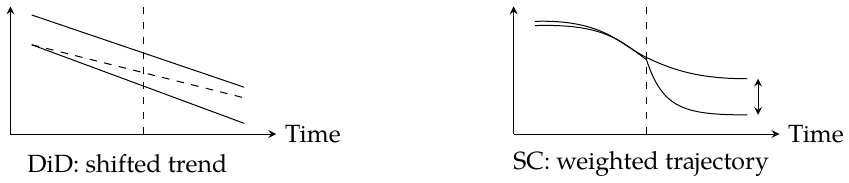

</div>

## Combining the two: synthetic DiD

<span style="color: #C92B32">$`\star`$</span> Compare the two ingredients:
``` math
\begin{array}{ll}
\mathrm{SC}:&\displaystyle\min_{\beta,\tau}\sum_{i,t}[Y_{it}-(\beta_t+\tau D_{it})]^2\widehat w_i^{\mathrm{sc}},\\[2mm]
\mathrm{DiD}:&\displaystyle\min_{\mu,\alpha,\beta,\tau}\sum_{i,t}[Y_{it}-(\mu+\alpha_i+\beta_t+\tau D_{it})]^2.
\end{array}
```

> <span style="color: #000000">SC weights and DiD fixed effects</span> $`\textcolor{black}{\longrightarrow}`$ Combine them, adding time weights.

$`\widehat\tau^{\mathrm{sdid}}`$ is the treatment coefficient minimizing
``` math
\min_{\mu,\alpha,\beta,\tau}\sum_{i=1}^N\sum_{t=1}^T
[Y_{it}-(\mu+\alpha_i+\beta_t+\tau D_{it})]^2
\underbrace{\widehat w_i^{\mathrm{sdid}}}_{\textcolor{red}{\text{unit weight}}}
\underbrace{\widehat\lambda_t^{\mathrm{sdid}}}_{\textcolor{red}{\text{time weight}}}.
```

#### Time weights.

Fit the controls’ average post-treatment outcomes from their pre-treatment outcomes:
``` math
(\widehat\lambda_0,\widehat\lambda_{\mathrm{pre}})
=\operatorname*{argmin}_{\lambda_0,\lambda_{\mathrm{pre}}}
\|\overline y_{\textcolor{blue}{\mathrm{post,co}}}-(\lambda_{\mathrm{pre}}Y_{\mathrm{pre,co}}+\lambda_0\mathbf1^{\mathsf T})\|_2^2,
\quad \sum_{t\in\mathrm{pre}}\lambda_t=1,\quad\lambda_t\ge0.
```

- $`Y_{\mathrm{pre,co}}`$: $`T_{\mathrm{pre}}\times N_{\mathrm{co}}`$, with times in rows and units in columns.

- $`\overline y_{\mathrm{post,co}}`$: $`1\times N_{\mathrm{co}}`$, averaging each control unit over post-treatment times.

- $`\lambda_{\mathrm{pre}}`$: $`1\times T_{\mathrm{pre}}`$, one weight per pre-treatment period.

With this row-vector convention, prepend a row of ones for the intercept. Fit $`(\lambda_0,\lambda_{\mathrm{pre}})`$ to predict the post-treatment control average:

<div class="center">

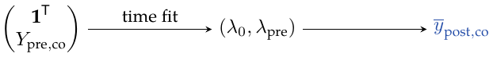

</div>

#### Unit weights.

The two weighting directions fit together as follows:

<div class="center">


</div>

``` math
\begin{aligned}
(\widehat w_0,\widehat w_{\mathrm{co}})
=\operatorname*{argmin}_{w_0,w_{\mathrm{co}}}\big\{&
\|\overline y_{\textcolor{blue}{\mathrm{pre,tr}}}-(Y_{\mathrm{pre,co}}w_{\mathrm{co}}+w_0\mathbf1)\|_2^2\\
&+\zeta^2T_{\mathrm{pre}}\|w_{\mathrm{co}}\|_2^2\big\},\\
\sum_{i\in\mathrm{co}}w_i&=1,\quad w_i\ge0,\\
\zeta&=(N_{\mathrm{tr}}T_{\mathrm{post}})^{1/4}\widehat\sigma(\Delta_{it}),
\qquad \Delta_{it}=Y_{it}-Y_{i,t-1}.
\end{aligned}
```
Estimate $`\widehat\sigma`$ from first differences of control outcomes during the pre-treatment period.

> <span style="color: #C92B32">The $`L_2`$ penalty tends to spread the nonzero weights more widely</span> $`\textcolor{red}{\longrightarrow}`$ $`\zeta^2T_{\mathrm{pre}}\|w_{\mathrm{co}}\|_2^2`$

Add a column of ones to the predictor matrix:
``` math
X=[\,\mathbf1_{T_{\mathrm{pre}}}\ \ Y_{\mathrm{pre,co}}\,].
```
Fit $`(w_0,w_{\mathrm{co}})`$, leaving the intercept unconstrained and unpenalized.

> <span style="color: #244DA8">There is an intercept</span> $`\textcolor{blue}{\longrightarrow}`$ $`w_0`$

<span style="color: #244DA8">Compared with SC: the intercept can improve the match to the treated trajectory, and the $`L_2`$ penalty regularizes the donor weights.</span>

Use uniform weights $`1/N_{\mathrm{tr}}`$ for treated units and $`1/T_{\mathrm{post}}`$ for post-treatment times. **My intuition:** I initially understood SDID, compared with SC, as focusing only on data taking effect near the intervention. Looking at the time-weighting objective, the weights actually use the controls’ pre-treatment outcomes to fit their average post-treatment outcomes. A useful earlier period can therefore also receive weight; distance from the intervention date does not directly determine the weights.

## Time-effect heterogeneity and staggered adoption

To estimate an effect separately for each period, run SDID on separate subpanels. Subscripts on the zeros and ones identify the original period.

#### <span style="color: #C92B32">Time-effect heterogeneity.</span>

The full matrix estimates an average ATT over periods 3 and 4. Split it to estimate the two periods separately:

<div class="center">

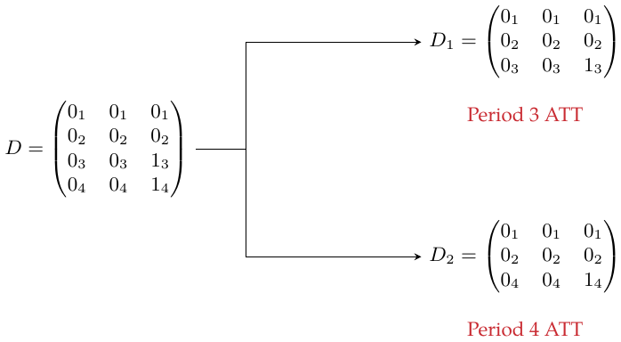

</div>

#### <span style="color: #C92B32">Staggered adoption.</span>

Now adoption occurs at different times. First split by post-treatment period:

<div class="center">

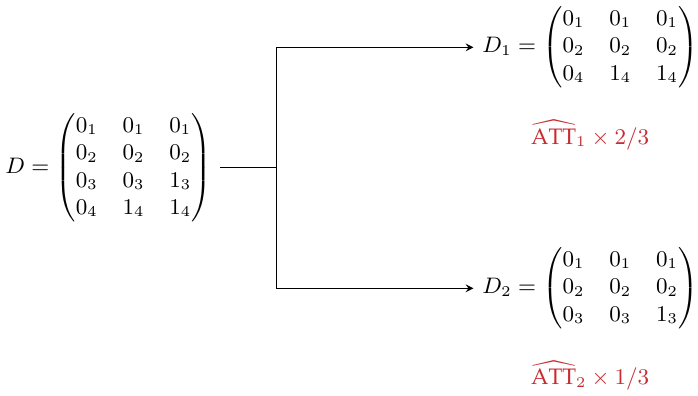

</div>

Period 4 contains two treated cells and period 3 one, hence the weights $`2/3`$ and $`1/3`$. Use genuinely untreated donors in each subpanel.

Alternatively, split by treated cohort, keeping the never-treated unit as the donor:

<div class="center">

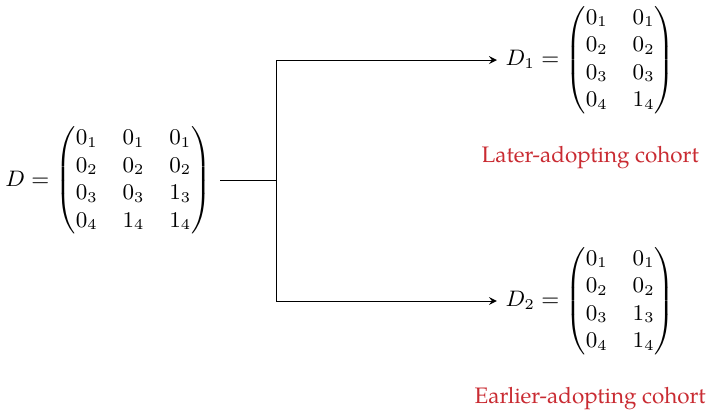

</div>

For example, California is treated for 12 years, and three other units for 8 years each:
``` math
\mathrm{ATT}_0\frac{12}{36}
+\left(\sum_{j=1}^{3}\mathrm{ATT}_j\right)\frac13\frac{3\times8}{36}.
```
These weights target the average over observed treated unit-period cells. A different target population can require different weights.

## Placebo variance estimation

In the example, SDID has smaller error bars than SC: adjusting across units and across time can reduce outcome variation. This can improve precision, although smaller valid uncertainty than SC is not guaranteed in every design. Placebo inference is especially useful when there is only one treated unit.

Pretend each control unit was treated, and estimate its placebo ATT using SDID.

> <span style="color: #000000">Placebo ATT estimates</span> $`\textcolor{black}{\longrightarrow}`$ Their variance, then an approximate confidence interval.

``` math
\overline\tau^{\mathrm{pl}}=\frac1B\sum_{b=1}^B\widehat\tau^{(b)},\qquad
\widehat V_\tau^{\mathrm{pl}}=\frac1B\sum_{b=1}^B
(\widehat\tau^{(b)}-\overline\tau^{\mathrm{pl}})^2,
```
``` math
\left[\widehat\tau^{\mathrm{sdid}}-z_{1-\alpha/2}\sqrt{\widehat V_\tau^{\mathrm{pl}}},\quad
\widehat\tau^{\mathrm{sdid}}+z_{1-\alpha/2}\sqrt{\widehat V_\tau^{\mathrm{pl}}}\right].
```
Here $`z_{1-\alpha/2}`$ is the standard-normal quantile. The idea of comparing placebo effects is shared with SC. For the variance to represent uncertainty about the actual treatment effect, placebo and treated units must have comparable noise behavior. With several treated units, placebo assignments should reproduce that group size; the ordinary weighted-regression standard error is not a substitute for this inference step.

# Appendix: Debiasing and Prediction

Non-randomized data lead to two adjustment approaches: propensity scores and orthogonalization.

## Debiasing with orthogonalization

> <span style="color: #244DA8">Chapter 22</span> $`\textcolor{blue}{\longrightarrow}`$ Orthogonalization: residualize the variables.

All features are contained in $`X`$.

1.  Regress the outcome on the first set of features and take its residual:
    ``` math
    y_i=\theta_0+\theta_1X_{1i}+e_i,\qquad
    y_i^*=y_i-(\widehat\theta_0+\widehat\theta_1X_{1i}).
    ```

2.  Predict the second set of features from the first, and take that residual:
    ``` math
    X_{2i}=\gamma_0+\gamma_1X_{1i}+e_i,\qquad
    X_{2i}^*=X_{2i}-(\widehat\gamma_0+\widehat\gamma_1X_{1i}).
    ```

3.  Regress the outcome residual on the feature residual:
    ``` math
    y_i^*=\beta_0+\beta_2X_{2i}^*+e_i.
    ```

## Debiasing with propensity scores

> <span style="color: #244DA8">Chapter 11</span> $`\textcolor{blue}{\longrightarrow}`$ Propensity-score weighting.

Weight each unit. The first formula is for binary treatment; the second extends it to discrete categories $`0,\ldots,K`$:
``` math
w_i=\frac{T_i}{e(X_i)}+\frac{1-T_i}{1-e(X_i)},\qquad e(X_i)=P(T_i=1\mid X_i).
```
``` math
w_i=\sum_{k=0}^{K}\frac{\mathbf1\{T_i=k\}}{P(T_i=k\mid X_i)}.
```
A genuinely continuous treatment instead requires a conditional density and a specified dose-response target.

> My intuition: a unit with a high chance of treatment that nevertheless remains untreated resembles the treated group but is observed as a control. It helps us estimate the treated group’s missing untreated outcome.

This intuition points toward an ATT comparison: treated units receive weight 1, and controls receive $`e(X)/(1-e(X))`$, suitably normalized. The displayed inverse-probability weights instead balance toward the overall population for an ATE comparison. Both causal interpretations require consistency, conditional exchangeability, and the relevant overlap.

When propensity scores are unknown, train a model using observed treatment $`T_i`$ as the response, estimating $`P(T_i=1\mid X_i)`$. The binary observation is distinct from the probability predicted by the model. A small email example: 20% (0.2) is the probability; actually receiving the email is recorded as 1. A probability of 0.2 does not imply that a particular person must receive the email.

#### Weaknesses of propensity weighting.

**1. Large weights.** If $`e<0.05`$, a treated observation receives a large weight $`1/e`$: it effectively appears many times and strongly influences the weighted data. A control with $`e`$ near one similarly has a large $`1/(1-e)`$ weight. <span style="color: #244DA8">High variance.</span>

**2. Positivity/common support.** Treated and control units need sufficient covariate overlap. Weighting cannot recover a missing comparison where overlap fails.

> I am wary of manually removing observations: subjective choices can introduce bias. Do not extrapolate to population subsets where positivity does not hold.

Prespecified trimming can address limited overlap, but changes the population under study and must be reported. Good prediction of treatment alone does not establish causal exchangeability.

## When prediction fails

Prediction and causality. To be continued.

[^1]: The textbook’s Chapter 22 prose reverses this subtraction and labels a residual-outcome prediction “Price”; its code uses counterfactual price minus predicted price. The equations here follow the code and training definition.

[^2]: These are the textbook simulation’s code settings. Its prose, also followed in my initial notes, omits the factor 100 and uses threshold 0. The quoted conversion difference belongs to the code settings.

[^3]: The chapter’s displayed sums and its ordering of control-cohort labels are schematic. Its implemented example uses cohorts untreated during the observed window as controls.
