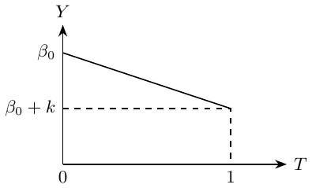
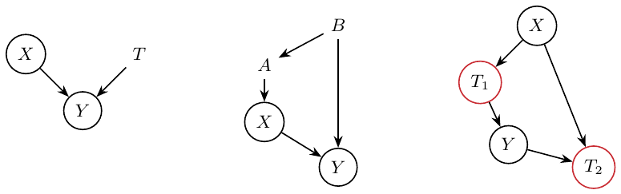
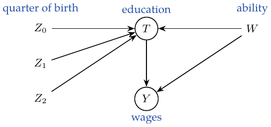
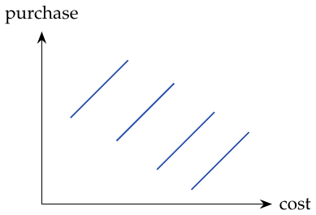
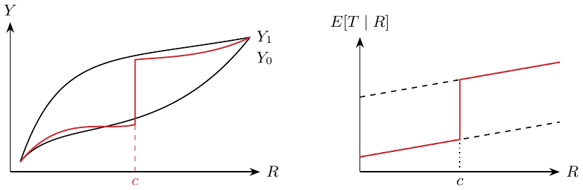
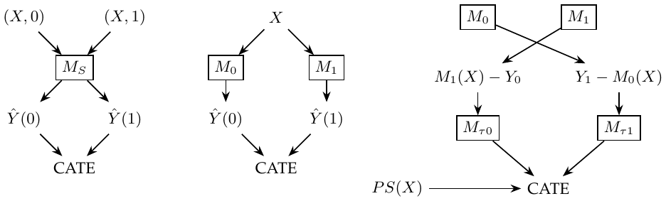
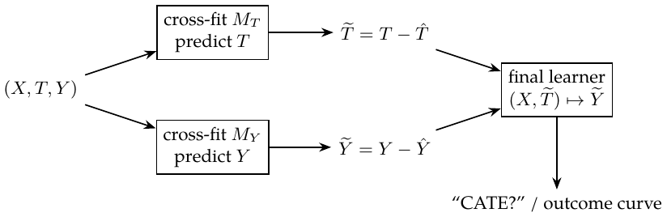
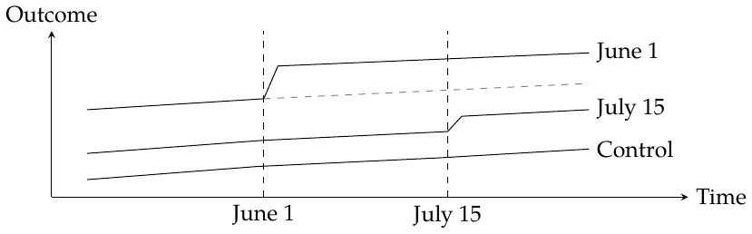
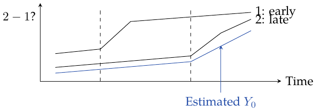
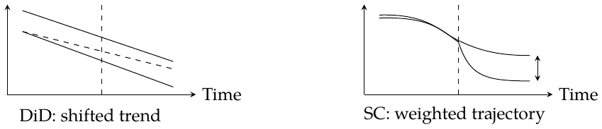

# Causal Inference for the Brave and True

Chapters 1–25 and Appendix · Reviewed English edition

Original black, red, and blue ink is retained in color spans and diagrams. Purple marks errors in the original note; orange marks qualifications or unresolved readings. Recognition and translation errors are fixed directly. Arrows show the author’s pointing relations in a reflowed English layout.

**Color rendering:** GitHub strips CSS colors from prose. The labeled review blocks remain readable there; use the [PDF](Brave-and-True-English.pdf) or [HTML preview](english/reviewed/Brave-and-True-English.html) to see prose colors. Mathematical source remains editable in this Markdown file; diagram PNGs preserve the original arrow colors.

Source coverage: 54 scanned pages. See the companion findings JSON and coverage Markdown for the audit trail.

---

# Chapter 1. Introduction to causality

*Scan reference: Chapter1-23.pdf, p. 1*

$`T_i`$ is treatment intake; $`Y_i`$ is the observed outcome. The notebook contrasts “reality (group assignment)” with “truth.”
``` math
\mathrm{ATE}=E[Y_1-Y_0],\qquad \mathrm{ATT}=E[Y_1-Y_0\mid T=1].
```
ATE is the average treatment effect; ATT concerns those who receive treatment. The causal quantity is the potential-outcome contrast. The observed association decomposes as
``` math
\underbrace{E[Y\mid T=1]-E[Y\mid T=0]}_{\textcolor{blue}{\text{association}}}
=\underbrace{E[Y_1-Y_0\mid T=1]}_{\textcolor{blue}{\mathrm{ATT}}}
+\underbrace{E[Y_0\mid T=1]-E[Y_0\mid T=0]}_{\textcolor{blue}{\text{bias}}}.
```

<div class="original-ink" style="color: #244DA8" data-ink="blue" aria-label="Original blue ink">

**My annotation.** When bias is zero, association represents ATT; the arrows then connect ATT to $`E[Y_1-Y_0]`$, labeled “causality.”

</div>

**Original pointing relations.**

> <span style="color: #244DA8">Bias $`=0`$: association represents ATT</span> $`\textcolor{blue}{\longrightarrow}`$ $`\mathrm{ATT}`$

> <span style="color: #244DA8">Can be converted to causality (source arrow)</span> $`\textcolor{blue}{\longrightarrow}`$ $`E[Y_1-Y_0]`$; see the qualification below

<div class="review-note" style="color: #B45A00" data-ink="ReviewOrange" aria-label="Qualification / unresolved point">

**Qualification / unresolved point (B1-004): Zero selection bias identifies ATT, not automatically ATE**

*Source: Chapter1-23.pdf, pp. 1*

The arrow is present in the original blue ink. Zero $`E[Y_0\mid T=1]-E[Y_0\mid T=0]`$ gives association $`=\mathrm{ATT}`$. To replace ATT by ATE also require $`E[Y_1-Y_0\mid T=1]=E[Y_1-Y_0]`$; random assignment of both potential outcomes is sufficient. Indeed, $`\mathrm{ATE}=P(T=1)\mathrm{ATT}+P(T=0)\mathrm{ATU}`$.

*Reference:* [Handbook, Chapter 1](https://matheusfacure.github.io/python-causality-handbook/01-Introduction-To-Causality.html).

</div>

# Chapter 2. Randomized experiments

*Scan reference: Chapter1-23.pdf, p. 1*

Randomized experiments provide a way to remove bias. The sketch separates the link from existing circumstances to potential outcomes (the link to eliminate) from the treatment-to-observed-outcome link (the link to study). An RCT supplies

<div class="original-ink" style="color: #244DA8" data-ink="blue" aria-label="Original blue ink">

``` math
(Y_0,Y_1)\perp T,\qquad E[Y_0\mid T=0]=E[Y_0\mid T=1]=E[Y_0],
```
so the selection-bias term is zero.

</div>

**Original pointing relations.**

> <span style="color: #244DA8">RCT supplies the condition</span> $`\textcolor{blue}{\longrightarrow}`$ $`(Y_0,Y_1)\perp T`$

> <span style="color: #244DA8">Need to eliminate this link</span> $`\textcolor{blue}{\longrightarrow}`$ Existing circumstances $`\longrightarrow`$ potential outcomes

> <span style="color: #244DA8">Need to study this link</span> $`\textcolor{blue}{\longrightarrow}`$ Treatment $`\longrightarrow`$ observed outcome

# Chapter 3. A review of statistics

*Scan reference: Chapter1-23.pdf, p. 2*

The standard error of an estimate is written as $`\mathrm{SE}=\hat\sigma/\sqrt n`$, with
``` math
\hat\sigma^2=\frac{1}{N-1}\sum_i(x_i-\bar x)^2.
```
Smaller sample size $`\Rightarrow`$ larger standard error $`\Rightarrow`$ wider confidence interval. The null hypothesis is that the treatment and control distributions have the same mean. Even if their individual confidence intervals overlap, their mean difference may still be statistically different from zero. <span style="color: #244DA8">The blue annotations distinguish the 95% intervals for the two group means from the difference between those means.</span>

The notebook writes the $`p`$-value as $`P(\text{data}\mid H_0)`$: under $`H_0`$, the probability of the observed data or more extreme data (with a Type I error reminder). Confidence level is described as the probability that the estimate and the population parameter differ by no more than a specified margin. Higher confidence $`\Rightarrow`$ a wider interval $`\Rightarrow`$ lower precision. The significance level is the probability of a Type I error.

**My intuition.** If the $`p`$-value is very small, then the observed data would be very unlikely under $`H_0`$, yet they occurred, suggesting that $`H_0`$ is false. <span style="color: #244DA8">Compare the sample’s $`p`$-value with the significance threshold chosen theoretically.</span>

**Original pointing relations.**

> <span style="color: #000000">$`\mathrm{SE}=\hat\sigma/\sqrt n`$</span> $`\textcolor{black}{\longrightarrow}`$ $`\hat\sigma^2=(N-1)^{-1}\sum_i(x_i-\bar x)^2`$

> <span style="color: #244DA8">Each confidence interval</span> $`\textcolor{blue}{\longrightarrow}`$ 95% interval for the mean in the $`T=1`$ or $`T=0`$ group

> <span style="color: #244DA8">The difference can still be significant</span> $`\textcolor{blue}{\longrightarrow}`$ Difference between the two group means

<div class="review-note" style="color: #B45A00" data-ink="ReviewOrange" aria-label="Qualification / unresolved point">

**Qualification / unresolved point (B1-005): Sampling probability and confidence coverage**

*Source: Chapter1-23.pdf, pp. 2*

The scan’s shorthand needs its sampling interpretation. For an i.i.d. sample mean, $`\widehat{\mathrm{SE}}(\bar X)=s/\sqrt n`$; this is not every estimator’s SE. A $`p`$-value is $`P_{H_0}\{S\text{ at least as extreme as }S_{\rm obs}\}`$, not $`P(H_0\mid\text{data})`$. A 95% confidence procedure has repeated-sampling coverage $`P_\theta\{\theta\in C(X)\}=0.95`$; a small $`p`$-value is evidence against the null, not a logical proof of its falsity.

*Reference:* [Handbook, Chapter 3](https://matheusfacure.github.io/python-causality-handbook/03-Stats-Review-The-Most-Dangerous-Equation.html).

</div>

# Chapter 4. Graphical causal models

*Scan reference: Chapter1-23.pdf, p. 3*

$`A\to B`$ means that $`A`$ affects $`B`$; dependence propagates along the arrows.

1.  Chain: $`A\to B\to C`$. Marginally $`A\not\perp C`$; conditioning on the known intermediate variable $`B`$ blocks the path: $`A\perp C\mid B`$.

2.  Fork: $`A\leftarrow C\to B`$. Without conditioning, $`A\not\perp B`$; conditioning on $`C`$ gives $`A\perp B\mid C`$.

3.  Collider: $`A\to C\leftarrow B`$. Marginally $`A\perp B`$; conditioning on $`C`$ gives $`A\not\perp B\mid C`$.

Confounding bias may involve proxy confounders and variables that cannot be directly measured.

**My summary.** Confounding bias arises from an uncontrolled open path, illustrated by $`X\leftarrow W\to Y`$ together with $`X\to Y`$. Selection bias comes from extra conditioning: conditioning on a collider opens a path, or conditioning on an intermediate variable blocks part of the causal path. The example labels $`X`$ as education, $`Y`$ as wages, and $`W`$ as investment. The collider sketch has $`X\to W_2\leftarrow Y`$, $`W_2\to W_1`$, and $`X\to Y`$, with “investment” written alongside $`W_1`$; the mediator sketch has education feeding $`W`$, then wages, alongside a direct education-to-wages arrow. The note says controlling $`W`$ also has a negative effect on this analysis.

<div class="center">


Source p. 3: chain, fork, collider; followed by confounding and the two bad-control graphs.

</div>

**Original pointing relations.**

> <span style="color: #000000">Extra conditioning on a common effect opens a path</span> $`\textcolor{black}{\longrightarrow}`$ Collider $`W_2`$, or its descendant $`W_1`$

> <span style="color: #000000">Extra conditioning blocks part of the causal path</span> $`\textcolor{black}{\longrightarrow}`$ Mediator $`W`$ in $`X\to W\to Y`$

<div class="review-note" style="color: #B45A00" data-ink="ReviewOrange" aria-label="Qualification / unresolved point">

**Qualification / unresolved point (B1-006): Graphical separation and dependence**

*Source: Chapter1-23.pdf, pp. 3*

These are the source’s three-node path rules. Under the causal Markov property, a blocked path implies the stated independence when no other path is open. An open path permits dependence; it does not force it without faithfulness (effects can cancel). Adjusting for a mediator blocks part of a total effect; that is overcontrol, whereas conditioning on a collider can create selection bias.

*Reference:* [Handbook, Chapter 4](https://matheusfacure.github.io/python-causality-handbook/04-Graphical-Causal-Models.html).

</div>

# Chapter 5. The usefulness of linear regression

*Scan reference: Chapter1-23.pdf, p. 4*

For individual $`i`$, write $`Y_{1i}=Y_{0i}+k`$ and estimate $`k`$. In a single regression,
``` math
Y_i=\beta_0+kT_i+u_i,\qquad \hat\beta_1=\frac{\operatorname{Cov}(Y_i,T_i)}{\operatorname{Var}(T_i)}.
```
The drawn line joins the intercept at $`T=0`$ to intercept plus $`k`$ at $`T=1`$ (a negative slope in the sketch). When $`T`$ is randomly assigned, its regression coefficient is ATE.

Multiple regression addresses the many factors that affect $`T_i`$:
``` math
y_i=\beta_0+kT_i+\beta_1X_{1i}+\cdots+\beta_KX_{Ki}+u_i.
```
<span style="color: #244DA8">The $`X`$ terms are auxiliary covariates.</span> Then
``` math
k=\frac{\operatorname{Cov}(Y_i,\widetilde T_i)}{\operatorname{Var}(\widetilde T_i)}.
```

<div class="original-ink" style="color: #244DA8" data-ink="blue" aria-label="Original blue ink">

**My annotation.** First remove the part explained by the $`X`$ variables and take the residual $`\widetilde T`$: the remaining part cannot be explained by $`X`$.

</div>

If a multiple-regression model is needed but a simple regression omits a variable, consider the correct model
``` math
\mathrm{Wage}_i=\alpha+k\,\mathrm{Educ}_i+A_i'\beta+u_i,
```
where $`A_i`$ is ability. The omitted-variable calculation is
``` math
\frac{\operatorname{Cov}(\mathrm{Wage}_i,\mathrm{Educ}_i)}{\operatorname{Var}(\mathrm{Educ}_i)}=k+\beta'\delta_{\mathrm{Ability}}.
```
<span style="color: #244DA8">$`\delta_A`$ is the coefficient vector from regressing ability on education.</span> <span style="color: #C92B32">The extra term is omitted variable bias (OVB).</span> If all confounders are included, there is no OVB. **Margin:** an RCT breaks the relationship; regression controls it and holds it fixed.

<div class="center">



Source p. 4: binary-treatment regression (negative slope as drawn).

</div>

**Original pointing relations.**

> <span style="color: #244DA8">Use $`X`$ to predict first, then take the unexplained part</span> $`\textcolor{blue}{\longrightarrow}`$ $`\widetilde T=T-\widehat{E[T\mid X]}`$ (linear projection here)

> <span style="color: #244DA8">The omitted term is ability</span> $`\textcolor{blue}{\longrightarrow}`$ $`A_i^{\prime}\beta`$

> <span style="color: #244DA8">Ability regressed on education</span> $`\textcolor{blue}{\longrightarrow}`$ $`\delta_A`$

> <span style="color: #C92B32">OVB: omitted variable bias</span> $`\textcolor{red}{\longrightarrow}`$ $`\beta^{\prime}\delta_A`$

<div class="review-note" style="color: #7A2B91" data-ink="ReviewPurple" aria-label="Original-note correction">

**Original-note correction (B1-007): Direction of the residual regression**

*Source: Chapter1-23.pdf, pp. 4*

This reversal is in the original black sentence, and the blue annotation already points toward the repair. Let $`P_X`$ include the intercept and set $`\widetilde T=(I-P_X)T`$. Then $`\hat k=\widetilde T'Y/(\widetilde T'\widetilde T)`$. Regressing $`X`$ on $`T`$ instead does not produce this residual.

*Reference:* [Handbook, Chapter 5](https://matheusfacure.github.io/python-causality-handbook/05-The-Unreasonable-Effectiveness-of-Linear-Regression.html).

</div>

<div class="review-note" style="color: #B45A00" data-ink="ReviewOrange" aria-label="Qualification / unresolved point">

**Qualification / unresolved point (B1-008): Regression adjustment still needs identification**

*Source: Chapter1-23.pdf, pp. 4*

Including all confounders is sufficient only with consistency, overlap, conditional exchangeability and an adequate adjustment specification. The displayed OVB identity uses $`\operatorname{Cov}(\mathrm{Educ},u)=0`$. An additive linear regression can remain misspecified even with all relevant covariates measured; adding them does not automatically identify the unweighted ATE under heterogeneous effects.

*Reference:* [Handbook, Chapter 5](https://matheusfacure.github.io/python-causality-handbook/05-The-Unreasonable-Effectiveness-of-Linear-Regression.html).

</div>

# Chapter 6. Grouping and dummy regression

*Scan reference: Chapter1-23.pdf, p. 5*

Heteroskedasticity means that outcome variance is not constant across the values of the covariates. With finer groups, the number of observations falls; grouping reduces variation, but coefficient standard errors can rise and $`t`$ statistics become smaller. Group-specific regressions should be weighted by within-group treatment variance.

For a dummy treatment (the note gives “whether 12 years” as the example),
``` math
\mathrm{wage}_i=\beta_0+\beta_1T_i+e_i.
```
At $`T=0`$ the expectation is the intercept; at $`T=1`$ it is intercept plus $`\beta_1`$. With continuous IQ,
``` math
\mathrm{wage}_i=\beta_0+\beta_1T_i+\beta_2\mathrm{IQ}_i+\beta_3\mathrm{IQ}_iT_i+e_i.
```

<div class="original-ink" style="color: #244DA8" data-ink="blue" aria-label="Original blue ink">

- $`\beta_0`$: the expectation at $`T=0`$, IQ $`=0`$.

- $`\beta_1`$: the effect of one unit of $`T`$ when IQ is zero (all other terms are zero).

- $`\beta_2`$: the effect of one unit of IQ when $`T=0`$.

- $`\beta_3`$: IQ also has a return when $`T=1`$, making that group’s regression slope larger when $`\beta_3>0`$.

</div>

To analyze the coefficient on $`T_i`$, calculate each group’s contribution to the overall coefficient: group by years of education (12-year groups in the note) and compute the corresponding categorical education/treatment contrast $`C(\mathrm{educ})[T_i]`$.

With more covariates, the target coefficient is a weighted average of the effect in each dummy-variable subgroup:
``` math
E\!\left[\{E[Y_i\mid T=1,G_i]-E[Y_i\mid T=0,G_i]\}\,w(G_i)\right],\qquad
w(G_i)\propto\operatorname{Var}(T_i\mid G_i).
```
<span style="color: #244DA8">The weights depend on the distribution of $`T_i`$ within a subgroup. The margin says to find both the education and IQ-bin treatment contrasts.</span>

**Original pointing relations.**

> <span style="color: #000000">The binary treatment changes from 0 to 1</span> $`\textcolor{black}{\longrightarrow}`$ $`E[Y\mid T=1]-E[Y\mid T=0]=\beta_1`$ in this regression

> <span style="color: #244DA8">IQ also changes the slope for $`T=1`$</span> $`\textcolor{blue}{\longrightarrow}`$ Interaction coefficient $`\beta_3`$

<div class="review-note" style="color: #B45A00" data-ink="ReviewOrange" aria-label="Qualification / unresolved point">

**Qualification / unresolved point (B1-009): Normalize the subgroup regression weights**

*Source: Chapter1-23.pdf, pp. 5*

With a separate intercept for every group and a common treatment coefficient, $`\beta=\sum_g P(G=g)v_g\tau_g/\sum_gP(G=g)v_g`$, where $`v_g=\operatorname{Var}(T\mid G=g)`$. Equivalently, the scan’s outer expectation uses $`w(g)=v_g/E[v_G]`$. This is generally a variance-weighted effect, not the ordinary ATE; causal interpretation additionally needs valid within-group adjustment.

*Reference:* [Handbook, Chapter 6](https://matheusfacure.github.io/python-causality-handbook/06-Grouped-and-Dummy-Regression.html).

</div>

# Chapter 7. Beyond controlling for confounders

*Scan reference: Chapter1-23.pdf, p. 6*

This chapter concerns the effects of controlling for given variables. In $`X\to Y\leftarrow T`$, controlling $`T`$ when studying $`X\to Y`$ can make the effect of $`X`$ clearer and reduce the variance of its estimate. A second sketch has $`B\to A\to X\to Y`$ and $`B\to Y`$: $`A`$ is related only to $`X`$, while $`B`$ is related to both $`X`$ and $`Y`$. <span style="color: #244DA8">The annotation says that adding $`A`$, related only to $`X`$, increases the variance (the handwritten outcome label is $`Y`$).</span>
``` math
\hat\sigma^2=\frac{1}{n-2}\sum_i(y_i-\hat y_i)^2,\qquad
\operatorname{Var}(\hat\beta_2)=\frac{\hat\sigma^2}{\sum_i(x_i-\bar x)^2}.
```
The adjacent black prose says “standard error is inversely proportional to the variance of $`X`$.” <span style="color: #244DA8">Larger sample variation gives a smaller standard error.</span>

Confounding is the bias from failing to control for a common cause. Selection bias occurs when controlling for a common effect or a variable on the path from cause to effect.

#### Bad controls and participation.

For a treatment that affects whether the outcome is zero, an RCT makes the mean difference causal. The note decomposes it into a participation effect and an effect among positive outcomes:
``` math
\begin{align*}
E[Y\mid T=1]-E[Y\mid T=0]
={}&\{P(Y>0\mid T=1)-P(Y>0\mid T=0)\}E[Y\mid Y>0,T=1]\\
&+\{E[Y\mid Y>0,T=1]-E[Y\mid Y>0,T=0]\}P(Y>0\mid T=0).
\end{align*}
```
<span style="color: #244DA8">The margin identifies the first part as the effect on the probability of a positive outcome, and distinguishes customers’ participation from spending ability.</span> Restricting analysis to participants gives

<div class="original-ink" style="color: #244DA8" data-ink="blue" aria-label="Original blue ink">

``` math
\begin{align*}
E[Y_{i1}\mid Y_{i1}>0]-E[Y_{i0}\mid Y_{i0}>0]
={}&\underbrace{E[Y_{i1}-Y_{i0}\mid Y_{i1}>0]}_{\text{causal effect among participants}}\\
&+\underbrace{E[Y_{i0}\mid Y_{i1}>0]-E[Y_{i0}\mid Y_{i0}>0]}_{\text{selection bias}}.
\end{align*}
```
The last term compares participants and nonparticipants \[the end of the annotation is clipped\].

</div>

The accompanying graph has $`X\to T_1\to Y\to T_2`$, and $`X\to T_2`$. <span style="color: #C92B32">$`T_1,T_2`$ are marked in red as bad selections/controls: “do not control!”</span>

<div class="center">



Source p. 6: good precision control, treatment predictor, and bad controls (red circles).

</div>

**Original pointing relations.**

> <span style="color: #244DA8">Only related to $`X`$; adding it increases variance (source wording)</span> $`\textcolor{blue}{\longrightarrow}`$ $`A`$ in the second graph

> <span style="color: #244DA8">Related to both $`X`$ and $`Y`$</span> $`\textcolor{blue}{\longrightarrow}`$ $`B`$ in the second graph

> <span style="color: #C92B32">Bad controls: do not condition on these</span> $`\textcolor{red}{\longrightarrow}`$ $`T_1`$ (mediator) and $`T_2`$ (collider) in the lower graph

> <span style="color: #244DA8">Participation effect</span> $`\textcolor{blue}{\longrightarrow}`$ $`P(Y>0\mid T=1)-P(Y>0\mid T=0)`$

> <span style="color: #244DA8">Selection bias</span> $`\textcolor{blue}{\longrightarrow}`$ $`E[Y_0\mid Y_1>0]-E[Y_0\mid Y_0>0]`$

<div class="review-note" style="color: #B45A00" data-ink="ReviewOrange" aria-label="Qualification / unresolved point">

**Qualification / unresolved point (B1-010): Precision, bad controls, and participation**

*Source: Chapter1-23.pdf, pp. 6*

For homoskedastic simple OLS, $`\mathrm{SE}(\hat\beta)=\sigma/\sqrt{\sum_i(x_i-\bar x)^2}`$: SE is inversely proportional to the square root of treatment variation. In multiple regression use residual treatment and the appropriate residual degrees of freedom. The variance intuition concerns the treatment-effect estimator, not literally a change in $`\operatorname{Var}(Y)`$. The participation decomposition assumes $`Y\ge0`$ (or that zero and positive outcomes exhaust the support); its two algebraic components are not separately causal effects without further assumptions.

*Reference:* [Handbook, Chapter 7](https://matheusfacure.github.io/python-causality-handbook/07-Beyond-Confounders.html).

</div>

# Chapter 8. Instrumental variables

*Scan reference: Chapter1-23.pdf, pp. 7–8*

Suppose
``` math
Y_i=\beta_0+kT_i+\beta W_i+u_i,
```
where $`T`$ is treatment and $`W`$ is a confounder. When $`W_i`$ is unavailable, fit $`Y_i=\beta_0+kT_i+v_i`$, with $`v_i=\beta W_i+u_i`$. Then $`\operatorname{Cov}(T,v)\ne0`$, so the estimate of $`k`$ is biased. <span style="color: #244DA8">The unobserved term carries information linking $`T`$ and $`Y`$.</span>

Introduce an instrument $`Z`$ related to $`T`$ and affecting $`Y`$ only through $`T`$, with $`\operatorname{Cov}(Z,v)=0`$. The graph is $`Z\to T\to Y`$, $`W\to T`$, $`W\to Y`$. Thus
``` math
\begin{align*}
\operatorname{Cov}(Z,Y)&=\operatorname{Cov}(Z,\beta_0+kT+v)\\
&=k\operatorname{Cov}(Z,T)+\operatorname{Cov}(Z,v)=k\operatorname{Cov}(Z,T),\\
k&=\frac{\operatorname{Cov}(Z,Y)}{\operatorname{Cov}(Z,T)}
=\frac{\operatorname{Cov}(Y,Z)/\operatorname{Var}(Z)}{\operatorname{Cov}(T,Z)/\operatorname{Var}(Z)}.
\end{align*}
```
Both numerator and denominator are regression coefficients. <span style="color: #244DA8">The numerator is the reduced-form coefficient: the effect of $`Z`$ on $`Y`$, operating only through $`T`$.</span>

**My calculus intuition.**
``` math
k=\frac{dY/dZ}{dT/dZ}=\frac{dY}{dZ}\frac{dZ}{dT}=\frac{dY}{dT}.
```
For a binary instrument, the Wald estimator is
``` math
k=\frac{E[Y\mid Z=1]-E[Y\mid Z=0]}{E[T\mid Z=1]-E[T\mid Z=0]}.
```
The note describes this as turning the change from $`Z\to Y`$ back into the effect $`T\to Y`$.

#### Using an instrument.

The example labels $`Z_0`$ “qob” (quarter of birth), $`T`$ education, $`W`$ ability, and $`Y`$ wages; additional variables are $`Z_1,Z_2`$. The proposed requirements are (1) $`\operatorname{Cov}(Z,T)\ne0`$, which can be checked directly in the data, and (2) $`Y\perp Z\mid T`$, followed by question marks and “$`Z`$ affects $`Y`$ only through $`T`$.” <span style="color: #C92B32">**Author’s red correction:** “Not accurate; corrected in Chapter 09.”</span> This conditional-independence statement is therefore retained as a superseded note, not an accepted assumption.

Regress $`T\sim Z_0`$ to check the first-stage relationship, then $`Y\sim Z_0`$ to examine the reduced form. Method 1 takes the ratio of these regression coefficients. Method 2 is 2SLS:

1.  Regress $`T`$ on $`Z_0,Z_1,Z_2`$.

2.  Regress $`Y`$ on fitted $`T`$ and $`Z_1,Z_2`$; the sketch substitutes $`(Z_0,Z_1,Z_2)`$ for fitted $`T`$.

<span style="color: #244DA8">The coding note says that one can specify $`T\sim Z_0`$ because the other terms are automatically added in stage 2.</span> The OLS comparison is written $`Y\sim T+C(Z_0,Z_1,Z_2)`$.

With a weak correlation between $`T`$ and $`Z`$, estimates differ between OLS and 2SLS, and standard errors are large \[the last parenthetical word is unclear\]. 2SLS has finite-sample bias toward OLS, with the same direction as OLS bias; 2SLS is consistent while OLS is not. Bias increases with the number of instruments: with too many IVs, 2SLS increasingly resembles OLS.

<div class="center">



Source pp. 7–8: instrument, treatment, confounder and outcome.

</div>

**Original pointing relations.**

> <span style="color: #244DA8">Information connecting $`T`$ and $`Y`$</span> $`\textcolor{blue}{\longrightarrow}`$ $`v_i=\beta W_i+u_i`$

> <span style="color: #244DA8">Reduced form: $`Z`$ affects $`Y`$ through $`T`$</span> $`\textcolor{blue}{\longrightarrow}`$ $`\operatorname{Cov}(Y,Z)/\operatorname{Var}(Z)`$

> <span style="color: #C92B32">Not accurate; corrected in Chapter 09</span> $`\textcolor{red}{\longrightarrow}`$ The proposed condition $`Y\perp Z\mid T`$

<div class="review-note" style="color: #7A2B91" data-ink="ReviewPurple" aria-label="Original-note correction">

**Original-note correction (B1-011): Exclusion is not conditional observed-outcome independence**

*Source: Chapter1-23.pdf, pp. 8*

The author’s red correction is appropriate. Exclusion is $`Y(t,z)=Y(t)`$, together with instrument exogeneity; it is not generally $`Y\perp Z\mid T`$. In the drawn graph, conditioning on collider $`T`$ opens $`Z\to T\leftarrow W\to Y`$. Hence a valid instrument can remain associated with observed $`Y`$ after conditioning on treatment.

*Reference:* [Handbook, Chapter 9](https://matheusfacure.github.io/python-causality-handbook/09-Non-Compliance-and-LATE.html).

</div>

<div class="review-note" style="color: #B45A00" data-ink="ReviewOrange" aria-label="Qualification / unresolved point">

**Qualification / unresolved point (B1-012): IV ratios and finite-sample claims**

*Source: Chapter1-23.pdf, pp. 7, 8*

The covariance ratio follows from $`\operatorname{Cov}(Z,v)=0`$ and a nonzero first stage in the stated constant-slope model. The derivative cancellation is an intuition for a differentiable single pathway, not a general proof for stochastic heterogeneous IV models. Ordinary 2SLS consistency requires valid sufficiently strong instruments and a fixed-dimensional regular asymptotic regime; weak or many instruments invalidate an unconditional consistency claim. Treat $`Z_1,Z_2`$ here as included exogenous controls, present in both stages.

*Reference:* [Handbook, Chapter 8](https://matheusfacure.github.io/python-causality-handbook/08-Instrumental-Variables.html).

</div>

# Chapter 9. Noncompliance and local average treatment effects

*Scan reference: Chapter1-23.pdf, pp. 9–10*

Compliers follow assignment; never-takers never receive treatment; always-takers always receive it; defiers do the opposite. In $`Z\to T\to Y`$ with $`W\to T`$ and $`W\to Y`$, never-takers and always-takers weaken the first stage. <span style="color: #244DA8">The blue intuition says that, for example, never-takers pull the reduced-form outcome difference toward the control condition.</span>

Potential outcomes now have two arguments: $`Y_i(t,z)`$; the written example is $`Y_i(1,0)`$ for $`T_i=1,Z_i=0`$. Potential treatment $`T_{0i}`$ corresponds to $`Z_i=0`$.

#### IV assumptions, as recorded.

1.  $`(T_{0i},T_{1i})\perp Z_i`$ and $`(Y_i(T_{1i},1),Y_i(T_{0i},0))\perp Z_i`$. $`Z`$ is unrelated to potential treatment; people in different instrument groups are comparable.

2.  Exclusion: $`Y_i(1,0)=Y_i(1,1)=Y_{i1}`$ and $`Y_i(0,0)=Y_i(0,1)=Y_{i0}`$. The instrument affects the outcome only via treatment.

3.  $`E[T_{1i}-T_{0i}]\ne0`$: the first stage exists; the instrument really affects treatment.

4.  The scan writes $`T_{1i}>T_{0i}`$ and says switching on the instrument increases the probability of treatment.

#### Deriving the Wald estimand.

The scan initially labels the ratio “ATE”:
``` math
\frac{E[Y\mid Z=1]-E[Y\mid Z=0]}{E[T\mid Z=1]-E[T\mid Z=0]}.
```
Using exclusion and random assignment,
``` math
\begin{align*}
E[Y_i\mid Z_i=1]&=E[Y_{i0}+T_{i1}(Y_{i1}-Y_{i0})\mid Z_i=1]\\
&=E[Y_{i0}+T_{i1}(Y_{i1}-Y_{i0})],\\
E[Y_i\mid Z_i=0]&=E[Y_{i0}+T_{i0}(Y_{i1}-Y_{i0})].
\end{align*}
```
The numerator is
``` math
\begin{align*}
E[(Y_{i1}-Y_{i0})(T_{i1}-T_{i0})]
=E[Y_{i1}-Y_{i0}\mid T_{i1}>T_{i0}]P(T_{i1}>T_{i0}),
\end{align*}
```
and the denominator is $`E[T_{i1}-T_{i0}]=P(T_{i1}>T_{i0})`$. Their ratio is therefore
``` math
E[Y_{i1}-Y_{i0}\mid T_{i1}>T_{i0}].
```
<span style="color: #C92B32">**Author’s red annotation:** this is the condition attached to that average treatment effect: compliance.</span> IV identifies the treatment effect only for compliers. Compliers have $`T_{i1}>T_{i0}`$; never-takers have $`T_{i1}=T_{i0}=0`$; always-takers have $`T_{i1}=T_{i0}=1`$. Defiers run counter to assignment.

**Original pointing relations.**

> <span style="color: #244DA8">Never-/always-takers weaken the first stage</span> $`\textcolor{blue}{\longrightarrow}`$ $`Z\longrightarrow T`$

> <span style="color: #000000">Instrument groups are comparable</span> $`\textcolor{black}{\longrightarrow}`$ Instrument exogeneity assumptions

> <span style="color: #000000">Instrument affects outcome only through treatment</span> $`\textcolor{black}{\longrightarrow}`$ $`Y_i(t,0)=Y_i(t,1)`$

> <span style="color: #C92B32">This condition means compliance</span> $`\textcolor{red}{\longrightarrow}`$ $`T_{i1}>T_{i0}`$ in the final conditional expectation

<div class="review-note" style="color: #7A2B91" data-ink="ReviewPurple" aria-label="Original-note correction">

**Original-note correction (B1-013): Non-strict monotonicity and the LATE label**

*Source: Chapter1-23.pdf, pp. 9, 10, 23*

The original assumptions use $`T_1>T_0`$, but the subsequent types include $`T_1=T_0`$. Replace the population condition by $`T_1\ge T_0`$ almost surely and $`P(T_1>T_0)>0`$. Under joint instrument exogeneity and exclusion, the numerator is $`P(C)E[Y_1-Y_0\mid C]`$ and the denominator $`P(C)`$, with $`C=\{T_1>T_0\}`$. The ratio is LATE, not population ATE. The same non-strict condition applies to the fuzzy-RD discussion on p. 23.

*Reference:* [Handbook, Chapter 9](https://matheusfacure.github.io/python-causality-handbook/09-Non-Compliance-and-LATE.html); [Imbens–Angrist, LATE identification](https://www.nber.org/papers/t0118).

</div>

# Chapter 10. Matching

*Scan reference: Chapter1-23.pdf, pp. 11–12*

When grouping on confounders to estimate ATE, weight the treatment effect in each group. Weighting by sample size pulls the estimate toward larger groups, even though their treatment variation may be small; this is marked “nonparametric estimation.” <span style="color: #244DA8">Weighting by variance gives higher-variance groups greater weight; this is linked to linear, parametric regression and its emphasis on high-variance covariates.</span>

#### Subclassification.

If $`X`$ creates confounding, group by equal $`X`$ values. Under $`(Y_0,Y_1)\perp T\mid X`$,
``` math
\begin{align*}
\mathrm{ATE}&=\int\{E[Y\mid X=x,T=1]-E[Y\mid X=x,T=0]\}\,dP(x),\\
\widehat{\mathrm{ATE}}&=\sum_{k=1}^{K}(\bar Y_{k1}-\bar Y_{k0})\frac{N_k}{N}.
\end{align*}
```
<span style="color: #244DA8">The blue annotation describes averaging over individual covariate values $`\{x_1,\ldots,x_K\}`$.</span>

#### Matching estimator.

Use distances between observations to define similarity, then compare similar or nearby individuals receiving different treatments. <span style="color: #C92B32">K-nearest neighbors is noted.</span> <span style="color: #244DA8">Normalize a coordinate when defining distance: $`(x_i-\bar x)/\sqrt{\operatorname{Var}(x)}`$.</span>
``` math
\widehat{\mathrm{ATE}}=\frac1N\sum_i(2T_i-1)(Y_i-Y_{j(i)}).
```
<span style="color: #244DA8">$`j(i)`$ is the most similar observation from the other treatment group.</span> <span style="color: #C92B32">The factor $`2T_i-1`$ changes the sign according to which treatment group $`i`$ belongs to.</span>

#### Matching bias and correction.

For the treated group, consider
``` math
\widehat{\mathrm{ATET}}=\frac1{N_1}\sum_{i:T_i=1}(Y_i-Y_{j(i)}),\qquad
\textcolor{blue}{\mu_0(x)=E[Y\mid X=x,T=0]}.
```
The centering discrepancy is written
``` math
E[\sqrt{N_1}(\widehat{\mathrm{ATET}}-\mathrm{ATET})]
=E[\sqrt{N_1}\{\mu_0(X_i)-\mu_0(X_{j(i)})\}],
```
and need not converge to zero. <span style="color: #244DA8">Multiplying the discrepancy by $`\sqrt{N_1}`$ magnifies it.</span> <span style="color: #244DA8">The blue explanation contrasts $`X_i`$’s untreated potential outcome (counterfactual because $`i`$ is treated) with $`X_j`$’s observed untreated outcome; $`X_i\approx X_j`$ is meant to make their untreated outcomes close.</span> Correct the estimator so that it converges:
``` math
\widehat{\mathrm{ATET}}_{\mathrm{bc}}=
\frac1{N_1}\sum_{i:T_i=1}\left[(Y_i-Y_{j(i)})-
\{\hat\mu_0(X_i)-\hat\mu_0(X_{j(i)})\}\right].
```
<span style="color: #244DA8">$`\hat\mu_0`$ is estimated, for example by least squares.</span> A local LS correction does not alter the matching estimator’s original aim.

**The curse of dimensionality.** More covariates mean larger matching distances: each cell contains fewer observations.

**Original pointing relations.**

> <span style="color: #244DA8">Average over the covariate values</span> $`\textcolor{blue}{\longrightarrow}`$ $`\int \tau(x)\,dP(x)`$

> <span style="color: #C92B32">Sign coding by treatment group</span> $`\textcolor{red}{\longrightarrow}`$ $`2T_i-1`$

> <span style="color: #244DA8">Most similar member of the other treatment group</span> $`\textcolor{blue}{\longrightarrow}`$ $`j(i)`$

> <span style="color: #244DA8">Counterfactual untreated mean for a treated person</span> $`\textcolor{blue}{\longrightarrow}`$ $`\mu_0(X_i)`$

> <span style="color: #244DA8">Observed-control counterpart</span> $`\textcolor{blue}{\longrightarrow}`$ $`\mu_0(X_{j(i)})`$

> <span style="color: #244DA8">Correct the centering discrepancy</span> $`\textcolor{blue}{\longrightarrow}`$ Subtract $`\hat\mu_0(X_i)-\hat\mu_0(X_{j(i)})`$

> <span style="color: #000000">More features: larger matching distances</span> $`\textcolor{black}{\longrightarrow}`$ Fewer observations in each cell

<div class="review-note" style="color: #B45A00" data-ink="ReviewOrange" aria-label="Qualification / unresolved point">

**Qualification / unresolved point (B1-014): Matching bias and the estimand**

*Source: Chapter1-23.pdf, pp. 11, 12*

The relevant bias is $`B_N=N_1^{-1}\sum_{i:T_i=1}[\mu_0(X_i)-\mu_0(X_{j(i)})]`$, so the centered bias is $`\sqrt{N_1}B_N`$; the scan’s single-$`i`$ expression abbreviates this average. Nearest-neighbor consistency does not itself imply negligible root-$`N`$ bias. Bias correction needs suitable smoothness, overlap and consistent regression approximation. Sample-share weights target ATE; treatment-variance weights generally target a different average.

*Reference:* [Handbook, Chapter 10](https://matheusfacure.github.io/python-causality-handbook/10-Matching.html); [Abadie–Imbens, bias-corrected matching](https://www.nber.org/papers/t0283).

</div>

# Chapter 11. Propensity scores

*Scan reference: Chapter1-23.pdf, pp. 13–14*

Another way to address confounding bias is to summarize the confounders by a number between zero and one. The graph is $`X\to p(X)\to T\to Y`$, with $`X\to Y`$. The page writes $`(Y_1,Y_0)\perp T\mid p(X)`$ next to a double arrow and the balancing identity
``` math
E[T\mid p(X),X]=E[T\mid p(X)].
```

**My example.** Take two individuals, one treated and one control. If their probabilities of treatment are the same, they are comparable, even if their $`X`$ values differ.
``` math
\begin{align*}
E[T\mid p(X),X]&=E[T\mid X]=p(X), &&\text{since }p(X)\text{ is a function of }X,\\
E[T\mid p(X)]&=E[E[T\mid p(X),X]\mid p(X)]\\
&=E[p(X)\mid p(X)]=p(X).
\end{align*}
```

#### Inverse propensity weighting (IPW).

The conditional difference can be rewritten as
``` math
\begin{align*}
E[Y\mid X,T=1]-E[Y\mid X,T=0]
={}&p(X)E\!\left[\frac{Y}{p(X)}\,\middle|\,X,T=1\right]\\
&-\{1-p(X)\}E\!\left[\frac{Y}{1-p(X)}\,\middle|\,X,T=0\right].
\end{align*}
```
<span style="color: #244DA8">?</span>**My understanding.** We observe treatment for individual $`i`$, but the probability that $`i`$ would be treated is only $`p(X_i)`$, determined by $`X`$. Give every observed treated individual weight $`1/p(X_i)`$ to correct for this. If $`p(X_i)`$ is small, that observation contributes little to the unweighted outcome distribution; increase its representation with the reciprocal weight. For $`T=1`$ and $`T=0`$, the weights are respectively $`1/p(X)`$ and $`1/(1-p(X))`$. This reconstructs a population in which everyone is treated ($`Y_1`$) and another in which everyone is untreated ($`Y_0`$), and ATE is their difference.

A weighted variance is written
``` math
\hat\sigma_w^2=\frac{\sum_{i=1}^n w_i(Y_i-\hat\mu)^2}{\sum_{i=1}^n w_i}.
```
But the estimated propensity $`\hat p(X)`$ itself contains error. Adding nonconfounding covariates carelessly can make the propensity estimator highly variable. Treated people may have a higher estimated probability of treatment than untreated people. The bottom warning says that propensity weights above 20% can increase variance (the threshold is recorded as written).

#### Propensity-score matching.

Replace matching distance with $`p(X)`$. The author comments, “this is not very good.” Better prediction of treatment does not necessarily improve causal estimation and can increase variance. If treated and untreated propensity-score distributions lack overlap, matching encounters problems.

<div class="center">


Source p. 13: propensity-score sketch and the original double arrow (qualified in the review).

</div>

**Original pointing relations.**

> <span style="color: #000000">Balancing identity: expand both sides</span> $`\textcolor{black}{\longrightarrow}`$ $`E[T\mid p(X),X]=E[T\mid p(X)]=p(X)`$

> <span style="color: #000000">Weight the observed treatment group</span> $`\textcolor{black}{\longrightarrow}`$ Construct the all-treated $`Y_1`$ population

> <span style="color: #000000">Weight the observed control group</span> $`\textcolor{black}{\longrightarrow}`$ Construct the all-untreated $`Y_0`$ population

<div class="review-note" style="color: #7A2B91" data-ink="ReviewPurple" aria-label="Original-note correction">

**Original-note correction (B1-015): Balancing is not equivalent to ignorability**

*Source: Chapter1-23.pdf, pp. 13*

The double arrow in the scan is not a logical equivalence. The identity $`E[T\mid e(X),X]=E[T\mid e(X)]`$ holds for the true binary-treatment propensity $`e(X)=P(T=1\mid X)`$. Conditional exchangeability $`(Y_0,Y_1)\perp T\mid X`$ implies $`(Y_0,Y_1)\perp T\mid e(X)`$. Overlap is additionally needed to identify both treatment-arm means on the target population; it is not necessary for this conditional-independence statement itself. Equal propensity scores balance covariate distributions; they do not make two particular people’s potential outcomes identical.

*Reference:* [Handbook, Chapter 11](https://matheusfacure.github.io/python-causality-handbook/11-Propensity-Score.html).

</div>

<div class="review-note" style="color: #B45A00" data-ink="ReviewOrange" aria-label="Qualification / unresolved point">

**Qualification / unresolved point (B1-016): Weighted dispersion is not the IPW estimator variance**

*Source: Chapter1-23.pdf, pp. 13, 14*

The displayed $`\sum w_i(Y_i-\hat\mu)^2/\sum w_i`$ measures weighted outcome dispersion, not the sampling variance of an IPW ATE estimator. With known propensities define $`\psi_i=T_iY_i/e_i-(1-T_i)Y_i/(1-e_i)`$; an i.i.d. variance estimate for its sample mean is $`s_\psi^2/n`$. Estimated nuisances require suitable influence-function or other valid inference. The scan’s 20% remark is a heuristic with unspecified normalization, not a universal threshold.

*Reference:* [Handbook, Chapter 11](https://matheusfacure.github.io/python-causality-handbook/11-Propensity-Score.html).

</div>

# Chapter 12. Doubly robust estimation

*Scan reference: Chapter1-23.pdf, p. 15*

Combine linear outcome regression and propensity weighting to estimate the treatment-control contrast conditional on $`X`$:
``` math
\begin{align*}
\widehat{\mathrm{ATE}}={}&\frac1N\sum_i\left[\frac{T_i\{Y_i-\hat\mu_1(X_i)\}}{\hat p(X_i)}+\hat\mu_1(X_i)\right]\\
&-\frac1N\sum_i\left[\frac{(1-T_i)\{Y_i-\hat\mu_0(X_i)\}}{1-\hat p(X_i)}+\hat\mu_0(X_i)\right].
\end{align*}
```
Here $`\hat p(X)`$ estimates the propensity score (for example, using logistic regression), and $`\hat\mu_1(X)`$ and $`\hat\mu_0(X)`$ estimate $`E[Y\mid X,T=1]`$ and $`E[Y\mid X,T=0]`$. <span style="color: #244DA8">The first average estimates $`E[Y_1]`$ and the second $`E[Y_0]`$. Only one of the propensity or outcome models needs to be correct.</span>

<div class="original-ink" style="color: #244DA8" data-ink="blue" aria-label="Original blue ink">

**My algebraic explanation.** For $`E[Y_1]`$,
``` math
\widehat E[Y_1]=\frac1N\sum_i\left[\frac{T_i\{Y_i-\hat\mu_1(X_i)\}}{\hat p(X_i)}+\hat\mu_1(X_i)\right].
```
If $`\hat p`$ is wrong but $`\hat\mu_1`$ is correct, the first term is zero for $`T_i=0`$ and has mean zero for $`T_i=1`$, leaving the regression prediction. The scan’s shorthand writes $`E[\hat\mu_1(X_i)]=Y_i`$.

Alternatively,
``` math
\widehat E[Y_1]=\frac1N\sum_i\left[\frac{T_iY_i}{\hat p(X_i)}-\frac{T_i-\hat p(X_i)}{\hat p(X_i)}\hat\mu_1(X_i)\right].
```
If the outcome model is wrong but the propensity model is correct, $`T_i-\hat p(X_i)`$ has mean zero conditional on $`X_i`$, so the correction vanishes in expectation.

</div>

The final reminder says the theory and the data must be right; try to use DRE even when beginning with a single model.

**Original pointing relations.**

> <span style="color: #000000">Combine the two approaches</span> $`\textcolor{black}{\longrightarrow}`$ Outcome regression + propensity weighting $`\longrightarrow`$ doubly robust estimator

> <span style="color: #244DA8">First bracket estimates $`E[Y_1]`$, second $`E[Y_0]`$</span> $`\textcolor{blue}{\longrightarrow}`$ ATE is their difference

> <span style="color: #244DA8">When propensity is wrong but outcome model correct</span> $`\textcolor{blue}{\longrightarrow}`$ Mean residual cancellation in the first representation

> <span style="color: #C92B32">The starred condition in the original: $`E[T_i-\hat p(X_i)]=0`$</span> $`\textcolor{red}{\longrightarrow}`$ The alternative representation; condition on $`X_i`$ for cancellation

<div class="review-note" style="color: #7A2B91" data-ink="ReviewPurple" aria-label="Original-note correction">

**Original-note correction (B1-017): Doubly robust cancellation is conditional**

*Source: Chapter1-23.pdf, pp. 15*

The source’s $`E[\hat\mu_1(X_i)]=Y_i`$ is not an identity. If $`\mu_1`$ is correct, $`E[T(Y-\mu_1(X))/q(X)\mid X]=0`$. If the propensity $`e`$ is correct, $`E[TY/e-(T-e)m(X)/e\mid X]=\mu_1(X)`$ for any fixed $`m`$. Apply both arms and average. This requires consistency, conditional exchangeability, overlap and appropriate estimation control; “one outcome model correct” means both treatment-arm outcome regressions for an ATE.

*Reference:* [Handbook, Chapter 12](https://matheusfacure.github.io/python-causality-handbook/12-Doubly-Robust-Estimation.html).

</div>

# Chapter 13. Difference-in-differences

*Scan reference: Chapter1-23.pdf, p. 17; placed before Chapter 14 on pp. 16 and 18*

Difference-in-differences evaluates the effect of a macro-level intervention. $`D`$ indicates treatment and $`T`$ time; $`Y_D(T)`$ is the potential outcome under treatment $`D`$ in period $`T`$.

#### Two comparisons and their problems.

The target among the treated is $`E[Y_1(1)-Y_0(1)\mid D=1]`$, comparing treatment and no treatment in the same period; $`Y_0(1)`$ is counterfactual. Before treatment, $`E[Y_1(0)\mid D=1]=E[Y_0(0)\mid D=1]`$. A before/after comparison uses the pre-intervention outcome to stand in for the post-intervention untreated outcome. This fails when there is a time trend: the two untreated potential outcomes need not coincide.

A treated/control comparison in the post period uses
``` math
E[Y(1)\mid D=1]-E[Y(1)\mid D=0].
```
It uses the control group’s untreated post-period outcome to estimate the treated group’s counterfactual. <span style="color: #244DA8">The blue annotation warns that this too can fail.</span>

Combine the two:
``` math
\begin{align*}
\widehat{\mathrm{ATET}}={}&\{E[Y(1)\mid D=1]-E[Y(1)\mid D=0]\}\\
&-\{E[Y(0)\mid D=1]-E[Y(0)\mid D=0]\}.
\end{align*}
```
<span style="color: #244DA8">The connecting arrows give the equivalent reading: the experimental group’s post-minus-pre change minus the control group’s post-minus-pre change. The margin notes a linear model with an interaction, an unknown variance, and “check parallel \[trends\].”</span>

**Original pointing relations.**

> <span style="color: #244DA8">Counterfactual in the same post period</span> $`\textcolor{blue}{\longrightarrow}`$ $`Y_0(1)\mid D=1`$

> <span style="color: #244DA8">Time comparison may fail</span> $`\textcolor{blue}{\longrightarrow}`$ Untreated potential outcomes can trend over time

> <span style="color: #244DA8">Alternative reading of the curved connecting arrows</span> $`\textcolor{blue}{\longrightarrow}`$ $`(\text{treated post}-\text{treated pre})-(\text{control post}-\text{control pre})`$

<div class="review-note" style="color: #B45A00" data-ink="ReviewOrange" aria-label="Qualification / unresolved point">

**Qualification / unresolved point (B1-018): Parallel trends is an identifying assumption**

*Source: Chapter1-23.pdf, pp. 16, 17, 18*

For the two-period ATT, require no anticipation and $`E[Y_0(1)-Y_0(0)\mid D=1]=E[Y_0(1)-Y_0(0)\mid D=0]`$, plus consistency, no spillovers and a comparable composition. This is a statement about untreated mean trends; it neither identifies each person’s counterfactual nor requires full independence for both $`d=0,1`$. Pre-period checks cannot prove future parallel trends. The within transformation removes additive time-invariant effects, but causal FE estimation still needs exogeneity (typically $`E[e_{it}\mid X_{i1},\ldots,X_{iT},U_i]=0`$).

*Reference:* [Handbook, Chapter 13](https://matheusfacure.github.io/python-causality-handbook/13-Difference-in-Differences.html); [Handbook, Chapter 14](https://matheusfacure.github.io/python-causality-handbook/14-Panel-Data-and-Fixed-Effects.html).

</div>

# Chapter 14. Panel data and fixed effects

*Scan reference: Chapter1-23.pdf, pp. 16 and 18*

Panel data repeatedly observe the same person at several times, holding that person’s identity fixed and avoiding confounding bias from fixed characteristics. The notes describe the fixed-effects model as a way to account for the person \[a short “IV” abbreviation is written in the scan\].

Recall DID. For the treated city, estimate its untreated outcome after intervention by its untreated outcome before intervention plus the untreated city’s change over time:
``` math
Y_0(1)\mid D=1
=Y_0(0)\mid D=1+\{Y_0(1)\mid D=0-Y_0(0)\mid D=0\}.
```

Then $`\widehat{\mathrm{ATT}}=Y_1(1)\mid D=1-\widehat Y_0(1)\mid D=1`$: the first is known, the second estimated. The example annotation mentions the effect of advertising in a DMA.

Parallel trends means treatment assignment is unrelated to growth in the potential outcome over time. The scan writes $`(Y_d(t)-Y_d(t-1))\perp D`$.
``` math
y_{it}=\beta X_{it}+\gamma U_i+e_{it}.
```
<span style="color: #244DA8">$`y_{it}`$ is the outcome for person $`i`$ at time $`t`$, $`X_{it}`$ a time-varying treatment/covariate, and $`U_i`$ a set of unobserved characteristics that do not vary with time.</span>

#### Limits of panel data (top margin on the continuation page).

<div class="original-ink" style="color: #244DA8" data-ink="blue" aria-label="Original blue ink">

Panel data cannot solve reverse causality, where cause and effect reinforce one another; fixed effects cannot control this. They also cannot remove unobserved confounders that vary over time.

</div>

#### Residualizing a linear panel model.

For two groups of features, $`X_1,X_2`$,
``` math
\hat y=\hat\beta_1X_1+\hat\beta_2X_2.
```
The drawn feature matrix has observations as rows and features as columns.

1.  Regress $`y`$ on the second feature group: $`\hat y^*=\hat\gamma_1X_2`$.

2.  Regress $`X_1`$ on $`X_2`$: $`\hat X_1=\hat\gamma_2X_2`$.

3.  Take residuals $`\widetilde X_1=X_1-\hat X_1`$ and $`\widetilde y=y-\hat y^*`$.

4.  Regress the outcome residual on the feature residual, yielding the coefficient on $`X_1`$.

#### Within transformation.

Compute $`\ddot Y_{it}=Y_{it}-\bar Y_i`$ and $`\ddot X_{it}=X_{it}-\bar X_i`$, then regress $`\ddot Y_{it}`$ on $`\ddot X_{it}`$. Since $`\bar U_i=U_i`$, the fixed effect disappears:
``` math
\begin{align*}
Y_{it}&=\beta X_{it}+\gamma U_i+e_{it},\\
\bar Y_i&=\beta\bar X_i+\gamma\bar U_i+\bar e_i,\\
Y_{it}-\bar Y_i&=\beta(X_{it}-\bar X_i)+\gamma(U_i-\bar U_i)+(e_{it}-\bar e_i),\\
\ddot Y_{it}&=\beta\ddot X_{it}+\ddot e_{it}.
\end{align*}
```
<span style="color: #244DA8">This removes all unobserved characteristics that are constant over time.</span> For time effects, such as inflation, add one dummy for each period; time-varying factors may also matter. Group the data by person and sum the deviations: a zero total for the fixed characteristic expresses its lack of within-person change.

The sketch shows several parallel purchase-versus-cost lines. A fixed-effects model fits a line for each city and assumes a constant causal effect across conditions.

<div class="center">



Source p. 18: parallel within-city purchase–cost lines (blue).

</div>

**Original pointing relations.**

> <span style="color: #000000">Repeated observations of the same person</span> $`\textcolor{black}{\longrightarrow}`$ Hold person-specific characteristics fixed

> <span style="color: #244DA8">Person $`i`$ at time $`t`$: outcome</span> $`\textcolor{blue}{\longrightarrow}`$ $`y_{it}`$

> <span style="color: #244DA8">Treatment changes over time</span> $`\textcolor{blue}{\longrightarrow}`$ $`X_{it}`$

> <span style="color: #244DA8">Unobserved characteristics do not change over time</span> $`\textcolor{blue}{\longrightarrow}`$ $`U_i`$

> <span style="color: #244DA8">$`\bar U_i=U_i`$</span> $`\textcolor{blue}{\longrightarrow}`$ The within transformation removes the fixed effect

# Chapter 15. Synthetic control

*Scan reference: Chapter1-23.pdf, pp. 19–21*

Panel methods require disaggregated data. If only aggregate data are available, or no similar control unit can be found, combine several units into one similar unit.

There are $`J+1`$ units. Unit 1 receives treatment; units $`2,\ldots,J+1`$ are untreated and form the donor pool. $`Y_{jt}^{I}`$ and $`Y_{jt}^{N}`$ are the potential outcomes with and without intervention for unit $`j`$ at time $`t`$. Treatment starts at $`T_0`$. For $`t>T_0`$,
``` math
\tau_{1t}=Y_{1t}^{I}-Y_{1t}^{N}.
```
<span style="color: #244DA8">The treated outcome is factual and the untreated one counterfactual; the effect is a function of time.</span> For weights $`W=(w_2,\ldots,w_{J+1})`$,
``` math
\widehat Y_{1t}^{N}=\sum_{j=2}^{J+1}w_jY_{jt}.
```
<span style="color: #244DA8">Regression can be used to choose these weights: minimize the squared pre-intervention distance between the treated unit and the weighted donor average.</span>

#### Synthetic control as regression.

Build a virtual California from donor states. The matrix has years as rows, states as columns, and cigarette sales as entries. Set California’s series to $`Y`$, other states’ series to $`X`$, and regress $`Y\sim X`$. The example weights include $`-0.436`$ and $`-0.032`$ (39 weights for 39 states). <span style="color: #244DA8">Their weighted sum is the virtual state, chosen to minimize its discrepancy from the treated unit.</span>

<div class="original-ink" style="color: #244DA8" data-ink="blue" aria-label="Original blue ink">

This easily overfits: the virtual state can almost coincide with California before intervention, then fluctuate strongly afterward and exceed California. The note mentions Ridge or Lasso regression. The handwritten size comparison reads “$`T`$ large, $`N`$ large” \[its exact intended inequality is unclear\].

</div>

#### Avoiding extrapolation.

Earlier overfitting is attributed to extrapolation: weights place observations outside the range of the data. Impose a convex-combination restriction. The synthetic control still has the form $`\widehat Y_{1t}^{N}=\sum_{j=2}^{J+1}w_jY_{jt}`$, but choose $`W`$ to minimize
``` math
\|X_1-X_0W\|_V=
\left\{\sum_{h=1}^{k}v_h\left(X_{h1}-\sum_{j=2}^{J+1}w_jX_{hj}\right)^2\right\}^{1/2},
\qquad w_j\ge0,\quad\sum_{j=2}^{J+1}w_j=1.
```
The drawings contrast unconstrained extrapolation from donor points to a treated point outside their triangle with a constrained fit inside the donor convex hull.

$`v_h`$ reflects each variable’s importance in matching treatment and synthetic control; different $`v_h`$ values yield different weights. Choices mentioned are standardizing each variable to mean zero and unit variance, or giving greater importance to variables that predict $`Y`$ better. The implementation here gives every variable equal importance: define a loss function, use SciPy quadratic optimization with weights summing to one, and constrain each weight to $`[0,1]`$. The resulting weights are sparse, small, and sum to one (the handwritten illustrative vector includes zeros and an approximately $`0.3852`$ entry).

#### Significance and placebo comparisons.

Use a Fisher exact/permutation-style test. Refit synthetic control and estimate an effect for each of the 39 states. California gives the actual intervention estimate; the other states give placebo effects. If untreated states also appear to have large effects, that is concerning. Post-intervention variation is larger than pre-intervention variation; some units fit poorly even before intervention and should be excluded. Set a pre-period fit threshold using
``` math
\mathrm{MSE}=\frac1N\sum_t(Y_t-\widehat Y_t^{\mathrm{synth}})^2.
```
The stated test steps are to compute all state effects, then form
``` math
p=\frac1N\sum_j\mathbf1\{\hat\tau_{\mathrm{California}}>\hat\tau_j\},
```
with the reminder that California’s effect is negative. <span style="color: #244DA8">A blue annotation says only one state’s effect is higher than California’s, gives $`p=0.0286`$, and concludes that California’s estimated intervention effect is very extreme (effective).</span>

<div class="center">


Source p. 20: extrapolation versus a convex-hull restriction (schematic source geometry).

</div>

**Original pointing relations.**

> <span style="color: #244DA8">Factual versus counterfactual</span> $`\textcolor{blue}{\longrightarrow}`$ $`Y^I_{1t}`$ versus $`Y^N_{1t}`$

> <span style="color: #244DA8">Effect is a function of time</span> $`\textcolor{blue}{\longrightarrow}`$ $`\tau_{1t}`$

> <span style="color: #244DA8">Find these weights by regression</span> $`\textcolor{blue}{\longrightarrow}`$ $`\widehat Y^N_{1t}=\sum_jw_jY_{jt}`$

> <span style="color: #244DA8">Nearly exact pre-fit can overfit</span> $`\textcolor{blue}{\longrightarrow}`$ The synthetic unit fluctuates after intervention

> <span style="color: #000000">Repeat the procedure for every state</span> $`\textcolor{black}{\longrightarrow}`$ California: actual effect; other states: placebo effects

> <span style="color: #000000">Poor pre-intervention fits</span> $`\textcolor{black}{\longrightarrow}`$ Set a pre-period MSE exclusion threshold

<div class="review-note" style="color: #B45A00" data-ink="ReviewOrange" aria-label="Qualification / unresolved point">

**Qualification / unresolved point (B1-019): Aggregate panels and synthetic-control identification**

*Source: Chapter1-23.pdf, pp. 19, 20*

A panel can consist of aggregate cities or states; individual-level data are not required. Synthetic control additionally needs untreated donors, no spillovers/anticipation and a credible stable relationship connecting pre- and post-period untreated outcomes. Convex weights restrict extrapolation outside the donor convex hull; they do not by themselves eliminate overfitting or guarantee causal identification. Read the unclear $`T,N`$ size annotation as a warning, not a proved sample-size rule.

*Reference:* [Handbook, Chapter 15](https://matheusfacure.github.io/python-causality-handbook/15-Synthetic-Control.html).

</div>

<div class="review-note" style="color: #B45A00" data-ink="ReviewOrange" aria-label="Qualification / unresolved point">

**Qualification / unresolved point (B1-020): Placebo tail probability and its denominator**

*Source: Chapter1-23.pdf, pp. 21*

For a negative effect the relevant one-sided tail is $`\hat\tau_j\le\hat\tau_{\rm CA}`$, i.e. more negative, not “higher.” An exact uniform-assignment rank test uses $`p=\#\{j:S_j\le S_{\rm obs}\}/J_{\rm eligible}`$ including the observed assignment (or $`(1+b)/(B+1)`$ for sampled permutations). Exactness requires an assignment/exchangeability justification and a consistently applied statistic/filter. The scan does not specify enough to reconstruct $`0.0286`$; observational placebo ranks alone are not automatically Fisher-exact.

*Reference:* [Handbook, Chapter 15](https://matheusfacure.github.io/python-causality-handbook/15-Synthetic-Control.html).

</div>

# Chapter 16. Regression discontinuity design

*Scan reference: Chapter1-23.pdf, pp. 22–24*

A discontinuity: what effect does it reveal? Let $`R`$ be the running variable, with treatment assigned discontinuously at cutoff $`c`$:
``` math
D_i=\mathbf1\{R_i>c\}.
```
<span style="color: #244DA8">Below $`c`$ treatment is zero; above it treatment is one.</span> Thus $`Y_1`$ is observed for $`R>c`$, and $`Y_0`$ for $`R<c`$. The figure draws smooth potential-outcome curves $`Y_1,Y_0`$, with the observed curve switching from $`Y_0`$ to $`Y_1`$ at $`c`$. The example plots age against all deaths / motor-vehicle deaths / suicide, looking for a discontinuity.

If potential-outcome means are smooth, their left and right limits agree, e.g.
``` math
\lim_{r\to c^-}E[Y_{1i}\mid R_i=r]=\lim_{r\to c^+}E[Y_{1i}\mid R_i=r].
```
The discontinuity in observed outcomes therefore identifies
``` math
\begin{align*}
&\lim_{r\to c^+}E[Y_i\mid R_i=r]-\lim_{r\to c^-}E[Y_i\mid R_i=r]\\
&\quad=\lim_{r\to c^+}E[Y_{1i}\mid R_i=r]-\lim_{r\to c^-}E[Y_{0i}\mid R_i=r]\\
&\quad=E[Y_{1i}-Y_{0i}\mid R_i=c].
\end{align*}
```
The source labels this a local average treatment effect. <span style="color: #244DA8">**My annotation.** This is a local random experiment, closest to an RCT.</span>

Estimate the treatment effect by a linear regression with different slopes on either side:
``` math
y_i=\beta_0+\beta_1r_i+\beta_2\mathbf1\{r_i>c\}+\beta_3\mathbf1\{r_i>c\}r_i.
```
<span style="color: #244DA8">The low-side line is the first part; the high-side line adds the indicator and interaction.</span> The next page identifies $`\beta_0`$ with the left limit, $`\beta_0+\beta_2`$ with the right limit, and $`\beta_2`$ with the cutoff effect. Standard errors assess significance.

#### Kernel weighting.

RDD relies heavily on linear regression’s extrapolation. A fit can focus too much on distant observations and fit badly at the cutoff. Give observations nearer the threshold higher weight. The triangular kernel is
``` math
K(R,c,h)=\mathbf1\{|R-c|<h\}\left(1-\frac{|R-c|}{h}\right).
```
<span style="color: #244DA8">The indicator keeps only observations within $`c\pm h`$; the second factor decreases as distance from $`c`$ increases. Use WLS, weighted least squares.</span>

#### Fuzzy RDD.

At the cutoff, treatment need not switch deterministically from zero to one: only its probability jumps. Use cutoff crossing as an IV; ignoring noncompliance biases the treatment estimate toward zero. The diagrams show a jump in treatment probability and a corresponding jump in outcome. The note assumes $`T_{1i}>T_{0i}`$ for all $`i`$ and no negative changes \[the prose is abbreviated\]. The Wald ratio is
``` math
\frac{\lim_{r\to c^+}E[Y_i\mid R_i=r]-\lim_{r\to c^-}E[Y_i\mid R_i=r]}
{\lim_{r\to c^+}E[T_i\mid R_i=r]-\lim_{r\to c^-}E[T_i\mid R_i=r]}
=E[Y_{1i}-Y_{0i}\mid T_{1i}>T_{0i},R_i=c].
```
The margin distinguishes simply estimating an RD discontinuity from IV estimation.

The continuation says a large $`p`$-value means nonsignificance and a smaller effect \[author’s shorthand, not an equivalence between significance and effect size\]. The McCrary test checks bunching in the running-variable distribution: is there a spike near the cutoff?

<div class="center">



Source pp. 22–23: black potential curves; red observed curve switches at the cutoff.

</div>

**Original pointing relations.**

> <span style="color: #244DA8">Local experiment: closest to an RCT</span> $`\textcolor{blue}{\longrightarrow}`$ $`E[Y_1-Y_0\mid R=c]`$

> <span style="color: #244DA8">Below-cutoff regression</span> $`\textcolor{blue}{\longrightarrow}`$ $`\beta_0+\beta_1r_i`$

> <span style="color: #244DA8">Above-cutoff regression adds</span> $`\textcolor{blue}{\longrightarrow}`$ $`\beta_2+\beta_3r_i`$

> <span style="color: #244DA8">Indicator: only use data inside $`c\pm h`$</span> $`\textcolor{blue}{\longrightarrow}`$ $`\mathbf1\{|R-c|<h\}`$

> <span style="color: #244DA8">Farther from the threshold gives less weight</span> $`\textcolor{blue}{\longrightarrow}`$ $`1-|R-c|/h`$

> <span style="color: #000000">Treatment-probability jump as first stage</span> $`\textcolor{black}{\longrightarrow}`$ Outcome jump divided by treatment jump: fuzzy-RD Wald ratio

<div class="review-note" style="color: #7A2B91" data-ink="ReviewPurple" aria-label="Original-note correction">

**Original-note correction (B1-021): Center the running variable before reading the intercept**

*Source: Chapter1-23.pdf, pp. 22, 23*

For the formula as written, $`m(c^-)=\beta_0+\beta_1c`$ and $`m(c^+)=\beta_0+\beta_1c+\beta_2+\beta_3c`$. Thus the jump is $`\beta_2+\beta_3c`$. Set $`r_i=R_i-c`$ and use $`1\{r_i>0\}`$ to obtain the stated intercept interpretation and jump $`\beta_2`$.

*Reference:* [Handbook, Chapter 16](https://matheusfacure.github.io/python-causality-handbook/16-Regression-Discontinuity-Design.html).

</div>

<div class="review-note" style="color: #B45A00" data-ink="ReviewOrange" aria-label="Qualification / unresolved point">

**Qualification / unresolved point (B1-022): RD locality, fuzzy compliance, and density tests**

*Source: Chapter1-23.pdf, pp. 22, 23, 24*

Sharp RD identifies the cutoff ATE under continuity of both potential-outcome means and support on both sides; literal local randomization is a stronger interpretation. Fuzzy RD additionally needs a nonzero treatment-probability jump, local exclusion/exogeneity and monotonicity. Its reduced form equals first-stage jump times complier LATE; this is a scaled estimand, not a universal claim that every naive estimate is biased toward zero. McCrary’s test targets a discontinuity in density at the cutoff, not any nearby spike, and cannot establish all RD assumptions.

*Reference:* [Handbook, Chapter 16](https://matheusfacure.github.io/python-causality-handbook/16-Regression-Discontinuity-Design.html); [McCrary, running-variable density test](https://www.nber.org/papers/t0334).

</div>

<div class="review-note" style="color: #7A2B91" data-ink="ReviewPurple" aria-label="Original-note correction">

**Original-note correction (B1-023): Nonsignificance does not imply a small effect**

*Source: Chapter1-23.pdf, pp. 24*

The original top line’s implication is invalid. A test statistic such as $`\hat\tau/\mathrm{SE}(\hat\tau)`$ depends on both magnitude and precision. A large estimate with a large SE can yield a large $`p`$-value. Report the estimate and interval; nonsignificance alone does not show an effect is small or absent.

*Reference:* [Handbook, Chapter 3](https://matheusfacure.github.io/python-causality-handbook/03-Stats-Review-The-Most-Dangerous-Equation.html).

</div>

# Part II. Applications

# Chapter 17. Predictive Models 101

*Scan reference: Chapter1-23.pdf, p. 25*

Machine learning estimates $`E[Y\mid X]`$, the expected outcome at a given $`X`$, producing $`\widehat E[Y\mid X]`$. An overly complex model overfits. The cross-validation diagram separates training data, test data, and unseen data. Distinguish predictions from policies. Estimators and maximum likelihood are noted.

<span style="color: #244DA8">$`R^2`$ evaluates a continuous-outcome model, describing how much outcome variation the model explains.</span> The written range is $`(-\infty,1)`$, with a reminder that it measures performance relative to the mean. <span style="color: #244DA8">As tree depth rises, training $`R^2`$ increases while test $`R^2`$ can decrease: overfitting.</span>

`pandas.qcut` divides model-predicted values into quantile bins, i.e. model segments. A return strategy can use a threshold to decide whether to trade or to lend, and how much money to commit.

**Original pointing relations.**

> <span style="color: #000000">ML learns from data</span> $`\textcolor{black}{\longrightarrow}`$ $`\widehat E[Y\mid X]`$

> <span style="color: #244DA8">Depth increases; train fit improves, test fit worsens</span> $`\textcolor{blue}{\longrightarrow}`$ Overfitting

> <span style="color: #000000">Decision threshold</span> $`\textcolor{black}{\longrightarrow}`$ Lend or not; determine how much to commit

<div class="review-note" style="color: #7A2B91" data-ink="ReviewPurple" aria-label="Original-note correction">

**Original-note correction (B1-024): Include perfect fit in the R-squared range**

*Source: Chapter1-23.pdf, pp. 25*

With a nonconstant outcome and $`R^2=1-\mathrm{SSE}/\mathrm{SST}`$, perfect prediction gives $`R^2=1`$, so the range is $`(-\infty,1]`$. In-sample OLS with an intercept gives $`0\le R^2\le1`$; out-of-sample $`R^2`$ can be negative. The zero-variance outcome requires a separate convention.

*Reference:* [Handbook, Chapter 17](https://matheusfacure.github.io/python-causality-handbook/17-Predictive-Models-101.html).

</div>

# Chapter 18. Heterogeneous treatment effects and personalization

*Scan reference: Chapter1-23.pdf, p. 26*

Unlike ordinary ML, the aim is to intervene and predict the effect of intervention. Consider $`E[Y\mid X,T]`$, where $`X`$ consists of external characteristics we cannot control (e.g. sales volume, as written), and $`T`$ is the treatment (e.g. price). Optimize $`\arg\max_T E[Y\mid X,T]`$.

Move from ATE to CATE. For binary treatment, ATE is $`E[Y_1-Y_0]`$; for continuous treatment, the note uses $`E[y'(t)]`$, the derivative of the outcome with respect to treatment. The conditional versions are
``` math
E[Y_1-Y_0\mid X],\qquad E[y'(t)\mid X].
```

<div class="original-ink" style="color: #244DA8" data-ink="blue" aria-label="Original blue ink">

**My annotation.** Add the condition $`X`$: calculate the expectation separately for each $`X`$, then choose a personalized policy.

</div>

Predicting elasticity means estimating $`\partial Y_i/\partial T_i`$, approximated by
``` math
\frac{Y(T_i)-Y(T_i+\varepsilon)}{T_i-(T_i+\varepsilon)}.
```
But both outcomes are unobservable for the same individual: the causal-inference problem. In a simple regression $`y_i=\beta_0+\beta_1t_i+\beta_2X_i+e_i`$, the derivative is only $`\beta_1`$, a common elasticity. Add an interaction:
``` math
y_i=\beta_0+\beta_1t_i+\beta_2X_i+\beta_3t_iX_i+e_i,
\qquad \frac{\partial\hat y_i}{\partial t_i}=\hat\beta_1+\hat\beta_3X_i.
```
<span style="color: #244DA8">The interaction makes CATE depend on the covariates.</span> <span style="color: #C92B32">$`\beta_1,\beta_3`$ determine the derivative relationship.</span> The note also writes a finite difference $`\{y(t+\varepsilon)-y(t)\}/\varepsilon`$, followed by the practical one-unit approximation $`\hat y(t+1)-\hat y(t)`$.

**Original pointing relations.**

> <span style="color: #244DA8">Condition on $`X`$: average separately</span> $`\textcolor{blue}{\longrightarrow}`$ Personalized policy

> <span style="color: #C92B32">Interaction term</span> $`\textcolor{red}{\longrightarrow}`$ $`\beta_3t_iX_i`$

> <span style="color: #244DA8">Covariates make the effect vary</span> $`\textcolor{blue}{\longrightarrow}`$ $`\hat\beta_1+\hat\beta_3X_i`$

<div class="review-note" style="color: #B45A00" data-ink="ReviewOrange" aria-label="Qualification / unresolved point">

**Qualification / unresolved point (B1-025): Causal conditional means and elasticity units**

*Source: Chapter1-23.pdf, pp. 26*

The policy target is $`\arg\max_t E[Y(t)\mid X=x]`$; it equals the observational conditional-mean optimization only under consistency, exchangeability and overlap. $`X`$ must be pre-treatment (e.g. past sales, not sales caused by today’s price). A raw derivative is sensitivity; elasticity is $`(t/y)\,\partial y/\partial t=\partial\log y/\partial\log t`$. A one-unit difference equals a derivative only for a linear response or as an appropriate approximation.

*Reference:* [Handbook, Chapter 18](https://matheusfacure.github.io/python-causality-handbook/18-Heterogeneous-Treatment-Effects-and-Personalization.html).

</div>

# Chapter 19. Evaluating causal models

*Scan reference: Chapter1-23.pdf, pp. 27–28*

The purpose is prediction and ranking (grouping). Use nonrandom data to estimate causal models. Compare:

1.  $`\mathrm{sales}_i=\beta_0+\beta_1\mathrm{price}_i+\beta_2X_i+\beta_3X_i\mathrm{price}_i+e_i`$, a linear model (the feature terms can be matrices).

2.  $`\mathrm{sales}_i=G(X_i,\mathrm{price}_i)+e_i`$, using a regression tree. Check $`R^2`$ for overfitting.

3.  A random-number prediction as a placebo comparison.

An elasticity model ranks units by treatment sensitivity. Within a segment, estimate elasticity by a univariate regression $`y_i=\beta_0+\beta_1t_i+e_i`$:
``` math
\hat\beta_1=\frac{\sum_i(t_i-\bar t)(y_i-\bar y)}{\sum_i(t_i-\bar t)^2},
```
where $`\bar t`$ is mean treatment and $`\bar y`$ mean outcome.

#### Cumulative elasticity curve.

Sort by predicted elasticity, from most sensitive downward. Estimate the slope for the first group, then keep adding groups until all observations are included, where the curve reaches ATE:
``` math
\widehat{y'}(t)_k=\hat\beta_k=
\frac{\sum_{i=1}^{k}(t_i-\bar t)(y_i-\bar y)}{\sum_{i=1}^{k}(t_i-\bar t)^2}.
```
The goals in the note are that $`\widehat{y'}(t)_k>\widehat{y'}(t)_{k+a}`$ and that the difference be large. The sketch descends toward the overall effect and labels a well-performing ranking as preferable.

#### Cumulative gain curve.

``` math
\widehat F(k)=\hat\beta_k\frac{k}{N}
=\frac{\sum_{i=1}^{k}(t_i-\bar t)(y_i-\bar y)}{\sum_{i=1}^{k}(t_i-\bar t)^2}\frac{k}{N}.
```
The sketch compares a curved gain line with a straight reference. For a confidence interval, the standard error is
``` math
S_{\hat\beta_1}=\sqrt{\frac{\sum_i\hat\varepsilon_i^2}{(n-2)\sum_i(t_i-\bar t)^2}}.
```

<div class="center">


Source pp. 27–28: cumulative slope (left) and gain against a straight reference (right).

</div>

**Original pointing relations.**

> <span style="color: #000000">Feature terms can be matrices</span> $`\textcolor{black}{\longrightarrow}`$ $`\beta_2X_i`$ and $`\beta_3X_i\mathrm{price}_i`$

> <span style="color: #000000">Keep adding ranked groups</span> $`\textcolor{black}{\longrightarrow}`$ At all observations, the cumulative slope reaches the overall effect

<div class="review-note" style="color: #B45A00" data-ink="ReviewOrange" aria-label="Qualification / unresolved point">

**Qualification / unresolved point (B1-026): Evaluate the ranking on an identified effect**

*Source: Chapter1-23.pdf, pp. 27, 28*

Fit the ranking separately from evaluation; subgroup univariate slopes are causal on a randomized evaluation sample (or with valid adjustment), not merely because the model was trained on observational data. At each $`k`$, recompute $`\bar t_k,\bar y_k`$ within the first $`k`$ observations. For negative price effects, “most sensitive” means more negative or larger absolute magnitude; the written decreasing-positive-curve convention needs the corresponding sign change. The displayed SE assumes i.i.d. homoskedastic linear errors and is pointwise, not simultaneous over the whole curve.

*Reference:* [Handbook, Chapter 19](https://matheusfacure.github.io/python-causality-handbook/19-Evaluating-Causal-Models.html).

</div>

# Chapter 20. Plug-and-play estimators

*Scan reference: Chapter1-23.pdf, pp. 29–31*

The author marks this part as “translation for reference.” Previously, comparable treatment and control groups gave ATE. The source writes $`Y(0),Y(1)\perp X`$ here \[the conditioning/assignment symbol is inconsistent with the surrounding discussion\]. Now ask: for whom does treatment work better; who is more sensitive?
``` math
\tau_i=Y_i(1)-Y_i(0),\qquad
Y_i^{\mathrm{obs}}=\begin{cases}Y_i(1),&t=1,\\Y_i(0),&t=0,\end{cases}
```
``` math
\mathrm{ATE}=\tau=E[Y_i(1)-Y_i(0)]=E[\tau_i],\qquad
\mathrm{CATE}=\tau(x)=E[Y_i(1)-Y_i(0)\mid X=x]=E[\tau_i\mid X=x].
```
With $`y_i=\beta_0+\beta_1t_i+\beta_2X_i+\beta_3t_iX_i+e_i`$, the fitted effect is $`\hat\tau(x)=\hat\beta_1+\hat\beta_3x`$. <span style="color: #244DA8">The blue note says the effect does not involve $`\beta_2`$, but if $`X`$ is unrelated to the outcome, $`\beta_1,\beta_3`$ will be biased.</span>

Outcome MSE is $`E[(Y_i-\hat Y_i)^2]`$. The aim is instead to minimize treatment-effect error, written in the source as
``` math
E[(\tau(x)-\hat\tau(x))^2]=E[(Y_i(1)-Y_i(0)-\hat\tau(x))^2].
```

#### Transformed outcomes for binary treatment.

Introduce $`Y_i^*=2Y_iT_i-2Y_i(1-T_i)`$. Under 50/50 random assignment, $`T\perp(Y(0),Y(1))`$, so $`E[TY(t)]=E[T]E[Y(t)]`$. Also, $`Y_iT_i=Y_i(1)T_i`$ and $`Y_i(1-T_i)=Y_i(0)(1-T_i)`$. Therefore
``` math
\begin{align*}
E[Y_i^*\mid X_i=x]
&=2E[Y_i(1)T_i\mid X_i=x]-2E[Y_i(0)(1-T_i)\mid X_i=x]\\
&=2E[Y_i(1)\mid X_i=x]\,0.5-2E[Y_i(0)\mid X_i=x]\,0.5\\
&=\tau(x).
\end{align*}
```
For nonrandom assignment, introduce propensity $`e(X_i)`$, with the relevant conditional independence assumption, and use
``` math
Y_i^*=Y_i\frac{T_i-e(X_i)}{e(X_i)(1-e(X_i))}.
```
When treatment is randomized at a known probability $`p`$, substitute $`p`$ for $`e(X_i)`$. The derivation, underlined in red in the scan, expands its conditional expectation as
``` math
\begin{align*}
E[Y_i^*\mid X_i=x]
={}&\frac{E[Y_i(1)\mid X_i=x]E[T_i\mid X_i=x]}{e(x)}\\
&-\frac{E[Y_i(0)\mid X_i=x]E[1-T_i\mid X_i=x]}{1-e(x)}=\tau(x).
\end{align*}
```
From the cumulative gain curve, the transformed target provides an unbiased but very noisy estimate of an individual’s treatment effect. With large data, this is less problematic.

#### Continuous treatment.

The target is $`\tau(x)=E[\partial Y_i(t)/\partial t\mid X=x]=E[\tau_i\mid X=x]`$. The sketch shows a downward demand-versus-price slope. A linear slope estimate is
``` math
\hat\tau(x)=\frac{\operatorname{Cov}(Y_i,T_i)}{\operatorname{Var}(T_i)}
=\frac{\sum_i(Y_i-\bar Y)(T_i-\bar T)}{\sum_i(T_i-\bar T)^2}.
```
For a single observation under randomized treatment, define
``` math
Y_i^*=(Y_i-\bar Y)\frac{T_i-\bar T}{\sigma_T^2}.
```
Set $`V_i=(T_i-\bar T)/\sigma_T^2`$. The derivation uses $`E[V_i\mid X_i=x]=0`$, $`E[T_iV_i\mid X_i=x]=1`$, and
``` math
E[T_i(T_i-\bar T)\mid X_i=x]=E[(T_i-\bar T)^2\mid X_i=x],
```
as well as $`E[T_ie_i\mid X_i=x]=E[T_i\mid X_i=x]E[e_i\mid X_i=x]`$. With $`Y_i=\alpha+\beta T_i+e_i`$ at $`X_i=x`$,
``` math
\begin{align*}
E[Y_i^*\mid X_i=x]
&=E[(Y_i-\bar Y)V_i\mid X_i=x]\\
&=E[(\alpha+\beta T_i+e_i-\bar Y)V_i\mid X_i=x]=\beta=\tau(x).
\end{align*}
```
The proposed continuous-treatment extension is written
``` math
Y_i^*=(Y_i-\bar Y)\frac{T_i-M(T_i)}{\{T_i-M(T_i)\}^2},
```
with a note that $`M`$ estimates $`E[T_i\mid X_i=x]`$. <span style="color: #C92B32">The author’s red note says the denominator creates numerical difficulty; for the intended use, only relative ranking is needed, not a numerical explanation.</span>

For nonlinear relationships, the author writes “no solution yet,” then suggests $`D_i=1/P_i^\alpha`$, so $`\log D=-\alpha\log P_i`$.

**Original pointing relations.**

> <span style="color: #000000">CATE</span> $`\textcolor{black}{\longrightarrow}`$ Add a treatment–covariate interaction

> <span style="color: #244DA8">The effect omits $`\beta_2`$ algebraically</span> $`\textcolor{blue}{\longrightarrow}`$ $`\hat\tau(x)=\hat\beta_1+\hat\beta_3x`$

> <span style="color: #C92B32">Minimize treatment-effect risk</span> $`\textcolor{red}{\longrightarrow}`$ $`E[(\tau(X)-\hat\tau(X))^2]`$

> <span style="color: #C92B32">Conditional expectation expansion (red underline)</span> $`\textcolor{red}{\longrightarrow}`$ $`E[Y^*\mid X=x]=\tau(x)`$ under the stated assumptions

> <span style="color: #000000">Continuous-treatment target</span> $`\textcolor{black}{\longrightarrow}`$ Demand-versus-price slope

> <span style="color: #C92B32">Numerical difficulty; only relative ranking wanted</span> $`\textcolor{red}{\longrightarrow}`$ The proposed denominator $`\{T_i-M(T_i)\}^2`$

<div class="review-note" style="color: #7A2B91" data-ink="ReviewPurple" aria-label="Original-note correction">

**Original-note correction (B1-027): Assignment independence uses treatment, not covariates**

*Source: Chapter1-23.pdf, pp. 29*

The scan explicitly writes $`(Y(0),Y(1))\perp X`$. That does not make treatment groups comparable. Use $`(Y(0),Y(1))\perp T`$ for random assignment, or $`(Y(0),Y(1))\perp T\mid X`$ with overlap for adjusted observational identification. The CATE can vary with $`X`$.

*Reference:* [Handbook, Chapter 20](https://matheusfacure.github.io/python-causality-handbook/20-Plug-and-Play-Estimators.html).

</div>

<div class="review-note" style="color: #7A2B91" data-ink="ReviewPurple" aria-label="Original-note correction">

**Original-note correction (B1-028): CATE risk and individual-effect risk differ**

*Source: Chapter1-23.pdf, pp. 29*

Let $`\Delta=Y(1)-Y(0)`$ and $`\tau(X)=E[\Delta\mid X]`$. For a prediction $`f(X)`$ independent of evaluation noise, $`E[(\Delta-f(X))^2]=E[(\tau(X)-f(X))^2]+E[\operatorname{Var}(\Delta\mid X)]`$. The cross term vanishes by conditional centering. Thus the risks share a minimizer but are not equal unless the conditional effect variance is zero.

*Reference:* [Handbook, Chapter 20](https://matheusfacure.github.io/python-causality-handbook/20-Plug-and-Play-Estimators.html).

</div>

<div class="review-note" style="color: #B45A00" data-ink="ReviewOrange" aria-label="Qualification / unresolved point">

**Qualification / unresolved point (B1-029): What transformed outcomes are unbiased for**

*Source: Chapter1-23.pdf, pp. 30*

Under conditional exchangeability and $`0<e(X)<1`$, $`E[Y^*\mid X]=\tau(X)`$; this is the precise conditional-mean guarantee. Design-unbiasedness for a fixed unit’s individual effect additionally conditions on its potential outcomes under randomized assignment. Large $`N`$ does not cure a lack of overlap or infinite/heavy-tailed inverse-weight variance. The factorization in the displayed proof must hold conditional on $`X`$.

*Reference:* [Handbook, Chapter 20](https://matheusfacure.github.io/python-causality-handbook/20-Plug-and-Play-Estimators.html).

</div>

<div class="review-note" style="color: #B45A00" data-ink="ReviewOrange" aria-label="Qualification / unresolved point">

**Qualification / unresolved point (B1-030): Continuous-treatment proof needs conditional moments**

*Source: Chapter1-23.pdf, pp. 31*

For $`E[Y\mid T,X=x]=a(x)+\tau(x)T`$, define $`m(x)=E[T\mid X=x]`$, $`v(x)=\operatorname{Var}(T\mid X=x)>0`$ and $`\ell(x)=E[Y\mid X=x]`$. Then $`E[(Y-\ell(X))(T-m(X))/v(X)\mid X=x]=\tau(x)`$. Global treatment moments suffice when the randomization distribution is the same for every $`x`$. Using in-sample $`\bar T,\bar Y`$ makes the written finite-sample expectation proof only approximate; use population moments, cross-fitting and consistency as appropriate.

*Reference:* [Handbook, Chapter 20](https://matheusfacure.github.io/python-causality-handbook/20-Plug-and-Play-Estimators.html).

</div>

<div class="review-note" style="color: #7A2B91" data-ink="ReviewPurple" aria-label="Original-note correction">

**Original-note correction (B1-031): A squared individual residual is not treatment variance**

*Source: Chapter1-23.pdf, pp. 31*

Both issues are in the handwritten formula. The nuisance input should be $`X_i`$, so $`r_i=T_i-\hat m(X_i)`$. Dividing by $`r_i^2`$ makes the proposed target $`(Y_i-\bar Y)/r_i`$, which can explode at zero and is not a generally unbiased CATE target. The conditional-moment target above uses $`v(X_i)`$ instead. Alternatively, $`\widetilde Y_i/r_i`$ with weight $`r_i^2`$ represents R-loss; retain its undivided form when $`r_i=0`$.

*Reference:* [Handbook, Chapter 20](https://matheusfacure.github.io/python-causality-handbook/20-Plug-and-Play-Estimators.html); [Nie–Wager, R-learner](https://arxiv.org/abs/1712.04912).

</div>

<div class="review-note" style="color: #7A2B91" data-ink="ReviewPurple" aria-label="Original-note correction">

**Original-note correction (B1-043): An irrelevant covariate does not automatically bias OLS**

*Source: Chapter1-23.pdf, pp. 29*

The word “unrelated” is legible in the original blue margin; the old English had reversed it. In a correctly specified OLS model with $`E[e\mid T,X]=0`$ and full-rank design, an irrelevant covariate does not itself bias $`\hat\beta_1`$ or $`\hat\beta_3`$: conditional on the design, $`E[\hat\beta]=\beta`$. It may reduce precision. Bias requires another mechanism, such as omitted confounding, misspecification, measurement error or regularization. The algebraic point that $`\beta_2`$ drops out of the treatment derivative remains correct.

*Reference:* [Handbook, Chapter 5](https://matheusfacure.github.io/python-causality-handbook/05-The-Unreasonable-Effectiveness-of-Linear-Regression.html); [Handbook, Chapter 20](https://matheusfacure.github.io/python-causality-handbook/20-Plug-and-Play-Estimators.html).

</div>

# Chapter 21. Meta-learners

*Scan reference: Chapter1-23.pdf, pp. 32–33*

These are ML methods for CATE. The note says to fit on nonrandom data and validate on random data, then adds that one must still remove confounding. The targets are $`E[Y_i(1)-Y_i(0)\mid X]`$ or the conditional derivative for continuous treatment.

#### S-learner (“Go-Horse Learner”).

Use one ML model $`M_S`$ to estimate $`\mu(X,T)=E[Y\mid T,X]`$. Fit with $`(X,T)`$, then pass the same $`X`$ through the model once with $`T=0`$ and once with $`T=1`$. The predicted outcome difference gives CATE. A cumulative gain curve can reveal overfitting; tune `max_depth`.

The weakness is a tendency to shrink treatment effects toward zero. An S-learner is a regularized ML model, so regularization restricts the estimated treatment effect. If other covariates have strong predictive effects, it may drop the treatment variable entirely.

#### T-learner.

Splitting the data addresses complete omission of treatment. Fit
``` math
\mu_0(x)=E[Y\mid T=0,X=x],\qquad \mu_1(x)=E[Y\mid T=1,X=x],
```
then estimate $`\hat\tau(x)=M_1(x)-M_0(x)`$. The diagram sends treatment and control data to separate models, then applies both models to the same $`X`$ and subtracts predictions.

<div class="original-ink" style="color: #244DA8" data-ink="blue" aria-label="Original blue ink">

**My annotation.** Splitting also shrinks the data sets. For example, abundant $`T=0`$ data may support a good fit, but scarce $`T=1`$ data force a simpler model to avoid overfitting. Regularization then creates a tension with effect estimation.

</div>

#### X-learner.

The first stage resembles the T-learner; another stage fits the imputed effects and uses a propensity model.

1.  Fit $`\hat M_0(x)\approx E[Y\mid T=0,X=x]`$ and $`\hat M_1(x)\approx E[Y\mid T=1,X=x]`$. <span style="color: #C92B32">The red note assumes the relationships can differ for $`T=0`$ and $`T=1`$.</span>

2.  Impute treatment effects by differencing observed outcomes and predicted missing outcomes:
    ``` math
    \hat\tau_i^{(0)}=\hat M_1(X_i)-Y_i\quad(T_i=0),\qquad
    \hat\tau_i^{(1)}=Y_i-\hat M_0(X_i)\quad(T_i=1).
    ```

3.  Fit effect models $`\hat M_{\tau0}(x)\approx E[\hat\tau^{(0)}\mid X=x,T=0]`$ and $`\hat M_{\tau1}(x)\approx E[\hat\tau^{(1)}\mid X=x,T=1]`$.

4.  Combine them:
    ``` math
    \hat\tau(x)=\hat M_{\tau0}(x)\hat e(x)+\hat M_{\tau1}(x)\{1-\hat e(x)\}.
    ```

The flowchart crosses the two outcome models over to the opposite groups, constructs CATE pseudo-outcomes, fits two further models, and combines them using propensity $`PS(X)`$. <span style="color: #C92B32">The red annotation says a larger $`e(X)`$ means more $`T=1`$ observations and a more accurate corresponding outcome model, warranting greater weight.</span> This refers to the model supplying the imputed counterfactual used by the opposite group’s effect regression.

<div class="center">



Source pp. 32–33: S-, T- and X-learner pointing relations.

</div>

**Original pointing relations.**

> <span style="color: #000000">Remove confounding first</span> $`\textcolor{black}{\longrightarrow}`$ Fit on nonrandom data; evaluate on random data

> <span style="color: #244DA8">Splitting shrinks each group</span> $`\textcolor{blue}{\longrightarrow}`$ Scarce treated data require stronger regularization

> <span style="color: #244DA8">Tension: keep the fit simple yet estimate the effect</span> $`\textcolor{blue}{\longrightarrow}`$ Avoiding overfit versus regularization bias

> <span style="color: #C92B32">Actual outcome minus imputed missing outcome</span> $`\textcolor{red}{\longrightarrow}`$ The two X-learner pseudo-effects

> <span style="color: #C92B32">Larger $`e(X)`$: more treated data, more accurate $`M_1`$</span> $`\textcolor{red}{\longrightarrow}`$ Greater weight on $`M_{\tau0}(X)`$

<div class="review-note" style="color: #B45A00" data-ink="ReviewOrange" aria-label="Qualification / unresolved point">

**Qualification / unresolved point (B1-032): Meta-learner identification and X-learner weights**

*Source: Chapter1-23.pdf, pp. 32, 33*

S-, T- and X-learners identify CATE only with consistency, conditional exchangeability, overlap and adequate estimation. In the X-learner, large $`e(x)`$ supports an accurate $`M_1`$ used to impute missing treated outcomes for controls; this motivates greater weight on $`M_{\tau0}`$. Choosing $`g(x)=e(x)`$ is a useful combination rule, not a universally variance-optimal one. Regularization can shrink effects, but its bias need not always point toward zero.

*Reference:* [Künzel et al., meta-learners](https://arxiv.org/abs/1706.03461).

</div>

# Chapter 22. Debiased / orthogonal machine learning

*Scan reference: Chapter1-23.pdf, pp. 34–36*

The notebook cites “Double Machine Learning for Treatment and Causal Parameters” (2016). ML is used for nuisance parameters. Existing data are biased because features are correlated: for sales, these may include price, temperature, cost, and weekday, with complex relationships.

#### Frisch–Waugh–Lovell.

For $`\hat Y=\hat\beta_1X_1+\hat\beta_2X_2`$, where $`X_1,X_2`$ are feature matrices (one feature per column, one observation per row) and the source calls $`\hat\beta_1,\hat\beta_2`$ row vectors, the same coefficient on $`X_1`$ is obtained by:

1.  Regressing $`Y`$ on $`X_2`$, giving $`\hat Y^*=\hat\gamma_1X_2`$.

2.  Regressing $`X_1`$ on $`X_2`$, giving $`\hat X_1=\hat\gamma_2X_2`$.

3.  Taking $`\widetilde X_1=X_1-\hat X_1`$ and $`\widetilde Y=Y-\hat Y^*`$.

4.  Regressing $`\widetilde Y`$ on $`\widetilde X_1`$ to recover $`\hat\beta_1`$.

Thus $`(Y-\widehat{Y\sim X})\sim(T-\widehat{T\sim X})`$ estimates $`\tau`$ in
``` math
Y_i-E[Y_i\mid X_i]=\tau\{T_i-E[T_i\mid X_i]\}+\varepsilon_i.
```

#### “FWL on steroids”: ML for ATE.

``` math
Y_i-\hat M_Y(X_i)=\tau\{T_i-\hat M_T(X_i)\}+\varepsilon_i.
```
<span style="color: #C92B32">$`\hat M_Y`$ estimates $`E[Y\mid X]`$ and acts as a denoising model, explaining variation in $`Y`$ due to $`X`$.</span> <span style="color: #C92B32">$`\hat M_T`$ estimates $`E[T\mid X]`$ and acts as a debiasing model, removing treatment-assignment bias associated with $`X`$.</span>

1.  Estimate outcome $`Y`$ from features $`X`$ with flexible ML regression $`M_Y`$.

2.  Estimate treatment $`T`$ from $`X`$ with $`M_T`$.

3.  Obtain residuals $`\widetilde Y=Y-M_Y(X)`$ and $`\widetilde T=T-M_T(X)`$.

4.  Regress outcome residuals on treatment residuals: $`\widetilde Y=\alpha+\tau\widetilde T`$.

The note calls this “two predictions, one regression”; $`\tau`$ is the causal ATE parameter.

<div class="original-ink" style="color: #244DA8" data-ink="blue" aria-label="Original blue ink">

**My overfitting explanation.** If $`M_Y`$ overfits, it captures more than the $`Y`$–$`X`$ relationship: it also absorbs some $`Y`$–$`T`$ relationship. The final effect is biased toward zero because the outcome model has swallowed the causal relationship instead of leaving it for residual regression. If $`M_T`$ overfits, it explains too much variation in $`T`$, leaving little treatment-residual variance. The final estimate then has high variance. The margin links this to an overly accurate or extreme propensity score and violation of positivity.

</div>

To address overfitting, split the data into $`K`$ folds. For each fold, train ML models on the other $`K-1`$ folds and obtain residuals on the held-out fold. Combine predictions/residuals for all folds and fit $`\widetilde Y=\alpha+\tau\widetilde T`$.

#### CATE and the R-learner.

Allow the slope to depend on $`X`$:
``` math
Y_i-M_Y(X_i)=\tau(X_i)\{T_i-M_T(X_i)\}+\varepsilon_i.
```
One final regression is $`\widetilde Y_i=\alpha+\beta_1\widetilde T_i+\beta_2X_i\widetilde T_i+\varepsilon_i`$. The final model estimates the sales effect by $`M(\mathrm{Price}=1,X_i)-M(\mathrm{Price}=0,X_i)`$. <span style="color: #C92B32">The bottom red label is “R-learner.”</span>

#### Nonparametric double/debiased ML.

For a continuous relationship, such as price and sales, write
``` math
Y_i=\hat M_Y(X_i)+\tau(X_i)\{T_i-\hat M_T(X_i)\}+\hat\varepsilon_i.
```
Rearrange the residual:
``` math
\hat\varepsilon_i=\{Y_i-\hat M_Y(X_i)\}-\tau(X_i)\{T_i-\hat M_T(X_i)\}.
```
Minimizing its square gives the causal R-loss and estimates CATE:
``` math
\begin{align*}
\hat L_n(\tau)&=\frac1n\sum_{i=1}^n\left[\{Y_i-\hat M_Y(X_i)\}-\tau(X_i)\{T_i-\hat M_T(X_i)\}\right]^2\\
&=\frac1n\sum_{i=1}^n(\widetilde Y_i-\tau(X_i)\widetilde T_i)^2\\
&=\frac1n\sum_{i=1}^n\widetilde T_i^2\left(\frac{\widetilde Y_i}{\widetilde T_i}-\tau(X_i)\right)^2.
\end{align*}
```

<div class="original-ink" style="color: #244DA8" data-ink="blue" aria-label="Original blue ink">

**My interpretation.** This is predicting $`\widetilde Y_i/\widetilde T_i`$ with any prediction model, using weights $`\widetilde T_i^2`$.

</div>

“What is nonparametric about it?” distinguishes nonparametric from nonlinear. The underlying equation $`\widetilde Y_i=\tau(X_i)\widetilde T_i+e_i`$ is still linear in residual treatment. Double ML yields a local linear approximation to a nonlinear CATE relationship, finding a derivative at a particular $`X_i`$.

## An unfinished nonlinear extension

*Scan reference: Chapter1-23.pdf, p. 38 main discussion, then facing-page supplement p. 37*

**Author’s status: unfinished.** The heading is “Non-Scientific Double/Debiased ML.” The author wants counterfactual prediction (“CATE?”) and an entire outcome curve from individual data points. Replace
``` math
\widetilde Y_i=\tau(X_i)\widetilde T_i+e_i
```
by
``` math
\widetilde Y_i=\tau(X_i,\widetilde T_i)+e_i.
```
The note calls this an unusual function to estimate with ML: first predict $`\widetilde T_i`$, then use it and $`X`$ to fit $`\widetilde Y`$. It mentions any ML model, particularly LGBM. A handwritten prediction label reads “price” although the adjacent function is $`\hat\tau(X_i,\widetilde T_i)`$; that label is inconsistent with the outcome being modeled.

For a test set, follow the same processing steps as in training. The margin mentions subsequent cross-prediction and averaging model predictions into one value \[the preceding short implementation abbreviation is unclear in the scan\].

The flowchart uses two cross-fitted treatment models and two outcome models, obtains $`T`$ residuals and $`Y`$ residuals, and feeds these together with $`X`$ into a final model for CATE. Drawbacks: (1) regularization biases the effect toward zero; (2) behavior depends on the ML method. Boosted trees have difficulty making smooth predictions or extrapolating to previously unseen prices, and can return strange predictions there.

#### Facing-page step-by-step supplement.

Let $`Y`$ be sales, $`T`$ price, and $`X`$ covariates. Use five-fold LGBM cross-prediction to estimate $`\hat Y\sim X`$ and $`\hat T\sim X`$. Compute $`\widetilde Y=Y-\hat Y`$ and $`\widetilde T=T-\hat T`$. Fit an ML model (LGBM is suggested) to $`\widetilde Y`$ using $`(\widetilde T,X)`$; call it `finalM`.

For prediction, obtain $`\hat T'`$ from the five LGBM models given $`X`$. The handwritten instruction says to subtract a proposed new treatment $`T_{\mathrm{new}}`$ from $`\hat T'`$ to form $`\widetilde T'`$. This proposed treatment is a counterfactual value. Pass $`(\widetilde T',X)`$ through the final model to get $`\widetilde Y'`$ for each $`T_{\mathrm{new}}`$. The note adds that zero can be supplied as a reference residual. Add the predicted baseline $`\hat Y`$ back to $`\widetilde Y'`$ to obtain the final outcome curve. This supplement explains the unfinished construction; it is not presented as a validated estimator.

<div class="center">



Source pp. 37–38: cross-prediction, residuals, and the unfinished final learner.

</div>

**Original pointing relations.**

> <span style="color: #244DA8">Predict outcome</span> $`\textcolor{blue}{\longrightarrow}`$ $`\hat M_Y(X)`$ in the p. 36 residual equation

> <span style="color: #244DA8">Predict treatment</span> $`\textcolor{blue}{\longrightarrow}`$ $`\hat M_T(X)`$ in the p. 36 residual equation

> <span style="color: #244DA8">R-loss: what the R-learner minimizes</span> $`\textcolor{blue}{\longrightarrow}`$ $`\hat L_n(\tau)`$

> <span style="color: #000000">Residual-on-residual regression</span> $`\textcolor{black}{\longrightarrow}`$ Recover the coefficient on $`X_1`$ by FWL

> <span style="color: #C92B32">Denoising model</span> $`\textcolor{red}{\longrightarrow}`$ $`\hat M_Y(X)`$

> <span style="color: #C92B32">Debiasing model</span> $`\textcolor{red}{\longrightarrow}`$ $`\hat M_T(X)`$

> <span style="color: #244DA8">Outcome model overfits</span> $`\textcolor{blue}{\longrightarrow}`$ It absorbs treatment signal; residual effect can shrink

> <span style="color: #244DA8">Treatment model overfits</span> $`\textcolor{blue}{\longrightarrow}`$ Residual treatment variation shrinks; effect variance grows

> <span style="color: #244DA8">Prediction target and weights</span> $`\textcolor{blue}{\longrightarrow}`$ $`\widetilde Y_i/\widetilde T_i`$ with weight $`\widetilde T_i^2`$

> <span style="color: #000000">Unfinished: replace the linear residual relationship</span> $`\textcolor{black}{\longrightarrow}`$ $`\widetilde Y_i=\tau(X_i,\widetilde T_i)+e_i`$

> <span style="color: #000000">Hypothetical counterfactual price</span> $`\textcolor{black}{\longrightarrow}`$ $`T_{\rm new}`$ in the facing-page prediction procedure

<div class="review-note" style="color: #B45A00" data-ink="ReviewOrange" aria-label="Qualification / unresolved point">

**Qualification / unresolved point (B1-033): Residual regression is not always the ATE**

*Source: Chapter1-23.pdf, pp. 34, 35*

The partially linear model $`Y=\theta T+g(X)+\varepsilon`$, $`E[\varepsilon\mid T,X]=0`$, supports the constant causal slope. With heterogeneous binary-treatment effects, pooled residual OLS instead targets $`E[e(X)(1-e(X))\tau(X)]/E[e(X)(1-e(X))]`$, generally not ATE. Cross-fitting reduces own-observation overfitting; it does not replace exchangeability, overlap, moments or nuisance-rate conditions. For the partialling-out score, a sufficient remainder condition is $`\|\hat m-m\|_2(\|\hat\ell-\ell\|_2+\|\hat m-m\|_2)=o_p(n^{-1/2})`$. See DML Sections 4.1 and 5.1 for the distinction.

*Reference:* [Chernozhukov et al., DML Section 4.1](https://arxiv.org/html/1608.00060v7#S4.SS1); [Chernozhukov et al., DML Section 5.1](https://arxiv.org/html/1608.00060v7#S5.SS1).

</div>

<div class="review-note" style="color: #7A2B91" data-ink="ReviewPurple" aria-label="Original-note correction">

**Original-note correction (B1-034): R-loss alone does not identify a local derivative**

*Source: Chapter1-23.pdf, pp. 36*

This claim is present in the original notes and also overstates the textbook discussion. Minimizing the conditional R-loss yields $`\tau^*(x)=\operatorname{Cov}(T,Y\mid X=x)/\operatorname{Var}(T\mid X=x)`$. It equals the treatment derivative for a conditionally linear response, but not generally for nonlinear $`E[Y\mid T,X]`$. For example, $`Y=T^2`$ and $`T\sim U(0,1)`$ give slope $`1`$, while the derivative is $`2t`$. Nonparametric flexibility in $`x`$ does not by itself localize in treatment $`t`$.

*Reference:* [Nie–Wager, Section 2 (R-loss)](https://arxiv.org/html/1712.04912v4#S2); [Handbook, Chapter 22](https://matheusfacure.github.io/python-causality-handbook/22-Debiased-Orthogonal-Machine-Learning.html).

</div>

<div class="review-note" style="color: #7A2B91" data-ink="ReviewPurple" aria-label="Original-note correction">

**Original-note correction (B1-035): Prediction residual has the subtraction reversed**

*Source: Chapter1-23.pdf, pp. 37*

The p. 37 subtraction direction is a source error: training uses $`\widetilde T=T-\hat m(X)`$, so prediction must use $`\widetilde T_{\rm new}=T_{\rm new}-\hat m(X)`$ too. Reversing this sign changes the fitted relationship. On p. 38 the output labeled “price” should be the residual outcome prediction $`\widehat{\widetilde Y}`$, because the final learner’s target is residual sales.

*Reference:* [Handbook, Chapter 22](https://matheusfacure.github.io/python-causality-handbook/22-Debiased-Orthogonal-Machine-Learning.html).

</div>

<div class="review-note" style="color: #B45A00" data-ink="ReviewOrange" aria-label="Qualification / unresolved point">

**Qualification / unresolved point (B1-036): Keep the unfinished nonlinear idea as a proposal**

*Source: Chapter1-23.pdf, pp. 37, 38*

The author’s tentative status is appropriate. For fixed functions $`m,\ell`$, the transformation $`r=t-m(x)`$ is invertible at fixed $`x`$: a consistent fit $`f(x,r)=E[Y-\ell(X)\mid X=x,T-m(X)=r]`$ reconstructs $`E[Y\mid x,t]=\ell(x)+f(x,t-m(x))`$. Calling this a causal response requires exchangeability and support; its derivative or two-dose contrast gives an effect. Arbitrary residual S-learning does not inherit the orthogonality/rate guarantees of the R-loss estimator, and unseen treatment values require unsupported extrapolation.

*Reference:* [Handbook, Chapter 22](https://matheusfacure.github.io/python-causality-handbook/22-Debiased-Orthogonal-Machine-Learning.html).

</div>

<div class="review-note" style="color: #7A2B91" data-ink="ReviewPurple" aria-label="Original-note correction">

**Original-note correction (B1-041): Matrix products must follow the stated layout**

*Source: Chapter1-23.pdf, pp. 18, 34*

The scan puts observations in rows of $`X_j\in\mathbb R^{n\times p_j}`$ and describes the coefficients as row vectors. With that convention, the conformable equation is $`\hat Y=X_1\hat\beta_1^{\mathsf T}+X_2\hat\beta_2^{\mathsf T}`$, not $`\hat\beta_1X_1+\hat\beta_2X_2`$. Alternatively adopt column coefficient vectors and write $`X_1\hat\beta_1+X_2\hat\beta_2`$. The fitted projections are $`\hat Y^*=P_{X_2}Y`$ and $`\hat X_1=P_{X_2}X_1`$. This repairs matrix orientation; the FWL residualization argument is unchanged.

*Reference:* [Handbook, Chapter 5](https://matheusfacure.github.io/python-causality-handbook/05-The-Unreasonable-Effectiveness-of-Linear-Regression.html).

</div>

# Chapter 23. Effect heterogeneity and nonlinearity

*Scan reference: Chapter1-23.pdf, pp. 39–40*

Treatment effect heterogeneity (TEH) means treatment effects differ among individuals. The example studies a latent outcome:
``` math
\begin{align*}
Y_{\mathrm{latent}}&\sim N(-4.5+0.001\,\mathrm{income}+\mathrm{nudge}
+0.01\,\mathrm{nudge}\cdot\mathrm{age},\ 1),\\
\mathrm{nudge}&\sim B(0.5),\qquad \mathrm{age}\sim G(10,4).
\end{align*}
```
The income distribution is written $`G(20,2)`$. <span style="color: #244DA8">Income’s additive coefficient is the same for everyone; age is the variable used to split heterogeneous treatment effects.</span> Define $`\mathrm{conversion}=\mathbf1\{Y_{\mathrm{latent}}>0\}`$, with “50%” written beside the threshold. The stated true ATE is 1.4 on the latent scale, versus 0.394 for conversion. Conversion is not linear.

#### What the sketches show.

For the effect on the latent outcome, the cumulative effect curve ranked by age starts high and declines toward ATE; the estimated-income ranking stays near ATE. For the effect on conversion, both age and estimated income show treatment-effect heterogeneity. Income is strongly predictive of conversion even though it does not interact with treatment on the latent scale.

A third sketch shows conversion probability as an S-shaped function of estimated income. Its lower end is labeled a low conversion rate, its upper end a high conversion rate. At both ends the curve is flatter and treatment effects are small. The final written comparison says high conversion / high baseline conversion gives a low treatment effect, followed by “low conversion, high baseline conversion, high treatment effect.”

#### A second example: price response.

The sales-versus-price sketch has two downward-sloping nonlinear curves for types $`a`$ and $`b`$. Type $`a`$ is labeled wealthy. Across increasing price intervals the drawn declines are roughly 1, 2, 3, 4 for $`a`$ and 2, 4, 5 for $`b`$. The effect depends both on type ($`a`$ or $`b`$) and on price, so ranking by one fixed elasticity is problematic. The last suggestion is to transform price to make the relationship with $`Y`$ linear, with an example written $`-(\mathrm{price}^{4})`$; the exponent is not fully clear.

<div class="center">


Source pp. 39–40: latent versus conversion rankings, saturation, and type/price dependence.

</div>

**Original pointing relations.**

> <span style="color: #244DA8">Same additive effect for every individual</span> $`\textcolor{blue}{\longrightarrow}`$ $`0.001\,\mathrm{income}`$ in the latent equation

> <span style="color: #244DA8">Variable for treatment-effect segmentation</span> $`\textcolor{blue}{\longrightarrow}`$ $`\mathrm{age}`$ in $`0.01\,\mathrm{nudge}\cdot\mathrm{age}`$

> <span style="color: #000000">Income can show treatment-effect heterogeneity</span> $`\textcolor{black}{\longrightarrow}`$ Conversion-scale effect curve

> <span style="color: #000000">Treatment effect depends on both type and price</span> $`\textcolor{black}{\longrightarrow}`$ The $`a,b`$ sales curves; one fixed ranking is problematic

<div class="review-note" style="color: #7A2B91" data-ink="ReviewPurple" aria-label="Original-note correction">

**Original-note correction (B1-037): The written simulation does not produce the quoted conversion effect**

*Source: Chapter1-23.pdf, pp. 39*

This is an original-note inconsistency traceable to the textbook’s prose/code mismatch. With shape–scale Gamma notation, the written income has mean $`40`$, not $`4000`$. The textbook code uses $`\mathrm{income}=100G(20,2)`$ and $`\mathbf1\{Y_{\rm latent}>0.1\}`$; its reported $`0.39477`$ is a simulated treated-minus-control difference. The latent ATE is $`1+0.01E[\mathrm{age}]=1.4`$. Under the unscaled handwritten DGP, the baseline latent mean is about $`-4.46`$, so neither roughly 50% conversion nor the quoted conversion effect follows.

*Reference:* [Handbook, Chapter 23](https://matheusfacure.github.io/python-causality-handbook/23-Challenges-with-Effect-Heterogeneity-and-Nonlinearity.html).

</div>

<div class="review-note" style="color: #7A2B91" data-ink="ReviewPurple" aria-label="Original-note correction">

**Original-note correction (B1-038): Low baseline conversion does not always mean a large effect**

*Source: Chapter1-23.pdf, pp. 39*

The repeated “high baseline conversion” and the blanket low-conversion/high-effect conclusion are in the scan. For latent mean $`a`$, treatment shift $`\delta>0`$, unit-variance normal noise and threshold $`c`$, the conversion effect is $`\Phi(a+\delta-c)-\Phi(a-c)`$. It becomes small as $`a\to-\infty`$ or $`a\to+\infty`$ and is largest in an intermediate region. The author’s preceding “both ends are flat” intuition is the consistent one.

*Reference:* [Handbook, Chapter 23](https://matheusfacure.github.io/python-causality-handbook/23-Challenges-with-Effect-Heterogeneity-and-Nonlinearity.html).

</div>

<div class="review-note" style="color: #B45A00" data-ink="ReviewOrange" aria-label="Qualification / unresolved point">

**Qualification / unresolved point (B1-039): A power transform is a model proposal**

*Source: Chapter1-23.pdf, pp. 40*

The price transformation is a tentative modeling idea; the handwritten exponent is not fully resolved. A transformation $`q=h(p)`$ linearizes a curve only if its functional form supports that choice. If $`E[Y\mid p,x]=a(x)+b(x)h(p)`$, the price effect remains $`b(x)h'(p)`$, so a constant slope in transformed price need not imply a constant price effect. Preserve the original $`a/b`$ and price-dependent ranking insight.

*Reference:* [Handbook, Chapter 23](https://matheusfacure.github.io/python-causality-handbook/23-Challenges-with-Effect-Heterogeneity-and-Nonlinearity.html).

</div>

# Chapter 24: The Difference-in-Differences Saga

## Panel data and two-way fixed effects

*Scan reference: Chapter24-25.pdf, pp. 2 and 1; p. 1 continues the assumptions at the bottom of p. 2.*

**Panel data:** repeatedly observing the same unit over time. The example compares units across time and across regions. The drawing has an early-treated group (June 1), a later-treated group (July 15), and a control group; a faint extra trajectory is labelled *TWFE prediction / counterfactual*.

<div class="center">



Schematic reconstruction of the handwritten trajectories; no numerical data are implied.

</div>

Group units by their intervention date $`g`$ (three groups in the example).

> <span style="color: #000000">Intervention start date</span> $`\textcolor{black}{\longrightarrow}`$ Cohort label $`g`$

The target written in the notes is
``` math
\operatorname{ATT}=E[Y_1\mid t>g]-E[Y_0\mid t>g].
```

<div class="review-note" style="color: #B45A00" data-ink="ReviewOrange" aria-label="Qualification / unresolved point">

**Qualification / unresolved point (B2-003): Define the cohort-time estimand**

*Source: Chapter24-25.pdf, pp. 2*

A precise version is $`\operatorname{ATT}(g,t)=E[Y_t(g)-Y_t(\infty)\mid G=g]`$ for a treated cohort $`g`$ and a post-adoption time $`t`$. State whether treatment starts at $`t=g`$ or only after it. An overall ATT requires aggregation weights.

</div>

The model is
``` math
\mathrm{Install}_{it}=\tau D_{it}+\gamma_i+\theta_t+e_{it}.
```
Here $`i`$ denotes a unit, $`t`$ time, and $`e_{it}`$ noise; $`\gamma_i`$ is associated with $`i`$ and $`\theta_t`$ with $`t`$. <span style="color: #244DA8">Estimating this by OLS gives the **two-way fixed effects (TWFE)** model.</span>

#### Author’s annotations.

<span style="color: #244DA8">At the same time, control for all characteristics.</span>

> <span style="color: #C92B32">Two groups and two periods</span> $`\textcolor{red}{\longrightarrow}`$ TWFE becomes DiD.

<div class="review-note" style="color: #7A2B91" data-ink="ReviewPurple" aria-label="Original-note correction">

**Original-note correction (B2-002): What fixed effects actually control**

*Source: Chapter24-25.pdf, pp. 2*

Unit fixed effects absorb time-invariant differences between units; time fixed effects absorb shocks common to units at a given time. They do not control arbitrary unit-specific, time-varying confounders. Additivity and the identification assumptions still matter.

</div>

> <span style="color: #000000">TWFE outcome model</span> $`\textcolor{black}{\longrightarrow}`$ Residualize outcome and treatment against the same fixed effects.

The notes write the residualized regression as
``` math
\widetilde{\mathrm{Install}}_{it}=\tau\widetilde D_{it}+e_{it},
```
with the following demeaning expressions:
``` math
\begin{align*}
\widetilde{\mathrm{Install}}_{it}
 &=\mathrm{Install}_{it}
 -\underbrace{\frac1T\sum_{t=0}^{T}\mathrm{Install}_{it}}_{\textcolor{red}{\text{time average}}}
 -\underbrace{\frac1N\sum_{i=0}^{N}\mathrm{Install}_{it}}_{\textcolor{red}{\text{unit average}}},\\
\widetilde D_{it}
 &=D_{it}-\frac1T\sum_{t=0}^{T}D_{it}-\frac1N\sum_{i=0}^{N}D_{it}.
\end{align*}
```

<div class="review-note" style="color: #7A2B91" data-ink="ReviewPurple" aria-label="Original-note correction">

**Original-note correction (B2-004): Double demeaning needs the grand mean**

*Source: Chapter24-25.pdf, pp. 2, 6*

For a balanced panel indexed by $`i=1,\ldots,N`$, $`t=1,\ldots,T`$, use
``` math
\widetilde z_{it}=z_{it}-\bar z_{i\cdot}-\bar z_{\cdot t}+\bar z_{\cdot\cdot},\qquad z\in\{Y,D\}.
```
Here $`\bar z_{i\cdot}=T^{-1}\sum_{s=1}^Tz_{is}`$, $`\bar z_{\cdot t}=N^{-1}\sum_{j=1}^Nz_{jt}`$, and $`\bar z_{\cdot\cdot}=(NT)^{-1}\sum_{j,s}z_{js}`$. The added grand mean makes each row and column mean zero. Omitting it shifts each transformed variable by a constant; if the final regression includes an intercept, the slope is unchanged. It is nevertheless not the exact fixed-effect residual, and a no-intercept regression need not give the same slope. With unbalanced panels, use the actual fixed-effect projection rather than this simple formula.

</div>

## Death: Failures over Effect Heterogeneity

TWFE often has bias when effects are heterogeneous. The fixed-effects model without time effects is written as
``` math
y_{it}=\tau D_{it}+\gamma_i+e_{it}.
```
The assumptions listed in the notebook are:

1.  **Functional form:** no heterogeneous effect over time (constant effects); linearity in the covariates; additive fixed effects.

2.  **Strict exogeneity:** parallel trends; no anticipation; no unobserved time-varying confounders; past treatment does not affect the current outcome (no carryover); past outcomes do not affect current treatment (no feedback).

The second item is the left-page continuation connected by the arrow at the foot of the main page.

> <span style="color: #000000">Strict-exogeneity list at the foot of p. 2</span> $`\textcolor{black}{\longrightarrow}`$ Continuation on p. 1: anticipation, confounding, carryover, and feedback.

<div class="review-note" style="color: #B45A00" data-ink="ReviewOrange" aria-label="Qualification / unresolved point">

**Qualification / unresolved point (B2-005): Strict exogeneity and DiD assumptions**

*Source: Chapter24-25.pdf, pp. 1, 2*

In a static fixed-effect regression, a standard condition is $`E[e_{it}\mid D_{i1},\ldots,D_{iT},\gamma_i]=0`$ (with the other regressors also conditioned on). Parallel trends and no anticipation are potential-outcome restrictions used for DiD; they are not interchangeable with the whole list. Dynamic effects can be allowed by changing the model and estimand.

</div>

*Scan reference: Chapter24-25.pdf, p. 3.*

Continuing the previous point: suppose the treatment effect is heterogeneous over time, and the treatment response is gradual (from $`0.1,0.2,\ldots`$, increasing from day to day). The ATT estimated by TWFE is then biased. The drawing labels the early-treated group $`1`$, the late-treated group $`2`$, and the never-treated group $`3`$. Decomposing TWFE into several $`2\times2`$ DiDs gives:
``` math
1-3:\ \checkmark,\quad
2-3:\ \checkmark,\quad
1-2:\ \checkmark,\quad
2-1:\ \text{??}
```
The second member of each comparison is the control. **Author’s intuition:** if the early-treated group $`1`$ is used as the control, the model thinks that the untreated outcome $`Y_0`$ would have risen in parallel with that group’s earlier trajectory.

> <span style="color: #244DA8">Estimated untreated trajectory</span> $`\textcolor{blue}{\longrightarrow}`$ The blue curve is $`\widehat Y_0`$ for the late-treated group.

<div class="center">



</div>

This schematic restores the comparison-to-curve relationship; line heights are illustrative.

The notebook attributes this shorthand to Goodman-Bacon (2019):
``` math
\operatorname*{plim}_{n\to\infty}\widehat\tau^{\mathrm{TWFE}}
 =\mathrm{VWATT}-\Delta\mathrm{ATT}.
```

> <span style="color: #244DA8">Bias: the extent to which ATT changes over time</span> $`\textcolor{blue}{\longrightarrow}`$ $`\Delta\mathrm{ATT}`$

<span style="color: #244DA8">If the effect increases over time, as in the drawing, the bias is downward; in the opposite case it is upward. **Author’s warning:** with negative effects that become more negative over time, even the estimated sign can be wrong.</span>

<div class="review-note" style="color: #B45A00" data-ink="ReviewOrange" aria-label="Qualification / unresolved point">

**Qualification / unresolved point (B2-006): The direction-of-bias claim refers to the illustrated comparison**

*Source: Chapter24-25.pdf, pp. 3*

The sketch explains contamination when already-treated units serve as controls. The sign and magnitude of the aggregate TWFE discrepancy depend on cohort effects, their dynamics, and the regression weights; the illustration is not a universal sign theorem.

</div>

## Event-study design

Rewrite TWFE using event-time indicators. The notebook writes the following lead/lag expansion (coefficient and index labels retained):
``` math
\begin{align*}
Y_{it}={}&\tau^{-K}D_{ik}^{<-K}
 +\sum_{k=-K}^{-2}\tau^{\mathrm{lead}}D_{it}^{k}
 +\sum_{k=0}^{L}\gamma_k^{\mathrm{lag}}D_{it}^{k}\\
 &+\gamma_k^{L+}D_{it}^{>L}+\gamma_i+e_{it},\\
D_{it}^{k}={}&\mathbf1\{t-\mathrm{Cohort}_i=k\}.
\end{align*}
```

> <span style="color: #000000">$`D_{it}^{k}=\mathbf1\{t-\mathrm{Cohort}_i=k\}`$</span> $`\textcolor{black}{\longrightarrow}`$ One in relative period $`k`$, zero otherwise.

> <span style="color: #244DA8">Add a variable measuring distance from treatment start</span> $`\textcolor{blue}{\longrightarrow}`$ The event-time indicator $`D_{it}^{k}`$.

This is labelled a *partial improvement*.

<div class="review-note" style="color: #7A2B91" data-ink="ReviewPurple" aria-label="Original-note correction">

**Original-note correction (B2-007): A complete lead/lag regression**

*Source: Chapter24-25.pdf, pp. 3*

A conventional specification, omitting the reference period $`k=-1`$, is
``` math
\begin{align*}
Y_{it}={}&\alpha_i+\theta_t+\beta_{<-K}\mathbf1\{t-G_i<-K\}\\
&+\sum_{k=-K}^{-2}\beta_k\mathbf1\{t-G_i=k\}
+\sum_{k=0}^{L}\beta_k\mathbf1\{t-G_i=k\}\\
&+\beta_{>L}\mathbf1\{t-G_i>L\}+e_{it}.
\end{align*}
```
Never-treated units have all event-time indicators zero. The faint source separator before the unit effect is rendered as a plus; the inconsistent subscripts are a source-notation problem.

</div>

<div class="review-note" style="color: #B45A00" data-ink="ReviewOrange" aria-label="Qualification / unresolved point">

**Qualification / unresolved point (B2-008): Event-time dummies alone do not solve heterogeneous effects**

*Source: Chapter24-25.pdf, pp. 3*

With staggered adoption and heterogeneous effects, a lead or lag coefficient can combine effects from other relative periods, and apparent pretrends can arise from effect heterogeneity. Use an estimator with explicit valid cohort comparisons when interpreting these coefficients causally.

</div>

## Enlightenment: A Flexible Functional Form

*Scan reference: Chapter24-25.pdf, p. 4.*

A new model gives every individual a treatment effect at every time:
``` math
\mathrm{Installs}_{it}
 =\sum_{i=0}^{N}\sum_{t=0}^{T}\tau_{it}D_{it}+\gamma_i+\theta_t+e_{it}.
```
There are too many parameters. Instead, assign an effect to each group $`g`$ at each time:
``` math
\mathrm{Installs}_{it}
 =\sum_{g=0}^{G}\sum_{t=0}^{T}\tau_{gt}D_{it}+\gamma_i+\theta_t+e_{it}.
```
This is marked as a better version. Reduce the parameters further by removing pre-treatment coefficients and the control-group coefficients:
``` math
\mathrm{Installs}_{it}
 =\sum_{g=q}^{G}\sum_{t\geq g}^{T}\tau_{gt}D_{it}+\gamma_i+\theta_t+e_{it}.
```
Cohorts with $`g<q`$ are defined as controls.

> <span style="color: #244DA8">Manually create cohort dummies: $`(0,1),(1,0),\ldots`$</span> $`\textcolor{blue}{\longrightarrow}`$ The cohort-by-time treatment terms.

<div class="review-note" style="color: #7A2B91" data-ink="ReviewPurple" aria-label="Original-note correction">

**Original-note correction (B2-009): Write cohort-by-time indicators explicitly**

*Source: Chapter24-25.pdf, pp. 4*

For observation $`(i,s)`$, the intended expansion is
``` math
Y_{is}=\alpha_i+\theta_s+
\sum_{g\in\mathcal G}\sum_{t\geq g}\tau_{g,t}
\mathbf1\{G_i=g\}\mathbf1\{s=t\}+e_{is}.
```
The cohort and calendar-time indicators are essential. This repairs the displayed notation, not the identification assumptions.

</div>

<div class="review-note" style="color: #B45A00" data-ink="ReviewOrange" aria-label="Qualification / unresolved point">

**Qualification / unresolved point (B2-010): Control cohorts must supply untreated comparisons**

*Source: Chapter24-25.pdf, pp. 4*

If $`g`$ is an actual adoption date, an earlier cohort may already be treated and cannot automatically serve as an untreated control. Use never-treated units, or not-yet-treated units during the relevant comparison window, with the appropriate parallel-trends and no-anticipation assumptions. The handbook example labels cohorts that adopt after the observed window as controls.

</div>

Remaining limitations:

1.  Treatment effects can change as time passes; this was not considered before.

2.  DiD and TWFE must satisfy the parallel-trends assumption. The restriction is very strong.

> <span style="color: #000000">DiD and TWFE</span> $`\textcolor{black}{\longrightarrow}`$ Require the relevant parallel-trends restriction.

# Chapter 25: Synthetic Difference-in-Differences

## Representing panel data

*Scan reference: Chapter24-25.pdf, p. 5.*

There are multiple units over multiple periods, with treated and untreated observations mixed together. In $`D`$, **rows are times and columns are units**:
``` math
D=\begin{pmatrix}
0&0&0&\cdots&0&0\\
0&0&0&\cdots&0&0\\
\vdots&\vdots&\vdots&&\vdots&\vdots\\
0&0&0&\cdots&1&1\\
0&0&0&\cdots&1&1
\end{pmatrix}.
```
The final columns identify the treated units.

> <span style="color: #000000">Columns containing ones after adoption</span> $`\textcolor{black}{\longrightarrow}`$ Treated units

The note calls this *one-time treatment* and stars the design requirement: once a unit is treated, it does not return to an untreated state.

<div class="review-note" style="color: #B45A00" data-ink="ReviewOrange" aria-label="Qualification / unresolved point">

**Qualification / unresolved point (B2-011): The four-block matrix needs a common treatment block**

*Source: Chapter24-25.pdf, pp. 5*

The displayed four-block representation assumes a common pre/post split for the included treated units. Under staggered adoption, construct valid cohort or period subpanels first, as in the later notes.

</div>

#### Representation 1: synthetic control.

Collapse the display into four blocks:
``` math
D=\begin{pmatrix}0&0\\0&1\end{pmatrix},\qquad
Y=\begin{pmatrix}
Y_{\mathrm{pre,co}}&Y_{\mathrm{pre,tr}}\\
Y_{\mathrm{post,co}}&Y_{\mathrm{post,tr}}
\end{pmatrix}.
```
Here pre means before treatment, post after treatment, co control group, and tr treatment group.

#### Representation 2: DiD.

Use a long table with columns for unit, time, outcome, whether the unit belongs to the treatment group, and whether it has already been treated. The observed outcomes are
``` math
Y=\begin{pmatrix}
Y(0)_{\mathrm{pre,co}}&Y(0)_{\mathrm{pre,tr}}\\
Y(0)_{\mathrm{post,co}}&Y(1)_{\mathrm{post,tr}}
\end{pmatrix},
```
and
``` math
\operatorname{ATT}=Y(1)_{\mathrm{post,tr}}
-\underbrace{Y(0)_{\mathrm{post,tr}}}_{\text{missing}}.
```

## Revisiting DiD and synthetic controls

*Scan reference: Chapter24-25.pdf, pp. 6 and 7; p. 7 supplies the two comparison sketches.*

The DiD regression is
``` math
Y_{it}=\beta_0+\beta_1\mathrm{Post}_t+\beta_2\mathrm{Treated}_i
+\beta_3\mathrm{Treated}_i\mathrm{Post}_t+e_{it}.
```
Its assumption is
``` math
E[Y(0)_{\mathrm{post,co}}-Y(0)_{\mathrm{pre,co}}]
=E[Y(0)_{\mathrm{post,tr}}-Y(0)_{\mathrm{pre,tr}}].
```
That is, in the absence of treatment the control and treatment groups have the same trend.

Rewrite the estimator in a form comparable to SDID:
``` math
\widehat\tau^{\mathrm{did}}
=\operatorname*{argmin}_{\mu,\alpha,\beta,\tau}
\left\{\sum_{i=1}^{N}\sum_{t=1}^{T}
[Y_{it}-(\mu+\alpha_i+\beta_t+\tau D_{it})]^2\right\}.
```
The notes connect this to demeaning:
``` math
\begin{align*}
\widetilde Y_{it}
&=Y_{it}-\overline Y_i-\overline Y_t
=Y_{it}-T^{-1}\sum_{t=0}^{T}Y_{it}-N^{-1}\sum_{i=0}^{N}Y_{it},\\
\widetilde D_{it}
&=D_{it}-\overline D_i-\overline D_t
=D_{it}-T^{-1}\sum_{t=0}^{T}D_{it}-N^{-1}\sum_{i=0}^{N}D_{it}.
\end{align*}
```
This looks like synthetic controls, but lacks the weights.

> <span style="color: #000000">Demeaning $`Y`$ and $`D`$</span> $`\textcolor{black}{\longrightarrow}`$ The fixed-effects least-squares criterion.

<div class="review-note" style="color: #7A2B91" data-ink="ReviewPurple" aria-label="Original-note correction">

**Original-note correction (B2-004): Repeated double-demeaning omission**

*Source: Chapter24-25.pdf, p. 6*

Add the grand mean and use consistent summation endpoints, as corrected in B2-004 above.

</div>

For synthetic control, estimate weights using pre-treatment outcomes:
``` math
\widehat w^{\mathrm{sc}}
=\operatorname*{argmin}_{w}
\|\overline y_{\textcolor{blue}{\mathrm{pre,tr}}}-Y_{\mathrm{pre,co}}w_{\mathrm{co}}\|_2^2,
\qquad \sum_iw_i=1,\quad w_i>0\quad\forall i.
```

<div class="review-note" style="color: #7A2B91" data-ink="ReviewPurple" aria-label="Original-note correction">

**Original-note correction (B2-012): Allow zero donor weights**

*Source: Chapter24-25.pdf, pp. 6, 8, 10*

The standard simplex constraint is $`w_i\geq0`$, $`\sum_{i\in\mathrm{co}}w_i=1`$, and similarly $`\lambda_t\geq0`$, $`\sum_{t\in\mathrm{pre}}\lambda_t=1`$. Zero weights are allowed. The open simplex $`w_i>0`$ can exclude the optimizer. On pp. 8 and 10 the handwritten constraints additionally omit the summation sign: individual weights are not all equal to one. The formulas below restore the intended sum-to-one constraint.

</div>

Here $`Y_{\mathrm{pre,co}}`$ is a $`T_{\mathrm{pre}}\times N_{\mathrm{co}}`$ outcome matrix: columns are units and rows are time periods. The vector $`w_{\mathrm{co}}`$ has size $`N_{\mathrm{co}}\times1`$. Each entry of $`\overline y_{\mathrm{pre,tr}}`$ is the average of the treated units at a pre-treatment time.

#### Author’s annotations.

<span style="color: #244DA8">Fit a synthetic control to the treated group; this is similar to linear regression.</span> After treatment, use the control outcomes and the fitted weights:
``` math
y_{\mathrm{sc}}=Y_{\mathrm{co}}\widehat w^{\mathrm{sc}}.
```
This gives a good estimate of $`Y(0)_{\mathrm{post,tr}}`$. Thus
``` math
\widehat\tau=\overline y_{\mathrm{post,tr}}-\overline y_{\mathrm{post,sc}}.
```
Rewrite it as
``` math
\widehat\tau^{\mathrm{sc}}
=\operatorname*{argmin}_{\beta,\tau}
\left\{\sum_{i=1}^{N}\sum_{t=1}^{T}
(Y_{it}-\beta_t-\tau D_{it})^2\widehat w_i^{\mathrm{sc}}\right\}.
```
The pre-treatment fitting step provides control-group weights; each treated unit has weight $`1/N_{\mathrm{tr}}`$.

> <span style="color: #244DA8">No overall intercept $`\mu`$; no unit effects $`\alpha_i`$</span> $`\textcolor{blue}{\longrightarrow}`$ The SC weighted regression criterion above.

#### Left-page visual intuition (p. 7).

The DiD sketch shifts a trajectory into a parallel comparison; the handwritten comment says this amplifies the effect in the illustrated case. In the SC sketch, pre-treatment data generate weights and hence a synthetic untreated treatment group. Use the same weights to compute post-treatment outcomes, and estimate the effect from the difference between the two post-treatment values. The curves closely track before treatment, then separate.

> <span style="color: #000000">Pre-treatment fit</span> $`\textcolor{black}{\longrightarrow}`$ Weights $`\widehat w`$

> <span style="color: #000000">Control outcomes and the same weights after treatment</span> $`\textcolor{black}{\longrightarrow}`$ Synthetic post-treatment outcome, then its gap from the treated outcome.

<div class="center">



Schematic reconstructions of the author’s sketches.

</div>

## Combining the two: synthetic DiD

*Scan reference: Chapter24-25.pdf, pp. 8 and 10 (upper and middle portions).*

<span style="color: #C92B32">$`\star`$</span> The starred heading combines the synthetic-control weighted criterion and the DiD fixed-effects criterion:
``` math
\widehat\tau^{\mathrm{sdid}}
=\operatorname*{argmin}_{\mu,\alpha,\beta,\tau}
\left\{\sum_{i=1}^{N}\sum_{t=1}^{T}
[Y_{it}-(\mu+\alpha_i+\beta_t+\tau D_{it})]^2
\underbrace{\widehat w_i^{\mathrm{sdid}}}_{\textcolor{red}{\text{unit weight}}}
\underbrace{\widehat\lambda_t^{\mathrm{sdid}}}_{\textcolor{red}{\text{time weight}}}\right\}.
```

#### Time weights.

Fit the average post-treatment outcome of the controls from their pre-treatment outcomes:
``` math
\widehat\lambda^{\mathrm{sdid}}
=\operatorname*{argmin}_{\lambda}
\|\overline y_{\textcolor{blue}{\mathrm{post,co}}}
-(\lambda_{\mathrm{pre}}Y_{\mathrm{pre,co}}+\lambda_0)\|_2^2,
\qquad \sum_t\lambda_t=1,\quad\lambda_t>0.
```

- $`Y_{\mathrm{pre,co}}`$ is $`T_{\mathrm{pre}}\times N_{\mathrm{co}}`$; rows are times and columns are units.

- $`\overline y_{\mathrm{post,co}}`$ is a $`1\times N_{\mathrm{co}}`$ row vector. Each entry is a control unit’s time-averaged outcome after treatment.

- $`\lambda_{\mathrm{pre}}`$ is a $`1\times T_{\mathrm{pre}}`$ row vector, with a weight for every pre-treatment period. $`\lambda`$ is a time weight.

The active replacement sketch at the bottom of p. 8 multiplies along the time dimension: prepend a row of ones to the matrix for the intercept, and fit $`\overline y_{\mathrm{post,co}}`$ from the weighted pre-treatment rows to obtain $`\lambda_t`$.

<div class="center">


</div>

#### Unit weights.

The small diagram at the top of p. 10 connects control/pre to control/post by $`\lambda`$, and control/pre to treated/pre by $`w`$, giving the corresponding treated/post comparison.

<div class="center">


</div>

``` math
\begin{align*}
\widehat w^{\mathrm{sdid}}
=\operatorname*{argmin}_{w}\ \big\{
&\|\overline y_{\textcolor{blue}{\mathrm{pre,tr}}}
-(Y_{\mathrm{pre,co}}w_{\mathrm{co}}+w_0)\|_2^2\\
&+\zeta^2T_{\mathrm{pre}}\|w_{\mathrm{co}}\|_2^2\big\},
\qquad \sum_iw_i=1,\quad w_i>0,\\
\zeta&=(N_{\mathrm{tr}}T_{\mathrm{post}})^{1/4}
\widehat\sigma(\Delta_{it}),\\
\Delta_{it}&=Y_{it}-Y_{i,t-1}.
\end{align*}
```
Here $`\Delta_{it}`$ is the first difference and $`\widehat\sigma(\Delta_{it})`$ its standard deviation.

**Author’s annotations.**

> <span style="color: #C92B32">The $`L_2`$ penalty spreads the nonzero weights more widely</span> $`\textcolor{red}{\longrightarrow}`$ $`\zeta^2T_{\mathrm{pre}}\|w_{\mathrm{co}}\|_2^2`$

> <span style="color: #244DA8">Compared with SC: (1) an intercept; (2) an $`L_2`$ penalty</span> $`\textcolor{blue}{\longrightarrow}`$ The SDID unit-weight fit.

> <span style="color: #244DA8">There is an intercept</span> $`\textcolor{blue}{\longrightarrow}`$ $`w_0`$

The implementation instruction says to add a row of ones *before $`\overline y_{\mathrm{pre,tr}}`$* as an intercept and perform the regression.

<div class="review-note" style="color: #7A2B91" data-ink="ReviewPurple" aria-label="Original-note correction">

**Original-note correction (B2-013): Put the intercept in the design matrix**

*Source: Chapter24-25.pdf, pp. 10*

For the unit-weight fit, $`\overline y_{\mathrm{pre,tr}}`$ is a $`T_{\mathrm{pre}}`$-vector and the design is
``` math
X=[\,\mathbf1_{T_{\mathrm{pre}}}\ \ Y_{\mathrm{pre,co}}\,].
```
Add a *column* of ones to the predictors, not a row to the outcome. Fit $`(w_0,w_{\mathrm{co}})`$; constrain and penalize only the donor weights, not the intercept. By contrast, the row-vector time-weight convention on p. 8 correctly prepends a row of ones to $`Y_{\mathrm{pre,co}}`$.

</div>

<div class="review-note" style="color: #B45A00" data-ink="ReviewOrange" aria-label="Qualification / unresolved point">

**Qualification / unresolved point (B2-014): Estimate the scale from untreated pre-treatment data**

*Source: Chapter24-25.pdf, pp. 10*

The standard SDID construction uses first differences of control-unit outcomes during the pre-treatment period to estimate $`\widehat\sigma`$. Using treated post-intervention outcomes can let the effect influence the regularization scale. The positive fourth-root factor $`(N_{\mathrm{tr}}T_{\mathrm{post}})^{1/4}`$ in the notes is correct.

</div>

For the treated units and post-treatment times, use uniform weights $`1/N_{\mathrm{tr}}`$ and $`1/T_{\mathrm{post}}`$, respectively. **Author’s intuition:** compared with SC, SDID focuses on data near the period when the intervention takes effect.

<div class="review-note" style="color: #B45A00" data-ink="ReviewOrange" aria-label="Qualification / unresolved point">

**Qualification / unresolved point (B2-015): Unclear wording in the SDID intuition**

*Source: Chapter24-25.pdf, pp. 10*

The temporal reading above is plausible, but the middle characters remain unclear. Mathematically, time weights make weighted control pre-treatment outcomes predict control post-treatment outcomes; they do not select observations by closeness to an unknown treatment effect, and they need not select only recent periods.

</div>

## Time-effect heterogeneity and staggered adoption

*Scan reference: Chapter24-25.pdf, p. 10 (lower portion), then the p. 9 supplement.*

SDID makes it easy to estimate an effect for each period: simply run the procedure multiple times. In these handwritten matrices, subscripts on the zeros and ones identify the period.

#### <span style="color: #C92B32">Time-effect heterogeneity.</span>

The example is
``` math
D=\begin{pmatrix}
0_1&0_1&0_1\\0_2&0_2&0_2\\0_3&0_3&1_3\\0_4&0_4&1_4
\end{pmatrix}.
```
Applying SDID gives an average ATT over periods 3 and 4.

> <span style="color: #000000">The full matrix $`D`$</span> $`\textcolor{black}{\longrightarrow}`$ SDID: average ATT over periods 3 and 4.

To estimate these periods separately, use
``` math
D_1=\begin{pmatrix}0_1&0_1&0_1\\0_2&0_2&0_2\\0_3&0_3&1_3\end{pmatrix},
\qquad
D_2=\begin{pmatrix}0_1&0_1&0_1\\0_2&0_2&0_2\\0_4&0_4&1_4\end{pmatrix}.
```

#### <span style="color: #C92B32">Staggered adoption: left-page supplement.</span>

The notebook gives
``` math
D=\begin{pmatrix}
0_1&0_1&0_1\\0_2&0_2&0_2\\0_3&0_3&1_3\\0_4&1_4&1_4
\end{pmatrix}.
```
The first decomposition is
``` math
D_1=\begin{pmatrix}0_1&0_1&0_1\\0_2&0_2&0_2\\0_4&1_4&1_4\end{pmatrix},
\qquad
D_2=\begin{pmatrix}0_1&0_1&0_1\\0_2&0_2&0_2\\0_3&0_3&1_3\end{pmatrix}.
```
Weight the ATT from $`D_1`$ by $`2/3`$, and the ATT from $`D_2`$ by $`1/3`$.

> <span style="color: #000000">Split the original treatment matrix by period</span> $`\textcolor{black}{\longrightarrow}`$ Two treated cells in period 4 and one in period 3: weights $`2/3`$ and $`1/3`$.

Alternatively, split by treated cohort:
``` math
D_1=\begin{pmatrix}0_1&0_1\\0_2&0_2\\0_3&0_3\\0_4&1_4\end{pmatrix},
\qquad
D_2=\begin{pmatrix}0_1&0_1\\0_2&0_2\\0_3&1_3\\0_4&1_4\end{pmatrix}.
```
The example underneath says: California, treated for 12 years; others, 8 years $`\times3`$. The weighting calculation is
``` math
\mathrm{ATT}_0\frac{12}{36}
+\left(\sum\mathrm{ATT}\right)\frac13\frac{3\times8}{36}.
```
This preserves the author’s treatment-duration weighting illustration.

<div class="review-note" style="color: #B45A00" data-ink="ReviewOrange" aria-label="Qualification / unresolved point">

**Qualification / unresolved point (B2-017): Treatment-cell weights define the aggregate target**

*Source: Chapter24-25.pdf, pp. 9, 10*

The $`2/3,1/3`$ weights count treated cells. Likewise, $`12/36`$ and $`24/36`$ average the California and three-other-unit effects over their observed treated durations, with equal period and unit weights. Other target populations can require different aggregation weights. Use genuinely untreated donor observations in each subpanel.

</div>

## Placebo variance estimation

*Scan reference: Chapter24-25.pdf, p. 11.*

Compared with SC, the notebook describes SDID as having lower error bars. SDID captures variation in outcomes over time and across units. This improves the SDID confidence interval and applies to a single treated unit.

<div class="review-note" style="color: #B45A00" data-ink="ReviewOrange" aria-label="Qualification / unresolved point">

**Qualification / unresolved point (B2-018): Precision is not uniformly better**

*Source: Chapter24-25.pdf, pp. 11*

SDID can improve precision and robustness in suitable designs; smaller valid standard errors than SC are not a universal guarantee. Estimated weights also contribute uncertainty, so an ordinary weighted-regression standard error is not automatically the SDID standard error.

</div>

For each control unit, pretend it received treatment and use SDID to estimate a placebo ATT. The notes write
``` math
\widehat V_{\tau}^{\mathrm{placebo}}
=B^{-1}\sum_{b=1}^{B}
\left(\widehat\tau^{(b)}-\overline\tau^{(b)}\right)^2,
\qquad
\tau\in\widehat\tau^{\mathrm{sdid}}
\pm z_{\alpha/2}\sqrt{\widehat V_\tau}.
```

> <span style="color: #000000">Variance of placebo ATT estimates</span> $`\textcolor{black}{\longrightarrow}`$ SDID placebo variance $`\widehat V_\tau`$, then a confidence interval.

A parenthetical annotation says this is the same as SC.

<div class="review-note" style="color: #B45A00" data-ink="ReviewOrange" aria-label="Qualification / unresolved point">

**Qualification / unresolved point (B2-019): Define the placebo mean and the interval convention**

*Source: Chapter24-25.pdf, pp. 11*

For $`B`$ placebo estimates define $`\overline\tau^{\mathrm{pl}}=B^{-1}\sum_b\widehat\tau^{(b)}`$ and
``` math
\widehat V^{\mathrm{pl}}=B^{-1}\sum_b(\widehat\tau^{(b)}-\overline\tau^{\mathrm{pl}})^2.
```
If $`z_p=\Phi^{-1}(p)`$, the normal-approximation interval is $`\widehat\tau\pm z_{1-\alpha/2}\sqrt{\widehat V^{\mathrm{pl}}}`$. The handwritten $`z_{\alpha/2}`$ can instead mean a positive upper-tail critical value; its convention is unstated. A confidence interval is a random set with a coverage claim, not a certainty that the realized interval contains $`\tau`$.

</div>

<div class="review-note" style="color: #B45A00" data-ink="ReviewOrange" aria-label="Qualification / unresolved point">

**Qualification / unresolved point (B2-020): Single-treated-unit placebo inference needs assumptions**

*Source: Chapter24-25.pdf, pp. 11*

The placebo construction borrows noise information from controls. It needs comparable noise across units (the SDID paper requires cross-unit homoskedasticity for this argument), suitable donor samples, and a justified distributional approximation. It can fail when the treated unit has different noise variability. For more than one treated unit, each placebo assignment should reproduce the treated-group size.

</div>

# Appendix: Debiasing and Prediction

*Scan reference: Chapter24-25.pdf, p. 12.*

A heading note links the treatment of non-randomized data to **propensity scores** and **orthogonalization**.

## Debiasing with orthogonalization

> <span style="color: #244DA8">Same as Chapter 22</span> $`\textcolor{blue}{\longrightarrow}`$ Orthogonalization / residualizing the variables.

All features are contained in $`X`$.

1.  Take the first group of features and fit
    ``` math
    y_i=\theta_0+\theta_1X_{1i}+e_i.
    ```
    Obtain the residual
    ``` math
    y_i^*=y_i-(\widehat\theta_0+\widehat\theta_1X_{1i}).
    ```

2.  Use the first group of features to predict the second group:
    ``` math
    X_{2i}=\gamma_0+\gamma_1X_{1i}+e_i.
    ```
    Obtain the residual
    ``` math
    X_{2i}^*=X_{2i}-(\widehat\gamma_0+\widehat\gamma_1X_{1i}).
    ```

3.  Regress the outcome residual on the feature residual:
    ``` math
    y_i^*=\beta_0+\beta_2X_{2i}^*+e_i.
    ```

## Debiasing with propensity scores

*Scan reference: Chapter24-25.pdf, p. 13.*

> <span style="color: #244DA8">See Chapter 11</span> $`\textcolor{blue}{\longrightarrow}`$ Propensity-score weighting.

Weight each unit. For binary treatment,
``` math
w_i=\frac{T}{P(T=1\mid X)}+\frac{1-T}{1-P(T=1\mid X)}.
```
The next formula, labelled *continuous* in the manuscript, is
``` math
w_i=\sum_{k=0}^{K}\frac{\mathbf1\{T=k\}}{P(T=k\mid X)}.
```

<div class="review-note" style="color: #7A2B91" data-ink="ReviewPurple" aria-label="Original-note correction">

**Original-note correction (B2-021): The displayed extension is categorical**

*Source: Chapter24-25.pdf, pp. 13*

This expression is for a discrete treatment with categories $`0,\ldots,K`$. For a genuinely continuous dose, $`P(T=k\mid X)=0`$ at an individual point in the usual continuous model; generalized propensity methods use a conditional density and require a separately specified dose-response estimand and estimator.

</div>

#### Author’s intuition.

<div class="original-ink" style="color: #244DA8" data-ink="blue" aria-label="Original blue ink">

A unit with a high probability of treatment that nevertheless remains untreated essentially resembles a treated unit but is observed in the control group. It can be used to estimate $`Y_0\mid T=1`$.

</div>

<div class="review-note" style="color: #B45A00" data-ink="ReviewOrange" aria-label="Qualification / unresolved point">

**Qualification / unresolved point (B2-022): ATE and ATT weights differ**

*Source: Chapter24-25.pdf, pp. 13*

Under consistency, conditional exchangeability, and positivity, the displayed inverse-probability weights target ATE comparisons. For an ATT comparison, treated units receive weight 1 and controls receive $`e(X)/(1-e(X))`$, with suitable normalization. A high-propensity control helps represent the treated covariate distribution, but it is not literally a treated unit.

</div>

If propensity scores are unavailable, estimate them using the probability of receiving treatment as the target, with machine learning. A small numerical illustration mentions 20%, 0.2, and receiving an email marked $`1`$; the rest of that short line is unclear in the scan.

<div class="review-note" style="color: #B45A00" data-ink="ReviewOrange" aria-label="Qualification / unresolved point">

**Qualification / unresolved point (B2-023): Email example remains partly unreadable**

*Source: Chapter24-25.pdf, pp. 13*

The legible quantities are retained; no extra probability calculation or causal claim is inferred from the missing words.

</div>

#### Weaknesses of propensity scores.

1.  When the propensity score is very small ($`e<0.05`$), the weight is too large: the observation effectively appears too many times and strongly influences the debiased dataset. The note mentions manual trimming. <span style="color: #244DA8">**High variance.**</span>

2.  **Positivity or common support:** there must be enough overlap between the characteristics of treated and control units. If overlap is too limited, propensity-score adjustment does a poor job of removing the association.

<div class="original-ink" style="color: #C92B32" data-ink="red" aria-label="Original red ink">

Manual intervention is not very advisable because it can introduce excessive subjective bias; do not extrapolate to population subsets where positivity does not hold.

</div>

<div class="review-note" style="color: #B45A00" data-ink="ReviewOrange" aria-label="Qualification / unresolved point">

**Qualification / unresolved point (B2-024): Large weights and trimming**

*Source: Chapter24-25.pdf, pp. 13*

For binary ATE weighting, small $`e`$ inflates treated-unit weights $`1/e`$, while $`e`$ near one inflates control weights $`1/(1-e)`$. Trimming can be a principled, prespecified response to limited overlap, but changes the population being studied and must be reported. Good propensity prediction alone does not establish causal exchangeability.

</div>

## When prediction fails

*Scan reference: Chapter24-25.pdf, p. 14.*

Prediction and causality. This is a heading-only page; no further notes are written beneath it.
