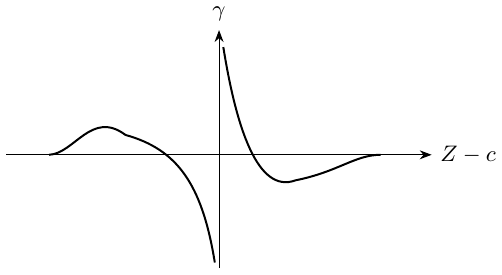
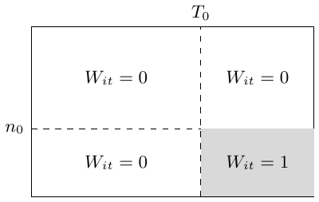
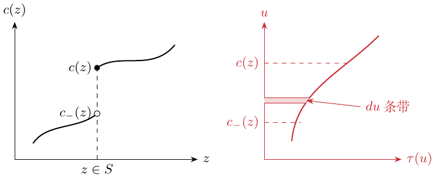
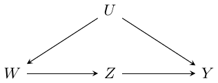
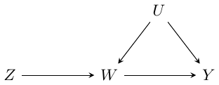
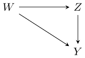
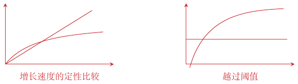

# STATS 361：因果推断笔记

第 1–14 讲

Ming · 中文版

# 第 1 讲：随机对照试验

在随机对照试验（RCT）中，用回归分析平均处理效应，是为了减小方差；ATE 的识别并不依赖回归。

> <span style="color: #000000">RCT 中的回归</span> $`\textcolor{black}{\longrightarrow}`$ 减小方差；ATE 的识别来自随机分配。

``` math
\Delta_i=Y_i(1)-Y_i(0),\qquad \tau=E[Y_i(1)-Y_i(0)].
```
用均值差估计量估计 $`\tau`$，并进行统计推断：
``` math
\widehat\tau_{\rm DM}=\frac1{n_1}\sum_{W_i=1}Y_i-\frac1{n_0}\sum_{W_i=0}Y_i,
\qquad n_w=|\{i:W_i=w\}|.
```
在随机分配下，该估计量是一致且无偏的。

> <span style="color: #244DA8">均值差</span> $`\textcolor{blue}{\longrightarrow}`$ $`\widehat\tau_{\rm DM}`$

本讲假设独立同分布抽样、有限二阶矩且两组均非空，并采用平衡分配 $`P(W=1)=1/2`$ 及中心化协变量 $`E[X]=0`$；正态分布表示渐近近似。

#### 补充：假设。

``` math
Y_i=Y_i(W_i),\qquad W_i\perp\{Y_i(0),Y_i(1)\}.
```
第二式表示随机分配。SUTVA 要求单位之间没有干扰，且每一种指定处理都有定义明确的版本；加上一致性，就有 $`Y_i=Y_i(W_i)`$。独立抽样是另外的假设。

> <span style="color: #000000">$`Y_i=Y_i(W_i)`$；SUTVA</span> $`\textcolor{black}{\longrightarrow}`$ 无干扰和定义明确的处理。

## 线性结果模型与方差缩减

``` math
Y_i(w)=c_{(w)}+X_i\beta_{(w)}+\varepsilon_i(w),\quad
E[\varepsilon_i(w)\mid X_i]=0,\quad
\operatorname{Var}[\varepsilon_i(w)\mid X_i]=b^2.
```
<span style="color: #244DA8">两种处理状态分别拟合各自的系数。</span>记 $`A=\operatorname{Var}[X]`$，<span style="color: #244DA8">$`\|v\|_A^2=v'Av`$</span>。渐近方差为
``` math
V_{\rm DM}=4b^2+\|\beta_{(0)}+\beta_{(1)}\|_A^2
 +\|\beta_{(0)}-\beta_{(1)}\|_A^2.
```
另有
``` math
\tau=c_{(1)}-c_{(0)}+E[X](\beta_{(1)}-\beta_{(0)}),\qquad
\widehat\tau_{\rm OLS}=\widehat c_{(1)}-\widehat c_{(0)}
 +\overline X(\widehat\beta_{(1)}-\widehat\beta_{(0)}).
```
误差分解为
``` math
\begin{aligned}
\widehat\tau_{\rm OLS}-\tau={}&(\widehat c_{(1)}-c_{(1)})-(\widehat c_{(0)}-c_{(0)})
 +\overline X(\beta_{(1)}-\beta_{(0)})\\
&+\overline X(\widehat\beta_{(1)}-\widehat\beta_{(0)}-\beta_{(1)}+\beta_{(0)}).
\end{aligned}
```
前两项的渐近近似分别为 $`N(0,b^2/n_1)`$、$`N(0,b^2/n_0)`$；第三项的渐近近似为 $`N(0,\|\beta_{(1)}-\beta_{(0)}\|_A^2/n)`$；最后一项是 $`O_p(1/n)`$。<span style="color: #244DA8">斜率估计带来的不确定性在一阶渐近中消失。</span>因此
``` math
\sqrt n(\widehat\tau_{\rm OLS}-\tau)\Rightarrow N(0,V_{\rm OLS}),\qquad
V_{\rm OLS}=4b^2+\|\beta_{(0)}-\beta_{(1)}\|_A^2,
```
``` math
V_{\rm DM}=V_{\rm OLS}+\|\beta_{(0)}+\beta_{(1)}\|_A^2.
```

## 一般结果回归下的 OLS

即使结果回归并非线性，OLS 也可以减小渐近方差。设
``` math
Y_i(w)=\mu_{(w)}(X_i)+\varepsilon_i(w),\quad
E[\varepsilon_i(w)\mid X_i]=0,\quad
\operatorname{Var}[\varepsilon_i(w)\mid X_i]=b^2.
```
对于均值差估计量，
``` math
\sqrt n(\widehat\tau_{\rm DM}-\tau)\Rightarrow N(0,V_{\rm DM}),\quad
V_{\rm DM}=4b^2+2\operatorname{Var}[\mu_{(0)}(X_i)]
+2\operatorname{Var}[\mu_{(1)}(X_i)].
```
对于 OLS，Huber–White 方差计算从总体投影出发：
``` math
(c^*_{(w)},\beta^*_{(w)})=\arg\min_{c,\beta}
 E[(Y_i(w)-X_i\beta-c)^2].
```
可得
``` math
\sqrt{n_w}\left\{\begin{pmatrix}\widehat c_{(w)}\\\widehat\beta_{(w)}\end{pmatrix}
-\begin{pmatrix}c^*_{(w)}\\\beta^*_{(w)}\end{pmatrix}\right\}
\Rightarrow N\left(0,Q^{-1}E[r_w^2qq^\mathsf T]Q^{-1}\right),
```
其中 $`c^*_{(w)}=E[Y_i(w)]`$。令 $`q=(1,X^\mathsf T)^\mathsf T`$，$`Q=E[qq^\mathsf T]`$ 非奇异，$`r_w=Y(w)-c_w^*-X\beta_w^*`$。三明治协方差不必为分块对角阵：$`E[r_wX]=0`$ 并不蕴含 $`E[r_w^2X]=0`$。在 $`E[X]=0`$ 下，截距方差是 $`E[r_w^2]`$。[^1]

``` math
\operatorname{MSE}^*_{(w)}=E[(Y_i(w)-X_i\beta^*_{(w)}-c^*_{(w)})^2].
```
由此得到
``` math
\sqrt n(\widehat\tau_{\rm OLS}-\tau)\Rightarrow N(0,V_{\rm OLS}),\qquad
V_{\rm OLS}=V_{\rm DM}-\|\beta^*_{(0)}+\beta^*_{(1)}\|_A^2.
```
<span style="color: #C92B32">$`V_{\rm OLS}\le V_{\rm DM}`$ 在本节平衡试验设定下成立。</span> 当 $`\|\beta^*_{(0)}+\beta^*_{(1)}\|_A^2>0`$ 时方差严格下降；该平方范数为零时取等号。若 $`A`$ 非奇异，等号条件就是 $`\beta^*_{(0)}+\beta^*_{(1)}=0`$。

#### 个人理解。

OLS 可以看作
``` math
\widehat\tau_{\rm OLS}=\frac1n\sum_{i=1}^n
\{(\widehat c_{(1)}+X_i\widehat\beta_{(1)})
 -(\widehat c_{(0)}+X_i\widehat\beta_{(0)})\}
=\frac1n\sum_i[\widehat\mu_{(1)}(X_i)-\widehat\mu_{(0)}(X_i)].
```
<span style="color: #244DA8">这里 $`\widehat\mu_{(w)}(x)`$ 是 OLS 在 $`x`$ 处的拟合值，也可以换成其他方法。</span>

# 第 2 讲：无混杂性与倾向得分

无混杂性：目的是消除混杂因素的影响。倾向得分：给定协变量后接受处理的概率。

## 汇总各组的均值差估计

<span style="color: #C92B32">直接按照概率加权。</span>对离散且取数值的 $`X_i`$，假设
``` math
\{Y_i(0),Y_i(1)\}\perp W_i\mid X_i=x,\qquad x\in\mathcal X.
```
<span style="color: #244DA8">这里 $`x`$ 是分组变量。</span>定义各组的 ATE：
``` math
\tau(x)=E[Y_i(1)-Y_i(0)\mid X_i=x].
```
则
``` math
\begin{aligned}
\widehat\tau_{\rm AGG}&=\sum_{x\in\mathcal X}\frac{n_x}{n}\widehat\tau(x),\\
\widehat\tau(x)&=\frac1{n_{x1}}\sum_{X_i=x,W_i=1}Y_i
-\frac1{n_{x0}}\sum_{X_i=x,W_i=0}Y_i,\\
n_x&=|\{i:X_i=x\}|,\qquad
n_{xw}=|\{i:X_i=x,W_i=w\}|.
\end{aligned}
```
令 $`e(x)=P(W_i=1\mid X_i=x)`$。组内的极限分布为
``` math
\begin{aligned}
\sqrt{n_x}(\widehat\tau(x)-\tau(x))
&\Rightarrow N\left(0,
\frac{\operatorname{Var}[Y_i(0)\mid X_i=x]}{1-e(x)}
+\frac{\operatorname{Var}[Y_i(1)\mid X_i=x]}{e(x)}\right)\\
&=N\left(0,\frac{b^2(x)}{e(x)(1-e(x))}\right),
\end{aligned}
```
第二个等号使用了两种处理状态具有相同条件方差的假设。定义 $`\pi(x)=P(X_i=x),\quad\widehat\pi(x)=n_x/n`$。 固定分层数下的极限需要层数有限、各层总体概率为正、层内处理重叠，以及有限条件二阶矩。 于是
``` math
\begin{aligned}
\widehat\tau_{\rm AGG}={}&\sum_x\pi(x)\tau(x)
+\sum_x\pi(x)(\widehat\tau(x)-\tau(x))\\
&+\sum_x(\widehat\pi(x)-\pi(x))\tau(x)
+\sum_x(\widehat\pi(x)-\pi(x))(\widehat\tau(x)-\tau(x)).
\end{aligned}
```
<span style="color: #244DA8">第一项是 $`\tau`$。</span><span style="color: #244DA8">第二项渐近正态，其方差为</span>

> 
> ``` math
> \sum_x\pi^2(x)\operatorname{Var}[\widehat\tau(x)].
> ```

<span style="color: #244DA8">第三项的方差是 $`n^{-1}\operatorname{Var}[\tau(X_i)]`$，最后一项为 $`O_p(1/n)`$。</span>合并这些项，

> <span style="color: #000000">汇总估计量的四项展开</span> $`\textcolor{black}{\longrightarrow}`$ 汇总估计量的方差 $`V_{\rm AGG}`$。

``` math
\sqrt n(\widehat\tau_{\rm AGG}-\tau)\Rightarrow N(0,V_{\rm AGG}),
```
``` math
\begin{aligned}
V_{\rm AGG}&=\operatorname{Var}[\tau(X_i)]
+\sum_{x\in\mathcal X}\pi^2(x)\frac1{\pi(x)}
\frac{b^2(x)}{e(x)(1-e(x))}\\
&=\operatorname{Var}[\tau(X_i)]
+E\left[\frac{b^2(X_i)}{e(X_i)(1-e(X_i))}\right].
\end{aligned}
```

## 连续协变量与倾向得分

给定 $`X_i`$ 后，$`W_i`$ 不能“偷看”$`Y_i`$：这是我对无混杂性的直觉理解。若
``` math
\{Y_i(0),Y_i(1)\}\perp W_i\mid X_i,
\quad e(x)=P(W_i=1\mid X_i=x),
```
则
``` math
\{Y_i(0),Y_i(1)\}\perp W_i\mid e(X_i).
```

#### 补充图示与计算。

<div class="center">


</div>

条件化后积分可得
``` math
\begin{aligned}
&P(W_i=w\mid\{Y_i(0),Y_i(1)\},e(X_i))\\
&\quad=\int_{\mathcal X}P(W_i=w\mid\{Y_i(0),Y_i(1)\},X_i=x)
 dP(X_i=x\mid Y_i(0),Y_i(1),e(X_i))\\
&\quad=\int_{\mathcal X}P(W_i=w\mid X_i=x)dP(X_i=x\mid Y_i(0),Y_i(1),e(X_i))\\
&\quad=e(X_i)\mathbf1_{\{w=1\}}+(1-e(X_i))\mathbf1_{\{w=0\}}.
\end{aligned}
```
<span style="color: #244DA8">这里是对条件概率测度积分。</span>

## 按倾向得分分层

1.  排序，使 $`\widehat e(X_{i_1})\leq\widehat e(X_{i_2})\leq\cdots\leq\widehat e(X_{i_n})`$。

2.  将样本分为 $`J`$ 层，在每一层内估计均值差。若 $`I_j`$ 包含排序后第 $`\lfloor(j-1)n/J\rfloor+1`$ 到第 $`\lfloor jn/J\rfloor`$ 个样本，则的简写公式可表示为
    ``` math
    \widehat\tau_j=\frac{\sum_{i\in I_j}W_iY_i}{\sum_{i\in I_j}W_i}
    -\frac{\sum_{i\in I_j}(1-W_i)Y_i}{\sum_{i\in I_j}(1-W_i)}.
    ```

    > <span style="color: #244DA8">使处理组与对照组更相似</span> $`\textcolor{blue}{\longrightarrow}`$ 按 $`\widehat e(X_i)`$ 排序，并按倾向得分分层。

3.  对各层估计取平均：$`\widehat\tau_{\rm STRAT}=J^{-1}\sum_{j=1}^J\widehat\tau_j`$。<span style="color: #244DA8">当分层越来越细且每层样本充足时，它具有一致性。</span> 要得到一致性，应让 $`J`$ 随 $`n`$ 适当增加，使分层越来越细，同时每层仍有足够的处理与对照样本，并满足重叠性及 $`\widehat e`$ 的一致收敛。固定的宽分层可能留下混杂。

## 逆倾向得分加权

``` math
\widehat\tau_{\rm IPW}=\frac1n\sum_{i=1}^n
\left\{\frac{W_iY_i}{\widehat e(X_i)}-\frac{(1-W_i)Y_i}{1-\widehat e(X_i)}\right\}.
```
理想的 IPW（oracle IPW）假定完全知道 $`e(x)`$：
``` math
\widehat\tau^*_{\rm IPW}=\frac1n\sum_i
\left\{\frac{W_iY_i}{e(X_i)}-\frac{(1-W_i)Y_i}{1-e(X_i)}\right\}.
```
假设满足重叠性：所有 $`x\in\mathcal X`$ 上均有 $`\eta\leq e(x)\leq1-\eta`$，且 $`|Y_i|<M`$。若
``` math
\sup_{x\in\mathcal X}|e(x)-\widehat e(x)|=O_p(a_n)\longrightarrow0,
```
可得
``` math
|\widehat\tau_{\rm IPW}-\widehat\tau^*_{\rm IPW}|=O_p(a_nM/\eta).
```
<span style="color: #244DA8">因此，理想估计量的一致性可以传递给使用估计倾向得分的 IPW。</span>另外，
``` math
E[\widehat\tau^*_{\rm IPW}]=E[Y_i(1)-Y_i(0)]=\tau.
```
<span style="color: #244DA8">满足重叠性时，理想 IPW 的收敛尺度是 $`1/\sqrt n`$。</span>

#### 方差计算：结果模型。

使用模型
``` math
\begin{aligned}
Y_i(0)&=c(X_i)-(1-e(X_i))\tau(X_i)+\varepsilon_i(0),\\
Y_i(1)&=c(X_i)+e(X_i)\tau(X_i)+\varepsilon_i(1),\\
E[\varepsilon_i(w)\mid X_i]&=0,\qquad
\operatorname{Var}[\varepsilon_i(w)\mid X_i=x]=b^2(x).
\end{aligned}
```
随后可得

> <span style="color: #000000">补充的结果模型</span> $`\textcolor{black}{\longrightarrow}`$ 理想 IPW 的方差 $`V_{\rm IPW^*}`$。

``` math
\begin{aligned}
n\operatorname{Var}[\widehat\tau^*_{\rm IPW}]
=V_{\rm IPW^*}
={}&E\left[\frac{c^2(X_i)}{e(X_i)(1-e(X_i))}\right]
+\operatorname{Var}[\tau(X_i)]\\
&+E\left[\frac{b^2(X_i)}{e(X_i)(1-e(X_i))}\right],\\
\sqrt n(\widehat\tau^*_{\rm IPW}-\tau)&\Rightarrow N(0,V_{\rm IPW^*}).
\end{aligned}
```

#### 个人比较。

$`c(x)`$ 描述的是 $`X`$ 与 $`Y`$ 的关系，而不是 $`X`$ 与 $`\Delta Y`$ 的关系。与分组汇总相比，
``` math
V_{\rm IPW^*}=V_{\rm AGG}+E\left[\frac{c^2(X_i)}{e(X_i)(1-e(X_i))}\right].
```

> <span style="color: #244DA8">$`V_{\rm IPW^*}-V_{\rm AGG}`$</span> $`\textcolor{blue}{\longrightarrow}`$ <span style="color: #244DA8">额外方差恰好在 $`c(X)=0`$ 几乎处处成立时消失。</span>

与线性模型相比：IPW 基于 $`\{Y_i(0),Y_i(1)\}\perp W_i\mid X_i`$，线性模型则依赖线性关系。 线性结果模型同样需要无混杂性等因果识别依据；线性本身只是对估计模型的限制。

# 第 3 讲：通过增广 IPW 高效估计处理效应

普通 IPW 的大样本性质较差。例如，$`X`$ 离散时，它不如汇总估计量 $`\widehat\tau`$。

## ATE 的两种表征

1.  利用 $`e(x)=P(W_i=1\mid X_i=x)`$，有 $`\tau=E[\widehat\tau^*_{\rm IPW}]`$；理想估计量定义如上。

2.  利用 $`\mu_{(w)}(x)=E[Y_i(w)\mid X_i=x]`$，
    ``` math
    \tau(x)=\mu_{(1)}(x)-\mu_{(0)}(x),\quad
    \tau=E[\mu_{(1)}(X_i)-\mu_{(0)}(X_i)],
    ```
    由此得到
    ``` math
    \widehat\tau_{\rm REG}=\frac1n\sum_i[\widehat\mu_{(1)}(X_i)-\widehat\mu_{(0)}(X_i)].
    ```

## 增广 IPW 估计量

``` math
\begin{aligned}
\widehat\tau_{\rm AIPW}=\frac1n\sum_i\bigg[&\widehat\mu_{(1)}(X_i)-\widehat\mu_{(0)}(X_i)
+W_i\frac{Y_i-\widehat\mu_{(1)}(X_i)}{\widehat e(X_i)}\\
&-(1-W_i)\frac{Y_i-\widehat\mu_{(0)}(X_i)}{1-\widehat e(X_i)}\bigg].
\end{aligned}
```

#### 个人直觉。

<span style="color: #244DA8">先用 $`\mu(x)`$ 估计结果，再对回归残差做 IPW。IPW 让数据的协变量构成变得“公平”。</span>

## 双重稳健性

只要结果回归 $`\widehat\mu_{(w)}(x)`$ 或倾向得分 $`\widehat e(x)`$ 中有一方一致，AIPW 就一致。 这里假设重叠性与可积性成立，另一类干扰函数估计也须保持良好行为。对于拟合函数，下方的期望论证还要条件于独立训练折；交叉拟合提供这种分离。

当 $`\widehat\mu_{(w)}(x)\approx\mu_{(w)}(x)`$ 时，回归均值是一致的，加权残差项的均值近似为零，因为
``` math
E[Y_i-\widehat\mu_{(W_i)}(X_i)\mid X_i,W_i]\approx0.
```
这里通过条件化把倾向得分项固定下来。若是 $`\widehat e(x)\approx e(x)`$，则改写为
``` math
\begin{aligned}
\widehat\tau_{\rm AIPW}={}&\frac1n\sum_i\left[\frac{W_iY_i}{\widehat e(X_i)}
-\frac{(1-W_i)Y_i}{1-\widehat e(X_i)}\right]\\
&+\frac1n\sum_i\left[\widehat\mu_{(1)}(X_i)\left(1-\frac{W_i}{\widehat e(X_i)}\right)
-\widehat\mu_{(0)}(X_i)\left(1-\frac{1-W_i}{1-\widehat e(X_i)}\right)\right].
\end{aligned}
```
<span style="color: #244DA8">第一部分是 IPW。</span><span style="color: #244DA8">第二部分均值近似为零，因为</span> $`E[1-W_i/\widehat e(X_i)\mid X_i]\approx0`$；条件化后把拟合的结果回归视为固定。

## 半参数效率

AIPW 在该非参数模型的正则估计量中达到半参数效率界。当辅助函数估计足够准确时，
``` math
\sqrt n(\widehat\tau_{\rm AIPW}-\widehat\tau^*_{\rm AIPW})\longrightarrow_p0,
```
星号表示理想 AIPW。该理想估计量只是独立同分布变量的均值，因此其中心极限定理可以传递给使用估计函数的版本：

> <span style="color: #244DA8">$`\sqrt n(\widehat\tau_{\rm AIPW}-\widehat\tau^*_{\rm AIPW})\to_p0`$</span> $`\textcolor{blue}{\longrightarrow}`$ 理想估计量的独立同分布中心极限定理可用于估计得到的 AIPW。

``` math
\sqrt n(\widehat\tau_{\rm AIPW}-\tau)\Rightarrow N(0,V^*),
```
``` math
V^*=\operatorname{Var}[\tau(X_i)]
+E\left[\frac{b_0^2(X_i)}{1-e(X_i)}\right]
+E\left[\frac{b_1^2(X_i)}{e(X_i)}\right].
```
<span style="color: #244DA8">这类似 Cramér–Rao 约束：它是正则估计量可达到的方差下界。</span>

## AIPW 与交叉拟合

将数据随机分成两半 $`I_1`$ 和 $`I_2`$。<span style="color: #244DA8">把数据随机分开。</span>令
``` math
\widehat\tau_{\rm AIPW}=\frac{|I_1|}{n}\widehat\tau^{I_1}
+\frac{|I_2|}{n}\widehat\tau^{I_2},
```
``` math
\begin{aligned}
\widehat\tau^{I_1}=\frac1{|I_1|}\sum_{i\in I_1}\bigg[&\widehat\mu_{(1)}^{I_2}(X_i)-\widehat\mu_{(0)}^{I_2}(X_i)
+W_i\frac{Y_i-\widehat\mu_{(1)}^{I_2}(X_i)}{\widehat e^{I_2}(X_i)}\\
&-(1-W_i)\frac{Y_i-\widehat\mu_{(0)}^{I_2}(X_i)}{1-\widehat e^{I_2}(X_i)}\bigg].
\end{aligned}
```
渐近分析可以不依赖所选机器学习调整方法的具体形式，而依赖以下条件：

1.  重叠性：对所有 $`x\in\mathcal X`$，有 $`\eta<e(x)<1-\eta`$，其中 $`\eta>0`$。

2.  辅助函数估计的一致性：
    ``` math
    \sup_x|\widehat\mu_{(w)}^{I_2}(x)-\mu_{(w)}(x)|\longrightarrow_p0,
    \quad \sup_x|\widehat e^{I_2}(x)-e(x)|\longrightarrow_p0.
    ```
    <span style="color: #244DA8">这里要求所选机器学习方法满足一致性，不能自动假设所有方法都满足。</span>

3.  结果模型与倾向得分模型的风险衰减：
    ``` math
    E[(\widehat\mu_{(w)}^{I_2}(X_i)-\mu_{(w)}(X_i))^2]\,
    E[(\widehat e^{I_2}(X_i)-e(X_i))^2]=o(1/n).
    ```
    <span style="color: #244DA8">若两者均以 $`\sqrt n`$ 速度一致收敛，则乘积为 $`1/n^2`$ 阶。一个简单的充分条件是，两种回归调整的均方根误差（RMSE）都以 $`o(n^{-1/4})`$ 收敛。</span>

#### 证明。

把理想估计量写作 $`\widehat\tau^*=|I_1|\widehat\tau^{I_1,*}/n+|I_2|\widehat\tau^{I_2,*}/n`$. 要证明 $`\sqrt n(\widehat\tau_{\rm AIPW}-\widehat\tau^*)\to_p0`$，只需对处理状态下的均值证明相应结果；其余部分类似。定义
``` math
\widehat\tau^{I_1}=\widehat\mu^{I_1}_{(1)}-\widehat\mu^{I_1}_{(0)},\qquad
\widehat\mu^{I_1}_{(1)}=\frac1{|I_1|}\sum_{i\in I_1}
\left[\widehat\mu^{I_2}_{(1)}(X_i)+W_i\frac{Y_i-\widehat\mu^{I_2}_{(1)}(X_i)}{\widehat e^{I_2}(X_i)}\right].
```
减去对应的理想估计量，得到
``` math
\begin{aligned}
\widehat\mu^{I_1}_{(1)}-\widehat\mu^{I_1,*}_{(1)}
={}&\frac1{|I_1|}\sum_{i\in I_1}
(\widehat\mu^{I_2}_{(1)}(X_i)-\mu_{(1)}(X_i))\left(1-\frac{W_i}{e(X_i)}\right)\\
&+\frac1{|I_1|}\sum_{i\in I_1}W_i(Y_i-\mu_{(1)}(X_i))
\left(\frac1{\widehat e^{I_2}(X_i)}-\frac1{e(X_i)}\right)\\
&-\frac1{|I_1|}\sum_{i\in I_1}W_i(\widehat\mu^{I_2}_{(1)}(X_i)-\mu_{(1)}(X_i))
\left(\frac1{\widehat e^{I_2}(X_i)}-\frac1{e(X_i)}\right).
\end{aligned}
```
<span style="color: #244DA8">第一项的条件方差为 $`o_p(1)/n`$；最后一项为 $`o_p(1/\sqrt n)`$。</span> 将第一项平均记为 $`T_1`$、训练数据记为 $`\mathcal D_2`$，则
``` math
E[T_1\mid\mathcal D_2]=0,\qquad E[T_1^2\mid\mathcal D_2]\le\frac{E[(\widehat\mu_1(X)-\mu_1(X))^2\mid\mathcal D_2]}{\eta|I_1|}=o_p(n^{-1}).
```
因此 $`T_1=o_p(n^{-1/2})`$。第二项同理，最后一项由 Cauchy–Schwarz 不等式和乘积风险条件控制。

对 $`K`$ 折交叉拟合，在构造第 $`i`$ 个观测的辅助估计时，排除其所在的第 $`k(i)`$ 折：
``` math
\begin{aligned}
\widehat\tau_{\rm AIPW}=\frac1n\sum_i\bigg[&\widehat\mu_{(1)}^{(-k(i))}(X_i)-\widehat\mu_{(0)}^{(-k(i))}(X_i)
+W_i\frac{Y_i-\widehat\mu_{(1)}^{(-k(i))}(X_i)}{\widehat e^{(-k(i))}(X_i)}\\
&-(1-W_i)\frac{Y_i-\widehat\mu_{(0)}^{(-k(i))}(X_i)}{1-\widehat e^{(-k(i))}(X_i)}\bigg].
\end{aligned}
```

## 置信区间

#### 补充：术语。

普通似然得分是
``` math
S(\theta)=\frac{d\log L(\theta)}{d\theta},
```
其中 $`L(\theta)`$ 为似然函数。$`n`$ 个样本得分的经验方差为
``` math
\frac1{n-1}\sum_i(S_\theta(O_i)-\overline S_\theta)^2.
```
存在干扰参数时，有效得分还要扣除干扰得分分量。对 ATE，下方中心化 AIPW 单项 $`\psi_i^*-\tau`$ 是有效影响函数，其方差是效率界；它不同于原始似然得分，后者的方差是 Fisher 信息。

#### 方差估计。

定义理想估计量中的单项
``` math
\psi_i^*=\mu_{(1)}(X_i)-\mu_{(0)}(X_i)
+\frac{W_i(Y_i-\mu_{(1)}(X_i))}{e(X_i)}
-\frac{(1-W_i)(Y_i-\mu_{(0)}(X_i))}{1-e(X_i)}.
```
它的经验方差收敛到有效方差：
``` math
\frac1{n-1}\sum_i(\psi_i^*-\widehat\tau^*)^2\longrightarrow_p V^*.
```
这里 $`\widehat\tau^*`$ 是理想 AIPW 估计量。

> <span style="color: #244DA8">未交叉拟合的理想 AIPW 估计</span> $`\textcolor{blue}{\longrightarrow}`$ $`\sum_i(\psi_i^*-\widehat\tau^*)^2/(n-1)`$ 中的 $`\widehat\tau^*`$。

将每个辅助函数替换为排除第 $`k(i)`$ 折后训练的估计，得到交叉拟合单项 $`\widehat\psi_i`$，以及
``` math
\widehat V_{\rm AIPW}=\frac1{n-1}\sum_i(\widehat\psi_i-\widehat\tau_{\rm AIPW})^2\longrightarrow_p V^*.
```
正态分布中央概率区域下画出的置信区间为

<div class="center">


</div>

该区间的渐近覆盖率为 $`1-\alpha`$：

``` math
\widehat\tau_{\rm AIPW}\ \pm\ \frac1{\sqrt n}\Phi^{-1}(1-\alpha/2)\sqrt{\widehat V_{\rm AIPW}}.
```

# 第 4 讲：估计处理效应的异质性

对于观测 $`(X_i,Y_i,W_i)`$，其中 $`X_i\in\mathcal X`$，之前关注的是 ATE $`E[Y_i(1)-Y_i(0)]`$。异质性分析转而考虑条件平均处理效应（CATE）：
``` math
\tau(x)=E[Y_i(1)-Y_i(0)\mid X_i=x].
```

> <span style="color: #244DA8">$`X_i`$ 某一类中的平均效应</span> $`\textcolor{blue}{\longrightarrow}`$ $`\tau(x)=E[Y_i(1)-Y_i(0)\mid X_i=x]`$。

## 正则化偏差

在 $`\{Y_i(0),Y_i(1)\}\perp W_i\mid X_i`$ 下，
``` math
\tau(x)=\mu_{(1)}(x)-\mu_{(0)}(x),\qquad
\mu_{(w)}(x)=E[Y_i\mid X_i=x,W_i=w].
```
一个直接的 CATE 估计量为 $`\widehat\tau_T(x)=\widehat\mu_{(1)}(x)-\widehat\mu_{(0)}(x)`$。

#### 个人疑虑。

<span style="color: #244DA8">如果 $`\widehat\mu_{(1)}`$ 的样本太少，就可能受到很强的正则化，向一条直线收缩。而 $`\widehat\mu_{(0)}`$ 样本很多时可能拟合得很好；这样，两者之差 $`\widehat\tau_T(x)`$ 就会因为前者拟合不准而出问题。</span>

## 半参数建模

``` math
Y_i(w)=f(X_i)+w\tau(X_i)+\varepsilon_i(w),\qquad
P(W_i=1\mid X_i)=e(X_i),\qquad \tau(x)=\psi(x)\beta.
```
<span style="color: #244DA8">$`f`$ 是 $`X_i`$ 的函数，$`\psi(x)`$ 是 $`X`$ 的非参数表示；$`\beta`$ 是处理效应的系数。</span>在无混杂性下，Robinson 变换为

> <span style="color: #000000">$`Y_i(w)=f(X_i)+w\tau(X_i)+\varepsilon_i(w)`$</span> $`\textcolor{black}{\longrightarrow}`$ <span style="color: #C92B32">Robinson</span>：减去 $`m(X_i)`$，并用 $`e(X_i)`$ 对 $`W_i`$ 残差化。

``` math
Y_i-m(X_i)=(W_i-e(X_i))\psi(X_i)\beta+\varepsilon_i,
\quad m(x)=E[Y_i\mid X_i=x]=f(x)+e(x)\tau(x),
```
其中 $`\varepsilon_i=\varepsilon_i(W_i)`$。

> <span style="color: #244DA8">$`\varepsilon_i=\varepsilon_i(W_i)`$</span> $`\textcolor{blue}{\longrightarrow}`$ $`Y_i-m(X_i)=(W_i-e(X_i))\psi(X_i)\beta+\varepsilon_i`$ 中的误差。

构造残差对残差的 OLS 回归，令
``` math
\widetilde Y_i^*=Y_i-m(X_i),\qquad
\widetilde Z_i^*=(W_i-e(X_i))\psi(X_i).
```
将 $`\widetilde Y_i^*`$ 对 $`\widetilde Z_i^*`$ 回归，得到 $`\widehat\beta_R^*`$。<span style="color: #244DA8">这些变换只用到已观测数据和辅助函数；这就是数据预处理。</span>可得
``` math
\sqrt n(\widehat\beta_R^*-\beta)\Rightarrow N(0,V_R),
```
``` math
V_R=Q^{-1}E[ZZ^\mathsf T\varepsilon^2]Q^{-1}.
```
同方差时，$`\operatorname{Var}(\varepsilon_i\mid X_i,W_i)=b^2`$ 为常数，$`V_R`$ 是 $`\beta`$ 的半参数有效方差。异方差时，三明治方差仍适用，但未必达到效率界。 这里 $`Z=(\widetilde Z_i^*)^\mathsf T`$，$`Q=E[ZZ^\mathsf T]`$ 非奇异，$`\varepsilon=\widetilde Y_i^*-Z^\mathsf T\beta`$。正规方程给出影响函数 $`Q^{-1}Z\varepsilon`$，所以中间项使用回归残差；条件同方差下为 $`b^2Q^{-1}`$。[^2]

#### 可实施的交叉拟合版本。

前面的回归是理想形式，因为 $`m(X_i)`$、$`e(X_i)`$ 未知。拟合非参数回归 $`Y\sim X`$ 和 $`W\sim X`$；构造下式时，<span style="color: #244DA8">排除第 $`i`$ 个观测所在的折</span>：
``` math
\widetilde Y_i=Y_i-\widehat m^{(-k(i))}(X_i),\qquad
\widetilde Z_i=(W_i-\widehat e^{(-k(i))}(X_i))\psi(X_i).
```
将 $`\widetilde Y_i`$ 对 $`\widetilde Z_i`$ 回归得到 $`\widehat\beta_R`$。若两个辅助函数估计的 RMSE 均为 $`o_p(n^{-1/4})`$，可得
``` math
\sqrt n(\widehat\beta_R^*-\widehat\beta_R)\longrightarrow_p0.
```

## 用于处理效应异质性的损失函数

前面的估计量假设 $`\tau(x)=\psi(x)\beta`$。实际关系往往不是线性的，因此使用机器学习。令
``` math
\mu_{(w)}(x)=E[Y(w)\mid X=x],\quad
\varepsilon_i(w)=Y_i(w)-[\mu_{(0)}(X_i)+w\tau(X_i)],
```
由无混杂性得到 $`E[\varepsilon_i(w)\mid X_i,W_i]=0`$。<span style="color: #244DA8">这里 $`\mu_{(0)}`$ 起到前面 $`f`$ 的作用。</span>仍有
``` math
Y_i-m(X_i)=(W_i-e(X_i))\tau(X_i)+\varepsilon_i,
\quad m(x)=\mu_{(0)}(x)+e(x)\tau(x),\quad \varepsilon_i=\varepsilon_i(W_i).
```
等价地，
``` math
\tau(\cdot)=\arg\min_{t}E[((Y_i-m(X_i))-(W_i-e(X_i))t(X_i))^2].
```
<span style="color: #244DA8">若 $`m`$ 和 $`e`$ 已知，最小化该式即可得到 $`\tau(\cdot)`$。</span> 事实上，$`L(t)-L(\tau)=E[e(X)(1-e(X))(t(X)-\tau(X))^2]`$，所以在 $`0<e(X)<1`$ 的区域，最小化目标识别 $`\tau`$（忽略零测集）。 理想的惩罚估计量为
``` math
\widehat\tau_R^*(\cdot)=\arg\min_t\left\{
\frac1n\sum_i[(Y_i-m(X_i))-(W_i-e(X_i))t(X_i)]^2+\Lambda_n(t)\right\}.
```

> <span style="color: #244DA8">对 $`\tau(\cdot)`$ 的复杂度进行正则化</span> $`\textcolor{blue}{\longrightarrow}`$ $`\Lambda_n(\tau)`$：例如 lasso／岭回归及神经网络。

<span style="color: #244DA8">通常 $`m`$ 和 $`e`$ 未知，因此进行交叉拟合；RCT 中 $`e`$ 由设计已知，但 $`m`$ 一般仍需估计：</span>

> 
> ``` math
> \begin{aligned}
> \widehat L_n(t)&=\frac1n\sum_i
> [(Y_i-\widehat m^{(-k(i))}(X_i))-(W_i-\widehat e^{(-k(i))}(X_i))t(X_i)]^2,\\
> \widehat\tau_R&=\arg\min_t\{\widehat L_n(t)+\Lambda_n(t)\}.
> \end{aligned}
> ```
> 对于 lasso，$`\widehat\tau(x)=x\widehat\beta`$，其中
> ``` math
> \widehat\beta=\arg\min_\beta\left\{\frac1n\sum_i
> [(Y_i-\widehat m^{(-k(i))}(X_i))-(W_i-\widehat e^{(-k(i))}(X_i))X_i\beta]^2
> +\lambda\|\beta\|_1\right\}.
> ```

#### 个人补充理解。

处理效应为常数时， $`Y_i(w)=f(X_i)+\tau w+\varepsilon_i`$，且 $`E[\varepsilon_i\mid X_i,W_i]=0`$；残差估计量为
``` math
\widehat\tau_R=\frac{\sum_i(Y_i-\widehat m^{(-k(i))}(X_i))(W_i-\widehat e^{(-k(i))}(X_i))}
{\sum_i(W_i-\widehat e^{(-k(i))}(X_i))^2}.
\tag{ 4.5}
```
前提是辅助部分收敛足够快。即使 $`\tau`$ 不为常数，该估计量也会收敛到 $`\tau(x)`$ 的某个非负加权平均。

> <span style="color: #244DA8">$`\overline Y_{(1)}-\overline Y_{(0)}`$</span> $`\textcolor{blue}{\longrightarrow}`$ 前述 $`\tau(x)`$ 的非负加权平均。

异质性较小而重叠性存在困难时，可用式 (4.5) 替代。

> <span style="color: #244DA8">常系数残差回归及其加权效应解释</span> $`\textcolor{blue}{\longrightarrow}`$ 用于灵活处理效应函数的 R 损失。

其总体目标为
``` math
\frac{E[e(X)(1-e(X))\tau(X)]}{E[e(X)(1-e(X))]},
```
分母须为正。它强调重叠较好的区域；效应为常数，或重叠权重与 $`\tau(X)`$ 不相关时才等于 ATE。处理完全确定的区域仍不能由此识别效应。

# 第 5 讲：断点回归设计

使用驱动变量 $`Z_i\in\mathbb R`$ 引入一个阈值：
``` math
W_i=\mathbf1_{\{Z_i\geq c\}},\qquad c\text{ 为阈值。}
```
<span style="color: #244DA8">当 $`Z_i\to c`$，靠近 $`c`$ 的观测特征相似，区别在于是否接受干预。</span>令 $`\mu_{(w)}(z)=E[Y_i(w)\mid Z_i=z]`$。若两个条件均值连续，则 $`z=c`$ 处的 CATE 为
``` math
\tau_c=\mu_{(1)}(c)-\mu_{(0)}(c)
=\lim_{z\to c^+}E[Y_i\mid Z_i=z]-\lim_{z\to c^-}E[Y_i\mid Z_i=z].
```

#### 个人补充：普通 IPW 为什么不适用？

此前假设无混杂性 $`\{Y_i(0),Y_i(1)\}\perp W_i\mid Z_i`$ 和重叠性 $`\eta\leq P(W_i=1\mid Z_i)\leq1-\eta`$。在 RDD 中，无混杂性成立，但重叠性不成立，因为给定 $`Z_i=z`$ 后，处理概率不是零就是一。<span style="color: #244DA8">无论如何选择非退化的 $`\eta`$，都不成立。</span>必须比较 $`c`$ 附近的观测，借助相似性而非重叠性。 重叠性不成立意味着不能以 $`\sqrt n`$ 速度估计 $`\tau_c`$。其极小极大误差以非参数速度收敛，取决于 $`\mu_{(w)}(z)`$ 的光滑性。例如，$`c`$ 处二阶导数一致有界时，可以得到 $`n^{-2/5}`$ 的估计误差速度。 该速率使用独立观测、截点两侧正且连续的设计密度、截点邻域内有界二阶导数，以及有界条件方差。更强的参数限制可能带来不同速率。

## 局部线性回归估计

选择小带宽 $`h_n\to0`$ 和对称权函数 $`K`$，在局部拟合两个条件均值。下式中 $`W_i`$ 的系数
``` math
\arg\min_{a,\tau,\beta_{(0)},\beta_{(1)}}\sum_i
K\left(\frac{|Z_i-c|}{h_n}\right)
[Y_i-a-\tau W_i-\beta_{(0)}(Z_i-c)_--\beta_{(1)}(Z_i-c)_+]^2
```
就是 $`\widehat\tau_c`$。

> <span style="color: #C92B32">权重；负侧；正侧</span> $`\textcolor{red}{\longrightarrow}`$ $`K(|Z_i-c|/h_n)`$；$`(Z_i-c)_-`$；$`(Z_i-c)_+`$。

截距 $`a`$ 和斜率 $`\beta_{(w)}`$ 是辅助参数；常见核函数包括窗口函数 $`K(x)=\mathbf1_{\{|x|\leq1\}}`$ 和三角核 $`K(x)=(1-|x|)_+`$。

## 估计量性质与光滑性

通过以下假设量化连续性：$`\mu_{(w)}`$ 二次可微，且二阶导数一致有界：
``` math
\left|\frac{d^2}{dz^2}\mu_{(w)}(z)\right|\leq B,
\qquad z\in\mathbb R,\quad w\in\{0,1\}.
```
若仅有 Lipschitz 光滑性，即 $`|f(x)-f(y)|\le L|x-y|`$，函数可以存在尖角；局部线性趋势不明显时，局部平均可能更合适。若光滑性更强，$`k\geq3`$ 阶导数有界，则更高阶的局部回归可能改善收敛速度。

<span style="color: #C92B32">在 $`c`$ 处做 Taylor 展开：</span>
``` math
\mu_{(w)}(z)=a_{(w)}+\beta_{(w)}(z-c)+\tfrac12\rho_{(w)}(z-c),
\qquad |\rho_{(w)}(u)|\leq Bu^2.
```
<span style="color: #C92B32">最后一项为余项，</span>且 $`\tau_c=a_{(1)}-a_{(0)}`$。分别拟合两侧：
``` math
(\widehat a_{(1)},\widehat\beta_{(1)})=\arg\min_{a,\beta}
\sum_{Z_i\geq c}K\left(\frac{|Z_i-c|}{h_n}\right)[Y_i-a-\beta(Z_i-c)]^2,
```
对照侧同理；然后 $`\widehat\tau_c=\widehat a_{(1)}-\widehat a_{(0)}`$。

#### 窗口核的闭式权重。

在 $`c\leq Z_i\leq c+h_n`$ 上，设
``` math
\widehat a_{(1)}=\sum_i\gamma_iY_i,\qquad
\gamma_i=\frac{m_2-m_1(Z_i-c)}{N_+(m_2-m_1^2)},
```
其中 $`N_+=|\{i:c\le Z_i\le c+h_n\}|`$，$`m_j=N_+^{-1}\sum_{c\le Z_i\le c+h_n}(Z_i-c)^j`$。 假设 $`m_2-m_1^2>0`$。因子 $`N_+`$ 使权重归一化，因此

``` math
\sum_i\gamma_i=1,\qquad \sum_i\gamma_i(Z_i-c)=0.
```

分解为
``` math
\widehat a_{(1)}=a_{(1)}+\underbrace{\tfrac12\sum_i\gamma_i\rho_{(1)}(Z_i-c)}_{\text{\textcolor{red}{曲率偏差}}}
+\underbrace{\sum_i\gamma_i(Y_i-\mu_{(1)}(Z_i))}_{\text{\textcolor{red}{抽样噪声}}}.
```
对照侧的截距也有相同形式的分解。 局部线性权重可能为负，因此曲率偏差绝对值的上界为 $`\frac B2\sum_i|\gamma_i|(Z_i-c)^2`$；规则局部设计下它是 $`O(h_n^2)`$。

> <span style="color: #C92B32">曲率偏差与抽样噪声</span> $`\textcolor{red}{\longrightarrow}`$ <span style="color: #C92B32">这两项都需要上界。</span>

曲率偏差的阶为 $`Bh_n^2`$，其中 $`B`$ 是二阶导数的界，$`h_n`$ 是带宽。抽样噪声均值为零；若 $`\operatorname{Var}[Y_i\mid Z_i]\leq b^2`$，则其方差不超过 $`b^2\sum_i\gamma_i^2`$。 若 $`Z_i`$ 在 $`c`$ 附近具有连续且非零的密度 $`f`$，
``` math
b^2\sum_i\gamma_i^2\approx\frac{4b^2}{|\{i:c\leq Z_i\leq c+h_n\}|}
\approx\frac{4b^2}{f(c)nh_n}.
```
因此平方偏差为 $`h_n^4`$ 阶，方差为 $`(nh_n)^{-1}`$ 阶，从而
``` math
\widehat\tau_c=\tau_c+O_p(n^{-2/5}),\qquad h_n\asymp n^{-1/5}.
```
<span style="color: #C92B32">这里 $`n^{-2/5}`$ 是估计误差；在 $`k`$ 阶光滑性下，$`h_n\asymp n^{-1/(2k+1)}`$。</span>

## 驱动变量中的噪声

> <span style="color: #244DA8">可能有噪声</span> $`\textcolor{blue}{\longrightarrow}`$ 驱动变量 $`Z_i`$。

引入潜在变量 $`U_i\sim G`$，并给出两个条件：

1.  含噪声的驱动变量：设 $`Z_i\mid U_i\sim N(U_i,\nu^2)`$，其中 $`\nu>0`$。

2.  驱动变量的无混杂性：$`\{Y_i(0),Y_i(1)\}\perp Z_i\mid U_i`$。

由 $`Y_i=Y_i(W_i)`$ 以及 $`\{Y_i(0),Y_i(1)\}\perp W_i\mid U_i`$，
``` math
e(u)=P(W_i=1\mid U_i=u)=P(Z_i\geq c\mid U_i=u)
=1-\Phi\left(\frac{c-u}{\nu}\right),
```
``` math
\alpha_{(w)}(u)=E[Y_i(w)\mid U_i=u],\qquad
\tau(u)=E[Y_i(1)-Y_i(0)\mid U_i=u].
```
定义标准正态分布函数： 倾向得分表达式来自 $`Z=U+\nu\xi`$，其中 $`\xi\sim N(0,1)`$ 与 $`U`$ 独立。仅归一化权重并不消除混杂：当 $`h_+=h_-`$，或另有条件使第二个积分为零时，混杂项才消失。

<span style="color: #C92B32">$`\Phi(x)=(2\pi)^{-1/2}\int_{-\infty}^x e^{-t^2/2}\,dt`$.</span>

$`U_i`$ 无法观测，因此不能直接使用其倾向得分。考虑反卷积型估计量：

> <span style="color: #000000">$`U_i`$ 未观测：不能直接使用其倾向得分</span> $`\textcolor{black}{\longrightarrow}`$ 反卷积权重 $`\gamma_+(z),\gamma_-(z)`$。

``` math
\widehat\tau_\gamma=\frac1n\sum_{Z_i\geq c}\gamma_+(Z_i)Y_i
-\frac1n\sum_{Z_i<c}\gamma_-(Z_i)Y_i.
```
选择权重，使
``` math
E[\mathbf1_{\{Z_i\geq c\}}\gamma_+(Z_i)]
=E[\mathbf1_{\{Z_i<c\}}\gamma_-(Z_i)]=1.
```
则
``` math
E[\widehat\tau_\gamma]
=\underbrace{\int h_+(u)\tau(u)\,dG(u)}_{\text{\textcolor{red}{加权处理效应}}}
+\underbrace{\int(h_+(u)-h_-(u))\alpha_{(0)}(u)\,dG(u)}_{\text{\textcolor{red}{混杂偏差}}},
```
其中权函数为
``` math
h_+(u)=\int_c^\infty\gamma_+(z)\varphi_\nu(z-u)\,dz,\qquad
h_-(u)=\int_{-\infty}^c\gamma_-(z)\varphi_\nu(z-u)\,dz,
```

> 
> ``` math
> \varphi_\nu(z-u)=\frac1{\sqrt{2\pi\nu^2}}\exp\left[-\frac12\left(\frac{z-u}{\nu}\right)^2\right].
> ```

# 第 6 讲：断点回归的有限样本推断

有限样本 RDD 允许不连续／离散的驱动变量，或更复杂的阈值规则。局部线性回归的解 (6.2) 可以写成线性估计量：
``` math
\widehat\tau_c(\gamma)=\sum_{i=1}^n\gamma_iY_i.\tag{6.3}
```
权重仅依赖 $`Z_i`$。

> <span style="color: #C92B32">局部线性解 (6.2)</span> $`\textcolor{red}{\longrightarrow}`$ 线性估计量 (6.3)，下面继续分析其性质。

若
``` math
Y_i(w)=\mu_{(w)}(Z_i)+\varepsilon_i(w),\qquad
\varepsilon_i(w)\mid Z_i\sim N(0,b^2),
```
则在给定 $`Z_1,\ldots,Z_n`$ 后，
``` math
\widehat\tau_c(\gamma)\sim N(\widehat\tau_c^*(\gamma),b^2\|\gamma\|_2^2),
\qquad \widehat\tau_c^*(\gamma)=\sum_i\gamma_i\mu_{(W_i)}(Z_i).
```
这里 $`W_i=\mathbf1_{\{Z_i\geq c\}}`$，且<span style="color: #C92B32">$`\|\gamma\|_2=(\gamma_1^2+\cdots+\gamma_n^2)^{1/2}`$ 是欧几里得范数。</span>

## 极小极大线性估计

<span style="color: #C92B32">极小极大是指最小化最坏情形的均方误差（MSE）。</span>同方差下，线性估计量的条件方差可以直接写为 $`b^2\|\gamma\|_2^2`$。其偏差则依赖未知的条件均值：
``` math
\operatorname{Bias}(\widehat\tau_c(\gamma)\mid Z_1,\ldots,Z_n)
=\sum_i\gamma_i\mu_{(W_i)}(Z_i)-[\mu_{(1)}(c)-\mu_{(0)}(c)].
```
光滑性限制 $`|\mu_{(w)}''(z)|\leq B`$ 给出偏差的上界
``` math
I_B(\gamma)=\sup_{|\mu_{(w)}''|\leq B}
\left\{\sum_i\gamma_i\mu_{(W_i)}(Z_i)-[\mu_{(1)}(c)-\mu_{(0)}(c)]\right\}.
```
<span style="color: #244DA8">因为二阶导数约束的函数类对称，取上确界时不需要绝对值。</span>因此
``` math
|\operatorname{Bias}(\widehat\tau_c(\gamma)\mid Z_1,\ldots,Z_n)|\leq I_B(\gamma),
```
``` math
\operatorname{MSE}(\widehat\tau_c(\gamma)\mid Z_1,\ldots,Z_n)
\leq b^2\|\gamma\|_2^2+I_B^2(\gamma).
```
<span style="color: #C92B32">MSE = 方差 + 偏差平方；这个界不依赖未知的 $`\mu`$。</span>接着定义
``` math
\gamma^B=\arg\min_\gamma\{b^2\|\gamma\|_2^2+I_B^2(\gamma)\},\qquad
\widehat\tau_c(\gamma^B)=\sum_i\gamma_i^B Y_i.
\tag{ 6.8}
```
<span style="color: #244DA8">比较：在同一曲率约束下，优化后的最坏 MSE 不大于局部线性估计的最坏 MSE。</span> 条件于设计，假设误差独立且服从已知方差 $`b^2`$ 的高斯分布，并使用有效曲率上界 $`B`$。极小极大准则最小化该函数类中的最坏 MSE，并非对每个回归函数都更好。离散设计要求约束可行，区间宽度可能保持为正。

## 推导极小极大线性权重

分解为
``` math
\mu_{(w)}(z)=a_{(w)}+\beta_{(w)}(z-c)+\rho_{(w)}(z),
```
其中 $`\rho_{(w)}(c)=\rho'_{(w)}(c)=0`$，二阶导数以 $`B`$ 为界。截距和斜率没有限制，因此除非满足下列条件，否则 $`I_B(\gamma)`$ 可以为无穷大：
``` math
\sum_i\gamma_iW_i=1,\qquad \sum_i\gamma_i=0,\qquad
\sum_i\gamma_i(Z_i-c)_+=0,\qquad \sum_i\gamma_i(Z_i-c)_-=0.
```
加上这些约束后，只需控制余项。将式 (6.8) 改写为
``` math
(\gamma^B,t)=\arg\min_{\gamma,t}\{b^2\|\gamma\|_2^2+B^2t^2\},
```
约束为
``` math
\sum_i\gamma_iW_i\rho_{(1)}(Z_i)+\sum_i\gamma_i(1-W_i)\rho_{(0)}(Z_i)\leq t
```
对所有满足 $`\rho_{(w)}(c)=\rho'_{(w)}(c)=0`$、$`|\rho''_{(w)}(z)|\leq1`$ 的 $`\rho_{(w)}`$ 都成立，同时满足
``` math
\sum_i\gamma_iW_i=1,\quad\sum_i\gamma_i=0,\quad
\sum_i\gamma_iW_i(Z_i-c)=0,\quad
\sum_i\gamma_i(1-W_i)(Z_i-c)=0.
\tag{ 6.10}
```
提示：求解对应的对偶问题。

> <span style="color: #244DA8">原始极小极大优化问题 (6.10)</span> $`\textcolor{blue}{\longrightarrow}`$ 转化为对偶问题求解。

#### 个人补充：为什么权重之和为零？

最终估计的是一个差。将求和拆成处理组和对照组两部分：
``` math
\widehat\tau_c(\gamma)=\sum_i\gamma_i^{(1)}Y_i+\sum_i\gamma_i^{(2)}Y_i.
```
处理组权重之和为 $`1`$，对照组权重之和为 $`-1`$，所以

> <span style="color: #C92B32">$`W=1`$ 组；$`W=0`$ 组</span> $`\textcolor{red}{\longrightarrow}`$ <span style="color: #C92B32">权重分别加总为 $`1`$、$`-1`$；总和为 $`0`$。</span>

> 
> ``` math
> \sum_i\gamma_i=1+(-1)=0,\quad
> \sum_i\gamma_i^{(1)}=\sum_i\gamma_iW_i=1,\quad
> \sum_i\gamma_i^{(2)}=\sum_i\gamma_i(1-W_i)=-1.
> ```

图中的权重在阈值左侧近处有负的尖峰，右侧近处有正的尖峰；离阈值更远时，权重改变符号，然后趋近零。

<div class="center">



</div>

## 线性估计量的推断

构造 $`\widehat\tau_c(\gamma^B)`$ 的置信区间。令
``` math
\mathrm{err}=\widehat\tau_c-\tau_c,\qquad
\mathrm{err}\mid Z_1,\ldots,Z_n\sim N(\mathrm{bias},b^2\|\gamma^B\|_2^2),
```
其中由式 (6.10) 得到 $`|\mathrm{bias}|\leq Bt`$。根据高斯分布的单峰性，对于 $`S\sim N(0,1)`$，
``` math
P(|\mathrm{err}|\geq\zeta)\leq P(|Bt+b\|\gamma^B\|_2S|\geq\zeta).
```
条件覆盖率至少为 $`1-\alpha`$ 的置信区间是
``` math
I_\alpha=(\widehat\tau_c(\gamma^B)-\zeta_\alpha^B,
\widehat\tau_c(\gamma^B)+\zeta_\alpha^B),
```
``` math
\zeta_\alpha^B=\inf\{\zeta:P(|Bt+b\|\gamma^B\|_2S|>\zeta)\leq\alpha\}.
\tag{ 6.13}
```
<span style="color: #244DA8">强调：条件于 $`Z_i`$，因此驱动变量服从任何分布都可以，包括非标准的 RDD 情形。</span>

#### 离散驱动变量。

单独限制 $`|\mu_{(w)}''(z)|\leq B`$ 不一定能识别 $`\tau_c`$，但式 (6.13) 仍有效。$`Z_i`$ 连续时，区间以 $`n^{-2/5}`$ 速度缩小；$`Z_i`$ 离散时，长度未必趋于零。<span style="color: #244DA8">当 $`c`$ 不在驱动变量的支持集内，需要用满足二阶导数界的插值函数表示 $`\mu_{(w)}(z)`$。</span>

#### 多维驱动变量。

例如二维、三维区域以及地理边界。不能直接使用一维阈值 RDD；<span style="color: #244DA8">有的方法将其化为一维距离，这样可能丢失相关空间信息。</span>极小极大方法则可以直接推广到多维。

## 超出同方差情形

当误差 $`\varepsilon_i=Y_i-\mu_{(W_i)}(Z_i)`$ 不再是方差为 $`b^2`$ 的同方差高斯误差时，式 (6.11) 的精确正态分布结论不成立。利用中心极限定理来说明
``` math
\widehat\tau_c(\gamma)\mid Z_1,\ldots,Z_n
\ \approx\ N\left(\widehat\tau_c^*(\gamma),
\sum_i\gamma_i^2\operatorname{Var}[Y_i\mid Z_i,W_i]\right).
\tag{ 6.14}
```
若高斯近似有效，仍可构造置信区间。将条件方差估计为
``` math
\widehat V_n=\sum_i\gamma_i^2(Y_i-\widehat\mu_{(W_i)}(Z_i))^2,
```
其中拟合均值来自局部线性回归。

> <span style="color: #244DA8">局部线性拟合的均值</span> $`\textcolor{blue}{\longrightarrow}`$ 残差方差估计量中的 $`\widehat\mu_{(W_i)}(Z_i)`$。

> <span style="color: #244DA8">在独立评估数据上，如果均值拟合错了</span> $`\textcolor{blue}{\longrightarrow}`$ <span style="color: #244DA8">残差平方期望增加了均值误差的平方。</span>

极小极大准则 (6.8) 针对同方差；异方差下，将各个方差 $`b_i^2`$ 引入用于构造对偶问题的式 (6.10)。 残差膨胀的直觉适用于独立评估数据：残差平方期望等于条件方差加均值误差平方。样本内过拟合反而可能缩小残差。应使用有效的留一法或交叉拟合方差估计，并要求不存在支配性观测的加权中心极限定理。

# 第 7 讲：平衡估计量

平衡性指导 $`\widehat e(x)`$ 的构造。

> <span style="color: #000000">平衡性／$`\widehat e(x)`$ 的设计原理</span> $`\textcolor{black}{\longrightarrow}`$ 构造倾向得分的平衡损失函数；高维 ATE 估计。

两个目标是：构造倾向得分的平衡损失函数，以及在高维协变量下估计 ATE。IPW、AIPW 都使用倾向得分；这一讲通过凸优化推导如何估计 $`e(x)`$。

## 回顾 IPW

给定独立同分布观测 $`(X_i,Y_i,W_i)\in\mathcal X\times\mathbb R\times\{0,1\}`$，目标为 $`\tau=\mu_{(1)}-\mu_{(0)}`$，其中 $`\mu_{(w)}=E[Y_i(w)]`$。假设
``` math
\{Y_i(0),Y_i(1)\}\perp W_i\mid X_i,\qquad
0<\eta\leq e(X_i)\leq1-\eta<1,
```
其中 $`e(x)=P(W_i=1\mid X_i=x)`$，$`\eta`$ 为正常数。用下式估计处理状态下的均值：
``` math
\widehat\mu_{\rm IPW}(1)=\frac1n\sum_i\frac{W_iY_i}{\widehat e(X_i)}.
\tag{ 7.3}
```
下面<span style="color: #244DA8">简略地</span>分三步说明一致性：

1.  总体平衡：无混杂性下，$`\mu_{(1)}=E[W_iY_i/e(X_i)]`$。

2.  理想估计量：使用真实的 $`e(x)`$ 时无偏；重叠性给出有限方差。

3.  可实施近似：若估计的倾向得分也满足重叠性，由 Cauchy–Schwarz 不等式可得
    ``` math
    \begin{aligned}
    |\widehat\mu_{\rm IPW}(1)-\widehat\mu^*_{\rm IPW}(1)|
    &\leq\left[\frac1n\sum_i\left(\frac1{\widehat e(X_i)}-\frac1{e(X_i)}\right)^2\right]^{1/2}
    \left[\frac1n\sum_i(W_iY_i)^2\right]^{1/2}\\
    &\leq\frac1{\eta^2}\left[\frac1n\sum_i(\widehat e(X_i)-e(X_i))^2\right]^{1/2}
    \left[\frac1n\sum_i(W_iY_i)^2\right]^{1/2}.
    \end{aligned}
    ```
    <span style="color: #244DA8">回顾 $`|a\cdot b|^2\leq\|a\|^2\|b\|^2`$，在乘积风险条件下，$`n\to\infty`$ 时，相应的 AIPW 误差相对于 $`1/\sqrt n`$ 可以忽略。</span>

## 总体平衡与样本平衡

用预先指定的基展开条件均值：
``` math
\mu_{(w)}(x)=\sum_{j=1}^\infty\beta_{j(w)}\psi_j(x).
```

> <span style="color: #C92B32">多项式基或 Fourier 基</span> $`\textcolor{red}{\longrightarrow}`$ 条件均值展开中的 $`\psi_j(x)`$。

在合理的正则条件下，
``` math
\mu_{(w)}=\sum_{j=1}^\infty\beta_{j(w)}E[\psi_j(X_i)].
```

> <span style="color: #000000">两边取期望</span> $`\textcolor{black}{\longrightarrow}`$ $`\mu_{(w)}=\sum_j\beta_{j(w)}E[\psi_j(X)]`$。

<span style="color: #C92B32">这些正则条件会不会有问题？</span>

#### 补充说明。

交换求和与期望的一个充分条件是 $`\sum_j|\beta_{j(w)}|E|\psi_j(X)|<\infty`$；部分和在 $`L^1`$ 中收敛也足够，概率分布下的 $`L^2`$ 收敛蕴含它。仅逐点收敛并不够。总体平衡也可直接条件于 $`X`$ 来证明。

在无混杂性下，$`Y_i=\mu_{(W_i)}(X_i)+\varepsilon_i`$，且 $`E[\varepsilon_i\mid X_i,W_i]=0`$。总体 IPW 论证为
``` math
\begin{aligned}
E\left[\frac{W_iY_i}{e(X_i)}\right]
&=E\left[\frac{W_i}{e(X_i)}\sum_j\beta_{j(1)}\psi_j(X_i)\right]\\
&=\sum_j\beta_{j(1)}E\left[\frac{W_i\psi_j(X_i)}{e(X_i)}\right]
=\sum_j\beta_{j(1)}E[\psi_j(X_i)]=\mu_{(1)}.
\end{aligned}
```

> <span style="color: #C92B32">核心：$`E[W_i\mid X_i]=e(X_i)`$</span> $`\textcolor{red}{\longrightarrow}`$ $`E[W_i\psi_j(X_i)/e(X_i)]=E[\psi_j(X_i)]`$。

因此选择权重，使样本中满足
``` math
\frac1n\sum_i\frac{W_i\psi_j(X_i)}{\widehat e(X_i)}
\approx\frac1n\sum_i\psi_j(X_i),\qquad j=1,2,\ldots.
\tag{ 7.8}
```

## 倾向得分估计的平衡损失

假设结果模型为线性：$`\mu_{(w)}(x)=x\beta_{(w)}`$，倾向得分模型为 logistic：
``` math
e(x)=\frac1{1+\exp(-x\theta)}.
```
<span style="color: #244DA8">此时样本平衡只涉及协变量 $`X_i`$，平衡的目标是均值。</span>式 (7.8) 变为
``` math
\frac1n\sum_i(1+e^{-X_i\widehat\theta})W_iX_i=\frac1n\sum_iX_i.
\tag{ 7.9}
```
这是以下凸优化问题的 KKT 条件：
``` math
\widehat\theta=\arg\min_\theta\frac1n\sum_i\ell_\theta(X_i,Y_i,W_i),\qquad
\ell_\theta(X_i,Y_i,W_i)=W_ie^{-X_i\theta}+(1-W_i)X_i\theta.
\tag{ 7.10}
```
因此可以用 Newton 下降法求解。

> <span style="color: #000000">平衡方程 (7.9) 是凸损失的 KKT 条件</span> $`\textcolor{black}{\longrightarrow}`$ 当存在合适的有限最小点时，可用 Newton 下降法。

这可以作为平衡损失函数。 Hessian $`n^{-1}\sum_iW_ie^{-X_i\theta}X_i^\mathsf TX_i`$ 为半正定。唯一有限最小点还需要足够的秩和解的存在性；目标均值位于处理组协变量凸支撑之外时，精确平衡可能无法实现。 <span style="color: #244DA8">为分别实现两组的平衡，可以拟合两个校准损失。真实处理机制仍只有一个倾向得分 $`e(x)`$，对照概率为 $`1-e(x)`$。</span>

## 高维混杂变量下的 ATE 估计

设 $`X_i\in\mathbb R^p`$，可能有 $`p\gg n`$，且 $`\mu_{(w)}(x)=x\beta_{(w)}`$。高维下很难充分准确地估计 $`e(x)`$，精确权重无法得到，因此寻求近似平衡。由 Hölder 不等式，
``` math
\begin{aligned}
&\frac1n\sum_i\frac{W_i\mu_{(1)}(X_i)}{\widehat e(X_i)}-\frac1n\sum_i\mu_{(1)}(X_i)\\
&\quad=\left(\frac1n\sum_i\frac{W_iX_i}{\widehat e(X_i)}-\frac1n\sum_iX_i\right)\beta_{(1)}\\
&\quad\leq\left\|\frac1n\sum_i\frac{W_iX_i}{\widehat e(X_i)}-\frac1n\sum_iX_i\right\|_\infty\|\beta_{(1)}\|_1.
\end{aligned}
```
<span style="color: #C92B32">第一个范数衡量不平衡程度。</span><span style="color: #244DA8">回顾 Hölder 不等式：</span> <span style="color: #244DA8">$`\sum_i|a_ib_i|\leq(\sum_i|a_i|^p)^{1/p}(\sum_i|b_i|^q)^{1/q}`$.</span>

#### 个人理解与问题。

<span style="color: #244DA8">好的逆概率权重使最坏情形下的不平衡程度尽可能小。</span>还剩两个问题：（1）如何参数化 $`\widehat e(X_i)`$，实现上确界范数下的近似平衡；（2）只有 $`\|\beta_{(1)}\|_1`$ 有界时，该界才有意义。<span style="color: #244DA8">高维统计通常假设系数向量稀疏，而不是直接限制其 $`1`$ 范数。</span>

#### 补充：范数回顾。

非零元素数为 $`\|x\|_0=\sum_i\mathbf1\{x_i\ne0\}`$，它并非范数。$`1`$ 范数为 $`\sum_i|x_i|`$，$`2`$ 范数为 $`(\sum_i x_i^2)^{1/2}`$，无穷范数为 $`\max_i|x_i|`$；对 $`p\ge1`$，$`\|x\|_p=(\sum_i|x_i|^p)^{1/p}`$。 Holder 不等式要求 $`p,q\ge1`$ 且 $`1/p+1/q=1`$，包括 $`(1,\infty)`$ 端点。该端点给出上方不平衡误差绝对值的界。

## 近似平衡权重与回归增广

选择合适的调节参数 $`\zeta`$，求解
``` math
\widehat\gamma=\arg\min_{\gamma_i\geq1}
\left\{\frac1{n^2}\|\gamma\|_2^2+
\zeta\left\|\frac1n\sum_i(\gamma_iW_i-1)X_i\right\|_\infty^2\right\}.
\tag{ 7.12}
```

> <span style="color: #C92B32">$`L_2`$ 大小的平方；不平衡程度；调节权重</span> $`\textcolor{red}{\longrightarrow}`$ $`n^{-2}\|\gamma\|_2^2`$；无穷范数的平方；$`\zeta`$。

然后将 $`1/\widehat e(X_i)=\widehat\gamma_i`$ 作为逆倾向得分权重。利用次高斯集中不等式，可对理想权重验证如下形式的界：
``` math
\frac1{n^2}\|1/e(X_i)\|_2^2\leq\frac{\eta^{-2}}n,
\qquad
\left\|\frac1n\sum_i(\gamma_iW_i-1)X_i\right\|_\infty^2
=O_p\left(\frac{\eta^{-2}\log p}{n}\right).
```
$`\widehat e(X_i)`$ 不需要很好地估计 $`e(X_i)`$；选择合适的 $`\zeta`$ 后，这些逆权重仍满足偏差界。 接着用高维回归增广加权估计量，以去掉对 $`\|\beta_{(1)}\|_1`$ 的依赖。增广平衡估计量为
``` math
\widehat\mu_{\rm AB}(1)=\frac1n\sum_i
\left[\widehat\mu_{(1)}(X_i)+\widehat\gamma_iW_i(Y_i-\widehat\mu_{(1)}(X_i))\right],
\quad\widehat\mu_{(1)}(X_i)=X_i\widehat\beta_{(1)}.
\tag{ 7.14}
```
其分解为
``` math
\begin{aligned}
\widehat\mu_{\rm AB}(1)={}&\underbrace{\frac1n\sum_iX_i\beta_{(1)}}_{\textcolor{red}{\mu_{(1)}(X_i)}\text{\textcolor{red}{ 的均值}}}
+\underbrace{\frac1n\sum_i\widehat\gamma_iW_i(Y_i-X_i\beta_{(1)})}_{\text{\textcolor{red}{零均值噪声}}}\\
&+\left[\frac1n\sum_i(1-\widehat\gamma_iW_i)X_i\right](\widehat\beta_{(1)}-\beta_{(1)}).
\end{aligned}
```
最后一项的绝对值上界为

> 
> ``` math
> \left\|\frac1n\sum_i(1-\widehat\gamma_iW_i)X_i\right\|_\infty
> \|\widehat\beta_{(1)}-\beta_{(1)}\|_1.
> ```

> <span style="color: #C92B32">权重只需修正 $`\beta_{(1)}-\widehat\beta_{(1)}`$，不必修正整个系数向量</span> $`\textcolor{red}{\longrightarrow}`$ 不平衡程度乘回归误差的余项。

高维回归给出该误差的界：在稀疏性 $`\|\beta_{(1)}\|_0\leq k`$ 与限制特征值条件下，lasso 可达到
``` math
\|\widehat\beta_{(1)}-\beta_{(1)}\|_1
=O_p\left(k\sqrt{\frac{\log p}{n}}\right).
```

#### 将步骤组合起来。

假设设计满足上述界所需的条件，$`\beta_{(1)}`$ 为 $`k`$ 稀疏，且 $`k\ll\sqrt n/\log p`$。

1.  在处理组上拟合 lasso；系数的 $`1`$ 范数误差为 $`o_p(1/\sqrt{\log p})`$。

2.  用式 (7.12) 拟合 $`\widehat\gamma`$，得到无穷范数不平衡程度 $`O_p(\sqrt{\log(p)/n})`$。

3.  使用式 (7.14)，将这些界代入分解：
    ``` math
    \widehat\mu_{\rm AB}(1)-\frac1n\sum_iX_i\beta_{(1)}
    =\frac1n\sum_i\widehat\gamma_iW_i(Y_i-X_i\beta_{(1)})+o_p(n^{-1/2}).
    \tag{ 7.17}
    ```
    <span style="color: #C92B32">噪声项为 $`O_p(n^{-1/2})`$。</span> 这些速率使用受控次高斯协变量、适当 lasso 调参、限制特征值及噪声矩条件。权重依赖 $`(X,W)`$，而非结果噪声。学生化要求不存在支配性的加权残差，并论证替换估计系数的有效性。

还成立中心极限定理：
``` math
\frac{\sum_i\widehat\gamma_iW_i(Y_i-X_i\beta_{(1)})}
{\sqrt{\sum_i\widehat\gamma_i^2W_i^2(Y_i-X_i\beta_{(1)})^2}}
\Rightarrow N(0,1).
```

#### 个人保留意见。

> 这比预想的弱：只给出了样本均值 $`\overline\mu_{(1)}=n^{-1}\sum_iX_i\beta_{(1)}`$ 的置信区间，而不是 $`\mu_{(1)}`$ 本身的区间。要得到总体均值的结果，一个可行途径是证明估计权重 $`\widehat\gamma_i`$ 的收敛性。

对总体目标，还须加入 $`n^{-1}\sum_i\mu_{(1)}(X_i)-E[\mu_{(1)}(X)]`$，并确定它与加权噪声的联合极限。权重收敛到稳定函数是一个充分途径。

# 第 8 讲：面板数据方法

面板（纵向）数据在时刻 $`t=1,\ldots,T`$ 观测单位 $`i=1,\ldots,n`$。把观测排成矩阵：各行对应单位，各列对应时间点 $`t_1,t_2,\ldots,T`$。
``` math
\begin{array}{c|cccc}
 &t=t_1&t=t_2&\cdots&t=T\\\hline
 i=1&&&&\\i=2&&&&\\\vdots&&&&\\i=n&&&&
\end{array}
```

## 常数处理效应模型

结果为 $`Y_{it}\in\mathbb R`$，处理分配为 $`W_{it}\in\{0,1\}`$。基本模型是
``` math
Y_{it}=Y_{it}(0)+W_{it}\tau,\qquad i=1,\ldots,n,\quad t=1,\ldots,T.
\tag{ 8.1}
```
这个非常基础的模型没有考虑处理效应异质性及动态效应。这里，所有单位、所有时点的处理效应相同；单位在 $`t`$ 时点的结果只依赖该时点的处理，不依赖之前的处理。<span style="color: #C92B32">$`\tau`$ 不依赖 $`i,t`$；过去的时点不进入模型。</span>

## 双向模型

``` math
Y_{it}=\alpha_i+\beta_t+W_{it}\tau+\varepsilon_{it},
\qquad E[\varepsilon\mid\alpha,\beta,W]=0.
\tag{ 8.2}
```
<span style="color: #C92B32">$`\alpha_i`$、$`\beta_t`$ 分别为单位和时间的平移。</span><span style="color: #C92B32">严格外生性条件于完整处理路径及固定效应：决策不能响应任一时期的个体噪声。这比同时期的均值外生性更强。</span>

例如有两个时期，一组的处理路径为 $`(0,0)`$，另一组为 $`(0,1)`$。双重差分的闭式估计为

> <span style="color: #244DA8">DID</span> $`\textcolor{blue}{\longrightarrow}`$ 两组各自的前后差，再做组间差。

``` math
\widehat\tau=\frac1{|\{i:W_{i2}=1\}|}\sum_{W_{i2}=1}(Y_{i2}-Y_{i1})
-\frac1{|\{i:W_{i2}=0\}|}\sum_{W_{i2}=0}(Y_{i2}-Y_{i1}).
```

#### 理解。

局限是：当 $`n,T`$ 很大且处理分配分布一般时，模型 (8.2) 可能不成立。类似地，多于两个时期的 OLS 有时也称为 DID，但一般 OLS 系数不再由两组前后差的简单式子描述。其优点是平行趋势要求比较直观（单位只在 $`\alpha_i`$ 上存在差异）；没有平行趋势就不能使用。 在平衡面板中，对单位和时间指标残差化：$`\widetilde W_{it}=W_{it}-\overline W_{i\cdot}-\overline W_{\cdot t}+\overline W_{\cdot\cdot}`$，$`Y`$ 同理。若 $`\sum_{it}\widetilde W_{it}^2>0`$，
``` math
\widehat\tau=\frac{\sum_{it}\widetilde W_{it}\widetilde Y_{it}}{\sum_{it}\widetilde W_{it}^2}.
```
这里平行趋势指条件均值路径，而非带噪声的实际结果。

#### 补充：噪声建模与方差估计。

将各行向量 $`\varepsilon_i=(\varepsilon_{i1},\ldots,\varepsilon_{iT})`$ 视为在单位之间独立同分布，并有 $`\operatorname{Var}[\varepsilon_i]=\Sigma`$。假设每个 $`\varepsilon_{it}`$ 都相互独立，很难论证，也不合理。$`T=2`$ 时，直接估计差分的方差：
``` math
\widehat{\operatorname{Var}}[\widehat\tau]
=\frac{\widehat{\operatorname{Var}}[Y_{i2}-Y_{i1}\mid W_{i2}=1]}{|\{i:W_{i2}=1\}|}
+\frac{\widehat{\operatorname{Var}}[Y_{i2}-Y_{i1}\mid W_{i2}=0]}{|\{i:W_{i2}=0\}|}.
\tag{ 8.4}
```
同一行／单位内的误差相关时，该方法仍稳健。

## 交互效应面板模型

考虑交互效应面板模型
``` math
Y_{it}=A_{i\cdot}B_{t\cdot}^{\mathsf T}+W_{it}\tau+\varepsilon_{it},
 \qquad\mathbb E[\varepsilon\mid A,B,W]=0,\tag{8.5}
```
其中 $`A\in\mathbb R^{n\times k}`$、$`B\in\mathbb R^{T\times k}`$，$`k`$ 是秩参数。等价地，
``` math
Y_{it}=L_{it}+W_{it}\tau+\varepsilon_{it}
 \qquad\text{对某个秩至多为 $k$ 的矩阵 }L.
```

#### 我的矩阵直觉。

将 $`A`$ 的取值沿行往下放，$`B`$ 的取值沿列横向放。秩为一时，交点的元素就是 $`a_i b_t`$；若 $`k\ne1`$，则该元素是一个和 $`a_{i1}b_{t1}+a_{i2}b_{t2}+\cdots`$。

<div class="center">


</div>

处理这个模型，可以考虑合成控制和合成双重差分。假设当且仅当 $`i>n_0`$ 且 $`t>T_0`$ 时，$`W_{it}=1`$。图中在第 $`n_0`$ 行、第 $`T_0`$ 列分割结果矩阵，只有右下角区块接受处理。

<div class="center">



</div>

用未处理个体拟合处理组在处理前的轨迹：
``` math
\sum_{i=1}^{n_0}\gamma_iY_{it}
 \approx\alpha+\frac1{n-n_0}\sum_{i=n_0+1}^nY_{it},
 \qquad t=1,\ldots,T_0.
```
<span style="color: #C92B32">第一组从不接受处理；第二组在 $`T_0`$ 之后接受处理。</span>截距 $`\alpha`$ 的作用类似于固定效应。权重选择为
``` math
\begin{aligned}
 (\widehat\gamma,\widehat\alpha)\in
 \operatorname*{arg\,min}_{\gamma',\alpha}\quad&
 \left\|\sum_{i=1}^{n_0}\gamma'_iY_{i,1:T_0}
 -\frac1{n-n_0}\sum_{i=n_0+1}^nY_{i,1:T_0}
 -\alpha\mathbf1\right\|_2^2,\\
 \text{约束为}\quad&\sum_{i=1}^{n_0}\gamma'_i=1,
 \qquad\gamma'_i\ge0.
\end{aligned}
\tag{8.7}
```
<span style="color: #C92B32">$`\gamma_i`$ 的目的是创造平行趋势，从而平衡潜在的 $`A_i`$ 项。</span>

最后，在加权的双向模型中估计处理系数：
``` math
(\widehat\tau,\widehat\alpha,\widehat\beta)
 \in\operatorname*{arg\,min}_{\tau',\alpha',\beta'}
 \sum_{i,t}\gamma_i
 (Y_{it}-\alpha'_i-\beta'_t-W_{it}\tau')^2,\tag{8.8}
```
其中，对 $`i>n_0`$，$`\gamma_i=1/(n-n_0)`$。

> <span style="color: #C92B32">加权回归中处理个体的权重</span> $`\textcolor{red}{\longrightarrow}`$ <span style="color: #C92B32">对 $`i>n_0`$，$`\gamma_i=1/(n-n_0)`$。</span>

处理系数的闭式解为
``` math
\begin{aligned}
 \widehat\tau={}&\frac1{n-n_0}\sum_{i=n_0+1}^n
 \left\{\frac1{T-T_0}\sum_{t=T_0+1}^TY_{it}
 -\frac1{T_0}\sum_{t=1}^{T_0}Y_{it}\right\}\\
 &-\sum_{i=1}^{n_0}\gamma_i
 \left\{\frac1{T-T_0}\sum_{t=T_0+1}^TY_{it}
 -\frac1{T_0}\sum_{t=1}^{T_0}Y_{it}\right\}.
\end{aligned}
```
<span style="color: #C92B32">这依赖 $`T_0`$ 和 $`n`$。</span>在适当的大面板渐近框架下，$`n_0,n_1,T\to\infty`$ 时，估计量一致。 一致性要求处理前因子能够揭示处理后相关的方向，处理前信息足够，并控制噪声与权重集中。仅有良好的处理前拟合并不充分。完整合成 DID 还使用时间权重和正则化；这里的式子突出单位加权思路。

#### 其他方法。

合成控制并非处理交互式固定效应的唯一方法。例如，通过 $`k`$-均值聚类矩阵 $`Y`$ 的行，然后分别为每个群组拟合时变基线模型。

## 通过可交换性识别

回顾 $`Y_{it}=Y_{it}(0)+W_{it}\tau`$。一个基于设计的假设为
``` math
Y_{i\cdot}(0)\perp W_{i\cdot}\mid S_i,
 \qquad S_i=\sum_{t=1}^TW_{it}.\tag{8.10}
```
其一个推论：考虑线性估计量
``` math
\widehat\tau=\sum_{i,t}\gamma_{it}Y_{it},\tag{8.11}
```
权重矩阵只依赖 $`W`$。在 (8.10) 下，给定同一个 $`S_i`$ 值，未处理潜在结果可交换，并且
``` math
\mathbb E[\widehat\tau\mid W,\gamma]
 =\sum_{i,t}\gamma_{it}\mathbb E[Y_{it}(0)\mid S_i]
 +\tau\sum_{i,t}\gamma_{it}W_{it}.
```
因此，只要满足下列条件，就可得无偏性：
``` math
\sum_{i,t}\gamma_{it}W_{it}=1,
 \qquad
 \sum_{i:S_i=s}\gamma_{it}=0
 \quad\text{对每个 }t\text{ 和 }s\in\mathcal S,
```
其中 $`\mathcal S`$ 是 $`S_i`$ 的支持集。

> <span style="color: #C92B32">同一层内，条件期望为常数</span> $`\textcolor{red}{\longrightarrow}`$ $`\sum_{i:S_i=s}\gamma_{it}=0`$ 消去 $`\sum_i\gamma_{it}E[Y_{it}(0)\mid S_i]`$。

这里假设各行独立同分布，且条件均值共同为 $`E[Y_{it}(0)\mid S_i=s]=m_t(s)`$。准则 $`\sum_{it}\gamma_{it}^2`$ 对应条件不相关且同方差的单元格；单位内协方差为 $`\Sigma_i`$ 时使用 $`\sum_i\gamma_i^\mathsf T\Sigma_i\gamma_i`$。只要平衡约束可行，即使该工作方差模型错设，无偏性仍成立。

在这些无偏性约束下，选择使方差最小的 $`\gamma`$：
``` math
\begin{aligned}
 \gamma\in\operatorname*{arg\,min}_{\gamma'}\quad&\sum_{i,t}(\gamma'_{it})^2,\\
 \text{约束为}\quad&\sum_{i,t}\gamma'_{it}W_{it}=1,
 \quad\sum_{i:S_i=s}\gamma'_{it}=0\quad\text{对所有 }s,t.
\end{aligned}
\tag{8.14}
```
<span style="color: #244DA8">大致说，需要相同 $`S_i`$ 的个体之间存在 $`W_{it}`$ 的变异。</span>

#### 两组识别约束。

回顾双向模型
``` math
Y_{it}=\alpha_i+\beta_t+W_{it}\tau+\varepsilon_{it},
 \qquad\mathbb E[\varepsilon\mid\alpha,\beta,W]=0.\tag{8.2，回顾}
```
在这个模型下，若满足下列条件，估计量 (8.11) 也无偏：
``` math
\sum_t\gamma_{it}=0\ \text{对每个 }i,
 \qquad\sum_i\gamma_{it}=0\ \text{对每个 }t,
 \qquad\sum_{i,t}\gamma_{it}W_{it}=1.
```
<span style="color: #C92B32">前两个等式消去固定效应 $`\alpha_i`$ 和 $`\beta_t`$，第三个等式将处理系数归一化。</span>

合并这些约束可得到双重稳健估计量：最小化 $`\sum_{i,t}\gamma_{it}^2`$，约束为
``` math
\sum_{i,t}\gamma_{it}W_{it}=1,
 \qquad\sum_{i:S_i=s}\gamma_{it}=0\quad\text{对所有 }s,t,
```
``` math
\sum_t\gamma_{it}=0\quad\text{对所有 }i,
 \qquad\sum_i\gamma_{it}=0\quad\text{对所有 }t.
```
只要 (8.2) 或 (8.10) 任一成立，它就无偏。

# 第 9 讲：工具变量回归

工具变量回归处理内生的处理效应问题，即 $`Y_i(0)`$ 与 $`W_i`$ 相互依赖的情形。

## 结构模型

从常数效应模型开始：
``` math
Y_i(w)=Y_i(0)+w\tau,\qquad Y_i=Y_i(W_i).\tag{9.1}
```
通常，无混杂性指 $`\{Y_i(w)\}\perp W_i`$；在 (9.1) 中，它就是 $`Y_i(0)\perp W_i`$。将模型改写为

> <span style="color: #000000">常数效应潜在结果与无混杂性</span> $`\textcolor{black}{\longrightarrow}`$ $`Y_i=\alpha+W_i\tau+\varepsilon_i`$。

``` math
Y_i=\alpha+W_i\tau+\varepsilon_i,\tag{9.2}
```
其中 $`\alpha=\mathbb E[Y_i(0)]`$，$`\varepsilon_i=Y_i(0)-\mathbb E[Y_i(0)]`$。在无混杂性下，$`\mathbb E[\varepsilon_i\mid W_i]=0`$，因此将 $`Y_i`$ 对 $`W_i`$ 作 OLS 回归即可估计 $`\tau`$。

存在混杂时，式 (9.2) 仍成立，但 $`\mathbb E[\varepsilon_i\mid W_i]\ne0`$。此时 OLS 的目标为
``` math
\begin{aligned}
 \tau_{\mathrm{OLS}}
 &=\frac{\operatorname{Cov}(Y_i,W_i)}{\operatorname{Var}(W_i)}\\
 &=\frac{\operatorname{Cov}(\tau W_i+\varepsilon_i,W_i)}{\operatorname{Var}(W_i)}
 =\tau+\frac{\operatorname{Cov}(\varepsilon_i,W_i)}{\operatorname{Var}(W_i)}
 .
\end{aligned}
```
<span style="color: #C92B32">这个比值就是 OLS 系数。</span> 当 $`\operatorname{Cov}(\varepsilon,W)\ne0`$ 时，该系数才偏离 $`\tau`$；依赖本身不必造成线性偏差。IV 识别需要第一阶段协方差非零。

## 利用工具变量识别

引入 $`Z_i`$：
``` math
Y_i=\alpha+W_i\tau+\varepsilon_i,\qquad\varepsilon_i\perp Z_i,
 \qquad W_i=Z_i\gamma+\eta_i.\tag{9.4}
```
由于 $`Z_i`$ 与 $`\varepsilon_i`$ 不相关，
``` math
\operatorname{Cov}(Y_i,Z_i)
 =\operatorname{Cov}(\tau W_i+\varepsilon_i,Z_i)
 =\tau\operatorname{Cov}(W_i,Z_i).
```
因此
``` math
\tau=\frac{\operatorname{Cov}(Y_i,Z_i)}{\operatorname{Cov}(W_i,Z_i)},
 \qquad
 \widehat\tau=\frac{\widehat{\operatorname{Cov}}(Y_i,Z_i)}
 {\widehat{\operatorname{Cov}}(W_i,Z_i)}.
```

#### 我的 IV 条件检查表。

1.  **外生性：**$`\varepsilon_i\perp Z_i`$。

2.  **相关性：**$`\operatorname{Cov}(W_i,Z_i)\ne0`$。

3.  **排除限制：**$`Z_i`$ 对 $`Y_i`$ 的所有影响都必须经过 $`W_i`$。

<div class="center">


</div>

## 最优工具变量

允许工具变量 $`Z_i\in\mathcal Z`$ 为高维：
``` math
Y_i=\tau W_i+\varepsilon_i,\qquad\varepsilon_i\perp Z_i,
 \qquad Y_i,W_i\in\mathbb R.
```
对函数 $`w:\mathcal Z\to\mathbb R`$，
``` math
\tau=\frac{\operatorname{Cov}(Y_i,w(Z_i))}
 {\operatorname{Cov}(W_i,w(Z_i))},\tag{9.8}
```
其中分母非零。哪个变换 $`w(\cdot)`$ 最优？估计量为
``` math
\begin{aligned}
 \widehat\tau_w
 &=\frac{\widehat{\operatorname{Cov}}(Y_i,w(Z_i))}
 {\widehat{\operatorname{Cov}}(W_i,w(Z_i))}\\
 &=\frac{n^{-1}\sum_i(Y_i-\overline Y)(w(Z_i)-\overline{w(Z)})}
 {n^{-1}\sum_i(W_i-\overline W)(w(Z_i)-\overline{w(Z)})},
\end{aligned}
\tag{9.9}
```
其中 $`\overline Y=n^{-1}\sum_iY_i`$，其他均值类似定义。它求解以下估计方程：
``` math
\frac1n\sum_i(w(Z_i)-\overline{w(Z)})
 \{Y_i-\overline Y-\widehat\tau_w(W_i-\overline W)\}=0.\tag{9.10}
```
极限为
``` math
\sqrt n(\widehat\tau_w-\tau)\Rightarrow\mathcal N(0,V_w),
 \qquad
 V_w=\frac{\operatorname{Var}(\varepsilon_i)\operatorname{Var}(w(Z_i))}
 {\operatorname{Cov}(W_i,w(Z_i))^2}.\tag{9.11}
```
该极限使用独立同分布观测、所需有限矩、中心化误差和非零第一阶段极限协方差，其一阶项为
``` math
\sqrt n(\widehat\tau_w-\tau)=\frac{n^{-1/2}\sum_i(w(Z_i)-E[w(Z)])\varepsilon_i}{\operatorname{Cov}(W,w(Z))}+o_p(1).
```

由于 $`Z_i\perp\varepsilon_i`$ 且 $`\mathbb E[\varepsilon_i]=0`$，
``` math
\operatorname{Var}\{\varepsilon_i(w(Z_i)-\mathbb E[w(Z_i)])\}
 =\operatorname{Var}(\varepsilon_i)\operatorname{Var}(w(Z_i)).
```
为最小化渐近方差，最大化其倒数比值：

> <span style="color: #C92B32">使用方差相关比值的倒数</span> $`\textcolor{red}{\longrightarrow}`$ 下方定义 $`w^*(\cdot)`$ 的最大化问题。

``` math
w^*(\cdot)\in\operatorname*{arg\,max}_{w'}
 \frac{\operatorname{Cov}(W_i,w'(Z_i))^2}{\operatorname{Var}(w'(Z_i))}.
```
给出的解为
``` math
w^*(z)\propto\mathbb E[W_i\mid Z_i=z].
```

> <span style="color: #C92B32">$`w^*(z)\propto E[W_i\mid Z_i=z]`$</span> $`\textcolor{red}{\longrightarrow}`$ <span style="color: #C92B32">用 $`Z_i`$ 对 $`W_i`$ 的最佳预测。</span>

记 $`m(Z)=E[W\mid Z]`$，由 Cauchy–Schwarz，$`\operatorname{Cov}(W,w)^2=\operatorname{Cov}(m,w)^2\le\operatorname{Var}(m)\operatorname{Var}(w)`$。当 $`\operatorname{Var}(m)>0`$ 时，$`w=a+bm`$、$`b\ne0`$ 取等号。这一最优性采用上方独立性设定。

#### 以协变量为条件。

> 条件可拓展为 $`\varepsilon_i\perp Z_i\mid X_i`$，得到
> ``` math
> \tau(x)=\frac{\operatorname{Cov}(Y_i,w(Z_i)\mid X_i=x)}
>  {\operatorname{Cov}(W_i,w(Z_i)\mid X_i=x)}.
> ```
> 这启发我构建平均效应 $`\tau=\mathbb E[\tau(X)]`$ 的双重稳健估计量，以及 $`\tau(\cdot)`$ 的随机森林估计量。

在 $`Y=a(X)+W\tau(X)+\varepsilon`$、$`E[\varepsilon\mid Z,X]=0`$ 且条件第一阶段非零时，比值等于 $`\tau(x)`$。无限制的个体异质性下，有效工具变量不必识别 CATE；适当单调性可以识别条件局部效应。

另一个有用的提醒：若 $`X_1,X_2`$ 独立，
``` math
\begin{aligned}
 \operatorname{Var}(X_1X_2)
 ={}&\operatorname{Var}(X_1)\operatorname{Var}(X_2)\\
 &+\mathbb E[X_2]^2\operatorname{Var}(X_1)
 +\mathbb E[X_1]^2\operatorname{Var}(X_2).
\end{aligned}
```

#### 星号补充：估计方程与 delta 方法。

若函数 $`\psi_i`$ 满足 $`\mathbb E[\psi_i(\theta)]=0`$，且通过下式估计 $`\widehat\theta`$：
``` math
\frac1n\sum_{i=1}^n\psi_i(\widehat\theta)=0,
```
那么，在可微、导数非奇异及适当矩条件下，
``` math
\sqrt n(\widehat\theta-\theta)\Rightarrow\mathcal N(0,V),
 \qquad
 V=\frac{\operatorname{Var}(\psi_i(\theta))}
 {\mathbb E[\psi_i'(\theta)]^2}.
```

## 交叉拟合与可行估计

最优工具变量为 $`w^*(z)=\mathbb E[W_i\mid Z_i=z]`$。一般步骤为：

1.  拟合非参数的第一阶段回归，估计 $`\mathbb E[W_i\mid Z_i=z]`$，得到 $`\widehat w(\cdot)`$。

2.  用 $`\widehat w(\cdot)`$ 作为 (9.9) 中的工具变量，得到 $`\widehat\tau_w`$。

但当工具变量很多时，这会产生过拟合偏差。若用整份数据拟合 $`\widehat w(Z_i)`$，它未必独立于 $`\varepsilon_i`$：拟合工具变量可能继承 $`W_i`$ 对 $`\varepsilon_i`$ 的依赖。

#### 我的过拟合例子。

> 设 $`W_i=\alpha+\beta Z_i+\eta_i`$，拟合值为 $`\widehat W_i=\widehat\alpha+\widehat\beta Z_i`$。原结构方程是 $`Y_i=\gamma+\delta W_i+\varepsilon_i`$；代入拟合处理后，
> ``` math
> Y_i=\gamma+\delta\widehat W_i+\{\varepsilon_i+\delta(W_i-\widehat W_i)\}.
> ```
>
> > <span style="color: #244DA8">用拟合处理 $`\widehat W_i`$ 改写</span> $`\textcolor{blue}{\longrightarrow}`$ 回到结构方程 $`Y_i=\gamma+\delta W_i+\varepsilon_i`$：残差也随之改变。
>
> 我的担心是：过拟合第一阶段可能把 $`W_i`$ 中与 $`\varepsilon_i`$ 相关的噪声学进去，并不能消除这种依赖。

如果 $`Z`$ 是纯噪声，相关性条件就不成立。交叉拟合避免重复使用同一观测的噪声，却不能制造有效的第一阶段。

改用 $`K`$ 折交叉拟合。用 $`k(i)`$ 表示观测 $`i`$ 所属的折，
``` math
\widehat\tau=
 \frac{\widehat{\operatorname{Cov}}(Y_i,\widehat w^{(-k(i))}(Z_i))}
 {\widehat{\operatorname{Cov}}(W_i,\widehat w^{(-k(i))}(Z_i))}.\tag{9.13}
```
在所述采样设定下，对应的拟合工具变量独立于该观测的误差。特别地，如果 $`\widehat w^{(-k(i))}(z)`$ 对 $`\mathbb E[W_i\mid Z_i=z]`$ 均方一致，那么 (9.13) 与 (9.9) 的 oracle 版本渐近等价。将这个一致性写为

> 
> ``` math
> \lim_{n\to\infty}\mathbb E[(\widehat w_n-\mathbb E[W\mid Z])^2]=0,
> ```

<span style="color: #C92B32">其中 $`n`$ 为样本量。</span> 在第一阶段不退化、矩条件适当且第一阶段均方一致时，交叉拟合估计具有 oracle 极限。独立性应条件于各自训练折理解；训练样本重叠并不使全部拟合观测彼此独立。

## 非参数工具变量回归

前面的模型对处理 $`W_i`$ 是线性的：$`Y_i=W_i\tau+\varepsilon_i`$。

将模型推广为
``` math
Y_i=g(W_i)+\varepsilon_i,\qquad Z_i\perp\varepsilon_i,
 \qquad Y_i,W_i\in\mathbb R,\quad Z_i\in\mathcal Z,
```
其中 $`g`$ 是一般的光滑函数。

> **提醒：**不能直接将 $`Y_i`$ 对 $`W_i`$ 作非参数回归，因为
> ``` math
> \mathbb E[Y_i\mid W_i=w]=g(w)+\mathbb E[\varepsilon_i\mid W_i=w],
> ```
> 而条件误差均值未必为零。

由于 $`Z_i\perp\varepsilon_i`$ 且 $`\mathbb E[\varepsilon_i]=0`$，
``` math
\begin{aligned}
 \mathbb E[Y_i\mid Z_i=z]
 &=\mathbb E[g(W_i)+\varepsilon_i\mid Z_i=z]\\
 &=\mathbb E[g(W_i)\mid Z_i=z]
 =\int_{\mathbb R}g(w)f(w\mid z)\,dw.
\end{aligned}
\tag{9.15}
```
其中 $`f(w\mid z)`$ 是给定 $`Z_i=z`$ 时 $`W_i`$ 的条件密度。

学习步骤：

1.  用交叉拟合估计 $`\widehat f(w\mid z)`$。

2.  选择合适的函数类 $`\mathcal G`$，通过最小化损失估计 $`g`$：
    ``` math
    \widehat g\in\operatorname*{arg\,min}_{g\in\mathcal G}
     \frac1n\sum_{i=1}^n\left\{
     Y_i-\int_{\mathbb R}g(w)\widehat f^{(-k(i))}(w\mid Z_i)\,dw
     \right\}^{\!2}.\tag{9.16}
    ```

实际求解时，可用基函数展开逼近 $`g`$：
``` math
g_K(w)=\sum_{k=1}^K\beta_k\psi_k(w),
```
其中 $`\psi_k`$ 是预先确定的基函数。随着 $`K`$ 增大，$`g_K`$ 对 $`g`$ 的逼近更好。于是
``` math
\widehat\beta\in\operatorname*{arg\,min}_\beta
 \frac1n\sum_{i=1}^n
 \{Y_i-\widehat m^{(-k(i))}(Z_i)^{\mathsf T}\beta\}^2,\tag{9.17}
```
其分量为
``` math
\widehat m_k^{(-k(i))}(Z_i)=
 \int_{\mathbb R}\psi_k(w)\widehat f^{(-k(i))}(w\mid Z_i)\,dw.
```
<span style="color: #244DA8">我的理解：对 $`g(\cdot)`$ 的一致估计需要条件；积分方程 (9.15) 很复杂，而基展开 (9.17) 将它变成回归。还要付出正则化的代价，这与交叉拟合第一阶段 (9.13) 的思路相联系。</span>

> **识别与正则化**
>
> 令 $`(Th)(z)=E[h(W)\mid Z=z]`$。识别要求它在所选函数类上为单射：$`Th=0`$ 蕴含 $`h(W)=0`$ 几乎处处成立，即完备性。逆运算仍可能病态，因此要用筛维数或其他正则化控制不稳定性与逼近误差。

# 第 10 讲：局部平均处理效应

回顾第 9 讲的 IV 模型：
``` math
Y_i=\alpha+W_i\tau+\varepsilon_i,\quad\varepsilon_i\perp Z_i,
 \qquad W_i=Z_i\gamma+\eta_i.\tag{10.1}
```
当 $`Z_i`$ 为二元变量时，
``` math
\begin{aligned}
 \tau&=\frac{\operatorname{Cov}(Y_i,Z_i)}{\operatorname{Cov}(W_i,Z_i)}\\
 &=\frac{\mathbb E[Y_i\mid Z_i=1]-\mathbb E[Y_i\mid Z_i=0]}
 {\mathbb E[W_i\mid Z_i=1]-\mathbb E[W_i\mid Z_i=0]}.
\end{aligned}
\tag{10.2}
```

## 不依从情形下的处理效应

在存在不依从的 RCT 中，$`Y_i\in\mathbb R`$ 是通常的结果变量；<span style="color: #C92B32">$`W_i\in\{0,1\}`$ 是实际接受的处理</span>，并未随机化；<span style="color: #C92B32">$`Z_i\in\{0,1\}`$ 是随机化的处理分配。</span>

(10.1) 中的常数 $`\tau`$ 可能并不合适，而且是否接受处理可能与处理效应相关。定义潜在的处理接受状态 $`W_i(0),W_i(1)`$，满足 $`W_i=W_i(Z_i)`$ 以及 $`Y_i=Y_i(W_i(Z_i))`$。

IV 有效性假设为：

- **排除限制：**$`Y_i(w,z)=Y_i(w)`$。分配仅通过实际接受的处理影响结果。

- **外生性：**$`\{Y_i(0),Y_i(1),W_i(0),W_i(1)\}\perp Z_i`$。分配是随机的。

- **相关性：**$`\mathbb E[W_i(1)-W_i(0)]\ne0`$。分配会影响是否接受处理。

有四种依从类型：

<div class="center">

|              | $`W_i(1)=0`$ | $`W_i(1)=1`$ |
|:-------------|:------------:|:------------:|
| $`W_i(0)=0`$ |  从不接受者  |    依从者    |
| $`W_i(0)=1`$ |  反向依从者  |  总是接受者  |

</div>

假设没有反向依从者，即满足**单调性**：

> 
> ``` math
> W_i(1)\ge W_i(0)\quad\text{对每个 }i.
> ```

于是
``` math
\begin{aligned}
 &\mathbb E[Y_i\mid Z_i=1]-\mathbb E[Y_i\mid Z_i=0]\\
 &\quad=\mathbb E[Y_i(W_i(1))\mid Z_i=1]
 -\mathbb E[Y_i(W_i(0))\mid Z_i=0]\\
 &\quad=\mathbb E[Y_i(W_i(1))-Y_i(W_i(0))]\\
 &\quad=\mathbb E[\mathbf1\{C_i=\mathrm{complier}\}
 (Y_i(1)-Y_i(0))].
\end{aligned}
```
若依从者存在，使用 Bayes 法则得到
``` math
\begin{aligned}
 \tau_{\mathrm{LATE}}
 &=\frac{\mathbb E[Y_i\mid Z_i=1]-\mathbb E[Y_i\mid Z_i=0]}
 {\mathbb E[W_i\mid Z_i=1]-\mathbb E[W_i\mid Z_i=0]}\\
 &=\mathbb E[Y_i(1)-Y_i(0)\mid C_i=\mathrm{complier}].
\end{aligned}
\tag{10.3}
```
<span style="color: #244DA8">这就是依从者平均处理效应。</span> 还须假设 $`0<P(Z=1)<1`$ 且依从者比例为正。由此识别依从者平均效应，一般并非总体 ATE。

#### 我的蓝色补记。

> 当常数效应模型 (10.1) 不成立，并存在从不接受者、总是接受者、反向依从者等类型时，个体差值 $`Y_i(1)-Y_i(0)`$ 一般不可观测。尤其是，从不接受者永远不会被观测到 $`W_i=1`$。总体 ATE 为 $`\mathbb E[Y_i(1)-Y_i(0)]`$，仅依从者的结果并不足以识别它。

## 供给与需求

对每个市场 $`i=1,\ldots,n`$，设供给曲线为 $`S_i(p,z)`$，需求曲线为 $`Q_i(p,z)`$，其中价格 $`p\in\mathbb R`$，工具变量 $`z\in\{0,1\}`$。假设供给随价格连续且严格递增，需求连续且严格递减，并且两条曲线相交。均衡价格 $`P_i`$ 是下式的唯一解：
``` math
S_i(P_i,Z_i)=Q_i(P_i,Z_i).
```
因此，$`Z_i`$ 是 IV，$`P_i`$ 是处理，$`Q_i(P_i,Z_i)`$ 是结果 $`Y_i`$。

> 
> ``` math
> Z_i\longrightarrow S_i\longrightarrow P_i\longrightarrow Q_i(P_i).
> ```

约束条件：

- 排除限制：对每个 $`p,z`$，$`Q_i(p,z)=Q_i(p)`$。

- 外生性：$`\{Q_i(p),S_i(p,z)\}\perp Z_i`$。

- 相关性：$`\operatorname{Cov}(P_i,Z_i)\ne0`$。

- 单调性：对所有相关的 $`p`$，$`S_i(p,1)\le S_i(p,0)`$。

下面的普通积分公式假设需求在受影响的价格区间上绝对连续，并满足 Fubini 所需的可积性。我的进一步想法是：即使没有普通导数，单调需求也存在分布意义的导数。
``` math
\begin{aligned}
 \tau_{\mathrm{LATE}}
 &=\frac{\mathbb E[Q_i\mid Z_i=1]-\mathbb E[Q_i\mid Z_i=0]}
 {\mathbb E[P_i\mid Z_i=1]-\mathbb E[P_i\mid Z_i=0]}\\
 &=\frac{\displaystyle\int
 \mathbb E[Q_i'(p)\mid P_i(0)\le p\le P_i(1)]
 P[P_i(0)\le p\le P_i(1)]\,dp}
 {\displaystyle\int P[P_i(0)\le p\le P_i(1)]\,dp}.
\end{aligned}
```
<span style="color: #C92B32">分母是总权重。</span>

> **补充说明：分布导数**
>
> 对仅单调的需求函数，导数是有符号测度 $`dQ_i`$，且 $`Q_i(P_i(1))-Q_i(P_i(0))=\int_{(P_i(0),P_i(1)]}dQ_i`$。这种解释包括普通导数密度未必捕捉的奇异连续变化。

#### 推导。

``` math
\begin{aligned}
 &\mathbb E[Q_i\mid Z_i=1]-\mathbb E[Q_i\mid Z_i=0]\\
 &\quad=\mathbb E[Q_i(P_i(1))\mid Z_i=1]
 -\mathbb E[Q_i(P_i(0))\mid Z_i=0]\\
 &\quad=\mathbb E[Q_i(P_i(1))-Q_i(P_i(0))]\\
 &\quad=\mathbb E\left[\int_{P_i(0)}^{P_i(1)}Q_i'(p)\,dp\right]\\
 &\quad=\int\mathbb E[Q_i'(p)\mid P_i(0)\le p\le P_i(1)]
 P[P_i(0)\le p\le P_i(1)]\,dp.
\end{aligned}
```

> <span style="color: #C92B32">Fubini：交换积分次序</span> $`\textcolor{red}{\longrightarrow}`$ $`E[\int Q_i'(p)\,dp]`$ 变成期望的积分。

## 阈值跨越与支付意愿

假设每个受试者都有不可观测的内生变量 $`U_i`$，满足
``` math
W_i=\mathbf1\{U_i\ge c(Z_i)\},
```
其中 $`c(z)`$ 是依赖工具变量的阈值函数。不失一般性，取 $`U_i\sim\operatorname{Unif}[0,1]`$，于是
``` math
c(z)=1-P(W_i=1\mid Z_i=z).
```
这里使用 $`U\perp Z`$ 及有效截点 $`c(z)\in[0,1]`$。连续潜变量分布可以直接作均匀秩变换；含原子的分布需要另行论证。

IV 设定要求：

1.  潜在结果 $`Y_i(0),Y_i(1)`$ 满足 $`Y_i=Y_i(W_i)`$：<span style="color: #244DA8">工具变量不存在直通结果的路径。</span>

2.  $`\{Y_i(0),Y_i(1),U_i\}\perp Z_i`$：<span style="color: #244DA8">外生性。</span>

3.  $`c(Z_i)`$ 具有非平凡分布：<span style="color: #244DA8">相关性。</span>

4.  $`c(z)`$ 是 càdlàg（右连续且存在左极限）的非减函数。<span style="color: #244DA8">此时 $`W_i`$ 随 $`Z_i`$ 非增。</span> 反转工具变量方向后，转换组就具有前面的依从者解释。两个 IV 协方差的符号同时反转，比值不变。

定义边际处理效应（MTE）
``` math
\tau(u)=\mathbb E[Y_i(1)-Y_i(0)\mid U_i=u].\tag{10.6}
```
IV 的目标参数是 $`\tau(u)`$ 的加权平均。设 $`Z_i\sim\mathcal N(0,1)`$，密度为 $`\varphi`$。令 $`S\subset\mathbb R`$ 为 $`c`$ 的不连续点集，并定义
``` math
c_-(z)=\lim_{a\uparrow z}c(a).
```
若 $`c`$ 仅有绝对连续变化和跳跃，表示式为
``` math
\tau_{\mathrm{LATE}}=
 \frac{\displaystyle\sum_{z\in S}
 \left\{\int_{c_-(z)}^{c(z)}\tau(u)\,du\right\}\varphi(z)
 +\int_{\mathbb R\setminus S}\tau(c(z))c'(z)\varphi(z)\,dz}
 {\displaystyle\sum_{z\in S}(c(z)-c_-(z))\varphi(z)
 +\int_{\mathbb R\setminus S}c'(z)\varphi(z)\,dz}.
```
这将 IV 目标参数表示为边际处理效应的凸平均。

#### 我对权重的解释。

图中画出 $`c(z)`$ 随 $`z`$ 的变化，在左极限处画空心点，跳跃后的函数值处画实心点。跳跃位置属于 $`S`$。

<div class="center">



</div>

<span style="color: #C92B32">在跳跃处，对从 $`c_-(z)`$ 到 $`c(z)`$ 的条带内的 $`\tau(u)`$ 积分，再乘以 $`\varphi(z)`$。</span><span style="color: #C92B32">在连续部分，取 $`u=c(z)`$ 处的处理效应，以 $`c'(z)\varphi(z)`$ 加权。</span>

> <span style="color: #C92B32">高斯密度因子</span> $`\textcolor{red}{\longrightarrow}`$ $`\varphi(z)`$。

> <span style="color: #C92B32">$`u=c(z)`$ 处的处理效应</span> $`\textcolor{red}{\longrightarrow}`$ $`\tau(c(z))`$。

> <span style="color: #C92B32">权重</span> $`\textcolor{red}{\longrightarrow}`$ $`c'(z)\varphi(z)`$。

<span style="color: #C92B32">分母累加总权重。</span> $`\varphi(z)`$ 是密度值，而非 $`P(Z=z)`$。归一化前，跳跃权重是 $`(c(z)-c_-(z))\varphi(z)`$。 第二幅草图在跳跃对应的 $`u`$ 区间内标出窄的 $`du`$ 阴影条带，使其贡献更直观。

#### 关于单调性。

有界单调截点 $`c`$ 具有有界变差，可以用 Stieltjes 测度 $`dc`$ 描述。若进一步绝对连续，则
``` math
c(z)=c_0+\int_{-\infty}^z c'(a)\,da,
```
且 $`c'\ge0`$。仅有单调性时，普通导数积分可能遗漏跳跃或奇异连续变化。

## 单次跳跃、多次跳跃与连续阈值

#### 例 1：一次跳跃。

设阈值除一次跳跃外保持常数：
``` math
c(z)=c_0+\delta_1\mathbf1\{z\ge z_1\},
```
各组为（反转工具变量方向后，中间组为依从者）
``` math
\begin{array}{ll}
 \text{从不接受者：}&U_i<c_0,\\
 \text{转换组：}&c_0\le U_i<c_0+\delta_1,\\
 \text{总是接受者：}&U_i\ge c_0+\delta_1.
 \end{array}
```

当有 $`K`$ 次跳跃时，
``` math
c(z)=c_0+\sum_{k=1}^K\delta_k\mathbf1\{z\ge z_k\},
```
可得
``` math
\tau_{\mathrm{LATE}}=
 \frac{\displaystyle\sum_{k=1}^K
 \mathbb E[\tau(U_i)\mid c_-(z_k)\le U_i<c(z_k)]
 (c(z_k)-c_-(z_k))\varphi(z_k)}
 {\displaystyle\sum_{k=1}^K(c(z_k)-c_-(z_k))\varphi(z_k)}.
```
这是各个转换层内平均处理效应的凸组合。权重依赖各层在 $`U`$ 空间中的大小，以及 $`\varphi(z_k)`$。

#### 例 2：连续阈值。

若 $`c(z)`$ 绝对连续，公式变为
``` math
\tau_{\mathrm{LATE}}=
 \frac{\displaystyle\int_{\mathbb R}\tau(c(z))c'(z)\varphi(z)\,dz}
 {\displaystyle\int_{\mathbb R}c'(z)\varphi(z)\,dz}.
```
协方差推导为
``` math
\begin{aligned}
 \operatorname{Cov}(Y_i,Z_i)
 &=\operatorname{Cov}(Y_i(0)+(Y_i(1)-Y_i(0))W_i,Z_i)\\
 &=\operatorname{Cov}((Y_i(1)-Y_i(0))W_i,Z_i)\\
 &=\operatorname{Cov}((Y_i(1)-Y_i(0))\mathbf1\{U_i\ge c(Z_i)\},Z_i)\\
 &=\operatorname{Cov}(\tau(U_i)\mathbf1\{U_i\ge c(Z_i)\},Z_i).
\end{aligned}
```
定义
``` math
H(z)=\mathbb E[\tau(U_i)\mathbf1\{U_i\ge c(z)\}].
```
对标准高斯变量 $`Z_i`$，若 $`H`$ 绝对连续并满足所需可积性，高斯分部积分给出
``` math
\operatorname{Cov}(H(Z_i),Z_i)=\mathbb E[H'(Z_i)].
```

#### 我的疑问：分布导数。

$`H'(z)`$ 表示 $`H(\cdot)`$ 的分布导数吗？我尝试把跳跃与连续部分写在一起：
``` math
-H'\;\stackrel{?}{=}\;
\begin{cases}
\left\{\displaystyle\int_{c_-(z)}^{c(z)}\tau(u)\,du\right\}\delta_z,&z\in S,\\
\tau(c(z))c'(z),&\text{其他部分}.
\end{cases}
```
这里想到的是位于 $`z`$ 的 Dirac delta：质量集中于一点，总质量为 $`1`$。这个分段式只是我对测度与密度的尝试性简写。

> **补充推导：把分布导数写成测度**
>
> 令 $`F(u)=\int_0^u\tau(v)\,dv`$。由于 $`H=F(1)-F\circ c`$，正确的整体表达是 $`-dH=d(F\circ c)`$。在跳跃 $`z`$ 处，其质量为 $`\int_{c_-(z)}^{c(z)}\tau(u)\,du`$；在绝对连续部分，其密度为 $`\tau(c(z))c'(z)`$，还可能有奇异连续部分。Dirac delta 应作为测度或分布理解，并非普通函数。 对右连续、非减、取值于 $`[0,1]`$ 的非平凡截点，假设 $`\tau`$ 可积且所需协方差矩存在，高斯分部积分给出
> ``` math
> \tau_{\rm IV}=\frac{\int_{\mathbb R}\varphi(z)\,d[F(c(z))]}{\int_{\mathbb R}\varphi(z)\,dc(z)}.
> ```
> 两个协方差各带一个负号，取比值时抵消。这保留了我对跳跃条带权重的理解，也包括普通积分可能遗漏的变化。[^3]

## 估计边际处理效应

在 $`c(z)`$ 的光滑点处，
``` math
\tau(c(z))=
 \frac{\displaystyle\frac d{dz}\mathbb E[Y_i\mid Z_i=z]}
 {\displaystyle\frac d{dz}P(W_i=1\mid Z_i=z)}.\tag{10.12}
```
假设这些导数性质良好，分子、分母可估计，而且分母非零。 该式识别的潜在秩限于工具变量倾向得分覆盖的范围。目标点处需要 $`c'(z)\ne0`$，且对 $`F(u)=\int_0^u\tau(v)\,dv`$ 有 $`F'(c(z))=\tau(c(z))`$；$`\tau`$ 在该点连续是充分条件。

#### 证明。

``` math
\begin{aligned}
 \mathbb E[Y_i\mid c(Z_i)=c]
 &=\mathbb E[Y_i(0)+\mathbf1\{U_i\ge c\}(Y_i(1)-Y_i(0))
 \mid c(Z_i)=c]\\
 &=\mathbb E[Y_i(0)+\mathbf1\{U_i\ge c\}(Y_i(1)-Y_i(0))]\\
 &=\mathbb E[Y_i(0)]+\int_c^1\tau(u)\,du.
\end{aligned}
```
最后一步由 Fubini 定理交换积分次序。因此
``` math
\tau(c)=-\frac d{dc}\mathbb E[Y_i\mid c(Z_i)=c].
```
由链式法则，
``` math
\frac d{dz}\mathbb E[Y_i\mid Z_i=z]
 =\left.\frac d{dc}\mathbb E[Y_i\mid c(Z_i)=c]\right|_{c=c(z)}c'(z).
```
由于 $`U_i\sim\operatorname{Unif}(0,1)`$ 且独立于 $`Z_i`$，
``` math
c'(z)=-\frac d{dz}P(W_i=1\mid Z_i=z).
```
合并这些恒等式，就得到 (10.12)，结论成立。

# 第 11 讲：策略学习

研究如何分配处理，使收益最大。决策就是让一个人进入哪一组：处理组还是对照组。

处理策略是一个映射
``` math
\pi:\mathcal X\longrightarrow\{0,1\}.
```
特征为 $`X_i=x`$ 的个体，当且仅当 $`\pi(x)=1`$ 时接受处理。目标是找到使期望效用最大的策略：
``` math
V(\pi)=\mathbb E[Y_i(\pi(X_i))].
```
（把 $`Y_i=1`$ 视为好的结果。）对于策略类 $`\Pi`$，定义
``` math
\pi^*=\operatorname*{arg\,max}_{\pi'\in\Pi}V(\pi').
```
另一个策略的遗憾（regret）为
``` math
R(\pi)=\sup_{\pi'\in\Pi}V(\pi')-V(\pi).
```
<span style="color: #C92B32">这里的损失是 regret，而不是平方误差损失。</span>目标是学到一个策略，并保证其最坏情况下的 regret 有上界，即 minimax regret 准则。

假设观测 $`(X_i,Y_i,W_i)\in\mathcal X\times\mathbb R\times\{0,1\}`$，$`i=1,\ldots,n`$，独立同分布（IID），且满足
``` math
\{Y_i(0),Y_i(1)\}\perp W_i\mid X_i,\qquad Y_i=Y_i(W_i),
```
``` math
0<\eta\le e(X_i)\le1-\eta<1,\qquad e(x)=\mathbb P(W_i=1\mid X_i=x).
```
学到 $`\widehat\pi`$ 后，令 $`W_i=\widehat\pi(X_i)`$，希望 $`Y_i=Y_i(\widehat\pi(X_i))`$ 尽可能大。**我的观察：**这样分配处理后，处理分配就没有随机性了，不能再用同样的方法从中学习因果效应。

仅凭实施确定性策略得到的数据会失去重叠性：$`e(x)\in\{0,1\}`$。此前的随机实验数据或额外假设仍可能支持因果学习。

## 通过经验最大化学习策略

一般地，
``` math
\widehat\pi=\operatorname*{arg\,max}_{\pi\in\Pi}\widehat V(\pi).
```
如果 $`e(x)`$ 已知，可以使用无偏的 IPW 估计：
``` math
\widehat V_{\mathrm{IPW}}(\pi)
 =\frac1n\sum_{i=1}^n
 \frac{\mathbf1\{W_i=\pi(X_i)\}Y_i}
 {\mathbb P[W_i=\pi(X_i)\mid X_i]},
 \qquad
 \widehat\pi_{\mathrm{IPW}}
 =\operatorname*{arg\,max}_{\pi\in\Pi}\widehat V_{\mathrm{IPW}}(\pi).
```
直观地说，保留实际处理 $`W_i`$ 与策略 $`\pi(X_i)`$ 一致的观测，再用分配概率的倒数对其结果加权。由无混杂性，
``` math
\begin{aligned}
 \mathbb E[\widehat V_{\mathrm{IPW}}(\pi)]
 &=\mathbb E\left[
 \frac{\mathbf1\{W_i=\pi(X_i)\}Y_i(\pi(X_i))}
 {\mathbb P[W_i=\pi(X_i)\mid X_i]}\right]\\
 &=\mathbb E\left[
 \mathbb E\left[\left.
 \frac{\mathbf1\{W_i=\pi(X_i)\}}
 {\mathbb P[W_i=\pi(X_i)\mid X_i]}\right|X_i\right]
 \mathbb E[Y_i(\pi(X_i))\mid X_i]\right]\\
 &=\mathbb E[Y_i(\pi(X_i))]=V(\pi).
\end{aligned}
```
<span style="color: #C92B32">指示变量除以其概率，条件期望等于 $`1`$。</span>
``` math
\textcolor{red}{\boxed{\textcolor{black}{E\left[\left.
 \frac{\mathbf1\{W_i=\pi(X_i)\}}{P[W_i=\pi(X_i)\mid X_i]}
 \right|X_i\right]}}}=\textcolor{red}{1}.
```

#### 类比：ATE 的 IPW 估计量为何无偏。

``` math
\begin{aligned}
 \mathbb E[\widehat\tau^*_{\mathrm{IPW}}]
 &=\mathbb E\left[\frac{W_iY_i}{e(X_i)}-
 \frac{(1-W_i)Y_i}{1-e(X_i)}\right]\\
 &=\mathbb E\left[\frac{W_iY_i(1)}{e(X_i)}-
 \frac{(1-W_i)Y_i(0)}{1-e(X_i)}\right]\\
 &=\mathbb E\left[
 \mathbb E\left[\left.\frac{W_iY_i(1)}{e(X_i)}\right|e(X_i)\right]
 -\mathbb E\left[\left.\frac{(1-W_i)Y_i(0)}{1-e(X_i)}\right|e(X_i)\right]
 \right]\\
 &=\mathbb E[Y_i(1)-Y_i(0)].
\end{aligned}
```
因此它是 $`\tau`$ 的无偏估计。

## 将策略学习转化为加权分类

分解价值函数：
``` math
V(\pi)=\underbrace{\mathbb E[Y_i(0)]}_{\textcolor{red}{E_0}}+
 \mathbb E[(Y_i(1)-Y_i(0))\pi(X_i)].
```
**我的理解：**这里展示了基线结果 $`E_0`$，以及策略 $`\pi(\cdot)`$ 选择接受处理的那些人的处理效应所作的贡献。

用 $`\tau(x)`$ 表示 CATE，策略的优势为
``` math
\begin{aligned}
 A(\pi)&=2\mathbb E[Y_i(\pi(X_i))]-\mathbb E[Y_i(0)+Y_i(1)]\\
 &=\mathbb E[(2\pi(X_i)-1)\tau(X_i)].
\end{aligned}
```
$`A(\pi)`$ 是策略 $`\pi(\cdot)`$ 的 advantage。同一个 $`\pi^*`$ 也使 $`A(\pi)`$ 在 $`\Pi`$ 中最大。

改写 IPW：$`\widehat\pi_{\mathrm{IPW}}`$ 使下式最大，
``` math
\begin{aligned}
 \widehat A_{\mathrm{IPW}}(\pi)
 &=2\widehat V_{\mathrm{IPW}}(\pi)
 -\frac1n\sum_{i=1}^n\left\{
 \frac{W_iY_i}{e(X_i)}+\frac{(1-W_i)Y_i}{1-e(X_i)}\right\}\\
 &=\frac1n\sum_{i=1}^n(2\pi(X_i)-1)
 \left\{\frac{W_iY_i}{e(X_i)}-
 \frac{(1-W_i)Y_i}{1-e(X_i)}\right\}.
\end{aligned}
\tag{11.10}
```
对固定 $`\pi`$，这是优势的无偏估计。

这个无偏性结论针对固定策略，或由独立数据学得的策略；在同一样本上将估计值最大化后，无偏性未必保留。

记
``` math
\widehat A_{\mathrm{IPW}}(\pi)
 =\frac1n\sum_{i=1}^n(2\pi(X_i)-1)\Gamma_i^{\mathrm{IPW}},
 \qquad
 \Gamma_i^{\mathrm{IPW}}=
 \frac{W_iY_i}{e(X_i)}-\frac{(1-W_i)Y_i}{1-e(X_i)}.\tag{11.11}
```
其中 $`\Gamma_i^{\mathrm{IPW}}`$ 就是 ATE 估计中使用的 IPW 得分： $`\widehat\tau_{\mathrm{IPW}}=n^{-1}\sum_i\Gamma_i^{\mathrm{IPW}}`$. **我的理解：**$`\widehat A_{\mathrm{IPW}}(\pi)`$ 与 ATE 的 IPW 估计量很像。当 $`\pi(X_i)=1`$ 时，我们“赚取”这个人的处理效应；当 $`\pi(X_i)=0`$ 时，我们“支付”这个人的处理效应。

为进行优化，写成
``` math
\widehat A_{\mathrm{IPW}}(\pi)
 =\frac1n\sum_{i=1}^n
 \underbrace{(2\pi(X_i)-1)\operatorname{sign}(\Gamma_i)}_{\textcolor{red}{\text{分类目标}}}
 \underbrace{|\Gamma_i|}_{\textcolor{red}{\text{权重 }\star}}.\tag{11.12}
```
<span style="color: #C92B32">符号决定分类目标，$`|\Gamma_i|`$ 是权重。</span>最大化优势等价于优化一个加权分类目标。<span style="color: #244DA8">实践中，常常通过最小化加权替代损失来学习。但估计可能不对。</span> 参见 Wager（2020），*On regression tables for policy learning: Comment on a paper by Jiang, Song, Li and Zeng*。

精确得分等价于最小化加权分类错误率，因为 $`(2\pi(X_i)-1)\Gamma_i=|\Gamma_i|[1-2\mathbf1\{\pi(X_i)\ne\mathbf1\{\Gamma_i>0\}\}]`$。在受限策略类内，替代损失未必保持同一个最优解。

#### 补充：复杂度与 regret 的收敛速度。

<span style="color: #C92B32">VC 维衡量 $`\Pi`$ 的复杂度；查一下它的精确定义。</span>若 $`|Y_i|\le M`$，$`\eta\le e(X_i)\le1-\eta`$（于是得分有界），且 $`\Pi`$ 的 Vapnik–Chervonenkis 维有限，则
``` math
R(\widehat\pi_{\mathrm{IPW}})
 =O_P\left(\frac M\eta\sqrt{\frac{\operatorname{VC}(\Pi)}n}\right),
 \quad
 \widehat\pi_{\mathrm{IPW}}=
 \operatorname*{arg\,max}_{\pi\in\Pi}\widehat A_{\mathrm{IPW}}(\pi).
```
<span style="color: #C92B32">这是最优收敛速度。但是否也有超效率：固定 $`\pi(x)`$ 后，有 $`n`$ 个观测时，收敛速度能否快于 $`\sqrt{\operatorname{VC}(\Pi)/n}`$？</span>

这里是最坏情况下的学习速度。在较容易的分布下 regret 可以更快；估计固定策略的价值则是另一个问题。

## 策略学习的有效得分

有没有更好的学习方法？注意到
``` math
\begin{aligned}
 A(\pi)&=2\mathbb E[Y_i(\pi(X_i))]-\mathbb E[Y_i(0)+Y_i(1)]\\
 &=\mathbb E[Y_i(\pi(X_i))]-\mathbb E[Y_i(1-\pi(X_i))].
\end{aligned}
```
因此，$`A(\pi)`$ 就是在一个实验中，比较实施 $`\pi(\cdot)`$ 与实施其相反策略所得的 ATE。

Oracle IPW 可以使用，但并不有效。Oracle AIPW 估计量使用有效得分，达到半参数效率界：
``` math
\widehat A^*_{\mathrm{AIPW}}(\pi)
 =\frac1n\sum_{i=1}^n(2\pi(X_i)-1)\Gamma_i^*,
```
``` math
\Gamma_i^*=\mu_1(X_i)-\mu_0(X_i)
 +W_i\frac{Y_i-\mu_1(X_i)}{e(X_i)}
 -(1-W_i)\frac{Y_i-\mu_0(X_i)}{1-e(X_i)}.
```
进一步假设回归调整 $`\widehat\mu_w(x)`$ 和 $`\widehat e(x)`$ 都以 $`o_P(n^{-1/4})`$ 的速度一致。<span style="color: #C92B32">当 $`n\to\infty`$ 时，两个 nuisance 估计误差都是 $`o_P(n^{-1/4})`$。</span>构造一个接近有效 oracle 的双重稳健估计量：
``` math
\widehat A_{\mathrm{AIPW}}(\pi)
 =\frac1n\sum_{i=1}^n(2\pi(X_i)-1)\widehat\Gamma_i,
```
``` math
\begin{aligned}
 \widehat\Gamma_i={}&\widehat\mu_1^{(-k(i))}(X_i)
 -\widehat\mu_0^{(-k(i))}(X_i)\\
 &+W_i\frac{Y_i-\widehat\mu_1^{(-k(i))}(X_i)}
 {\widehat e^{(-k(i))}(X_i)}
 -(1-W_i)\frac{Y_i-\widehat\mu_0^{(-k(i))}(X_i)}
 {1-\widehat e^{(-k(i))}(X_i)}.
\end{aligned}
```
这同样是加权分类目标。若 $`\Pi`$ 是 VC 类，则可行目标与 oracle 目标一致地渐近等价，差异比 $`1/\sqrt n`$ 更快趋于零：
``` math
\sqrt n\sup_{\pi\in\Pi}
 \left|\widehat A_{\mathrm{AIPW}}(\pi)
 -\widehat A^*_{\mathrm{AIPW}}(\pi)\right|
 \xrightarrow{P}0.\tag{11.17}
```

这里使用 $`L_2(P_X)`$ 收敛速度、交叉拟合、固定且有限的 VC 维、有界结果，以及远离 $`0`$ 和 $`1`$ 的估计倾向概率。特别地，$`\|\widehat e-e\|_2\max_w\|\widehat\mu_w-\mu_w\|_2=o_P(n^{-1/2})`$。

#### 续记：regret 与效率。

结合前面的结果与经验过程集中性质，可得
``` math
R(\widehat\pi_{\mathrm{AIPW}})
 =O_P\left(\sqrt{\frac{V^*\operatorname{VC}(\Pi)}n}\right),
 \quad
 \widehat\pi_{\mathrm{AIPW}}
 =\operatorname*{arg\,max}_{\pi\in\Pi}\widehat A_{\mathrm{AIPW}}(\pi),
```
``` math
V^*=\mathbb E[\tau^2(X_i)]
 +\mathbb E\left[\frac{\operatorname{Var}(Y_i(0)\mid X_i)}{1-e(X_i)}\right]
 +\mathbb E\left[\frac{\operatorname{Var}(Y_i(1)\mid X_i)}{e(X_i)}\right].
```
Athey 和 Wager（2017 年预印本），*Policy learning with observational data*。

> <span style="color: #000000">上式的 $`V^*`$ 分解。</span> $`\textcolor{black}{\longrightarrow}`$ 当处理效应刚刚从噪声中显现出来时，这个界是最优的。

<span style="color: #C92B32">不太对……</span> 这里 $`V^*=E[(\Gamma_i^*)^2]`$，且 $`\operatorname{Var}((2\pi(X)-1)\Gamma_i^*)=V^*-A(\pi)^2`$。最优性针对模型内的最坏情况，并不是对每个分布都成立的逐点结论。

## 策略类的作用

从非参数模型出发：$`\mu_w(x)`$ 和 $`e(x)`$ 可以是任意函数。此时 Bayes 最优处理分配规则是
``` math
\pi_{\mathrm{Bayes}}(x)=\mathbf1\{\tau(x)>0\}.
```
不过，我们的目标是在给定的策略类 $`\Pi`$ 中求解，不一定要逼近这个 Bayes 规则。例如，$`\Pi`$ 可以包含线性决策规则、$`k`$-稀疏决策规则，或深度为 $`\ell`$ 的决策树。不要求 $`\pi_{\mathrm{Bayes}}\in\Pi`$。

原因：

1.  使用 $`X_i`$ 是为了使无混杂性假设合理： $`\{Y_i(0),Y_i(1)\}\perp W_i\mid X_i`$。掌握更丰富且合适的处理前混杂变量，可以让这个假设更可信；任意增加变量，例如 collider，则未必如此。为了可靠建模，最好使用更丰富的特征，以及灵活的非参数模型来估计 $`e(x)`$ 和 $`\mu_w(x)`$。

2.  策略有具体形式，也受现实限制：某些特征可能不能用于决策；资源或处理预算可能有限；$`\pi(\cdot)`$ 的函数形式也可能受限。

# 第 12 讲：动态策略评估

这一主题与强化学习有关。我们评估动态策略，也就是随时间改变的策略。

有 $`n`$ 个 IID 个体 $`i=1,\ldots,n`$，以及时点 $`t=1,\ldots,T`$。每个时点观测随时间变化的协变量 $`X_{it}`$ 和处理 $`W_{it}\in\{0,1\}`$。在最后一个时点 $`T`$，还观测结果 $`Y_i\in\mathbb R`$。

为了体现动态结构，每个随时间变化的观测都可能依赖之前的全部处理。对每个 $`X_{it}\in\mathcal X_t`$，定义 $`2^{t-1}`$ 个潜在取值 $`X_{it}(w_{1:t-1})`$，且
``` math
X_{it}=X_{it}(W_{i,1:t-1}).
```
最终结果有 $`2^T`$ 个潜在结果 $`Y_i(w_{1:T})`$，且
``` math
Y_i=Y_i(W_{i,1:T}).
```
类似地，写为 $`W_{it}=W_{it}(W_{i,1:t-1})`$：第 $`t`$ 期的处理依赖已观测的协变量历史 $`X_{i,1:t}`$ 和之前的处理取值。

#### 我的直觉。

想象对一个人按 $`1,\ldots,T`$ 各期逐列观测，记录协变量 $`X_{i1},X_{i2},\ldots`$ 和决策 $`W_{i1},W_{i2},\ldots`$。每一期做一个决策。第 $`t`$ 期的决策依赖截至 $`t-1`$ 期发生的事情，最后有 $`2^T`$ 个可能的结果。

> <span style="color: #000000">$`X_{i1},W_{i1};\ X_{i2},W_{i2};\ \ldots;\ X_{iT},W_{iT}`$</span> $`\textcolor{black}{\longrightarrow}`$ $`2^T`$ 个潜在最终结果 $`Y_i(w_{1:T})`$

有两类目标参数：

1.  评估一个固定处理序列 $`w\in\{0,1\}^T`$：
    ``` math
    V(w)=\mathbb E[Y_i(w)].
    ```

2.  评估一个策略，其决策规则 $`\pi_t`$ 将可用历史映射到 $`\{0,1\}`$：
    ``` math
    \begin{aligned}
     V(\pi)=\mathbb E\bigl[Y_i\bigl(&\pi_1(X_{i1}),\\
     &\pi_2(X_{i1},\pi_1(X_{i1}),X_{i2}(\pi_1(X_{i1}))),\ldots\bigr)\bigr].
    \end{aligned}
    \tag{12.2}
    ```

> <span style="color: #C92B32">第二次决策依赖协变量历史和先前的处理取值。</span> $`\textcolor{red}{\longrightarrow}`$ 式 (12.2) 中 $`\pi_2`$ 的参数。

这两个问题都用潜在处理序列定义目标参数，包括对生成数据的处理分配分布实施干预。

考虑两种自然的无混杂性假设：

1.  **序贯无混杂性／序贯可忽略性（sequential ignorability）：**
    ``` math
    \{\text{时点 }t\text{ 之后的潜在结果}\}\perp W_{it}
     \mid\{\text{时点 }t\text{ 的历史}\}.
    ```
    在每一期，给定截至该期收集的数据，处理分配不存在混杂。

2.  **完全随机化：**
    ``` math
    \{\text{所有潜在结果}\}\perp W_{i,1:T}.
    ```
    对这里的自适应设计，这不合理。

识别还要求一致性，以及在 $`\pi`$ 可到达的每段历史上，目标动作的概率为正。对整个处理序列完全随机化是另一种可行设计，但通常不描述这里的自适应分配。

## 处理与混杂因素之间的反馈

一个可能出问题的例子。所有个体都有 $`X_{i1}=0`$，且
``` math
\mathbb P(W_{i1}=1)=0.5,\qquad
 \mathbb P(W_{i2}=1\mid X_{i2}=1)=0.8,\qquad
 \mathbb P(W_{i2}=1\mid X_{i2}=0)=0.4.
```
比较始终处理与始终不处理，目标为 $`\tau=\mathbb E[Y(1,1)-Y(0,0)]`$。分析得到
``` math
\mathbb E[Y_i\mid W_{i1}=0]=\mathbb E[Y_i\mid W_{i1}=1],
```
``` math
\mathbb E[Y_i\mid W_{i2}=0,W_{i1}=w_1,X_{i2}=x]
 =\mathbb E[Y_i\mid W_{i2}=1,W_{i1}=w_1,X_{i2}=x]
```
对每个 $`w_1,x`$ 都成立。

第一种错误是忽略自适应采样，直接使用通常的均值差：
``` math
\widehat\tau=\widehat{\mathbb E}[Y\mid W_1=W_2=1]
 -\widehat{\mathbb E}[Y\mid W_1=W_2=0].
```
第二种错误是按 $`X_{i2}`$ 分层：
``` math
\begin{aligned}
 \widehat\tau_0&=\mathbb E[Y\mid W_1=W_2=1,X_{i2}=0]
 -\mathbb E[Y\mid W_1=W_2=0,X_{i2}=0],\\
 \widehat\tau_1&=\mathbb E[Y\mid W_1=W_2=1,X_{i2}=1]
 -\mathbb E[Y\mid W_1=W_2=0,X_{i2}=1],\\
 \widehat\tau&=\frac{n_0\widehat\tau_0+n_1\widehat\tau_1}{n_0+n_1}.
\end{aligned}
```
为什么会想这样做？我们知道形如 $`Y_i(\cdots)\perp W_{i2}\mid X_{i2}`$ 的结论，但这种分层实际需要
``` math
Y_i(\cdots)\perp(W_{i1},W_{i2})\mid X_{i2}.
```
考虑三类人：

<div class="center">

| 类型        | $`W_{i1}=0`$ 时的 $`X_{i2}`$ | $`W_{i1}=1`$ 时的 $`X_{i2}`$ |
|:------------|:----------------------------:|:----------------------------:|
| 稳定型（1） |              0               |              0               |
| 响应型（2） |              1               |              0               |
| 急性型（3） |              1               |              1               |

</div>

由一致性，$`W_1=1,X_{i2}=0`$ 组包含第（1）、（2）类，而 $`W_1=0,X_{i2}=0`$ 组仅包含第（1）类；$`W_1=1,X_{i2}=1`$ 组包含第（3）类，而 $`W_1=0,X_{i2}=1`$ 组包含第（2）、（3）类。因此，即使实验是序贯随机化的，这样分层也不能控制混杂。

## 序贯可忽略性下的序贯推断

简单分层不起作用，便直接专注于估计 $`V(\pi)`$。定义过滤族
``` math
\mathcal F_t=\sigma(X_1,W_1,X_2,W_2,\ldots,W_{t-1},X_t),
```
它包含选择第 $`t`$ 期处理之前的所有可用信息。用 $`\mathbb E_\pi`$ 表示按照策略 $`\pi`$ 分配处理时的期望。于是 (12.2) 变为 $`V(\pi)=\mathbb E_\pi[Y]`$。

定义价值函数
``` math
V_{\pi,t}(X_1,W_1,\ldots,W_{t-1},X_t)
 =\mathbb E_\pi[Y\mid\mathcal F_t].
```
这个函数衡量：从 $`\mathcal F_t`$ 所代表的状态开始遵循 $`\pi`$，预计会获得的回报。<span style="color: #C92B32">策略 $`\pi`$ 的整体价值为 $`V_{\pi,0}`$。</span>

由塔式法则，
``` math
\begin{aligned}
 &\mathbb E_\pi[V_{\pi,t+1}(X_1,W_1,\ldots,W_t,X_{t+1})\mid\mathcal F_t]\\
 &\quad=\mathbb E_\pi[\mathbb E_\pi[Y\mid\mathcal F_{t+1}]\mid\mathcal F_t]\\
 &\quad=\mathbb E_\pi[Y\mid\mathcal F_t]
 =V_{\pi,t}(X_1,W_1,\ldots,W_{t-1},X_t).
\end{aligned}
\tag{12.6}
```

> **我的理解：**即当已知 $`\mathcal F_t`$，从 $`t`$ 到 $`t+1`$，我以后的预期一直不变。把它联系到“贝尔曼方程”：
> ``` math
> V(s)=R(s)+\gamma\sum_{s'}P(s'\mid s,a)V(s').
> ```

这是与 Bellman 方程的类比：固定确定性策略时取 $`a=\pi(s)`$。基于完整历史的塔式恒等式本身不需要 Markov 假设或折扣因子。

若已有 $`V_{\pi,t+1}`$ 的好估计，就设法得到 $`V_{\pi,t}`$ 的好估计，一直向前回溯，直到恢复 $`V(\pi)`$。

记 $`X_{T+1}=Y`$。联合分布可分解为
``` math
P_\pi(X_1,W_1,\ldots,X_T,W_T,Y)
 =P_\pi(X_1)\prod_{t=1}^T
 P_\pi(W_t\mid\mathcal F_t)
 P_\pi(X_{t+1}\mid\mathcal F_t,W_t).
```
无混杂性意味着：分解中非处理项不依赖于策略，
``` math
P_\pi(X_1)=P(X_1),\qquad
 P_\pi(X_{t+1}\mid\mathcal F_t,W_t)
 =P(X_{t+1}\mid\mathcal F_t,W_t),\quad\text{对所有 }\pi.
```

> <span style="color: #C92B32">处理对后续协变量的影响与选择处理的策略无关。</span> $`\textcolor{red}{\longrightarrow}`$ 不变的转移项 $`P(X_{t+1}\mid\mathcal F_t,W_t)`$。

## 逆倾向概率加权

为了把 (12.6) 用于 off-policy 数据，需要改变测度：实际数据并不是由 $`\pi(\cdot)`$ 生成的。
``` math
\begin{aligned}
 V_{\pi,t}
 &=\mathbb E_\pi[V_{\pi,t+1}\mid\mathcal F_t]\\
 &=\mathbb E\left[\left.
 \frac{P_\pi(W_t,X_{t+1}\mid\mathcal F_t)}
 {P(W_t,X_{t+1}\mid\mathcal F_t)}V_{\pi,t+1}
 \right|\mathcal F_t\right]\\
 &=\mathbb E\left[\left.
 \frac{P_\pi(W_t\mid\mathcal F_t)P_\pi(X_{t+1}\mid\mathcal F_t,W_t)}
 {P(W_t\mid\mathcal F_t)P(X_{t+1}\mid\mathcal F_t,W_t)}
 V_{\pi,t+1}\right|\mathcal F_t\right]\\
 &=\mathbb E\left[\left.
 \frac{\mathbf1\{W_t=\pi_t(\ldots,X_t)\}}
 {P[W_t=\pi_t(\ldots,X_t)\mid\mathcal F_t]}
 V_{\pi,t+1}\right|\mathcal F_t\right].
\end{aligned}
```

> <span style="color: #C92B32">从观测策略换到 $`\pi`$，消去转移项。</span> $`\textcolor{red}{\longrightarrow}`$ 两个转移项相消。

对每个 $`t=1,\ldots,T`$ 都进行测度变换。由于
``` math
V(\pi)=\mathbb E[V_{\pi,1}(X_1)],
```
``` math
V_{\pi,1}(X_1)=\mathbb E\left[\left.
 \frac{\mathbf1\{W_1=\pi_1(X_1)\}}
 {P[W_1=\pi_1(X_1)\mid\mathcal F_1]}
 V_{\pi,2}(X_1,W_1,X_2)\right|\mathcal F_1\right],
```

反复代入，最后留下 $`V_{\pi,T+1}=\mathbb E_\pi[Y\mid\mathcal F_{T+1}]=Y`$，从而得到

``` math
V(\pi)=\mathbb E\left[
 \left\{\prod_{t=1}^T
 \frac{\mathbf1\{W_t=\pi_t(\ldots,X_t)\}}
 {P[W_t=\pi_t(\ldots,X_t)\mid\mathcal F_t]}\right\}Y\right].
```

> <span style="color: #C92B32">这里需要以 $`\mathcal F_1`$ 为条件吗？</span> $`\textcolor{red}{\longrightarrow}`$ 匹配概率 $`P[W_1=\pi_1(X_1)\mid\mathcal F_1]`$。

需要：分母必须以 $`\mathcal F_1`$ 为条件。$`\pi_1(X_1)`$ 随历史变化时，仅有 $`W_1`$ 与 $`X_1`$ 独立，并不能保证匹配概率不变。

IPW 估计量为
``` math
\widehat V_{\mathrm{IPW}}(\pi)=\frac1n\sum_{i=1}^n\gamma_{iT}(\pi)Y_i,
 \qquad
 \gamma_{it}(\pi)=\gamma_{i,t-1}(\pi)
 \frac{\mathbf1\{W_{it}=\pi_t(\ldots,X_{it})\}}
 {P[W_{it}=\pi_t(\ldots,X_{it})\mid\mathcal F_{it}]}.
```
递推的初值为 $`\gamma_{i0}(\pi)=1`$。

<span style="color: #C92B32">**我的理解：**对符合 $`\pi`$ 的结果取平均，用 IPW 去除已观测的时变变量造成的混杂影响。如果权重，即每一期的条件分配概率，都是已知的，那么 $`\widehat V_{\mathrm{IPW}}`$ 无偏。</span>

## 向后递推的回归调整

利用 (12.6) 与序贯无混杂性，从后向前迭代。在 $`t=T`$ 时，
``` math
\begin{aligned}
 V_{\pi,T}(X_1,W_1,\ldots,X_T)
 &=\mathbb E_\pi[Y\mid\mathcal F_T]\\
 &=\mathbb E_\pi[Y\mid\mathcal F_T,W_T=\pi_T(X_1,W_1,\ldots,X_T)]\\
 &=\mathbb E[Y\mid\mathcal F_T,W_T=\pi_T(X_1,W_1,\ldots,X_T)].
\end{aligned}
```
直接用非参数回归学习 $`\widehat V_{\pi,T}`$。给定下一期价值函数的合理估计，
``` math
V_{\pi,t}(X_1,W_1,\ldots,X_t)
 \approx\mathbb E[\widehat V_{\pi,t+1}(\ldots,X_{t+1})
 \mid\mathcal F_t,W_t=\pi_t(\ldots,X_t)].\tag{12.12}
```
继续向前回溯，直到得到 $`V(\pi)`$ 的估计。

> <span style="color: #244DA8">与 IPW 不同，需要量化回归误差在向后递推中如何传播。</span> $`\textcolor{blue}{\longrightarrow}`$ $`Q`$-learning

上面的递推评估固定策略；最优 $`Q`$-learning 还需要对动作取最大。两者都有误差传播的问题。

## 双重稳健估计量

现在同时有 IPW 和回归两种方法。式 (12.12) 给出价值估计 $`\widehat V_{\pi,1}(X_1)`$，于是
``` math
\widehat V_{\mathrm{REG}}(\pi)=\frac1n\sum_{i=1}^n\widehat V_{\pi,1}(X_{i1}).
```

> <span style="color: #000000">向后回归 (12.12)</span> $`\textcolor{black}{\longrightarrow}`$ $`\widehat V_{\pi,1}`$，再取 $`n^{-1}\sum_i\widehat V_{\pi,1}(X_{i1})`$

如果相比 $`\widehat V_{\pi,1}`$ 更相信 $`\widehat V_{\pi,2}`$，就用后者给前者去偏：
``` math
\widehat V(\pi)=\frac1n\sum_{i=1}^n\left[
 \widehat V_{\pi,1}(X_{i1})+
 \gamma_{i1}(\pi)\{
 \widehat V_{\pi,2}(X_{i1},W_{i1},X_{i2})
 -\widehat V_{\pi,1}(X_{i1})\}\right].
```

> <span style="color: #C92B32">权重 $`\gamma_{i1}`$；修正项。</span> $`\textcolor{red}{\longrightarrow}`$ $`\gamma_{i1}(\widehat V_{\pi,2}-\widehat V_{\pi,1})`$

``` math
\widehat V_{\mathrm{AIPW}}(\pi)
 =\frac1n\sum_{i=1}^n\left[
 \gamma_{iT}(\pi)Y_i+
 \sum_{t=1}^T\{\gamma_{i,t-1}(\pi)-\gamma_{it}(\pi)\}
 \widehat V_{\pi,t}(X_{i1},\ldots,X_{it})\right].
```
这将非动态情形的 AIPW 推广到了动态情形。

> <span style="color: #000000">不断修正，直到 $`V_{\pi,T+1}=Y`$。</span> $`\textcolor{black}{\longrightarrow}`$ 上面的完整序贯 AIPW 估计量。

<span style="color: #C92B32">哪些条件保证序贯 AIPW 估计量无偏？</span>

> **补充推导：序贯双重稳健性**
>
> 设 $`q_t`$ 是固定的或用独立数据训练的价值函数，$`q_{T+1}=Y`$，且 $`\gamma_0=1`$。被平均的单项可写为
> ``` math
> q_1+\sum_{t=1}^T\gamma_t(q_{t+1}-q_t).
> ```
> 如果每一期的处理概率都正确，对任意 $`q_t`$，加权期望都会通过望远镜消去得到 $`E_\pi[Y]`$，不需要回归无偏。如果每个 $`q_t=V_{\pi,t}`$，在目标动作下每个残差的条件均值都为零，此时可容许正的、可预测的倾向概率模型。仅仅要求拟合回归在边际上无偏并不足够，尤其是重复使用同一批观测时。对估得的 nuisance 作渐近论断，通常还需一致性和乘积收敛速度条件。参见 [Jiang 和 Li（2016）](https://proceedings.mlr.press/v48/jiang16.html)。

# 第 13 讲：结构方程建模

SEM 指结构方程模型。回顾前面的方程 $`Y_i=\alpha+W_i\tau+\varepsilon_i`$：设 $`W_i=w`$，则观测到 $`Y_i(W_i=w)=\alpha+w\tau+\varepsilon_i`$。

## 非参数 SEM

设 $`(X_1,\ldots,X_p)`$ 是 $`p`$ 个随机变量，联合分布为 $`P`$。假设 $`P`$ 可以用有向无环图（DAG）$`G`$ 表示，即
``` math
P(X_1,\ldots,X_p)=\prod_{j=1}^p P(X_j\mid\operatorname{pa}_j),\tag{13.2}
```
其中 $`\operatorname{pa}_j`$ 是图 $`G`$ 中 $`X_j`$ 的父节点集合。等价地，
``` math
\operatorname{pa}_j=\{X_i:E_{ij}=1\},
```
$`E_{ij}`$ 表示是否存在边 $`X_i\to X_j`$。进一步假设存在确定性函数 $`f_j`$，$`j=1,\ldots,p`$，使得
``` math
X_j=f_j(\operatorname{pa}_j,\varepsilon_j),\qquad
 \varepsilon_j\sim F_j,\quad\text{相互独立}.\tag{13.3}
```
<span style="color: #C92B32">SEM／DAG 用父节点和噪声来规定每个节点。</span>

> <span style="color: #C92B32">即使上游父节点的取值改变，$`f_j(\cdot)`$ 也不改变。</span> $`\textcolor{red}{\longrightarrow}`$ $`X_j=f_j(\operatorname{pa}_j,\varepsilon_j)`$

<span style="color: #244DA8">这样有了具体含义：$`f_j`$ 可以看作给定父节点时 $`X_j`$ 的分布索引。</span>

因果查询从外部设置某些节点的取值，考察其他节点的分布怎样改变。对不相交的节点集 $`W,Y\subset X`$，把设置 $`W=w`$ 对 $`Y`$ 的影响写为
``` math
P[Y\mid\operatorname{do}(W=w)].
```
在 (13.3) 中，删除对应于 $`W`$ 的方程，并将其他方程中的 $`W`$ 替换为 $`w`$。对 $`X_j`$ 的干预，对离散变量，截断分解为
``` math
P[X\mid\operatorname{do}(X_j=x_j)]
 =\begin{cases}
 \displaystyle\frac{P[X]}{P[X_j=x_j\mid\operatorname{pa}_j]},&X_j=x_j,\\
 0,&\text{其他情况}.
 \end{cases}
```

> <span style="color: #244DA8">1?</span> $`\textcolor{blue}{\longrightarrow}`$ 分母 $`P[X_j=x_j\mid\operatorname{pa}_j]`$

被强制设置的节点在 $`x_j`$ 处的新概率质量是 $`1`$。分母的作用是移除旧的观测机制，不能把这个分母换成 $`1`$。

## Do-calculus：分离与图的修改

对互不相交的节点集 $`X,Y,Z`$，考虑一条连接 $`X`$ 中某节点与 $`Y`$ 中某节点的无向路径 $`p`$。若路径中存在节点 $`W`$ 满足下列任一条件，路径就被 $`Z`$ 阻断：

1.  $`W`$ 是路径 $`p`$ 上的 collider，且 $`W`$ 本身及其任何后代都不在 $`Z`$ 中；或

2.  $`W`$ 不是路径 $`p`$ 上的 collider，且 $`W\in Z`$。

两幅路径示意图如下（实线箭头是因果边；虚线箭头连接批注）：

<div class="center">


</div>

当 $`Z`$ 阻断两个节点集之间的每条路径时，才称它将二者 $`d`$-分离。

若 $`Z`$ 将 $`X`$ 和 $`Y`$ $`d`$-分离，则 (13.2) 推出 $`X\perp Y\mid Z`$，记为
``` math
(X\perp Y\mid Z)_G.
```
图的记号：

- $`G_{\overline X}`$：删除指向 $`X`$ 的入边。

- $`G_{\underline X}`$：删除从 $`X`$ 出发的出边。

- $`G_{\underline X\overline Z}`$：删除从 $`X`$ 出发的边，以及指向 $`Z`$ 的边。

## 三条规则

<span style="color: #C92B32">$`\operatorname{do}(X=x)`$ 删除入边，所以在 $`X`$ 上方加横线。</span>对互不相交的节点集 $`X,Y,Z,W`$：

1.  **观测的插入／删除。**若
    ``` math
    (Y\perp Z\mid X,W)_{G_{\overline X}},
    ```
    则
    ``` math
    P[Y\mid\operatorname{do}(X=x),Z=z,W=w]
     =P[Y\mid\operatorname{do}(X=x),W=w].
    ```

2.  **干预与观测的交换。**若
    ``` math
    (Y\perp Z\mid X,W)_{G_{\overline X\underline Z}},
    ```
    则
    ``` math
    P[Y\mid\operatorname{do}(X=x),\operatorname{do}(Z=z),W=w]
     =P[Y\mid\operatorname{do}(X=x),Z=z,W=w].
    ```

3.  **干预的插入／删除。**若
    ``` math
    (Y\perp Z\mid X,W)_{G_{\overline X\overline{Z(W)}}},
    ```
    其中 $`Z(W)`$ 是 $`Z`$ 中在 $`G_{\overline X}`$ 内不属于任何 $`W`$ 节点之祖先的那些节点，则
    ``` math
    P[Y\mid\operatorname{do}(X=x),\operatorname{do}(Z=z),W=w]
     =P[Y\mid\operatorname{do}(X=x),W=w].
    ```

**我的简记。**

> <span style="color: #C92B32">共同的 $`\operatorname{do}(X=x)`$，以及额外的上横线／下横线。</span> $`\textcolor{red}{\longrightarrow}`$ 上面的三条 do-calculus 规则。

<span style="color: #C92B32">三个式中都有 $`\operatorname{do}(X=x)`$；$`\overline X`$ 提供 $`\operatorname{do}(X=x)`$ 条件。之后，在相应分离条件成立时，删掉 $`Z`$ 的出边，就可以把“do $`Z`$”换成“control $`Z`$”；删掉 $`Z(W)`$ 的入边，则“do $`Z`$”相当于没 do。$`Z(W)`$ 是 $`Z`$ 中不具有上述被排除的 $`W`$ 祖先关系的部分。</span>

反复使用 do-calculus，将因果查询化简为关于 $`P`$ 的可观测查询：表达式中不再有 do 算子，只依赖观测到的随机变量。Do-calculus 是完备的：如果无法把某个因果查询化为这样的观测表达式，那么在给定的 SEM 框架下，该查询就不能非参数识别。

完备性说的是：在指定因果模型和可观测变量集合中，不存在任何有效化简。某次尝试失败本身不能证明不可识别。调整公式还需要相应的支持条件。

## 例 1：后门准则

取互不相交的节点集 $`X,Y,W`$，查询 $`P[Y\mid\operatorname{do}(W=w)]`$。假设 $`X`$ 不包含 $`W`$ 的任何后代，并且删除 $`W`$ 的出边后，$`X`$ 将 $`W`$ 与 $`Y`$ $`d`$-分离：
``` math
(Y\perp W\mid X)_{G_{\underline W}}.\tag{13.8}
```
则
``` math
\begin{aligned}
 P[Y\mid\operatorname{do}(W=w)]
 &=\sum_xP[X=x\mid\operatorname{do}(W=w)]
 P[Y\mid X=x,\operatorname{do}(W=w)]\\
 &=\sum_xP[X=x]P[Y\mid X=x,\operatorname{do}(W=w)]\\
 &=\sum_xP[X=x]P[Y\mid X=x,W=w].
\end{aligned}
\tag{13.9}
```
<span style="color: #C92B32">第二个等号使用了 $`X`$ 不在 $`W`$ 下游的事实；最后一个等号使用规则 2。第一次替换与 $`(X\perp W)_{G_{\overline W}}`$ 联系起来。</span>

#### 我对图条件的理解。

把 $`W`$ 和 $`Y`$ 看成单个节点。删除 $`W`$ 的出边，就去掉了它对 $`Y`$ 的下游因果影响；剩下的依赖关系，就是调整集合必须阻断的部分。<span style="color: #C92B32">若 $`X`$ 阻断 $`W`$ 与 $`Y`$ 之间所有指向 $`W`$ 的路径，就阻断了后门路径。</span>

假设 $`W`$ 和 $`Y`$ 是单个节点，而且在 $`G`$ 中，$`W`$ 除了 $`Y`$ 以外没有其他后代。剪掉 $`W`$ 的出边，就去掉其下游影响。这时 (13.8) 变为
``` math
F_Y(w)\perp W\mid X,\qquad
 F_Y(w)=f_Y(w,X,\varepsilon_Y).\tag{13.10}
```

> <span style="color: #244DA8">从图上推断；一个具体的条件独立论证。</span> $`\textcolor{blue}{\longrightarrow}`$ 式 (13.10) 中的 $`F_Y(w)\perp W\mid X`$

<span style="color: #C92B32">在 $`X_j=f_j(\operatorname{pa}_j,\varepsilon_j)`$ 中，除 $`w`$ 以外的因素都还没有被指定。</span>

## 例 2：前门准则

<div class="center">



</div>

我们要得到 $`P[Y\mid\operatorname{do}(W=w)]`$。由于 $`U`$ 不可观测，不能使用 $`X=U`$ 作后门调整。但假设 $`Z`$ 完全中介了 $`W`$ 对 $`Y`$ 的影响，并且不受 $`U`$ 影响。
``` math
\begin{aligned}
 P[Y\mid\operatorname{do}(W=w)]
 &=\sum_zP[Z=z\mid\operatorname{do}(W=w)]
 P[Y\mid Z=z,\operatorname{do}(W=w)]\\
 &=\sum_zP[Z=z\mid W=w]
 P[Y\mid Z=z,\operatorname{do}(W=w)].
\end{aligned}
```

> <span style="color: #C92B32">$`W`$ 与 $`Z`$ 之间没有后门路径。</span> $`\textcolor{red}{\longrightarrow}`$ $`Z`$ 对应的项中，将 $`\operatorname{do}(W=w)`$ 换为 $`W=w`$。

接着，
``` math
\begin{aligned}
 P[Y\mid Z=z,\operatorname{do}(W=w)]
 &=P[Y\mid\operatorname{do}(Z=z),\operatorname{do}(W=w)]
 &&\text{\textcolor{red}{（规则 2）}}\\
 &=P[Y\mid\operatorname{do}(Z=z)]&&\text{\textcolor{red}{（规则 3）}}\\
 &=\sum_{w'}P[W=w']P[Y\mid Z=z,W=w']&&\text{\textcolor{red}{（后门）}}.
\end{aligned}
```
合并各步，得到
``` math
P[Y\mid\operatorname{do}(W=w)]
 =\sum_zP[Z=z\mid W=w]
 \sum_{w'}P[W=w']P[Y\mid Z=z,W=w'].\tag{13.11}
```

> <span style="color: #C92B32">$`W\to Y`$ 的整体效应。</span> $`\textcolor{red}{\longrightarrow}`$ $`W\to Z`$：$`P(Z=z\mid W=w)`$；$`Z\to Y`$：$`\sum_{w\prime}P(w\prime)P(Y\mid z,w\prime)`$

**我的观察：**虽然这里直接描述的是 $`\operatorname{do}(W=w)`$ 干预，仍然需要对观测分布 $`P[W=w']`$ 积分。

> <span style="color: #000000">即使干预 $`W`$，也需要对观测分布积分。</span> $`\textcolor{black}{\longrightarrow}`$ 式 (13.11) 中的 $`P[W=w']`$ 项。

## 例 3：工具变量

<div class="center">



</div>

希望估计 $`P[Y\mid\operatorname{do}(W=w)]`$。在这张图里，仅靠 do-calculus 不能识别完整的干预分布；工具变量并未消除 $`W`$ 与 $`Y`$ 之间的未观测混杂。

对 LATE 分析，仅有图还不够；单调性是额外的假设。即使这样，也可能只能识别 LATE 等非标准因果量。而把单调性插入 SEM 本身也很复杂。

## SEM 与潜在结果

在简单的双节点图 $`W\to Y`$ 中，两种表述相同：潜在结果 $`Y_i(w)`$ 与 SEM 中的 $`f_Y(w,\varepsilon_Y)`$ 可以一一映射。

更一般地，两种表述有何不同？潜在结果记号问的是：若将指定变量设为某些取值，$`Y`$ 会是多少。SEM 更灵活，可以表达嵌套操作。对于同时包含 $`W\to Z\to Y`$ 和 $`W\to Y`$ 的图，定义
``` math
Z(w):=f_Z(w,\varepsilon_Z).
```

<div class="center">



</div>

嵌套反事实为
``` math
Y(0,Z(1))
 =f_Y\bigl(w=0,z=f_Z(w=1,\varepsilon_Z),\varepsilon_Y\bigr).
```
<span style="color: #C92B32">不同的潜在设置可以放在一起讨论；Potential Outcome 不作图也能表达吗？</span>

SEM 能识别这种嵌套操作的因果效应吗？这种额外能力是缺陷，还是说更弱的潜在结果模型过于受限？

> <span style="color: #C92B32">可识别？</span> $`\textcolor{red}{\longrightarrow}`$ 嵌套反事实 $`Y(0,Z(1))`$。

潜在结果也可用 $`Y(0,Z(1))`$ 表达它；仅仅定义这个嵌套变量并不需要画图。识别依赖实质性假设，而不是记号的选择。

若图中节点均可观测、结构误差相互独立且支持充分，则 $`E[Y(0,Z(1))]=\int E[Y\mid W=0,Z=z]\,dP(Z=z\mid W=1)`$。这里使用了该 SEM 提供的跨世界独立性；中介与结果之间的潜在混杂或更弱的假设可能使它失效。

# 第 14 讲：自适应实验

自适应实验动态调整实验设计。此前的固定实验在 IID 框架下进行，而这一假设有时过于严格。

## 设定与记号

有动作 $`k=1,\ldots,K`$ 和受试者 $`t=1,\ldots,T`$。不同受试者的潜在结果独立同分布。记
``` math
Y_t(k)\sim F_k,\qquad Y_t=Y_t(W_t),\qquad
 \mu_k=\mathbb E[Y_t(k)].
```
$`W_t`$ 是为第 $`t`$ 个受试者选择的动作，$`F_k`$ 是臂 $`k`$ 的潜在结果分布，$`\mu_k`$ 是其均值。定义 regret：
``` math
R_T=\sum_{t=1}^T(\mu^*-\mu_{W_t}),\qquad
 \mu^*=\sup_{1\le k\le K}\mu_k.
```
$`\mu^*`$ 是所有可用动作中最大的期望奖励。Regret 衡量：相较于始终选择最优动作，选择当前动作序列损失了多少期望奖励。

定义
``` math
n_{kt}=\sum_{j=1}^t\mathbf1\{W_j=k\},\qquad
 \widehat\mu_{kt}=\frac1{n_{kt}}\sum_{j=1}^t\mathbf1\{W_j=k\}Y_j.
```

> <span style="color: #000000">$`n_{kt}`$</span> $`\textcolor{black}{\longrightarrow}`$ 截至时点 $`t`$，选择臂 $`k`$ 的次数。

> <span style="color: #000000">$`\widehat\mu_{kt}`$</span> $`\textcolor{black}{\longrightarrow}`$ 臂 $`k`$ 的平均奖励。

<span style="color: #C92B32">使用的是从第 $`1`$ 期到第 $`t`$ 期收集的信息。</span>

#### 我的重新表述。

可以想象有 $`T`$ 个相似、独立的个体。每个人都有 $`K`$ 种处理选择，因而有 $`K`$ 个潜在结果，各臂对应的分布 $`F_k`$ 对所有人相同。对每个人，只能观测被选择处理的结果 $`Y_t=Y_t(W_t)`$。向量 $`\mu`$ 收集了各臂的期望奖励。总 regret 就是对 $`T`$ 个人累加：所选处理与最优处理之间的差距；在这个设定中，最优臂始终是同一个。

在普通随机实验中，$`W_t`$ 在 $`1,\ldots,K`$ 上均匀且非自适应地选择，因此 regret 随 $`T`$ 线性增长：
``` math
R_T\sim T\sum_{k=1}^K\frac{\mu^*-\mu_k}{K}.
```
<span style="color: #244DA8">求和项的平均是每个个体的期望损失。</span>自适应实验的首要目标是使 regret 次线性增长。

> <span style="color: #C92B32">Regret 不应随实验次数或时间线性增长；选择要逐渐接近最优。</span> $`\textcolor{red}{\longrightarrow}`$ 次线性 regret。

这需要平衡*探索*（尝试）与*利用*（使用已有知识）。

## 面对不确定性时保持乐观

置信上界（UCB）方法平衡探索与利用：

1.  对每个臂抽样 $`t_0`$ 次进行初始化：<span style="color: #C92B32">选择并观测 $`t_0`$ 次，一共 $`Kt_0`$ 次初始抽样。</span>

2.  对每个 $`t=Kt_0+1,Kt_0+2,\ldots`$，基于截至 $`t-1`$ 收集的数据，为每个 $`\mu_k`$ 构造置信区间 $`\widehat U_{kt}`$。

3.  选择置信区间上端点最大的动作 $`W_t`$，观测 $`Y_t=Y_t(W_t)`$。

<span style="color: #C92B32">每过一个 $`t`$，只多了一个数据点。</span>

为理解 UCB 控制 regret 的原理，将奖励简化为高斯分布：
``` math
Y_t(k)\sim\mathcal N(\mu_k,b^2),\tag{14.4}
```
其中 $`b^2`$ 已知。

> <span style="color: #244DA8">这里已知是为了简化计算。</span> $`\textcolor{blue}{\longrightarrow}`$ 高斯 UCB 半径中的 $`b^2`$。

使用
``` math
\widehat U_{kt}=\widehat\mu_{k,t-1}
 \ \pm\ b\sqrt{\frac{4\log T}{n_{k,t-1}}}.\tag{14.5}
```
当 $`t_0=1`$ 且 $`T\ge\max\{K,2\}`$ 时，regret 的上界为
``` math
R_T\le\sum_{k:\mu_k<\mu_{k^*}}
 \left\{\frac{16b^2\log T}{\mu_{k^*}-\mu_k}
 +(\mu_{k^*}-\mu_k)\right\},\tag{14.6}
```
以至少 $`1-K/T`$ 的概率成立，其中 $`k^*`$ 表示最优臂。

**我对这个界的直觉。**

> <span style="color: #C92B32">分母中的差距 $`\mu_{k^*}-\mu_k`$。</span> $`\textcolor{red}{\longrightarrow}`$ <span style="color: #C92B32">臂与最优臂越接近，UCB 越需要更长的时间分辨；很差的臂可快速丢弃。</span>

<span style="color: #C92B32">UCB 的 regret 只以对数增长。$`\mu_{k^*}-\mu_k`$ 很小时，看起来会使上面的界趋向无穷。实际上有两个相互竞争的界：effect 强时，UCB 在置信区间分离后丢弃该臂；effect 弱时，总 regret 至多为 $`T(\mu_{k^*}-\mu_k)`$。结合两者就得到有限上界；当均值差一致有界时，可得到 $`K\sqrt{T\log T}`$ 阶的上界。</span>

在置信事件上，每只臂的贡献至多为 $`\min\{T\Delta_k,16b^2\log T/\Delta_k+\Delta_k\}`$。一致的 $`O(K\sqrt{T\log T})`$ 比较需要固定 $`b`$ 且差距一致有界；仅初始化就有 $`\sum_k\Delta_k`$ 的代价。

## UCB 的 regret 上界

将 regret 写成
``` math
R_T=\sum_{k:\Delta_k>0}n_{kT}\Delta_k,\qquad \Delta_k=\mu^*-\mu_k.
```
主要任务是控制 UCB 选择次优臂的次数。

> <span style="color: #C92B32">我也用这一点理解 UCB 的设计。</span> $`\textcolor{red}{\longrightarrow}`$ 控制选择次数 $`n_{kT}`$。

设 $`\zeta_{kj}`$ 是臂 $`k`$ 第 $`j`$ 次被选择的时间。对每个臂，设想有一列 IID 奖励 $`Y'_\ell(k)\sim\mathcal N(\mu_k,b^2)`$，每次选择该臂时揭示下一个观测。于是
``` math
\begin{aligned}
 &P\left[\sup_{K<t\le T}\left\{
 \mu_k-\widehat\mu_{k,t-1}-b\sqrt{\frac{4\log T}{n_{k,t-1}}}\right\}\ge0\right]\\
 &\quad\le P\left[\sup_{1\le j\le n_{kT}}\left\{
 \mu_k-\widehat\mu_{k,\zeta_{kj}}-b\sqrt{\frac{4\log T}{j}}\right\}\ge0\right]\\
 &\quad=P\left[\sup_{1\le j\le n_{kT}}\left\{
 \mu_k-\frac1j\sum_{\ell=1}^jY'_\ell(k)-b\sqrt{\frac{4\log T}{j}}\right\}\ge0\right]\\
 &\quad\le P\left[\sup_{1\le j\le T}\left\{
 \mu_k-\frac1j\sum_{\ell=1}^jY'_\ell(k)-b\sqrt{\frac{4\log T}{j}}\right\}\ge0\right]
 \le\frac1T.
\end{aligned}
```

> <span style="color: #C92B32">扩大索引集合，上确界及相应事件只会变大。</span> $`\textcolor{red}{\longrightarrow}`$ $`K<t\le T\ \leadsto\ 1\le j\le n_{kT}\ \leadsto\ 1\le j\le T`$

这里把日历时间改为同一只臂的观测次数。最后的集中不等式是我想进一步检查的一步。

#### 我对 Hoeffding 不等式的疑问。

对相互独立的随机变量 $`Z_1,\ldots,Z_n`$，若几乎必然有 $`Z_i\in[a,b]`$，且 $`s>0`$，则
``` math
P\left(\frac1n\sum_{i=1}^n(Z_i-\mathbb E[Z_i])\ge s\right)
 \le\exp\left(-\frac{2ns^2}{(b-a)^2}\right).
```
下尾有相同的界，双侧界多一个因子 $`2`$。

> <span style="color: #C92B32">几乎肯定有界。</span> $`\textcolor{red}{\longrightarrow}`$ $`Z_i\in[a,b]`$

对事件 $`A_1,\ldots,A_n`$，
``` math
P(A_1\cup\cdots\cup A_n)\le\sum_{i=1}^nP(A_i).
```
我把这个 union bound 与所需的置信水平 $`1-K/T`$ 联系起来。

**我的计算尝试：**猜吧，也许只需证明
``` math
P\left(\mu_k-\frac1j\sum_{\ell=1}^jY'_\ell(k)
 -b\sqrt{\frac{4\log T}{j}}\ge0\right)\le\frac1T.
```
左边可以写成
``` math
P\left(\frac1j\sum_{\ell=1}^jY'_\ell(k)-\mu_k
 \le-b\sqrt{\frac{4\log T}{j}}\right).
```
尝试套用有界变量的不等式，会得到下面这个表达式：
``` math
\exp\left(-\frac{2j\,b^2(4\log T)/j}{(b-a)^2}\right)
 =\exp\left(-\frac{8b^2}{(b-a)^2}\log T\right)
 \ \overset{?}{\le}\ \frac1T.
```
<span style="color: #C92B32">但 $`Y'_\ell(k)`$ 无界，$`k`$ 是否写错了？不知道最后一步怎么化，可能有未说明的假设。</span>

选择次数的论证需要以下同时成立的事件，其概率至少为 $`1-K/T`$：
``` math
|\widehat\mu_{k,t-1}-\mu_k|
 \le b\sqrt{\frac{4\log T}{n_{k,t-1}}}
 \quad\text{对所有 }k,\ t=K+1,\ldots,T.\tag{14.8}
```

> **补充推导：高斯分布的集中不等式**
>
> 高斯假设提供了所需的尾概率界，不必要求奖励有界。记 $`\overline Y'_{kj}=j^{-1}\sum_{\ell=1}^jY'_\ell(k)`$。当 $`T\ge2`$ 时，
> ``` math
> \sqrt j(\overline Y'_{kj}-\mu_k)/b\sim N(0,1),\qquad
>  P\left(|\overline Y'_{kj}-\mu_k|>b\sqrt{4\log T/j}\right)
>  =2\Phi(-2\sqrt{\log T})\le T^{-2}.
> ```
> 最后一步使用正态尾界 $`2\Phi(-x)\le2e^{-x^2/2}/(x\sqrt{2\pi})`$。 对至多 $`KT`$ 个臂／次数组合使用 union bound，即得到 (14.8)。 如果每个计数只有 $`1/T`$ 的界，再对所有计数取并集就不够。高斯标准差 $`b`$ 与有界变量不等式中区间端点的 $`b`$ 也不是同一个量。讲义在这段推导中两次出现的 $`Y'_\ell(0)`$ 应为 $`Y'_\ell(k)`$。

#### 继续推导选择次数界。

在事件 (14.8) 上，记 $`r_{kt}=b\sqrt{4\log T/n_{k,t-1}}`$。若 $`W_t=k`$，由 UCB 的选择规则，
``` math
\begin{aligned}
 \mu^*&\le\widehat\mu_{k^*,t-1}+r_{k^*t}\\
 &\le\widehat\mu_{k,t-1}+r_{kt}\\
 &\le\mu_k+2r_{kt}.
\end{aligned}
```
第一步和最后一步分别用到 (14.8) 的两个偏差方向。因此，当 $`\Delta_k>0`$ 时，
``` math
n_{k,t-1}\le\frac{16b^2\log T}{\Delta_k^2},\qquad
 n_{kT}\le\frac{16b^2\log T}{\Delta_k^2}+1.
```

> <span style="color: #C92B32">置信事件（1），再加上 UCB 选择 $`k`$。</span> $`\textcolor{red}{\longrightarrow}`$ 次数阈值（2）：$`n_{k,t-1}\le16b^2\log T/\Delta_k^2`$。

<span style="color: #C92B32">我的理解：选择臂 $`k`$，说明它的置信区间上端点还必须高于最优臂的上端点。一旦选择次数超过阈值，而阈值只随 $`\log T`$ 增长，在这个论证中就不能再选择它了。</span>

这两幅草图分别比较增长速度、示意越过阈值。

<div class="center">



</div>

将次数上界代入 regret：
``` math
R_T=\sum_{k:\Delta_k>0}\Delta_k n_{kT}
 \ \le\ \sum_{k:\Delta_k>0}\left\{\frac{16b^2\log T}{\Delta_k}+\Delta_k\right\}.
```

> <span style="color: #C92B32">最后加上的均值差 $`\Delta_k`$。</span> $`\textcolor{red}{\longrightarrow}`$ 该臂初始化时 $`t_0=1`$ 次选择带来的 regret；第一项对应其余选择。

## 自适应随机化方案

UCB 有局限性：很难与 IID 抽样方法结合，也难以推广到复杂的抽样设计。各臂的 $`b_k^2`$ 可以不同，需要构造基于不同标准误的、可比较的置信区间。

> <span style="color: #C92B32">UCB 的 $`W_t`$ 依赖过去的观测。</span> $`\textcolor{red}{\longrightarrow}`$ 许多熟悉的方法，包括统计检验和条件均值模型拟合，依赖随机化的 IID 数据。

#### Thompson 采样。

这是 UCB 的替代方案：<span style="color: #C92B32">基于 Bayesian 更新的启发式算法。</span>

1.  为每个潜在结果分布 $`F_k`$ 选择先验 $`\Pi_{k,0}`$。

2.  在时点 $`t`$，计算臂 $`k`$ 是最优臂的后验概率：
    ``` math
    e_{k,t-1}=P_{\Pi_{t-1}}(\mu_k=\mu^*).
    ```

3.  随机选择动作：
    ``` math
    W_t\sim\operatorname{Categorical}(e_{\cdot,t-1}).
    ```

4.  观测 $`Y_t=Y_t(W_t)`$，并将后验更新为 $`\Pi_t`$。

Thompson 采样与 UCB 有相似的统计行为：周期性地对每个臂采样，直到基本确信该臂较差。

> <span style="color: #C92B32">后验概率降到 $`1/T`$ 以下。</span> $`\textcolor{red}{\longrightarrow}`$ 基本确信该臂较差。

若后验允许并列最优臂，需指定平局规则，使各概率之和为一。$`1/T`$ 的比较是直觉，并不是 Thompson sampling 的停止规则。

Thompson 采样中的动作是随机的，自适应随机化概率依赖过去的数据。这自然可以与因果推断结合。

> <span style="color: #000000">Thompson 采样使用依赖历史数据的概率随机选择动作。</span> $`\textcolor{black}{\longrightarrow}`$ 与因果推断结合。

调整先验 $`\Pi_0`$ 可能比调整 UCB 区间 $`\widehat U_{kt}`$ 更合理。

## 自适应实验中的统计推断

分析由 UCB 或 Thompson 采样得到的数据，并对问题背后的参数给出置信结论。这比 IID 情形困难得多。

$`\mu_k`$ 的两个自然估计量，一是样本均值：
``` math
\widehat\mu_k^{\mathrm{AVG}}=\widehat\mu_{kT}
 =\frac1{n_{kT}}\sum_{t=1}^T\mathbf1\{W_t=k\}Y_t,\tag{14.11}
```
二是 Thompson 采样下的 IPW 估计量：

这里 $`e_{tk}=P(W_t=k\mid\mathcal H_{t-1})>0`$ 在当前结果出现前计算，对应前面的 $`e_{k,t-1}`$。IPW／AW 公式需要随机探索；确定性 UCB 未必给每只臂正的选择概率。

``` math
\widehat\mu_k^{\mathrm{IPW}}=\frac1T\sum_{t=1}^T
 \frac{\mathbf1\{W_t=k\}Y_t}{e_{tk}}.\tag{14.12}
```
由于数据收集是自适应的，这些估计量未必具有渐近正态极限分布，所以置信区间难以构造。

自适应加权估计量可以得到高斯枢轴量： <span style="color: #C92B32">高斯枢轴量接近，或依分布收敛到 $`N(0,1)`$。</span>
``` math
\widehat\mu_k^{\mathrm{AW}}
 =\frac{\displaystyle\sum_{t=1}^T
 \frac{\mathbf1\{W_t=k\}Y_t}{\sqrt{e_{tk}}}}
 {\displaystyle\sum_{t=1}^T
 \frac{\mathbf1\{W_t=k\}}{\sqrt{e_{tk}}}}.\tag{14.13}
```
例如，设当前潜在结果 IID 且独立于过去，$`0<b_k^2<\infty`$，$`E|Y_t(k)-\mu_k|^4<\infty`$，可预测概率满足 $`e_{tk}\ge ct^{-\alpha}`$，其中 $`c>0`$、$`0\le\alpha<1`$。则
``` math
\widehat V_k^{-1/2}(\widehat\mu_k^{\mathrm{AW}}-\mu_k)
 \ \Rightarrow\ \mathcal N(0,1),
```
其中
``` math
\widehat V_k=
 \frac{\displaystyle\sum_{t=1}^T
 \left\{\frac{\mathbf1\{W_t=k\}(Y_t-\widehat\mu_k^{\mathrm{AW}})}
 {\sqrt{e_{tk}}}\right\}^{\!2}}
 {\displaystyle\left\{\sum_{t=1}^T
 \frac{\mathbf1\{W_t=k\}}{\sqrt{e_{tk}}}\right\}^{\!2}}.\tag{14.14}
```
**我的解释：**由于估计量稳定了方差，便可以恢复 CLT。它的方差变得可控制，从而能应用中心极限定理。

#### 推导：估计量背后的鞅。

鞅 $`M_t`$ 适应于可用历史 $`\mathcal H_t`$，满足 $`E|M_t|<\infty`$，且 $`E[M_t\mid\mathcal H_{t-1}]=M_{t-1}`$。特别地，$`M_t`$ 只使用截至时点 $`t`$ 的信息。

由 (14.13)，
``` math
\widehat\mu_k^{\mathrm{AW}}-\mu_k
 =\frac{\displaystyle\sum_{t=1}^T
 \frac{\mathbf1\{W_t=k\}(Y_t-\mu_k)}{\sqrt{e_{tk}}}}
 {\displaystyle\sum_{t=1}^T
 \frac{\mathbf1\{W_t=k\}}{\sqrt{e_{tk}}}}.
```
令分子中的部分和为
``` math
M_t=\sum_{j=1}^t
 \frac{\mathbf1\{W_j=k\}(Y_j-\mu_k)}{\sqrt{e_{jk}}}.
```
$`W_t`$ 根据时点 $`t`$ 之前可用的信息随机选择，并且给定过去后与 $`Y_t(k)`$ 独立。因此，$`M_t`$ 是鞅：

> 
> ``` math
> \mathbb E[M_{t+1}\mid M_1,\ldots,M_t]=M_t,\qquad \text{对所有 }t.
> ```

由加权方案，
``` math
\operatorname{Var}[M_t\mid M_1,\ldots,M_{t-1}]=b_k^2,
 \qquad b_k^2=\operatorname{Var}[Y_t(k)].\tag{14.18}
```
给定之前的部分和后，这也就是新增加一项的条件方差。

只要 $`e_{tk}`$ 不衰减得太快，由鞅 CLT 可得
``` math
\frac{M_T}{\sqrt{Tb_k^2}}\Rightarrow\mathcal N(0,1).
```
<span style="color: #C92B32">自适应加权的 CLT；有限二阶矩；抽样概率 $`e_{tk}`$ 的衰减速度应慢于 $`1/t`$。这排除了最激进的强有效探索方案：一个臂只抽样 $`\log T`$ 量级的次数。</span>

> **补充条件：鞅枢轴量**
>
> 一组清楚的充分条件是：$`0<b_k^2<\infty`$，$`E|Y_t(k)-\mu_k|^4<\infty`$，可预测的 $`e_{tk}\ge c t^{-\alpha}`$，其中 $`c>0`$、$`0\le\alpha<1`$，且当前潜在结果独立于过去的数据。对 $`D_t=\mathbf1\{W_t=k\}(Y_t-\mu_k)/\sqrt{e_{tk}}`$，
> ``` math
> E[D_t\mid\mathcal H_{t-1}]=0,\quad E[D_t^2\mid\mathcal H_{t-1}]=b_k^2,\quad
>  T^{-2}\sum_{t\le T}E[D_t^4]=O(T^{\alpha-1})\to0.
> ```
> 由此得到鞅 Lyapunov 条件，以及 $`T^{-1}\sum D_t^2`$ 的集中性。AW 分母的可预测均值量级至少为 $`T^{1-\alpha/2}`$，波动为 $`O_P(\sqrt T)`$，因此可得一致性，并允许在方差中使用拟合残差。这些条件充分但非必要。更一般的条件见 [Hadad 等（2021）](https://pmc.ncbi.nlm.nih.gov/articles/PMC8054003/)。

接着，
``` math
\frac1{Tb_k^2}\sum_{t=1}^T
 \left\{\frac{\mathbf1\{W_t=k\}(Y_t-\widehat\mu_k^{\mathrm{AW}})}
 {\sqrt{e_{tk}}}\right\}^{\!2}
 \xrightarrow{P}1.
```
这一步证明集中性；再次要求概率不要衰减得太快。$`\widehat\mu_k^{\mathrm{AW}}-\mu_k`$ 与 $`\widehat V_k^{1/2}`$ 的分母相消，就得到前面的高斯枢轴量。

> <span style="color: #000000">$`\widehat\mu_k^{\mathrm{AW}}-\mu_k`$ 与 $`\widehat V_k^{1/2}`$ 的分母相消。</span> $`\textcolor{black}{\longrightarrow}`$ 式 (14.14) 中的高斯枢轴量。

[^1]: 讲义式 (1.16) 中的非对角块不一定为零。

[^2]: 讲义式 (4.6) 的这一项也需要使用残差。

[^3]: 讲义第 10 讲脚注 4 的有界变差论述也需要这一测度解释。
