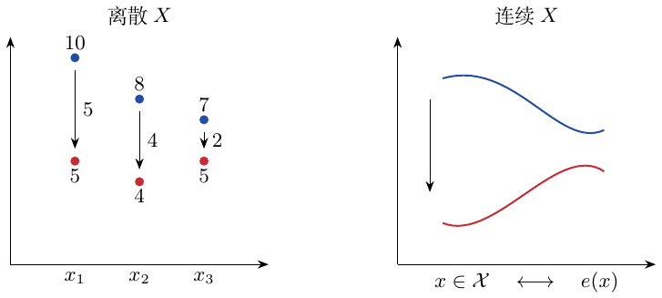
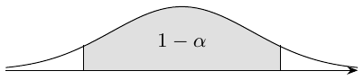
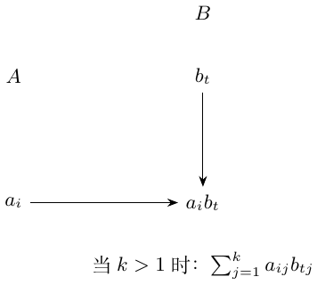
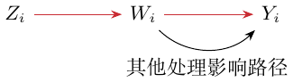
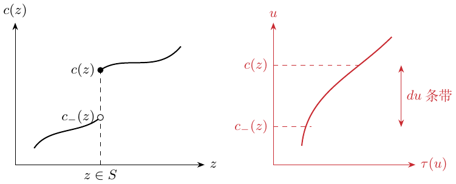
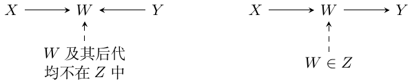

# STATS 361：因果推断笔记

第1至14讲 · 中文校订排印版

黑、红、蓝对应原笔颜色。紫色标注原笔记错误；橙色标注补充条件或待确认问题。识别和翻译错误直接改正。保留原公式、个人直觉与箭头关系。

**颜色显示：** GitHub会去掉正文CSS颜色；完整颜色请看[PDF](STATS361-Chinese.pdf)或[HTML预览](english/reviewed/STATS361-Chinese.html)。公式可直接编辑，图像保留原箭头颜色。中英文使用同一套校注编号。

---

# 第 1 讲：随机对照试验

*原扫描页码：Lecture1-10.pdf，第 2、1、3 页；阅读顺序：先第 2 页正文，再第 1 页补充，最后第 3 页。*

在随机对照试验（RCT）中，用回归分析平均处理效应，是为了减小方差；ATE 的识别并不依赖回归。

> <span style="color: #000000">RCT 中的回归（第 2 页）</span> $`\textcolor{black}{\longrightarrow}`$ 减小方差；ATE 的识别来自随机分配。

``` math
\Delta_i=Y_i(1)-Y_i(0),\qquad \tau=E[Y_i(1)-Y_i(0)].
```
用均值差估计量估计 $`\tau`$，并进行统计推断：
``` math
\widehat\tau_{\rm DM}=\frac1{n_1}\sum_{W_i=1}Y_i-\frac1{n_0}\sum_{W_i=0}Y_i,
\qquad n_w=|\{i:W_i=w\}|.
```
笔记标注：该估计量是一致且无偏的。

> <span style="color: #244DA8">均值差（第 2 页）</span> $`\textcolor{blue}{\longrightarrow}`$ $`\widehat\tau_{\rm DM}`$

<div class="review-note" style="color: #B45A00" data-ink="ReviewOrange" aria-label="Qualification / unresolved point">

**补充条件／待确认（S1-002）：抽样与处理分配条件**

*来源：Lecture1-10.pdf，第 2 页*

在上述随机分配设定下，两组均非空时，均值差是无偏的；总体一致性与正态极限还需要独立同分布抽样及有限二阶矩。下面的平衡分配方差公式专指 $`P(W=1)=1/2`$，并假设协变量已中心化，即 $`E[X]=0`$。一般方差为 $`\operatorname{Var}(Y(1))/e+\operatorname{Var}(Y(0))/(1-e)`$。中心化也解释了后面的 OLS 分解。在仅有上述矩条件时，分解旁的 $`N(0,\cdot/n_w)`$ 是渐近近似，而非有限样本下的精确分布。参见讲义式 (1.6)、(1.8)–(1.13)。

</div>

#### 补充：假设。

``` math
Y_i=Y_i(W_i),\qquad W_i\perp\{Y_i(0),Y_i(1)\}.
```
第一个式子标为 SUTVA，第二个是处理的随机分配。SUTVA 即稳定单位处理值假设；原笔记简述为：（1）单位稳定，实验单位之间相互独立；（2）只有一个处理水平／版本。

> <span style="color: #000000">$`Y_i=Y_i(W_i)`$；SUTVA</span> $`\textcolor{black}{\longrightarrow}`$ 稳定单位处理值假设：左页补充中的两项解释（第 1 页）。

<div class="review-note" style="color: #7A2B91" data-ink="ReviewPurple" aria-label="Original-note correction">

**原笔记纠错（S1-001）：SUTVA 不等于统计独立**

*来源：Lecture1-10.pdf，第 1 页*

SUTVA 要求单位之间没有干扰，且每种指定处理没有隐藏版本。它不要求结果在统计上相互独立，也允许这里的 $`0,1`$ 两种处理取值。独立抽样是另外的假设。原笔记的“单一处理水平”宜改为“每一种处理都有定义明确的版本”。参见[讲义](https://web.stanford.edu/~swager/stats361.pdf)印刷页码第 2–3 页的讨论与脚注。

</div>

## 线性结果模型与方差缩减

``` math
Y_i(w)=c_{(w)}+X_i\beta_{(w)}+\varepsilon_i(w),\quad
E[\varepsilon_i(w)\mid X_i]=0,\quad
\operatorname{Var}[\varepsilon_i(w)\mid X_i]=b^2.
```
<span style="color: #244DA8">两种处理状态分别拟合各自的系数。</span>记 $`A=\operatorname{Var}[X]`$，<span style="color: #244DA8">$`\|v\|_A^2=v'Av`$</span>。笔记中的方差为
``` math
V_{\rm DM}=4b^2+\|\beta_{(0)}+\beta_{(1)}\|_A^2
 +\|\beta_{(0)}-\beta_{(1)}\|_A^2.
```
另有
``` math
\tau=c_{(1)}-c_{(0)}+E[X](\beta_{(1)}-\beta_{(0)}),\qquad
\widehat\tau_{\rm OLS}=\widehat c_{(1)}-\widehat c_{(0)}
 +\overline X(\widehat\beta_{(1)}-\widehat\beta_{(0)}).
```
笔记给出的误差分解为
``` math
\begin{align*}
\widehat\tau_{\rm OLS}-\tau={}&(\widehat c_{(1)}-c_{(1)})-(\widehat c_{(0)}-c_{(0)})
 +\overline X(\beta_{(1)}-\beta_{(0)})\\
&+\overline X(\widehat\beta_{(1)}-\widehat\beta_{(0)}-\beta_{(1)}+\beta_{(0)}).
\end{align*}
```
前两项分别标注为 $`N(0,b^2/n_1)`$、$`N(0,b^2/n_0)`$；第三项标注为 $`N(0,\|\beta_{(1)}-\beta_{(0)}\|_A^2/n)`$；最后一项是 $`O_p(1/n)`$。<span style="color: #244DA8">页边批注：斜率估计带来的不确定性趋于零。</span>因此
``` math
\sqrt n(\widehat\tau_{\rm OLS}-\tau)\Rightarrow N(0,V_{\rm OLS}),\qquad
V_{\rm OLS}=4b^2+\|\beta_{(0)}-\beta_{(1)}\|_A^2,
```
``` math
V_{\rm DM}=V_{\rm OLS}+\|\beta_{(0)}+\beta_{(1)}\|_A^2.
```

## 一般结果回归下的 OLS

下一页说明：在该模型中，OLS 比均值差更好。设
``` math
Y_i(w)=\mu_{(w)}(X_i)+\varepsilon_i(w),\quad
E[\varepsilon_i(w)\mid X_i]=0,\quad
\operatorname{Var}[\varepsilon_i(w)\mid X_i]=b^2.
```
对于均值差估计量，
``` math
\sqrt n(\widehat\tau_{\rm DM}-\tau)\Rightarrow N(0,V_{\rm DM}),\quad
V_{\rm DM}=4b^2+2\operatorname{Var}[\mu_{(0)}(X_i)]
+2\operatorname{Var}[\mu_{(1)}(X_i)].
```
对于 OLS，Huber–White 方差计算从总体投影出发：
``` math
(c^*_{(w)},\beta^*_{(w)})=arg\min_{c,\beta}
 E[(Y_i(w)-X_i\beta-c)^2].
```
笔记写为
``` math
\sqrt{n_w}\left\{\begin{pmatrix}\widehat c_{(w)}\\\widehat\beta_{(w)}\end{pmatrix}
-\begin{pmatrix}c^*_{(w)}\\\beta^*_{(w)}\end{pmatrix}\right\}
\Rightarrow N\left(0,\begin{pmatrix}\operatorname{MSE}^*_{(w)}&0\\0&\cdots\end{pmatrix}\right),
```
其中 $`c^*_{(w)}=E[Y_i(w)]`$，并定义

<div class="review-note" style="color: #7A2B91" data-ink="ReviewPurple" aria-label="Original-note correction">

**原笔记纠错（S1-003）：错设回归的协方差矩阵不一定为分块对角阵**

*来源：Lecture1-10.pdf，第 3 页*

非对角块为零不能由 $`E[X]=0`$ 推出。令 $`q=(1,X')'`$、$`r_w=Y(w)-c_w^*-X\beta_w^*`$、$`Q=E[qq']`$，则协方差矩阵为
``` math
Q^{-1}E[r_w^2qq']Q^{-1}.
```
截距与斜率之间的协方差块为 $`E[r_w^2X]A^{-1}`$（行列方向相应调整）；条件均值模型错设时，它一般不为零。投影正交性给出的是 $`E[r_wX]=0`$，而非 $`E[r_w^2X]=0`$。截距方差 $`E[r_w^2]`$ 和随后平衡试验下的方差缩减恒等式仍成立。这是原扫描中可见的错误，讲义式 (1.16) 也有同样问题，并非识别错误。

</div>

``` math
\operatorname{MSE}^*_{(w)}=E[(Y_i(w)-X_i\beta^*_{(w)}-c^*_{(w)})^2].
```
由此得到
``` math
\sqrt n(\widehat\tau_{\rm OLS}-\tau)\Rightarrow N(0,V_{\rm OLS}),\qquad
V_{\rm OLS}=V_{\rm DM}-\|\beta^*_{(0)}+\beta^*_{(1)}\|_A^2.
```
<span style="color: #C92B32">$`V_{\rm OLS}<V_{\rm DM}`$ 总是成立。</span>

<div class="review-note" style="color: #7A2B91" data-ink="ReviewPurple" aria-label="Original-note correction">

**原笔记纠错（S1-004）：方差不会增大，但不一定严格减小**

*来源：Lecture1-10.pdf，第 3 页*

前面的恒等式只能推出 $`V_{\rm OLS}\le V_{\rm DM}`$。当 $`\|\beta_0^*+\beta_1^*\|_A^2=0`$ 时等号成立；若 $`A`$ 非奇异，等价于 $`\beta_0^*+\beta_1^*=0`$。两组斜率非零但互为相反数，就会出现相等的情况。严格缩减要求上述平方范数为正。这可以直接由两个方差相减得到。

</div>

#### 个人理解。

OLS 可以看作
``` math
\widehat\tau_{\rm OLS}=\frac1n\sum_{i=1}^n
\{(\widehat c_{(1)}+X_i\widehat\beta_{(1)})
 -(\widehat c_{(0)}+X_i\widehat\beta_{(0)})\}
=\frac1n\sum_i[\widehat\mu_{(1)}(X_i)-\widehat\mu_{(0)}(X_i)].
```
<span style="color: #244DA8">这里 $`\widehat\mu_{(w)}(x)`$ 是 OLS 在 $`x`$ 处的拟合值，也可以换成其他方法。</span>

# 第 2 讲：无混杂性与倾向得分

*原扫描页码：Lecture1-10.pdf，第 5、4、7、6 页；第 4 页承接第 5 页底部，第 6 页补充第 7 页。*

无混杂性：目的是消除混杂因素的影响。倾向得分：给定协变量后接受处理的概率。

## 汇总各组的均值差估计

<span style="color: #C92B32">直接按照概率加权。</span>对离散且取数值的 $`X_i`$，假设
``` math
\{Y_i(0),Y_i(1)\}\perp W_i\mid X_i=x,\qquad x\in\mathcal X.
```
<span style="color: #244DA8">这里 $`x`$ 是分组变量。</span>定义各组的 ATE：
``` math
\tau(x)=E[Y_i(1)-Y_i(0)\mid X_i=x].
```
则
``` math
\begin{align*}
\widehat\tau_{\rm AGG}&=\sum_{x\in\mathcal X}\frac{n_x}{n}\widehat\tau(x),\\
\widehat\tau(x)&=\frac1{n_{x1}}\sum_{X_i=x,W_i=1}Y_i
-\frac1{n_{x0}}\sum_{X_i=x,W_i=0}Y_i,\\
n_x&=|\{i:X_i=x\}|,\qquad
n_{xw}=|\{i:X_i=x,W_i=w\}|.
\end{align*}
```
令 $`e(x)=P(W_i=1\mid X_i=x)`$。组内的极限分布为
``` math
\begin{align*}
\sqrt{n_x}(\widehat\tau(x)-\tau(x))
&\Rightarrow N\left(0,
\frac{\operatorname{Var}[Y_i(0)\mid X_i=x]}{1-e(x)}
+\frac{\operatorname{Var}[Y_i(1)\mid X_i=x]}{e(x)}\right)\\
&=N\left(0,\frac{b^2(x)}{e(x)(1-e(x))}\right),
\end{align*}
```
第二个等号使用了原笔记中两种处理状态具有相同条件方差的假设。原定义一行写作 $`\widehat\pi(x)=P(X_i=x)=n_x/n`$。

<div class="review-note" style="color: #7A2B91" data-ink="ReviewPurple" aria-label="Original-note correction">

**原笔记纠错（S1-005）：总体分层概率与经验分层概率**

*来源：Lecture1-10.pdf，第 5 页*

总体概率质量应记为 $`\pi(x)=P(X_i=x)`$，其估计为 $`\widehat\pi(x)=n_x/n`$；有限样本中二者通常不相等。后面的 $`\widehat\pi(x)-\pi(x)`$ 已经要求区分二者。以下展开按这两个不同定义理解。固定分层数下的中心极限定理还需要：层数有限、各层总体概率为正、层内处理重叠，以及有限条件二阶矩。参见讲义式 (2.3)–(2.7)。

</div>

于是
``` math
\begin{align*}
\widehat\tau_{\rm AGG}={}&\sum_x\pi(x)\tau(x)
+\sum_x\pi(x)(\widehat\tau(x)-\tau(x))\\
&+\sum_x(\widehat\pi(x)-\pi(x))\tau(x)
+\sum_x(\widehat\pi(x)-\pi(x))(\widehat\tau(x)-\tau(x)).
\end{align*}
```
<span style="color: #244DA8">第一项是 $`\tau`$。</span><span style="color: #244DA8">第二项标注为渐近正态，其方差为</span>

<div class="original-ink" style="color: #244DA8" data-ink="blue" aria-label="Original blue ink">

``` math
\sum_x\pi^2(x)\operatorname{Var}[\widehat\tau(x)].
```

</div>

<span style="color: #244DA8">第三项的方差是 $`n^{-1}\operatorname{Var}[\tau(X_i)]`$，最后一项为 $`O_p(1/n)`$。</span>沿箭头接到左页，

> <span style="color: #000000">汇总估计量的四项展开（第 5 页）</span> $`\textcolor{black}{\longrightarrow}`$ 汇总估计量的方差 $`V_{\rm AGG}`$（第 4 页）。

``` math
\sqrt n(\widehat\tau_{\rm AGG}-\tau)\Rightarrow N(0,V_{\rm AGG}),
```
``` math
\begin{align*}
V_{\rm AGG}&=\operatorname{Var}[\tau(X_i)]
+\sum_{x\in\mathcal X}\pi^2(x)\frac1{\pi(x)}
\frac{b^2(x)}{e(x)(1-e(x))}\\
&=\operatorname{Var}[\tau(X_i)]
+E\left[\frac{b^2(X_i)}{e(X_i)(1-e(X_i))}\right].
\end{align*}
```

## 连续协变量与倾向得分

给定 $`X_i`$ 后，$`W_i`$ 不能“偷看”$`Y_i`$：这是作者对无混杂性的直觉理解。若
``` math
\{Y_i(0),Y_i(1)\}\perp W_i\mid X_i,
\quad e(x)=P(W_i=1\mid X_i=x),
```
则
``` math
\{Y_i(0),Y_i(1)\}\perp W_i\mid e(X_i).
```

#### 补充图示与计算。

<div class="center">



</div>

图下方的证明写作
``` math
\begin{align*}
&P(W_i=w\mid\{Y_i(0),Y_i(1)\},e(X_i))\\
&\quad=\int_{\mathcal X}P(W_i=w\mid\{Y_i(0),Y_i(1)\},X_i=x)
 P(X_i=x\mid e(X_i))\,dx\\
&\quad=\int_{\mathcal X}P(W_i=w\mid X_i=x)P(X_i=x\mid e(X_i))\,dx\\
&\quad=e(X_i)\mathbf1_{\{w=1\}}+(1-e(X_i))\mathbf1_{\{w=0\}}.
\end{align*}
```
<span style="color: #244DA8">页边标注：“Lebesgue 积分”。</span>

<div class="review-note" style="color: #7A2B91" data-ink="ReviewPurple" aria-label="Original-note correction">

**原笔记纠错（S1-006）：倾向得分证明中的条件集合**

*来源：Lecture1-10.pdf，第 6 页*

令 $`\mathcal Y=(Y(0),Y(1))`$。迭代期望中的积分一开始必须使用 $`dP(X\mid\mathcal Y,e(X))`$，而非 $`dP(X\mid e(X))`$。无混杂性把被积函数化为 $`P(W=w\mid X)`$；它在每个倾向得分的等值集合上为常数。无论剩余条件分布是什么，对这一常数积分都得到所需结论。对于连续 $`X`$，应使用正则条件概率测度，而不能把点概率 $`P(X=x\mid\cdot)\,dx`$ 当作积分测度。可对照讲义命题 2.1 中条件集合正确的证明。

</div>

## 按倾向得分分层

1.  排序，使 $`\widehat e(X_{i_1})\leq\widehat e(X_{i_2})\leq\cdots\leq\widehat e(X_{i_n})`$。

2.  将样本分为 $`J`$ 层，在每一层内估计均值差。若 $`I_j`$ 包含排序后第 $`\lfloor(j-1)n/J\rfloor+1`$ 到第 $`\lfloor jn/J\rfloor`$ 个样本，则原页的简写公式可表示为
    ``` math
    \widehat\tau_j=\frac{\sum_{i\in I_j}W_iY_i}{\sum_{i\in I_j}W_i}
    -\frac{\sum_{i\in I_j}(1-W_i)Y_i}{\sum_{i\in I_j}(1-W_i)}.
    ```

    > <span style="color: #244DA8">使处理组与对照组更相似（第 7 页）</span> $`\textcolor{blue}{\longrightarrow}`$ 按 $`\widehat e(X_i)`$ 排序，并按倾向得分分层。

3.  对各层估计取平均：$`\widehat\tau_{\rm STRAT}=J^{-1}\sum_{j=1}^J\widehat\tau_j`$。<span style="color: #244DA8">笔记标注其具有一致性。</span>

    <div class="review-note" style="color: #B45A00" data-ink="ReviewOrange" aria-label="Qualification / unresolved point">

    **补充条件／待确认（S1-007）：分层区间需要逐渐缩小**

    *来源：Lecture1-10.pdf，第 7 页*

    若只用固定数量的宽倾向得分区间，一般仍会留下混杂。一致性要求分层越来越细，每层有足够的处理组和对照组样本，满足重叠性，且倾向得分估计足够准确。讲义明确要求 $`\widehat e`$ 一致收敛，并且 $`J`$ 随 $`n`$ 以适当速度增长。这里各层样本量近似相等，因此使用等权平均。

    </div>

## 逆倾向得分加权

*原扫描页码：Lecture1-10.pdf，第 9、8、10 页；第 8 页给出第 9 页方差计算所用的模型。*

``` math
\widehat\tau_{\rm IPW}=\frac1n\sum_{i=1}^n
\left\{\frac{W_iY_i}{\widehat e(X_i)}-\frac{(1-W_i)Y_i}{1-\widehat e(X_i)}\right\}.
```
理想的 IPW（oracle IPW）假定完全知道 $`e(x)`$：
``` math
\widehat\tau^*_{\rm IPW}=\frac1n\sum_i
\left\{\frac{W_iY_i}{e(X_i)}-\frac{(1-W_i)Y_i}{1-e(X_i)}\right\}.
```
假设满足重叠性：所有 $`x\in\mathcal X`$ 上均有 $`\eta\leq e(x)\leq1-\eta`$，且 $`|Y_i|<M`$。若
``` math
\sup_{x\in\mathcal X}|e(x)-\widehat e(x)|=O_p(a_n)\longrightarrow0,
```
笔记给出
``` math
|\widehat\tau_{\rm IPW}-\widehat\tau^*_{\rm IPW}|=O_p(a_nM/\eta).
```
<span style="color: #244DA8">因此，理想估计量的一致性可以传递给使用估计倾向得分的 IPW。</span>另外，
``` math
E[\widehat\tau^*_{\rm IPW}]=E[Y_i(1)-Y_i(0)]=\tau.
```
<span style="color: #244DA8">满足重叠性时，理想 IPW 的收敛尺度是 $`1/\sqrt n`$。</span>

#### 方差计算：左页补充的模型。

左页给出
``` math
\begin{align*}
Y_i(0)&=c(X_i)-(1-e(X_i))\tau(X_i)+\varepsilon_i(0),\\
Y_i(1)&=c(X_i)+e(X_i)\tau(X_i)+\varepsilon_i(1),\\
E[\varepsilon_i(w)\mid X_i]&=0,\qquad
\operatorname{Var}[\varepsilon_i(w)\mid X_i=x]=b^2(x).
\end{align*}
```
随后笔记写为

> <span style="color: #000000">第 8 页补充的结果模型</span> $`\textcolor{black}{\longrightarrow}`$ 第 9 页理想 IPW 的方差 $`V_{\rm IPW^*}`$。

``` math
\begin{align*}
n\operatorname{Var}[\widehat\tau^*_{\rm IPW}]
=V_{\rm IPW^*}
={}&E\left[\frac{c^2(X_i)}{e(X_i)(1-e(X_i))}\right]
+\operatorname{Var}[\tau(X_i)]\\
&+E\left[\frac{b^2(X_i)}{e(X_i)(1-e(X_i))}\right],\\
\sqrt n(\widehat\tau^*_{\rm IPW}-\tau)&\Rightarrow N(0,V_{\rm IPW^*}).
\end{align*}
```

#### 个人比较。

$`c(x)`$ 描述的是 $`X`$ 与 $`Y`$ 的关系，而不是 $`X`$ 与 $`\Delta Y`$ 的关系。与分组汇总相比，
``` math
V_{\rm IPW^*}=V_{\rm AGG}+E\left[\frac{c^2(X_i)}{e(X_i)(1-e(X_i))}\right].
```

> <span style="color: #244DA8">$`V_{\rm IPW^*}-V_{\rm AGG}`$（第 10 页）</span> $`\textcolor{blue}{\longrightarrow}`$ <span style="color: #244DA8">除非 $`c(X_i)`$ 处处为零，否则理想 IPW 的方差比汇总估计更大。</span>

与线性模型相比：IPW 基于 $`\{Y_i(0),Y_i(1)\}\perp W_i\mid X_i`$，线性模型则依赖线性关系。

<div class="review-note" style="color: #B45A00" data-ink="ReviewOrange" aria-label="Qualification / unresolved point">

**补充条件／待确认（S1-009）：方差比较与因果识别**

*来源：Lecture1-10.pdf，第 10 页*

在重叠性和有限矩条件下，恰当且仅当 $`c(X)=0`$ 几乎处处成立时，额外方差为零；若 $`P(c(X)\ne0)>0`$，它就为正。正确设定的线性结果模型是估计上的限制，本身不是因果识别假设：观察性回归仍需要适当的外生性／无混杂性，或其他识别依据。这里保留作者对两种估计方法的比较。

</div>

# 第 3 讲：通过增广 IPW 高效估计处理效应

*原扫描页码：Lecture1-10.pdf，第 11–12 页。*

普通 IPW 的大样本性质较差。例如，$`X`$ 离散时，它不如汇总估计量 $`\widehat\tau`$。

## ATE 的两种表征

1.  利用 $`e(x)=P(W_i=1\mid X_i=x)`$，有 $`\tau=E[\widehat\tau^*_{\rm IPW}]`$；理想估计量定义如上。

2.  利用 $`\mu_{(w)}(x)=E[Y_i(w)\mid X_i=x]`$，
    ``` math
    \tau(x)=\mu_{(1)}(x)-\mu_{(0)}(x),\quad
    \tau=E[\mu_{(1)}(X_i)-\mu_{(0)}(X_i)],
    ```
    由此得到
    ``` math
    \widehat\tau_{\rm REG}=\frac1n\sum_i[\widehat\mu_{(1)}(X_i)-\widehat\mu_{(0)}(X_i)].
    ```

## 增广 IPW 估计量

``` math
\begin{align*}
\widehat\tau_{\rm AIPW}=\frac1n\sum_i\bigg[&\widehat\mu_{(1)}(X_i)-\widehat\mu_{(0)}(X_i)
+W_i\frac{Y_i-\widehat\mu_{(1)}(X_i)}{\widehat e(X_i)}\\
&-(1-W_i)\frac{Y_i-\widehat\mu_{(0)}(X_i)}{1-\widehat e(X_i)}\bigg].
\end{align*}
```

#### 个人直觉。

<span style="color: #244DA8">先用 $`\mu(x)`$ 估计结果，再对回归残差做 IPW。IPW 让数据的协变量构成变得“公平”。</span>

## 双重稳健性

只要结果回归 $`\widehat\mu_{(w)}(x)`$ 或倾向得分 $`\widehat e(x)`$ 中有一方一致，AIPW 就一致。

<div class="review-note" style="color: #B45A00" data-ink="ReviewOrange" aria-label="Qualification / unresolved point">

**补充条件／待确认（S1-010）：双重稳健性和效率需要正则条件**

*来源：Lecture1-10.pdf，第 11、12、13 页*

双重稳健性需要重叠性、适当的可积性，以及对拟合函数求值的控制（例如交叉拟合）；另一个辅助估计量也必须表现良好。仅条件于 $`X_i,W_i`$，不能把使用同一个样本点训练出来的函数视为固定。交叉拟合的证明还需要条件于训练折。下面的效率界适用于非参数无混杂模型中的正则估计量，而不是字面上所有可能的估计量。下一页列出的乘积风险条件与辅助函数一致性，是选定学习方法后需要验证的假设，并非所有机器学习算法自动具备的性质。参见讲义式 (3.8) 及式 (3.16) 后的正则性讨论。

</div>

当 $`\widehat\mu_{(w)}(x)\approx\mu_{(w)}(x)`$ 时，回归均值是一致的，加权残差项的均值近似为零，因为
``` math
E[Y_i-\widehat\mu_{(W_i)}(X_i)\mid X_i,W_i]\approx0.
```
这里通过条件化把倾向得分项固定下来。若是 $`\widehat e(x)\approx e(x)`$，则改写为
``` math
\begin{align*}
\widehat\tau_{\rm AIPW}={}&\frac1n\sum_i\left[\frac{W_iY_i}{\widehat e(X_i)}
-\frac{(1-W_i)Y_i}{1-\widehat e(X_i)}\right]\\
&+\frac1n\sum_i\left[\widehat\mu_{(1)}(X_i)\left(1-\frac{W_i}{\widehat e(X_i)}\right)
-\widehat\mu_{(0)}(X_i)\left(1-\frac{1-W_i}{1-\widehat e(X_i)}\right)\right].
\end{align*}
```
<span style="color: #244DA8">第一部分是 IPW。</span><span style="color: #244DA8">第二部分均值近似为零，因为</span> $`E[1-W_i/\widehat e(X_i)\mid X_i]\approx0`$；条件化后把拟合的结果回归视为固定。

## 半参数效率

笔记称 AIPW 在非参数估计量中渐近最优。当辅助函数估计足够准确时，
``` math
\sqrt n(\widehat\tau_{\rm AIPW}-\widehat\tau^*_{\rm AIPW})\longrightarrow_p0,
```
星号表示理想 AIPW。该理想估计量只是独立同分布变量的均值，因此其中心极限定理可以传递给使用估计函数的版本：

> <span style="color: #244DA8">$`\sqrt n(\widehat\tau_{\rm AIPW}-\widehat\tau^*_{\rm AIPW})\to_p0`$（第 12 页）</span> $`\textcolor{blue}{\longrightarrow}`$ 理想估计量的独立同分布中心极限定理可用于估计得到的 AIPW。

``` math
\sqrt n(\widehat\tau_{\rm AIPW}-\tau)\Rightarrow N(0,V^*),
```
``` math
V^*=\operatorname{Var}[\tau(X_i)]
+E\left[\frac{b_0^2(X_i)}{1-e(X_i)}\right]
+E\left[\frac{b_1^2(X_i)}{e(X_i)}\right].
```
<span style="color: #244DA8">页边将其描述为类似 Cramér–Rao 的约束：这是能达到的最好效果／方差。</span>

## AIPW 与交叉拟合

*原扫描页码：Lecture1-10.pdf，第 13–14 页。*

将数据随机分成两半 $`I_1`$ 和 $`I_2`$。<span style="color: #244DA8">批注：把数据分开，随机选择。</span>令
``` math
\widehat\tau_{\rm AIPW}=\frac{|I_1|}{n}\widehat\tau^{I_1}
+\frac{|I_2|}{n}\widehat\tau^{I_2},
```
``` math
\begin{align*}
\widehat\tau^{I_1}=\frac1{|I_1|}\sum_{i\in I_1}\bigg[&\widehat\mu_{(1)}^{I_2}(X_i)-\widehat\mu_{(0)}^{I_2}(X_i)
+W_i\frac{Y_i-\widehat\mu_{(1)}^{I_2}(X_i)}{\widehat e^{I_2}(X_i)}\\
&-(1-W_i)\frac{Y_i-\widehat\mu_{(0)}^{I_2}(X_i)}{1-\widehat e^{I_2}(X_i)}\bigg].
\end{align*}
```
渐近分析可以不依赖所选机器学习调整方法的具体形式，而依赖以下条件：

1.  重叠性：对所有 $`x\in\mathcal X`$，有 $`\eta<e(x)<1-\eta`$，其中 $`\eta>0`$。

2.  辅助函数估计的一致性：
    ``` math
    \sup_x|\widehat\mu_{(w)}^{I_2}(x)-\mu_{(w)}(x)|\longrightarrow_p0,
    \quad \sup_x|\widehat e^{I_2}(x)-e(x)|\longrightarrow_p0.
    ```
    <span style="color: #244DA8">蓝字写的是：机器学习调整方法具有大样本一致性。</span>

3.  结果模型与倾向得分模型的风险衰减：
    ``` math
    E[(\widehat\mu_{(w)}^{I_2}(X_i)-\mu_{(w)}(X_i))^2]\,
    E[(\widehat e^{I_2}(X_i)-e(X_i))^2]=o(1/n).
    ```
    <span style="color: #244DA8">若两者均以 $`\sqrt n`$ 速度一致收敛，则乘积为 $`1/n^2`$ 阶。一个简单的充分条件是，两种回归调整的均方根误差（RMSE）都以 $`o(n^{-1/4})`$ 收敛。</span>

#### 续页上的证明。

把理想估计量写作 $`\widehat\tau^*=|I_1|\widehat\tau^{I_1,*}/n+|I_2|\widehat\tau^{I_2,*}/n`$. 要证明 $`\sqrt n(\widehat\tau_{\rm AIPW}-\widehat\tau^*)\to_p0`$，只需对处理状态下的均值证明相应结果；其余部分类似。定义
``` math
\widehat\tau^{I_1}=\widehat\mu^{I_1}_{(1)}-\widehat\mu^{I_1}_{(0)},\qquad
\widehat\mu^{I_1}_{(1)}=\frac1{|I_1|}\sum_{i\in I_1}
\left[\widehat\mu^{I_2}_{(1)}(X_i)+W_i\frac{Y_i-\widehat\mu^{I_2}_{(1)}(X_i)}{\widehat e^{I_2}(X_i)}\right].
```
减去对应的理想估计量，得到
``` math
\begin{align*}
\widehat\mu^{I_1}_{(1)}-\widehat\mu^{I_1,*}_{(1)}
={}&\frac1{|I_1|}\sum_{i\in I_1}
(\widehat\mu^{I_2}_{(1)}(X_i)-\mu_{(1)}(X_i))\left(1-\frac{W_i}{e(X_i)}\right)\\
&+\frac1{|I_1|}\sum_{i\in I_1}W_i(Y_i-\mu_{(1)}(X_i))
\left(\frac1{\widehat e^{I_2}(X_i)}-\frac1{e(X_i)}\right)\\
&-\frac1{|I_1|}\sum_{i\in I_1}W_i(\widehat\mu^{I_2}_{(1)}(X_i)-\mu_{(1)}(X_i))
\left(\frac1{\widehat e^{I_2}(X_i)}-\frac1{e(X_i)}\right).
\end{align*}
```
<span style="color: #244DA8">蓝字把第一项的界写成 $`o_p(1)/n`$，最后一项标为 $`o_p(1/\sqrt n)`$。</span>

<div class="review-note" style="color: #7A2B91" data-ink="ReviewPurple" aria-label="Original-note correction">

**原笔记纠错（S1-011）：把方差的阶标在了余项本身上**

*来源：Lecture1-10.pdf，第 14 页*

记第一个均值为 $`T_1`$，训练数据为 $`\mathcal D_2`$。由交叉拟合可得 $`E[T_1\mid\mathcal D_2]=0`$，并且
``` math
E[T_1^2\mid\mathcal D_2]
\le \frac{E[(\widehat\mu_1(X)-\mu_1(X))^2\mid\mathcal D_2]}{\eta|I_1|}
=o_p(n^{-1}).
```
因此 $`T_1=o_p(n^{-1/2})`$，一般不能说它是 $`o_p(n^{-1})`$。较小的阶属于其条件方差／二阶矩。第二个均值类似处理，乘积项则使用前面的乘积风险假设。这里指出原批注很可能遗漏了方差运算，同时保留原来的标注。

</div>

对 $`K`$ 折交叉拟合，在构造第 $`i`$ 个观测的辅助估计时，排除其所在的第 $`k(i)`$ 折：
``` math
\begin{align*}
\widehat\tau_{\rm AIPW}=\frac1n\sum_i\bigg[&\widehat\mu_{(1)}^{(-k(i))}(X_i)-\widehat\mu_{(0)}^{(-k(i))}(X_i)
+W_i\frac{Y_i-\widehat\mu_{(1)}^{(-k(i))}(X_i)}{\widehat e^{(-k(i))}(X_i)}\\
&-(1-W_i)\frac{Y_i-\widehat\mu_{(0)}^{(-k(i))}(X_i)}{1-\widehat e^{(-k(i))}(X_i)}\bigg].
\end{align*}
```

## 置信区间

*原扫描页码：Lecture1-10.pdf，第 16、15 页；第 15 页补充第 16 页所用的定义。*

#### 补充：术语。

原笔记将对数似然的导数标为有效得分：
``` math
S(\theta)=\frac{d\log L(\theta)}{d\theta},
```
其中 $`L(\theta)`$ 为似然函数。$`n`$ 个样本得分的经验方差为
``` math
\frac1{n-1}\sum_i(S(\theta_i)-\overline{S(\theta)})^2.
```
有效方差是给定问题下能够达到的最小方差，可以理解为 Cramér–Rao 下界。

<div class="review-note" style="color: #7A2B91" data-ink="ReviewPurple" aria-label="Original-note correction">

**原笔记纠错（S1-012）：似然得分与有效影响函数不同**

*来源：Lecture1-10.pdf，第 15、16 页*

所写导数是普通的似然得分。有辅助参数时，有效得分还需要去掉辅助得分方向的分量。在 ATE 估计中，下面中心化的 AIPW 单项 $`\psi_i^*-\tau`$ 是有效影响函数；其方差就是效率界。它不等于原始似然得分，后者的方差是 Fisher 信息。对观测 $`O_i`$，经验得分方差应使用同一参数值 $`\theta`$ 下的 $`S_\theta(O_i)`$，而非不同的参数值 $`\theta_i`$。第 16 页 AIPW 的经验方差公式，在相应一致性和矩条件下是正确的。

</div>

#### 方差估计。

定义理想估计量中的单项
``` math
\psi_i^*=\mu_{(1)}(X_i)-\mu_{(0)}(X_i)
+\frac{W_i(Y_i-\mu_{(1)}(X_i))}{e(X_i)}
-\frac{(1-W_i)(Y_i-\mu_{(0)}(X_i))}{1-e(X_i)}.
```
它的经验方差收敛到有效方差：
``` math
\frac1{n-1}\sum_i(\psi_i^*-\widehat\tau^*)^2\longrightarrow_p V^*.
```
页边把 $`\widehat\tau^*`$ 称为未做交叉拟合的理想 AIPW 估计量。

> <span style="color: #244DA8">未交叉拟合的理想 AIPW 估计（第 16 页）</span> $`\textcolor{blue}{\longrightarrow}`$ $`\sum_i(\psi_i^*-\widehat\tau^*)^2/(n-1)`$ 中的 $`\widehat\tau^*`$。

将每个辅助函数替换为排除第 $`k(i)`$ 折后训练的估计，得到交叉拟合单项 $`\widehat\psi_i`$，以及
``` math
\widehat V_{\rm AIPW}=\frac1{n-1}\sum_i(\widehat\psi_i-\widehat\tau_{\rm AIPW})^2\longrightarrow_p V^*.
```
正态分布中央概率区域下画出的置信区间为

<div class="center">



</div>

<div class="review-note" style="color: #B45A00" data-ink="ReviewOrange" aria-label="Qualification / unresolved point">

**补充条件／待确认（S1-013）：置信水平的命名惯例**

*来源：Lecture1-10.pdf，第 16 页*

下面公式的渐近覆盖率是 $`1-\alpha`$；$`\alpha`$ 为错误概率。手写的“$`\alpha`$ 水平”可以理解为按显著性水平命名，因此无需改动公式。

</div>

``` math
\widehat\tau_{\rm AIPW}\ \pm\ \frac1{\sqrt n}\Phi^{-1}(1-\alpha/2)\sqrt{\widehat V_{\rm AIPW}}.
```

# 第 4 讲：估计处理效应的异质性

*原扫描页码：Lecture1-10.pdf，第 17–18 页。*

对于观测 $`(X_i,Y_i,W_i)`$，其中 $`X_i\in\mathcal X`$，之前关注的是 ATE $`E[Y_i(1)-Y_i(0)]`$。异质性分析转而考虑条件平均处理效应（CATE）：
``` math
\tau(x)=E[Y_i(1)-Y_i(0)\mid X_i=x].
```

> <span style="color: #244DA8">$`X_i`$ 某一类中的平均效应（第 17 页）</span> $`\textcolor{blue}{\longrightarrow}`$ $`\tau(x)=E[Y_i(1)-Y_i(0)\mid X_i=x]`$。

## 正则化偏差

在 $`\{Y_i(0),Y_i(1)\}\perp W_i\mid X_i`$ 下，
``` math
\tau(x)=\mu_{(1)}(x)-\mu_{(0)}(x),\qquad
\mu_{(w)}(x)=E[Y_i\mid X_i=x,W_i=w].
```
一个直接的 CATE 估计量为 $`\widehat\tau_T(x)=\widehat\mu_{(1)}(x)-\widehat\mu_{(0)}(x)`$。

#### 个人疑虑。

<span style="color: #244DA8">如果 $`\widehat\mu_{(1)}`$ 的样本太少，就可能受到很强的正则化，向一条直线收缩。而 $`\widehat\mu_{(0)}`$ 样本很多时可能拟合得很好；这样，两者之差 $`\widehat\tau_T(x)`$ 就会因为前者拟合不准而出问题。</span>

## 半参数建模

``` math
Y_i(w)=f(X_i)+w\tau(X_i)+\varepsilon_i(w),\qquad
P(W_i=1\mid X_i)=e(X_i),\qquad \tau(x)=\psi(x)\beta.
```
<span style="color: #244DA8">$`f`$ 是 $`X_i`$ 的函数，$`\psi(x)`$ 是 $`X`$ 的非参数表示；$`\beta`$ 是处理效应的系数。</span>在无混杂性下，Robinson 变换为

> <span style="color: #000000">$`Y_i(w)=f(X_i)+w\tau(X_i)+\varepsilon_i(w)`$（第 17 页）</span> $`\textcolor{black}{\longrightarrow}`$ <span style="color: #C92B32">Robinson</span>：减去 $`m(X_i)`$，并用 $`e(X_i)`$ 对 $`W_i`$ 残差化。

``` math
Y_i-m(X_i)=(W_i-e(X_i))\psi(X_i)\beta+\varepsilon_i,
\quad m(x)=E[Y_i\mid X_i=x]=f(x)+e(x)\tau(x),
```
其中 $`\varepsilon_i=\varepsilon_i(W_i)`$。

> <span style="color: #244DA8">$`\varepsilon_i=\varepsilon_i(W_i)`$（第 17 页）</span> $`\textcolor{blue}{\longrightarrow}`$ $`Y_i-m(X_i)=(W_i-e(X_i))\psi(X_i)\beta+\varepsilon_i`$ 中的误差。

构造残差对残差的 OLS 回归，令
``` math
\widetilde Y_i^*=Y_i-m(X_i),\qquad
\widetilde Z_i^*=(W_i-e(X_i))\psi(X_i).
```
将 $`\widetilde Y_i^*`$ 对 $`\widetilde Z_i^*`$ 回归，得到 $`\widehat\beta_R^*`$（原笔记使用的系数符号类似 $`\zeta_R`$）。<span style="color: #244DA8">这些变换只用到已观测数据和辅助函数；页边称之为数据预处理。</span>笔记给出
``` math
\sqrt n(\widehat\beta_R^*-\beta)\Rightarrow N(0,V_R),
```
``` math
V_R=\operatorname{Var}[\widetilde Z_i^*]^{-1}
\operatorname{Var}[\widetilde Z_i^*\widetilde Y_i^*]
\operatorname{Var}[\widetilde Z_i^*]^{-1}.
```
同方差时，$`\operatorname{Var}(\varepsilon_i\mid X_i,W_i)=b^2`$ 为常数，$`V_R`$ 是 $`\beta`$ 的半参数有效方差。异方差时，笔记说 $`V_R`$ 仍适用，但不再是有效方差。

<div class="review-note" style="color: #7A2B91" data-ink="ReviewPurple" aria-label="Original-note correction">

**原笔记纠错（S1-014）：Robinson 夹心方差应使用回归残差**

*来源：Lecture1-10.pdf，第 18 页*

令列向量 $`Z=\widetilde Z_i^*`$，$`Q=E[ZZ']`$，$`\varepsilon=\widetilde Y_i^*-Z'\beta`$。由正规方程得到影响函数 $`Q^{-1}Z\varepsilon`$，因此
``` math
V_R=Q^{-1}E[ZZ'\varepsilon^2]Q^{-1}.
```
中间项应为 $`\operatorname{Var}(Z\varepsilon)`$，而非 $`\operatorname{Var}(Z\widetilde Y^*)`$。后者包含 $`ZZ'\beta`$ 的随机波动，而估计分母会抵消这部分波动。这里 $`E[Z]=0`$，所以 $`Q=\operatorname{Var}(Z)`$。在条件同方差、$`Q`$ 非奇异及所需矩有限时，修正后的方差为 $`b^2Q^{-1}`$。原文关于效率的讨论应针对这个修正后的夹心方差。

</div>

#### 可实施的交叉拟合版本。

前面的回归是理想形式，因为 $`m(X_i)`$、$`e(X_i)`$ 未知。拟合非参数回归 $`Y\sim X`$ 和 $`W\sim X`$；构造下式时，<span style="color: #244DA8">排除第 $`i`$ 个观测所在的折</span>：
``` math
\widetilde Y_i=Y_i-\widehat m^{(-k(i))}(X_i),\qquad
\widetilde Z_i=(W_i-\widehat e^{(-k(i))}(X_i))\psi(X_i).
```
将 $`\widetilde Y_i`$ 对 $`\widetilde Z_i`$ 回归得到 $`\widehat\beta_R`$。若两个辅助函数估计的 RMSE 均为 $`o_p(n^{-1/4})`$，笔记得到
``` math
\sqrt n(\widehat\beta_R^*-\widehat\beta_R)\longrightarrow_p0.
```

## 用于处理效应异质性的损失函数

*原扫描页码：Lecture1-10.pdf，第 20、19 页；第 19 页补充第 20 页的残差回归与 R 损失。*

前面的估计量假设 $`\tau(x)=\psi(x)\beta`$。实际关系往往不是线性的，因此使用机器学习。令
``` math
\mu_{(w)}(x)=E[Y(w)\mid X=x],\quad
\varepsilon_i(w)=Y_i(w)-[\mu_{(0)}(X_i)+w\tau(X_i)],
```
由无混杂性得到 $`E[\varepsilon_i(w)\mid X_i,W_i]=0`$。<span style="color: #244DA8">这里 $`\mu_{(0)}`$ 起到前面 $`f`$ 的作用。</span>仍有
``` math
Y_i-m(X_i)=(W_i-e(X_i))\tau(X_i)+\varepsilon_i,
\quad m(x)=\mu_{(0)}(x)+e(x)\tau(x),\quad \varepsilon_i=\varepsilon_i(W_i).
```
等价地，
``` math
\tau(\cdot)=\arg\min_{t}E[((Y_i-m(X_i))-(W_i-e(X_i))t(X_i))^2].
```
<span style="color: #244DA8">若 $`m`$ 和 $`e`$ 已知，最小化该式即可得到 $`\tau(\cdot)`$。</span>

<div class="review-note" style="color: #B45A00" data-ink="ReviewOrange" aria-label="Qualification / unresolved point">

**补充条件／待确认（S1-015）：R 损失的识别与括号中的 RCT**

*来源：Lecture1-10.pdf，第 20 页*

总体 R 损失相对最优值的差为
``` math
L(t)-L(\tau)=E[e(X)(1-e(X))(t(X)-\tau(X))^2].
```
因此，只有在 $`0<e(X)<1`$ 的区域，CATE 才能被唯一确定（忽略零测集）。RCT 中 $`e`$ 由设计已知，但结果均值 $`m(x)=E[Y\mid X=x]`$ 一般仍未知，需要估计。因此，括号中提到 RCT，并不意味着两个辅助函数都已知。

</div>

理想的惩罚估计量为
``` math
\widehat\tau_R^*(\cdot)=\arg\min_t\left\{
\frac1n\sum_i[(Y_i-m(X_i))-(W_i-e(X_i))t(X_i)]^2+\Lambda_n(t)\right\}.
```

> <span style="color: #244DA8">对 $`\tau(\cdot)`$ 的复杂度进行正则化（第 20 页）</span> $`\textcolor{blue}{\longrightarrow}`$ $`\Lambda_n(\tau)`$：线性情形如 lasso／岭回归；页边还列了 CNN。

<span style="color: #244DA8">通常 $`m`$ 和 $`e`$ 未知（原笔记在括号中提到 RCT），因此对它们进行交叉拟合：</span>

<div class="original-ink" style="color: #244DA8" data-ink="blue" aria-label="Original blue ink">

``` math
\begin{align*}
\widehat L_n(t)&=\frac1n\sum_i
[(Y_i-\widehat m^{(-k(i))}(X_i))-(W_i-\widehat e^{(-k(i))}(X_i))t(X_i)]^2,\\
\widehat\tau_R&=\arg\min_t\{\widehat L_n(t)+\Lambda_n(t)\}.
\end{align*}
```
对于 lasso，$`\widehat\tau(x)=x\widehat\beta`$，其中
``` math
\widehat\beta=\arg\min_\beta\left\{\frac1n\sum_i
[(Y_i-\widehat m^{(-k(i))}(X_i))-(W_i-\widehat e^{(-k(i))}(X_i))X_i\beta]^2
+\lambda\|\beta\|_1\right\}.
```

</div>

#### 个人补充理解。

处理效应为常数时， $`Y_i(w)=f(X_i)+\tau w+\varepsilon_i`$，且 $`E[\varepsilon_i\mid X_i,W_i]=0`$；残差估计量为
``` math
\widehat\tau_R=\frac{\sum_i(Y_i-\widehat m^{(-k(i))}(X_i))(W_i-\widehat e^{(-k(i))}(X_i))}
{\sum_i(W_i-\widehat e^{(-k(i))}(X_i))^2}.
\tag{原笔记 4.5}
```
前提是辅助部分收敛足够快。即使 $`\tau`$ 不为常数，该估计量也会收敛到 $`\tau(x)`$ 的某个非负加权平均（批注还写了处理组均值减去对照组均值的比较）。

> <span style="color: #244DA8">$`\overline Y_{(1)}-\overline Y_{(0)}`$（第 19 页页边比较）</span> $`\textcolor{blue}{\longrightarrow}`$ 前述 $`\tau(x)`$ 的非负加权平均。

异质性较小而重叠性存在困难时，可用式 (4.5) 替代。

> <span style="color: #244DA8">常系数残差回归及其加权效应解释（第 19 页）</span> $`\textcolor{blue}{\longrightarrow}`$ 用于灵活处理效应函数的 R 损失（第 20 页）。

<div class="review-note" style="color: #B45A00" data-ink="ReviewOrange" aria-label="Qualification / unresolved point">

**补充条件／待确认（S1-016）：常系数残差回归改变了目标量**

*来源：Lecture1-10.pdf，第 19 页*

存在异质性时，其总体极限为
``` math
\frac{E[e(X)(1-e(X))\tau(X)]}{E[e(X)(1-e(X))]},
```
这里要求分母为正，辅助估计收敛足够快。该目标更强调重叠较好的区域。只有加入其他条件，例如效应恒定，或 $`e(X)(1-e(X))`$ 与 $`\tau(X)`$ 协方差为零时，它才等于总体 ATE。它不能识别处理由协变量完全确定的区域中的效应。这精确表达了作者关于非负权重的直觉。

</div>

# 第 5 讲：断点回归设计

*原扫描页码：Lecture1-10.pdf，第 22、21 页；第 21 页解释先前的 IPW 方法为什么不适用。*

使用驱动变量 $`Z_i\in\mathbb R`$ 引入一个阈值：
``` math
W_i=\mathbf1_{\{Z_i\geq c\}},\qquad c\text{ 为阈值。}
```
<span style="color: #244DA8">当 $`Z_i\to c`$，靠近 $`c`$ 的观测特征相似，区别在于是否接受干预。</span>令 $`\mu_{(w)}(z)=E[Y_i(w)\mid Z_i=z]`$。若两个条件均值连续，则 $`z=c`$ 处的 CATE 为
``` math
\tau_c=\mu_{(1)}(c)-\mu_{(0)}(c)
=\lim_{z\to c^+}E[Y_i\mid Z_i=z]-\lim_{z\to c^-}E[Y_i\mid Z_i=z].
```

#### 个人补充：普通 IPW 为什么不适用？

此前假设无混杂性 $`\{Y_i(0),Y_i(1)\}\perp W_i\mid Z_i`$ 和重叠性 $`\eta\leq P(W_i=1\mid Z_i)\leq1-\eta`$。在 RDD 中，无混杂性成立，但重叠性不成立，因为给定 $`Z_i=z`$ 后，处理概率不是零就是一。<span style="color: #244DA8">蓝字说明：无论如何选择非退化的 $`\eta`$，都不成立。</span>必须比较 $`c`$ 附近的观测，借助相似性而非重叠性。 重叠性不成立意味着不能以 $`\sqrt n`$ 速度估计 $`\tau_c`$。其极小极大误差以非参数速度收敛，取决于 $`\mu_{(w)}(z)`$ 的光滑性。例如，$`c`$ 处二阶导数一致有界时，可以得到 $`n^{-2/5}`$ 的估计误差速度。

<div class="review-note" style="color: #B45A00" data-ink="ReviewOrange" aria-label="Qualification / unresolved point">

**补充条件／待确认（S1-017）：RDD 识别及收敛速度结论的适用范围**

*来源：Lecture1-10.pdf，第 21、22、24 页*

“不能达到 $`\sqrt n`$”针对这里的非参数光滑函数类，并非针对所有可能的参数限制。$`n^{-2/5}`$ 速度需要阈值邻域中的二阶导数界、阈值两侧为正且连续的设计密度、独立观测，以及有界条件方差。只有观测能从两侧趋近阈值时，连续性才识别边界差异。通过平衡平方偏差 $`h^4`$ 与方差 $`(nh)^{-1}`$ 的计算是正确的；在 $`k`$ 阶光滑性及适当的局部多项式拟合下，误差速度为 $`n^{-k/(2k+1)}`$。

</div>

## 局部线性回归估计

选择小带宽 $`h_n\to0`$ 和对称权函数 $`K`$，在局部拟合两个条件均值。下式中 $`W_i`$ 的系数
``` math
\arg\min_{a,\tau,\beta_{(0)},\beta_{(1)}}\sum_i
K\left(\frac{|Z_i-c|}{h_n}\right)
[Y_i-a-\tau W_i-\beta_{(0)}(Z_i-c)_--\beta_{(1)}(Z_i-c)_+]^2
```
就是 $`\widehat\tau_c`$。

> <span style="color: #C92B32">权重；负侧；正侧（第 22 页）</span> $`\textcolor{red}{\longrightarrow}`$ $`K(|Z_i-c|/h_n)`$；$`(Z_i-c)_-`$；$`(Z_i-c)_+`$。

截距 $`a`$ 和斜率 $`\beta_{(w)}`$ 是辅助参数；手写标签指出了负侧和正侧部分。常见核函数包括窗口函数 $`K(x)=\mathbf1_{\{|x|\leq1\}}`$ 和三角核 $`K(x)=(1-|x|)_+`$。

## 估计量性质与光滑性

*原扫描页码：Lecture1-10.pdf，第 23–24 页。*

通过以下假设量化连续性：$`\mu_{(w)}`$ 二次可微，且二阶导数一致有界：
``` math
\left|\frac{d^2}{dz^2}\mu_{(w)}(z)\right|\leq B,
\qquad z\in\mathbb R,\quad w\in\{0,1\}.
```
若光滑性更弱，只有 Lipschitz 连续（原笔记解释为有界但不可微），局部没有明确的线性趋势，局部平均可能更好。若光滑性更强，$`k\geq3`$ 阶导数有界，则更高阶的局部回归可能改善收敛速度。

<div class="review-note" style="color: #7A2B91" data-ink="ReviewPurple" aria-label="Original-note correction">

**原笔记纠错（S1-018）：Lipschitz 连续不等于有界但不可微**

*来源：Lecture1-10.pdf，第 23 页*

Lipschitz 连续是指存在有限常数 $`L`$，使 $`|f(x)-f(y)|\le L|x-y|`$。它既允许可微函数，也允许 $`|x|`$ 这样有尖点的函数。仅有有界性不能推出 Lipschitz 连续；而定义域无界时，Lipschitz 函数也不一定有界。作者原本关于较弱光滑性的比较仍有意义。

</div>

<span style="color: #C92B32">在 $`c`$ 处做 Taylor 展开：</span>
``` math
\mu_{(w)}(z)=a_{(w)}+\beta_{(w)}(z-c)+\tfrac12\rho_{(w)}(z-c),
\qquad |\rho_{(w)}(u)|\leq Bu^2.
```
<span style="color: #C92B32">最后一项为余项，</span>且 $`\tau_c=a_{(1)}-a_{(0)}`$。分别拟合两侧：
``` math
(\widehat a_{(1)},\widehat\beta_{(1)})=arg\min_{a,\beta}
\sum_{Z_i\geq c}K\left(\frac{|Z_i-c|}{h_n}\right)[Y_i-a-\beta(Z_i-c)]^2,
```
对照侧同理；然后 $`\widehat\tau_c=\widehat a_{(1)}-\widehat a_{(0)}`$。

#### 窗口核的闭式权重。

在 $`c\leq Z_i\leq c+h_n`$ 上，原扫描写作
``` math
\widehat a_{(1)}=\sum_i\gamma_iY_i,\qquad
\gamma_i=\frac{\widehat E_{(1)}[(Z_i-c)^2]-\widehat E_{(1)}[Z_i-c](Z_i-c)}
{\widehat E_{(1)}[(Z_i-c)^2]-\widehat E_{(1)}[Z_i-c]^2},
```
其中 $`\widehat E_{(1)}[Z_i-c]`$ 是带宽内 $`Z_i-c`$ 的平均值。还记有

<div class="review-note" style="color: #7A2B91" data-ink="ReviewPurple" aria-label="Original-note correction">

**原笔记纠错（S1-019）：局部线性权重的分母缺少样本量**

*来源：Lecture1-10.pdf，第 24 页*

令 $`N_+=|\{i:c\le Z_i\le c+h_n\}|`$、$`u_i=Z_i-c`$，并在该区间内定义 $`m_j=N_+^{-1}\sum_i u_i^j`$。归一化的截距权重为
``` math
\gamma_i=\frac{m_2-m_1u_i}{N_+(m_2-m_1^2)}.
```
假设 $`m_2-m_1^2>0`$。则 $`\sum_i\gamma_i=1`$ 且 $`\sum_i\gamma_i u_i=0`$，符合所需约束。原式缺少 $`N_+`$，其权重和会等于 $`N_+`$。后面的偏差／噪声计算需要使用归一化权重。

</div>

``` math
\sum_i\gamma_i=1,\qquad \sum_i\gamma_i(Z_i-c)=0.
```

原页上的分解为
``` math
\widehat a_{(1)}=a_{(1)}+\underbrace{\sum_i\gamma_i\rho_{(1)}(Z_i-c)}_{\text{\textcolor{red}{曲率偏差}}}
+\underbrace{\sum_i\gamma_i(Y_i-\mu_{(1)}(Z_i))}_{\text{\textcolor{red}{抽样噪声}}}.
```
对照侧的截距也有相同形式的分解。

<div class="review-note" style="color: #7A2B91" data-ink="ReviewPurple" aria-label="Original-note correction">

**原笔记纠错（S1-020）：Taylor 余项的归一化要前后一致**

*来源：Lecture1-10.pdf，第 23、24 页*

按前面的定义，曲率项应为 $`\tfrac12\sum_i\gamma_i\rho_{(1)}(Z_i-c)`$。也可以重新定义 $`r_w=\rho_w/2`$，满足 $`|r_w(u)|\le Bu^2/2`$，然后写为 $`\sum_i\gamma_i r_w(u_i)`$。遗漏的系数影响常数，不影响所述速度。由于局部线性权重可正可负，曲率偏差的界应使用 $`\sum_i|\gamma_i|u_i^2`$。

</div>

> <span style="color: #C92B32">曲率偏差与抽样噪声（第 24 页）</span> $`\textcolor{red}{\longrightarrow}`$ <span style="color: #C92B32">这两项都需要上界。</span>

曲率偏差的阶为 $`Bh_n^2`$，其中 $`B`$ 是二阶导数的界，$`h_n`$ 是带宽。抽样噪声均值为零；若 $`\operatorname{Var}[Y_i\mid Z_i]\leq b^2`$，则其方差不超过 $`b^2\sum_i\gamma_i^2`$。 若 $`Z_i`$ 在 $`c`$ 附近具有连续且非零的密度 $`f`$，
``` math
b^2\sum_i\gamma_i^2\approx\frac{4b^2}{|\{i:c\leq Z_i\leq c+h_n\}|}
\approx\frac{4b^2}{f(c)nh_n}.
```
因此平方偏差为 $`h_n^4`$ 阶，方差为 $`(nh_n)^{-1}`$ 阶，从而
``` math
\widehat\tau_c=\tau_c+O_p(n^{-2/5}),\qquad h_n\asymp n^{-1/5}.
```
<span style="color: #C92B32">红字指出 $`n^{-2/5}`$ 是估计误差，并补充：$`k`$ 阶光滑性下，$`h_n\asymp n^{-1/(2k+1)}`$。</span>

## 驱动变量中的噪声

*原扫描页码：Lecture1-10.pdf，第 25 页。*

> <span style="color: #244DA8">可能有噪声（第 25 页）</span> $`\textcolor{blue}{\longrightarrow}`$ 驱动变量 $`Z_i`$。

引入潜在变量 $`U_i\sim G`$，并给出两个条件：

1.  含噪声的驱动变量：原扫描写作 $`Z_i\mid U_i\sim N(0,\nu^2)`$，其中 $`\nu>0`$。

2.  驱动变量的无混杂性：$`\{Y_i(0),Y_i(1)\}\perp Z_i\mid U_i`$。

由 $`Y_i=Y_i(W_i)`$ 以及 $`\{Y_i(0),Y_i(1)\}\perp W_i\mid U_i`$，
``` math
e(u)=P(W_i=1\mid U_i=u)=P(Z_i\geq c\mid U_i=u)
=1-\Phi\left(\frac{c-u}{\nu}\right),
```
``` math
\alpha_{(w)}(u)=E[Y_i(w)\mid U_i=u],\qquad
\tau(u)=E[Y_i(1)-Y_i(0)\mid U_i=u].
```
批注定义了标准正态分布函数：

<div class="review-note" style="color: #7A2B91" data-ink="ReviewPurple" aria-label="Original-note correction">

**原笔记纠错（S1-021）：含噪声的驱动变量应以潜在变量为条件均值**

*来源：Lecture1-10.pdf，第 25 页*

后面的倾向得分及卷积公式要求 $`Z_i\mid U_i=u\sim N(u,\nu^2)`$，等价于 $`Z_i-U_i\mid U_i\sim N(0,\nu^2)`$。若对每个 $`u`$，所写条件均值真的都为零，倾向得分就应为 $`1-\Phi(c/\nu)`$，与 $`u`$ 无关。因此原文在条件均值中遗漏了 $`u`$。后面的分解对该潜在位置模型成立；但仅归一化权重还不能消除混杂偏差，诱导的 $`h_+`$ 和 $`h_-`$ 还需要适当平衡。

</div>

<span style="color: #C92B32">$`\Phi(x)=(2\pi)^{-1/2}\int_{-\infty}^x e^{-t^2/2}\,dt`$.</span>

$`U_i`$ 无法观测，因此不能直接使用其倾向得分。考虑反卷积型估计量：

> <span style="color: #000000">$`U_i`$ 未观测：不能直接使用其倾向得分（第 25 页）</span> $`\textcolor{black}{\longrightarrow}`$ 反卷积权重 $`\gamma_+(z),\gamma_-(z)`$。

``` math
\widehat\tau_\gamma=\frac1n\sum_{Z_i\geq c}\gamma_+(Z_i)Y_i
-\frac1n\sum_{Z_i<c}\gamma_-(Z_i)Y_i.
```
选择权重，使
``` math
E[\mathbf1_{\{Z_i\geq c\}}\gamma_+(Z_i)]
=E[\mathbf1_{\{Z_i<c\}}\gamma_-(Z_i)]=1.
```
则
``` math
E[\widehat\tau_\gamma]
=\underbrace{\int h_+(u)\tau(u)\,dG(u)}_{\text{\textcolor{red}{加权处理效应}}}
+\underbrace{\int(h_+(u)-h_-(u))\alpha_{(0)}(u)\,dG(u)}_{\text{\textcolor{red}{混杂偏差}}},
```
其中权函数为
``` math
h_+(u)=\int_c^\infty\gamma_+(z)\varphi_\nu(z-u)\,dz,\qquad
h_-(u)=\int_{-\infty}^c\gamma_-(z)\varphi_\nu(z-u)\,dz,
```

<div class="original-ink" style="color: #244DA8" data-ink="blue" aria-label="Original blue ink">

``` math
\varphi_\nu(z-u)=\frac1{\sqrt{2\pi\nu^2}}\exp\left[-\frac12\left(\frac{z-u}{\nu}\right)^2\right].
```

</div>

# 第 6 讲：断点回归的有限样本推断

*原扫描页码：Lecture1-10.pdf，第 27、26、29、28 页；第 26 页承接第 27 页，第 28 页解释第 29 页的权重约束。*

有限样本 RDD 允许不连续／离散的驱动变量，或更复杂的阈值规则。局部线性回归的解 (6.2) 可以写成线性估计量：
``` math
\widehat\tau_c(\gamma)=\sum_{i=1}^n\gamma_iY_i.\tag{6.3（原笔记）}
```
权重仅依赖 $`Z_i`$。

> <span style="color: #C92B32">局部线性解 (6.2)（第 27 页）</span> $`\textcolor{red}{\longrightarrow}`$ 线性估计量 (6.3)，下面继续分析其性质。

若
``` math
Y_i(w)=\mu_{(w)}(Z_i)+\varepsilon_i(w),\qquad
\varepsilon_i(w)\mid Z_i\sim N(0,b^2),
```
则在给定 $`Z_1,\ldots,Z_n`$ 后，
``` math
\widehat\tau_c(\gamma)\sim N(\widehat\tau_c^*(\gamma),b^2\|\gamma\|_2^2),
\qquad \widehat\tau_c^*(\gamma)=\sum_i\gamma_i\mu_{(W_i)}(Z_i).
```
这里 $`W_i=\mathbf1_{\{Z_i\geq c\}}`$，且<span style="color: #C92B32">$`\|\gamma\|_2=(\gamma_1^2+\cdots+\gamma_n^2)^{1/2}`$ 是欧几里得范数。</span>

## 极小极大线性估计

<span style="color: #C92B32">极小极大是指最小化最坏情形的均方误差（MSE）。</span>同方差下，线性估计量的条件方差可以直接写为 $`b^2\|\gamma\|_2^2`$。其偏差则依赖未知的条件均值：
``` math
\operatorname{Bias}(\widehat\tau_c(\gamma)\mid Z_1,\ldots,Z_n)
=\sum_i\gamma_i\mu_{(W_i)}(Z_i)-[\mu_{(1)}(c)-\mu_{(0)}(c)].
```
光滑性限制 $`|\mu_{(w)}''(z)|\leq B`$ 给出偏差的上界
``` math
I_B(\gamma)=\sup_{|\mu_{(w)}''|\leq B}
\left\{\sum_i\gamma_i\mu_{(W_i)}(Z_i)-[\mu_{(1)}(c)-\mu_{(0)}(c)]\right\}.
```
<span style="color: #244DA8">蓝字说明：因为二阶导数约束的函数类对称，取上确界时不需要绝对值。</span>因此
``` math
|\operatorname{Bias}(\widehat\tau_c(\gamma)\mid Z_1,\ldots,Z_n)|\leq I_B(\gamma),
```
``` math
\operatorname{MSE}(\widehat\tau_c(\gamma)\mid Z_1,\ldots,Z_n)
\leq b^2\|\gamma\|_2^2+I_B^2(\gamma).
```
<span style="color: #C92B32">红字强调“MSE = 方差 + 偏差平方”，并指出这个界不依赖未知的 $`\mu`$。</span>左页续写，定义
``` math
\gamma^B=\arg\min_\gamma\{b^2\|\gamma\|_2^2+I_B^2(\gamma)\},\qquad
\widehat\tau_c(\gamma^B)=\sum_i\gamma_i^B Y_i.
\tag{原笔记 6.8}
```
<span style="color: #244DA8">蓝字比较：给定偏差上界 $`I_B(\gamma)`$ 时，这样得到的 MSE 小于局部线性估计。</span>

<div class="review-note" style="color: #B45A00" data-ink="ReviewOrange" aria-label="Qualification / unresolved point">

**补充条件／待确认（S1-022）：有限样本极小极大保证的含义**

*来源：Lecture1-10.pdf，第 26、27、29、30 页*

精确的条件正态计算需要各单位之间的误差独立且为高斯分布（或使用相应的联合高斯协方差），方差已知，且曲率界 $`B`$ 有效。仅有边际正态性不够。最小化 $`b^2\|\gamma\|_2^2+I_B(\gamma)^2`$，是在给定函数类上最小化最坏条件 MSE；并不保证对每一对具体的响应函数，实际 MSE 都更小，也不保证严格改善。只要优化可行，偏差调整后的区间在给定设计条件下有效，包括离散设计。若把估计的 $`b`$ 或 $`B`$ 代入，还需要额外论证。

</div>

## 推导极小极大线性权重

分解为
``` math
\mu_{(w)}(z)=a_{(w)}+\beta_{(w)}(z-c)+\rho_{(w)}(z),
```
其中 $`\rho_{(w)}(c)=\rho'_{(w)}(c)=0`$，二阶导数以 $`B`$ 为界。截距和斜率没有限制，因此除非满足下列条件，否则 $`I_B(\gamma)`$ 可以为无穷大：
``` math
\sum_i\gamma_iW_i=1,\qquad \sum_i\gamma_i=0,\qquad
\sum_i\gamma_i(Z_i-c)_+=0,\qquad \sum_i\gamma_i(Z_i-c)_-=0.
```
加上这些约束后，只需控制余项。将式 (6.8) 改写为
``` math
(\gamma^B,t)=\arg\min_{\gamma,t}\{b^2\|\gamma\|_2^2+B^2t^2\},
```
约束为
``` math
\sum_i\gamma_iW_i\rho_{(1)}(Z_i)+\sum_i\gamma_i(1-W_i)\rho_{(0)}(Z_i)\leq t
```
对所有满足 $`\rho_{(w)}(c)=\rho'_{(w)}(c)=0`$、$`|\rho''_{(w)}(z)|\leq1`$ 的 $`\rho_{(w)}`$ 都成立，同时满足
``` math
\sum_i\gamma_iW_i=1,\quad\sum_i\gamma_i=0,\quad
\sum_i\gamma_iW_i(Z_i-c)=0,\quad
\sum_i\gamma_i(1-W_i)(Z_i-c)=0.
\tag{原笔记 6.10}
```
蓝字提示：求解对应的对偶问题。

> <span style="color: #244DA8">原始极小极大优化问题 (6.10)（第 29 页）</span> $`\textcolor{blue}{\longrightarrow}`$ 转化为对偶问题求解。

#### 个人补充：为什么权重之和为零？

最终估计的是一个差。将求和拆成处理组和对照组两部分：
``` math
\widehat\tau_c(\gamma)=\sum_i\gamma_i^{(1)}Y_i+\sum_i\gamma_i^{(2)}Y_i.
```
处理组权重之和为 $`1`$，对照组权重之和为 $`-1`$，所以

> <span style="color: #C92B32">$`Y=1`$ 组；$`Y=0`$ 组（第 28 页原标注）</span> $`\textcolor{red}{\longrightarrow}`$ <span style="color: #C92B32">权重分别加总为 $`1`$、$`-1`$；总和为 $`0`$。</span>

<div class="original-ink" style="color: #C92B32" data-ink="red" aria-label="Original red ink">

``` math
\sum_i\gamma_i=1+(-1)=0,\quad
\sum_i\gamma_i^{(1)}=\sum_i\gamma_iW_i=1,\quad
\sum_i\gamma_i^{(2)}=\sum_i\gamma_i(1-W_i)=-1.
```

</div>

图中的权重在阈值左侧近处有负的尖峰，右侧近处有正的尖峰；离阈值更远时，权重改变符号，然后趋近零。

<div class="center">


</div>

原页红字标为 $`Y=1`$ 和 $`Y=0`$，下面的公式则使用处理指示变量 $`W`$。

<div class="review-note" style="color: #7A2B91" data-ink="ReviewPurple" aria-label="Original-note correction">

**原笔记纠错（S1-023）：红色分组标签指处理而非结果**

*来源：Lecture1-10.pdf，第 28 页*

这些标签应为 $`W=1`$ 和 $`W=0`$，结果 $`Y`$ 不一定是二元变量。权重和的约束本身正确：处理组权重和为 $`1`$，对照组为 $`-1`$。

</div>

## 线性估计量的推断

*原扫描页码：Lecture1-10.pdf，第 30–31 页。*

构造 $`\widehat\tau_c(\gamma^B)`$ 的置信区间。令
``` math
\mathrm{err}=\widehat\tau_c-\tau_c,\qquad
\mathrm{err}\mid Z_1,\ldots,Z_n\sim N(\mathrm{bias},b^2\|\gamma^B\|_2^2),
```
其中由式 (6.10) 得到 $`|\mathrm{bias}|\leq Bt`$。根据高斯分布的单峰性，对于 $`S\sim N(0,1)`$，
``` math
P(|\mathrm{err}|\geq\zeta)\leq P(|Bt+b\|\gamma^B\|_2S|\geq\zeta).
```
条件覆盖率至少为 $`1-\alpha`$ 的置信区间是
``` math
I_\alpha=(\widehat\tau_c(\gamma^B)-\zeta_\alpha^B,
\widehat\tau_c(\gamma^B)+\zeta_\alpha^B),
```
``` math
\zeta_\alpha^B=\inf\{\zeta:P(|Bt+b\|\gamma^B\|_2S|>\zeta)\leq\alpha\}.
\tag{原笔记 6.13}
```
<span style="color: #244DA8">蓝字强调：条件于 $`Z_i`$，因此驱动变量服从任何分布都可以，包括非标准的 RDD 情形。</span>

#### 离散驱动变量。

单独限制 $`|\mu_{(w)}''(z)|\leq B`$ 不一定能识别 $`\tau_c`$，但式 (6.13) 仍有效。$`Z_i`$ 连续时，区间以 $`n^{-2/5}`$ 速度缩小；$`Z_i`$ 离散时，长度未必趋于零。<span style="color: #244DA8">当 $`c`$ 不在驱动变量的支持集内，需要用满足二阶导数界的插值函数表示 $`\mu_{(w)}(z)`$。</span>

#### 多维驱动变量。

例如二维、三维区域以及地理边界。不能直接使用一维阈值 RDD；<span style="color: #244DA8">有的方法将其化为一维距离，笔记认为这样不太稳定。</span>极小极大方法则可以直接推广到多维。

## 超出同方差情形

当误差 $`\varepsilon_i=Y_i-\mu_{(W_i)}(Z_i)`$ 不再是方差为 $`b^2`$ 的同方差高斯误差时，式 (6.11) 的精确正态分布结论不成立。利用中心极限定理来说明
``` math
\widehat\tau_c(\gamma)\mid Z_1,\ldots,Z_n
\ \approx\ N\left(\widehat\tau_c^*(\gamma),
\sum_i\gamma_i^2\operatorname{Var}[Y_i\mid Z_i,W_i]\right).
\tag{原笔记 6.14}
```
若高斯近似有效，仍可构造置信区间。将条件方差估计为
``` math
\widehat V_n=\sum_i\gamma_i^2(Y_i-\widehat\mu_{(W_i)}(Z_i))^2,
```
其中拟合均值来自局部线性回归。

> <span style="color: #244DA8">局部线性拟合的均值（第 31 页）</span> $`\textcolor{blue}{\longrightarrow}`$ 残差方差估计量中的 $`\widehat\mu_{(W_i)}(Z_i)`$。

> <span style="color: #244DA8">如果均值拟合错了（第 31 页）</span> $`\textcolor{blue}{\longrightarrow}`$ <span style="color: #244DA8">残差会膨胀，结果过于保守。</span>

极小极大准则 (6.8) 针对同方差；异方差下，将各个方差 $`b_i^2`$ 引入用于构造对偶问题的式 (6.10)。

<div class="review-note" style="color: #B45A00" data-ink="ReviewOrange" aria-label="Qualification / unresolved point">

**补充条件／待确认（S1-024）：残差方差估计不会自动保守**

*来源：Lecture1-10.pdf，第 31 页*

对于独立的求值观测和固定的拟合均值，残差平方的期望等于条件方差加均值误差平方。但若回归在同一样本内拟合，过拟合和杠杆作用反而可能使残差缩小。因此，保守性需要适当的留一法／交叉拟合方差估计，或控制样本内拟合的理论。条件高斯近似还需要加权 Lindeberg 条件（没有占主导地位的观测），方差估计需要一致或保守有效。这些要求不能仅靠把 $`b^2`$ 换成 $`b_i^2`$ 来保证。

</div>

# 第 7 讲：平衡估计量

*原扫描页码：Lecture1-10.pdf，第 32–33 页。*

标题将平衡性与估计 $`\widehat e(x)`$ 的原理联系起来。

> <span style="color: #000000">平衡性／$`\widehat e(x)`$ 的设计原理（第 32 页）</span> $`\textcolor{black}{\longrightarrow}`$ 改善倾向得分与回归函数；高维 ATE 估计。

记录的两个目标是：改善倾向得分和回归函数，以及在高维协变量下估计 ATE。IPW、AIPW 都使用倾向得分；这一讲通过凸优化推导如何估计 $`e(x)`$。

## 回顾 IPW

给定独立同分布观测 $`(X_i,Y_i,W_i)\in\mathcal X\times\mathbb R\times\{0,1\}`$，目标为 $`\tau=\mu_{(1)}-\mu_{(0)}`$，其中 $`\mu_{(w)}=E[Y_i(w)]`$。假设
``` math
\{Y_i(0),Y_i(1)\}\perp W_i\mid X_i,\qquad
0<\eta\leq e(X_i)\leq1-\eta<1,
```
其中 $`e(x)=P(W_i=1\mid X_i=x)`$，$`\eta`$ 为正常数。用下式估计处理状态下的均值：
``` math
\widehat\mu_{\rm IPW}(1)=\frac1n\sum_i\frac{W_iY_i}{\widehat e(X_i)}.
\tag{原笔记 7.3}
```
笔记将下面的一致性论证标为<span style="color: #244DA8">“简略，不重要”</span>，但仍记录了三步：

1.  总体平衡：无混杂性下，$`\mu_{(1)}=E[W_iY_i/e(X_i)]`$。

2.  理想估计量：使用真实的 $`e(x)`$ 时无偏；重叠性给出有限方差。

3.  可实施近似：若估计的倾向得分也满足重叠性，由 Cauchy–Schwarz 不等式可得
    ``` math
    \begin{align*}
    |\widehat\mu_{\rm IPW}(1)-\widehat\mu^*_{\rm IPW}(1)|
    &\leq\left[\frac1n\sum_i\left(\frac1{\widehat e(X_i)}-\frac1{e(X_i)}\right)^2\right]^{1/2}
    \left[\frac1n\sum_i(W_iY_i)^2\right]^{1/2}\\
    &\leq\frac1{\eta^2}\left[\frac1n\sum_i(\widehat e(X_i)-e(X_i))^2\right]^{1/2}
    \left[\frac1n\sum_i(W_iY_i)^2\right]^{1/2}.
    \end{align*}
    ```
    <span style="color: #244DA8">页边回顾 $`|a\cdot b|^2\leq\|a\|^2\|b\|^2`$，并补充：$`n\to\infty`$ 时，相应的 AIPW 误差相对于 $`1/\sqrt n`$ 可以忽略。</span>

## 总体平衡与样本平衡

用预先指定的基展开条件均值：
``` math
\mu_{(w)}(x)=\sum_{j=1}^\infty\beta_{j(w)}\psi_j(x).
```

> <span style="color: #C92B32">多项式基或 Fourier 基（第 33 页）</span> $`\textcolor{red}{\longrightarrow}`$ 条件均值展开中的 $`\psi_j(x)`$。

在合理的正则条件下，
``` math
\mu_{(w)}=\sum_{j=1}^\infty\beta_{j(w)}E[\psi_j(X_i)].
```

> <span style="color: #000000">两边取期望（第 33 页）</span> $`\textcolor{black}{\longrightarrow}`$ $`\mu_{(w)}=\sum_j\beta_{j(w)}E[\psi_j(X)]`$。

<span style="color: #C92B32">这些正则条件会不会有问题？</span>

<div class="review-note" style="color: #B45A00" data-ink="ReviewOrange" aria-label="Qualification / unresolved point">

**补充条件／待确认（S1-025）：回应基展开的正则性问题**

*来源：Lecture1-10.pdf，第 33 页*

这个问题是合理的：级数逐点收敛本身不足以交换求和与期望。

一个充分条件是 $`\sum_j|\beta_{j(w)}|E|\psi_j(X)|<\infty`$；或者要求部分和在 $`L^1`$ 中收敛。概率分布下的 $`L^2`$ 收敛也能推出 $`L^1`$ 收敛。满足重叠性时，同样的论证可以控制加权期望。总体恒等式也可以直接通过条件于 $`X`$ 来证明，不必使用无限基展开。

</div>

在无混杂性下，$`Y_i=\mu_{(W_i)}(X_i)+\varepsilon_i`$，且 $`E[\varepsilon_i\mid X_i,W_i]=0`$。总体 IPW 论证为
``` math
\begin{align*}
E\left[\frac{W_iY_i}{e(X_i)}\right]
&=E\left[\frac{W_i}{e(X_i)}\sum_j\beta_{j(1)}\psi_j(X_i)\right]\\
&=\sum_j\beta_{j(1)}E\left[\frac{W_i\psi_j(X_i)}{e(X_i)}\right]
=\sum_j\beta_{j(1)}E[\psi_j(X_i)]=\mu_{(1)}.
\end{align*}
```

> <span style="color: #C92B32">核心：$`E[W_i\mid X_i]=e(X_i)`$（第 33 页）</span> $`\textcolor{red}{\longrightarrow}`$ $`E[W_i\psi_j(X_i)/e(X_i)]=E[\psi_j(X_i)]`$。

因此选择权重，使样本中满足
``` math
\frac1n\sum_i\frac{W_i\psi_j(X_i)}{\widehat e(X_i)}
\approx\frac1n\sum_i\psi_j(X_i),\qquad j=1,2,\ldots.
\tag{原笔记 7.8}
```

## 倾向得分估计的平衡损失

*原扫描页码：Lecture1-10.pdf，第 35、34 页；第 34 页补充高维界中用到的范数知识。*

假设结果模型为线性：$`\mu_{(w)}(x)=x\beta_{(w)}`$，倾向得分模型为 logistic：
``` math
e(x)=\frac1{1+\exp(-x\theta)}.
```
<span style="color: #244DA8">蓝字说明：此时样本平衡只涉及协变量 $`X_i`$，平衡的目标是均值。</span>式 (7.8) 变为
``` math
\frac1n\sum_i(1+e^{-X_i\widehat\theta})W_iX_i=\frac1n\sum_iX_i.
\tag{原笔记 7.9}
```
这是以下凸优化问题的 KKT 条件：
``` math
\widehat\theta=\arg\min_\theta\frac1n\sum_i\ell_\theta(X_i,Y_i,W_i),\qquad
\ell_\theta(X_i,Y_i,W_i)=W_ie^{-X_i\theta}+(1-W_i)X_i\theta.
\tag{原笔记 7.10}
```
因此可以用 Newton 下降法求解。

> <span style="color: #000000">平衡方程 (7.9) 是凸损失的 KKT 条件（第 35 页）</span> $`\textcolor{black}{\longrightarrow}`$ Newton 下降法；原笔记称解唯一。

手写文字称其有唯一解，并用它作为损失函数。

<div class="review-note" style="color: #7A2B91" data-ink="ReviewPurple" aria-label="Original-note correction">

**原笔记纠错（S1-026）：凸性本身不能保证存在唯一有限解**

*来源：Lecture1-10.pdf，第 35 页*

Hessian 为 $`n^{-1}\sum_iW_i e^{-X_i\theta}X_i'X_i`$。它是半正定的；只有处理组协变量满足适当的张成／秩条件时才正定。有限极小值点还需要存在性；若目标协变量均值位于处理组可达到的凸支持集之外，精确平衡可能无法实现。因此，仅有凸性既不能保证唯一性，也不能保证极小值能取到，Newton 迭代还需要通常的保护措施。所写一阶平衡方程是正确的。

</div>

<span style="color: #244DA8">页边写道：同时估计 $`\mu_{(0)}`$ 和 $`\mu_{(1)}`$，需要两个倾向得分模型。</span>

<div class="review-note" style="color: #B45A00" data-ink="ReviewOrange" aria-label="Qualification / unresolved point">

**补充条件／待确认（S1-027）：两次校准拟合与一个真实倾向得分**

*来源：Lecture1-10.pdf，第 35 页*

处理机制只有一个倾向得分 $`e(x)`$，对照概率为 $`1-e(x)`$。在这一构造中，分别做两次校准拟合，是实现各处理组平衡的一种方式；但估计两个均值并不在数学上要求存在两个不同的真实倾向得分模型。

</div>

## 高维混杂变量下的 ATE 估计

设 $`X_i\in\mathbb R^p`$，可能有 $`p\gg n`$，且 $`\mu_{(w)}(x)=x\beta_{(w)}`$。高维下很难充分准确地估计 $`e(x)`$，精确权重无法得到，因此寻求近似平衡。由 Hölder 不等式，
``` math
\begin{align*}
&\frac1n\sum_i\frac{W_i\mu_{(1)}(X_i)}{\widehat e(X_i)}-\frac1n\sum_i\mu_{(1)}(X_i)\\
&\quad=\left(\frac1n\sum_i\frac{W_iX_i}{\widehat e(X_i)}-\frac1n\sum_iX_i\right)\beta_{(1)}\\
&\quad\leq\left\|\frac1n\sum_i\frac{W_iX_i}{\widehat e(X_i)}-\frac1n\sum_iX_i\right\|_\infty\|\beta_{(1)}\|_1.
\end{align*}
```
<span style="color: #C92B32">第一个范数标为不平衡程度。</span><span style="color: #244DA8">手写补充回顾了 Hölder 不等式：</span> <span style="color: #244DA8">$`\sum_i|a_ib_i|\leq(\sum_i|a_i|^p)^{1/p}(\sum_i|b_i|^q)^{1/q}`$.</span>

#### 个人理解与问题。

<span style="color: #244DA8">好的逆概率权重使最坏情形下的不平衡程度尽可能小。</span>还剩两个问题：（1）如何参数化 $`\widehat e(X_i)`$，实现上确界范数下的近似平衡；（2）只有 $`\|\beta_{(1)}\|_1`$ 有界时，该界才有意义。<span style="color: #244DA8">高维统计通常假设系数向量稀疏，而不是直接限制其 $`1`$ 范数。</span>

#### 补充：范数回顾。

左页将“$`0`$ 范数”列为 $`\sum_iX_i^0`$，$`1`$ 范数为 $`\sum_i|X_i|`$，$`2`$ 范数为 $`(\sum_iX_i^2)^{1/2}`$，无穷范数为 $`\max_i|X_i|`$。一般表达式写为 $`\|x\|_p=(\sum_i x_i^p)^{1/p}`$。

<div class="review-note" style="color: #7A2B91" data-ink="ReviewPurple" aria-label="Original-note correction">

**原笔记纠错（S1-028）：修正范数简写并明确 Hölder 共轭指数**

*来源：Lecture1-10.pdf，第 34、35 页*

应使用 $`\|x\|_0=\sum_i\mathbf1\{x_i\ne0\}`$（这是计数，不是范数），以及 $`p\ge1`$ 时的 $`\|x\|_p=(\sum_i|x_i|^p)^{1/p}`$。$`x_i^0`$ 不能正确处理零分量；对负分量取奇数或非整数次幂，也不能定义所需的实值范数。Hölder 不等式要求 $`p,q\ge1`$ 且 $`1/p+1/q=1`$，包括端点 $`(1,\infty)`$。所写不平衡界由该端点不等式得到；加绝对值后给出的是误差大小的上界。

</div>

## 近似平衡权重与回归增广

*原扫描页码：Lecture1-10.pdf，第 36–37 页。*

选择合适的调节参数 $`\zeta`$，求解
``` math
\widehat\gamma=\arg\min_{\gamma_i\geq1}
\left\{\frac1{n^2}\|\gamma\|_2^2+
\zeta\left\|\frac1n\sum_i(\gamma_iW_i-1)X_i\right\|_\infty^2\right\}.
\tag{原笔记 7.12}
```

> <span style="color: #C92B32">$`L_2`$ 大小的平方；不平衡程度；调节权重（第 36 页）</span> $`\textcolor{red}{\longrightarrow}`$ $`n^{-2}\|\gamma\|_2^2`$；无穷范数的平方；$`\zeta`$。

然后将 $`1/\widehat e(X_i)=\widehat\gamma_i`$ 作为逆倾向得分权重。利用次高斯集中不等式，可对理想权重验证如下形式的界：
``` math
\frac1{n^2}\|1/e(X_i)\|_2^2\leq\frac{\eta^{-2}}n,
\qquad
\left\|\frac1n\sum_i(\gamma_iW_i-1)X_i\right\|_\infty^2
=O_p\left(\frac{\eta^{-2}\log p}{n}\right).
```
笔记说 $`\widehat e(X_i)`$ 不需要很好地估计 $`e(X_i)`$；选择合适的 $`\zeta`$ 后，这些逆权重仍满足偏差界。 接着用高维回归增广加权估计量，以去掉对 $`\|\beta_{(1)}\|_1`$ 的依赖。增广平衡估计量为
``` math
\widehat\mu_{\rm AB}(1)=\frac1n\sum_i
\left[\widehat\mu_{(1)}(X_i)+\widehat\gamma_iW_i(Y_i-\widehat\mu_{(1)}(X_i))\right],
\quad\widehat\mu_{(1)}(X_i)=X_i\widehat\beta_{(1)}.
\tag{原笔记 7.14}
```
其分解为
``` math
\begin{align*}
\widehat\mu_{\rm AB}(1)={}&\underbrace{\frac1n\sum_iX_i\beta_{(1)}}_{\textcolor{red}{\mu_{(1)}(X_i)}\text{\textcolor{red}{ 的均值}}}
+\underbrace{\frac1n\sum_i\widehat\gamma_iW_i(Y_i-X_i\beta_{(1)})}_{\text{\textcolor{red}{零均值噪声}}}\\
&+\left[\frac1n\sum_i(1-\widehat\gamma_iW_i)X_i\right](\widehat\beta_{(1)}-\beta_{(1)}).
\end{align*}
```
最后一项的绝对值上界为

<div class="original-ink" style="color: #C92B32" data-ink="red" aria-label="Original red ink">

``` math
\left\|\frac1n\sum_i(1-\widehat\gamma_iW_i)X_i\right\|_\infty
\|\widehat\beta_{(1)}-\beta_{(1)}\|_1.
```

</div>

> <span style="color: #C92B32">权重只需修正 $`\beta_{(1)}-\widehat\beta_{(1)}`$，不必修正整个系数向量（第 36 页）</span> $`\textcolor{red}{\longrightarrow}`$ 不平衡程度乘回归误差的余项。

高维回归给出该误差的界：在稀疏性 $`\|\beta_{(1)}\|_0\leq k`$ 与限制特征值条件下，lasso 可达到
``` math
\|\widehat\beta_{(1)}-\beta_{(1)}\|_1
=O_p\left(k\sqrt{\frac{\log p}{n}}\right).
```

#### 将步骤组合起来。

假设设计满足上述界所需的条件，$`\beta_{(1)}`$ 为 $`k`$ 稀疏，且 $`k\ll\sqrt n/\log p`$。

1.  在处理组上拟合 lasso；系数的 $`1`$ 范数误差为 $`o_p(1/\sqrt{\log p})`$。

2.  用式 (7.12) 拟合 $`\widehat\gamma`$，得到无穷范数不平衡程度 $`O_p(\sqrt{\log(p)/n})`$。

3.  使用式 (7.14)，将这些界代入分解：
    ``` math
    \widehat\mu_{\rm AB}(1)-\frac1n\sum_iX_i\beta_{(1)}
    =\frac1n\sum_i\widehat\gamma_iW_i(Y_i-X_i\beta_{(1)})+o_p(n^{-1/2}).
    \tag{原笔记 7.17}
    ```
    <span style="color: #C92B32">噪声项为 $`O_p(n^{-1/2})`$。</span>

    <div class="review-note" style="color: #B45A00" data-ink="ReviewOrange" aria-label="Qualification / unresolved point">

    **补充条件／待确认（S1-029）：高维平衡推断所需的条件**

    *来源：Lecture1-10.pdf，第 32、36、37 页*

    重叠性本身不能保证有限方差，还需 $`E[Y(w)^2]<\infty`$。集中界也使用了受控的次高斯协变量，而 lasso 速度需要合适的调节参数、限制特征值以及噪声假设。将两个速度相乘可见，所写稀疏性条件使余项为 $`o_p(n^{-1/2})`$。条件于 $`(X,W)`$ 后，权重必须只依赖这些变量，而不依赖结果噪声。中心极限定理还要求不存在占主导地位的加权残差；所写学生化分母使用了未知真实值 $`\beta_1`$，因此可实施推断还需论证用估计值替换它的有效性。

    </div>

还成立中心极限定理：
``` math
\frac{\sum_i\widehat\gamma_iW_i(Y_i-X_i\beta_{(1)})}
{\sqrt{\sum_i\widehat\gamma_i^2W_i^2(Y_i-X_i\beta_{(1)})^2}}
\Rightarrow N(0,1).
```

#### 个人保留意见。

<div class="original-ink" style="color: #244DA8" data-ink="blue" aria-label="Original blue ink">

这比预想的弱：只给出了样本均值 $`\overline\mu_{(1)}=n^{-1}\sum_iX_i\beta_{(1)}`$ 的置信区间，而不是 $`\mu_{(1)}`$ 本身的区间。要得到总体均值的结果，需要证明估计权重 $`\widehat\gamma_i`$ 的收敛性。

</div>

<div class="review-note" style="color: #B45A00" data-ink="ReviewOrange" aria-label="Qualification / unresolved point">

**补充条件／待确认（S1-030）：样本目标与总体目标的不确定性**

*来源：Lecture1-10.pdf，第 37 页*

针对总体目标，还要计入抽样波动 $`n^{-1}\sum_i\mu_1(X_i)-E[\mu_1(X)]`$。拟合权重收敛到稳定函数，是建立影响函数结论的一条有用的充分路径，但并非所有构造中逻辑上必需的条件。必须建立联合极限及其方差。作者指出所写条件区间只覆盖样本均值，这一提醒是正确的。

</div>

# 第 8 讲：面板数据方法

*原扫描页码：Lecture1-10.pdf，第 39、38 页；第 38 页补充面板布局和单位内部的方差。*

面板（纵向）数据在时刻 $`t=1,\ldots,T`$ 观测单位 $`i=1,\ldots,n`$。左页示意图为矩阵：各行对应单位，各列对应时间点 $`t_1,t_2,\ldots,T`$。
``` math
\begin{array}{c|cccc}
 &t=t_1&t=t_2&\cdots&t=T\\\hline
 i=1&&&&\\i=2&&&&\\\vdots&&&&\\i=n&&&&
\end{array}
```

## 常数处理效应模型

结果为 $`Y_{it}\in\mathbb R`$，处理分配为 $`W_{it}\in\{0,1\}`$。基本模型是
``` math
Y_{it}=Y_{it}(0)+W_{it}\tau,\qquad i=1,\ldots,n,\quad t=1,\ldots,T.
\tag{原笔记 8.1}
```
这个非常基础的模型没有考虑处理效应异质性及动态效应。笔记解释：所有单位、所有时点的处理效应相同；单位在 $`t`$ 时点的结果只依赖该时点的处理，不依赖之前的处理。<span style="color: #C92B32">$`\tau`$ 不依赖 $`i,t`$；过去的时点不进入模型。</span>

## 双向模型

``` math
Y_{it}=\alpha_i+\beta_t+W_{it}\tau+\varepsilon_{it},
\qquad E[\varepsilon\mid\alpha,\beta,W]=0.
\tag{原笔记 8.2}
```
<span style="color: #C92B32">$`\alpha_i`$、$`\beta_t`$ 分别为单位和时间的平移。</span><span style="color: #C92B32">红字将该条件称为处理的严格外生性，比无混杂性更强。</span>

<div class="review-note" style="color: #B45A00" data-ink="ReviewOrange" aria-label="Qualification / unresolved point">

**补充条件／待确认（S1-031）：严格外生性与无混杂性的范围不同**

*来源：Lecture1-10.pdf，第 39 页*

这里严格外生性要求：给定整个处理路径和固定效应后，误差均值为零；处理决策不能响应任何时期的个体特异误差。它比相应的同期均值外生性更强，但不能笼统地与所有分布意义上的无混杂性假设排列强弱。应明确条件集合，以及讨论的是条件均值还是完整的独立性。

</div>

例如有两个时期，一组的处理路径为 $`(0,0)`$，另一组为 $`(0,1)`$。双重差分的闭式估计为

> <span style="color: #244DA8">DID（第 39 页）</span> $`\textcolor{blue}{\longrightarrow}`$ 两组各自的前后差，再做组间差。

``` math
\widehat\tau=\frac1{|\{i:W_{i2}=1\}|}\sum_{W_{i2}=1}(Y_{i2}-Y_{i1})
-\frac1{|\{i:W_{i2}=0\}|}\sum_{W_{i2}=0}(Y_{i2}-Y_{i1}).
```

#### 笔记中的评论。

局限是：当 $`n,T`$ 很大且处理分配分布一般时，模型 (8.2) 可能不成立。类似地，多于两个时期的 OLS 有时也称为 DID，但原笔记认为 OLS 没有闭式解。列出的优点是平行趋势要求比较直观（单位只在 $`\alpha_i`$ 上存在差异）；没有平行趋势就不能使用。

<div class="review-note" style="color: #7A2B91" data-ink="ReviewPurple" aria-label="Original-note correction">

**原笔记纠错（S1-032）：一般双向 OLS 仍有闭式解**

*来源：Lecture1-10.pdf，第 39 页*

对于平衡面板，将 $`Y`$ 和 $`W`$ 对单位及时间虚拟变量残差化：$`\widetilde W_{it}=W_{it}-\overline W_{i\cdot}-\overline W_{\cdot t}+\overline W_{\cdot\cdot}`$，$`Y`$ 同理。当 $`\sum_{it}\widetilde W_{it}^2>0`$ 时，
``` math
\widehat\tau=\frac{\sum_{it}\widetilde W_{it}\widetilde Y_{it}}{\sum_{it}\widetilde W_{it}^2}.
```
因此，简单的两组前后差表达式未必适用，但 OLS 系数仍有闭式解。固定效应模型意味着条件均值趋势平行，而不是含噪声的实际路径完全平行。

</div>

#### 补充：噪声建模与方差估计。

将各行向量 $`\varepsilon_i=(\varepsilon_{i1},\ldots,\varepsilon_{iT})`$ 视为在单位之间独立同分布，并有 $`\operatorname{Var}[\varepsilon_i]=\Sigma`$。假设每个 $`\varepsilon_{it}`$ 都相互独立，很难论证，也不合理。$`T=2`$ 时，直接估计差分的方差：
``` math
\widehat{\operatorname{Var}}[\widehat\tau]
=\frac{\widehat{\operatorname{Var}}[Y_{i2}-Y_{i1}\mid W_{i2}=1]}{|\{i:W_{i2}=1\}|}
+\frac{\widehat{\operatorname{Var}}[Y_{i2}-Y_{i1}\mid W_{i2}=0]}{|\{i:W_{i2}=0\}|}.
\tag{原笔记 8.4}
```
同一行／单位内的误差相关时，该方法仍稳健。

## 交互效应面板模型

*原扫描页码：Lecture1-10.pdf, page 41, with the matrix intuition on page 40*

考虑交互效应面板模型
``` math
Y_{it}=A_{i\cdot}B_{t\cdot}^{\mathsf T}+W_{it}\tau+\varepsilon_{it},
 \qquad\mathbb E[\varepsilon\mid A,B,W]=0,\tag{8.5}
```
其中 $`A\in\mathbb R^{n\times k}`$、$`B\in\mathbb R^{T\times k}`$，$`k`$ 是秩参数。等价地，
``` math
Y_{it}=L_{it}+W_{it}\tau+\varepsilon_{it}
 \qquad\text{对某个秩为 $k$ 的矩阵 }L.
```

#### 我在左页的矩阵直觉。

将 $`A`$ 的取值沿行往下放，$`B`$ 的取值沿列横向放。秩为一时，交点的元素就是 $`a_i b_t`$；若 $`k\ne1`$，则该元素是一个和 $`a_{i1}b_{t1}+a_{i2}b_{t2}+\cdots`$。

<div class="center">



</div>

处理这个模型，可以考虑合成控制和合成双重差分。假设当且仅当 $`i>n_0`$ 且 $`t>T_0`$ 时，$`W_{it}=1`$。图中在第 $`n_0`$ 行、第 $`T_0`$ 列分割结果矩阵，只有右下角区块接受处理。

<div class="center">


</div>

用未处理个体拟合处理组在处理前的轨迹：
``` math
\sum_{i=1}^{n_0}\gamma_iY_{it}
 \approx\alpha+\frac1{n-n_0}\sum_{i=n_0+1}^nY_{it},
 \qquad t=1,\ldots,T_0.
```
<span style="color: #C92B32">第一组从不接受处理；第二组在 $`T_0`$ 之后接受处理。</span>截距 $`\alpha`$ 的作用类似于固定效应。权重选择为
``` math
\begin{align*}
 (\widehat\gamma,\widehat\alpha)\in
 \operatorname*{arg\,min}_{\gamma',\alpha}\quad&
 \left\|\sum_{i=1}^{n_0}\gamma'_iY_{i,1:T_0}
 -\frac1{n-n_0}\sum_{i=n_0+1}^nY_{i,1:T_0}
 -\alpha\mathbf1\right\|_2^2,\\
 \text{约束为}\quad&\sum_{i=1}^{n_0}\gamma'_i=1,
 \qquad\gamma'_i\ge0.\tag{8.7}
\end{align*}
```
<span style="color: #C92B32">$`\gamma_i`$ 的目的是创造平行趋势，从而平衡潜在的 $`A_i`$ 项。</span>

最后，在加权的双向模型中估计处理系数：
``` math
(\widehat\tau,\widehat\alpha,\widehat\beta)
 \in\operatorname*{arg\,min}_{\tau',\alpha',\beta'}
 \sum_{i,t}\gamma_i
 (Y_{it}-\alpha'_i-\beta'_t-W_{it}\tau')^2,\tag{8.8}
```
其中，对 $`i>n_0`$，$`\gamma_i=1/(n-n_0)`$。

> <span style="color: #C92B32">加权回归中处理个体的权重（第 41 页）</span> $`\textcolor{red}{\longrightarrow}`$ <span style="color: #C92B32">对 $`i>n_0`$，$`\gamma_i=1/(n-n_0)`$。</span>

处理系数的闭式解为
``` math
\begin{align*}
 \widehat\tau={}&\frac1{n-n_0}\sum_{i=n_0+1}^n
 \left\{\frac1{T-T_0}\sum_{t=T_0+1}^TY_{it}
 -\frac1{T_0}\sum_{t=1}^{T_0}Y_{it}\right\}\\
 &-\sum_{i=1}^{n_0}\gamma_i
 \left\{\frac1{T-T_0}\sum_{t=T_0+1}^TY_{it}
 -\frac1{T_0}\sum_{t=1}^{T_0}Y_{it}\right\}.
\end{align*}
```
<span style="color: #C92B32">红色页边批注写道：这依赖 $`T_0`$ 和 $`n`$。</span>在适当的大面板渐近框架下，$`n_0,n_1,T\to\infty`$ 时，估计量一致。这句话下方还有一条手写限定，但被扫描页底截断；可见部分涉及 (8.5) 的设定以及渐近正态推断，无法恢复完整句子。

<div class="review-note" style="color: #B45A00" data-ink="ReviewOrange" aria-label="Qualification / unresolved point">

**补充条件／待确认（S1-033）：潜在因子平衡与面板渐近条件**

*来源：Lecture1-10.pdf, pp. 40, 41*

仅仅在处理前拟合得好，不能证明处理后的反事实趋势已平衡：处理前因子必须揭示处理后相关的方向，还需控制噪声与权重集中程度。该分解的秩至多为 $`k`$；恰好为 $`k`$ 还要求因子满秩。一致性结论依赖适当的渐近框架和假设，并非只要 $`n,T\to\infty`$ 就成立。完整的 synthetic-DID 方法还可能使用时间权重与正则化。参见 [Arkhangelsky 等（2021）](https://www.aeaweb.org/articles?id=10.1257/aer.20190159)及讲义 (8.7)–(8.9)；这里没有根据参考文献补写被截断的原文。

</div>

#### 左页补记。

合成控制并非处理交互式固定效应的唯一方法。例如，通过 $`k`$-均值聚类矩阵 $`Y`$ 的行，然后分别为每个群组拟合时变基线模型。旁边简记“p66，文献”\[页码／参考不清楚\]。

## 通过可交换性识别

*原扫描页码：Lecture1-10.pdf, page 43, with the extension on page 42*

回顾 $`Y_{it}=Y_{it}(0)+W_{it}\tau`$。一个基于设计的假设为
``` math
Y_{i\cdot}(0)\perp W_{i\cdot}\mid S_i,
 \qquad S_i=\sum_{t=1}^TW_{it}.\tag{8.10}
```
其一个推论：考虑线性估计量
``` math
\widehat\tau=\sum_{i,t}\gamma_{it}Y_{it},\tag{8.11}
```
权重矩阵只依赖 $`W`$。在 (8.10) 下，给定同一个 $`S_i`$ 值，未处理潜在结果可交换，并且
``` math
\mathbb E[\widehat\tau\mid W,\gamma]
 =\sum_{i,t}\gamma_{it}\mathbb E[Y_{it}(0)\mid S_i]
 +\tau\sum_{i,t}\gamma_{it}W_{it}.
```
因此，只要满足下列条件，就可得无偏性：
``` math
\sum_{i,t}\gamma_{it}W_{it}=1,
 \qquad
 \sum_{i:S_i=s}\gamma_{it}=0
 \quad\text{对每个 }t\text{ 和 }s\in\mathcal S,
```
其中 $`\mathcal S`$ 是 $`S_i`$ 的支持集。

> <span style="color: #C92B32">同一层内，条件期望为常数（第 43 页）</span> $`\textcolor{red}{\longrightarrow}`$ $`\sum_{i:S_i=s}\gamma_{it}=0`$ 消去 $`\sum_i\gamma_{it}E[Y_{it}(0)\mid S_i]`$。

<div class="review-note" style="color: #B45A00" data-ink="ReviewOrange" aria-label="Qualification / unresolved point">

**补充条件／待确认（S1-034）：个体间可交换性与方差准则**

*来源：Lecture1-10.pdf, pp. 42, 43*

要实现上述消去，需要不同个体具有共同的条件均值 $`E[Y_{it}(0)\mid S_i=s]=m_t(s)`$，以及诸如各行 IID 的条件，保证在给定整张处理分配矩阵时，不会获得超出该个体自身处理路径的额外信息。仅有每一行内给定 $`S_i`$ 后 $`Y_i(0)`$ 与 $`W_i`$ 独立，并不保证个体间可交换性。若约束可行，合并后的限制给出所述双重稳健性。对条件不相关、同方差的各单元，最小化 $`\sum_{it}\gamma_{it}^2`$ 等于最小化方差；若个体内协方差为 $`\Sigma_i`$，方差准则应为 $`\sum_i\gamma_i'\Sigma_i\gamma_i`$。可行权重的无偏性不要求这个工作方差模型正确。

</div>

在这些无偏性约束下，选择使方差最小的 $`\gamma`$：
``` math
\begin{align*}
 \gamma\in\operatorname*{arg\,min}_{\gamma'}\quad&\sum_{i,t}(\gamma'_{it})^2,\\
 \text{约束为}\quad&\sum_{i,t}\gamma'_{it}W_{it}=1,
 \quad\sum_{i:S_i=s}\gamma'_{it}=0\quad\text{对所有 }s,t.\tag{8.14}
\end{align*}
```
<span style="color: #244DA8">大致说，需要相同 $`S_i`$ 的个体之间存在 $`W_{it}`$ 的变异。</span>

#### 左页扩展：两组识别约束。

回顾双向模型
``` math
Y_{it}=\alpha_i+\beta_t+W_{it}\tau+\varepsilon_{it},
 \qquad\mathbb E[\varepsilon\mid\alpha,\beta,W]=0.\tag{8.2，回顾}
```
在这个模型下，若满足下列条件，估计量 (8.11) 也无偏：
``` math
\sum_t\gamma_{it}=0\ \text{对每个 }i,
 \qquad\sum_i\gamma_{it}=0\ \text{对每个 }t,
 \qquad\sum_{i,t}\gamma_{it}W_{it}=1.
```
<span style="color: #C92B32">前两个等式消去固定效应 $`\alpha_i`$ 和 $`\beta_t`$，第三个等式将处理系数归一化。</span>

合并这些约束可得到双重稳健估计量：最小化 $`\sum_{i,t}\gamma_{it}^2`$，约束为
``` math
\sum_{i,t}\gamma_{it}W_{it}=1,
 \qquad\sum_{i:S_i=s}\gamma_{it}=0\quad\text{对所有 }s,t,
```
``` math
\sum_t\gamma_{it}=0\quad\text{对所有 }i,
 \qquad\sum_i\gamma_{it}=0\quad\text{对所有 }t.
```
只要 (8.2) 或 (8.10) 任一成立，它就无偏。补充页顶部附近的简略参考写着“p67，\[2019\]”\[无法从扫描完整识别该引用\]。

# 第 9 讲：工具变量回归

*原扫描页码：Lecture1-10.pdf, page 45, with the three IV conditions on page 44*

工具变量回归处理内生的处理效应问题，即 $`Y_i(0)`$ 与 $`W_i`$ 相互依赖的情形。

## 结构模型

从常数效应模型开始：
``` math
Y_i(w)=Y_i(0)+w\tau,\qquad Y_i=Y_i(W_i).\tag{9.1}
```
通常，无混杂性指 $`\{Y_i(w)\}\perp W_i`$；在 (9.1) 中，它就是 $`Y_i(0)\perp W_i`$。将模型改写为

> <span style="color: #000000">常数效应潜在结果与无混杂性（第 45 页）</span> $`\textcolor{black}{\longrightarrow}`$ $`Y_i=\alpha+W_i\tau+\varepsilon_i`$。

``` math
Y_i=\alpha+W_i\tau+\varepsilon_i,\tag{9.2}
```
其中 $`\alpha=\mathbb E[Y_i(0)]`$，$`\varepsilon_i=Y_i(0)-\mathbb E[Y_i(0)]`$。在无混杂性下，$`\mathbb E[\varepsilon_i\mid W_i]=0`$，因此将 $`Y_i`$ 对 $`W_i`$ 作 OLS 回归即可估计 $`\tau`$。

存在混杂时，式 (9.2) 仍成立，但 $`\mathbb E[\varepsilon_i\mid W_i]\ne0`$。此时 OLS 的目标为
``` math
\begin{align*}
 \tau_{\mathrm{OLS}}
 &=\frac{\operatorname{Cov}(Y_i,W_i)}{\operatorname{Var}(W_i)}\\
 &=\frac{\operatorname{Cov}(\tau W_i+\varepsilon_i,W_i)}{\operatorname{Var}(W_i)}
 =\tau+\frac{\operatorname{Cov}(\varepsilon_i,W_i)}{\operatorname{Var}(W_i)}
 \ne\tau.
\end{align*}
```
<span style="color: #C92B32">这个比值被划线标为 OLS 系数。</span>

<div class="review-note" style="color: #B45A00" data-ink="ReviewOrange" aria-label="Qualification / unresolved point">

**补充条件／待确认（S1-035）：依赖关系未必产生非零线性偏差**

*来源：Lecture1-10.pdf, pp. 45*

精确恒等式 $`\tau_{\rm OLS}=\tau+\operatorname{Cov}(\varepsilon,W)/\operatorname{Var}(W)`$ 是正确的。但 $`Y(0)`$ 与 $`W`$ 依赖，未必意味着条件误差均值或协方差非零。例如，$`Y(0)`$ 的方差可以依赖处理，但条件均值保持不变。所示 $`\ne\tau`$ 描述的是协方差非零的混杂情形，并非任何依赖关系都会导致这一结论。后面用 IV 比值识别，还需要分母非零。

</div>

## 利用工具变量识别

引入 $`Z_i`$：
``` math
Y_i=\alpha+W_i\tau+\varepsilon_i,\qquad\varepsilon_i\perp Z_i,
 \qquad W_i=Z_i\gamma+\eta_i.\tag{9.4}
```
由于 $`Z_i`$ 与 $`\varepsilon_i`$ 不相关，
``` math
\operatorname{Cov}(Y_i,Z_i)
 =\operatorname{Cov}(\tau W_i+\varepsilon_i,Z_i)
 =\tau\operatorname{Cov}(W_i,Z_i).
```
因此
``` math
\tau=\frac{\operatorname{Cov}(Y_i,Z_i)}{\operatorname{Cov}(W_i,Z_i)},
 \qquad
 \widehat\tau=\frac{\widehat{\operatorname{Cov}}(Y_i,Z_i)}
 {\widehat{\operatorname{Cov}}(W_i,Z_i)}.
```

#### 我在左页列出的 IV 条件。

1.  **外生性：**$`\varepsilon_i\perp Z_i`$。

2.  **相关性：**$`\operatorname{Cov}(W_i,Z_i)\ne0`$。

3.  **排除限制：**$`Z_i`$ 对 $`Y_i`$ 的所有影响都必须经过 $`W_i`$。

<div class="center">



</div>

## 最优工具变量

*原扫描页码：Lecture1-10.pdf, page 47, with extensions on page 46 and the estimating-equation reminder on page 48*

允许工具变量 $`Z_i\in\mathcal Z`$ 为高维：
``` math
Y_i=\tau W_i+\varepsilon_i,\qquad\varepsilon_i\perp Z_i,
 \qquad Y_i,W_i\in\mathbb R.
```
对函数 $`w:\mathcal Z\to\mathbb R`$，
``` math
\tau=\frac{\operatorname{Cov}(Y_i,w(Z_i))}
 {\operatorname{Cov}(W_i,w(Z_i))},\tag{9.8}
```
其中分母非零。哪个变换 $`w(\cdot)`$ 最优？估计量为
``` math
\begin{align*}
 \widehat\tau_w
 &=\frac{\widehat{\operatorname{Cov}}(Y_i,w(Z_i))}
 {\widehat{\operatorname{Cov}}(W_i,w(Z_i))}\\
 &=\frac{n^{-1}\sum_i(Y_i-\overline Y)(w(Z_i)-\overline{w(Z)})}
 {n^{-1}\sum_i(W_i-\overline W)(w(Z_i)-\overline{w(Z)})},\tag{9.9}
\end{align*}
```
其中 $`\overline Y=n^{-1}\sum_iY_i`$，其他均值类似定义。它求解以下估计方程：
``` math
\frac1n\sum_i(w(Z_i)-\overline{w(Z)})
 \{Y_i-\overline Y-\widehat\tau_w(W_i-\overline W)\}=0.\tag{9.10}
```
原稿写为
``` math
n(\widehat\tau_w-\tau)\Rightarrow\mathcal N(0,V_w),
 \qquad
 V_w=\frac{\operatorname{Var}(\varepsilon_i)\operatorname{Var}(w(Z_i))}
 {\operatorname{Cov}(W_i,w(Z_i))^2}.\tag{9.11，原稿缩放}
```

<div class="review-note" style="color: #7A2B91" data-ink="ReviewPurple" aria-label="Original-note correction">

**原笔记纠错（S1-036）：IV 的正态极限需要根号 n 缩放**

*来源：Lecture1-10.pdf, pp. 47, 48*

正确极限是 $`\sqrt n(\widehat\tau_w-\tau)\Rightarrow N(0,V_w)`$。一阶展开为
``` math
\sqrt n(\widehat\tau_w-\tau)=
\frac{n^{-1/2}\sum_i(w(Z_i)-E[w(Z)])\varepsilon_i}
{\operatorname{Cov}(W,w(Z))}+o_p(1),
```
这里要求误差已中心化、观测 IID、所需矩有限，且极限协方差非零。在 $`\varepsilon\perp Z`$ 下，由此得到所示的 $`V_w`$。可对照官方讲义 (9.12)；其公式编号与手写笔记不同。

</div>

由于 $`Z_i\perp\varepsilon_i`$ 且 $`\mathbb E[\varepsilon_i]=0`$，
``` math
\operatorname{Var}\{\varepsilon_i(w(Z_i)-\mathbb E[w(Z_i)])\}
 =\operatorname{Var}(\varepsilon_i)\operatorname{Var}(w(Z_i)).
```
笔记写出的优化问题是

> <span style="color: #C92B32">使用方差相关比值的倒数（第 47 页）</span> $`\textcolor{red}{\longrightarrow}`$ 下方原稿中求 $`w^*(\cdot)`$ 的优化问题。

``` math
w^*(\cdot)\in\operatorname*{arg\,min}_{w'}
 \frac{\operatorname{Cov}(W_i,w'(Z_i))^2}{\operatorname{Var}(w'(Z_i))}.
```
给出的解为
``` math
w^*(z)\propto\mathbb E[W_i\mid Z_i=z].
```

> <span style="color: #C92B32">$`w^*(z)\propto E[W_i\mid Z_i=z]`$（第 47 页）</span> $`\textcolor{red}{\longrightarrow}`$ <span style="color: #C92B32">用 $`Z_i`$ 对 $`W_i`$ 的最佳预测。</span>

<div class="review-note" style="color: #7A2B91" data-ink="ReviewPurple" aria-label="Original-note correction">

**原笔记纠错（S1-037）：应最大化协方差比值**

*来源：Lecture1-10.pdf, pp. 47*

最小化 $`V_w`$ 需要
``` math
\arg\max_w\frac{\operatorname{Cov}(W,w(Z))^2}{\operatorname{Var}(w(Z))}.
```
记 $`m(Z)=E[W\mid Z]`$，由条件期望和 Cauchy–Schwarz 不等式，$`\operatorname{Cov}(W,w)^2=\operatorname{Cov}(m,w)^2\le\operatorname{Var}(m)\operatorname{Var}(w)`$。在 $`\operatorname{Var}(m)>0`$ 时，取 $`w=a+bm`$、$`b\ne0`$ 可达等号。因此，最佳预测的直觉正确，但优化方向写反了。该结果使用原稿中误差独立于工具变量、相应条件同方差的设定，并非一般异方差情况下的最优工具变量公式。参见官方讲义 (9.13)–(9.15)。

</div>

#### 左页扩展：以协变量为条件。

<div class="original-ink" style="color: #C92B32" data-ink="red" aria-label="Original red ink">

条件可拓展为 $`\varepsilon_i\perp Z_i\mid X_i`$，得到
``` math
\tau(x)=\frac{\operatorname{Cov}(Y_i,w(Z_i)\mid X_i=x)}
 {\operatorname{Cov}(W_i,w(Z_i)\mid X_i=x)}.
```
批注提到：构建平均效应 $`\tau=\mathbb E[\tau(X)]`$ 的双重稳健估计量，以及 $`\tau(\cdot)`$ 的随机森林估计量。

</div>

<div class="review-note" style="color: #B45A00" data-ink="ReviewOrange" aria-label="Qualification / unresolved point">

**补充条件／待确认（S1-038）：条件 IV 比值识别的是什么**

*来源：Lecture1-10.pdf, pp. 46*

在条件结构模型 $`Y=a(X)+W\tau(X)+\varepsilon`$ 下，若 $`E[\varepsilon\mid Z,X]=0`$ 且条件第一阶段协方差非零，该比值等于 $`\tau(x)`$。若个体处理效应异质性不受限制，仅有工具变量的条件外生性，并不能使该比值成为一般的 CATE；加上适当单调性，它可能识别的是条件局部效应。双重稳健估计量或森林方法，必须针对各自假设下可识别的效应。

</div>

同一页的另一条提醒：若 $`X_1,X_2`$ 独立，
``` math
\begin{align*}
 \operatorname{Var}(X_1X_2)
 ={}&\operatorname{Var}(X_1)\operatorname{Var}(X_2)\\
 &+\mathbb E[X_2]^2\operatorname{Var}(X_1)
 +\mathbb E[X_1]^2\operatorname{Var}(X_2).
\end{align*}
```

#### 星号补充：估计方程与 delta 方法。

若函数 $`\psi_i`$ 满足 $`\mathbb E[\psi_i(\theta)]=0`$，且通过下式估计 $`\widehat\theta`$：
``` math
\frac1n\sum_{i=1}^n\psi_i(\widehat\theta)=0,
```
那么，在笔记的非参数 delta 方法提醒所指的正则设定下，
``` math
\sqrt n(\widehat\theta-\theta)\Rightarrow\mathcal N(0,V),
 \qquad
 V=\frac{\operatorname{Var}(\psi_i(\theta))}
 {\mathbb E[\psi_i'(\theta)]^2}.
```

## 交叉拟合与可行估计

*原扫描页码：Lecture1-10.pdf, page 49*

最优工具变量为 $`w^*(z)=\mathbb E[W_i\mid Z_i=z]`$。一般步骤为：

1.  拟合非参数的第一阶段回归，估计 $`\mathbb E[W_i\mid Z_i=z]`$，得到 $`\widehat w(\cdot)`$。

2.  用 $`\widehat w(\cdot)`$ 作为 (9.9) 中的工具变量，得到 $`\widehat\tau_w`$。

但当工具变量很多时，这会产生过拟合偏差。若用整份数据拟合 $`\widehat w(Z_i)`$，它未必独立于 $`\varepsilon_i`$：拟合工具变量可能继承 $`W_i`$ 对 $`\varepsilon_i`$ 的依赖。

#### 我在页边写的蓝色例子。

<div class="original-ink" style="color: #244DA8" data-ink="blue" aria-label="Original blue ink">

例如，$`Z_i`$ 是 noise。笔记写为
``` math
W_i=\alpha+\beta Z_i+\eta_i,
 \qquad Y_i=\gamma+\delta\widehat W_i+\varepsilon_i
 =\gamma+\delta(\widehat\alpha+\widehat\beta Z_i)+\varepsilon_i,
```
并将拟合项标为“偏”，画箭头与 $`Y_i=\gamma+\delta W_i+\varepsilon_i`$ 比较。

> <span style="color: #244DA8">蓝色例子中的拟合处理方程（第 49 页）</span> $`\textcolor{blue}{\longrightarrow}`$ $`Y_i=\gamma+\delta W_i+\varepsilon_i`$；原稿标为“等价”。

这条批注的意思是：使用过拟合的第一阶段，不能消除有问题的依赖关系。

</div>

<div class="review-note" style="color: #7A2B91" data-ink="ReviewPurple" aria-label="Original-note correction">

**原笔记纠错（S1-039）：代入拟合处理后，结构残差也随之改变**

*来源：Lecture1-10.pdf, pp. 49*

由 $`Y=\gamma+\delta W+\varepsilon`$ 可得
``` math
Y=\gamma+\delta\widehat W+\{\varepsilon+\delta(W-\widehat W)\}.
```
除非 $`\delta(W-\widehat W)=0`$，一般不能保留原来的 $`\varepsilon`$ 不变。作者对第一阶段过拟合的提醒正确，但所写的等价关系需要换成这个新残差。若 $`Z`$ 是纯噪声，相关性条件就不成立；交叉拟合可以避免重复使用同一观测的噪声，却不能凭空产生有相关性的工具变量。

</div>

改用 $`K`$ 折交叉拟合。用 $`k(i)`$ 表示观测 $`i`$ 所属的折，
``` math
\widehat\tau=
 \frac{\widehat{\operatorname{Cov}}(Y_i,\widehat w^{(-k(i))}(Z_i))}
 {\widehat{\operatorname{Cov}}(W_i,\widehat w^{(-k(i))}(Z_i))}.\tag{9.13}
```
在所述采样设定下，对应的拟合工具变量独立于该观测的误差。特别地，如果 $`\widehat w^{(-k(i))}(z)`$ 对 $`\mathbb E[W_i\mid Z_i=z]`$ 均方一致，那么 (9.13) 与 (9.9) 的 oracle 版本渐近等价。红色提醒将这个一致性写为

<div class="original-ink" style="color: #C92B32" data-ink="red" aria-label="Original red ink">

``` math
\lim_{n\to\infty}\mathbb E[(\widehat w_n-\mathbb E[W\mid Z])^2]=0,
```

</div>

<span style="color: #C92B32">其中 $`n`$ 为样本量。</span>

<div class="review-note" style="color: #B45A00" data-ink="ReviewOrange" aria-label="Qualification / unresolved point">

**补充条件／待确认（S1-040）：交叉拟合 IV 仍需要不退化的第一阶段**

*来源：Lecture1-10.pdf, pp. 49*

在观测独立、折数固定、具有适当矩条件，且 $`\operatorname{Var}(E[W\mid Z])>0`$ 一致远离零时，均方一致的第一阶段预测可在一阶上模拟 oracle。在该观测所属折之外训练，可在 $`\varepsilon\perp Z`$ 下消除对自身观测的依赖。但这不能保证弱工具变量下的正态推断，也不意味着全部拟合观测彼此独立，因为它们的训练集有重叠。

</div>

## 非参数工具变量回归

*原扫描页码：Lecture1-10.pdf, page 50*

前面的模型假设 $`Y_i=W_i\tau+\varepsilon_i`$。手写括号中说的是“$`Z_i`$ 线性作用于 $`Y_i`$”。

<div class="review-note" style="color: #7A2B91" data-ink="ReviewPurple" aria-label="Original-note correction">

**原笔记纠错（S1-041）：线性结构系数乘的是处理变量**

*来源：Lecture1-10.pdf, pp. 50*

常数结构效应是对 $`W_i`$ 线性的，未必对 $`Z_i`$ 线性。工具变量可以非线性地影响处理。后面的推广将 $`W_i\tau`$ 换成 $`g(W_i)`$；这个公式正确表达了想要作的扩展。

</div>

将模型推广为
``` math
Y_i=g(W_i)+\varepsilon_i,\qquad Z_i\perp\varepsilon_i,
 \qquad Y_i,W_i\in\mathbb R,\quad Z_i\in\mathcal Z,
```
其中 $`g`$ 是一般的光滑函数。

<div class="original-ink" style="color: #244DA8" data-ink="blue" aria-label="Original blue ink">

**蓝色提醒：**不能直接将 $`Y_i`$ 对 $`W_i`$ 作非参数回归，因为
``` math
g(w)\ne\mathbb E[Y_i\mid W_i=w].
```

</div>

由于 $`Z_i\perp\varepsilon_i`$ 且 $`\mathbb E[\varepsilon_i]=0`$，
``` math
\begin{align*}
 \mathbb E[Y_i\mid Z_i=z]
 &=\mathbb E[g(W_i)+\varepsilon_i\mid Z_i=z]\\
 &=\mathbb E[g(W_i)\mid Z_i=z]
 =\int_{\mathbb R}g(w)f(w\mid z)\,dw.\tag{9.15}
\end{align*}
```
其中 $`f(w\mid z)`$ 是给定 $`Z_i=z`$ 时 $`W_i`$ 的条件密度。

学习步骤：

1.  用交叉拟合估计 $`\widehat f(w\mid z)`$。

2.  选择合适的函数类 $`\mathcal G`$，通过最小化损失估计 $`g`$：
    ``` math
    \widehat g\in\operatorname*{arg\,min}_{g\in\mathcal G}
     \frac1n\sum_{i=1}^n\left\{
     Y_i-\int_{\mathbb R}g(w)\widehat f^{(-k(i))}(w\mid Z_i)\,dw
     \right\}^{\!2}.\tag{9.16}
    ```

实际求解时，可用基函数展开逼近 $`g`$：
``` math
g_K(w)=\sum_{k=1}^K\beta_k\psi_k(w),
```
其中 $`\psi_k`$ 是预先确定的基函数。随着 $`K`$ 增大，$`g_K`$ 对 $`g`$ 的逼近更好。于是
``` math
\widehat\beta\in\operatorname*{arg\,min}_\beta
 \frac1n\sum_{i=1}^n
 \{Y_i-\widehat m^{(-k(i))}(Z_i)^{\mathsf T}\beta\}^2,\tag{9.17}
```
其分量为
``` math
\widehat m_k^{(-k(i))}(Z_i)=
 \int_{\mathbb R}\psi_k(w)\widehat f^{(-k(i))}(w\mid Z_i)\,dw.
```
<span style="color: #244DA8">**页底理解：**要保证对 $`g(\cdot)`$ 的一致估计，需要条件；(9.15) 很复杂，而 (9.17) 通过最小化各基函数系数的损失，将问题变成回归。</span><span style="color: #244DA8">蓝色页边还说，使用 (9.17) 要付出正则化的代价。</span>其余页底文字被截断，无法完整读出。旁边写着“类似 9.13”。

<div class="review-note" style="color: #B45A00" data-ink="ReviewOrange" aria-label="Qualification / unresolved point">

**补充条件／待确认（S1-042）：NPIV 的识别与逆问题的正则化**

*来源：Lecture1-10.pdf, pp. 50*

记 $`(Th)(z)=E[h(W)\mid Z=z]`$。只有当算子 $`T`$ 在所选函数类上是单射时，矩方程才识别 $`g`$：即 $`E[h(W)\mid Z]=0`$ 蕴含 $`h(W)=0`$ 几乎处处成立，这是完备性条件。即使如此，求逆仍可能是不适定的，因此仅有准确的第一阶段密度估计，并不能保证准确恢复 $`g`$。需要用筛估计的维度或其他正则化方式，控制不稳定性与逼近误差。另外，$`E[Y\mid W=w]=g(w)+E[\varepsilon\mid W=w]`$；只有条件误差均值非零时，它才不等于 $`g(w)`$。参见 [Newey 和 Powell（2003）](https://doi.org/10.1111/1468-0262.00459)，该文通过完备性刻画识别，并发展了正则化的级数估计。

</div>

# 第 10 讲：局部平均处理效应

*原扫描页码：Lecture1-10.pdf, page 52, then the compliance table and derivation on page 51*

回顾第 9 讲的 IV 模型：
``` math
Y_i=\alpha+W_i\tau+\varepsilon_i,\quad\varepsilon_i\perp Z_i,
 \qquad W_i=Z_i\gamma+\eta_i.\tag{10.1}
```
当 $`Z_i`$ 为二元变量时，
``` math
\begin{align*}
 \tau&=\frac{\operatorname{Cov}(Y_i,Z_i)}{\operatorname{Cov}(W_i,Z_i)}\\
 &=\frac{\mathbb E[Y_i\mid Z_i=1]-\mathbb E[Y_i\mid Z_i=0]}
 {\mathbb E[W_i\mid Z_i=1]-\mathbb E[W_i\mid Z_i=0]}.\tag{10.2}
\end{align*}
```

## 不依从情形下的处理效应

在存在不依从的 RCT 中，$`Y_i\in\mathbb R`$ 是通常的结果变量；<span style="color: #C92B32">$`W_i\in\{0,1\}`$ 是实际接受的处理</span>，并未随机化；<span style="color: #C92B32">$`Z_i\in\{0,1\}`$ 是随机化的处理分配。</span>

(10.1) 中的常数 $`\tau`$ 可能并不合适，而且是否接受处理可能与处理效应相关。定义潜在的处理接受状态 $`W_i(0),W_i(1)`$，满足 $`W_i=W_i(Z_i)`$ 以及 $`Y_i=Y_i(W_i(Z_i))`$。

IV 有效性假设为：

- **排除限制：**$`Y_i(w,z)=Y_i(w)`$。分配仅通过实际接受的处理影响结果。

- **外生性：**$`\{Y_i(0),Y_i(1),W_i(0),W_i(1)\}\perp Z_i`$。分配是随机的。

- **相关性：**$`\mathbb E[W_i(1)-W_i(0)]\ne0`$。分配会影响是否接受处理。

有四种依从类型：

<div class="center">

|              | $`W_i(1)=0`$ | $`W_i(1)=1`$ |
|:-------------|:------------:|:------------:|
| $`W_i(0)=0`$ |  从不接受者  |    依从者    |
| $`W_i(0)=1`$ |  反向依从者  |  总是接受者  |

</div>

假设没有反向依从者，即满足**单调性**：

<div class="original-ink" style="color: #C92B32" data-ink="red" aria-label="Original red ink">

``` math
W_i(1)\ge W_i(0)\quad\text{对每个 }i.
```

</div>

于是
``` math
\begin{align*}
 &\mathbb E[Y_i\mid Z_i=1]-\mathbb E[Y_i\mid Z_i=0]\\
 &\quad=\mathbb E[Y_i(W_i(1))\mid Z_i=1]
 -\mathbb E[Y_i(W_i(0))\mid Z_i=0]\\
 &\quad=\mathbb E[Y_i(W_i(1))-Y_i(W_i(0))]\\
 &\quad=\mathbb E[\mathbf1\{C_i=\mathrm{complier}\}
 (Y_i(1)-Y_i(0))].
\end{align*}
```
若依从者存在，使用 Bayes 法则得到
``` math
\begin{align*}
 \tau_{\mathrm{LATE}}
 &=\frac{\mathbb E[Y_i\mid Z_i=1]-\mathbb E[Y_i\mid Z_i=0]}
 {\mathbb E[W_i\mid Z_i=1]-\mathbb E[W_i\mid Z_i=0]}\\
 &=\mathbb E[Y_i(1)-Y_i(0)\mid C_i=\mathrm{complier}].\tag{10.3}
\end{align*}
```
<span style="color: #244DA8">这就是依从者平均处理效应。</span>

<div class="review-note" style="color: #B45A00" data-ink="ReviewOrange" aria-label="Qualification / unresolved point">

**补充条件／待确认（S1-043）：LATE、ATE 与个体效应的区别**

*来源：Lecture1-10.pdf, pp. 51, 52*

推导还需要 $`0<P(Z=1)<1`$ 以及正的依从者比例。在所述排除限制、外生性和单调性下，Wald 比值识别的是依从者平均效应，一般不等于总体 ATE。蓝字表达式 $`E[Y(1)-Y(0)]`$ 是 ATE；个体效应应是 $`Y_i(1)-Y_i(0)`$。页边标签本身仍有歧义。作者指出“从不接受者没有可观测的处理结果”，这一点是对的。

</div>

#### 我的蓝色补记。

<div class="original-ink" style="color: #244DA8" data-ink="blue" aria-label="Original blue ink">

当常数效应模型 (10.1) 不成立，并存在从不接受者、总是接受者、反向依从者等类型时，个体差值 $`Y_i(1)-Y_i(0)`$ 一般不可观测。尤其是，从不接受者永远不会被观测到 $`W_i=1`$。页边将一个“ IATE ”表达式写为 $`\mathbb E[Y_i(1)-Y_i(0)]`$ \[扫描未能澄清该标签，以及这里想区分的个体效应和平均效应\]。

</div>

## 供给与需求

*原扫描页码：Lecture1-10.pdf, page 53*

对每个市场 $`i=1,\ldots,n`$，设供给曲线为 $`S_i(p,z)`$，需求曲线为 $`Q_i(p,z)`$，其中价格 $`p\in\mathbb R`$，工具变量 $`z\in\{0,1\}`$。假设供给随价格连续且单调递增，需求连续且单调递减。均衡价格 $`P_i`$ 是下式的唯一解：
``` math
S_i(P_i,Z_i)=Q_i(P_i,Z_i).
```
因此，$`Z_i`$ 是 IV，$`P_i`$ 是处理，$`Q_i(P_i,Z_i)`$ 是结果 $`Y_i`$。

<div class="original-ink" style="color: #C92B32" data-ink="red" aria-label="Original red ink">

``` math
Z_i\longrightarrow S_i\longrightarrow P_i\longrightarrow Q_i(P_i).
```

</div>

约束条件：

- 排除限制：对每个 $`p,z`$，$`Q_i(p,z)=Q_i(p)`$。

- 外生性：$`\{Q_i(p),S_i(p,z)\}\perp Z_i`$。

- 相关性：$`\operatorname{Cov}(P_i,Z_i)\ne0`$。

- 单调性：对所有相关的 $`p`$，$`S_i(p,1)\le S_i(p,0)`$ \[原稿在此条件中使用了均衡价格的符号\]。

若 $`Q_i(p)`$ 可微，用 $`Q_i'(p)`$ 表示其导数。作者在括号中补充：不必要求通常意义的可微；因为 $`Q_i(\cdot)`$ 单调递减，所以其分布意义下的导数必存在。
``` math
\begin{align*}
 \tau_{\mathrm{LATE}}
 &=\frac{\mathbb E[Q_i\mid Z_i=1]-\mathbb E[Q_i\mid Z_i=0]}
 {\mathbb E[P_i\mid Z_i=1]-\mathbb E[P_i\mid Z_i=0]}\\
 &=\frac{\displaystyle\int
 \mathbb E[Q_i'(p)\mid P_i(0)\le p\le P_i(1)]
 P[P_i(0)\le p\le P_i(1)]\,dp}
 {\displaystyle\int P[P_i(0)\le p\le P_i(1)]\,dp}.
\end{align*}
```
<span style="color: #C92B32">分母被标注为“总积分”。</span>

<div class="review-note" style="color: #B45A00" data-ink="ReviewOrange" aria-label="Qualification / unresolved point">

**补充条件／待确认（S1-044）：供需均衡的存在性与导数表示**

*来源：Lecture1-10.pdf, pp. 53*

连续性与方向相反的严格斜率保证至多一个交点；要存在均衡，还需两条曲线确实相交。供给移动条件必须对每个相关价格成立，才能推出 $`P_i(1)\ge P_i(0)`$。当需求在受影响价格区间上绝对连续，并有足够可积性以交换期望与积分时，所示含 $`Q_i'(p)\,dp`$ 的普通积分才有效。单调连续需求曲线仍可能包含奇异连续部分，因此分布导数应视为带符号测度 $`dQ_i(p)`$。此时使用 $`Q_i(P_i(1))-Q_i(P_i(0))=\int_{(P_i(0),P_i(1)]}dQ_i`$。作者关于分布导数的想法在测度解释下成立，不能一概把它当成普通密度。

</div>

#### 笔记中的推导。

``` math
\begin{align*}
 &\mathbb E[Q_i\mid Z_i=1]-\mathbb E[Q_i\mid Z_i=0]\\
 &\quad=\mathbb E[Q_i(P_i(1))\mid Z_i=1]
 -\mathbb E[Q_i(P_i(0))\mid Z_i=0]\\
 &\quad=\mathbb E[Q_i(P_i(1))-Q_i(P_i(0))]\\
 &\quad=\mathbb E\left[\int_{P_i(0)}^{P_i(1)}Q_i'(p)\,dp\right]\\
 &\quad=\int\mathbb E[Q_i'(p)\mid P_i(0)\le p\le P_i(1)]
 P[P_i(0)\le p\le P_i(1)]\,dp.
\end{align*}
```

> <span style="color: #C92B32">Fubini：交换积分次序（第 53 页）</span> $`\textcolor{red}{\longrightarrow}`$ $`E[\int Q_i'(p)\,dp]`$ 变成期望的积分。

## 阈值跨越与支付意愿

*原扫描页码：Lecture1-10.pdf, page 55, with the diagram and decomposition on page 54*

假设每个受试者都有不可观测的内生变量 $`U_i`$，满足
``` math
W_i=\mathbf1\{U_i\ge c(Z_i)\},
```
其中 $`c(z)`$ 是依赖工具变量的阈值函数。不失一般性，取 $`U_i\sim\operatorname{Unif}[0,1]`$，于是
``` math
c(z)=1-P(W_i=1\mid Z_i=z).
```

<div class="review-note" style="color: #B45A00" data-ink="ReviewOrange" aria-label="Qualification / unresolved point">

**补充条件／待确认（S1-046）：均匀分布归一化与阈值支持**

*来源：Lecture1-10.pdf, pp. 55*

恒等式 $`c(z)=1-P(W=1\mid Z=z)`$ 使用了 $`U\perp Z`$、$`U\sim\mathrm{Unif}[0,1]`$，以及有效阈值位于 $`[0,1]`$ 的条件。当潜变量的 CDF 连续时，通过适当的单调重参数化，可直接归一化为均匀分布；若有原子，则需额外处理，例如使用随机化的潜在秩。这些是阈值模型的假设或归一化，并非仅由指示变量规则自动推出。

</div>

IV 设定要求：

1.  潜在结果 $`Y_i(0),Y_i(1)`$ 满足 $`Y_i=Y_i(W_i)`$：<span style="color: #244DA8">工具变量不存在直通结果的路径。</span>

2.  $`\{Y_i(0),Y_i(1),U_i\}\perp Z_i`$：<span style="color: #244DA8">外生性。</span>

3.  $`c(Z_i)`$ 具有非平凡分布：<span style="color: #244DA8">相关性。</span>

4.  $`c(z)`$ 是 càdlàg（右连续且存在左极限）的非减函数。<span style="color: #244DA8">页边写的是 $`W_i`$ 随 $`Z_i`$ 非减。</span>

    <div class="review-note" style="color: #7A2B91" data-ink="ReviewPurple" aria-label="Original-note correction">

    **原笔记纠错（S1-045）：阈值上升会减少处理接受**

    *来源：Lecture1-10.pdf, pp. 55, 57*

    固定 $`U_i`$，若 $`c`$ 非减，则 $`W_i(z)=\mathbf1\{U_i\ge c(z)\}`$ 非增。因此，单跳跃例子中间那组人会随 $`z`$ 增大，由接受处理转为不接受处理。相对于此前“工具变量增加处理”的约定，这是相反的转换方向；反转工具变量方向后，可以称之为依从者组。IV 比值中的两个协方差同时变号，所以正权重处理效应解释仍然成立。这个方向约定问题不使 IV 比值失效。

    </div>

定义边际处理效应（MTE）
``` math
\tau(u)=\mathbb E[Y_i(1)-Y_i(0)\mid U_i=u].\tag{10.6}
```
IV 的目标参数是 $`\tau(u)`$ 的加权平均。笔记设 $`Z_i\sim\mathcal N(0,1)`$，密度为 $`\varphi`$。令 $`S\subset\mathbb R`$ 为 $`c`$ 的不连续点集，并定义
``` math
c_-(z)=\lim_{a\uparrow z}c(a).
```
所示表示为
``` math
\tau_{\mathrm{LATE}}=
 \frac{\displaystyle\sum_{z\in S}
 \left\{\int_{c_-(z)}^{c(z)}\tau(u)\,du\right\}\varphi(z)
 +\int_{\mathbb R\setminus S}\tau(c(z))c'(z)\varphi(z)\,dz}
 {\displaystyle\sum_{z\in S}(c(z)-c_-(z))\varphi(z)
 +\int_{\mathbb R\setminus S}c'(z)\varphi(z)\,dz}.
```
这将 IV 目标参数表示为边际处理效应的凸平均。

#### 我在左页对权重的解释。

图中画出 $`c(z)`$ 随 $`z`$ 的变化，在左极限处画空心点，跳跃后的函数值处画实心点。跳跃位置属于 $`S`$。

<div class="center">



</div>

<span style="color: #C92B32">在跳跃处，对从 $`c_-(z)`$ 到 $`c(z)`$ 的条带内的 $`\tau(u)`$ 积分，再乘以 $`\varphi(z)`$。</span><span style="color: #C92B32">在连续部分，取 $`u=c(z)`$ 处的处理效应，以 $`c'(z)\varphi(z)`$ 加权。</span>

> <span style="color: #C92B32">概率权重（原稿措辞，第 54 页）</span> $`\textcolor{red}{\longrightarrow}`$ $`\varphi(z)`$。

> <span style="color: #C92B32">$`u=c(z)`$ 处的处理效应（第 54 页）</span> $`\textcolor{red}{\longrightarrow}`$ $`\tau(c(z))`$。

> <span style="color: #C92B32">权重（第 54 页）</span> $`\textcolor{red}{\longrightarrow}`$ $`c'(z)\varphi(z)`$。

<span style="color: #C92B32">分母累加总权重。</span>

<div class="review-note" style="color: #7A2B91" data-ink="ReviewPurple" aria-label="Original-note correction">

**原笔记纠错（S1-047）：高斯因子是密度，不是单点概率**

*来源：Lecture1-10.pdf, pp. 54*

对连续高斯变量 $`Z`$，每一个跳跃位置都满足 $`P(Z=z)=0`$。$`\varphi(z)`$ 是该点的高斯密度，来自分部积分；它不是点质量，也不是 $`P(Z\in S)`$。该跳跃的权重为 $`(c(z)-c_-(z))\varphi(z)`$，并由总分母归一化。

</div>

第二幅草图将跳跃对应的 $`u`$ 区间画出阴影，使 $`du`$ 的贡献更直观。

#### 原稿页底的限定。

笔记说单调的 $`c(z)`$ 必须具有有界变差，接着写为
``` math
c(z)=c_0+\int_{-\infty}^zc'(a)\,da,
```
其中 $`c'`$ 是非负、Lebesgue 可积的函数。

<div class="review-note" style="color: #7A2B91" data-ink="ReviewPurple" aria-label="Original-note correction">

**原笔记纠错（S1-048）：单调阈值可能含有奇异连续变差**

*来源：Lecture1-10.pdf, pp. 54, 55, 56, 57*

有界单调阈值对应 Stieltjes 测度 $`dc`$，未必具有密度 $`c'(z)\,dz`$。它可能包含绝对连续部分、跳跃处的原子，以及奇异连续部分（Cantor 函数就是反例）。因此，“跳跃项加普通积分”的公式，还需要排除奇异连续部分；仅仅“没有跳跃”，不足以保证后面的连续情形公式。

设 $`c`$ 右连续、非减、取值于 $`[0,1]`$，且不是常数，并假设结果与协方差所需的矩存在。此时 $`\int\varphi\,dc>0`$。定义 $`F(u)=\int_0^u\tau(v)\,dv`$（要求 $`\tau`$ 有界或具有适当可积性），便得到保留所有组成部分的表示：
``` math
\tau_{\rm IV}=\frac{\int_{\mathbb R}\varphi(z)\,d[F(c(z))]}{\int_{\mathbb R}\varphi(z)\,dc(z)}.
```
事实上，$`E[W\mid Z=z]=1-c(z)`$，且 $`E[Y\mid Z=z]=E[Y(0)]+F(1)-F(c(z))`$；高斯分部积分使两个协方差各带一个负号，二者相消。在跳跃处，$`d[F(c)]`$ 的质量是 $`\int_{c_-}^{c}\tau(u)\,du`$，解释了作者的条带直觉。在绝对连续部分，它的密度为 $`\tau(c(z))c'(z)`$。原稿第 56 页的分布导数应理解为这个测度，而不是分段定义的普通函数。Dirac delta 是测度／广义函数，不是满足所写逐点性质的普通函数。这也修正了讲义脚注 4 中存在的错误，并限定了 (10.7)–(10.11) 的适用范围。

</div>

## 单次跳跃、多次跳跃与连续阈值

*原扫描页码：Lecture1-10.pdf, page 57, with the derivative supplement on page 56*

#### 例 1：一次跳跃。

设阈值除一次跳跃外保持常数：
``` math
c(z)=c_0+\delta_1\mathbf1\{z\ge z_1\},
```
原稿列出
``` math
\begin{array}{ll}
 \text{从不接受者：}&U_i<c_0,\\
 \text{依从者：}&c_0\le U_i<c_0+\delta_1,\\
 \text{总是接受者：}&U_i\ge c_0+\delta_1.
 \end{array}
```

当有 $`K`$ 次跳跃时，
``` math
c(z)=c_0+\sum_{k=1}^K\delta_k\mathbf1\{z\ge z_k\},
```
笔记给出
``` math
\tau_{\mathrm{LATE}}=
 \frac{\displaystyle\sum_{k=1}^K
 \mathbb E[\tau(U_i)\mid c_-(z_k)\le U_i<c(z_k)]
 (z_k-c_-(z_k))\varphi(z_k)}
 {\displaystyle\sum_{k=1}^K(c(z_k)-c_-(z_k))\varphi(z_k)}.
```
这是各个转换层内平均处理效应的凸组合。权重依赖各层在 $`U`$ 空间中的大小，以及 $`\varphi(z_k)`$。

<div class="review-note" style="color: #7A2B91" data-ink="ReviewPurple" aria-label="Original-note correction">

**原笔记纠错（S1-049）：跳跃宽度应是两个阈值之差**

*来源：Lecture1-10.pdf, pp. 57*

应将分子中的 $`z_k-c_-(z_k)`$ 改为 $`c(z_k)-c_-(z_k)`$。该层是 $`U`$ 空间中的 $`[c_-(z_k),c(z_k))`$；在均匀 $`U`$ 下，其概率等于两个阈值之差，而不是工具变量位置与阈值之差。修正后，公式才是所述的凸组合。

</div>

#### 例 2：连续阈值。

若 $`c(z)`$ 没有跳跃，所示公式变为
``` math
\tau_{\mathrm{LATE}}=
 \frac{\displaystyle\int_{\mathbb R}\tau(c(z))c'(z)\varphi(z)\,dz}
 {\displaystyle\int_{\mathbb R}c'(z)\varphi(z)\,dz}.
```
协方差推导为
``` math
\begin{align*}
 \operatorname{Cov}(Y_i,Z_i)
 &=\operatorname{Cov}(Y_i(0)+(Y_i(1)-Y_i(0))W_i,Z_i)\\
 &=\operatorname{Cov}((Y_i(1)-Y_i(0))W_i,Z_i)\\
 &=\operatorname{Cov}((Y_i(1)-Y_i(0))\mathbf1\{U_i\ge c(Z_i)\},Z_i)\\
 &=\operatorname{Cov}(\tau(U_i)\mathbf1\{U_i\ge c(Z_i)\},Z_i).
\end{align*}
```
定义
``` math
H(z)=\mathbb E[\tau(U_i)\mathbf1\{U_i\ge c(z)\}].
```
对于标准高斯变量 $`Z_i`$，笔记使用
``` math
\operatorname{Cov}(H(Z_i),Z_i)=\mathbb E[H'(Z_i)].
```

#### 左页疑问：分布导数。

星号补充问道：“$`H'(z)`$ 表示 $`H(\cdot)`$ 的分布导数？”随后用混合的普通导数／分布导数记号写为
``` math
-H'(z)=
 \begin{cases}
 \displaystyle\left\{\int_{c_-(z)}^{c(z)}\tau(u)\,du\right\}\delta_z,
 &z\in S,\\
 \tau(c(z))c'(z),&\text{其他情况}.
 \end{cases}
```
这里 $`\delta_z`$ 是位于 $`z`$ 的 Dirac delta。旁边的提醒给出以零为中心的 delta 的非正式定义性质：当 $`x\ne0`$ 时 $`\delta(x)=0`$，且 $`\int_{-\infty}^{\infty}\delta(x)\,dx=1`$。这里保留了原稿的问号，以及这段补充涉及分布导数的性质。

## 估计边际处理效应

*原扫描页码：Lecture1-10.pdf, page 58*

在 $`c(z)`$ 的光滑点处，
``` math
\tau(c(z))=
 \frac{\displaystyle\frac d{dz}\mathbb E[Y_i\mid Z_i=z]}
 {\displaystyle\frac d{dz}P(W_i=1\mid Z_i=z)}.\tag{10.12}
```
假设这些导数性质良好，分子、分母可估计，而且分母非零。

<div class="review-note" style="color: #B45A00" data-ink="ReviewOrange" aria-label="Qualification / unresolved point">

**补充条件／待确认（S1-050）：局部 IV 导数在哪些点识别 MTE**

*来源：Lecture1-10.pdf, pp. 58*

当 $`c`$ 和条件均值在目标点可微、$`c'(z)\ne0`$，且 $`F'(c(z))=\tau(c(z))`$ 时，链式法则的证明正确。若 $`\tau`$ 仅可积，最后一个等式只是几乎处处成立；$`\tau`$ 在目标点连续是一项方便的充分条件。识别范围只包含工具变量倾向概率支持所能达到的潜在秩。仅有 $`c`$ 光滑，不能识别该范围之外的 MTE。

</div>

#### 笔记中的证明。

``` math
\begin{align*}
 \mathbb E[Y_i\mid c(Z_i)=c]
 &=\mathbb E[Y_i(0)+\mathbf1\{U_i\ge c\}(Y_i(1)-Y_i(0))
 \mid c(Z_i)=c]\\
 &=\mathbb E[Y_i(0)+\mathbf1\{U_i\ge c\}(Y_i(1)-Y_i(0))]\\
 &=\mathbb E[Y_i(0)]+\int_c^1\tau(u)\,du.
\end{align*}
```
最后一步标为“Fubini”。因此
``` math
\tau(c)=-\frac d{dc}\mathbb E[Y_i\mid c(Z_i)=c].
```
由链式法则，
``` math
\frac d{dz}\mathbb E[Y_i\mid Z_i=z]
 =\left.\frac d{dc}\mathbb E[Y_i\mid c(Z_i)=c]\right|_{c=c(z)}c'(z).
```
由于 $`U_i\sim\operatorname{Unif}(0,1)`$ 且独立于 $`Z_i`$，
``` math
c'(z)=-\frac d{dz}P(W_i=1\mid Z_i=z).
```
合并这些恒等式，就得到 (10.12)，原稿在此打了勾。

# 第 11 讲：策略学习

*原扫描页码：Lecture11-14.pdf, page 1*

研究如何分配处理，使收益最大。决策就是让一个人进入哪一组：处理组还是对照组。

处理策略是一个映射
``` math
\pi:\mathcal X\longrightarrow\{0,1\}.
```
特征为 $`X_i=x`$ 的个体，当且仅当 $`\pi(x)=1`$ 时接受处理。目标是找到使期望效用最大的策略：
``` math
V(\pi)=\mathbb E[Y_i(\pi(X_i))].
```
（笔记把 $`Y_i=1`$ 视为好的结果。）对于策略类 $`\Pi`$，定义
``` math
\pi^*=\operatorname*{arg\,max}_{\pi'\in\Pi}V(\pi').
```
另一个策略的遗憾（regret）为
``` math
R(\pi)=\sup_{\pi'\in\Pi}V(\pi')-V(\pi).
```
<span style="color: #C92B32">**笔记强调：**这里的损失是 regret，而不是平方误差损失。</span>目标是学到一个策略，并保证其最坏情况下的 regret 有上界，即 minimax regret 准则。

假设观测 $`(X_i,Y_i,W_i)\in\mathcal X\times\mathbb R\times\{0,1\}`$，$`i=1,\ldots,n`$，独立同分布（IID），且满足
``` math
\{Y_i(0),Y_i(1)\}\perp W_i\mid X_i,\qquad Y_i=Y_i(W_i),
```
``` math
0<\eta\le e(X_i)\le1-\eta<1,\qquad e(x)=\mathbb P(W_i=1\mid X_i=x).
```
学到 $`\widehat\pi`$ 后，令 $`W_i=\widehat\pi(X_i)`$，希望 $`Y_i=Y_i(\widehat\pi(X_i))`$ 尽可能大。**我的观察：**这样分配处理后，处理分配就没有随机性了，不能再用同样的方法从中学习因果效应。

<div class="review-note" style="color: #B45A00" data-ink="ReviewOrange" aria-label="Qualification / unresolved point">

**补充条件／待确认（S2-001）：确定性策略的实施会失去重叠性**

*来源：Lecture11-14.pdf, page 1*

确定性策略使 $`e(x)\in\{0,1\}`$，因此仅凭实施该策略得到的数据，通常无法在同一个 $`x`$ 上非参数地恢复两种潜在结果的均值。此前的随机实验数据、重新引入探索，或额外的结构假设，仍可能支持因果学习。

</div>

## 通过经验最大化学习策略

*原扫描页码：Lecture11-14.pdf, page 3, with the analogy on page 2*

一般地，
``` math
\widehat\pi=\operatorname*{arg\,max}_{\pi\in\Pi}\widehat V(\pi).
```
如果 $`e(x)`$ 已知，可以使用无偏的 IPW 估计：
``` math
\widehat V_{\mathrm{IPW}}(\pi)
 =\frac1n\sum_{i=1}^n
 \frac{\mathbf1\{W_i=\pi(X_i)\}Y_i}
 {\mathbb P[W_i=\pi(X_i)\mid X_i]},
 \qquad
 \widehat\pi_{\mathrm{IPW}}
 =\operatorname*{arg\,max}_{\pi\in\Pi}\widehat V_{\mathrm{IPW}}(\pi).
```
直观地说，保留实际处理 $`W_i`$ 与策略 $`\pi(X_i)`$ 一致的观测，再用分配概率的倒数对其结果加权。由无混杂性，
``` math
\begin{align*}
 \mathbb E[\widehat V_{\mathrm{IPW}}(\pi)]
 &=\mathbb E\left[
 \frac{\mathbf1\{W_i=\pi(X_i)\}Y_i(\pi(X_i))}
 {\mathbb P[W_i=\pi(X_i)\mid X_i]}\right]\\
 &=\mathbb E\left[
 \mathbb E\left[\left.
 \frac{\mathbf1\{W_i=\pi(X_i)\}}
 {\mathbb P[W_i=\pi(X_i)\mid X_i]}\right|X_i\right]
 \mathbb E[Y_i(\pi(X_i))\mid X_i]\right]\\
 &=\mathbb E[Y_i(\pi(X_i))]=V(\pi).
\end{align*}
```
原笔记在这个计算的开头写的是
``` math
E[\widehat V_{\mathrm{IPW}}(\pi)]
 =E\left[\frac{\mathbf1\{W_i=\pi(X_i)\}}{P[W_i=\pi(X_i)\mid X_i]}\right].
```
<span style="color: #C92B32">指示变量除以其概率，条件期望等于 $`1`$。</span>
``` math
\textcolor{red}{\boxed{\textcolor{black}{E\left[\left.
 \frac{\mathbf1\{W_i=\pi(X_i)\}}{P[W_i=\pi(X_i)\mid X_i]}
 \right|X_i\right]}}}=\textcolor{red}{1}.
```

<div class="review-note" style="color: #7A2B91" data-ink="ReviewPurple" aria-label="Original-note correction">

**原笔记纠错（S2-003）：IPW 期望的第一步漏掉了结果变量**

*来源：Lecture11-14.pdf, page 3*

手写式的右边等于 $`1`$，一般并不等于 $`V(\pi)`$。应在分子中补上 $`Y_i`$，再由一致性将筛选出的观测结果换为 $`Y_i(\pi(X_i))`$。上面的完整推导给出了正确步骤。

</div>

#### 左页类比：ATE 的 IPW 估计量为何无偏。

``` math
\begin{align*}
 \mathbb E[\widehat\tau^*_{\mathrm{IPW}}]
 &=\mathbb E\left[\frac{W_iY_i}{e(X_i)}-
 \frac{(1-W_i)Y_i}{1-e(X_i)}\right]\\
 &=\mathbb E\left[\frac{W_iY_i(1)}{e(X_i)}-
 \frac{(1-W_i)Y_i(0)}{1-e(X_i)}\right]\\
 &=\mathbb E\left[
 \mathbb E\left[\left.\frac{W_iY_i(1)}{e(X_i)}\right|e(X_i)\right]
 -\mathbb E\left[\left.\frac{(1-W_i)Y_i(0)}{1-e(X_i)}\right|e(X_i)\right]
 \right]\\
 &=\mathbb E[Y_i(1)-Y_i(0)].
\end{align*}
```
因此它是 $`\tau`$ 的无偏估计。

## 将策略学习转化为加权分类

*原扫描页码：Lecture11-14.pdf, page 5, with the regret bound on page 4*

分解价值函数：
``` math
V(\pi)=\underbrace{\mathbb E[Y_i(0)]}_{\textcolor{red}{E_0}}+
 \mathbb E[(Y_i(1)-Y_i(0))\pi(X_i)].
```
**页边解释：**这里展示了基线结果 $`E_0`$，以及策略 $`\pi(\cdot)`$ 选择接受处理的那些人的处理效应所作的贡献。

用 $`\tau(x)`$ 表示 CATE，策略的优势为
``` math
\begin{align*}
 A(\pi)&=2\mathbb E[Y_i(\pi(X_i))]-\mathbb E[Y_i(0)+Y_i(1)]\\
 &=\mathbb E[(2\pi(X_i)-1)\tau(X_i)].
\end{align*}
```
$`A(\pi)`$ 是策略 $`\pi(\cdot)`$ 的 advantage。同一个 $`\pi^*`$ 也使 $`A(\pi)`$ 在 $`\Pi`$ 中最大。

改写 IPW：$`\widehat\pi_{\mathrm{IPW}}`$ 使下式最大，
``` math
\begin{align*}
 \widehat A_{\mathrm{IPW}}(\pi)
 &=2\widehat V_{\mathrm{IPW}}(\pi)
 -\frac1n\sum_{i=1}^n\left\{
 \frac{W_iY_i}{e(X_i)}+\frac{(1-W_i)Y_i}{1-e(X_i)}\right\}\\
 &=\frac1n\sum_{i=1}^n(2\pi(X_i)-1)
 \left\{\frac{W_iY_i}{e(X_i)}-
 \frac{(1-W_i)Y_i}{1-e(X_i)}\right\}.\tag{11.10}
\end{align*}
```
这是优势的无偏估计。

<div class="review-note" style="color: #B45A00" data-ink="ReviewOrange" aria-label="Qualification / unresolved point">

**补充条件／待确认（S2-002）：固定策略与学得的策略需要区分**

*来源：Lecture11-14.pdf, pages 3, 5*

IPW 价值估计与优势估计的无偏性针对固定的 $`\pi`$，或以独立数据学得的策略为条件成立。一般而言，在训练样本上评价 $`\widehat V(\widehat\pi)`$ 会偏乐观：对带噪声的无偏价值估计取最大，并不能保留无偏性。

</div>

记
``` math
\widehat A_{\mathrm{IPW}}(\pi)
 =\frac1n\sum_{i=1}^n(2\pi(X_i)-1)\Gamma_i^{\mathrm{IPW}},
 \qquad
 \Gamma_i^{\mathrm{IPW}}=
 \frac{W_iY_i}{e(X_i)}-\frac{(1-W_i)Y_i}{1-e(X_i)}.\tag{11.11}
```
其中 $`\Gamma_i^{\mathrm{IPW}}`$ 就是 ATE 估计中使用的 IPW 得分： $`\widehat\tau_{\mathrm{IPW}}=n^{-1}\sum_i\Gamma_i^{\mathrm{IPW}}`$. **我的理解：**$`\widehat A_{\mathrm{IPW}}(\pi)`$ 与 ATE 的 IPW 估计量很像。当 $`\pi(X_i)=1`$ 时，我们“赚取”这个人的处理效应；当 $`\pi(X_i)=0`$ 时，我们“支付”这个人的处理效应。

为进行优化，写成
``` math
\widehat A_{\mathrm{IPW}}(\pi)
 =\frac1n\sum_{i=1}^n
 \underbrace{(2\pi(X_i)-1)\operatorname{sign}(\Gamma_i)}_{\textcolor{red}{\text{分类目标}}}
 \underbrace{|\Gamma_i|}_{\textcolor{red}{\text{权重 }\star}}.\tag{11.12}
```
<span style="color: #C92B32">符号决定分类目标，$`|\Gamma_i|`$ 是权重（原稿在这里打了星号）。</span>最大化优势等价于优化一个加权分类目标。<span style="color: #244DA8">实践中，常常通过最小化加权替代损失来学习。页边参考写着“Wager \[2020\]”\[年份不太清楚\]；我补充的提醒是：**“但估计可能不对。”**</span>

<div class="review-note" style="color: #B45A00" data-ink="ReviewOrange" aria-label="Qualification / unresolved point">

**补充条件／待确认（S2-038）：替代损失为何可能改变策略目标**

*来源：Lecture11-14.pdf, page 5*

作者的蓝色提醒确有实质内容。精确目标满足
``` math
(2\pi(X_i)-1)\Gamma_i
 =|\Gamma_i|\bigl[1-2\mathbf1\{\pi(X_i)\ne\mathbf1\{\Gamma_i>0\}\}\bigr].
```
因此，最大化所示得分恰好等价于最小化加权分类错误率。如果把指示损失换成任意光滑替代损失，尤其是在受限策略类内，最优解未必保持不变。需要近似／优化保证，或适当的替代损失一致性论证；这个提醒并不否定精确的加权分类恒等式。

</div>

#### 补充：复杂度与 regret 的收敛速度。

<span style="color: #C92B32">VC 维衡量 $`\Pi`$ 的复杂度；笔记提醒查一下它的精确定义。</span>若 $`|Y_i|\le M`$，$`\eta\le e(X_i)\le1-\eta`$（于是得分有界），且 $`\Pi`$ 的 Vapnik–Chervonenkis 维有限，则
``` math
R(\widehat\pi_{\mathrm{IPW}})
 =O_P\left(\frac M\eta\sqrt{\frac{\operatorname{VC}(\Pi)}n}\right),
 \quad
 \widehat\pi_{\mathrm{IPW}}=
 \operatorname*{arg\,max}_{\pi\in\Pi}\widehat A_{\mathrm{IPW}}(\pi).
```
<span style="color: #C92B32">作者划线强调这是最优收敛速度，随后补充 superefficiency 的提醒：对某个固定策略 $`\pi(x)`$，有 $`n`$ 个观测时，收敛速度可能快于 $`\sqrt{\operatorname{VC}(\Pi)/n}`$。</span>

<div class="review-note" style="color: #B45A00" data-ink="ReviewOrange" aria-label="Qualification / unresolved point">

**补充条件／待确认（S2-004）：Minimax regret 与逐点收敛速度**

*来源：Lecture11-14.pdf, page 4*

该速度是在模型与策略类上针对最坏情况的策略学习结论。在某些特定分布下 regret 更快，并不与之矛盾。固定策略本身没有策略学习 regret 的收敛速度；估计其价值是另一个问题。因此，红色批注对“逐点”与“一致”结论的区分很有帮助，但它不是固定策略的超有效性定理。参见 [Athey 和 Wager](https://arxiv.org/abs/1702.02896)。

</div>

## 策略学习的有效得分

*原扫描页码：Lecture11-14.pdf, page 7, then page 6*

有没有更好的学习方法？注意到
``` math
\begin{align*}
 A(\pi)&=2\mathbb E[Y_i(\pi(X_i))]-\mathbb E[Y_i(0)+Y_i(1)]\\
 &=\mathbb E[Y_i(\pi(X_i))]-\mathbb E[Y_i(1-\pi(X_i))].
\end{align*}
```
因此，$`A(\pi)`$ 就是在一个实验中，比较实施 $`\pi(\cdot)`$ 与实施其相反策略所得的 ATE。

Oracle IPW 可以使用，但并不有效。Oracle AIPW 估计量使用有效得分，达到半参数效率界：
``` math
\widehat A^*_{\mathrm{AIPW}}(\pi)
 =\frac1n\sum_{i=1}^n(2\pi(X_i)-1)\Gamma_i^*,
```
``` math
\Gamma_i^*=\mu_1(X_i)-\mu_0(X_i)
 +W_i\frac{Y_i-\mu_1(X_i)}{e(X_i)}
 -(1-W_i)\frac{Y_i-\mu_0(X_i)}{1-e(X_i)}.
```
进一步假设回归调整 $`\widehat\mu_w(x)`$ 和 $`\widehat e(x)`$ 都以 $`o_P(n^{-1/4})`$ 的速度一致。<span style="color: #C92B32">红色批注强调：当 $`n\to\infty`$ 时，两个 nuisance 估计误差都是 $`o_P(n^{-1/4})`$。</span>构造一个接近有效 oracle 的双重稳健估计量：
``` math
\widehat A_{\mathrm{AIPW}}(\pi)
 =\frac1n\sum_{i=1}^n(2\pi(X_i)-1)\widehat\Gamma_i,
```
``` math
\begin{align*}
 \widehat\Gamma_i={}&\widehat\mu_1^{(-k(i))}(X_i)
 -\widehat\mu_0^{(-k(i))}(X_i)\\
 &+W_i\frac{Y_i-\widehat\mu_1^{(-k(i))}(X_i)}
 {\widehat e^{(-k(i))}(X_i)}
 -(1-W_i)\frac{Y_i-\widehat\mu_0^{(-k(i))}(X_i)}
 {1-\widehat e^{(-k(i))}(X_i)}.
\end{align*}
```
这同样是加权分类目标。若 $`\Pi`$ 是 VC 类，则可行目标与 oracle 目标一致地渐近等价，差异比 $`1/\sqrt n`$ 更快趋于零：
``` math
\sqrt n\sup_{\pi\in\Pi}
 \left|\widehat A_{\mathrm{AIPW}}(\pi)
 -\widehat A^*_{\mathrm{AIPW}}(\pi)\right|
 \xrightarrow{P}0.\tag{11.17}
```

<div class="review-note" style="color: #B45A00" data-ink="ReviewOrange" aria-label="Qualification / unresolved point">

**补充条件／待确认（S2-005）：一致 oracle 等价所需的条件**

*来源：Lecture11-14.pdf, page 7*

应将 nuisance 收敛速度理解为 $`L_2(P_X)`$ 范数下的速度，并使用式中的交叉拟合。一组标准充分条件是：固定且有限的 VC 维、适当的有界性或矩包络、$`\widehat e\in[\eta',1-\eta']`$、nuisance 一致性，以及
``` math
\|\widehat e-e\|_2\max_w\|\widehat\mu_w-\mu_w\|_2=o_P(n^{-1/2}).
```
两个 $`o_P(n^{-1/4})`$ 速度足以保证这个乘积条件。若允许 VC 类任意增长，还需额外限制。[Athey 和 Wager](https://arxiv.org/abs/1702.02896) 给出了相应的正则条件框架。

</div>

#### 左页续记：regret 与效率。

结合前面的结果与经验过程集中性质，可得
``` math
R(\widehat\pi_{\mathrm{AIPW}})
 =O_P\left(\sqrt{\frac{V^*\operatorname{VC}(\Pi)}n}\right),
 \quad
 \widehat\pi_{\mathrm{AIPW}}
 =\operatorname*{arg\,max}_{\pi\in\Pi}\widehat A_{\mathrm{AIPW}}(\pi),
```
``` math
V^*=\mathbb E[\tau^2(X_i)]
 +\mathbb E\left[\frac{\operatorname{Var}(Y_i(0)\mid X_i)}{1-e(X_i)}\right]
 +\mathbb E\left[\frac{\operatorname{Var}(Y_i(1)\mid X_i)}{e(X_i)}\right].
```
笔记中写的参考是“Wager 2017”。

> <span style="color: #000000">上式的 $`V^*`$ 分解。</span> $`\textcolor{black}{\longrightarrow}`$ 当处理效应刚刚从噪声中显现出来时，这个界是最优的。

<span style="color: #C92B32">**作者红字批注：“不太对……”**</span>

<div class="review-note" style="color: #B45A00" data-ink="ReviewOrange" aria-label="Qualification / unresolved point">

**补充条件／待确认（S2-006）：如何理解有效得分的二阶矩**

*来源：Lecture11-14.pdf, page 6*

上式满足 $`V^*=E[(\Gamma_i^*)^2]`$。由于 $`(2\pi(X)-1)^2=1`$，
``` math
\operatorname{Var}((2\pi(X)-1)\Gamma_i^*)=V^*-A(\pi)^2.
```
噪声占主导的局部模型有助于解释 minimax 下界，但不能证明每个分布上的逐点最优性。作者的保留意见需要用下界中精确的量词来回答。参见 [Athey 和 Wager](https://arxiv.org/abs/1702.02896)。

</div>

## 策略类的作用

*原扫描页码：Lecture11-14.pdf, page 8*

从非参数模型出发：$`\mu_w(x)`$ 和 $`e(x)`$ 可以是任意函数。此时 Bayes 最优处理分配规则是
``` math
\pi_{\mathrm{Bayes}}(x)=\mathbf1\{\tau(x)>0\}.
```
不过，我们的目标是在给定的策略类 $`\Pi`$ 中求解，不一定要逼近这个 Bayes 规则。例如，$`\Pi`$ 可以包含线性决策规则、$`k`$-稀疏决策规则，或深度为 $`\ell`$ 的决策树。不要求 $`\pi_{\mathrm{Bayes}}\in\Pi`$。

原因：

1.  使用 $`X_i`$ 是为了使无混杂性假设合理： $`\{Y_i(0),Y_i(1)\}\perp W_i\mid X_i`$。通常，掌握更多处理前变量，会让这个假设更可信。为了可靠建模，最好使用更丰富的特征，以及灵活的非参数模型来估计 $`e(x)`$ 和 $`\mu_w(x)`$。

2.  策略有具体形式，也受现实限制：某些特征可能不能用于决策；资源或处理预算可能有限；$`\pi(\cdot)`$ 的函数形式也可能受限。

<div class="review-note" style="color: #B45A00" data-ink="ReviewOrange" aria-label="Qualification / unresolved point">

**补充条件／待确认（S2-007）：更多协变量并不会自动消除混杂**

*来源：Lecture11-14.pdf, page 8*

任意扩大条件变量集合，并不能保持无混杂性：即使是处理前的 collider，也可能打开非因果路径。选择合适的调整集合后，灵活的 nuisance 模型有助于估计；它们本身不能建立识别。

</div>

# 第 12 讲：动态策略评估

*原扫描页码：Lecture11-14.pdf, page 10, with the setup and second assumption on page 9*

标题将这一主题与强化学习联系起来。我们评估动态策略，也就是随时间改变的策略。

有 $`n`$ 个 IID 个体 $`i=1,\ldots,n`$，以及时点 $`t=1,\ldots,T`$。每个时点观测随时间变化的协变量 $`X_{it}`$ 和处理 $`W_{it}\in\{0,1\}`$。在最后一个时点 $`T`$，还观测结果 $`Y_i\in\mathbb R`$。

为了体现动态结构，每个随时间变化的观测都可能依赖之前的全部处理。对每个 $`X_{it}\in\mathcal X_t`$，定义 $`2^{t-1}`$ 个潜在取值 $`X_{it}(w_{1:t-1})`$，且
``` math
X_{it}=X_{it}(W_{i,1:t-1}).
```
最终结果有 $`2^T`$ 个潜在结果 $`Y_i(w_{1:T})`$，且
``` math
Y_i=Y_i(W_{i,1:T}).
```
类似地，笔记写为 $`W_{it}=W_{it}(W_{i,1:t-1})`$：第 $`t`$ 期的处理依赖已观测的协变量历史 $`X_{i,1:t}`$ 和之前的处理取值。

#### 左页直觉。

想象对一个人按 $`1,\ldots,T`$ 各期逐列观测，记录协变量 $`X_{i1},X_{i2},\ldots`$ 和决策 $`W_{i1},W_{i2},\ldots`$。每一期做一个决策。第 $`t`$ 期的决策依赖截至 $`t-1`$ 期发生的事情，最后有 $`2^T`$ 个可能的结果。

> <span style="color: #000000">$`X_{i1},W_{i1};\ X_{i2},W_{i2};\ \ldots;\ X_{iT},W_{iT}`$</span> $`\textcolor{black}{\longrightarrow}`$ $`2^T`$ 个潜在最终结果 $`Y_i(w_{1:T})`$

有两类目标参数：

1.  评估一个固定处理序列 $`w\in\{0,1\}^T`$：
    ``` math
    V(w)=\mathbb E[Y_i(w)].
    ```

2.  评估一个策略，其决策规则 $`\pi_t`$ 将可用历史映射到 $`\{0,1\}`$：
    ``` math
    \begin{align*}
     V(\pi)=\mathbb E\bigl[Y_i\bigl(&\pi_1(X_{i1}),\\
     &\pi_2(X_{i1},\pi_1(X_{i1}),X_{i2}(\pi_1(X_{i1}))),\ldots\bigr)\bigr].\tag{12.2}
    \end{align*}
    ```

> <span style="color: #C92B32">第二次决策依赖协变量历史和先前的处理取值。</span> $`\textcolor{red}{\longrightarrow}`$ 式 (12.2) 中 $`\pi_2`$ 的参数。

这两个问题都用潜在处理序列定义目标参数，包括对生成数据的处理分配分布实施干预。

考虑两种自然的无混杂性假设：

1.  **序贯无混杂性／序贯可忽略性（sequential ignorability）：**
    ``` math
    \{\text{时点 }t\text{ 之后的潜在结果}\}\perp W_{it}
     \mid\{\text{时点 }t\text{ 的历史}\}.
    ```
    在每一期，给定截至该期收集的数据，处理分配不存在混杂。

2.  **完全随机化：**
    ``` math
    \{\text{所有潜在结果}\}\perp W_{i,1:T}.
    ```
    **作者在左页的判断：**这里不合理。

<div class="review-note" style="color: #B45A00" data-ink="ReviewOrange" aria-label="Qualification / unresolved point">

**补充条件／待确认（S2-008）：序贯识别还需要支持条件**

*来源：Lecture11-14.pdf, pages 9, 10, 12, 13*

除了序贯可忽略性和一致性，在策略 $`\pi`$ 可到达的历史上，还要求
``` math
P(W_t=\pi_t(\mathcal F_t)\mid\mathcal F_t)>0
```
成立。稳定估计往往还需要一致的界和矩条件。对整个处理序列完全随机化，可以作为另一种实验设计，但一般不适合这里的自适应设计。$`W_{it}(W_{i,1:t-1})`$ 是简写：决策还使用截至 $`t`$ 期已观测的协变量。

</div>

## 处理与混杂因素之间的反馈

*原扫描页码：Lecture11-14.pdf, page 11*

一个可能出问题的例子。所有个体都有 $`X_{i1}=0`$，且
``` math
\mathbb P(W_{i1}=1)=0.5,\qquad
 \mathbb P(W_{i2}=1\mid X_{i2}=1)=0.8,\qquad
 \mathbb P(W_{i2}=1\mid X_{i2}=0)=0.4.
```
目标写为 $`\tau=\mathbb E[Y(1)-Y(0)]`$。分析得到
``` math
\mathbb E[Y_i\mid W_{i1}=0]=\mathbb E[Y_i\mid W_{i1}=1]=0,
```
``` math
\mathbb E[Y_i\mid W_{i2}=0,W_{i1}=w_1,X_{i2}=x]
 =\mathbb E[Y_i\mid W_{i2}=1,W_{i1}=w_1,X_{i2}=x]
```
对每个 $`w_1,x`$ 都成立。

第一种错误是忽略自适应采样，直接使用通常的均值差：
``` math
\widehat\tau=\widehat{\mathbb E}[Y\mid W=1]
 -\widehat{\mathbb E}[Y\mid W=0].
```
第二种错误是按 $`X_{i2}`$ 分层：
``` math
\begin{align*}
 \widehat\tau_0&=\mathbb E[Y\mid W=1,X_{i2}=0]
 -\mathbb E[Y\mid W=0,X_{i2}=0],\\
 \widehat\tau_1&=\mathbb E[Y\mid W=1,X_{i2}=1]
 -\mathbb E[Y\mid W=0,X_{i2}=1],\\
 \widehat\tau&=\frac{n_0\widehat\tau_0+n_1\widehat\tau_1}{n_0+n_1}.
\end{align*}
```
为什么会想这样做？我们知道形如 $`Y_i(\cdots)\perp W_{i2}\mid X_{i2}`$ 的结论，但这种分层实际需要
``` math
Y_i(\cdots)\perp(W_{i1},W_{i2})\mid X_{i2}.
```
笔记画了三类人：

<div class="center">

| 类型        | $`W_{i1}=0`$ 时的 $`X_{i2}`$ | $`W_{i1}=1`$ 时的 $`X_{i2}`$ |
|:------------|:----------------------------:|:----------------------------:|
| 稳定型（1） |              0               |              0               |
| 响应型（2） |              1               |              0               |
| 急性型（3） |              1               |              1               |

</div>

按笔记中的一致性比较，$`W=1,X_{i2}=0`$ 组包含第（1）、（2）类，而 $`W=0,X_{i2}=0`$ 组仅包含第（1）类；$`W=1,X_{i2}=1`$ 组包含第（3）类，而 $`W=0,X_{i2}=1`$ 组包含第（2）、（3）类。因此，即使实验是序贯随机化的，这样分层也不能控制混杂。

<div class="review-note" style="color: #B45A00" data-ink="ReviewOrange" aria-label="Qualification / unresolved point">

**补充条件／待确认（S2-009）：反馈例子缺少结果表，且下标含糊**

*来源：Lecture11-14.pdf, page 11*

手写的 $`0`$ 很清楚，并非 OCR 误读。在对应的[第 12 讲例子](https://web.stanford.edu/~swager/stats361.pdf)中，两个未经中心化的条件均值都是 $`60`$。若把所有结果减去 $`60`$，它们才变成 $`0`$，但扫描中没有说明中心化，也没有给出结果表，因此原意仍不确定。另外，$`Y(1)-Y(0)`$ 与不带下标的 $`W`$ 需要明确对应的处理序列。稳定型／响应型／急性型的组成比较，正确地展示了按处理后变量选择样本的问题；这里比较的是 $`W_{i1}`$。

</div>

## 序贯可忽略性下的序贯推断

*原扫描页码：Lecture11-14.pdf, page 12*

简单分层不起作用，便直接专注于估计 $`V(\pi)`$。定义过滤族
``` math
\mathcal F_t=\sigma(X_1,W_1,X_2,W_2,\ldots,W_{t-1},X_t),
```
它包含选择第 $`t`$ 期处理之前的所有可用信息。用 $`\mathbb E_\pi`$ 表示按照策略 $`\pi`$ 分配处理时的期望。于是 (12.2) 变为 $`V(\pi)=\mathbb E_\pi[Y]`$。

定义价值函数
``` math
V_{\pi,t}(X_1,W_1,\ldots,W_{t-1},X_t)
 =\mathbb E_\pi[Y\mid\mathcal F_t].
```
这个函数衡量：从 $`\mathcal F_t`$ 所代表的状态开始遵循 $`\pi`$，预计会获得的回报。<span style="color: #C92B32">策略 $`\pi`$ 的整体价值为 $`V_{\pi,0}`$。</span>

由塔式法则，
``` math
\begin{align*}
 &\mathbb E_\pi[V_{\pi,t+1}(X_1,W_1,\ldots,W_t,X_{t+1})\mid\mathcal F_t]\\
 &\quad=\mathbb E_\pi[\mathbb E_\pi[Y\mid\mathcal F_{t+1}]\mid\mathcal F_t]\\
 &\quad=\mathbb E_\pi[Y\mid\mathcal F_t]
 =V_{\pi,t}(X_1,W_1,\ldots,W_{t-1},X_t).\tag{12.6}
\end{align*}
```

<div class="original-ink" style="color: #C92B32" data-ink="red" aria-label="Original red ink">

**我的理解：**即当已知 $`\mathcal F_t`$，从 $`t`$ 到 $`t+1`$，我以后的预期一直不变。批注将它联系到“贝尔曼方程”：
``` math
V(s)=R(s)+\gamma\sum_{s'}P(s'\mid s,a)V(s').
```

</div>

<div class="review-note" style="color: #B45A00" data-ink="ReviewOrange" aria-label="Qualification / unresolved point">

**补充条件／待确认（S2-010）：Bellman 类比中应明确策略参数**

*来源：Lecture11-14.pdf, page 12*

基于历史的塔式恒等式不需要 Markov 假设。在带折扣的 Markov 奖励模型中，对固定确定性策略，对应的式子为
``` math
V^\pi(s)=r(s,\pi(s))+\gamma\sum_{s'}P(s'\mid s,\pi(s))V^\pi(s').
```
若策略随机，还要对动作取平均。这里研究的是最终结果，没有另外指定逐期奖励序列或折扣因子。

</div>

若已有 $`V_{\pi,t+1}`$ 的好估计，就设法得到 $`V_{\pi,t}`$ 的好估计，一直向前回溯，直到恢复 $`V(\pi)`$。

记 $`X_{T+1}=Y`$。联合分布可分解为
``` math
P_\pi(X_1,W_1,\ldots,X_T,W_T,Y)
 =P_\pi(X_1)\prod_{t=1}^T
 P_\pi(W_t\mid\mathcal F_t)
 P_\pi(X_{t+1}\mid\mathcal F_t,W_t).
```
无混杂性意味着：分解中非处理项不依赖于策略，
``` math
P_\pi(X_1)=P(X_1),\qquad
 P_\pi(X_{t+1}\mid\mathcal F_t,W_t)
 =P(X_{t+1}\mid\mathcal F_t,W_t),\quad\text{对所有 }\pi.
```

> <span style="color: #C92B32">处理对后续协变量的影响与选择处理的策略无关。</span> $`\textcolor{red}{\longrightarrow}`$ 不变的转移项 $`P(X_{t+1}\mid\mathcal F_t,W_t)`$。

## 逆倾向概率加权

*原扫描页码：Lecture11-14.pdf, page 13*

为了把 (12.6) 用于 off-policy 数据，需要改变测度：实际数据并不是由 $`\pi(\cdot)`$ 生成的。
``` math
\begin{align*}
 V_{\pi,t}
 &=\mathbb E_\pi[V_{\pi,t+1}\mid\mathcal F_t]\\
 &=\mathbb E\left[\left.
 \frac{P_\pi(W_t,X_{t+1}\mid\mathcal F_t)}
 {P(W_t,X_{t+1}\mid\mathcal F_t)}V_{\pi,t+1}
 \right|\mathcal F_t\right]\\
 &=\mathbb E\left[\left.
 \frac{P_\pi(W_t\mid\mathcal F_t)P_\pi(X_t\mid\mathcal F_t,W_t)}
 {P(W_t\mid\mathcal F_t)P(X_t\mid\mathcal F_t,W_t)}
 V_{\pi,t+1}\right|\mathcal F_t\right]\\
 &=\mathbb E\left[\left.
 \frac{\mathbf1\{W_t=\pi_t(\ldots,X_t)\}}
 {P[W_t=\pi_t(\ldots,X_t)\mid\mathcal F_t]}
 V_{\pi,t+1}\right|\mathcal F_t\right].
\end{align*}
```

> <span style="color: #C92B32">从观测策略换到 $`\pi`$，消去转移项。</span> $`\textcolor{red}{\longrightarrow}`$ 两个转移项相消（下标需按下方校注修正）。

<div class="review-note" style="color: #7A2B91" data-ink="ReviewPurple" aria-label="Original-note correction">

**原笔记纠错（S2-011）：转移项需要下一期的协变量**

*来源：Lecture11-14.pdf, page 13*

这两个项必须是 $`P_\pi(X_{t+1}\mid\mathcal F_t,W_t)`$ 和 $`P(X_{t+1}\mid\mathcal F_t,W_t)`$。当前的 $`X_t`$ 已包含在 $`\mathcal F_t`$ 中，不能用它分解前一行 $`(W_t,X_{t+1})`$ 的联合分布。官方讲义也有同一笔误。修正下标后，由不变性可消去转移项。

</div>

对每个 $`t=1,\ldots,T`$ 都进行测度变换。由于
``` math
V(\pi)=\mathbb E[V_{\pi,1}(X_1)],
```
``` math
V_{\pi,1}(X_1)=\mathbb E\left[\left.
 \frac{\mathbf1\{W_1=\pi_1(X_1)\}}
 {P[W_1=\pi_1(X_1)]}
 V_{\pi,2}(X_1,W_1,X_2)\right|\mathcal F_1\right],
```

<div class="review-note" style="color: #7A2B91" data-ink="ReviewPurple" aria-label="Original-note correction">

**原笔记纠错（S2-037）：单步递推中的历史参数**

*来源：Lecture11-14.pdf, page 13*

手写的单步价值为 $`V_{\pi,2}(X_1,W_2,X_2)`$，但第 2 期的历史应包含 $`W_1`$，而不是尚未选择的 $`W_2`$。类似地，一般形式中下一期价值的最后一个参数应为 $`X_{t+1}`$，而不是原稿的 $`W_{t+1}`$。这里展示的紧凑公式已直接使用修正后的历史参数。

</div>

反复代入，最后留下 $`V_{\pi,T+1}=\mathbb E_\pi[Y\mid\mathcal F_{T+1}]=Y`$，从而得到

``` math
V(\pi)=\mathbb E\left[
 \left\{\prod_{t=1}^T
 \frac{\mathbf1\{W_t=\pi_t(\ldots,X_t)\}}
 {P[W_t=\pi_t(\ldots,X_t)\mid\mathcal F_t]}\right\}Y\right].
```

> <span style="color: #C92B32">$`\mid\mathcal F_1`$?</span> $`\textcolor{red}{\longrightarrow}`$ 分母 $`P[W_1=\pi_1(X_1)]`$

<div class="review-note" style="color: #7A2B91" data-ink="ReviewPurple" aria-label="Original-note correction">

**原笔记纠错（S2-012）：单步概率应以历史为条件**

*来源：Lecture11-14.pdf, page 13*

作者的疑问正确指出了遗漏。分母应为 $`P[W_1=\pi_1(X_1)\mid\mathcal F_1]`$。只有当这个条件匹配概率不随历史变化时，才能用无条件概率替代。若策略随 $`X_1`$ 变化，仅有 $`W_1`$ 与 $`X_1`$ 独立仍然不够：例如 $`P(W_1=1)=0.2`$ 时，匹配概率可能为 $`0.2`$，也可能为 $`0.8`$。一般的乘积式已经正确使用了条件概率。

</div>

IPW 估计量为
``` math
\widehat V_{\mathrm{IPW}}(\pi)=\frac1n\sum_{i=1}^n\gamma_{iT}(\pi)Y_i,
 \qquad
 \gamma_{it}(\pi)=\gamma_{i,t-1}(\pi)
 \frac{\mathbf1\{W_{it}=\pi_t(\ldots,X_{it})\}}
 {P[W_{it}=\pi_t(\ldots,X_{it})\mid\mathcal F_{it}]}.
```
**原稿转写：**页底的初值写为 $`\gamma_{i0}(\pi)=0`$。

<div class="review-note" style="color: #7A2B91" data-ink="ReviewPurple" aria-label="Original-note correction">

**原笔记纠错（S2-013）：IPW 递推应从一开始**

*来源：Lecture11-14.pdf, pages 13, 15*

应令 $`\gamma_{i0}(\pi)=1`$。若初值为零，后面所有权重和整个 IPW 估计量都会等于零。AIPW 的望远镜消去恒等式也必须使用这个修正。官方讲义有同一笔误；乘积的代数关系决定了正确答案。

</div>

<span style="color: #C92B32">**我的理解：**对符合 $`\pi`$ 的结果取平均，用 IPW 去除已观测的时变变量造成的混杂影响。如果权重，即每一期的条件分配概率，都是已知的，那么 $`\widehat V_{\mathrm{IPW}}`$ 无偏。</span>

## 向后递推的回归调整

*原扫描页码：Lecture11-14.pdf, page 14*

利用 (12.6) 与序贯无混杂性，从后向前迭代。在 $`t=T`$ 时，
``` math
\begin{align*}
 V_{\pi,T}(X_1,W_1,\ldots,X_T)
 &=\mathbb E_\pi[Y\mid\mathcal F_T]\\
 &=\mathbb E_\pi[Y\mid\mathcal F_T,W_T=\pi_T(X_1,W_1,\ldots,X_T)]\\
 &=\mathbb E[Y\mid\mathcal F_T,W_T=\pi_T(X_1,W_1,\ldots,X_T)].
\end{align*}
```
直接用非参数回归学习 $`\widehat V_{\pi,T}`$。给定下一期价值函数的合理估计，
``` math
V_{\pi,t}(X_1,W_1,\ldots,X_t)
 \approx\mathbb E[\widehat V_{\pi,t+1}(\ldots,X_{t+1})
 \mid\mathcal F_t,W_t=\pi_t(\ldots,X_t)].\tag{12.12}
```
继续向前回溯，直到得到 $`V(\pi)`$ 的估计。

> <span style="color: #244DA8">与 IPW 不同，需要量化回归误差在向后递推中如何传播。</span> $`\textcolor{blue}{\longrightarrow}`$ $`Q`$-learning

<div class="review-note" style="color: #B45A00" data-ink="ReviewOrange" aria-label="Qualification / unresolved point">

**补充条件／待确认（S2-014）：向后评估与策略优化的区别**

*来源：Lecture11-14.pdf, page 14*

所示递推是对固定 $`\pi`$ 的向后回归或拟合评估。最优 $`Q`$-learning 还需要通过最大化拟合的动作价值来选择动作。作者关于误差传播的担忧对两者都适用。

</div>

## 双重稳健估计量

*原扫描页码：Lecture11-14.pdf, page 15*

现在同时有 IPW 和回归两种方法。式 (12.12) 给出价值估计 $`\widehat V_{\pi,1}(X_1)`$，于是
``` math
\widehat V_{\mathrm{REG}}(\pi)=\frac1n\sum_{i=1}^n\widehat V_{\pi,1}(X_{i1}).
```

> <span style="color: #000000">向后回归 (12.12)</span> $`\textcolor{black}{\longrightarrow}`$ $`\widehat V_{\pi,1}`$，再取 $`n^{-1}\sum_i\widehat V_{\pi,1}(X_{i1})`$

如果相比 $`\widehat V_{\pi,1}`$ 更相信 $`\widehat V_{\pi,2}`$，就用后者给前者去偏：
``` math
\widehat V(\pi)=\frac1n\sum_{i=1}^n\left[
 \widehat V_{\pi,1}(X_{i1})+
 \gamma_{i1}(\pi)\{
 \widehat V_{\pi,2}(X_{i1},W_{i1},X_{i2})
 -\widehat V_{\pi,1}(X_{i1})\}\right].
```

> <span style="color: #C92B32">权重 $`\gamma_{i1}`$；修正项。</span> $`\textcolor{red}{\longrightarrow}`$ $`\gamma_{i1}(\widehat V_{\pi,2}-\widehat V_{\pi,1})`$

``` math
\widehat V_{\mathrm{AIPW}}(\pi)
 =\frac1n\sum_{i=1}^n\left[
 \gamma_{iT}(\pi)Y_i+
 \sum_{t=1}^T\{\gamma_{i,t-1}(\pi)-\gamma_{it}(\pi)\}
 \widehat V_{\pi,t}(X_{i1},\ldots,X_{it})\right].
```
这将非动态情形的 AIPW 推广到了动态情形。

> <span style="color: #000000">不断修正，直到 $`V_{\pi,T+1}=Y`$。</span> $`\textcolor{black}{\longrightarrow}`$ 上面的完整序贯 AIPW 估计量。

原稿最后划线的结论是：<span style="color: #C92B32"><u><span style="color: #000000">对任意无偏的 $`\widehat V_{\pi,t}`$，$`\widehat V_{\mathrm{AIPW}}`$ 都无偏。</span></u></span>

<div class="review-note" style="color: #B45A00" data-ink="ReviewOrange" aria-label="Qualification / unresolved point">

**补充条件／待确认（S2-015）：序贯双重稳健性所需的条件**

*来源：Lecture11-14.pdf, page 15*

设 $`q_t`$ 是固定的或用独立数据训练的价值函数，$`q_{T+1}=Y`$，且 $`\gamma_0=1`$。被平均的单项可写为
``` math
q_1+\sum_{t=1}^T\gamma_t(q_{t+1}-q_t).
```
如果每一期的处理概率都正确，对任意 $`q_t`$，加权期望都会通过望远镜消去得到 $`E_\pi[Y]`$，不需要回归无偏。如果每个 $`q_t=V_{\pi,t}`$，在目标动作下每个残差的条件均值都为零，此时可容许正的、可预测的倾向概率模型。仅仅要求拟合回归在边际上无偏并不足够，尤其是重复使用同一批观测时。对估得的 nuisance 作渐近论断，通常还需一致性和乘积收敛速度条件。参见 [Jiang 和 Li（2016）](https://proceedings.mlr.press/v48/jiang16.html)。

</div>

# 第 13 讲：结构方程建模

*原扫描页码：Lecture11-14.pdf, page 16*

SEM 指结构方程模型。回顾前面的方程 $`Y_i=\alpha+W_i\tau+\varepsilon_i`$：设 $`W_i=w`$，则观测到 $`Y_i(W_i=w)=\alpha+w\tau+\varepsilon_i`$。

## 非参数 SEM

设 $`(X_1,\ldots,X_p)`$ 是 $`p`$ 个随机变量，联合分布为 $`P`$。假设 $`P`$ 可以用有向无环图（DAG）$`G`$ 表示，即
``` math
P(X_1,\ldots,X_p)=\prod_{j=1}^p P(X_j\mid\operatorname{pa}_j),\tag{13.2}
```
其中 $`\operatorname{pa}_j`$ 是图 $`G`$ 中 $`X_j`$ 的父节点集合。等价地，
``` math
\operatorname{pa}_j=\{X_i:E_{ij}=1\},
```
$`E_{ij}`$ 表示是否存在边 $`X_i\to X_j`$。进一步假设存在确定性函数 $`f_j`$，$`j=1,\ldots,p`$，使得
``` math
X_j=f_j(\operatorname{pa}_j,\varepsilon_j),\qquad
 \varepsilon_j\sim F_j,\quad\text{相互独立}.\tag{13.3}
```
<span style="color: #C92B32">SEM／DAG 用父节点和噪声来规定每个节点。</span>

> <span style="color: #C92B32">即使上游父节点的取值改变，$`f_j(\cdot)`$ 也不改变。</span> $`\textcolor{red}{\longrightarrow}`$ $`X_j=f_j(\operatorname{pa}_j,\varepsilon_j)`$

<span style="color: #244DA8">这样有了具体含义：$`f_j`$ 可以看作给定父节点时 $`X_j`$ 的分布索引。</span>

因果查询从外部设置某些节点的取值，考察其他节点的分布怎样改变。对不相交的节点集 $`W,Y\subset X`$，把设置 $`W=w`$ 对 $`Y`$ 的影响写为
``` math
P[Y\mid\operatorname{do}(W=w)].
```
在 (13.3) 中，删除对应于 $`W`$ 的方程，并将其他方程中的 $`W`$ 替换为 $`w`$。对 $`X_j`$ 的干预，原稿将截断分解写为
``` math
P[X\mid\operatorname{do}(X_j=x_j)]
 =\begin{cases}
 \displaystyle\frac{P[X]}{P[X_j=x_j\mid\operatorname{pa}_j]},&X_j=w_j,\\
 0,&\text{其他情况}.
 \end{cases}
```

> <span style="color: #244DA8">1?</span> $`\textcolor{blue}{\longrightarrow}`$ 分母 $`P[X_j=x_j\mid\operatorname{pa}_j]`$

<div class="review-note" style="color: #7A2B91" data-ink="ReviewPurple" aria-label="Original-note correction">

**原笔记纠错（S2-016）：分支条件应与干预取值一致**

*来源：Lecture11-14.pdf, page 16*

非零分支必须写 $`X_j=x_j`$，与干预一致。对离散变量，
``` math
p^{\operatorname{do}(X_j=x_j)}(x)
 =\mathbf1\{x_j\text{ 等于施加的取值}\}\prod_{\ell\ne j}p(x_\ell\mid\operatorname{pa}_\ell).
```
蓝色的“1?”指向被强制设置节点的新概率质量：在施加的取值处，质量为 $`1`$。但这不能据以把所示分母改为 $`1`$；那个分母的作用是移除原来的观测生成机制。

</div>

<div class="review-note" style="color: #B45A00" data-ink="ReviewOrange" aria-label="Qualification / unresolved point">

**补充条件／待确认（S2-017）：连续变量的确定性干预会产生点质量**

*来源：Lecture11-14.pdf, page 16*

对连续坐标实施确定性干预，会产生点质量；所得联合分布未必仍有相对于原来全维 Lebesgue 测度的密度。一般做法是将其他条件概率核作截断乘积。用比值表示时，还需要相应的观测支持条件。

</div>

## Do-calculus：分离与图的修改

*原扫描页码：Lecture11-14.pdf, page 17*

对互不相交的节点集 $`X,Y,Z`$，考虑一条连接 $`X`$ 中某节点与 $`Y`$ 中某节点的无向路径 $`p`$。若路径中存在节点 $`W`$ 满足下列任一条件，路径就被 $`Z`$ 阻断：

1.  $`W`$ 是路径 $`p`$ 上的 collider，且 $`W`$ 本身及其任何后代都不在 $`Z`$ 中；或

2.  $`W`$ 不是路径 $`p`$ 上的 collider，且 $`W\in Z`$。

两幅路径示意图如下（实线箭头是因果边；虚线箭头连接批注）：

<div class="center">



</div>

笔记将此称为 $`d`$-分离。

<div class="review-note" style="color: #B45A00" data-ink="ReviewOrange" aria-label="Qualification / unresolved point">

**补充条件／待确认（S2-018）：需要对每一条路径检查**

*来源：Lecture11-14.pdf, page 17*

只阻断一条路径并不足够。开头的“任意路径”应理解为：节点集之间的每条路径都必须满足阻断条件。示意图中从条件集合标签指向节点的箭头是批注，不是额外的因果边。

</div>

若 $`Z`$ 将 $`X`$ 和 $`Y`$ $`d`$-分离，则 (13.2) 推出 $`X\perp Y\mid Z`$，记为
``` math
(X\perp Y\mid Z)_G.
```
图的记号：

- $`G_{\overline X}`$：删除指向 $`X`$ 的入边。

- $`G_{\underline X}`$：删除从 $`X`$ 出发的出边。

- $`G_{\underline X\overline Z}`$：删除从 $`X`$ 出发的边，以及指向 $`Z`$ 的边。

## 三条规则

*原扫描页码：Lecture11-14.pdf, page 19, with the red mnemonic on page 18*

<span style="color: #C92B32">页边再次强调：$`\operatorname{do}(X=x)`$ 删除入边，所以在 $`X`$ 上方加横线。</span>对互不相交的节点集 $`X,Y,Z,W`$：

1.  **观测的插入／删除。**若
    ``` math
    (Y\perp Z\mid X,W)_{G_{\overline X}},
    ```
    则
    ``` math
    P[Y\mid\operatorname{do}(X=x),Z=z,W=w]
     =P[Y\mid\operatorname{do}(X=x),W=w].
    ```

2.  **干预与观测的交换。**若
    ``` math
    (Y\perp Z\mid X,W)_{G_{\overline X\underline Z}},
    ```
    则
    ``` math
    P[Y\mid\operatorname{do}(X=x),\operatorname{do}(Z=z),W=w]
     =P[Y\mid\operatorname{do}(X=x),Z=z,W=w].
    ```

3.  **干预的插入／删除。**若
    ``` math
    (Y\perp Z\mid X,W)_{G_{\overline X\overline{Z(W)}}},
    ```
    其中 $`Z(W)`$ 是 $`Z`$ 中在 $`G_{\overline X}`$ 内不属于任何 $`W`$ 节点之祖先的那些节点，则
    ``` math
    P[Y\mid\operatorname{do}(X=x),\operatorname{do}(Z=z),W=w]
     =P[Y\mid\operatorname{do}(X=x),W=w].
    ```

**我在左页的简记。**

> <span style="color: #C92B32">共同的 $`\operatorname{do}(X=x)`$，以及额外的上横线／下横线。</span> $`\textcolor{red}{\longrightarrow}`$ 上面的三条 do-calculus 规则。

<span style="color: #C92B32">三个式中都有 $`\operatorname{do}(X=x)`$；$`\overline X`$ 提供 $`\operatorname{do}(X=x)`$ 条件。之后，在相应分离条件成立时，删掉 $`Z`$ 的出边，就可以把“do $`Z`$”换成“control $`Z`$”；删掉 $`Z(W)`$ 的入边，则“do $`Z`$”相当于没 do。$`Z(W)`$ 是 $`Z`$ 中不具有上述被排除的 $`W`$ 祖先关系的部分。</span>

反复使用 do-calculus，将因果查询化简为关于 $`P`$ 的可观测查询：表达式中不再有 do 算子，只依赖观测到的随机变量。Do-calculus 是完备的：如果无法把某个因果查询化为这样的观测表达式，那么在给定的 SEM 框架下，该查询就不能非参数识别。

<div class="review-note" style="color: #B45A00" data-ink="ReviewOrange" aria-label="Qualification / unresolved point">

**补充条件／待确认（S2-019）：完备性是相对于指定因果模型而言的**

*来源：Lecture11-14.pdf, page 19*

完备性指在指定的因果模型和可观测变量集合中，不存在任何有效的化简，而不是某一次非正式尝试没有成功。调整公式中使用的条件概率还需要相应的支持条件。这里三条规则及 $`Z(W)`$ 的定义与官方讲义一致。

</div>

## 例 1：后门准则

*原扫描页码：Lecture11-14.pdf, page 20*

取互不相交的节点集 $`X,Y,W`$，查询 $`P[Y\mid\operatorname{do}(W=w)]`$。假设 $`X`$ 不包含 $`W`$ 的任何后代，并且删除 $`W`$ 的出边后，$`X`$ 将 $`W`$ 与 $`Y`$ $`d`$-分离：
``` math
(Y\perp W\mid X)_{G_{\underline W}}.\tag{13.8}
```
则
``` math
\begin{align*}
 P[Y\mid\operatorname{do}(W=w)]
 &=\sum_xP[X=x\mid\operatorname{do}(W=w)]
 P[Y\mid X=x,\operatorname{do}(W=w)]\\
 &=\sum_xP[X=x]P[Y\mid X=x,\operatorname{do}(W=w)]\\
 &=\sum_xP[X=x]P[Y\mid X=x,W=w].\tag{13.9}
\end{align*}
```
<span style="color: #C92B32">第二个等号使用了 $`X`$ 不在 $`W`$ 下游的事实；最后一个等号使用规则 2。红色页边批注把第一次替换与 $`(X\perp W)_{G_{\overline W}}`$ 联系起来。</span>

#### 我对图条件的理解。

把 $`W`$ 和 $`Y`$ 看成单个节点。删除 $`W`$ 的出边，就去掉了它对 $`Y`$ 的下游因果影响；剩下的依赖关系，就是调整集合必须阻断的部分。<span style="color: #C92B32">顶部批注说，$`X`$ 必须分离 $`Y`$ 与 $`W`$ 之间的后门联系，才能在评估干预 $`W`$ 的效应时使用 $`X`$ \[最上方红字有部分无法辨清\]。</span>

假设 $`W`$ 和 $`Y`$ 是单个节点，而且在 $`G`$ 中，$`W`$ 除了 $`Y`$ 以外没有其他后代。剪掉 $`W`$ 的出边，就去掉其下游影响。这时 (13.8) 变为
``` math
F_Y(w)\perp W\mid X,\qquad
 F_Y(w)=f_Y(w,X,\varepsilon_Y).\tag{13.10}
```

> <span style="color: #244DA8">从图上推断；一个具体的条件独立论证。</span> $`\textcolor{blue}{\longrightarrow}`$ 式 (13.10) 中的 $`F_Y(w)\perp W\mid X`$

<span style="color: #C92B32">在 $`X_j=f_j(\operatorname{pa}_j,\varepsilon_j)`$ 中，除 $`w`$ 以外的因素都还没有被指定。</span>

## 例 2：前门准则

*原扫描页码：Lecture11-14.pdf, page 21*

<div class="center">


</div>

我们要得到 $`P[Y\mid\operatorname{do}(W=w)]`$。由于 $`U`$ 不可观测，不能使用 $`X=U`$ 作后门调整。但假设 $`Z`$ 完全中介了 $`W`$ 对 $`Y`$ 的影响，并且不受 $`U`$ 影响。
``` math
\begin{align*}
 P[Y\mid\operatorname{do}(W=w)]
 &=\sum_zP[Z=z\mid\operatorname{do}(W=w)]
 P[Y\mid Z=z,\operatorname{do}(W=w)]\\
 &=\sum_zP[Z=z\mid W=w]
 P[Y\mid Z=z,\operatorname{do}(W=w)].
\end{align*}
```

> <span style="color: #C92B32">$`W`$ 与 $`Z`$ 之间没有后门路径。</span> $`\textcolor{red}{\longrightarrow}`$ $`Z`$ 对应的项中，将 $`\operatorname{do}(W=w)`$ 换为 $`W=w`$。

接着，
``` math
\begin{align*}
 P[Y\mid Z=z,\operatorname{do}(W=w)]
 &=P[Y\mid\operatorname{do}(Z=z),\operatorname{do}(W=w)]
 &&\text{\textcolor{red}{（规则 2）}}\\
 &=P[Y\mid\operatorname{do}(Z=z)]&&\text{\textcolor{red}{（规则 3）}}\\
 &=\sum_{w'}P[W=w']P[Y\mid Z=z,W=w']&&\text{\textcolor{red}{（后门）}}.
\end{align*}
```
合并各步，得到
``` math
P[Y\mid\operatorname{do}(W=w)]
 =\sum_zP[Z=z\mid W=w]
 \sum_{w'}P[W=w']P[Y\mid Z=z,W=w'].\tag{13.11}
```

> <span style="color: #C92B32">$`W\to Y`$ 的整体效应。</span> $`\textcolor{red}{\longrightarrow}`$ $`W\to Z`$：$`P(Z=z\mid W=w)`$；$`Z\to Y`$：$`\sum_{w\prime}P(w\prime)P(Y\mid z,w\prime)`$

**我的观察：**虽然这里直接描述的是 $`\operatorname{do}(W=w)`$ 干预，仍然需要对观测分布 $`P[W=w']`$ 积分。

> <span style="color: #000000">即使干预 $`W`$，也需要对观测分布积分。</span> $`\textcolor{black}{\longrightarrow}`$ 式 (13.11) 中的 $`P[W=w']`$ 项。

## 例 3：工具变量

*原扫描页码：Lecture11-14.pdf, page 22, upper part*

<div class="center">


</div>

希望估计 $`P[Y\mid\operatorname{do}(W=w)]`$。Do-calculus 在这种情形下无用：增加 IV 节点无法提供所需的分离，只会使相应的图分离条件更复杂。

在使用 IV 时，我们的假设不可仅仅写成 SEM 图，例如还需要单调性。即使这样，也可能只能识别 LATE 等非标准因果量。而把单调性插入 SEM 本身也很复杂。

## SEM 与潜在结果

*原扫描页码：Lecture11-14.pdf, page 22, lower part*

在简单的双节点图 $`W\to Y`$ 中，两种表述相同：潜在结果 $`Y_i(w)`$ 与 SEM 中的 $`f_Y(w,\varepsilon_Y)`$ 可以一一映射。

更一般地，笔记对比了两种表述。潜在结果记号问的是：若将指定变量设为某些取值，$`Y`$ 会是多少。SEM 更灵活，可以表达嵌套操作。对于同时包含 $`W\to Z\to Y`$ 和 $`W\to Y`$ 的图，定义
``` math
Z(w):=f_Z(w,\varepsilon_Z).
```

<div class="center">


</div>

原稿接着写道
``` math
P[Y\mid\operatorname{do}(W=0),\operatorname{do}(Z=Z(w=1))]
 =f_Y\bigl(w=0,z=f_Z(w=1,\varepsilon_Z),\varepsilon_Y\bigr).
```
<span style="color: #C92B32">不同的潜在设置可以放在一起讨论；Potential Outcome 中不行，除非作图？</span>

<div class="review-note" style="color: #7A2B91" data-ink="ReviewPurple" aria-label="Original-note correction">

**原笔记纠错（S2-022）：反事实变量不等于它的分布**

*来源：Lecture11-14.pdf, page 22*

两边类型一致的等式应为
``` math
Y(0,Z(1))=f_Y(0,f_Z(1,\varepsilon_Z),\varepsilon_Y).
```
其分布是 $`\mathcal L(Y(0,Z(1)))`$，而不是随机变量本身。手写等式和官方讲义对应的例子都存在这种类型不匹配。

</div>

**笔记记录的一些观点：**SEM 可以识别上述操作的因果效应，被一些人认为是 SEM 的缺陷；潜在结果表述不能识别，则被认为是其局限性。

> <span style="color: #C92B32">可识别？</span> $`\textcolor{red}{\longrightarrow}`$ SEM 能识别这种嵌套操作的说法。

这里记录的是疑问和观点，并非由翻译替作者作出的定论。

<div class="review-note" style="color: #7A2B91" data-ink="ReviewPurple" aria-label="Original-note correction">

**原笔记纠错（S2-023）：潜在结果也能表达嵌套反事实**

*来源：Lecture11-14.pdf, page 22*

关于记号局限性的说法不正确：$`Y(0,Z(1))`$ 恰好表达了这一嵌套量。任何一种记号本身都不能证明识别。关于中介分析中的嵌套潜在结果，参见 [Imai、Keele 和 Tingley（2010）](https://imai.sites.fas.harvard.edu/research/files/BaronKenny.pdf)。

</div>

<div class="review-note" style="color: #B45A00" data-ink="ReviewOrange" aria-label="Qualification / unresolved point">

**补充条件／待确认（S2-024）：回答页边疑问：需要哪些识别假设？**

*来源：Lecture11-14.pdf, page 22*

对图中所有节点均可观测、结构误差相互独立且支持充分的情形，
``` math
E[Y(0,Z(1))]=\int E[Y\mid W=0,Z=z]\,dP(Z=z\mid W=1).
```
SEM 提供了相关的跨世界独立性。若中介与结果之间有潜在混杂，或仅作更弱的单世界假设，这个公式就可能不成立。因此，红字“可识别？”提出的是实质性的模型问题。[Imai 等人](https://imai.sites.fas.harvard.edu/research/files/BaronKenny.pdf) 区分了定义与识别。

</div>

# 第 14 讲：自适应实验

*原扫描页码：Lecture11-14.pdf, page 24, with the explanatory note on page 23*

自适应实验动态调整实验设计。此前的固定实验在 IID 框架下进行，而这一假设有时过于严格。

## 设定与记号

有动作 $`k=1,\ldots,K`$ 和受试者 $`t=1,\ldots,T`$。不同受试者的潜在结果独立同分布。记
``` math
Y_t(k)\sim F_k,\qquad Y_t=Y_t(W_t),\qquad
 \mu_k=\mathbb E[Y_t(k)].
```
$`W_t`$ 是为第 $`t`$ 个受试者选择的动作，$`F_k`$ 是臂 $`k`$ 的潜在结果分布，$`\mu_k`$ 是其均值。定义 regret：
``` math
R_T=\sum_{t=1}^T(\mu^*-\mu_{W_t}),\qquad
 \mu^*=\sup_{1\le k\le K}\mu_k.
```
$`\mu^*`$ 是所有可用动作中最大的期望奖励。Regret 衡量：相较于始终选择最优动作，选择当前动作序列损失了多少期望奖励。

定义
``` math
n_{kt}=\sum_{j=1}^t\mathbf1\{W_j=k\},\qquad
 \widehat\mu_{kt}=\frac1{n_{kt}}\sum_{j=1}^t\mathbf1\{W_j=k\}Y_j.
```

> <span style="color: #000000">$`n_{kt}`$</span> $`\textcolor{black}{\longrightarrow}`$ 截至时点 $`t`$，选择臂 $`k`$ 的次数。

> <span style="color: #000000">$`\widehat\mu_{kt}`$</span> $`\textcolor{black}{\longrightarrow}`$ 臂 $`k`$ 的平均奖励。

<span style="color: #C92B32">使用的是从第 $`1`$ 期到第 $`t`$ 期收集的信息。</span>

#### 我在左页的重新表述。

可以想象有 $`T`$ 个相似、独立的个体。每个人都有 $`K`$ 种处理选择，因而有 $`K`$ 个潜在结果，各臂对应的分布 $`F_k`$ 对所有人相同。对每个人，只能观测被选择处理的结果 $`Y_t=Y_t(W_t)`$。向量 $`\mu`$ 收集了各臂的期望奖励。总 regret 就是对 $`T`$ 个人累加：所选处理与最优处理之间的差距；在这个设定中，最优臂始终是同一个。

在普通随机实验中，$`W_t`$ 在 $`1,\ldots,K`$ 上均匀且非自适应地选择，因此 regret 随 $`T`$ 线性增长：
``` math
R_T\sim T\sum_{k=1}^K\frac{\mu^*-\mu_k}{K}.
```
<span style="color: #244DA8">批注把求和项的平均解释为每个个体的期望损失。</span>自适应实验的首要目标是使 regret 次线性增长。

> <span style="color: #C92B32">Regret 不应随实验次数或时间线性增长；选择要逐渐接近最优。</span> $`\textcolor{red}{\longrightarrow}`$ 次线性 regret。

这需要平衡*探索*（尝试）与*利用*（使用已有知识）。

## 面对不确定性时保持乐观

*原扫描页码：Lecture11-14.pdf, page 25*

置信上界（UCB）方法平衡探索与利用：

1.  对每个臂抽样 $`t_0`$ 次进行初始化：<span style="color: #C92B32">选择并观测 $`t_0`$ 次，一共 $`Kt_0`$ 次初始抽样。</span>

2.  对每个 $`t=Kt_0+1,Kt_0+2,\ldots`$，基于截至 $`t-1`$ 收集的数据，为每个 $`\mu_k`$ 构造置信区间 $`\widehat U_{kt}`$。

3.  选择置信区间上端点最大的动作 $`W_t`$，观测 $`Y_t=Y_t(W_t)`$。

<span style="color: #C92B32">每过一个 $`t`$，只多了一个数据点。</span>

为理解 UCB 控制 regret 的原理，将奖励简化为高斯分布：
``` math
Y_t(k)\sim\mathcal N(\mu_k,b^2),\tag{14.4}
```
其中 $`b^2`$ 已知。

> <span style="color: #244DA8">这里已知是为了简化计算。</span> $`\textcolor{blue}{\longrightarrow}`$ 高斯 UCB 半径中的 $`b^2`$。

使用
``` math
\widehat U_{kt}=\widehat\mu_{k,t-1}
 \ \pm\ b\sqrt{\frac{4\log T}{n_{k,t-1}}}.\tag{14.5}
```
当 $`t_0=1`$ 时，笔记给出的 regret 表达式为
``` math
R_T=\sum_{k\ne k^*}
 \left\{\frac{16b^2\log T}{\mu_{k^*}-\mu_k}
 +(\mu_{k^*}-\mu_k)\right\},\tag{14.6}
```
以至少 $`1-K/T`$ 的概率成立，其中 $`k^*`$ 表示最优臂。

<div class="review-note" style="color: #7A2B91" data-ink="ReviewPurple" aria-label="Original-note correction">

**原笔记纠错（S2-025）：UCB 的 regret 结论是上界**

*来源：Lecture11-14.pdf, pages 25, 27, 28*

应将 (14.6)、第 27 页重写的结论以及第 28 页最后一个式子中的 $`=`$ 改为 $`\le`$。对 $`\Delta_k=\mu^*-\mu_k>0`$，证明给出的是 $`n_{kT}\le16b^2\log T/\Delta_k^2+1`$，而不是等式。求和只应包含严格次优的臂；并列最优的臂 regret 为零，不能把它们放进分母为零的项。官方讲义也重复了这个等号笔误。

</div>

**我对这个界的直觉。**

> <span style="color: #C92B32">分母中的差距 $`\mu_{k^*}-\mu_k`$。</span> $`\textcolor{red}{\longrightarrow}`$ <span style="color: #C92B32">臂与最优臂越接近，UCB 越需要更长的时间分辨；很差的臂可快速丢弃。</span>

<span style="color: #C92B32">UCB 的 regret 只以对数增长。臂与最优臂越接近，越需要更长时间分辨；很差的臂可以快速丢弃。$`\mu_{k^*}-\mu_k`$ 很小时，看起来会使上面的界趋向无穷。实际上有两个相互竞争的界：effect 强时，UCB 在置信区间分离后丢弃该臂；effect 弱时，总 regret 至多为 $`T(\mu_{k^*}-\mu_k)`$。结合两者就得到有限上界；即使对所有均值取最坏情况，笔记仍给出了 $`K\sqrt{T\log T}`$ 阶的上界。</span>续页的两幅草图比较了增长速度（重绘如下）。

<div class="review-note" style="color: #7A2B91" data-ink="ReviewPurple" aria-label="Original-note correction">

**原笔记纠错（S2-026）：一致最坏情形界不能允许均值差无界**

*来源：Lecture11-14.pdf, page 25*

声称对所有实数均值都成立的一致上界不正确：初始化时每个臂各选一次，就已经付出了 $`\sum_k\Delta_k`$，该量可以无界。在置信事件上，
``` math
R_T\le\sum_{k:\Delta_k>0}\min\left\{T\Delta_k,\frac{16b^2\log T}{\Delta_k}+\Delta_k\right\}.
```
若均值差一致有界且 $`b`$ 固定，强／弱效应比较可以给出所述 $`O(K\sqrt{T\log T})`$ 量级，再加初始化代价。补上这个限制后，原直觉才成立。

</div>

## UCB 的 regret 上界

*原扫描页码：Lecture11-14.pdf, page 27, with the attempted concentration calculation on page 26, then page 28*

将 regret 改写为
``` math
R_T=\sum_{k\ne k^*}n_{kT}(\mu_{k^*}-\mu_k).
```
主要任务是控制 $`n_{kT}`$，即 UCB 选择次优臂的次数。

> <span style="color: #C92B32">这也是 UCB 的设计原理。</span> $`\textcolor{red}{\longrightarrow}`$ 控制次优臂的选择次数 $`n_{kT}`$。

设 $`\zeta_{kj}`$ 是臂 $`k`$ 第 $`j`$ 次被选择的时间。对 $`t=K+1,\ldots,T`$，笔记推导以下概率界：
``` math
\begin{align*}
 &P\left[\sup_{K<t\le T}\left\{
 \mu_k-\widehat\mu_{k,t-1}
 -b\sqrt{\frac{4\log T}{n_{k,t-1}}}\right\}\ge0\right]\\
 &\quad\le P\left[\sup_{1\le j\le n_{kT}}\left\{
 \mu_k-\widehat\mu_{k,\zeta_{kj}}
 -b\sqrt{\frac{4\log T}{j}}\right\}\ge0\right]\\
 &\quad=P\left[\sup_{1\le j\le n_{kT}}\left\{
 \mu_k-\frac1j\sum_{\ell=1}^jY'_\ell(k)
 -b\sqrt{\frac{4\log T}{j}}\right\}\ge0\right]\\
 &\quad\le P\left[\sup_{1\le j\le T}\left\{
 \mu_k-\frac1j\sum_{\ell=1}^jY'_\ell(k)
 -b\sqrt{\frac{4\log T}{j}}\right\}\ge0\right]
 \le\frac1T.
\end{align*}
```
其中 $`Y'_\ell(k)`$ 是从 $`\mathcal N(\mu_k,b^2)`$ 独立抽取的观测。

> <span style="color: #C92B32">扩大索引集合，上确界及相应事件只会变大；奖励序列的分布相同。</span> $`\textcolor{red}{\longrightarrow}`$ $`K<t\le T\ \leadsto\ 1\le j\le n_{kT}\ \leadsto\ 1\le j\le T`$

对应的两行手写式使用的是 $`Y'_\ell(0)`$。

<div class="review-note" style="color: #7A2B91" data-ink="ReviewPurple" aria-label="Original-note correction">

**原笔记纠错（S2-027）：时间变换后的观测仍属于臂 k**

*来源：Lecture11-14.pdf, page 27*

这两处都应为 $`Y'_\ell(k)`$，如所展示的推导。可以预先为每个臂生成一列 IID 奖励，每次选中该臂时，揭示其中的下一个观测。对确定的计数 $`j\le T`$ 使用 union bound，可避免错误地认为给定随机样本量后，停止采样的样本均值仍由条件 IID 观测构成。

</div>

因此，对每个臂 $`k`$，以至少 $`1-1/T`$ 的概率，
``` math
\mu_k\le\widehat\mu_{k,t-1}
 +b\sqrt{\frac{4\log T}{n_{k,t-1}}}
 \quad\text{对所有 }t=K+1,\ldots,T.\tag{14.8}
```
再对 $`K`$ 个臂取 union bound，就得到至少 $`1-K/T`$ 的概率。

#### 左页推算：Hoeffding 不等式，以及我尚未解决的计算。

对相互独立的有界随机变量 $`Z_1,\ldots,Z_n`$，若几乎必然有 $`Z_i\in[a,b]`$，且 $`s>0`$，则
``` math
P\left(\frac1n\sum_{i=1}^n(Z_i-\mathbb E[Z_i])\ge s\right)
 \le\exp\left(-\frac{2ns^2}{(b-a)^2}\right).
```
下尾偏差 $`\le-s`$ 也满足同样的界；双侧绝对偏差的界多一个因子 $`2`$。

> <span style="color: #C92B32">几乎肯定有界。</span> $`\textcolor{red}{\longrightarrow}`$ $`Z_i\in[a,b]`$

对事件 $`A_1,\ldots,A_n`$，union bound 为
``` math
P(A_1\cup\cdots\cup A_n)\le\sum_{i=1}^nP(A_i).
```
笔记将它与 $`1-K/T`$ 的保证联系起来。

**我的计算尝试（保留尚未解决的疑问）：**猜吧，只需证明
``` math
P\left(\mu_k-\frac1j\sum_{\ell=1}^jY'_\ell(k)
 -b\sqrt{\frac{4\log T}{j}}\ge0\right)\le\frac1T.
```
而左边为
``` math
P\left(\frac1j\sum_{\ell=1}^jY'_\ell(k)-\mu_k
 \le-b\sqrt{\frac{4\log T}{j}}\right).
```
套用上面针对有界变量的不等式，似乎会得到
``` math
\exp\left(-\frac{2j\,b^2(4\log T)/j}{(b-a)^2}\right)
 =\exp\left(-\frac{8b^2}{(b-a)^2}\log T\right)
 \le\frac1T.
```
<span style="color: #C92B32">**作者的红字疑问：**“$`Y'_\ell(k)`$ 无界，$`k`$ 是否写错了？”以及“不知道怎么化的，可能有未说明的假设。”</span>

<div class="review-note" style="color: #B45A00" data-ink="ReviewOrange" aria-label="Qualification / unresolved point">

**补充条件／待确认（S2-028）：补完尚未完成的高斯尾概率计算**

*来源：Lecture11-14.pdf, pages 26, 27*

作者的红字质疑是对的：有界变量的 Hoeffding 不等式不能用于这里。应改用
``` math
\sqrt j(\overline Y'_{kj}-\mu_k)/b\sim N(0,1),
```
``` math
P\left(|\overline Y'_{kj}-\mu_k|>b\sqrt{4\log T/j}\right)
 =2\Phi(-2\sqrt{\log T})\le T^{-2}\quad(T\ge2).
```
最后一步来自正态分布的 Mills 界 $`2\Phi(-x)\le2e^{-x^2/2}/(x\sqrt{2\pi})`$。对至多 $`KT`$ 个“臂／计数”组合取 union bound，可得至少 $`1-K/T`$ 的同时双侧覆盖概率。若每个计数只有 $`1/T`$ 的界，再对 $`T`$ 个计数取并集就不够了。这些是补充的证明细节，并非原扫描已有的陈述。字母 $`b`$ 在两处代表的不同含义也不应混淆。

</div>

#### 继续推导臂的选择次数界。

若 (14.8) 对所有臂都成立，且 $`W_t=k`$，则由 UCB 的选择规则，
``` math
\begin{align*}
 \widehat\mu_{k,t-1}+b\sqrt{\frac{4\log T}{n_{k,t-1}}}
 &\ge\widehat\mu_{k^*,t-1}+b\sqrt{\frac{4\log T}{n_{k^*,t-1}}}\\
 &\ge\mu_{k^*}.
\end{align*}
```
笔记接着写道
``` math
\mu_k+2b\sqrt{\frac{4\log T}{n_{k,t-1}}}\ge\mu_{k^*},
 \qquad
 n_{k,t-1}\le\frac{16b^2\log T}{(\mu_{k^*}-\mu_k)^2}.
```

> <span style="color: #C92B32">置信结论（1），然后 UCB 选择 $`k`$。</span> $`\textcolor{red}{\longrightarrow}`$ 次数界（2）：$`n_{k,t-1}\le16b^2\log T/\Delta_k^2`$。

<div class="review-note" style="color: #7A2B91" data-ink="ReviewPurple" aria-label="Original-note correction">

**原笔记纠错（S2-029）：次数界还需要另一方向的偏差控制**

*来源：Lecture11-14.pdf, pages 27, 28*

仅有 (14.8) 不足以推出这一步。记 $`r_{kt}=b\sqrt{4\log T/n_{k,t-1}}`$。在前面所述双侧事件上，选择 $`k`$ 意味着
``` math
\mu^*\le\widehat\mu_{k^*,t-1}+r_{k^*t}
 \le\widehat\mu_{k,t-1}+r_{kt}\le\mu_k+2r_{kt}.
```
最后一步需要 $`\widehat\mu_{k,t-1}-\mu_k\le r_{kt}`$，这正是遗漏的偏差方向。平方后即可得到次数阈值。使用相同的高斯置信常数可以补全定理，但手写证明本身不完整。

</div>

<span style="color: #C92B32">**我的理解：**选择臂 $`k`$，说明它的置信区间上端点还必须高于最优臂的上端点。一旦选择次数超过阈值，而阈值只随 $`\log T`$ 增长，在这个论证中就不能再选择它了。</span>

把次数上界代入 regret 的定义：

<div class="center">


</div>

``` math
R_T=\sum_{k\ne k^*}(\mu_{k^*}-\mu_k)n_{kT}
 \ =\ \sum_{k\ne k^*}\left\{
 \frac{16b^2\log T}{\mu_{k^*}-\mu_k}+(\mu_{k^*}-\mu_k)\right\}.
```
<span style="color: #C92B32">最后加上的均值差，是该臂初始化时 $`t_0=1`$ 次选择带来的 regret；第一项对应 $`t=K+1,\ldots,T`$。</span>等号按扫描原样保留；前面的紫色上界校注也适用于这里。

## 自适应随机化方案

*原扫描页码：Lecture11-14.pdf, page 29*

UCB 有局限：难以与为 IID 采样开发的方法结合，也难以推广到更复杂的采样设计。例如，不同臂的不确定性可能不同，在更一般的设计中，构造可比较的区间 $`\widehat U_{kt}`$ 会比较麻烦 \[手写括号内部分不清楚\]。<span style="color: #C92B32">红字将 UCB 对历史观测的依赖，与基于随机 IID 数据的方法作对比 \[最右边括号中的简短批注不清楚\]。</span>

#### Thompson 采样。

这是 UCB 的替代方案：<span style="color: #C92B32">基于 Bayesian 更新的启发式算法。</span>

1.  为每个潜在结果分布 $`F_k`$ 选择先验 $`\Pi_{k,0}`$。

2.  在时点 $`t`$，计算臂 $`k`$ 是最优臂的后验概率：
    ``` math
    e_{k,t-1}=P_{\Pi_{t-1}}(\mu_k=\mu^*).
    ```

3.  随机选择动作：
    ``` math
    W_t\sim\operatorname{Multinomial}(e_{\cdot,t-1}).
    ```

4.  观测 $`Y_t=Y_t(W_t)`$，并将后验更新为 $`\Pi_t`$。

Thompson 采样与 UCB 有相似的统计行为：周期性地对每个臂采样，直到基本确信该臂较差。

> <span style="color: #C92B32">后验概率降到 $`1/T`$ 以下。</span> $`\textcolor{red}{\longrightarrow}`$ 基本确信该臂较差。

<div class="review-note" style="color: #B45A00" data-ink="ReviewOrange" aria-label="Qualification / unresolved point">

**补充条件／待确认（S2-031）：并列最优臂与 Thompson 的启发式解释**

*来源：Lecture11-14.pdf, page 29*

若后验下的最优臂几乎必然唯一，各臂最优的概率才直接加和为一；否则需要规定打破平局的规则。这里的 $`\operatorname{Multinomial}`$ 指一次分类抽样。概率降到 $`1/T`$ 以下，是对剩余被选概率可忽略的直觉说明，不是算法强制设置的截断点。UCB 与 Thompson 具有相似 regret 行为，还需要相应的模型、先验及正则条件。

</div>

Thompson 采样中的动作是随机的，自适应随机化概率依赖过去的数据。这自然可以与因果推断结合。

> <span style="color: #000000">Thompson 采样使用依赖历史数据的概率随机选择动作。</span> $`\textcolor{black}{\longrightarrow}`$ 与因果推断结合。

笔记指出，调整先验 $`\Pi_0`$ 可能比调整 UCB 区间 $`\widehat U_{kt}`$ 更合理。

## 自适应实验中的统计推断

*原扫描页码：Lecture11-14.pdf, page 31, with the derivation on page 30*

分析由 UCB 或 Thompson 采样得到的数据，并对问题背后的参数给出置信结论。这比 IID 情形困难得多。

$`\mu_k`$ 的两个自然估计量，一是样本均值：
``` math
\widehat\mu_k^{\mathrm{AVG}}=\widehat\mu_{kT}
 =\frac1{n_{kT}}\sum_{t=1}^T\mathbf1\{W_t=k\}Y_t,\tag{14.11}
```
二是 Thompson 采样下的 IPW 估计量：

<div class="review-note" style="color: #B45A00" data-ink="ReviewOrange" aria-label="Qualification / unresolved point">

**补充条件／待确认（S2-033）：使用观测当前结果之前的分配概率**

*来源：Lecture11-14.pdf, pages 29, 31*

定义 $`e_{tk}=P(W_t=k\mid\mathcal H_{t-1})`$，在第 $`t`$ 个受试者的结果出现之前计算；它就是前面的 $`e_{k,t-1}`$。需要正性条件。通常的确定性 UCB 给出的条件概率是 $`0`$ 或 $`1`$，因此这些 IPW／AW 公式不能直接用于其未选择的臂。样本均值还要求 $`n_{kT}>0`$。

</div>

``` math
\widehat\mu_k^{\mathrm{IPW}}=\frac1T\sum_{t=1}^T
 \frac{\mathbf1\{W_t=k\}Y_t}{e_{tk}}.\tag{14.12}
```
由于数据收集是自适应的，这些估计量没有渐近正态极限分布，所以置信区间难以构造。

<div class="review-note" style="color: #7A2B91" data-ink="ReviewPurple" aria-label="Original-note correction">

**原笔记纠错（S2-032）：自适应性并不排除所有正态极限**

*来源：Lecture11-14.pdf, page 31*

正确的提醒是：在不加限制的自适应设计下，这些估计量*未必*具有正态极限。固定的正分配概率适用普通 CLT；经过适当稳定化的自适应设计也可能满足 CLT。正的可预测概率仍可使固定终点下、未归一化的 IPW 均值保持无偏，但无偏并不蕴含正态性。参见 [Hadad 等（2021）](https://pmc.ncbi.nlm.nih.gov/articles/PMC8054003/)。

</div>

自适应加权估计量可以得到高斯枢轴量： <span style="color: #C92B32">高斯枢轴量接近，或依分布收敛到 $`N(0,1)`$。</span>
``` math
\widehat\mu_k^{\mathrm{AW}}
 =\frac{\displaystyle\sum_{t=1}^T
 \frac{\mathbf1\{W_t=k\}Y_t}{\sqrt{e_{tk}}}}
 {\displaystyle\sum_{t=1}^T
 \frac{\mathbf1\{W_t=k\}}{\sqrt{e_{tk}}}}.\tag{14.13}
```
在合理的正则条件下，
``` math
\widehat V_k^{-1/2}(\widehat\mu_k^{\mathrm{AW}}-\mu_k)
 \ \Rightarrow\ \mathcal N(0,1),
```
其中
``` math
\widehat V_k=
 \frac{\displaystyle\sum_{t=1}^T
 \left\{\frac{\mathbf1\{W_t=k\}(Y_t-\widehat\mu_k^{\mathrm{AW}})}
 {\sqrt{e_{tk}}}\right\}^{\!2}}
 {\displaystyle\left\{\sum_{t=1}^T
 \frac{\mathbf1\{W_t=k\}}{\sqrt{e_{tk}}}\right\}^{\!2}}.\tag{14.14}
```
**我的解释：**由于估计量稳定了方差，便可以恢复 CLT。它的方差变得可控制，从而能应用中心极限定理。

#### 左页推导：估计量背后的鞅。

页顶先给出了鞅的定义：变量对可用历史可测，满足 $`\mathbb E[X_i]<\infty`$，并满足条件均值恒等式。另一行将适应过程 $`M_n`$ 描述为只依赖 $`X_0,\ldots,X_n`$，且 $`\mathbb E[M_n\mid X_0,\ldots,X_{n-1}]=M_{n-1}`$.

<div class="review-note" style="color: #7A2B91" data-ink="ReviewPurple" aria-label="Original-note correction">

**原笔记纠错（S2-034）：鞅的可积性应使用绝对矩**

*来源：Lecture11-14.pdf, page 30*

应写 $`E|X_i|<\infty`$。仅有单侧不等式 $`E[X_i]<\infty`$ 可能容许 $`-\infty`$，不能保证所需的条件期望存在。如果“有限期望”本意是有限实数期望，则已经隐含可积性；加上绝对值可将它明确写出。

</div>

由 (14.13)，
``` math
\widehat\mu_k^{\mathrm{AW}}-\mu_k
 =\frac{\displaystyle\sum_{t=1}^T
 \frac{\mathbf1\{W_t=k\}(Y_t-\mu_k)}{\sqrt{e_{tk}}}}
 {\displaystyle\sum_{t=1}^T
 \frac{\mathbf1\{W_t=k\}}{\sqrt{e_{tk}}}}.
```
令分子中的部分和为
``` math
M_t=\sum_{j=1}^t
 \frac{\mathbf1\{W_j=k\}(Y_j-\mu_k)}{\sqrt{e_{jk}}}.
```
$`W_t`$ 根据截至时点 $`t`$ 可用的信息随机选择，并且给定过去后与 $`Y_t(k)`$ 独立。因此，$`M_t`$ 是鞅：
``` math
\mathbb E[M_t\mid M_1,\ldots,M_{t-1}]=M_{t-1}.
```
<span style="color: #C92B32">红字重新写为 $`\mathbb E[M_{t+1}\mid M_1,\ldots,M_t]=M_t`$。</span>

原稿接着写：“由加权方案”，
``` math
\operatorname{Var}[M_t\mid M_1,\ldots,M_{t-1}]=b_k^2,
 \qquad b_k^2=\operatorname{Var}[Y_t(k)].\tag{14.8，原稿标号}
```
给定之前的部分和后，这也就是新增加一项的条件方差。笔记重复使用了编号 (14.8)。

只要 $`e_{tk}`$ 不衰减得太快，由鞅 CLT 可得
``` math
\frac{M_T}{\sqrt{Tb_k^2}}\Rightarrow\mathcal N(0,1).
```
<span style="color: #C92B32">**作者的红字批注：**自适应加权的 CLT；有限二阶矩；抽样概率 $`e_{tk}`$ 的衰减速度应慢于 $`1/t`$。这排除了最激进的强有效探索方案：一个臂只抽样 $`\log T`$ 量级的次数。</span>

<div class="review-note" style="color: #B45A00" data-ink="ReviewOrange" aria-label="Qualification / unresolved point">

**补充条件／待确认（S2-035）：鞅枢轴量的一组充分条件**

*来源：Lecture11-14.pdf, pages 30, 31*

一组清楚的充分条件是：$`0<b_k^2<\infty`$，$`E|Y_t(k)-\mu_k|^4<\infty`$，可预测的 $`e_{tk}\ge c t^{-\alpha}`$，其中 $`c>0`$、$`0\le\alpha<1`$，且当前潜在结果独立于过去的数据。对 $`D_t=\mathbf1\{W_t=k\}(Y_t-\mu_k)/\sqrt{e_{tk}}`$，
``` math
E[D_t\mid\mathcal H_{t-1}]=0,\quad E[D_t^2\mid\mathcal H_{t-1}]=b_k^2,\quad
 T^{-2}\sum_{t\le T}E[D_t^4]=O(T^{\alpha-1})\to0.
```
由此得到鞅 Lyapunov 条件，以及 $`T^{-1}\sum D_t^2`$ 的集中性。AW 分母的可预测均值量级至少为 $`T^{1-\alpha/2}`$，波动为 $`O_P(\sqrt T)`$，因此可得一致性，并允许在方差中使用拟合残差。这些条件充分但非必要。原稿的 $`\operatorname{Var}(M_t\mid M_{1:t-1})=b_k^2`$ 在这里是正确的：$`M_{t-1}`$ 已知，而新增一项具有该方差。更一般的条件见 [Hadad 等（2021）](https://pmc.ncbi.nlm.nih.gov/articles/PMC8054003/)。

</div>

接着，
``` math
\frac1{Tb_k^2}\sum_{t=1}^T
 \left\{\frac{\mathbf1\{W_t=k\}(Y_t-\widehat\mu_k^{\mathrm{AW}})}
 {\sqrt{e_{tk}}}\right\}^{\!2}
 \xrightarrow{P}1.
```
这一步证明集中性；页边再次要求概率不要衰减得太快。$`\widehat\mu_k^{\mathrm{AW}}-\mu_k`$ 与 $`\widehat V_k^{1/2}`$ 的分母相消，就得到前面的高斯枢轴量。

> <span style="color: #000000">$`\widehat\mu_k^{\mathrm{AW}}-\mu_k`$ 与 $`\widehat V_k^{1/2}`$ 的分母相消。</span> $`\textcolor{black}{\longrightarrow}`$ 式 (14.14) 中的高斯枢轴量。
