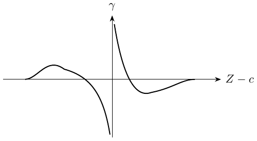
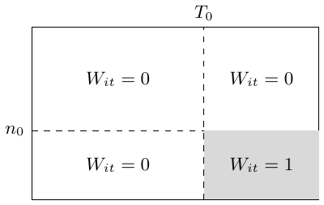
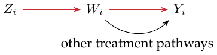
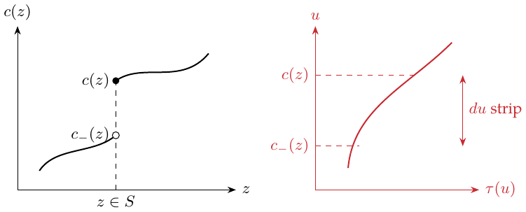
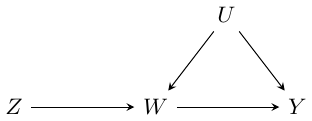
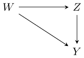
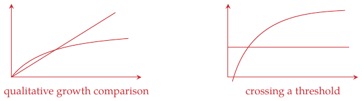

# STATS 361: Causal Inference

Lectures 1–14 · Reviewed English edition

Original black, red, and blue ink is retained in color spans and diagrams. Purple marks errors in the original note; orange marks qualifications or unresolved readings. Recognition and translation errors are fixed directly. Arrows show the author’s pointing relations in a reflowed English layout.

**Color rendering:** GitHub strips CSS colors from prose. The labeled review blocks remain readable there; use the [PDF](STATS361-English.pdf) or [HTML preview](english/reviewed/STATS361-English.html) to see prose colors. Mathematical source remains editable in this Markdown file; diagram PNGs preserve the original arrow colors.

Source coverage: 89 scanned pages. See the companion findings JSON and coverage Markdown for the audit trail.

---

# Lecture 1: Randomized Controlled Trials

*Scan reference: Lecture1-10.pdf, pp. 2, 1, 3; reading order: main text on p. 2, its supplement on p. 1, then p. 3.*

Regression in an RCT analysis of the average treatment effect reduces variance; it does not play a role in identifying the ATE.

> <span style="color: #000000">Regression in an RCT (p. 2)</span> $`\textcolor{black}{\longrightarrow}`$ Variance reduction; ATE identification comes from assignment.

``` math
\Delta_i=Y_i(1)-Y_i(0),\qquad \tau=E[Y_i(1)-Y_i(0)].
```
Estimate and construct inference for $`\tau`$ using the difference-in-means estimator:
``` math
\widehat\tau_{\rm DM}=\frac1{n_1}\sum_{W_i=1}Y_i-\frac1{n_0}\sum_{W_i=0}Y_i,
\qquad n_w=|\{i:W_i=w\}|.
```
The note marks this estimator as consistent and unbiased.

> <span style="color: #244DA8">Difference in means (p. 2)</span> $`\textcolor{blue}{\longrightarrow}`$ $`\widehat\tau_{\rm DM}`$

<div class="review-note" style="color: #B45A00" data-ink="ReviewOrange" aria-label="Qualification / unresolved point">

**Qualification / unresolved point (S1-002): Sampling and allocation conditions**

*Source: Lecture1-10.pdf, pp. 2*

The difference in means is unbiased under the stated random-assignment setup when both groups are nonempty; the population consistency and normal limits also use IID sampling and finite second moments. The balanced-variance formulas below specialize to $`P(W=1)=1/2`$ and centered covariates $`E[X]=0`$. The general variance is $`\operatorname{Var}(Y(1))/e+\operatorname{Var}(Y(0))/(1-e)`$. Centering also explains the displayed OLS decomposition. Its $`N(0,\cdot/n_w)`$ labels are asymptotic approximations, not exact finite-sample distributions under merely the stated moment assumptions. See lecture (1.6), (1.8)–(1.13).

</div>

#### Supplement: assumptions.

``` math
Y_i=Y_i(W_i),\qquad W_i\perp\{Y_i(0),Y_i(1)\}.
```
The first is labeled SUTVA; the second is random treatment assignment. SUTVA means the stable unit treatment value assumption: (1) unit stability, with experimental units independent of one another; (2) a single treatment level/version. These are the author’s short descriptions.

> <span style="color: #000000">$`Y_i=Y_i(W_i)`$; SUTVA</span> $`\textcolor{black}{\longrightarrow}`$ Stable unit treatment value assumption: the two definitions in the supplement (p. 1).

<div class="review-note" style="color: #7A2B91" data-ink="ReviewPurple" aria-label="Original-note correction">

**Original-note correction (S1-001): SUTVA does not mean statistical independence**

*Source: Lecture1-10.pdf, pp. 1*

SUTVA requires no interference between units and no hidden versions of each specified treatment. It does not require statistically independent outcomes, and it permits the two treatment values $`0,1`$ used here. Independent sampling is a separate assumption. The handwritten phrase “single treatment level” is best replaced by “a well-defined version of each treatment.” See the discussion and footnote on printed pp. 2–3 of [the lecture](https://web.stanford.edu/~swager/stats361.pdf).

</div>

## Linear outcome model and variance reduction

``` math
Y_i(w)=c_{(w)}+X_i\beta_{(w)}+\varepsilon_i(w),\quad
E[\varepsilon_i(w)\mid X_i]=0,\quad
\operatorname{Var}[\varepsilon_i(w)\mid X_i]=b^2.
```
<span style="color: #244DA8">The coefficients are fitted separately for the two treatment states.</span> Write $`A=\operatorname{Var}[X]`$ and <span style="color: #244DA8">$`\|v\|_A^2=v'Av`$</span>. The variance in the notes is
``` math
V_{\rm DM}=4b^2+\|\beta_{(0)}+\beta_{(1)}\|_A^2
 +\|\beta_{(0)}-\beta_{(1)}\|_A^2.
```
Also,
``` math
\tau=c_{(1)}-c_{(0)}+E[X](\beta_{(1)}-\beta_{(0)}),\qquad
\widehat\tau_{\rm OLS}=\widehat c_{(1)}-\widehat c_{(0)}
 +\overline X(\widehat\beta_{(1)}-\widehat\beta_{(0)}).
```
The error decomposition written in the notebook is
``` math
\begin{align*}
\widehat\tau_{\rm OLS}-\tau={}&(\widehat c_{(1)}-c_{(1)})-(\widehat c_{(0)}-c_{(0)})
 +\overline X(\beta_{(1)}-\beta_{(0)})\\
&+\overline X(\widehat\beta_{(1)}-\widehat\beta_{(0)}-\beta_{(1)}+\beta_{(0)}).
\end{align*}
```
The first two terms are annotated $`N(0,b^2/n_1)`$ and $`N(0,b^2/n_0)`$; the third is annotated $`N(0,\|\beta_{(1)}-\beta_{(0)}\|_A^2/n)`$; the last is $`O_p(1/n)`$. <span style="color: #244DA8">The margin says that uncertainty in the estimated slopes tends to zero.</span> Thus
``` math
\sqrt n(\widehat\tau_{\rm OLS}-\tau)\Rightarrow N(0,V_{\rm OLS}),\qquad
V_{\rm OLS}=4b^2+\|\beta_{(0)}-\beta_{(1)}\|_A^2,
```
``` math
V_{\rm DM}=V_{\rm OLS}+\|\beta_{(0)}+\beta_{(1)}\|_A^2.
```

## OLS under a general outcome regression

The next page says that OLS is better than difference in means in this model. Suppose
``` math
Y_i(w)=\mu_{(w)}(X_i)+\varepsilon_i(w),\quad
E[\varepsilon_i(w)\mid X_i]=0,\quad
\operatorname{Var}[\varepsilon_i(w)\mid X_i]=b^2.
```
For difference in means,
``` math
\sqrt n(\widehat\tau_{\rm DM}-\tau)\Rightarrow N(0,V_{\rm DM}),\quad
V_{\rm DM}=4b^2+2\operatorname{Var}[\mu_{(0)}(X_i)]
+2\operatorname{Var}[\mu_{(1)}(X_i)].
```
For OLS, the Huber–White calculation starts from the population projection
``` math
(c^*_{(w)},\beta^*_{(w)})=arg\min_{c,\beta}
 E[(Y_i(w)-X_i\beta-c)^2].
```
The notebook records
``` math
\sqrt{n_w}\left\{\begin{pmatrix}\widehat c_{(w)}\\\widehat\beta_{(w)}\end{pmatrix}
-\begin{pmatrix}c^*_{(w)}\\\beta^*_{(w)}\end{pmatrix}\right\}
\Rightarrow N\left(0,\begin{pmatrix}\operatorname{MSE}^*_{(w)}&0\\0&\cdots\end{pmatrix}\right),
```
with $`c^*_{(w)}=E[Y_i(w)]`$ and

<div class="review-note" style="color: #7A2B91" data-ink="ReviewPurple" aria-label="Original-note correction">

**Original-note correction (S1-003): The misspecified-regression covariance need not be block diagonal**

*Source: Lecture1-10.pdf, pp. 3*

The zero off-diagonal entries do not follow from $`E[X]=0`$. With $`q=(1,X')'`$, $`r_w=Y(w)-c_w^*-X\beta_w^*`$ and $`Q=E[qq']`$, the covariance is
``` math
Q^{-1}E[r_w^2qq']Q^{-1}.
```
The intercept–slope block is $`E[r_w^2X]A^{-1}`$ (with matching row/column orientation), generally nonzero under a misspecified conditional mean. Projection orthogonality gives $`E[r_wX]=0`$, not $`E[r_w^2X]=0`$. The intercept variance $`E[r_w^2]`$ and the subsequent balanced-trial variance-reduction identity remain valid. This is an error in the visible original, also present in lecture (1.16), rather than an OCR error.

</div>

``` math
\operatorname{MSE}^*_{(w)}=E[(Y_i(w)-X_i\beta^*_{(w)}-c^*_{(w)})^2].
```
It concludes
``` math
\sqrt n(\widehat\tau_{\rm OLS}-\tau)\Rightarrow N(0,V_{\rm OLS}),\qquad
V_{\rm OLS}=V_{\rm DM}-\|\beta^*_{(0)}+\beta^*_{(1)}\|_A^2.
```
<span style="color: #C92B32">$`V_{\rm OLS}<V_{\rm DM}`$ always holds.</span>

<div class="review-note" style="color: #7A2B91" data-ink="ReviewPurple" aria-label="Original-note correction">

**Original-note correction (S1-004): Variance reduction is weak, not always strict**

*Source: Lecture1-10.pdf, pp. 3*

The preceding identity implies $`V_{\rm OLS}\le V_{\rm DM}`$. Equality occurs whenever $`\|\beta_0^*+\beta_1^*\|_A^2=0`$; for nonsingular $`A`$, this means $`\beta_0^*+\beta_1^*=0`$. Opposite nonzero slopes already give equality. Strict reduction needs a positive squared norm. This follows directly by subtracting the two displayed variances.

</div>

#### Personal observation.

OLS can be viewed as
``` math
\widehat\tau_{\rm OLS}=\frac1n\sum_{i=1}^n
\{(\widehat c_{(1)}+X_i\widehat\beta_{(1)})
 -(\widehat c_{(0)}+X_i\widehat\beta_{(0)})\}
=\frac1n\sum_i[\widehat\mu_{(1)}(X_i)-\widehat\mu_{(0)}(X_i)].
```
<span style="color: #244DA8">Here $`\widehat\mu_{(w)}(x)`$ is the fitted OLS value at $`x`$. It could be replaced with another method.</span>

# Lecture 2: Unconfoundedness and the Propensity Score

*Scan reference: Lecture1-10.pdf, pp. 5, 4, 7, 6; p. 4 continues the bottom of p. 5, and p. 6 supplements p. 7.*

Unconfoundedness: the aim is to remove the influence of confounding factors. Propensity score: the probability of treatment given the covariates.

## Aggregating difference-in-means estimators

<span style="color: #C92B32">Simply weight by probability.</span> With discrete, numerically valued $`X_i`$, assume
``` math
\{Y_i(0),Y_i(1)\}\perp W_i\mid X_i=x,\qquad x\in\mathcal X.
```
<span style="color: #244DA8">Here $`x`$ is the grouping variable.</span> Define the group-wise ATE
``` math
\tau(x)=E[Y_i(1)-Y_i(0)\mid X_i=x].
```
Then
``` math
\begin{align*}
\widehat\tau_{\rm AGG}&=\sum_{x\in\mathcal X}\frac{n_x}{n}\widehat\tau(x),\\
\widehat\tau(x)&=\frac1{n_{x1}}\sum_{X_i=x,W_i=1}Y_i
-\frac1{n_{x0}}\sum_{X_i=x,W_i=0}Y_i,\\
n_x&=|\{i:X_i=x\}|,\qquad
n_{xw}=|\{i:X_i=x,W_i=w\}|.
\end{align*}
```
Let $`e(x)=P(W_i=1\mid X_i=x)`$. The within-group limit is
``` math
\begin{align*}
\sqrt{n_x}(\widehat\tau(x)-\tau(x))
&\Rightarrow N\left(0,
\frac{\operatorname{Var}[Y_i(0)\mid X_i=x]}{1-e(x)}
+\frac{\operatorname{Var}[Y_i(1)\mid X_i=x]}{e(x)}\right)\\
&=N\left(0,\frac{b^2(x)}{e(x)(1-e(x))}\right),
\end{align*}
```
where the second equality uses the common conditional variance written in the notes. The definition line writes $`\widehat\pi(x)=P(X_i=x)=n_x/n`$.

<div class="review-note" style="color: #7A2B91" data-ink="ReviewPurple" aria-label="Original-note correction">

**Original-note correction (S1-005): Population and empirical stratum probabilities**

*Source: Lecture1-10.pdf, pp. 5*

Use $`\pi(x)=P(X_i=x)`$ for the population mass and $`\widehat\pi(x)=n_x/n`$ for its estimate; they are generally unequal in a finite sample. This distinction is already required by the subsequent terms $`\widehat\pi(x)-\pi(x)`$. The expansion below is read with these distinct definitions. For its fixed-stratum CLT, assume finitely many strata, positive stratum masses and treatment overlap, and finite conditional second moments. See lecture (2.3)–(2.7).

</div>

Then
``` math
\begin{align*}
\widehat\tau_{\rm AGG}={}&\sum_x\pi(x)\tau(x)
+\sum_x\pi(x)(\widehat\tau(x)-\tau(x))\\
&+\sum_x(\widehat\pi(x)-\pi(x))\tau(x)
+\sum_x(\widehat\pi(x)-\pi(x))(\widehat\tau(x)-\tau(x)).
\end{align*}
```
<span style="color: #244DA8">The first term is $`\tau`$.</span> <span style="color: #244DA8">The second is annotated as asymptotically normal, with variance</span>

<div class="original-ink" style="color: #244DA8" data-ink="blue" aria-label="Original blue ink">

``` math
\sum_x\pi^2(x)\operatorname{Var}[\widehat\tau(x)].
```

</div>

<span style="color: #244DA8">The third has variance $`n^{-1}\operatorname{Var}[\tau(X_i)]`$; the last is $`O_p(1/n)`$.</span> Following the arrow onto the left page,

> <span style="color: #000000">Four-term aggregate-estimator expansion (p. 5)</span> $`\textcolor{black}{\longrightarrow}`$ Aggregate variance $`V_{\rm AGG}`$ (p. 4).

``` math
\sqrt n(\widehat\tau_{\rm AGG}-\tau)\Rightarrow N(0,V_{\rm AGG}),
```
``` math
\begin{align*}
V_{\rm AGG}&=\operatorname{Var}[\tau(X_i)]
+\sum_{x\in\mathcal X}\pi^2(x)\frac1{\pi(x)}
\frac{b^2(x)}{e(x)(1-e(x))}\\
&=\operatorname{Var}[\tau(X_i)]
+E\left[\frac{b^2(X_i)}{e(X_i)(1-e(X_i))}\right].
\end{align*}
```

## Continuous covariates and propensity scores

Given $`X_i`$, $`W_i`$ cannot “peek” at $`Y_i`$: this is the author’s intuition for unconfoundedness. If
``` math
\{Y_i(0),Y_i(1)\}\perp W_i\mid X_i,
\quad e(x)=P(W_i=1\mid X_i=x),
```
then
``` math
\{Y_i(0),Y_i(1)\}\perp W_i\mid e(X_i).
```

#### Supplementary sketches and calculation.

<div class="center">


</div>

The proof written beneath the sketches is
``` math
\begin{align*}
&P(W_i=w\mid\{Y_i(0),Y_i(1)\},e(X_i))\\
&\quad=\int_{\mathcal X}P(W_i=w\mid\{Y_i(0),Y_i(1)\},X_i=x)
 P(X_i=x\mid e(X_i))\,dx\\
&\quad=\int_{\mathcal X}P(W_i=w\mid X_i=x)P(X_i=x\mid e(X_i))\,dx\\
&\quad=e(X_i)\mathbf1_{\{w=1\}}+(1-e(X_i))\mathbf1_{\{w=0\}}.
\end{align*}
```
<span style="color: #244DA8">The margin labels this “Lebesgue integration.”</span>

<div class="review-note" style="color: #7A2B91" data-ink="ReviewPurple" aria-label="Original-note correction">

**Original-note correction (S1-006): Conditioning in the propensity-score proof**

*Source: Lecture1-10.pdf, pp. 6*

Let $`\mathcal Y=(Y(0),Y(1))`$. The tower-property integral must initially use $`dP(X\mid\mathcal Y,e(X))`$, not $`dP(X\mid e(X))`$. Unconfoundedness changes the integrand to $`P(W=w\mid X)`$, which is constant on each propensity-score level set. Integrating that constant gives the claimed result, regardless of the remaining conditional distribution. For continuous $`X`$, use a regular conditional measure rather than the point probability $`P(X=x\mid\cdot)\,dx`$. Compare the correctly conditioned proof of Proposition 2.1 in the lecture.

</div>

## Propensity stratification

1.  Sort the observations so that $`\widehat e(X_{i_1})\leq\widehat e(X_{i_2})\leq\cdots\leq\widehat e(X_{i_n})`$.

2.  Split them into $`J`$ strata and estimate a difference in means within each stratum. If $`I_j`$ contains ranks $`\lfloor(j-1)n/J\rfloor+1`$ through $`\lfloor jn/J\rfloor`$, write the abbreviated formula on the page as
    ``` math
    \widehat\tau_j=\frac{\sum_{i\in I_j}W_iY_i}{\sum_{i\in I_j}W_i}
    -\frac{\sum_{i\in I_j}(1-W_i)Y_i}{\sum_{i\in I_j}(1-W_i)}.
    ```

    > <span style="color: #244DA8">Make treatment and control groups more similar (p. 7)</span> $`\textcolor{blue}{\longrightarrow}`$ Sort by $`\widehat e(X_i)`$ and form propensity-score strata.

3.  Average the stratum estimates: $`\widehat\tau_{\rm STRAT}=J^{-1}\sum_{j=1}^J\widehat\tau_j`$. <span style="color: #244DA8">The notebook calls this consistent.</span>

    <div class="review-note" style="color: #B45A00" data-ink="ReviewOrange" aria-label="Qualification / unresolved point">

    **Qualification / unresolved point (S1-007): Stratification needs shrinking propensity-score strata**

    *Source: Lecture1-10.pdf, pp. 7*

    A fixed number of broad propensity-score strata generally leaves residual confounding. Consistency requires increasingly fine strata, sufficiently many treated and control observations within them, overlap, and sufficiently accurate propensity estimates. The lecture explicitly states uniform consistency of $`\widehat e`$ and that $`J`$ grows appropriately with $`n`$. Equal weighting is appropriate for the approximately equal-size strata used here.

    </div>

## Inverse-propensity weighting

*Scan reference: Lecture1-10.pdf, pp. 9, 8, 10; p. 8 supplies the model used in the variance calculation on p. 9.*

``` math
\widehat\tau_{\rm IPW}=\frac1n\sum_{i=1}^n
\left\{\frac{W_iY_i}{\widehat e(X_i)}-\frac{(1-W_i)Y_i}{1-\widehat e(X_i)}\right\}.
```
Oracle IPW assumes $`e(x)`$ is perfectly known:
``` math
\widehat\tau^*_{\rm IPW}=\frac1n\sum_i
\left\{\frac{W_iY_i}{e(X_i)}-\frac{(1-W_i)Y_i}{1-e(X_i)}\right\}.
```
Suppose overlap holds, $`\eta\leq e(x)\leq1-\eta`$ for all $`x\in\mathcal X`$, and $`|Y_i|<M`$. If
``` math
\sup_{x\in\mathcal X}|e(x)-\widehat e(x)|=O_p(a_n)\longrightarrow0,
```
the notebook gives
``` math
|\widehat\tau_{\rm IPW}-\widehat\tau^*_{\rm IPW}|=O_p(a_nM/\eta).
```
<span style="color: #244DA8">Thus consistency of the oracle estimator transfers to estimated-propensity IPW.</span> Moreover,
``` math
E[\widehat\tau^*_{\rm IPW}]=E[Y_i(1)-Y_i(0)]=\tau.
```
<span style="color: #244DA8">With overlap, oracle IPW converges at the $`1/\sqrt n`$ scale.</span>

#### Variance calculation: supplementary model.

The left page supplies
``` math
\begin{align*}
Y_i(0)&=c(X_i)-(1-e(X_i))\tau(X_i)+\varepsilon_i(0),\\
Y_i(1)&=c(X_i)+e(X_i)\tau(X_i)+\varepsilon_i(1),\\
E[\varepsilon_i(w)\mid X_i]&=0,\qquad
\operatorname{Var}[\varepsilon_i(w)\mid X_i=x]=b^2(x).
\end{align*}
```
Then the notes state

> <span style="color: #000000">Supplementary outcome model on p. 8</span> $`\textcolor{black}{\longrightarrow}`$ Oracle-IPW variance on p. 9, $`V_{\rm IPW^*}`$.

``` math
\begin{align*}
n\operatorname{Var}[\widehat\tau^*_{\rm IPW}]
=V_{\rm IPW^*}
={}&E\left[\frac{c^2(X_i)}{e(X_i)(1-e(X_i))}\right]
+\operatorname{Var}[\tau(X_i)]\\
&+E\left[\frac{b^2(X_i)}{e(X_i)(1-e(X_i))}\right],\\
\sqrt n(\widehat\tau^*_{\rm IPW}-\tau)&\Rightarrow N(0,V_{\rm IPW^*}).
\end{align*}
```

#### Personal comparison.

$`c(x)`$ describes the relationship between $`X`$ and $`Y`$, rather than the relationship between $`X`$ and $`\Delta Y`$. Compared with aggregation,
``` math
V_{\rm IPW^*}=V_{\rm AGG}+E\left[\frac{c^2(X_i)}{e(X_i)(1-e(X_i))}\right].
```

> <span style="color: #244DA8">$`V_{\rm IPW^*}-V_{\rm AGG}`$ (p. 10)</span> $`\textcolor{blue}{\longrightarrow}`$ <span style="color: #244DA8">Unless $`c(X_i)`$ is zero everywhere, oracle IPW has worse variance than aggregation.</span>

Compared with linear modeling: IPW is based on $`\{Y_i(0),Y_i(1)\}\perp W_i\mid X_i`$, while the linear model relies on linearity.

<div class="review-note" style="color: #B45A00" data-ink="ReviewOrange" aria-label="Qualification / unresolved point">

**Qualification / unresolved point (S1-009): Variance comparison and causal identification**

*Source: Lecture1-10.pdf, pp. 10*

The excess variance is zero exactly when $`c(X)=0`$ almost surely; it is positive if $`P(c(X)\ne0)>0`$, under overlap and finite moments. A correctly specified linear outcome model is an estimation restriction, not by itself a causal identification assumption: observational regression still needs suitable exogeneity/unconfoundedness or another identification argument. The original comparison of estimation methods is retained.

</div>

# Lecture 3: Efficient Treatment Effect Estimation via Augmented IPW

*Scan reference: Lecture1-10.pdf, pp. 11–12.*

Ordinary IPW has poor large-sample properties. For example, with discrete $`X`$, it is worse than the aggregate estimator $`\widehat\tau`$.

## Two characterizations of the ATE

1.  Using $`e(x)=P(W_i=1\mid X_i=x)`$, $`\tau=E[\widehat\tau^*_{\rm IPW}]`$, where the oracle estimator is as above.

2.  Using $`\mu_{(w)}(x)=E[Y_i(w)\mid X_i=x]`$,
    ``` math
    \tau(x)=\mu_{(1)}(x)-\mu_{(0)}(x),\quad
    \tau=E[\mu_{(1)}(X_i)-\mu_{(0)}(X_i)],
    ```
    which motivates
    ``` math
    \widehat\tau_{\rm REG}=\frac1n\sum_i[\widehat\mu_{(1)}(X_i)-\widehat\mu_{(0)}(X_i)].
    ```

## The augmented IPW estimator

``` math
\begin{align*}
\widehat\tau_{\rm AIPW}=\frac1n\sum_i\bigg[&\widehat\mu_{(1)}(X_i)-\widehat\mu_{(0)}(X_i)
+W_i\frac{Y_i-\widehat\mu_{(1)}(X_i)}{\widehat e(X_i)}\\
&-(1-W_i)\frac{Y_i-\widehat\mu_{(0)}(X_i)}{1-\widehat e(X_i)}\bigg].
\end{align*}
```

#### Personal intuition.

<span style="color: #244DA8">First use $`\mu(x)`$ to estimate the outcome, and then use IPW on the regression residuals. IPW makes the covariate composition of the data “fair.”</span>

## Double robustness

AIPW is consistent if either the outcome regressions $`\widehat\mu_{(w)}(x)`$ are consistent or $`\widehat e(x)`$ is consistent.

<div class="review-note" style="color: #B45A00" data-ink="ReviewOrange" aria-label="Qualification / unresolved point">

**Qualification / unresolved point (S1-010): Double robustness and efficiency require regularity**

*Source: Lecture1-10.pdf, pp. 11, 12, 13*

Double robustness is a statement under overlap, suitable integrability and control of fitted-function evaluation (for example cross-fitting); the other nuisance estimate must remain well behaved. Conditioning on $`X_i,W_i`$ alone does not freeze a function trained on the same observation. In the cross-fitted argument, condition also on the training fold. The efficiency bound below is for regular estimators in the nonparametric unconfoundedness model, not literally every conceivable estimator. The product-risk condition and nuisance consistency listed on the next page are assumptions to verify for a chosen learning method, not automatic properties of all machine-learning algorithms. See lecture (3.8) and the regularity discussion after (3.16).

</div>

When $`\widehat\mu_{(w)}(x)\approx\mu_{(w)}(x)`$, the regression average is consistent and the weighted residual terms have mean approximately zero because
``` math
E[Y_i-\widehat\mu_{(W_i)}(X_i)\mid X_i,W_i]\approx0.
```
The propensity term is held fixed by this conditioning. When instead $`\widehat e(x)\approx e(x)`$, rearrange:
``` math
\begin{align*}
\widehat\tau_{\rm AIPW}={}&\frac1n\sum_i\left[\frac{W_iY_i}{\widehat e(X_i)}
-\frac{(1-W_i)Y_i}{1-\widehat e(X_i)}\right]\\
&+\frac1n\sum_i\left[\widehat\mu_{(1)}(X_i)\left(1-\frac{W_i}{\widehat e(X_i)}\right)
-\widehat\mu_{(0)}(X_i)\left(1-\frac{1-W_i}{1-\widehat e(X_i)}\right)\right].
\end{align*}
```
<span style="color: #244DA8">The first part is IPW.</span> <span style="color: #244DA8">The second has mean approximately zero since</span> $`E[1-W_i/\widehat e(X_i)\mid X_i]\approx0`$; conditioning holds the fitted outcome regression fixed.

## Semiparametric efficiency

The notes call AIPW asymptotically optimal among nonparametric estimators. When the nuisance functions are estimated sufficiently accurately,
``` math
\sqrt n(\widehat\tau_{\rm AIPW}-\widehat\tau^*_{\rm AIPW})\longrightarrow_p0,
```
where the starred estimator is oracle AIPW. This oracle estimator is just an IID average, so the central limit theorem also applies to the estimated version:

> <span style="color: #244DA8">$`\sqrt n(\widehat\tau_{\rm AIPW}-\widehat\tau^*_{\rm AIPW})\to_p0`$ (p. 12)</span> $`\textcolor{blue}{\longrightarrow}`$ The oracle IID central limit theorem transfers to estimated AIPW.

``` math
\sqrt n(\widehat\tau_{\rm AIPW}-\tau)\Rightarrow N(0,V^*),
```
``` math
V^*=\operatorname{Var}[\tau(X_i)]
+E\left[\frac{b_0^2(X_i)}{1-e(X_i)}\right]
+E\left[\frac{b_1^2(X_i)}{e(X_i)}\right].
```
<span style="color: #244DA8">The margin describes this as a Cramer–Rao-type constraint: this is the best attainable effect/variance.</span>

## AIPW and cross-fitting

*Scan reference: Lecture1-10.pdf, pp. 13–14.*

Randomly split the data into two halves, $`I_1`$ and $`I_2`$. <span style="color: #244DA8">The annotation says to split the data and choose the halves at random.</span> Set
``` math
\widehat\tau_{\rm AIPW}=\frac{|I_1|}{n}\widehat\tau^{I_1}
+\frac{|I_2|}{n}\widehat\tau^{I_2},
```
``` math
\begin{align*}
\widehat\tau^{I_1}=\frac1{|I_1|}\sum_{i\in I_1}\bigg[&\widehat\mu_{(1)}^{I_2}(X_i)-\widehat\mu_{(0)}^{I_2}(X_i)
+W_i\frac{Y_i-\widehat\mu_{(1)}^{I_2}(X_i)}{\widehat e^{I_2}(X_i)}\\
&-(1-W_i)\frac{Y_i-\widehat\mu_{(0)}^{I_2}(X_i)}{1-\widehat e^{I_2}(X_i)}\bigg].
\end{align*}
```
Asymptotically, we can ignore the specific properties of the chosen machine-learning adjustment method and instead rely on:

1.  Overlap: $`\eta<e(x)<1-\eta`$ for all $`x\in\mathcal X`$, with $`\eta>0`$.

2.  Consistency of the nuisance estimators:
    ``` math
    \sup_x|\widehat\mu_{(w)}^{I_2}(x)-\mu_{(w)}(x)|\longrightarrow_p0,
    \quad \sup_x|\widehat e^{I_2}(x)-e(x)|\longrightarrow_p0.
    ```
    <span style="color: #244DA8">The blue sentence says that the machine-learning adjustment methods have large-sample consistency.</span>

3.  Risk decay for the outcome and propensity models:
    ``` math
    E[(\widehat\mu_{(w)}^{I_2}(X_i)-\mu_{(w)}(X_i))^2]\,
    E[(\widehat e^{I_2}(X_i)-e(X_i))^2]=o(1/n).
    ```
    <span style="color: #244DA8">If both are $`\sqrt n`$-consistent, the product is of order $`1/n^2`$. A simple sufficient approach is for both regression adjustments to converge at $`o(n^{-1/4})`$ in RMSE.</span>

#### Proof recorded on the continuation page.

Write the oracle estimator as $`\widehat\tau^*=|I_1|\widehat\tau^{I_1,*}/n+|I_2|\widehat\tau^{I_2,*}/n`$. To establish $`\sqrt n(\widehat\tau_{\rm AIPW}-\widehat\tau^*)\to_p0`$, it suffices to show the corresponding result for the treated mean; the other components are analogous. Define
``` math
\widehat\tau^{I_1}=\widehat\mu^{I_1}_{(1)}-\widehat\mu^{I_1}_{(0)},\qquad
\widehat\mu^{I_1}_{(1)}=\frac1{|I_1|}\sum_{i\in I_1}
\left[\widehat\mu^{I_2}_{(1)}(X_i)+W_i\frac{Y_i-\widehat\mu^{I_2}_{(1)}(X_i)}{\widehat e^{I_2}(X_i)}\right].
```
Subtracting its oracle version gives
``` math
\begin{align*}
\widehat\mu^{I_1}_{(1)}-\widehat\mu^{I_1,*}_{(1)}
={}&\frac1{|I_1|}\sum_{i\in I_1}
(\widehat\mu^{I_2}_{(1)}(X_i)-\mu_{(1)}(X_i))\left(1-\frac{W_i}{e(X_i)}\right)\\
&+\frac1{|I_1|}\sum_{i\in I_1}W_i(Y_i-\mu_{(1)}(X_i))
\left(\frac1{\widehat e^{I_2}(X_i)}-\frac1{e(X_i)}\right)\\
&-\frac1{|I_1|}\sum_{i\in I_1}W_i(\widehat\mu^{I_2}_{(1)}(X_i)-\mu_{(1)}(X_i))
\left(\frac1{\widehat e^{I_2}(X_i)}-\frac1{e(X_i)}\right).
\end{align*}
```
<span style="color: #244DA8">The blue annotations bound the first contribution by an expression written as $`o_p(1)/n`$ and the last by $`o_p(1/\sqrt n)`$.</span>

<div class="review-note" style="color: #7A2B91" data-ink="ReviewPurple" aria-label="Original-note correction">

**Original-note correction (S1-011): A variance rate was attached to the remainder itself**

*Source: Lecture1-10.pdf, pp. 14*

If $`T_1`$ denotes the first average and $`\mathcal D_2`$ its training data, cross-fitting gives $`E[T_1\mid\mathcal D_2]=0`$ and
``` math
E[T_1^2\mid\mathcal D_2]
\le \frac{E[(\widehat\mu_1(X)-\mu_1(X))^2\mid\mathcal D_2]}{\eta|I_1|}
=o_p(n^{-1}).
```
Thus $`T_1=o_p(n^{-1/2})`$, not generally $`o_p(n^{-1})`$. The smaller rate belongs to its conditional variance/second moment. The second average is handled similarly, and the product term uses the displayed product-risk assumption. This identifies the likely omitted variance operation without changing the original annotation.

</div>

For $`K`$ folds, use nuisance estimates trained without the fold $`k(i)`$ containing observation $`i`$:
``` math
\begin{align*}
\widehat\tau_{\rm AIPW}=\frac1n\sum_i\bigg[&\widehat\mu_{(1)}^{(-k(i))}(X_i)-\widehat\mu_{(0)}^{(-k(i))}(X_i)
+W_i\frac{Y_i-\widehat\mu_{(1)}^{(-k(i))}(X_i)}{\widehat e^{(-k(i))}(X_i)}\\
&-(1-W_i)\frac{Y_i-\widehat\mu_{(0)}^{(-k(i))}(X_i)}{1-\widehat e^{(-k(i))}(X_i)}\bigg].
\end{align*}
```

## Confidence intervals

*Scan reference: Lecture1-10.pdf, pp. 16, 15; p. 15 supplies definitions used on p. 16.*

#### Supplement: terminology.

The notebook labels the likelihood derivative an efficient score:
``` math
S(\theta)=\frac{d\log L(\theta)}{d\theta},
```
where $`L(\theta)`$ is the likelihood. The empirical variance of $`n`$ sample scores is
``` math
\frac1{n-1}\sum_i(S(\theta_i)-\overline{S(\theta)})^2.
```
Efficient variance is the smallest attainable variance for a given problem, with a Cramer–Rao lower-bound interpretation.

<div class="review-note" style="color: #7A2B91" data-ink="ReviewPurple" aria-label="Original-note correction">

**Original-note correction (S1-012): Likelihood score and efficient influence function are different objects**

*Source: Lecture1-10.pdf, pp. 15, 16*

The displayed derivative is the ordinary likelihood score. With nuisance parameters, an efficient score additionally removes the nuisance-score component. For ATE estimation, the centered AIPW summand $`\psi_i^*-\tau`$ below is the efficient influence function; its variance is the efficiency bound. It is not the same as a raw likelihood score, whose variance is Fisher information. For observations $`O_i`$, empirical score variance would use $`S_\theta(O_i)`$ at a common $`\theta`$, rather than different parameter values $`\theta_i`$. The empirical-variance formula for AIPW on p. 16 is correct under the stated consistency and moment conditions.

</div>

#### Variance estimation.

Define the oracle summand
``` math
\psi_i^*=\mu_{(1)}(X_i)-\mu_{(0)}(X_i)
+\frac{W_i(Y_i-\mu_{(1)}(X_i))}{e(X_i)}
-\frac{(1-W_i)(Y_i-\mu_{(0)}(X_i))}{1-e(X_i)}.
```
Its empirical variance converges to the efficient variance:
``` math
\frac1{n-1}\sum_i(\psi_i^*-\widehat\tau^*)^2\longrightarrow_p V^*.
```
The margin calls $`\widehat\tau^*`$ the non-cross-fitted oracle AIPW estimator.

> <span style="color: #244DA8">The non-cross-fitted oracle AIPW estimate (p. 16)</span> $`\textcolor{blue}{\longrightarrow}`$ $`\widehat\tau^*`$ in $`\sum_i(\psi_i^*-\widehat\tau^*)^2/(n-1)`$.

Replacing each nuisance function by the estimate trained outside $`k(i)`$ gives the cross-fitted summand $`\widehat\psi_i`$ and
``` math
\widehat V_{\rm AIPW}=\frac1{n-1}\sum_i(\widehat\psi_i-\widehat\tau_{\rm AIPW})^2\longrightarrow_p V^*.
```
The confidence interval drawn under a central normal probability region is

<div class="center">


</div>

<div class="review-note" style="color: #B45A00" data-ink="ReviewOrange" aria-label="Qualification / unresolved point">

**Qualification / unresolved point (S1-013): Confidence level convention**

*Source: Lecture1-10.pdf, pp. 16*

The formula below has asymptotic coverage $`1-\alpha`$; $`\alpha`$ is the error probability. The handwritten “$`\alpha`$-level” can be read as a significance-level convention. No formula correction is needed.

</div>

``` math
\widehat\tau_{\rm AIPW}\ \pm\ \frac1{\sqrt n}\Phi^{-1}(1-\alpha/2)\sqrt{\widehat V_{\rm AIPW}}.
```

# Lecture 4: Estimating Treatment Heterogeneity

*Scan reference: Lecture1-10.pdf, pp. 17–18.*

For observations $`(X_i,Y_i,W_i)`$ with $`X_i\in\mathcal X`$, we previously pursued the ATE $`E[Y_i(1)-Y_i(0)]`$. Heterogeneity analysis instead considers the conditional average treatment effect (CATE):
``` math
\tau(x)=E[Y_i(1)-Y_i(0)\mid X_i=x].
```

> <span style="color: #244DA8">Average for a category of $`X_i`$ (p. 17)</span> $`\textcolor{blue}{\longrightarrow}`$ $`\tau(x)=E[Y_i(1)-Y_i(0)\mid X_i=x]`$.

## Regularization bias

Under $`\{Y_i(0),Y_i(1)\}\perp W_i\mid X_i`$,
``` math
\tau(x)=\mu_{(1)}(x)-\mu_{(0)}(x),\qquad
\mu_{(w)}(x)=E[Y_i\mid X_i=x,W_i=w].
```
A direct CATE estimator is $`\widehat\tau_T(x)=\widehat\mu_{(1)}(x)-\widehat\mu_{(0)}(x)`$.

#### Personal concern.

<span style="color: #244DA8">If there are too few observations for $`\widehat\mu_{(1)}`$, it may be heavily regularized (toward a straight line). If there are many observations for $`\widehat\mu_{(0)}`$, that fit may be accurate; then the difference $`\widehat\tau_T(x)`$ goes wrong because of the first fit.</span>

## Semiparametric modeling

``` math
Y_i(w)=f(X_i)+w\tau(X_i)+\varepsilon_i(w),\qquad
P(W_i=1\mid X_i)=e(X_i),\qquad \tau(x)=\psi(x)\beta.
```
<span style="color: #244DA8">$`f`$ is a function of $`X_i`$, and $`\psi(x)`$ is a nonparametric representation of $`X`$; $`\beta`$ is the treatment-effect coefficient.</span> Under unconfoundedness, the Robinson transformation is

> <span style="color: #000000">$`Y_i(w)=f(X_i)+w\tau(X_i)+\varepsilon_i(w)`$ (p. 17)</span> $`\textcolor{black}{\longrightarrow}`$ <span style="color: #C92B32">Robinson</span>: subtract $`m(X_i)`$ and residualize $`W_i`$ by $`e(X_i)`$.

``` math
Y_i-m(X_i)=(W_i-e(X_i))\psi(X_i)\beta+\varepsilon_i,
\quad m(x)=E[Y_i\mid X_i=x]=f(x)+e(x)\tau(x),
```
with $`\varepsilon_i=\varepsilon_i(W_i)`$.

> <span style="color: #244DA8">$`\varepsilon_i=\varepsilon_i(W_i)`$ (p. 17)</span> $`\textcolor{blue}{\longrightarrow}`$ The error in $`Y_i-m(X_i)=(W_i-e(X_i))\psi(X_i)\beta+\varepsilon_i`$.

Design a residual-on-residual OLS regression using
``` math
\widetilde Y_i^*=Y_i-m(X_i),\qquad
\widetilde Z_i^*=(W_i-e(X_i))\psi(X_i).
```
Regress $`\widetilde Y_i^*`$ on $`\widetilde Z_i^*`$ to obtain $`\widehat\beta_R^*`$ (the notebook uses a coefficient symbol resembling $`\zeta_R`$). <span style="color: #244DA8">These transformations use only the observed data and the nuisance functions; the margin calls this data preprocessing.</span> The notebook gives
``` math
\sqrt n(\widehat\beta_R^*-\beta)\Rightarrow N(0,V_R),
```
``` math
V_R=\operatorname{Var}[\widetilde Z_i^*]^{-1}
\operatorname{Var}[\widetilde Z_i^*\widetilde Y_i^*]
\operatorname{Var}[\widetilde Z_i^*]^{-1}.
```
Under homoskedasticity, $`\operatorname{Var}(\varepsilon_i\mid X_i,W_i)=b^2`$ is constant and $`V_R`$ is the semiparametrically efficient variance for $`\beta`$. Under heteroskedasticity, the notes say that $`V_R`$ still applies but is not the efficient variance.

<div class="review-note" style="color: #7A2B91" data-ink="ReviewPurple" aria-label="Original-note correction">

**Original-note correction (S1-014): Use the regression residual in the Robinson sandwich**

*Source: Lecture1-10.pdf, pp. 18*

Let $`Z=\widetilde Z_i^*`$ be a column vector, $`Q=E[ZZ']`$ and $`\varepsilon=\widetilde Y_i^*-Z'\beta`$. The normal equations give influence function $`Q^{-1}Z\varepsilon`$, hence
``` math
V_R=Q^{-1}E[ZZ'\varepsilon^2]Q^{-1}.
```
The middle term is $`\operatorname{Var}(Z\varepsilon)`$, not $`\operatorname{Var}(Z\widetilde Y^*)`$. The latter includes random variation of $`ZZ'\beta`$ that the estimated denominator cancels. Here $`E[Z]=0`$, so $`Q=\operatorname{Var}(Z)`$. Under conditional homoskedasticity the corrected variance is $`b^2Q^{-1}`$, with $`Q`$ nonsingular and finite required moments. The source’s efficiency discussion refers to this corrected sandwich.

</div>

#### Feasible cross-fitted version.

The preceding regression is idealized because $`m(X_i)`$ and $`e(X_i)`$ are unknown. Fit nonparametric regressions $`Y\sim X`$ and $`W\sim X`$; <span style="color: #244DA8">omit the fold containing observation $`i`$</span> when constructing
``` math
\widetilde Y_i=Y_i-\widehat m^{(-k(i))}(X_i),\qquad
\widetilde Z_i=(W_i-\widehat e^{(-k(i))}(X_i))\psi(X_i).
```
Regress $`\widetilde Y_i`$ on $`\widetilde Z_i`$ to obtain $`\widehat\beta_R`$. If both nuisance RMSEs are $`o_p(n^{-1/4})`$, the notes conclude
``` math
\sqrt n(\widehat\beta_R^*-\widehat\beta_R)\longrightarrow_p0.
```

## A loss function for treatment heterogeneity

*Scan reference: Lecture1-10.pdf, pp. 20, 19; p. 19 supplements the residual regression and the R-loss on p. 20.*

The previous estimator assumes $`\tau(x)=\psi(x)\beta`$. Often the relationship is not linear, so use machine learning. With
``` math
\mu_{(w)}(x)=E[Y(w)\mid X=x],\quad
\varepsilon_i(w)=Y_i(w)-[\mu_{(0)}(X_i)+w\tau(X_i)],
```
unconfoundedness yields $`E[\varepsilon_i(w)\mid X_i,W_i]=0`$. <span style="color: #244DA8">Here $`\mu_{(0)}`$ plays the role of the previous $`f`$.</span> Again,
``` math
Y_i-m(X_i)=(W_i-e(X_i))\tau(X_i)+\varepsilon_i,
\quad m(x)=\mu_{(0)}(x)+e(x)\tau(x),\quad \varepsilon_i=\varepsilon_i(W_i).
```
Equivalently,
``` math
\tau(\cdot)=\arg\min_{t}E[((Y_i-m(X_i))-(W_i-e(X_i))t(X_i))^2].
```
<span style="color: #244DA8">If $`m`$ and $`e`$ are known, minimizing this gives $`\tau(\cdot)`$.</span>

<div class="review-note" style="color: #B45A00" data-ink="ReviewOrange" aria-label="Qualification / unresolved point">

**Qualification / unresolved point (S1-015): R-loss identification and the RCT parenthesis**

*Source: Lecture1-10.pdf, pp. 20*

The excess population R-loss is
``` math
L(t)-L(\tau)=E[e(X)(1-e(X))(t(X)-\tau(X))^2].
```
Therefore the CATE is uniquely determined only where $`0<e(X)<1`$ (up to null sets). In an RCT, $`e`$ is known by design; the outcome mean $`m(x)=E[Y\mid X=x]`$ is generally still unknown and must be estimated. Thus the parenthetical RCT exception does not make both nuisance functions known.

</div>

The oracle penalized estimator is
``` math
\widehat\tau_R^*(\cdot)=\arg\min_t\left\{
\frac1n\sum_i[(Y_i-m(X_i))-(W_i-e(X_i))t(X_i)]^2+\Lambda_n(t)\right\}.
```

> <span style="color: #244DA8">Regularize the complexity of $`\tau(\cdot)`$ (p. 20)</span> $`\textcolor{blue}{\longrightarrow}`$ $`\Lambda_n(\tau)`$: linear examples are lasso/ridge; the margin also lists CNNs.

<span style="color: #244DA8">Usually $`m`$ and $`e`$ are unknown (the notes parenthetically mention RCTs), so cross-fit them:</span>

<div class="original-ink" style="color: #244DA8" data-ink="blue" aria-label="Original blue ink">

``` math
\begin{align*}
\widehat L_n(t)&=\frac1n\sum_i
[(Y_i-\widehat m^{(-k(i))}(X_i))-(W_i-\widehat e^{(-k(i))}(X_i))t(X_i)]^2,\\
\widehat\tau_R&=\arg\min_t\{\widehat L_n(t)+\Lambda_n(t)\}.
\end{align*}
```
For lasso, $`\widehat\tau(x)=x\widehat\beta`$, with
``` math
\widehat\beta=\arg\min_\beta\left\{\frac1n\sum_i
[(Y_i-\widehat m^{(-k(i))}(X_i))-(W_i-\widehat e^{(-k(i))}(X_i))X_i\beta]^2
+\lambda\|\beta\|_1\right\}.
```

</div>

#### Personal supplementary observation.

With a constant treatment effect, $`Y_i(w)=f(X_i)+\tau w+\varepsilon_i`$ and $`E[\varepsilon_i\mid X_i,W_i]=0`$, the residual estimator is
``` math
\widehat\tau_R=\frac{\sum_i(Y_i-\widehat m^{(-k(i))}(X_i))(W_i-\widehat e^{(-k(i))}(X_i))}
{\sum_i(W_i-\widehat e^{(-k(i))}(X_i))^2}.
\tag{4.5 in the notes}
```
The premise is that the nuisance components converge fast enough. Even if $`\tau`$ is not constant, this estimator converges to a nonnegatively weighted average of $`\tau(x)`$ (the annotation also writes a treated-minus-control mean comparison).

> <span style="color: #244DA8">$`\overline Y_{(1)}-\overline Y_{(0)}`$ (p. 19 marginal comparison)</span> $`\textcolor{blue}{\longrightarrow}`$ The nonnegative weighted average of $`\tau(x)`$ in the preceding observation.

When heterogeneity is small and overlap presents difficulties, use (4.5) as a replacement.

> <span style="color: #244DA8">Constant-coefficient residual regression and its weighted-effect interpretation (p. 19)</span> $`\textcolor{blue}{\longrightarrow}`$ R-loss for a flexible treatment-effect function (p. 20).

<div class="review-note" style="color: #B45A00" data-ink="ReviewOrange" aria-label="Qualification / unresolved point">

**Qualification / unresolved point (S1-016): The constant-coefficient residual regression changes the target**

*Source: Lecture1-10.pdf, pp. 19*

With heterogeneous effects, its population limit is
``` math
\frac{E[e(X)(1-e(X))\tau(X)]}{E[e(X)(1-e(X))]},
```
provided the denominator is positive and nuisances converge sufficiently fast. It emphasizes regions of overlap. It equals the population ATE only with additional conditions, for example constant effects or zero covariance between $`e(X)(1-e(X))`$ and $`\tau(X)`$. It does not identify effects where treatment is deterministic. This makes precise the author’s nonnegative-weight intuition.

</div>

# Lecture 5: Regression Discontinuity Designs

*Scan reference: Lecture1-10.pdf, pp. 22, 21; p. 21 explains why the earlier IPW approach does not apply.*

Introduce a cutoff using a running variable $`Z_i\in\mathbb R`$:
``` math
W_i=\mathbf1_{\{Z_i\geq c\}},\qquad c\text{ is the threshold.}
```
<span style="color: #244DA8">As $`Z_i\to c`$, observations near $`c`$ have similar characteristics and differ in whether they receive the intervention.</span> Let $`\mu_{(w)}(z)=E[Y_i(w)\mid Z_i=z]`$. If the two conditional means are continuous, the CATE at $`z=c`$ is
``` math
\tau_c=\mu_{(1)}(c)-\mu_{(0)}(c)
=\lim_{z\to c^+}E[Y_i\mid Z_i=z]-\lim_{z\to c^-}E[Y_i\mid Z_i=z].
```

#### Personal supplement: why does ordinary IPW not apply?

Earlier we assumed unconfoundedness $`\{Y_i(0),Y_i(1)\}\perp W_i\mid Z_i`$ and overlap $`\eta\leq P(W_i=1\mid Z_i)\leq1-\eta`$. In RDD, unconfoundedness holds, but overlap fails because the treatment probability given $`Z_i=z`$ is either zero or one. <span style="color: #244DA8">The blue comment says this fails regardless of the nondegenerate choice of $`\eta`$.</span> We must compare observations near $`c`$, using similarity rather than overlap. Failure of overlap means $`\tau_c`$ cannot be estimated at the $`\sqrt n`$ rate. Its minimax error converges at a nonparametric rate depending on the smoothness of $`\mu_{(w)}(z)`$. For example, a uniformly bounded second derivative at $`c`$ allows an $`n^{-2/5}`$ estimation-error rate.

<div class="review-note" style="color: #B45A00" data-ink="ReviewOrange" aria-label="Qualification / unresolved point">

**Qualification / unresolved point (S1-017): Scope of the RDD identification and rate claims**

*Source: Lecture1-10.pdf, pp. 21, 22, 24*

The no-$`\sqrt n`$ statement concerns the nonparametric smoothness class used here, not every possible parametric restriction. The $`n^{-2/5}`$ rate uses a second-derivative bound on a neighborhood of the cutoff, positive continuous design density on both sides, independent observations, and bounded conditional variance. Continuity identifies the boundary contrast only when the cutoff is approached from both observed sides. The arithmetic balancing squared bias $`h^4`$ against variance $`(nh)^{-1}`$ is correct; under order-$`k`$ smoothness and suitable local polynomial fitting it gives error $`n^{-k/(2k+1)}`$.

</div>

## Estimation via local linear regression

Choose a small bandwidth $`h_n\to0`$ and a symmetric weighting function $`K`$. Fit the two conditional means locally. The coefficient on $`W_i`$ in
``` math
\arg\min_{a,\tau,\beta_{(0)},\beta_{(1)}}\sum_i
K\left(\frac{|Z_i-c|}{h_n}\right)
[Y_i-a-\tau W_i-\beta_{(0)}(Z_i-c)_--\beta_{(1)}(Z_i-c)_+]^2
```
is $`\widehat\tau_c`$.

> <span style="color: #C92B32">Weight; negative side; positive side (p. 22)</span> $`\textcolor{red}{\longrightarrow}`$ $`K(|Z_i-c|/h_n)`$; $`(Z_i-c)_-`$; $`(Z_i-c)_+`$.

The intercept $`a`$ and slopes $`\beta_{(w)}`$ are nuisance parameters; the handwritten labels identify negative-side and positive-side parts. Common kernels are the window function $`K(x)=\mathbf1_{\{|x|\leq1\}}`$ and triangular kernel $`K(x)=(1-|x|)_+`$.

## Estimator properties and smoothness

*Scan reference: Lecture1-10.pdf, pp. 23–24.*

Quantify continuity by assuming $`\mu_{(w)}`$ is twice differentiable with a uniformly bounded second derivative:
``` math
\left|\frac{d^2}{dz^2}\mu_{(w)}(z)\right|\leq B,
\qquad z\in\mathbb R,\quad w\in\{0,1\}.
```
If smoothness is weaker, with only Lipschitz continuity (the note says bounded but not differentiable), local averaging may work better because there is no clear linear trend locally. If smoothness is stronger, with bounded derivatives of order $`k\geq3`$, higher-order local regression may improve the convergence rate.

<div class="review-note" style="color: #7A2B91" data-ink="ReviewPurple" aria-label="Original-note correction">

**Original-note correction (S1-018): Lipschitz continuity is not bounded nondifferentiability**

*Source: Lecture1-10.pdf, pp. 23*

Lipschitz continuity means $`|f(x)-f(y)|\le L|x-y|`$ for a finite constant $`L`$. It permits both differentiable functions and functions with corners, such as $`|x|`$. Boundedness alone does not imply Lipschitz continuity, and a Lipschitz function need not be bounded on an unbounded domain. The author’s intended weaker-smoothness comparison remains valid.

</div>

<span style="color: #C92B32">Taylor-expand at $`c`$:</span>
``` math
\mu_{(w)}(z)=a_{(w)}+\beta_{(w)}(z-c)+\tfrac12\rho_{(w)}(z-c),
\qquad |\rho_{(w)}(u)|\leq Bu^2.
```
<span style="color: #C92B32">The last term is the remainder,</span> and $`\tau_c=a_{(1)}-a_{(0)}`$. Fit each side separately:
``` math
(\widehat a_{(1)},\widehat\beta_{(1)})=arg\min_{a,\beta}
\sum_{Z_i\geq c}K\left(\frac{|Z_i-c|}{h_n}\right)[Y_i-a-\beta(Z_i-c)]^2,
```
and analogously on the control side; then $`\widehat\tau_c=\widehat a_{(1)}-\widehat a_{(0)}`$.

#### Closed-form weights for the window kernel.

On $`c\leq Z_i\leq c+h_n`$, the scan writes
``` math
\widehat a_{(1)}=\sum_i\gamma_iY_i,\qquad
\gamma_i=\frac{\widehat E_{(1)}[(Z_i-c)^2]-\widehat E_{(1)}[Z_i-c](Z_i-c)}
{\widehat E_{(1)}[(Z_i-c)^2]-\widehat E_{(1)}[Z_i-c]^2},
```
where $`\widehat E_{(1)}[Z_i-c]`$ is the average of $`Z_i-c`$ within the bandwidth. It also records

<div class="review-note" style="color: #7A2B91" data-ink="ReviewPurple" aria-label="Original-note correction">

**Original-note correction (S1-019): The local-linear weights need a sample-size denominator**

*Source: Lecture1-10.pdf, pp. 24*

Let $`N_+=|\{i:c\le Z_i\le c+h_n\}|`$, $`u_i=Z_i-c`$, and $`m_j=N_+^{-1}\sum_i u_i^j`$ within this band. The normalized intercept weights are
``` math
\gamma_i=\frac{m_2-m_1u_i}{N_+(m_2-m_1^2)}.
```
Assume $`m_2-m_1^2>0`$. Then $`\sum_i\gamma_i=1`$ and $`\sum_i\gamma_i u_i=0`$, as required. The source formula without $`N_+`$ sums to $`N_+`$. The later bias/noise calculations require the normalized weights.

</div>

``` math
\sum_i\gamma_i=1,\qquad \sum_i\gamma_i(Z_i-c)=0.
```

The decomposition on the page is
``` math
\widehat a_{(1)}=a_{(1)}+\underbrace{\sum_i\gamma_i\rho_{(1)}(Z_i-c)}_{\text{\textcolor{red}{curvature bias}}}
+\underbrace{\sum_i\gamma_i(Y_i-\mu_{(1)}(Z_i))}_{\text{\textcolor{red}{sampling noise}}}.
```
The control intercept has an analogous decomposition.

<div class="review-note" style="color: #7A2B91" data-ink="ReviewPurple" aria-label="Original-note correction">

**Original-note correction (S1-020): Keep the Taylor remainder normalization consistent**

*Source: Lecture1-10.pdf, pp. 23, 24*

With the earlier definition, the curvature term is $`\tfrac12\sum_i\gamma_i\rho_{(1)}(Z_i-c)`$. Equivalently redefine $`r_w=\rho_w/2`$, with $`|r_w(u)|\le Bu^2/2`$, and write $`\sum_i\gamma_i r_w(u_i)`$. The omission affects constants, not the stated rate. Bounds on curvature bias use $`\sum_i|\gamma_i|u_i^2`$ because local-linear weights may have either sign.

</div>

> <span style="color: #C92B32">Curvature bias and sampling noise (p. 24)</span> $`\textcolor{red}{\longrightarrow}`$ <span style="color: #C92B32">Both terms need bounds.</span>

Curvature bias is bounded at order $`Bh_n^2`$, where $`B`$ bounds the second derivative and $`h_n`$ is the bandwidth. Sampling noise has mean zero; if $`\operatorname{Var}[Y_i\mid Z_i]\leq b^2`$, its variance is bounded by $`b^2\sum_i\gamma_i^2`$. If $`Z_i`$ has a continuous nonzero density $`f`$ near $`c`$,
``` math
b^2\sum_i\gamma_i^2\approx\frac{4b^2}{|\{i:c\leq Z_i\leq c+h_n\}|}
\approx\frac{4b^2}{f(c)nh_n}.
```
Thus squared bias is of order $`h_n^4`$ and variance is of order $`(nh_n)^{-1}`$, giving
``` math
\widehat\tau_c=\tau_c+O_p(n^{-2/5}),\qquad h_n\asymp n^{-1/5}.
```
<span style="color: #C92B32">The red note identifies $`n^{-2/5}`$ as the estimation error and adds that with $`k`$-th order smoothness, $`h_n\asymp n^{-1/(2k+1)}`$.</span>

## Noise in the running variable

*Scan reference: Lecture1-10.pdf, p. 25.*

> <span style="color: #244DA8">May contain noise (p. 25)</span> $`\textcolor{blue}{\longrightarrow}`$ The running variable $`Z_i`$.

Introduce a latent $`U_i\sim G`$ and two conditions:

1.  A noisy running variable: the scan writes $`Z_i\mid U_i\sim N(0,\nu^2)`$, with $`\nu>0`$.

2.  Unconfoundedness of the running variable: $`\{Y_i(0),Y_i(1)\}\perp Z_i\mid U_i`$.

With $`Y_i=Y_i(W_i)`$ and $`\{Y_i(0),Y_i(1)\}\perp W_i\mid U_i`$,
``` math
e(u)=P(W_i=1\mid U_i=u)=P(Z_i\geq c\mid U_i=u)
=1-\Phi\left(\frac{c-u}{\nu}\right),
```
``` math
\alpha_{(w)}(u)=E[Y_i(w)\mid U_i=u],\qquad
\tau(u)=E[Y_i(1)-Y_i(0)\mid U_i=u].
```
The annotation defines the standard normal CDF,

<div class="review-note" style="color: #7A2B91" data-ink="ReviewPurple" aria-label="Original-note correction">

**Original-note correction (S1-021): The noisy running variable must be centered at the latent variable**

*Source: Lecture1-10.pdf, pp. 25*

The subsequent propensity and convolution formulas require $`Z_i\mid U_i=u\sim N(u,\nu^2)`$, equivalently $`Z_i-U_i\mid U_i\sim N(0,\nu^2)`$. If the written mean were really zero for every $`u`$, the propensity would be $`1-\Phi(c/\nu)`$, independent of $`u`$. The source therefore omits $`u`$ in the conditional mean. The later decomposition is correct for the latent-location model; its weight normalization alone does not remove confounding bias unless the induced $`h_+`$ and $`h_-`$ are suitably balanced.

</div>

<span style="color: #C92B32">$`\Phi(x)=(2\pi)^{-1/2}\int_{-\infty}^x e^{-t^2/2}\,dt`$.</span>

$`U_i`$ is unobserved, so we cannot directly use its propensity score. Consider a deconvolution-type estimator:

> <span style="color: #000000">Unobserved $`U_i`$: cannot directly use its propensity score (p. 25)</span> $`\textcolor{black}{\longrightarrow}`$ Deconvolution weights $`\gamma_+(z),\gamma_-(z)`$.

``` math
\widehat\tau_\gamma=\frac1n\sum_{Z_i\geq c}\gamma_+(Z_i)Y_i
-\frac1n\sum_{Z_i<c}\gamma_-(Z_i)Y_i.
```
Choose the weights to satisfy
``` math
E[\mathbf1_{\{Z_i\geq c\}}\gamma_+(Z_i)]
=E[\mathbf1_{\{Z_i<c\}}\gamma_-(Z_i)]=1.
```
Then
``` math
E[\widehat\tau_\gamma]
=\underbrace{\int h_+(u)\tau(u)\,dG(u)}_{\text{\textcolor{red}{weighted treatment effect}}}
+\underbrace{\int(h_+(u)-h_-(u))\alpha_{(0)}(u)\,dG(u)}_{\text{\textcolor{red}{confounding bias}}},
```
where the weighting functions are
``` math
h_+(u)=\int_c^\infty\gamma_+(z)\varphi_\nu(z-u)\,dz,\qquad
h_-(u)=\int_{-\infty}^c\gamma_-(z)\varphi_\nu(z-u)\,dz,
```

<div class="original-ink" style="color: #244DA8" data-ink="blue" aria-label="Original blue ink">

``` math
\varphi_\nu(z-u)=\frac1{\sqrt{2\pi\nu^2}}\exp\left[-\frac12\left(\frac{z-u}{\nu}\right)^2\right].
```

</div>

# Lecture 6: Finite-Sample Inference in RDDs

*Scan reference: Lecture1-10.pdf, pp. 27, 26, 29, 28; p. 26 continues p. 27, and p. 28 explains the weight constraints on p. 29.*

Finite-sample RDDs allow a discontinuous/discrete running variable or a more complex cutoff rule. The local-linear regression solution (6.2) can be written as a linear estimator,
``` math
\widehat\tau_c(\gamma)=\sum_{i=1}^n\gamma_iY_i.\tag{6.3 in the notes}
```
The weights depend only on $`Z_i`$.

> <span style="color: #C92B32">The local-linear solution (6.2) (p. 27)</span> $`\textcolor{red}{\longrightarrow}`$ The linear estimator (6.3), whose properties follow below.

If
``` math
Y_i(w)=\mu_{(w)}(Z_i)+\varepsilon_i(w),\qquad
\varepsilon_i(w)\mid Z_i\sim N(0,b^2),
```
then, conditional on $`Z_1,\ldots,Z_n`$,
``` math
\widehat\tau_c(\gamma)\sim N(\widehat\tau_c^*(\gamma),b^2\|\gamma\|_2^2),
\qquad \widehat\tau_c^*(\gamma)=\sum_i\gamma_i\mu_{(W_i)}(Z_i).
```
Here $`W_i=\mathbf1_{\{Z_i\geq c\}}`$ and <span style="color: #C92B32">$`\|\gamma\|_2=(\gamma_1^2+\cdots+\gamma_n^2)^{1/2}`$ is the Euclidean norm.</span>

## Minimax linear estimation

<span style="color: #C92B32">Minimax means minimizing the worst-case MSE.</span> For a linear estimator, the conditional variance is directly accessible as $`b^2\|\gamma\|_2^2`$ under homoskedasticity. Its bias depends on unknown conditional means:
``` math
\operatorname{Bias}(\widehat\tau_c(\gamma)\mid Z_1,\ldots,Z_n)
=\sum_i\gamma_i\mu_{(W_i)}(Z_i)-[\mu_{(1)}(c)-\mu_{(0)}(c)].
```
A smoothness restriction $`|\mu_{(w)}''(z)|\leq B`$ bounds the bias by
``` math
I_B(\gamma)=\sup_{|\mu_{(w)}''|\leq B}
\left\{\sum_i\gamma_i\mu_{(W_i)}(Z_i)-[\mu_{(1)}(c)-\mu_{(0)}(c)]\right\}.
```
<span style="color: #244DA8">The blue note says the supremum does not need an absolute value because the second-derivative class is symmetric.</span> Hence
``` math
|\operatorname{Bias}(\widehat\tau_c(\gamma)\mid Z_1,\ldots,Z_n)|\leq I_B(\gamma),
```
``` math
\operatorname{MSE}(\widehat\tau_c(\gamma)\mid Z_1,\ldots,Z_n)
\leq b^2\|\gamma\|_2^2+I_B^2(\gamma).
```
<span style="color: #C92B32">The red annotation emphasizes “MSE = variance + squared bias” and that this bound does not depend on the unknown $`\mu`$.</span> The left-page continuation defines
``` math
\gamma^B=\arg\min_\gamma\{b^2\|\gamma\|_2^2+I_B^2(\gamma)\},\qquad
\widehat\tau_c(\gamma^B)=\sum_i\gamma_i^B Y_i.
\tag{6.8 in the notes}
```
<span style="color: #244DA8">The blue comparison says that, at a fixed bias bound $`I_B(\gamma)`$, this yields smaller MSE than local-linear estimation.</span>

<div class="review-note" style="color: #B45A00" data-ink="ReviewOrange" aria-label="Qualification / unresolved point">

**Qualification / unresolved point (S1-022): What the finite-sample minimax guarantee says**

*Source: Lecture1-10.pdf, pp. 26, 27, 29, 30*

The exact conditional normal calculation needs independent Gaussian errors across units (or the corresponding joint Gaussian covariance), with known variance and a valid curvature bound $`B`$. Marginal normality alone is insufficient. Minimizing $`b^2\|\gamma\|_2^2+I_B(\gamma)^2`$ minimizes worst-case conditional MSE over the stated function class; it does not guarantee smaller actual MSE at every particular pair of response functions, nor strict improvement. The bias-adjusted interval is valid conditional on the design, including discrete designs, whenever the optimization is feasible. A plug-in choice of $`b`$ or $`B`$ requires further justification.

</div>

## Deriving the minimax linear weights

Decompose
``` math
\mu_{(w)}(z)=a_{(w)}+\beta_{(w)}(z-c)+\rho_{(w)}(z),
```
where $`\rho_{(w)}(c)=\rho'_{(w)}(c)=0`$ and the second derivative is bounded by $`B`$. The intercepts and slopes are unrestricted, so $`I_B(\gamma)`$ can be infinite unless
``` math
\sum_i\gamma_iW_i=1,\qquad \sum_i\gamma_i=0,\qquad
\sum_i\gamma_i(Z_i-c)_+=0,\qquad \sum_i\gamma_i(Z_i-c)_-=0.
```
After these constraints, only the remainders need control. Rewrite (6.8) as
``` math
(\gamma^B,t)=\arg\min_{\gamma,t}\{b^2\|\gamma\|_2^2+B^2t^2\},
```
subject to
``` math
\sum_i\gamma_iW_i\rho_{(1)}(Z_i)+\sum_i\gamma_i(1-W_i)\rho_{(0)}(Z_i)\leq t
```
for every $`\rho_{(w)}`$ with $`\rho_{(w)}(c)=\rho'_{(w)}(c)=0`$ and $`|\rho''_{(w)}(z)|\leq1`$, together with
``` math
\sum_i\gamma_iW_i=1,\quad\sum_i\gamma_i=0,\quad
\sum_i\gamma_iW_i(Z_i-c)=0,\quad
\sum_i\gamma_i(1-W_i)(Z_i-c)=0.
\tag{6.10 in the notes}
```
The blue instruction is to solve the corresponding dual problem.

> <span style="color: #244DA8">Primal minimax optimization (6.10), p. 29</span> $`\textcolor{blue}{\longrightarrow}`$ Transform to the dual problem to solve it.

#### Personal supplement: why do the weights sum to zero?

The final estimate is a difference. Split its sum into the treated and control parts:
``` math
\widehat\tau_c(\gamma)=\sum_i\gamma_i^{(1)}Y_i+\sum_i\gamma_i^{(2)}Y_i.
```
The treated weights sum to $`1`$ and the control weights sum to $`-1`$, so

> <span style="color: #C92B32">$`Y=1`$ group; $`Y=0`$ group (source labels, p. 28)</span> $`\textcolor{red}{\longrightarrow}`$ <span style="color: #C92B32">Weights sum to $`1`$ and $`-1`$, respectively; total sum $`0`$.</span>

<div class="original-ink" style="color: #C92B32" data-ink="red" aria-label="Original red ink">

``` math
\sum_i\gamma_i=1+(-1)=0,\quad
\sum_i\gamma_i^{(1)}=\sum_i\gamma_iW_i=1,\quad
\sum_i\gamma_i^{(2)}=\sum_i\gamma_i(1-W_i)=-1.
```

</div>

The sketch shows a weight profile with a negative spike just to the left of the threshold and a positive spike just to the right; farther away, the weights change sign and then approach zero.

<div class="center">



</div>

The red labels on the original say $`Y=1`$ and $`Y=0`$, while the equations below them use treatment indicators $`W`$.

<div class="review-note" style="color: #7A2B91" data-ink="ReviewPurple" aria-label="Original-note correction">

**Original-note correction (S1-023): The red group labels refer to treatment, not outcome**

*Source: Lecture1-10.pdf, pp. 28*

These labels should be $`W=1`$ and $`W=0`$. The outcome $`Y`$ need not be binary. The sum constraints themselves are correct: treated weights sum to $`1`$ and control weights to $`-1`$.

</div>

## Inference with linear estimators

*Scan reference: Lecture1-10.pdf, pp. 30–31.*

Construct a confidence interval for $`\widehat\tau_c(\gamma^B)`$. Let
``` math
\mathrm{err}=\widehat\tau_c-\tau_c,\qquad
\mathrm{err}\mid Z_1,\ldots,Z_n\sim N(\mathrm{bias},b^2\|\gamma^B\|_2^2),
```
where $`|\mathrm{bias}|\leq Bt`$ from (6.10). By unimodality of the Gaussian distribution, for $`S\sim N(0,1)`$,
``` math
P(|\mathrm{err}|\geq\zeta)\leq P(|Bt+b\|\gamma^B\|_2S|\geq\zeta).
```
A confidence interval with conditional coverage at least $`1-\alpha`$ is
``` math
I_\alpha=(\widehat\tau_c(\gamma^B)-\zeta_\alpha^B,
\widehat\tau_c(\gamma^B)+\zeta_\alpha^B),
```
``` math
\zeta_\alpha^B=\inf\{\zeta:P(|Bt+b\|\gamma^B\|_2S|>\zeta)\leq\alpha\}.
\tag{6.13 in the notes}
```
<span style="color: #244DA8">The blue comment stresses that conditioning on $`Z_i`$ makes this work for running variables with any distribution, including nonstandard RDD settings.</span>

#### Discrete running variables.

The restriction $`|\mu_{(w)}''(z)|\leq B`$ alone need not identify $`\tau_c`$, but (6.13) remains valid. For continuous $`Z_i`$, the interval shrinks at rate $`n^{-2/5}`$; for discrete $`Z_i`$, its length may not tend to zero. <span style="color: #244DA8">When $`c`$ is outside the support of the running variable, one needs an interpolating function representing $`\mu_{(w)}(z)`$ and satisfying the second-derivative bound.</span>

#### Multivariate running variables.

Examples include two- or three-dimensional regions and geographic boundaries. A scalar-cutoff RDD cannot be used directly; <span style="color: #244DA8">some reduce the problem to one-dimensional distance, which the note calls less stable.</span> The minimax method can instead be extended directly to multiple dimensions.

## Beyond homoskedasticity

When the errors $`\varepsilon_i=Y_i-\mu_{(W_i)}(Z_i)`$ are no longer homoskedastic Gaussian with variance $`b^2`$, the exact normal statement (6.11) fails. Use a central limit theorem to justify
``` math
\widehat\tau_c(\gamma)\mid Z_1,\ldots,Z_n
\ \approx\ N\left(\widehat\tau_c^*(\gamma),
\sum_i\gamma_i^2\operatorname{Var}[Y_i\mid Z_i,W_i]\right).
\tag{6.14 in the notes}
```
With a valid Gaussian approximation, confidence intervals can still be obtained. Estimate the conditional variance by
``` math
\widehat V_n=\sum_i\gamma_i^2(Y_i-\widehat\mu_{(W_i)}(Z_i))^2,
```
where the fitted mean comes from local-linear regression.

> <span style="color: #244DA8">Local-linear fitted mean (p. 31)</span> $`\textcolor{blue}{\longrightarrow}`$ $`\widehat\mu_{(W_i)}(Z_i)`$ in the residual-variance estimator.

> <span style="color: #244DA8">If the fitted mean is wrong (p. 31)</span> $`\textcolor{blue}{\longrightarrow}`$ <span style="color: #244DA8">Residuals inflate; the result is too conservative.</span>

The minimax criterion (6.8) was for homoskedasticity; under heteroskedasticity, introduce individual variances $`b_i^2`$ into (6.10), the problem used to construct the dual.

<div class="review-note" style="color: #B45A00" data-ink="ReviewOrange" aria-label="Qualification / unresolved point">

**Qualification / unresolved point (S1-024): Residual variance estimates are not automatically conservative**

*Source: Lecture1-10.pdf, pp. 31*

For an independent evaluation observation and a fixed fitted mean, expected squared residual equals conditional variance plus squared mean error. With an in-sample fitted regression, overfitting and leverage can instead shrink residuals. Conservativeness therefore needs suitable leave-one-out/cross-fitted variance estimation or a theorem controlling the in-sample fit. The conditional Gaussian approximation also needs a weighted Lindeberg condition (no dominant observation), and the variance estimate must be consistent or conservatively valid. These requirements are not supplied merely by changing $`b^2`$ to $`b_i^2`$.

</div>

# Lecture 7: Balancing Estimators

*Scan reference: Lecture1-10.pdf, pp. 32–33.*

The heading links balance to the principle behind estimating $`\widehat e(x)`$.

> <span style="color: #000000">Balance / the design principle for $`\widehat e(x)`$ (p. 32)</span> $`\textcolor{black}{\longrightarrow}`$ Improve propensity and regression functions; high-dimensional ATE estimation.

Two aims are noted: improving the propensity and regression functions, and estimating ATEs with high-dimensional covariates. IPW and AIPW use propensity scores; this lecture uses convex optimization to derive how to estimate $`e(x)`$.

## Review of IPW

For IID observations $`(X_i,Y_i,W_i)\in\mathcal X\times\mathbb R\times\{0,1\}`$, the goal is $`\tau=\mu_{(1)}-\mu_{(0)}`$, where $`\mu_{(w)}=E[Y_i(w)]`$. Assume
``` math
\{Y_i(0),Y_i(1)\}\perp W_i\mid X_i,\qquad
0<\eta\leq e(X_i)\leq1-\eta<1,
```
with $`e(x)=P(W_i=1\mid X_i=x)`$ and positive constant $`\eta`$. Estimate the treated mean using
``` math
\widehat\mu_{\rm IPW}(1)=\frac1n\sum_i\frac{W_iY_i}{\widehat e(X_i)}.
\tag{7.3 in the notes}
```
The notebook labels the following consistency argument <span style="color: #244DA8">“brief, not important”</span> but records three steps:

1.  Population balance: under unconfoundedness, $`\mu_{(1)}=E[W_iY_i/e(X_i)]`$.

2.  Oracle estimator: with the true $`e(x)`$ it is unbiased; overlap gives finite variance.

3.  Feasible approximation: if the estimated propensities also satisfy overlap, the Cauchy–Schwarz inequality gives
    ``` math
    \begin{align*}
    |\widehat\mu_{\rm IPW}(1)-\widehat\mu^*_{\rm IPW}(1)|
    &\leq\left[\frac1n\sum_i\left(\frac1{\widehat e(X_i)}-\frac1{e(X_i)}\right)^2\right]^{1/2}
    \left[\frac1n\sum_i(W_iY_i)^2\right]^{1/2}\\
    &\leq\frac1{\eta^2}\left[\frac1n\sum_i(\widehat e(X_i)-e(X_i))^2\right]^{1/2}
    \left[\frac1n\sum_i(W_iY_i)^2\right]^{1/2}.
    \end{align*}
    ```
    <span style="color: #244DA8">The margin recalls $`|a\cdot b|^2\leq\|a\|^2\|b\|^2`$. It adds that the analogous AIPW error is negligible relative to $`1/\sqrt n`$ as $`n\to\infty`$.</span>

## Population versus sample balance

Expand the conditional mean in a predefined basis:
``` math
\mu_{(w)}(x)=\sum_{j=1}^\infty\beta_{j(w)}\psi_j(x).
```

> <span style="color: #C92B32">Polynomial or Fourier basis (p. 33)</span> $`\textcolor{red}{\longrightarrow}`$ $`\psi_j(x)`$ in the conditional-mean expansion.

Under reasonable regularity conditions,
``` math
\mu_{(w)}=\sum_{j=1}^\infty\beta_{j(w)}E[\psi_j(X_i)].
```

> <span style="color: #000000">Take expectations on both sides (p. 33)</span> $`\textcolor{black}{\longrightarrow}`$ $`\mu_{(w)}=\sum_j\beta_{j(w)}E[\psi_j(X)]`$.

<span style="color: #C92B32">Could these regularity assumptions have a problem?</span>

<div class="review-note" style="color: #B45A00" data-ink="ReviewOrange" aria-label="Qualification / unresolved point">

**Qualification / unresolved point (S1-025): Answer to the basis-expansion regularity question**

*Source: Lecture1-10.pdf, pp. 33*

The question is justified: pointwise convergence of a series alone does not justify exchanging its sum and expectation. A sufficient condition is $`\sum_j|\beta_{j(w)}|E|\psi_j(X)|<\infty`$; alternatively, convergence of partial sums in $`L^1`$ suffices. $`L^2`$ convergence under a probability distribution also implies $`L^1`$ convergence. Under overlap, the same reasoning controls the weighted expectation. The population identity can also be proved directly by conditioning on $`X`$, without an infinite basis expansion.

</div>

With unconfoundedness, $`Y_i=\mu_{(W_i)}(X_i)+\varepsilon_i`$ and $`E[\varepsilon_i\mid X_i,W_i]=0`$. The population IPW argument is
``` math
\begin{align*}
E\left[\frac{W_iY_i}{e(X_i)}\right]
&=E\left[\frac{W_i}{e(X_i)}\sum_j\beta_{j(1)}\psi_j(X_i)\right]\\
&=\sum_j\beta_{j(1)}E\left[\frac{W_i\psi_j(X_i)}{e(X_i)}\right]
=\sum_j\beta_{j(1)}E[\psi_j(X_i)]=\mu_{(1)}.
\end{align*}
```

> <span style="color: #C92B32">The core: $`E[W_i\mid X_i]=e(X_i)`$ (p. 33)</span> $`\textcolor{red}{\longrightarrow}`$ $`E[W_i\psi_j(X_i)/e(X_i)]=E[\psi_j(X_i)]`$.

Thus choose weights so that, in the sample,
``` math
\frac1n\sum_i\frac{W_i\psi_j(X_i)}{\widehat e(X_i)}
\approx\frac1n\sum_i\psi_j(X_i),\qquad j=1,2,\ldots.
\tag{7.8 in the notes}
```

## A balancing loss for propensity estimation

*Scan reference: Lecture1-10.pdf, pp. 35, 34; p. 34 supplies the norm reminders used in the high-dimensional bounds.*

Suppose the outcome model is linear, $`\mu_{(w)}(x)=x\beta_{(w)}`$, and the propensity model is logistic,
``` math
e(x)=\frac1{1+\exp(-x\theta)}.
```
<span style="color: #244DA8">The blue annotation says that sample balance then involves only the covariates $`X_i`$, and the targeted balance concerns means.</span> Equation (7.8) becomes
``` math
\frac1n\sum_i(1+e^{-X_i\widehat\theta})W_iX_i=\frac1n\sum_iX_i.
\tag{7.9 in the notes}
```
This is the KKT condition of the convex problem
``` math
\widehat\theta=\arg\min_\theta\frac1n\sum_i\ell_\theta(X_i,Y_i,W_i),\qquad
\ell_\theta(X_i,Y_i,W_i)=W_ie^{-X_i\theta}+(1-W_i)X_i\theta.
\tag{7.10 in the notes}
```
It can therefore be solved by Newton descent.

> <span style="color: #000000">Balance equation (7.9) is the convex loss KKT condition (p. 35)</span> $`\textcolor{black}{\longrightarrow}`$ Newton descent; the source claims a unique solution.

The handwritten text describes a unique solution and says this serves as the loss function.

<div class="review-note" style="color: #7A2B91" data-ink="ReviewPurple" aria-label="Original-note correction">

**Original-note correction (S1-026): Convexity alone does not guarantee a unique finite solution**

*Source: Lecture1-10.pdf, pp. 35*

The Hessian is $`n^{-1}\sum_iW_i e^{-X_i\theta}X_i'X_i`$. It is positive semidefinite, and positive definite only with suitable span/rank conditions on treated covariates. A finite minimizer also needs existence; exact balance can fail when the target covariate mean lies outside the attainable treated convex support. Thus convexity alone establishes neither uniqueness nor attainment, and Newton iterations require the usual safeguards. The displayed first-order balance equation is correct.

</div>

<span style="color: #244DA8">The margin notes that estimating both $`\mu_{(0)}`$ and $`\mu_{(1)}`$ requires two propensity models.</span>

<div class="review-note" style="color: #B45A00" data-ink="ReviewOrange" aria-label="Qualification / unresolved point">

**Qualification / unresolved point (S1-027): Two calibration fits versus one true propensity**

*Source: Lecture1-10.pdf, pp. 35*

The treatment mechanism has one propensity $`e(x)`$; control probabilities are $`1-e(x)`$. Two separate calibration fits are one way to enforce arm-specific balance in this construction, but two distinct true propensity models are not mathematically required for estimating both means.

</div>

## ATE estimation with high-dimensional confounders

Suppose $`X_i\in\mathbb R^p`$, possibly $`p\gg n`$, and $`\mu_{(w)}(x)=x\beta_{(w)}`$. In high dimensions, it is difficult to estimate $`e(x)`$ adequately; exact weights are not attainable, so seek approximate balance. By Holder’s inequality,
``` math
\begin{align*}
&\frac1n\sum_i\frac{W_i\mu_{(1)}(X_i)}{\widehat e(X_i)}-\frac1n\sum_i\mu_{(1)}(X_i)\\
&\quad=\left(\frac1n\sum_i\frac{W_iX_i}{\widehat e(X_i)}-\frac1n\sum_iX_i\right)\beta_{(1)}\\
&\quad\leq\left\|\frac1n\sum_i\frac{W_iX_i}{\widehat e(X_i)}-\frac1n\sum_iX_i\right\|_\infty\|\beta_{(1)}\|_1.
\end{align*}
```
<span style="color: #C92B32">The first norm is labeled imbalance.</span> <span style="color: #244DA8">The handwritten reminder states Holder’s bound</span> <span style="color: #244DA8">$`\sum_i|a_ib_i|\leq(\sum_i|a_i|^p)^{1/p}(\sum_i|b_i|^q)^{1/q}`$.</span>

#### Personal interpretation and questions.

<span style="color: #244DA8">Good inverse-probability weights make the worst case of imbalance as good as possible.</span> Two problems remain: (1) how to parameterize $`\widehat e(X_i)`$ to obtain sup-norm approximate balance; (2) the bound is meaningful only if $`\|\beta_{(1)}\|_1`$ is bounded. <span style="color: #244DA8">High-dimensional statistics usually assumes a sparse coefficient vector rather than constraining its $`1`$-norm directly.</span>

#### Supplement: norm reminders.

The left page lists the “0-norm” as $`\sum_iX_i^0`$, the $`1`$-norm as $`\sum_i|X_i|`$, the $`2`$-norm as $`(\sum_iX_i^2)^{1/2}`$, and the infinity norm as $`\max_i|X_i|`$. It gives the general expression $`\|x\|_p=(\sum_i x_i^p)^{1/p}`$.

<div class="review-note" style="color: #7A2B91" data-ink="ReviewPurple" aria-label="Original-note correction">

**Original-note correction (S1-028): Correct the norm shorthand and specify Holder exponents**

*Source: Lecture1-10.pdf, pp. 34, 35*

Use $`\|x\|_0=\sum_i\mathbf1\{x_i\ne0\}`$ (a count, not a norm) and $`\|x\|_p=(\sum_i|x_i|^p)^{1/p}`$ for $`p\ge1`$. $`x_i^0`$ does not properly handle zero entries, and odd/noninteger powers do not define the intended real norm for negative entries. Holder requires $`p,q\ge1`$ with $`1/p+1/q=1`$, including the $`(1,\infty)`$ endpoint. The displayed imbalance bound follows by this endpoint inequality; its absolute-value version bounds the magnitude of the error.

</div>

## Approximate balancing weights and regression augmentation

*Scan reference: Lecture1-10.pdf, pp. 36–37.*

For a well-chosen tuning parameter $`\zeta`$, solve
``` math
\widehat\gamma=\arg\min_{\gamma_i\geq1}
\left\{\frac1{n^2}\|\gamma\|_2^2+
\zeta\left\|\frac1n\sum_i(\gamma_iW_i-1)X_i\right\|_\infty^2\right\}.
\tag{7.12 in the notes}
```

> <span style="color: #C92B32">Squared $`L_2`$ size; imbalance; tuning weight (p. 36)</span> $`\textcolor{red}{\longrightarrow}`$ $`n^{-2}\|\gamma\|_2^2`$; the squared infinity norm; $`\zeta`$.

Then use $`1/\widehat e(X_i)=\widehat\gamma_i`$ as inverse-propensity weights. Sub-Gaussian concentration inequalities verify, for oracle weights, bounds of the form
``` math
\frac1{n^2}\|1/e(X_i)\|_2^2\leq\frac{\eta^{-2}}n,
\qquad
\left\|\frac1n\sum_i(\gamma_iW_i-1)X_i\right\|_\infty^2
=O_p\left(\frac{\eta^{-2}\log p}{n}\right).
```
The notes say $`\widehat e(X_i)`$ need not estimate $`e(X_i)`$ well; with a suitable $`\zeta`$, these inverse weights nonetheless satisfy a bias bound. Next augment the weighted estimator with high-dimensional regression to remove dependence on $`\|\beta_{(1)}\|_1`$. The augmented balancing estimator is
``` math
\widehat\mu_{\rm AB}(1)=\frac1n\sum_i
\left[\widehat\mu_{(1)}(X_i)+\widehat\gamma_iW_i(Y_i-\widehat\mu_{(1)}(X_i))\right],
\quad\widehat\mu_{(1)}(X_i)=X_i\widehat\beta_{(1)}.
\tag{7.14 in the notes}
```
Its decomposition is
``` math
\begin{align*}
\widehat\mu_{\rm AB}(1)={}&\underbrace{\frac1n\sum_iX_i\beta_{(1)}}_{\text{\textcolor{red}{mean of }}\textcolor{red}{\mu_{(1)}(X_i)}}
+\underbrace{\frac1n\sum_i\widehat\gamma_iW_i(Y_i-X_i\beta_{(1)})}_{\text{\textcolor{red}{mean-zero noise}}}\\
&+\left[\frac1n\sum_i(1-\widehat\gamma_iW_i)X_i\right](\widehat\beta_{(1)}-\beta_{(1)}).
\end{align*}
```
The last term is bounded in magnitude by

<div class="original-ink" style="color: #C92B32" data-ink="red" aria-label="Original red ink">

``` math
\left\|\frac1n\sum_i(1-\widehat\gamma_iW_i)X_i\right\|_\infty
\|\widehat\beta_{(1)}-\beta_{(1)}\|_1.
```

</div>

> <span style="color: #C92B32">Weights need only correct $`\beta_{(1)}-\widehat\beta_{(1)}`$, not the whole coefficient vector (p. 36)</span> $`\textcolor{red}{\longrightarrow}`$ The imbalance times regression-error remainder.

High-dimensional regression supplies a bound on this error: under sparsity $`\|\beta_{(1)}\|_0\leq k`$ and a restricted-eigenvalue condition, lasso achieves
``` math
\|\widehat\beta_{(1)}-\beta_{(1)}\|_1
=O_p\left(k\sqrt{\frac{\log p}{n}}\right).
```

#### Putting the steps together.

Suppose the design satisfies the conditions for this bound, $`\beta_{(1)}`$ is $`k`$-sparse, and $`k\ll\sqrt n/\log p`$.

1.  Fit lasso on the treated units; the coefficient $`1`$-norm error is $`o_p(1/\sqrt{\log p})`$.

2.  Fit $`\widehat\gamma`$ using (7.12), giving infinity-norm imbalance $`O_p(\sqrt{\log(p)/n})`$.

3.  Use (7.14), and insert these bounds into the decomposition:
    ``` math
    \widehat\mu_{\rm AB}(1)-\frac1n\sum_iX_i\beta_{(1)}
    =\frac1n\sum_i\widehat\gamma_iW_i(Y_i-X_i\beta_{(1)})+o_p(n^{-1/2}).
    \tag{7.17 in the notes}
    ```
    <span style="color: #C92B32">The noise term is $`O_p(n^{-1/2})`$.</span>

    <div class="review-note" style="color: #B45A00" data-ink="ReviewOrange" aria-label="Qualification / unresolved point">

    **Qualification / unresolved point (S1-029): Conditions behind high-dimensional balancing inference**

    *Source: Lecture1-10.pdf, pp. 32, 36, 37*

    Overlap does not by itself give finite variance: require $`E[Y(w)^2]<\infty`$. The concentration bounds also use controlled sub-Gaussian covariates, and the lasso rate needs an appropriate tuning level, restricted eigenvalues and noise assumptions. The stated sparsity condition makes the remainder $`o_p(n^{-1/2})`$ by multiplying the two rates. Conditional on $`(X,W)`$, weights must depend on these variables rather than outcome noise. A CLT additionally needs no dominant weighted residual; the displayed studentization uses the unknown true $`\beta_1`$, so feasible inference must justify replacing it by an estimate.

    </div>

A central limit theorem also holds:
``` math
\frac{\sum_i\widehat\gamma_iW_i(Y_i-X_i\beta_{(1)})}
{\sqrt{\sum_i\widehat\gamma_i^2W_i^2(Y_i-X_i\beta_{(1)})^2}}
\Rightarrow N(0,1).
```

#### Personal caveat.

<div class="original-ink" style="color: #244DA8" data-ink="blue" aria-label="Original blue ink">

This is weaker than expected: it only gives a confidence interval for the sample average $`\overline\mu_{(1)}=n^{-1}\sum_iX_i\beta_{(1)}`$, not for $`\mu_{(1)}`$ itself. To obtain a result for the population mean, one needs to establish convergence of the estimated weights $`\widehat\gamma_i`$.

</div>

<div class="review-note" style="color: #B45A00" data-ink="ReviewOrange" aria-label="Qualification / unresolved point">

**Qualification / unresolved point (S1-030): Sample-target and population-target uncertainty**

*Source: Lecture1-10.pdf, pp. 37*

For the population target, also include the sampling fluctuation $`n^{-1}\sum_i\mu_1(X_i)-E[\mu_1(X)]`$. Convergence of the fitted weights to a stable function is a useful sufficient route to an influence-function result; it is not a logically necessary condition in every construction. One must establish the joint limit and its variance. The author’s warning that the displayed conditional interval only covers the sample mean is correct.

</div>

# Lecture 8: Methods for Panel Data

*Scan reference: Lecture1-10.pdf, pp. 39, 38; p. 38 supplies the panel layout and within-unit variance supplement.*

Panel (longitudinal) data observe units $`i=1,\ldots,n`$ at times $`t=1,\ldots,T`$. The left-page sketch is a matrix with units down the rows and time points $`t_1,t_2,\ldots,T`$ across the columns.
``` math
\begin{array}{c|cccc}
 &t=t_1&t=t_2&\cdots&t=T\\\hline
 i=1&&&&\\i=2&&&&\\\vdots&&&&\\i=n&&&&
\end{array}
```

## A constant treatment-effect model

Outcomes are $`Y_{it}\in\mathbb R`$ and treatment assignments are $`W_{it}\in\{0,1\}`$. The basic model is
``` math
Y_{it}=Y_{it}(0)+W_{it}\tau,\qquad i=1,\ldots,n,\quad t=1,\ldots,T.
\tag{8.1 in the notes}
```
This very basic model leaves out treatment heterogeneity and treatment dynamics. The notes explain that the treatment effect is the same for all units and all times; a unit’s outcome at $`t`$ depends only on its treatment at $`t`$, not on previous treatment. <span style="color: #C92B32">$`\tau`$ does not depend on $`i,t`$; past times do not enter.</span>

## The two-way model

``` math
Y_{it}=\alpha_i+\beta_t+W_{it}\tau+\varepsilon_{it},
\qquad E[\varepsilon\mid\alpha,\beta,W]=0.
\tag{8.2 in the notes}
```
<span style="color: #C92B32">$`\alpha_i`$ and $`\beta_t`$ are unit and time shifts.</span> <span style="color: #C92B32">The red comment calls the condition strict exogeneity of treatment, stronger than unconfoundedness.</span>

<div class="review-note" style="color: #B45A00" data-ink="ReviewOrange" aria-label="Qualification / unresolved point">

**Qualification / unresolved point (S1-031): Strict exogeneity and unconfoundedness have different scopes**

*Source: Lecture1-10.pdf, pp. 39*

Here strict exogeneity requires mean-zero errors conditional on the entire treatment path and the fixed effects; treatment decisions cannot respond to the idiosyncratic errors in any period. It is stronger than a corresponding contemporaneous mean-exogeneity condition, but it is not literally a universal implication ordering with every distributional unconfoundedness assumption. State the conditioning sets and whether mean or full independence is intended.

</div>

For example, with two periods, let one group have treatment path $`(0,0)`$ and another $`(0,1)`$. The closed-form difference-in-differences estimate is

> <span style="color: #244DA8">DID (p. 39)</span> $`\textcolor{blue}{\longrightarrow}`$ Difference of the two groups’ before–after differences.

``` math
\widehat\tau=\frac1{|\{i:W_{i2}=1\}|}\sum_{W_{i2}=1}(Y_{i2}-Y_{i1})
-\frac1{|\{i:W_{i2}=0\}|}\sum_{W_{i2}=0}(Y_{i2}-Y_{i1}).
```

#### Comments in the notes.

A limitation is that with large $`n,T`$ and general treatment-assignment distributions, model (8.2) may fail. Analogously, OLS with more than two periods is sometimes also called DID, although the note says there is no closed-form OLS solution. The listed advantage is the intuitive parallel-trends requirement (units differ only in $`\alpha_i`$); without parallel trends, it cannot be used.

<div class="review-note" style="color: #7A2B91" data-ink="ReviewPurple" aria-label="Original-note correction">

**Original-note correction (S1-032): General two-way OLS still has a closed form**

*Source: Lecture1-10.pdf, pp. 39*

For a balanced panel, residualize $`Y`$ and $`W`$ on unit and time indicators: $`\widetilde W_{it}=W_{it}-\overline W_{i\cdot}-\overline W_{\cdot t}+\overline W_{\cdot\cdot}`$, and similarly for $`Y`$. When $`\sum_{it}\widetilde W_{it}^2>0`$,
``` math
\widehat\tau=\frac{\sum_{it}\widetilde W_{it}\widetilde Y_{it}}{\sum_{it}\widetilde W_{it}^2}.
```
Thus the simple two-group before/after expression need not apply, but a closed-form OLS coefficient exists. The fixed-effect model implies parallel conditional mean trends, not exactly parallel noisy realized paths.

</div>

#### Supplement: modeling the noise and estimating variance.

Treat the row vectors $`\varepsilon_i=(\varepsilon_{i1},\ldots,\varepsilon_{iT})`$ as IID across units, with $`\operatorname{Var}[\varepsilon_i]=\Sigma`$. Treating every $`\varepsilon_{it}`$ as independent is hard to justify and unreasonable. For $`T=2`$, estimate the variance of the differences directly:
``` math
\widehat{\operatorname{Var}}[\widehat\tau]
=\frac{\widehat{\operatorname{Var}}[Y_{i2}-Y_{i1}\mid W_{i2}=1]}{|\{i:W_{i2}=1\}|}
+\frac{\widehat{\operatorname{Var}}[Y_{i2}-Y_{i1}\mid W_{i2}=0]}{|\{i:W_{i2}=0\}|}.
\tag{8.4 in the notes}
```
This remains robust when errors within a row/unit are correlated.

## Interactive panel models

*Scan reference: Lecture1-10.pdf, page 41, with the matrix intuition on page 40*

Consider the interactive panel model
``` math
Y_{it}=A_{i\cdot}B_{t\cdot}^{\mathsf T}+W_{it}\tau+\varepsilon_{it},
 \qquad\mathbb E[\varepsilon\mid A,B,W]=0,\tag{8.5}
```
where $`A\in\mathbb R^{n\times k}`$, $`B\in\mathbb R^{T\times k}`$ and $`k`$ is a rank parameter. Equivalently,
``` math
Y_{it}=L_{it}+W_{it}\tau+\varepsilon_{it}
 \qquad\text{for a rank-$k$ matrix }L.
```

#### My left-page matrix intuition.

Place the $`A`$ values down the rows and the $`B`$ values across the columns. For rank one, their intersection has entry $`a_i b_t`$; for $`k\ne1`$, the entry is a sum $`a_{i1}b_{t1}+a_{i2}b_{t2}+\cdots`$.

<div class="center">


</div>

To handle this model, consider synthetic control and synthetic differences-in-differences. Suppose $`W_{it}=1`$ exactly when $`i>n_0`$ and $`t>T_0`$. The diagram partitions the outcome matrix at row $`n_0`$ and column $`T_0`$, with only the bottom-right block treated.

<div class="center">



</div>

Fit the untreated units to the pretreatment trajectory of the treated group:
``` math
\sum_{i=1}^{n_0}\gamma_iY_{it}
 \approx\alpha+\frac1{n-n_0}\sum_{i=n_0+1}^nY_{it},
 \qquad t=1,\ldots,T_0.
```
<span style="color: #C92B32">The first group is never treated; the second is treated after $`T_0`$.</span> The intercept $`\alpha`$ plays a role similar to a fixed effect. Choose weights by
``` math
\begin{align*}
 (\widehat\gamma,\widehat\alpha)\in
 \operatorname*{arg\,min}_{\gamma',\alpha}\quad&
 \left\|\sum_{i=1}^{n_0}\gamma'_iY_{i,1:T_0}
 -\frac1{n-n_0}\sum_{i=n_0+1}^nY_{i,1:T_0}
 -\alpha\mathbf1\right\|_2^2,\\
 \text{subject to}\quad&\sum_{i=1}^{n_0}\gamma'_i=1,
 \qquad\gamma'_i\ge0.\tag{8.7}
\end{align*}
```
<span style="color: #C92B32">The purpose of $`\gamma_i`$ is to create parallel trends, so that the latent $`A_i`$ terms can be balanced.</span>

Finally, estimate the treatment coefficient in the weighted two-way model:
``` math
(\widehat\tau,\widehat\alpha,\widehat\beta)
 \in\operatorname*{arg\,min}_{\tau',\alpha',\beta'}
 \sum_{i,t}\gamma_i
 (Y_{it}-\alpha'_i-\beta'_t-W_{it}\tau')^2,\tag{8.8}
```
where $`\gamma_i=1/(n-n_0)`$ for $`i>n_0`$.

> <span style="color: #C92B32">Treated-unit weights in the weighted regression (p. 41)</span> $`\textcolor{red}{\longrightarrow}`$ <span style="color: #C92B32">$`\gamma_i=1/(n-n_0)`$ for $`i>n_0`$.</span>

The closed-form treatment coefficient is
``` math
\begin{align*}
 \widehat\tau={}&\frac1{n-n_0}\sum_{i=n_0+1}^n
 \left\{\frac1{T-T_0}\sum_{t=T_0+1}^TY_{it}
 -\frac1{T_0}\sum_{t=1}^{T_0}Y_{it}\right\}\\
 &-\sum_{i=1}^{n_0}\gamma_i
 \left\{\frac1{T-T_0}\sum_{t=T_0+1}^TY_{it}
 -\frac1{T_0}\sum_{t=1}^{T_0}Y_{it}\right\}.
\end{align*}
```
<span style="color: #C92B32">The red margin says this depends on $`T_0`$ and $`n`$.</span> Under an appropriate large-panel asymptotic regime, $`n_0,n_1,T\to\infty`$, the estimator is consistent. A further handwritten qualification below this statement is clipped by the bottom edge of the scan; the visible fragments refer to the specification in (8.5) and asymptotic normal inference, but a complete sentence cannot be recovered.

<div class="review-note" style="color: #B45A00" data-ink="ReviewOrange" aria-label="Qualification / unresolved point">

**Qualification / unresolved point (S1-033): Latent-factor balance and panel asymptotics**

*Source: Lecture1-10.pdf, pp. 40, 41*

A close pretreatment fit alone does not prove that posttreatment counterfactual trends are balanced: preperiod factors must reveal the directions relevant after treatment, and noise/weight concentration must be controlled. The factorization has rank at most $`k`$; exact rank $`k`$ needs full-rank factors. The consistency claim is conditional on a suitable asymptotic regime and assumptions, not on $`n,T\to\infty`$ alone. The full synthetic-DID method may also use time weights and regularization. See [Arkhangelsky et al. (2021)](https://www.aeaweb.org/articles?id=10.1257/aer.20190159) and lecture (8.7)–(8.9); the clipped handwriting is not reconstructed from that reference.

</div>

#### Left-page postscript.

Synthetic control is not the only method for interactive fixed effects. For example, apply $`k`$-means clustering to the rows of the outcome matrix $`Y`$, then fit a time-varying baseline model separately for each group. A short reference is written as “p66, literature” \[page number/reference unclear\].

## Identification through exchangeability

*Scan reference: Lecture1-10.pdf, page 43, with the extension on page 42*

Recall $`Y_{it}=Y_{it}(0)+W_{it}\tau`$. A design-based assumption is
``` math
Y_{i\cdot}(0)\perp W_{i\cdot}\mid S_i,
 \qquad S_i=\sum_{t=1}^TW_{it}.\tag{8.10}
```
One implication: consider a linear estimator
``` math
\widehat\tau=\sum_{i,t}\gamma_{it}Y_{it},\tag{8.11}
```
whose weight matrix depends only on $`W`$. Under (8.10), the untreated potential outcomes are exchangeable within a value of $`S_i`$, and
``` math
\mathbb E[\widehat\tau\mid W,\gamma]
 =\sum_{i,t}\gamma_{it}\mathbb E[Y_{it}(0)\mid S_i]
 +\tau\sum_{i,t}\gamma_{it}W_{it}.
```
Thus unbiasedness follows if
``` math
\sum_{i,t}\gamma_{it}W_{it}=1,
 \qquad
 \sum_{i:S_i=s}\gamma_{it}=0
 \quad\text{for every }t\text{ and }s\in\mathcal S,
```
where $`\mathcal S`$ is the support of $`S_i`$.

> <span style="color: #C92B32">Within a stratum, the conditional expectation is constant (p. 43)</span> $`\textcolor{red}{\longrightarrow}`$ $`\sum_{i:S_i=s}\gamma_{it}=0`$ removes $`\sum_i\gamma_{it}E[Y_{it}(0)\mid S_i]`$.

<div class="review-note" style="color: #B45A00" data-ink="ReviewOrange" aria-label="Qualification / unresolved point">

**Qualification / unresolved point (S1-034): Exchangeability across units and the variance criterion**

*Source: Lecture1-10.pdf, pp. 42, 43*

For the cancellation, require a common conditional mean $`E[Y_{it}(0)\mid S_i=s]=m_t(s)`$ across units, and conditions such as IID rows ensuring that conditioning on the full assignment matrix adds no information about a row beyond its own path. Within-row independence of $`Y_i(0)`$ and $`W_i`$ given $`S_i`$ alone does not impose cross-unit exchangeability. The combined restrictions give the claimed double robustness when feasible. Minimizing $`\sum_{it}\gamma_{it}^2`$ minimizes variance for conditionally uncorrelated homoskedastic cells; with within-unit covariance $`\Sigma_i`$, the variance criterion is $`\sum_i\gamma_i'\Sigma_i\gamma_i`$. Unbiasedness of feasible weights does not require that working variance model to be correct.

</div>

Choose $`\gamma`$ by minimizing variance under these unbiasedness constraints:
``` math
\begin{align*}
 \gamma\in\operatorname*{arg\,min}_{\gamma'}\quad&\sum_{i,t}(\gamma'_{it})^2,\\
 \text{subject to}\quad&\sum_{i,t}\gamma'_{it}W_{it}=1,
 \quad\sum_{i:S_i=s}\gamma'_{it}=0\quad\text{for all }s,t.\tag{8.14}
\end{align*}
```
<span style="color: #244DA8">Roughly, we need variation in $`W_{it}`$ among units with the same $`S_i`$.</span>

#### Left-page extension: two sets of identifying restrictions.

Recall the two-way model
``` math
Y_{it}=\alpha_i+\beta_t+W_{it}\tau+\varepsilon_{it},
 \qquad\mathbb E[\varepsilon\mid\alpha,\beta,W]=0.\tag{8.2, recalled}
```
The estimator (8.11) is also unbiased under this model if
``` math
\sum_t\gamma_{it}=0\ \text{for every }i,
 \qquad\sum_i\gamma_{it}=0\ \text{for every }t,
 \qquad\sum_{i,t}\gamma_{it}W_{it}=1.
```
<span style="color: #C92B32">The first two equalities cancel the fixed effects $`\alpha_i`$ and $`\beta_t`$, and the third normalizes the treatment coefficient.</span>

Combine the restrictions to obtain a doubly robust estimator: minimize $`\sum_{i,t}\gamma_{it}^2`$ subject to
``` math
\sum_{i,t}\gamma_{it}W_{it}=1,
 \qquad\sum_{i:S_i=s}\gamma_{it}=0\quad\text{for all }s,t,
```
``` math
\sum_t\gamma_{it}=0\quad\text{for all }i,
 \qquad\sum_i\gamma_{it}=0\quad\text{for all }t.
```
It is unbiased if either (8.2) or (8.10) holds. An abbreviated reference near the top of the supplement reads “p67, \[2019\]” \[the citation is not fully identifiable from the scan\].

# Lecture 9: Instrumental variables regression

*Scan reference: Lecture1-10.pdf, page 45, with the three IV conditions on page 44*

Instrumental variables regression addresses endogenous treatment effects, where $`Y_i(0)`$ and $`W_i`$ are dependent.

## A structural model

Start with a constant-effect model:
``` math
Y_i(w)=Y_i(0)+w\tau,\qquad Y_i=Y_i(W_i).\tag{9.1}
```
Unconfoundedness ordinarily means $`\{Y_i(w)\}\perp W_i`$; in (9.1), this is $`Y_i(0)\perp W_i`$. Rewrite the model as

> <span style="color: #000000">Constant-effect potential outcomes and unconfoundedness (p. 45)</span> $`\textcolor{black}{\longrightarrow}`$ $`Y_i=\alpha+W_i\tau+\varepsilon_i`$.

``` math
Y_i=\alpha+W_i\tau+\varepsilon_i,\tag{9.2}
```
where $`\alpha=\mathbb E[Y_i(0)]`$ and $`\varepsilon_i=Y_i(0)-\mathbb E[Y_i(0)]`$. Under unconfoundedness, $`\mathbb E[\varepsilon_i\mid W_i]=0`$, so OLS of $`Y_i`$ on $`W_i`$ estimates $`\tau`$.

With confounding, equation (9.2) still holds, but $`\mathbb E[\varepsilon_i\mid W_i]\ne0`$. OLS then targets
``` math
\begin{align*}
 \tau_{\mathrm{OLS}}
 &=\frac{\operatorname{Cov}(Y_i,W_i)}{\operatorname{Var}(W_i)}\\
 &=\frac{\operatorname{Cov}(\tau W_i+\varepsilon_i,W_i)}{\operatorname{Var}(W_i)}
 =\tau+\frac{\operatorname{Cov}(\varepsilon_i,W_i)}{\operatorname{Var}(W_i)}
 \ne\tau.
\end{align*}
```
<span style="color: #C92B32">The ratio is underlined as the OLS coefficient.</span>

<div class="review-note" style="color: #B45A00" data-ink="ReviewOrange" aria-label="Qualification / unresolved point">

**Qualification / unresolved point (S1-035): Dependence need not create a nonzero linear bias**

*Source: Lecture1-10.pdf, pp. 45*

The exact identity $`\tau_{\rm OLS}=\tau+\operatorname{Cov}(\varepsilon,W)/\operatorname{Var}(W)`$ is correct. However, dependence of $`Y(0)`$ and $`W`$ does not necessarily imply nonzero conditional mean or nonzero covariance. For example, $`Y(0)`$ can have treatment-dependent variance but the same conditional mean. The displayed $`\ne\tau`$ describes the confounded case with nonzero covariance, not a consequence of every dependence. Identification by the subsequent IV ratio requires its nonzero denominator.

</div>

## Identification with an instrument

Introduce $`Z_i`$:
``` math
Y_i=\alpha+W_i\tau+\varepsilon_i,\qquad\varepsilon_i\perp Z_i,
 \qquad W_i=Z_i\gamma+\eta_i.\tag{9.4}
```
Since $`Z_i`$ is uncorrelated with $`\varepsilon_i`$,
``` math
\operatorname{Cov}(Y_i,Z_i)
 =\operatorname{Cov}(\tau W_i+\varepsilon_i,Z_i)
 =\tau\operatorname{Cov}(W_i,Z_i).
```
Hence
``` math
\tau=\frac{\operatorname{Cov}(Y_i,Z_i)}{\operatorname{Cov}(W_i,Z_i)},
 \qquad
 \widehat\tau=\frac{\widehat{\operatorname{Cov}}(Y_i,Z_i)}
 {\widehat{\operatorname{Cov}}(W_i,Z_i)}.
```

#### My left-page checklist for an IV.

1.  **Exogenous:** $`\varepsilon_i\perp Z_i`$.

2.  **Relevant:** $`\operatorname{Cov}(W_i,Z_i)\ne0`$.

3.  **Exclusion restriction:** every effect of $`Z_i`$ on $`Y_i`$ must pass through $`W_i`$.

<div class="center">



</div>

## Optimal instruments

*Scan reference: Lecture1-10.pdf, page 47, with extensions on page 46 and the estimating-equation reminder on page 48*

Allow a high-dimensional instrument $`Z_i\in\mathcal Z`$:
``` math
Y_i=\tau W_i+\varepsilon_i,\qquad\varepsilon_i\perp Z_i,
 \qquad Y_i,W_i\in\mathbb R.
```
For a function $`w:\mathcal Z\to\mathbb R`$,
``` math
\tau=\frac{\operatorname{Cov}(Y_i,w(Z_i))}
 {\operatorname{Cov}(W_i,w(Z_i))},\tag{9.8}
```
with nonzero denominator. Which transformation $`w(\cdot)`$ is optimal? The estimator is
``` math
\begin{align*}
 \widehat\tau_w
 &=\frac{\widehat{\operatorname{Cov}}(Y_i,w(Z_i))}
 {\widehat{\operatorname{Cov}}(W_i,w(Z_i))}\\
 &=\frac{n^{-1}\sum_i(Y_i-\overline Y)(w(Z_i)-\overline{w(Z)})}
 {n^{-1}\sum_i(W_i-\overline W)(w(Z_i)-\overline{w(Z)})},\tag{9.9}
\end{align*}
```
where $`\overline Y=n^{-1}\sum_iY_i`$, with analogous definitions for the other averages. It solves the estimating equation
``` math
\frac1n\sum_i(w(Z_i)-\overline{w(Z)})
 \{Y_i-\overline Y-\widehat\tau_w(W_i-\overline W)\}=0.\tag{9.10}
```
The source writes
``` math
n(\widehat\tau_w-\tau)\Rightarrow\mathcal N(0,V_w),
 \qquad
 V_w=\frac{\operatorname{Var}(\varepsilon_i)\operatorname{Var}(w(Z_i))}
 {\operatorname{Cov}(W_i,w(Z_i))^2}.\tag{9.11, source scaling}
```

<div class="review-note" style="color: #7A2B91" data-ink="ReviewPurple" aria-label="Original-note correction">

**Original-note correction (S1-036): The IV normal limit uses square-root-n scaling**

*Source: Lecture1-10.pdf, pp. 47, 48*

The correct limit is $`\sqrt n(\widehat\tau_w-\tau)\Rightarrow N(0,V_w)`$. The first-order expansion is
``` math
\sqrt n(\widehat\tau_w-\tau)=
\frac{n^{-1/2}\sum_i(w(Z_i)-E[w(Z)])\varepsilon_i}
{\operatorname{Cov}(W,w(Z))}+o_p(1),
```
with centered errors, IID observations, finite required moments and a nonzero limiting covariance. This gives the displayed $`V_w`$ under $`\varepsilon\perp Z`$. Compare official lecture (9.12); its equation numbering differs from the handwritten notes.

</div>

Because $`Z_i\perp\varepsilon_i`$ and $`\mathbb E[\varepsilon_i]=0`$,
``` math
\operatorname{Var}\{\varepsilon_i(w(Z_i)-\mathbb E[w(Z_i)])\}
 =\operatorname{Var}(\varepsilon_i)\operatorname{Var}(w(Z_i)).
```
The optimization written in the notebook is

> <span style="color: #C92B32">Use the reciprocal of the variance-dependent ratio (p. 47)</span> $`\textcolor{red}{\longrightarrow}`$ The source optimization for $`w^*(\cdot)`$ below.

``` math
w^*(\cdot)\in\operatorname*{arg\,min}_{w'}
 \frac{\operatorname{Cov}(W_i,w'(Z_i))^2}{\operatorname{Var}(w'(Z_i))}.
```
Its stated solution is
``` math
w^*(z)\propto\mathbb E[W_i\mid Z_i=z].
```

> <span style="color: #C92B32">$`w^*(z)\propto E[W_i\mid Z_i=z]`$ (p. 47)</span> $`\textcolor{red}{\longrightarrow}`$ <span style="color: #C92B32">The best prediction of $`W_i`$ from $`Z_i`$.</span>

<div class="review-note" style="color: #7A2B91" data-ink="ReviewPurple" aria-label="Original-note correction">

**Original-note correction (S1-037): Maximize the covariance ratio**

*Source: Lecture1-10.pdf, pp. 47*

Minimizing $`V_w`$ requires
``` math
\arg\max_w\frac{\operatorname{Cov}(W,w(Z))^2}{\operatorname{Var}(w(Z))}.
```
Writing $`m(Z)=E[W\mid Z]`$, conditional expectation and Cauchy–Schwarz give $`\operatorname{Cov}(W,w)^2=\operatorname{Cov}(m,w)^2\le\operatorname{Var}(m)\operatorname{Var}(w)`$. Equality holds for $`w=a+bm`$, $`b\ne0`$, provided $`\operatorname{Var}(m)>0`$. Thus the prediction intuition is correct; the optimization direction is not. The result uses the source’s independence/homoskedastic-instrument setup; it is not the general heteroskedastic optimal-instrument formula. See official lecture (9.13)–(9.15).

</div>

#### Left-page extension: conditioning on covariates.

<div class="original-ink" style="color: #C92B32" data-ink="red" aria-label="Original red ink">

The condition can be extended to $`\varepsilon_i\perp Z_i\mid X_i`$, giving
``` math
\tau(x)=\frac{\operatorname{Cov}(Y_i,w(Z_i)\mid X_i=x)}
 {\operatorname{Cov}(W_i,w(Z_i)\mid X_i=x)}.
```
The annotation mentions a doubly robust estimator of the average effect $`\tau=\mathbb E[\tau(X)]`$, and a random-forest estimator of $`\tau(\cdot)`$.

</div>

<div class="review-note" style="color: #B45A00" data-ink="ReviewOrange" aria-label="Qualification / unresolved point">

**Qualification / unresolved point (S1-038): What the conditional IV ratio identifies**

*Source: Lecture1-10.pdf, pp. 46*

The ratio equals $`\tau(x)`$ under a conditional structural model $`Y=a(X)+W\tau(X)+\varepsilon`$ with $`E[\varepsilon\mid Z,X]=0`$ and nonzero conditional first-stage covariance. Under unrestricted individual treatment heterogeneity, conditional exogeneity of the instrument alone does not make this ratio the general CATE; with appropriate monotonicity it may instead identify a conditional local effect. A doubly robust estimator or forest must target the identified effect under its particular assumptions.

</div>

Another reminder on the same page: for independent $`X_1,X_2`$,
``` math
\begin{align*}
 \operatorname{Var}(X_1X_2)
 ={}&\operatorname{Var}(X_1)\operatorname{Var}(X_2)\\
 &+\mathbb E[X_2]^2\operatorname{Var}(X_1)
 +\mathbb E[X_1]^2\operatorname{Var}(X_2).
\end{align*}
```

#### Starred supplement: estimating equations and the delta method.

If functions $`\psi_i`$ satisfy $`\mathbb E[\psi_i(\theta)]=0`$, and $`\widehat\theta`$ is estimated by
``` math
\frac1n\sum_{i=1}^n\psi_i(\widehat\theta)=0,
```
then, in the regular setting described by the note’s nonparametric delta-method reminder,
``` math
\sqrt n(\widehat\theta-\theta)\Rightarrow\mathcal N(0,V),
 \qquad
 V=\frac{\operatorname{Var}(\psi_i(\theta))}
 {\mathbb E[\psi_i'(\theta)]^2}.
```

## Cross-fitting and feasible estimation

*Scan reference: Lecture1-10.pdf, page 49*

The optimal instrument is $`w^*(z)=\mathbb E[W_i\mid Z_i=z]`$. The general procedure is:

1.  Fit a nonparametric first-stage regression to estimate $`\mathbb E[W_i\mid Z_i=z]`$, obtaining $`\widehat w(\cdot)`$.

2.  Use $`\widehat w(\cdot)`$ as the instrument in (9.9), obtaining $`\widehat\tau_w`$.

However, with many instruments this can create overfitting bias. If $`\widehat w(Z_i)`$ is fit using the entire data set, it need not be independent of $`\varepsilon_i`$: the fitted instrument can inherit the dependence of $`W_i`$ on $`\varepsilon_i`$.

#### My blue example in the margin.

<div class="original-ink" style="color: #244DA8" data-ink="blue" aria-label="Original blue ink">

Suppose $`Z_i`$ is noise. The note writes
``` math
W_i=\alpha+\beta Z_i+\eta_i,
 \qquad Y_i=\gamma+\delta\widehat W_i+\varepsilon_i
 =\gamma+\delta(\widehat\alpha+\widehat\beta Z_i)+\varepsilon_i,
```
marks the fitted term as biased, and draws an arrow comparing it to $`Y_i=\gamma+\delta W_i+\varepsilon_i`$.

> <span style="color: #244DA8">Fitted-treatment equation in the blue example (p. 49)</span> $`\textcolor{blue}{\longrightarrow}`$ $`Y_i=\gamma+\delta W_i+\varepsilon_i`$; “equivalent” in the source.

The point of the annotation is that using an overfit first stage does not remove the problematic dependence.

</div>

<div class="review-note" style="color: #7A2B91" data-ink="ReviewPurple" aria-label="Original-note correction">

**Original-note correction (S1-039): Substituting a fitted treatment changes the structural residual**

*Source: Lecture1-10.pdf, pp. 49*

From $`Y=\gamma+\delta W+\varepsilon`$ one obtains
``` math
Y=\gamma+\delta\widehat W+\{\varepsilon+\delta(W-\widehat W)\}.
```
The same $`\varepsilon`$ cannot generally be retained unless $`\delta(W-\widehat W)=0`$. The author’s warning about first-stage overfitting is sound, but the displayed equivalence needs this changed residual. If $`Z`$ is pure noise, relevance fails; cross-fitting prevents reuse of an observation’s noise but does not create a relevant instrument.

</div>

Use $`K`$-fold cross-fitting instead. With $`k(i)`$ the fold containing observation $`i`$,
``` math
\widehat\tau=
 \frac{\widehat{\operatorname{Cov}}(Y_i,\widehat w^{(-k(i))}(Z_i))}
 {\widehat{\operatorname{Cov}}(W_i,\widehat w^{(-k(i))}(Z_i))}.\tag{9.13}
```
The corresponding fitted instrument is independent of the observation’s error under the stated sampling setup. In particular, if $`\widehat w^{(-k(i))}(z)`$ is mean-square consistent for $`\mathbb E[W_i\mid Z_i=z]`$, then (9.13) is asymptotically equivalent to the oracle version of (9.9). The red reminder writes this consistency as

<div class="original-ink" style="color: #C92B32" data-ink="red" aria-label="Original red ink">

``` math
\lim_{n\to\infty}\mathbb E[(\widehat w_n-\mathbb E[W\mid Z])^2]=0,
```

</div>

<span style="color: #C92B32">where $`n`$ is the sample size.</span>

<div class="review-note" style="color: #B45A00" data-ink="ReviewOrange" aria-label="Qualification / unresolved point">

**Qualification / unresolved point (S1-040): Cross-fitted IV still needs a nonvanishing first stage**

*Source: Lecture1-10.pdf, pp. 49*

With independent observations, a fixed number of folds, suitable moments, and $`\operatorname{Var}(E[W\mid Z])>0`$ bounded away from zero, mean-square-consistent first-stage prediction can emulate the oracle at first order. Training outside the observation’s fold removes own-observation dependence under $`\varepsilon\perp Z`$. It does not justify normal inference when instruments become weak, nor independence across all fitted observations (their training sets overlap).

</div>

## Nonparametric instrumental variables regression

*Scan reference: Lecture1-10.pdf, page 50*

The previous model assumed $`Y_i=W_i\tau+\varepsilon_i`$. The handwritten parenthesis says “$`Z_i`$ acts linearly on $`Y_i`$.”

<div class="review-note" style="color: #7A2B91" data-ink="ReviewPurple" aria-label="Original-note correction">

**Original-note correction (S1-041): The linear structural coefficient multiplies treatment**

*Source: Lecture1-10.pdf, pp. 50*

The constant structural effect is linear in $`W_i`$, not necessarily in $`Z_i`$. The instrument may influence treatment nonlinearly. The subsequent generalization replaces $`W_i\tau`$ by $`g(W_i)`$; that formula correctly describes the intended extension.

</div>

Generalize it to
``` math
Y_i=g(W_i)+\varepsilon_i,\qquad Z_i\perp\varepsilon_i,
 \qquad Y_i,W_i\in\mathbb R,\quad Z_i\in\mathcal Z,
```
where $`g`$ is a general smooth function.

<div class="original-ink" style="color: #244DA8" data-ink="blue" aria-label="Original blue ink">

**Blue warning:** we cannot simply run a nonparametric regression of $`Y_i`$ on $`W_i`$, because
``` math
g(w)\ne\mathbb E[Y_i\mid W_i=w].
```

</div>

Since $`Z_i\perp\varepsilon_i`$ and $`\mathbb E[\varepsilon_i]=0`$,
``` math
\begin{align*}
 \mathbb E[Y_i\mid Z_i=z]
 &=\mathbb E[g(W_i)+\varepsilon_i\mid Z_i=z]\\
 &=\mathbb E[g(W_i)\mid Z_i=z]
 =\int_{\mathbb R}g(w)f(w\mid z)\,dw.\tag{9.15}
\end{align*}
```
Here $`f(w\mid z)`$ is the conditional density of $`W_i`$ given $`Z_i=z`$.

A learning procedure:

1.  Estimate $`\widehat f(w\mid z)`$ using cross-fitting.

2.  Choose a suitable function class $`\mathcal G`$ and minimize the loss to estimate $`g`$:
    ``` math
    \widehat g\in\operatorname*{arg\,min}_{g\in\mathcal G}
     \frac1n\sum_{i=1}^n\left\{
     Y_i-\int_{\mathbb R}g(w)\widehat f^{(-k(i))}(w\mid Z_i)\,dw
     \right\}^{\!2}.\tag{9.16}
    ```

To solve this in practice, approximate $`g`$ with a basis expansion,
``` math
g_K(w)=\sum_{k=1}^K\beta_k\psi_k(w),
```
where the $`\psi_k`$ are predetermined basis functions. As $`K`$ grows, $`g_K`$ better approximates $`g`$. Then
``` math
\widehat\beta\in\operatorname*{arg\,min}_\beta
 \frac1n\sum_{i=1}^n
 \{Y_i-\widehat m^{(-k(i))}(Z_i)^{\mathsf T}\beta\}^2,\tag{9.17}
```
with components
``` math
\widehat m_k^{(-k(i))}(Z_i)=
 \int_{\mathbb R}\psi_k(w)\widehat f^{(-k(i))}(w\mid Z_i)\,dw.
```
<span style="color: #244DA8">**Bottom-margin interpretation:** consistency for $`g(\cdot)`$ needs conditions; (9.15) is complicated, while (9.17) turns the problem into regression by minimizing the loss for each basis coefficient.</span> <span style="color: #244DA8">The blue margin adds that using (9.17) comes at the cost of regularization.</span> The remaining bottom-edge wording is clipped and cannot be fully read. A nearby note says “analogous to 9.13.”

<div class="review-note" style="color: #B45A00" data-ink="ReviewOrange" aria-label="Qualification / unresolved point">

**Qualification / unresolved point (S1-042): NPIV identification and inverse-problem regularization**

*Source: Lecture1-10.pdf, pp. 50*

Let $`(Th)(z)=E[h(W)\mid Z=z]`$. The moment equation identifies $`g`$ only if $`T`$ is injective on the chosen function class: $`E[h(W)\mid Z]=0`$ implies $`h(W)=0`$ almost surely (a completeness condition). Even then inversion may be ill posed, so accurate first-stage density estimates alone do not ensure accurate recovery of $`g`$. Sieve dimension or other regularization must control this instability and approximation error. Also, $`E[Y\mid W=w]=g(w)+E[\varepsilon\mid W=w]`$; inequality with $`g(w)`$ holds when that conditional error mean is nonzero. See [Newey and Powell (2003)](https://doi.org/10.1111/1468-0262.00459), which characterizes identification through completeness and develops regularized series estimation.

</div>

# Lecture 10: Local average treatment effects

*Scan reference: Lecture1-10.pdf, page 52, then the compliance table and derivation on page 51*

Recall the Lecture 9 IV model:
``` math
Y_i=\alpha+W_i\tau+\varepsilon_i,\quad\varepsilon_i\perp Z_i,
 \qquad W_i=Z_i\gamma+\eta_i.\tag{10.1}
```
When $`Z_i`$ is binary,
``` math
\begin{align*}
 \tau&=\frac{\operatorname{Cov}(Y_i,Z_i)}{\operatorname{Cov}(W_i,Z_i)}\\
 &=\frac{\mathbb E[Y_i\mid Z_i=1]-\mathbb E[Y_i\mid Z_i=0]}
 {\mathbb E[W_i\mid Z_i=1]-\mathbb E[W_i\mid Z_i=0]}.\tag{10.2}
\end{align*}
```

## Treatment effects under noncompliance

In an RCT with noncompliance, $`Y_i\in\mathbb R`$ is the ordinary outcome; <span style="color: #C92B32">$`W_i\in\{0,1\}`$ is the treatment actually received</span> and is not randomized; <span style="color: #C92B32">$`Z_i\in\{0,1\}`$ is randomized treatment assignment.</span>

The constant $`\tau`$ in (10.1) may not be appropriate, and treatment receipt may be related to the treatment effect. Define potential treatment receipt $`W_i(0),W_i(1)`$, with $`W_i=W_i(Z_i)`$ and $`Y_i=Y_i(W_i(Z_i))`$.

The IV validity assumptions are:

- **Exclusion restriction:** $`Y_i(w,z)=Y_i(w)`$. Assignment affects the outcome only through treatment receipt.

- **Exogeneity:** $`\{Y_i(0),Y_i(1),W_i(0),W_i(1)\}\perp Z_i`$. Assignment is randomized.

- **Relevance:** $`\mathbb E[W_i(1)-W_i(0)]\ne0`$. Assignment affects treatment receipt.

There are four compliance types:

<div class="center">

|              | $`W_i(1)=0`$ | $`W_i(1)=1`$ |
|:-------------|:------------:|:------------:|
| $`W_i(0)=0`$ | Never-taker  |   Complier   |
| $`W_i(0)=1`$ |    Defier    | Always-taker |

</div>

Assume there are no defiers, that is, **monotonicity**:

<div class="original-ink" style="color: #C92B32" data-ink="red" aria-label="Original red ink">

``` math
W_i(1)\ge W_i(0)\quad\text{for every }i.
```

</div>

Then
``` math
\begin{align*}
 &\mathbb E[Y_i\mid Z_i=1]-\mathbb E[Y_i\mid Z_i=0]\\
 &\quad=\mathbb E[Y_i(W_i(1))\mid Z_i=1]
 -\mathbb E[Y_i(W_i(0))\mid Z_i=0]\\
 &\quad=\mathbb E[Y_i(W_i(1))-Y_i(W_i(0))]\\
 &\quad=\mathbb E[\mathbf1\{C_i=\mathrm{complier}\}
 (Y_i(1)-Y_i(0))].
\end{align*}
```
If compliers exist, applying Bayes’ rule gives
``` math
\begin{align*}
 \tau_{\mathrm{LATE}}
 &=\frac{\mathbb E[Y_i\mid Z_i=1]-\mathbb E[Y_i\mid Z_i=0]}
 {\mathbb E[W_i\mid Z_i=1]-\mathbb E[W_i\mid Z_i=0]}\\
 &=\mathbb E[Y_i(1)-Y_i(0)\mid C_i=\mathrm{complier}].\tag{10.3}
\end{align*}
```
<span style="color: #244DA8">This is the complier average treatment effect.</span>

<div class="review-note" style="color: #B45A00" data-ink="ReviewOrange" aria-label="Qualification / unresolved point">

**Qualification / unresolved point (S1-043): LATE, ATE, and individual contrasts**

*Source: Lecture1-10.pdf, pp. 51, 52*

The derivation also requires $`0<P(Z=1)<1`$ and a positive complier share. Under the stated exclusion, exogeneity and monotonicity, the Wald ratio identifies the complier average effect, not the population ATE in general. The blue expression $`E[Y(1)-Y(0)]`$ is an ATE; an individual effect is $`Y_i(1)-Y_i(0)`$. The marginal label itself remains ambiguous. The author’s point that never-takers reveal no treated outcome is correct.

</div>

#### My blue postscript.

<div class="original-ink" style="color: #244DA8" data-ink="blue" aria-label="Original blue ink">

When the constant-effect model (10.1) fails and there are never-takers, always-takers, defiers, and so on, the individual contrast $`Y_i(1)-Y_i(0)`$ is not generally observable. In particular, a never-taker is never observed with $`W_i=1`$. The marginal line writes an “IATE” expression as $`\mathbb E[Y_i(1)-Y_i(0)]`$ \[the label and intended distinction between individual and average effects are not resolved in the scan\].

</div>

## Supply and demand

*Scan reference: Lecture1-10.pdf, page 53*

For each market $`i=1,\ldots,n`$, let $`S_i(p,z)`$ be its supply curve and $`Q_i(p,z)`$ its demand curve, where price $`p\in\mathbb R`$ and the instrument $`z\in\{0,1\}`$. Assume supply is continuous and increasing in price, while demand is continuous and decreasing. The equilibrium price $`P_i`$ is the unique solution to
``` math
S_i(P_i,Z_i)=Q_i(P_i,Z_i).
```
Thus $`Z_i`$ is the IV, $`P_i`$ is treatment, and $`Q_i(P_i,Z_i)`$ is the outcome $`Y_i`$.

<div class="original-ink" style="color: #C92B32" data-ink="red" aria-label="Original red ink">

``` math
Z_i\longrightarrow S_i\longrightarrow P_i\longrightarrow Q_i(P_i).
```

</div>

Conditions:

- Exclusion: $`Q_i(p,z)=Q_i(p)`$ for every $`p,z`$.

- Exogeneity: $`\{Q_i(p),S_i(p,z)\}\perp Z_i`$.

- Relevance: $`\operatorname{Cov}(P_i,Z_i)\ne0`$.

- Monotonicity: $`S_i(p,1)\le S_i(p,0)`$ for all relevant $`p`$ \[the source writes the equilibrium-price symbol in this condition\].

If $`Q_i(p)`$ is differentiable, let $`Q_i'(p)`$ denote its derivative. The author’s parenthetical qualification says that ordinary differentiability is not necessary: because $`Q_i(\cdot)`$ is monotone decreasing, a derivative in the distributional sense exists.
``` math
\begin{align*}
 \tau_{\mathrm{LATE}}
 &=\frac{\mathbb E[Q_i\mid Z_i=1]-\mathbb E[Q_i\mid Z_i=0]}
 {\mathbb E[P_i\mid Z_i=1]-\mathbb E[P_i\mid Z_i=0]}\\
 &=\frac{\displaystyle\int
 \mathbb E[Q_i'(p)\mid P_i(0)\le p\le P_i(1)]
 P[P_i(0)\le p\le P_i(1)]\,dp}
 {\displaystyle\int P[P_i(0)\le p\le P_i(1)]\,dp}.
\end{align*}
```
<span style="color: #C92B32">The denominator is annotated “total integral.”</span>

<div class="review-note" style="color: #B45A00" data-ink="ReviewOrange" aria-label="Qualification / unresolved point">

**Qualification / unresolved point (S1-044): Supply-demand existence and the derivative representation**

*Source: Lecture1-10.pdf, pp. 53*

Continuity and opposing strict slopes give at most one intersection; existence also requires that the curves cross. The supply shift must hold at every relevant price to imply $`P_i(1)\ge P_i(0)`$. The displayed ordinary integral with $`Q_i'(p)\,dp`$ is valid when demand is absolutely continuous over the affected price intervals and integrable enough to interchange expectation and integration. A monotone continuous demand curve can have a singular continuous component, so a distributional derivative must instead be treated as a signed measure $`dQ_i(p)`$. Then use $`Q_i(P_i(1))-Q_i(P_i(0))=\int_{(P_i(0),P_i(1)]}dQ_i`$. The author’s distributional-derivative idea is valid with this measure interpretation, not as an ordinary density in all cases.

</div>

#### Derivation in the notebook.

``` math
\begin{align*}
 &\mathbb E[Q_i\mid Z_i=1]-\mathbb E[Q_i\mid Z_i=0]\\
 &\quad=\mathbb E[Q_i(P_i(1))\mid Z_i=1]
 -\mathbb E[Q_i(P_i(0))\mid Z_i=0]\\
 &\quad=\mathbb E[Q_i(P_i(1))-Q_i(P_i(0))]\\
 &\quad=\mathbb E\left[\int_{P_i(0)}^{P_i(1)}Q_i'(p)\,dp\right]\\
 &\quad=\int\mathbb E[Q_i'(p)\mid P_i(0)\le p\le P_i(1)]
 P[P_i(0)\le p\le P_i(1)]\,dp.
\end{align*}
```

> <span style="color: #C92B32">Fubini: interchange integration order (p. 53)</span> $`\textcolor{red}{\longrightarrow}`$ $`E[\int Q_i'(p)\,dp]`$ becomes an integral of the expectation.

## Threshold crossing and willingness to pay

*Scan reference: Lecture1-10.pdf, page 55, with the diagram and decomposition on page 54*

Suppose each subject has an unobserved endogenous variable $`U_i`$ such that
``` math
W_i=\mathbf1\{U_i\ge c(Z_i)\},
```
where $`c(z)`$ is a cutoff function depending on the instrument. Without loss of generality, take $`U_i\sim\operatorname{Unif}[0,1]`$, giving
``` math
c(z)=1-P(W_i=1\mid Z_i=z).
```

<div class="review-note" style="color: #B45A00" data-ink="ReviewOrange" aria-label="Qualification / unresolved point">

**Qualification / unresolved point (S1-046): Uniform normalization and cutoff support**

*Source: Lecture1-10.pdf, pp. 55*

The identity $`c(z)=1-P(W=1\mid Z=z)`$ uses $`U\perp Z`$, $`U\sim\mathrm{Unif}[0,1]`$ and an effective cutoff in $`[0,1]`$. Uniform normalization follows directly from a continuous latent CDF (with a suitable monotone reparameterization); atoms need additional care, such as a randomized latent rank. These are assumptions/normalizations of the threshold model, not a consequence of the indicator rule alone.

</div>

The IV setup imposes:

1.  Potential outcomes $`Y_i(0),Y_i(1)`$ with $`Y_i=Y_i(W_i)`$: <span style="color: #244DA8">the instrument has no direct route to the outcome.</span>

2.  $`\{Y_i(0),Y_i(1),U_i\}\perp Z_i`$: <span style="color: #244DA8">exogeneity.</span>

3.  $`c(Z_i)`$ has a nontrivial distribution: <span style="color: #244DA8">relevance.</span>

4.  $`c(z)`$ is càdlàg (right-continuous with left limits) and nondecreasing. <span style="color: #244DA8">The margin says that $`W_i`$ is nondecreasing in $`Z_i`$.</span>

    <div class="review-note" style="color: #7A2B91" data-ink="ReviewPurple" aria-label="Original-note correction">

    **Original-note correction (S1-045): Increasing cutoffs decrease treatment receipt**

    *Source: Lecture1-10.pdf, pp. 55, 57*

    For fixed $`U_i`$, $`W_i(z)=\mathbf1\{U_i\ge c(z)\}`$ is nonincreasing when $`c`$ is nondecreasing. The single-jump middle group therefore switches from treated to untreated as $`z`$ increases. Relative to the earlier increasing-treatment instrument convention it is the opposite switching direction; it can be called a complier group after reversing the instrument orientation. Both IV covariances change sign together, so the positive-weight treatment-effect interpretation still holds. This convention issue does not invalidate the IV ratio.

    </div>

Define the marginal treatment effect (MTE)
``` math
\tau(u)=\mathbb E[Y_i(1)-Y_i(0)\mid U_i=u].\tag{10.6}
```
The IV estimand is a weighted average of $`\tau(u)`$. In the notes, $`Z_i\sim\mathcal N(0,1)`$, with density $`\varphi`$. Let $`S\subset\mathbb R`$ be the discontinuity set of $`c`$, and
``` math
c_-(z)=\lim_{a\uparrow z}c(a).
```
The displayed representation is
``` math
\tau_{\mathrm{LATE}}=
 \frac{\displaystyle\sum_{z\in S}
 \left\{\int_{c_-(z)}^{c(z)}\tau(u)\,du\right\}\varphi(z)
 +\int_{\mathbb R\setminus S}\tau(c(z))c'(z)\varphi(z)\,dz}
 {\displaystyle\sum_{z\in S}(c(z)-c_-(z))\varphi(z)
 +\int_{\mathbb R\setminus S}c'(z)\varphi(z)\,dz}.
```
This displays the IV estimand as a convex average of marginal treatment effects.

#### My left-page explanation of the weights.

The drawing plots $`c(z)`$ against $`z`$ with an open dot at the left limit and a filled dot at the value after a jump. The jump location belongs to $`S`$.

<div class="center">



</div>

<span style="color: #C92B32">At a jump, integrate $`\tau(u)`$ over the strip from $`c_-(z)`$ to $`c(z)`$ and multiply by $`\varphi(z)`$.</span> <span style="color: #C92B32">On the continuous part, evaluate the treatment effect at $`u=c(z)`$ and weight it by $`c'(z)\varphi(z)`$.</span>

> <span style="color: #C92B32">Probability weight (source wording, p. 54)</span> $`\textcolor{red}{\longrightarrow}`$ $`\varphi(z)`$.

> <span style="color: #C92B32">Treatment effect at $`u=c(z)`$ (p. 54)</span> $`\textcolor{red}{\longrightarrow}`$ $`\tau(c(z))`$.

> <span style="color: #C92B32">Weight (p. 54)</span> $`\textcolor{red}{\longrightarrow}`$ $`c'(z)\varphi(z)`$.

<span style="color: #C92B32">The denominator adds the total weight.</span>

<div class="review-note" style="color: #7A2B91" data-ink="ReviewPurple" aria-label="Original-note correction">

**Original-note correction (S1-047): The Gaussian factor is a density, not point probability**

*Source: Lecture1-10.pdf, pp. 54*

For continuous Gaussian $`Z`$, $`P(Z=z)=0`$ at every individual jump location. The factor $`\varphi(z)`$ is the Gaussian density evaluated there, arising from integration by parts; it is not a point mass or $`P(Z\in S)`$. The jump’s weight is $`(c(z)-c_-(z))\varphi(z)`$, normalized by the total denominator.

</div>

A second sketch shades the interval in $`u`$ corresponding to the jump, making the $`du`$ contribution explicit.

#### Bottom qualification in the source.

The note says that a monotone $`c(z)`$ must have bounded variation, then writes
``` math
c(z)=c_0+\int_{-\infty}^zc'(a)\,da,
```
where $`c'`$ is a nonnegative Lebesgue-integrable function.

<div class="review-note" style="color: #7A2B91" data-ink="ReviewPurple" aria-label="Original-note correction">

**Original-note correction (S1-048): Monotone cutoffs may have singular continuous variation**

*Source: Lecture1-10.pdf, pp. 54, 55, 56, 57*

A bounded monotone cutoff has a Stieltjes measure $`dc`$, not necessarily a density $`c'(z)\,dz`$. It may have an absolutely continuous part, atoms at jumps, and a singular continuous part (the Cantor function supplies a counterexample). Thus the jump-plus-ordinary-integral formula also needs absence of a singular continuous part; “no jumps” alone is insufficient for the later continuous formula.

Take $`c`$ to be right-continuous, nondecreasing, $`[0,1]`$-valued and nonconstant, and assume the outcome/covariance moments exist. Then $`\int\varphi\,dc>0`$. A formulation that retains all parts is obtained by defining $`F(u)=\int_0^u\tau(v)\,dv`$ (for bounded or suitably integrable $`\tau`$):
``` math
\tau_{\rm IV}=\frac{\int_{\mathbb R}\varphi(z)\,d[F(c(z))]}{\int_{\mathbb R}\varphi(z)\,dc(z)}.
```
Indeed $`E[W\mid Z=z]=1-c(z)`$ and $`E[Y\mid Z=z]=E[Y(0)]+F(1)-F(c(z))`$; Gaussian integration by parts gives a minus sign in both covariances, which cancels. At a jump, $`d[F(c)]`$ has mass $`\int_{c_-}^{c}\tau(u)\,du`$, explaining the author’s strip intuition. On an absolutely continuous part it has density $`\tau(c(z))c'(z)`$. The source’s p. 56 distributional derivative should be read as this measure, rather than as a piecewise ordinary function. A Dirac delta is a measure/distribution, not an ordinary function with the displayed pointwise properties. This corrects an error also present in lecture footnote 4 and qualifies (10.7)–(10.11).

</div>

## Single jumps, multiple jumps, and continuous cutoffs

*Scan reference: Lecture1-10.pdf, page 57, with the derivative supplement on page 56*

#### Example 1: one jump.

For a cutoff otherwise constant with a single jump,
``` math
c(z)=c_0+\delta_1\mathbf1\{z\ge z_1\},
```
the source lists
``` math
\begin{array}{ll}
 \text{Never-taker:}&U_i<c_0,\\
 \text{Complier:}&c_0\le U_i<c_0+\delta_1,\\
 \text{Always-taker:}&U_i\ge c_0+\delta_1.
 \end{array}
```

For $`K`$ jumps,
``` math
c(z)=c_0+\sum_{k=1}^K\delta_k\mathbf1\{z\ge z_k\},
```
and the note gives
``` math
\tau_{\mathrm{LATE}}=
 \frac{\displaystyle\sum_{k=1}^K
 \mathbb E[\tau(U_i)\mid c_-(z_k)\le U_i<c(z_k)]
 (z_k-c_-(z_k))\varphi(z_k)}
 {\displaystyle\sum_{k=1}^K(c(z_k)-c_-(z_k))\varphi(z_k)}.
```
It is a convex combination of the average effects in the switching strata. The weights depend on the size of each stratum in $`U`$ space and on $`\varphi(z_k)`$.

<div class="review-note" style="color: #7A2B91" data-ink="ReviewPurple" aria-label="Original-note correction">

**Original-note correction (S1-049): The jump width is a cutoff difference**

*Source: Lecture1-10.pdf, pp. 57*

Replace the numerator’s factor $`z_k-c_-(z_k)`$ by $`c(z_k)-c_-(z_k)`$. The stratum is $`[c_-(z_k),c(z_k))`$ in $`U`$-space; its probability under uniform $`U`$ is the difference of these cutoff values, not a difference between instrument location and cutoff. With that correction the formula is the stated convex combination.

</div>

#### Example 2: a continuous cutoff.

If $`c(z)`$ has no jumps, the displayed formula becomes
``` math
\tau_{\mathrm{LATE}}=
 \frac{\displaystyle\int_{\mathbb R}\tau(c(z))c'(z)\varphi(z)\,dz}
 {\displaystyle\int_{\mathbb R}c'(z)\varphi(z)\,dz}.
```
The covariance derivation is
``` math
\begin{align*}
 \operatorname{Cov}(Y_i,Z_i)
 &=\operatorname{Cov}(Y_i(0)+(Y_i(1)-Y_i(0))W_i,Z_i)\\
 &=\operatorname{Cov}((Y_i(1)-Y_i(0))W_i,Z_i)\\
 &=\operatorname{Cov}((Y_i(1)-Y_i(0))\mathbf1\{U_i\ge c(Z_i)\},Z_i)\\
 &=\operatorname{Cov}(\tau(U_i)\mathbf1\{U_i\ge c(Z_i)\},Z_i).
\end{align*}
```
Define
``` math
H(z)=\mathbb E[\tau(U_i)\mathbf1\{U_i\ge c(z)\}].
```
For standard Gaussian $`Z_i`$, the note uses
``` math
\operatorname{Cov}(H(Z_i),Z_i)=\mathbb E[H'(Z_i)].
```

#### Left-page question: distributional derivatives.

The starred supplement asks: “Does $`H'(z)`$ denote the distributional derivative of $`H(\cdot)`$?” It writes, in a mixed ordinary/distributional notation,
``` math
-H'(z)=
 \begin{cases}
 \displaystyle\left\{\int_{c_-(z)}^{c(z)}\tau(u)\,du\right\}\delta_z,
 &z\in S,\\
 \tau(c(z))c'(z),&\text{otherwise}.
 \end{cases}
```
Here $`\delta_z`$ is a Dirac delta at $`z`$. The accompanying reminder gives the informal defining properties of a delta centered at zero: $`\delta(x)=0`$ for $`x\ne0`$ and $`\int_{-\infty}^{\infty}\delta(x)\,dx=1`$. The question mark and the distributional nature of this supplement are retained.

## Estimating the marginal treatment effect

*Scan reference: Lecture1-10.pdf, page 58*

At a smooth point of $`c(z)`$,
``` math
\tau(c(z))=
 \frac{\displaystyle\frac d{dz}\mathbb E[Y_i\mid Z_i=z]}
 {\displaystyle\frac d{dz}P(W_i=1\mid Z_i=z)}.\tag{10.12}
```
Assume the derivatives are well behaved, the numerator and denominator can be estimated, and the denominator is nonzero.

<div class="review-note" style="color: #B45A00" data-ink="ReviewOrange" aria-label="Qualification / unresolved point">

**Qualification / unresolved point (S1-050): Where the local-IV derivative identifies an MTE**

*Source: Lecture1-10.pdf, pp. 58*

The chain-rule proof is correct at points where $`c`$ and the conditional mean are differentiable, $`c'(z)\ne0`$, and $`F'(c(z))=\tau(c(z))`$. For merely integrable $`\tau`$, the last equality is an almost-everywhere statement; continuity of $`\tau`$ at the target is a convenient sufficient condition. Identification is restricted to latent ranks reached by the instrument propensity support. Smoothness of $`c`$ alone does not identify MTEs outside that range.

</div>

#### Proof in the notebook.

``` math
\begin{align*}
 \mathbb E[Y_i\mid c(Z_i)=c]
 &=\mathbb E[Y_i(0)+\mathbf1\{U_i\ge c\}(Y_i(1)-Y_i(0))
 \mid c(Z_i)=c]\\
 &=\mathbb E[Y_i(0)+\mathbf1\{U_i\ge c\}(Y_i(1)-Y_i(0))]\\
 &=\mathbb E[Y_i(0)]+\int_c^1\tau(u)\,du.
\end{align*}
```
The last step is marked “Fubini.” Therefore
``` math
\tau(c)=-\frac d{dc}\mathbb E[Y_i\mid c(Z_i)=c].
```
By the chain rule,
``` math
\frac d{dz}\mathbb E[Y_i\mid Z_i=z]
 =\left.\frac d{dc}\mathbb E[Y_i\mid c(Z_i)=c]\right|_{c=c(z)}c'(z).
```
Since $`U_i\sim\operatorname{Unif}(0,1)`$ independently of $`Z_i`$,
``` math
c'(z)=-\frac d{dz}P(W_i=1\mid Z_i=z).
```
Combining these identities gives (10.12), as checked in the original.

# Lecture 11: Policy learning

*Scan reference: Lecture11-14.pdf, page 1*

We study how to allocate treatment so as to maximize benefit. The decision is simply which group a person should enter: treatment or control.

A treatment policy is a mapping
``` math
\pi:\mathcal X\longrightarrow\{0,1\}.
```
An individual with characteristics $`X_i=x`$ is treated if and only if $`\pi(x)=1`$. The goal is to find a policy that maximizes expected utility:
``` math
V(\pi)=\mathbb E[Y_i(\pi(X_i))].
```
(The note takes $`Y_i=1`$ to be a good outcome.) For a policy class $`\Pi`$, define
``` math
\pi^*=\operatorname*{arg\,max}_{\pi'\in\Pi}V(\pi').
```
The regret of another policy is
``` math
R(\pi)=\sup_{\pi'\in\Pi}V(\pi')-V(\pi).
```
<span style="color: #C92B32">**Emphasis in the notebook:** the loss is regret, rather than squared-error loss.</span> The objective is to learn a policy with a guaranteed upper bound on worst-case regret: a minimax regret criterion.

Assume IID observations $`(X_i,Y_i,W_i)\in\mathcal X\times\mathbb R\times\{0,1\}`$, $`i=1,\ldots,n`$, with
``` math
\{Y_i(0),Y_i(1)\}\perp W_i\mid X_i,\qquad Y_i=Y_i(W_i),
```
``` math
0<\eta\le e(X_i)\le1-\eta<1,\qquad e(x)=\mathbb P(W_i=1\mid X_i=x).
```
After learning $`\widehat\pi`$, set $`W_i=\widehat\pi(X_i)`$ and expect $`Y_i=Y_i(\widehat\pi(X_i))`$ to be large. **My observation:** once treatment is assigned this way, assignment has no randomness; we can no longer learn the causal effect from it in the same way.

<div class="review-note" style="color: #B45A00" data-ink="ReviewOrange" aria-label="Qualification / unresolved point">

**Qualification / unresolved point (S2-001): Deterministic deployment removes overlap**

*Source: Lecture11-14.pdf, page 1*

A deterministic policy gives $`e(x)\in\{0,1\}`$, so both potential-outcome means cannot generally be recovered nonparametrically at the same $`x`$ from deployment data alone. Earlier randomized data, renewed exploration, or additional structural assumptions can still support causal learning.

</div>

## Policy learning by empirical maximization

*Scan reference: Lecture11-14.pdf, page 3, with the analogy on page 2*

In general,
``` math
\widehat\pi=\operatorname*{arg\,max}_{\pi\in\Pi}\widehat V(\pi).
```
If $`e(x)`$ is known, an unbiased IPW choice is
``` math
\widehat V_{\mathrm{IPW}}(\pi)
 =\frac1n\sum_{i=1}^n
 \frac{\mathbf1\{W_i=\pi(X_i)\}Y_i}
 {\mathbb P[W_i=\pi(X_i)\mid X_i]},
 \qquad
 \widehat\pi_{\mathrm{IPW}}
 =\operatorname*{arg\,max}_{\pi\in\Pi}\widehat V_{\mathrm{IPW}}(\pi).
```
In words, retain observations whose treatment $`W_i`$ agrees with the policy $`\pi(X_i)`$, and weight their observed outcomes using the inverse assignment probability. Unconfoundedness gives
``` math
\begin{align*}
 \mathbb E[\widehat V_{\mathrm{IPW}}(\pi)]
 &=\mathbb E\left[
 \frac{\mathbf1\{W_i=\pi(X_i)\}Y_i(\pi(X_i))}
 {\mathbb P[W_i=\pi(X_i)\mid X_i]}\right]\\
 &=\mathbb E\left[
 \mathbb E\left[\left.
 \frac{\mathbf1\{W_i=\pi(X_i)\}}
 {\mathbb P[W_i=\pi(X_i)\mid X_i]}\right|X_i\right]
 \mathbb E[Y_i(\pi(X_i))\mid X_i]\right]\\
 &=\mathbb E[Y_i(\pi(X_i))]=V(\pi).
\end{align*}
```
The source begins this calculation with
``` math
E[\widehat V_{\mathrm{IPW}}(\pi)]
 =E\left[\frac{\mathbf1\{W_i=\pi(X_i)\}}{P[W_i=\pi(X_i)\mid X_i]}\right].
```
<span style="color: #C92B32">The conditional expectation of the indicator divided by its probability is $`1`$.</span>
``` math
\textcolor{red}{\boxed{\textcolor{black}{E\left[\left.
 \frac{\mathbf1\{W_i=\pi(X_i)\}}{P[W_i=\pi(X_i)\mid X_i]}
 \right|X_i\right]}}}=\textcolor{red}{1}.
```

<div class="review-note" style="color: #7A2B91" data-ink="ReviewPurple" aria-label="Original-note correction">

**Original-note correction (S2-003): The first IPW expectation drops the outcome**

*Source: Lecture11-14.pdf, page 3*

The handwritten right side equals $`1`$, not $`V(\pi)`$ in general. Insert $`Y_i`$ in the numerator and use consistency to replace the selected observed outcome by $`Y_i(\pi(X_i))`$. The preceding full derivation gives the valid steps.

</div>

#### Left-page analogy: unbiasedness of the ATE IPW estimator.

``` math
\begin{align*}
 \mathbb E[\widehat\tau^*_{\mathrm{IPW}}]
 &=\mathbb E\left[\frac{W_iY_i}{e(X_i)}-
 \frac{(1-W_i)Y_i}{1-e(X_i)}\right]\\
 &=\mathbb E\left[\frac{W_iY_i(1)}{e(X_i)}-
 \frac{(1-W_i)Y_i(0)}{1-e(X_i)}\right]\\
 &=\mathbb E\left[
 \mathbb E\left[\left.\frac{W_iY_i(1)}{e(X_i)}\right|e(X_i)\right]
 -\mathbb E\left[\left.\frac{(1-W_i)Y_i(0)}{1-e(X_i)}\right|e(X_i)\right]
 \right]\\
 &=\mathbb E[Y_i(1)-Y_i(0)].
\end{align*}
```
Thus it is unbiased for $`\tau`$.

## Policy learning as weighted classification

*Scan reference: Lecture11-14.pdf, page 5, with the regret bound on page 4*

Decompose the value function:
``` math
V(\pi)=\underbrace{\mathbb E[Y_i(0)]}_{\textcolor{red}{E_0}}+
 \mathbb E[(Y_i(1)-Y_i(0))\pi(X_i)].
```
**Interpretation in the margin:** this displays the baseline outcome $`E_0`$ and the contribution from the treatment effects of people treated by $`\pi(\cdot)`$.

With $`\tau(x)`$ denoting the CATE, the policy advantage is
``` math
\begin{align*}
 A(\pi)&=2\mathbb E[Y_i(\pi(X_i))]-\mathbb E[Y_i(0)+Y_i(1)]\\
 &=\mathbb E[(2\pi(X_i)-1)\tau(X_i)].
\end{align*}
```
$`A(\pi)`$ is the advantage of $`\pi(\cdot)`$. The same $`\pi^*`$ maximizes $`A(\pi)`$ over $`\Pi`$.

Rewrite IPW: $`\widehat\pi_{\mathrm{IPW}}`$ maximizes
``` math
\begin{align*}
 \widehat A_{\mathrm{IPW}}(\pi)
 &=2\widehat V_{\mathrm{IPW}}(\pi)
 -\frac1n\sum_{i=1}^n\left\{
 \frac{W_iY_i}{e(X_i)}+\frac{(1-W_i)Y_i}{1-e(X_i)}\right\}\\
 &=\frac1n\sum_{i=1}^n(2\pi(X_i)-1)
 \left\{\frac{W_iY_i}{e(X_i)}-
 \frac{(1-W_i)Y_i}{1-e(X_i)}\right\}.\tag{11.10}
\end{align*}
```
This estimates the advantage without bias.

<div class="review-note" style="color: #B45A00" data-ink="ReviewOrange" aria-label="Qualification / unresolved point">

**Qualification / unresolved point (S2-002): Fixed versus learned policy**

*Source: Lecture11-14.pdf, pages 3, 5*

The IPW value and advantage are unbiased for a fixed $`\pi`$, or conditional on a policy learned from independent data. In general $`\widehat V(\widehat\pi)`$ evaluated on the training sample is optimistic: maximizing noisy unbiased values does not preserve unbiasedness.

</div>

Write
``` math
\widehat A_{\mathrm{IPW}}(\pi)
 =\frac1n\sum_{i=1}^n(2\pi(X_i)-1)\Gamma_i^{\mathrm{IPW}},
 \qquad
 \Gamma_i^{\mathrm{IPW}}=
 \frac{W_iY_i}{e(X_i)}-\frac{(1-W_i)Y_i}{1-e(X_i)}.\tag{11.11}
```
Here $`\Gamma_i^{\mathrm{IPW}}`$ is the IPW score used in ATE estimation: $`\widehat\tau_{\mathrm{IPW}}=n^{-1}\sum_i\Gamma_i^{\mathrm{IPW}}`$. **My interpretation:** $`\widehat A_{\mathrm{IPW}}(\pi)`$ resembles the ATE IPW estimator. When $`\pi(X_i)=1`$, we “earn” that individual’s treatment effect; when $`\pi(X_i)=0`$, we “pay” that individual’s treatment effect.

For optimization, write
``` math
\widehat A_{\mathrm{IPW}}(\pi)
 =\frac1n\sum_{i=1}^n
 \underbrace{(2\pi(X_i)-1)\operatorname{sign}(\Gamma_i)}_{\textcolor{red}{\text{classification target}}}
 \underbrace{|\Gamma_i|}_{\textcolor{red}{\text{weight }\star}}.\tag{11.12}
```
<span style="color: #C92B32">The sign defines a classification target and $`|\Gamma_i|`$ is the weight (starred in the scan).</span> Maximizing the advantage is equivalent to optimizing a weighted classification objective. <span style="color: #244DA8">In practice one often minimizes a weighted surrogate loss instead. A marginal reference reads “Wager \[2020\]” \[year somewhat unclear\]; the author’s added warning is: **“But the estimator may be wrong.”**</span>

<div class="review-note" style="color: #B45A00" data-ink="ReviewOrange" aria-label="Qualification / unresolved point">

**Qualification / unresolved point (S2-038): Why a surrogate can change the policy target**

*Source: Lecture11-14.pdf, page 5*

The author’s blue warning is substantive. The exact objective satisfies
``` math
(2\pi(X_i)-1)\Gamma_i
 =|\Gamma_i|\bigl[1-2\mathbf1\{\pi(X_i)\ne\mathbf1\{\Gamma_i>0\}\}\bigr].
```
Thus maximizing the displayed score exactly minimizes weighted classification error. Replacing the indicator loss by an arbitrary smooth surrogate, especially within a restricted policy class, need not preserve its optimizer. An approximation/optimization guarantee or a suitable surrogate-consistency argument is needed; the warning does not invalidate the exact weighted-classification identity.

</div>

#### Supplement: complexity and a regret rate.

<span style="color: #C92B32">The VC dimension measures the complexity of $`\Pi`$; the note says to look up its precise definition.</span> If $`|Y_i|\le M`$, $`\eta\le e(X_i)\le1-\eta`$ (so the scores are bounded), and $`\Pi`$ has finite Vapnik–Chervonenkis dimension, then
``` math
R(\widehat\pi_{\mathrm{IPW}})
 =O_P\left(\frac M\eta\sqrt{\frac{\operatorname{VC}(\Pi)}n}\right),
 \quad
 \widehat\pi_{\mathrm{IPW}}=
 \operatorname*{arg\,max}_{\pi\in\Pi}\widehat A_{\mathrm{IPW}}(\pi).
```
<span style="color: #C92B32">The author underlines this as an optimal convergence rate, then adds a superefficiency caveat: for a fixed policy $`\pi(x)`$, the convergence rate with $`n`$ observations may be faster than $`\sqrt{\operatorname{VC}(\Pi)/n}`$.</span>

<div class="review-note" style="color: #B45A00" data-ink="ReviewOrange" aria-label="Qualification / unresolved point">

**Qualification / unresolved point (S2-004): Minimax regret and pointwise rates**

*Source: Lecture11-14.pdf, page 4*

The rate is a worst-case policy-learning claim over a model and policy class. Faster regret at particular distributions does not contradict it. A fixed policy has no learning regret rate by itself; estimating its value is a different problem. Thus the red remark is a useful warning about pointwise versus uniform statements, but not a fixed-policy superefficiency theorem. See [Athey and Wager](https://arxiv.org/abs/1702.02896).

</div>

## Efficient scoring rules for policy learning

*Scan reference: Lecture11-14.pdf, page 7, then page 6*

Is there a better learning method? Observe that
``` math
\begin{align*}
 A(\pi)&=2\mathbb E[Y_i(\pi(X_i))]-\mathbb E[Y_i(0)+Y_i(1)]\\
 &=\mathbb E[Y_i(\pi(X_i))]-\mathbb E[Y_i(1-\pi(X_i))].
\end{align*}
```
Thus $`A(\pi)`$ is the ATE in an experiment comparing deployment of $`\pi(\cdot)`$ with deployment of its opposite policy.

Oracle IPW is feasible but inefficient. The oracle AIPW estimator uses an efficient score and reaches the semiparametric efficiency bound:
``` math
\widehat A^*_{\mathrm{AIPW}}(\pi)
 =\frac1n\sum_{i=1}^n(2\pi(X_i)-1)\Gamma_i^*,
```
``` math
\Gamma_i^*=\mu_1(X_i)-\mu_0(X_i)
 +W_i\frac{Y_i-\mu_1(X_i)}{e(X_i)}
 -(1-W_i)\frac{Y_i-\mu_0(X_i)}{1-e(X_i)}.
```
Assume further that there are $`o_P(n^{-1/4})`$-consistent regression adjustments $`\widehat\mu_w(x)`$ and $`\widehat e(x)`$. <span style="color: #C92B32">The red note emphasizes that, as $`n\to\infty`$, both nuisance-estimation errors are $`o_P(n^{-1/4})`$.</span> Construct a doubly robust estimator close to the efficient oracle:
``` math
\widehat A_{\mathrm{AIPW}}(\pi)
 =\frac1n\sum_{i=1}^n(2\pi(X_i)-1)\widehat\Gamma_i,
```
``` math
\begin{align*}
 \widehat\Gamma_i={}&\widehat\mu_1^{(-k(i))}(X_i)
 -\widehat\mu_0^{(-k(i))}(X_i)\\
 &+W_i\frac{Y_i-\widehat\mu_1^{(-k(i))}(X_i)}
 {\widehat e^{(-k(i))}(X_i)}
 -(1-W_i)\frac{Y_i-\widehat\mu_0^{(-k(i))}(X_i)}
 {1-\widehat e^{(-k(i))}(X_i)}.
\end{align*}
```
This too is a weighted classification objective. If $`\Pi`$ is a VC class, the feasible and oracle objectives are uniformly asymptotically equivalent faster than $`1/\sqrt n`$:
``` math
\sqrt n\sup_{\pi\in\Pi}
 \left|\widehat A_{\mathrm{AIPW}}(\pi)
 -\widehat A^*_{\mathrm{AIPW}}(\pi)\right|
 \xrightarrow{P}0.\tag{11.17}
```

<div class="review-note" style="color: #B45A00" data-ink="ReviewOrange" aria-label="Qualification / unresolved point">

**Qualification / unresolved point (S2-005): Conditions for uniform oracle equivalence**

*Source: Lecture11-14.pdf, page 7*

Interpret nuisance rates in $`L_2(P_X)`$ and use the displayed cross-fitting. A standard sufficient regime has fixed finite VC dimension, suitable boundedness or moment envelopes, $`\widehat e\in[\eta',1-\eta']`$, nuisance consistency and
``` math
\|\widehat e-e\|_2\max_w\|\widehat\mu_w-\mu_w\|_2=o_P(n^{-1/2}).
```
The two $`o_P(n^{-1/4})`$ rates suffice for this product. Arbitrarily growing VC classes require additional restrictions. [Athey and Wager](https://arxiv.org/abs/1702.02896) supply a regularity framework.

</div>

#### Left-page continuation: regret and efficiency.

Combining the preceding result with empirical-process concentration gives
``` math
R(\widehat\pi_{\mathrm{AIPW}})
 =O_P\left(\sqrt{\frac{V^*\operatorname{VC}(\Pi)}n}\right),
 \quad
 \widehat\pi_{\mathrm{AIPW}}
 =\operatorname*{arg\,max}_{\pi\in\Pi}\widehat A_{\mathrm{AIPW}}(\pi),
```
``` math
V^*=\mathbb E[\tau^2(X_i)]
 +\mathbb E\left[\frac{\operatorname{Var}(Y_i(0)\mid X_i)}{1-e(X_i)}\right]
 +\mathbb E\left[\frac{\operatorname{Var}(Y_i(1)\mid X_i)}{e(X_i)}\right].
```
The reference written in the notebook is “Wager 2017.”

> <span style="color: #000000">The displayed $`V^*`$ decomposition.</span> $`\textcolor{black}{\longrightarrow}`$ This bound is optimal when the treatment effect just emerges from the noise.

<span style="color: #C92B32">**Author’s red annotation: “Not quite right…”**</span>

<div class="review-note" style="color: #B45A00" data-ink="ReviewOrange" aria-label="Qualification / unresolved point">

**Qualification / unresolved point (S2-006): Interpret the efficient-score second moment**

*Source: Lecture11-14.pdf, page 6*

The display satisfies $`V^*=E[(\Gamma_i^*)^2]`$. Since $`(2\pi(X)-1)^2=1`$,
``` math
\operatorname{Var}((2\pi(X)-1)\Gamma_i^*)=V^*-A(\pi)^2.
```
A noise-dominated local model helps explain a minimax lower bound; it does not establish pointwise optimality at every distribution. The author’s reservation asks for the precise lower-bound quantifiers. See [Athey and Wager](https://arxiv.org/abs/1702.02896).

</div>

## The role of the policy class

*Scan reference: Lecture11-14.pdf, page 8*

Start from a nonparametric model: $`\mu_w(x)`$ and $`e(x)`$ may be arbitrary. Then the Bayes-optimal treatment assignment rule is
``` math
\pi_{\mathrm{Bayes}}(x)=\mathbf1\{\tau(x)>0\}.
```
Our goal, however, is to work with a specified policy class $`\Pi`$, not necessarily to approximate this Bayes rule. Examples include linear decision rules, $`k`$-sparse decision rules, and decision trees of depth $`\ell`$. We do not require $`\pi_{\mathrm{Bayes}}\in\Pi`$.

Reasons:

1.  We use $`X_i`$ to make unconfoundedness plausible: $`\{Y_i(0),Y_i(1)\}\perp W_i\mid X_i`$. Generally, access to more pretreatment variables makes this assumption more plausible. For reliable modeling, it is preferable to use richer features and flexible nonparametric models for $`e(x)`$ and $`\mu_w(x)`$.

2.  A policy has a concrete form and practical restrictions: it may not use certain features; resources or treatment budgets may be limited; and the functional form of $`\pi(\cdot)`$ may be constrained.

<div class="review-note" style="color: #B45A00" data-ink="ReviewOrange" aria-label="Qualification / unresolved point">

**Qualification / unresolved point (S2-007): More covariates do not automatically remove confounding**

*Source: Lecture11-14.pdf, page 8*

Unconfoundedness is not preserved under arbitrary additions to a conditioning set: even a pretreatment collider can open a noncausal path. Flexible nuisance models help after an appropriate adjustment set is chosen; they do not establish identification.

</div>

# Lecture 12: Evaluating dynamic policies

*Scan reference: Lecture11-14.pdf, page 10, with the setup and second assumption on page 9*

The heading connects this topic with reinforcement learning. We evaluate a dynamic policy: a policy that changes over time.

There are $`n`$ IID individuals $`i=1,\ldots,n`$ and times $`t=1,\ldots,T`$. At each time we observe time-varying covariates $`X_{it}`$ and a treatment $`W_{it}\in\{0,1\}`$. At the final time $`T`$, we additionally observe an outcome $`Y_i\in\mathbb R`$.

To reflect the dynamic structure, every time-varying observation may depend on all earlier treatments. For each $`X_{it}\in\mathcal X_t`$, define $`2^{t-1}`$ potential values $`X_{it}(w_{1:t-1})`$, with
``` math
X_{it}=X_{it}(W_{i,1:t-1}).
```
The final outcome has $`2^T`$ potential outcomes $`Y_i(w_{1:T})`$, and
``` math
Y_i=Y_i(W_{i,1:T}).
```
Similarly, the note writes $`W_{it}=W_{it}(W_{i,1:t-1})`$: treatment at time $`t`$ depends on observed covariate history $`X_{i,1:t}`$ and past treatment values.

#### Left-page intuition.

Picture one individual observed in successive columns $`1,\ldots,T`$, with covariates $`X_{i1},X_{i2},\ldots`$ and decisions $`W_{i1},W_{i2},\ldots`$. Make one decision at each time. The decision at time $`t`$ depends on what happened through $`t-1`$, and there are $`2^T`$ possible final outcomes.

> <span style="color: #000000">$`X_{i1},W_{i1};\ X_{i2},W_{i2};\ \ldots;\ X_{iT},W_{iT}`$</span> $`\textcolor{black}{\longrightarrow}`$ $`2^T`$ potential final outcomes $`Y_i(w_{1:T})`$

There are two types of estimand:

1.  Evaluate a fixed treatment sequence $`w\in\{0,1\}^T`$:
    ``` math
    V(w)=\mathbb E[Y_i(w)].
    ```

2.  Evaluate a policy with decision rules $`\pi_t`$ mapping the available history to $`\{0,1\}`$:
    ``` math
    \begin{align*}
     V(\pi)=\mathbb E\bigl[Y_i\bigl(&\pi_1(X_{i1}),\\
     &\pi_2(X_{i1},\pi_1(X_{i1}),X_{i2}(\pi_1(X_{i1}))),\ldots\bigr)\bigr].\tag{12.2}
    \end{align*}
    ```

> <span style="color: #C92B32">The second decision depends on covariate history and previous treatment values.</span> $`\textcolor{red}{\longrightarrow}`$ The arguments of $`\pi_2`$ in (12.2).

Both problems use potential treatment sequences to define the estimand, including interventions on the assignment distribution that generated the data.

Two natural unconfoundedness-type assumptions are considered:

1.  **Sequential unconfoundedness / sequential ignorability:**
    ``` math
    \{\text{potential outcomes after time }t\}\perp W_{it}
     \mid\{\text{history at time }t\}.
    ```
    At each time, treatment is unconfounded given the data collected up to that time.

2.  **Complete randomization:**
    ``` math
    \{\text{all potential outcomes}\}\perp W_{i,1:T}.
    ```
    **Author’s judgment in the left-page note:** this is unreasonable here.

<div class="review-note" style="color: #B45A00" data-ink="ReviewOrange" aria-label="Qualification / unresolved point">

**Qualification / unresolved point (S2-008): Sequential identification needs support**

*Source: Lecture11-14.pdf, pages 9, 10, 12, 13*

Besides sequential ignorability and consistency, require
``` math
P(W_t=\pi_t(\mathcal F_t)\mid\mathcal F_t)>0
```
at histories reachable under $`\pi`$. Stable estimation often needs uniform bounds and moments. Complete randomization of a whole sequence is possible as another design, but generally inappropriate for the adaptive design here. The notation $`W_{it}(W_{i,1:t-1})`$ is shorthand: decisions also use covariates observed by time $`t`$.

</div>

## Treatment–confounder feedback

*Scan reference: Lecture11-14.pdf, page 11*

An example of what can go wrong. All individuals have $`X_{i1}=0`$, and
``` math
\mathbb P(W_{i1}=1)=0.5,\qquad
 \mathbb P(W_{i2}=1\mid X_{i2}=1)=0.8,\qquad
 \mathbb P(W_{i2}=1\mid X_{i2}=0)=0.4.
```
The target is written $`\tau=\mathbb E[Y(1)-Y(0)]`$. Analysis shows
``` math
\mathbb E[Y_i\mid W_{i1}=0]=\mathbb E[Y_i\mid W_{i1}=1]=0,
```
``` math
\mathbb E[Y_i\mid W_{i2}=0,W_{i1}=w_1,X_{i2}=x]
 =\mathbb E[Y_i\mid W_{i2}=1,W_{i1}=w_1,X_{i2}=x]
```
for every $`w_1,x`$.

The first mistake is to ignore adaptive sampling and use the ordinary difference in means,
``` math
\widehat\tau=\widehat{\mathbb E}[Y\mid W=1]
 -\widehat{\mathbb E}[Y\mid W=0].
```
The second mistake is to stratify on $`X_{i2}`$:
``` math
\begin{align*}
 \widehat\tau_0&=\mathbb E[Y\mid W=1,X_{i2}=0]
 -\mathbb E[Y\mid W=0,X_{i2}=0],\\
 \widehat\tau_1&=\mathbb E[Y\mid W=1,X_{i2}=1]
 -\mathbb E[Y\mid W=0,X_{i2}=1],\\
 \widehat\tau&=\frac{n_0\widehat\tau_0+n_1\widehat\tau_1}{n_0+n_1}.
\end{align*}
```
Why might one try this? We know a statement of the form $`Y_i(\cdots)\perp W_{i2}\mid X_{i2}`$. But the stratification would actually need
``` math
Y_i(\cdots)\perp(W_{i1},W_{i2})\mid X_{i2}.
```
The note illustrates three types:

<div class="center">

| Type          | $`X_{i2}`$ if $`W_{i1}=0`$ | $`X_{i2}`$ if $`W_{i1}=1`$ |
|:--------------|:--------------------------:|:--------------------------:|
| Stable (1)    |             0              |             0              |
| Responder (2) |             1              |             0              |
| Acute (3)     |             1              |             1              |

</div>

Under the consistency comparison drawn in the notebook, the group with $`W=1,X_{i2}=0`$ contains types (1) and (2), whereas $`W=0,X_{i2}=0`$ contains only type (1). The group with $`W=1,X_{i2}=1`$ contains type (3), whereas $`W=0,X_{i2}=1`$ contains types (2) and (3). Thus, even in a sequentially randomized experiment, this stratification does not control confounding.

<div class="review-note" style="color: #B45A00" data-ink="ReviewOrange" aria-label="Qualification / unresolved point">

**Qualification / unresolved point (S2-009): Feedback example: missing data and ambiguous indexing**

*Source: Lecture11-14.pdf, page 11*

The handwritten $`0`$ is clear, so this is not OCR. In the corresponding [Lecture 12 example](https://web.stanford.edu/~swager/stats361.pdf), both uncentered conditional means are $`60`$. They become $`0`$ if all outcomes are centered at $`60`$, but no centering or outcome table is stated in the scan. The intention therefore remains uncertain. Also, $`Y(1)-Y(0)`$ and unsubscripted $`W`$ need treatment-sequence definitions. The stable/responder/acute composition argument correctly illustrates selection on a post-treatment variable and compares $`W_{i1}`$.

</div>

## Sequential inference under sequential ignorability

*Scan reference: Lecture11-14.pdf, page 12*

Since simple stratification does not work, focus directly on estimating $`V(\pi)`$. Define the filtration
``` math
\mathcal F_t=\sigma(X_1,W_1,X_2,W_2,\ldots,W_{t-1},X_t),
```
which contains all information available before selecting treatment at time $`t`$. Let $`\mathbb E_\pi`$ denote expectation when treatment is assigned according to $`\pi`$. Then (12.2) becomes $`V(\pi)=\mathbb E_\pi[Y]`$.

Define the value function
``` math
V_{\pi,t}(X_1,W_1,\ldots,W_{t-1},X_t)
 =\mathbb E_\pi[Y\mid\mathcal F_t].
```
It measures the expected return from starting in the state represented by $`\mathcal F_t`$ and following $`\pi`$ thereafter. <span style="color: #C92B32">The red note calls the overall policy value $`V_{\pi,0}`$.</span>

By the tower property,
``` math
\begin{align*}
 &\mathbb E_\pi[V_{\pi,t+1}(X_1,W_1,\ldots,W_t,X_{t+1})\mid\mathcal F_t]\\
 &\quad=\mathbb E_\pi[\mathbb E_\pi[Y\mid\mathcal F_{t+1}]\mid\mathcal F_t]\\
 &\quad=\mathbb E_\pi[Y\mid\mathcal F_t]
 =V_{\pi,t}(X_1,W_1,\ldots,W_{t-1},X_t).\tag{12.6}
\end{align*}
```

<div class="original-ink" style="color: #C92B32" data-ink="red" aria-label="Original red ink">

**My interpretation:** given $`\mathcal F_t`$, the expected future return remains the same when we express it through time $`t+1`$. The annotation connects this with the Bellman equation,
``` math
V(s)=R(s)+\gamma\sum_{s'}P(s'\mid s,a)V(s').
```

</div>

<div class="review-note" style="color: #B45A00" data-ink="ReviewOrange" aria-label="Qualification / unresolved point">

**Qualification / unresolved point (S2-010): Bellman analogy and the policy argument**

*Source: Lecture11-14.pdf, page 12*

The history-based tower identity needs no Markov assumption. In a discounted Markov reward model the fixed deterministic-policy analogue is
``` math
V^\pi(s)=r(s,\pi(s))+\gamma\sum_{s'}P(s'\mid s,\pi(s))V^\pi(s').
```
A stochastic policy also averages over actions. The final-outcome problem here has no separately specified reward sequence or discount factor.

</div>

If we have a good estimate of $`V_{\pi,t+1}`$, seek a good estimate of $`V_{\pi,t}`$ and continue backward until we recover $`V(\pi)`$.

Write $`X_{T+1}=Y`$. The joint distribution factors as
``` math
P_\pi(X_1,W_1,\ldots,X_T,W_T,Y)
 =P_\pi(X_1)\prod_{t=1}^T
 P_\pi(W_t\mid\mathcal F_t)
 P_\pi(X_{t+1}\mid\mathcal F_t,W_t).
```
Unconfoundedness means that the non-treatment factors do not depend on the policy:
``` math
P_\pi(X_1)=P(X_1),\qquad
 P_\pi(X_{t+1}\mid\mathcal F_t,W_t)
 =P(X_{t+1}\mid\mathcal F_t,W_t),\quad\text{for all }\pi.
```

> <span style="color: #C92B32">The effect of treatment on the subsequent covariates does not depend on the selecting policy.</span> $`\textcolor{red}{\longrightarrow}`$ The invariant transition factor $`P(X_{t+1}\mid\mathcal F_t,W_t)`$.

## Inverse-propensity weighting

*Scan reference: Lecture11-14.pdf, page 13*

To make (12.6) useful with off-policy data, change measure: the actual data were not generated by $`\pi(\cdot)`$.
``` math
\begin{align*}
 V_{\pi,t}
 &=\mathbb E_\pi[V_{\pi,t+1}\mid\mathcal F_t]\\
 &=\mathbb E\left[\left.
 \frac{P_\pi(W_t,X_{t+1}\mid\mathcal F_t)}
 {P(W_t,X_{t+1}\mid\mathcal F_t)}V_{\pi,t+1}
 \right|\mathcal F_t\right]\\
 &=\mathbb E\left[\left.
 \frac{P_\pi(W_t\mid\mathcal F_t)P_\pi(X_t\mid\mathcal F_t,W_t)}
 {P(W_t\mid\mathcal F_t)P(X_t\mid\mathcal F_t,W_t)}
 V_{\pi,t+1}\right|\mathcal F_t\right]\\
 &=\mathbb E\left[\left.
 \frac{\mathbf1\{W_t=\pi_t(\ldots,X_t)\}}
 {P[W_t=\pi_t(\ldots,X_t)\mid\mathcal F_t]}
 V_{\pi,t+1}\right|\mathcal F_t\right].
\end{align*}
```

> <span style="color: #C92B32">Change from the observed policy to $`\pi`$; cancel the transition factors.</span> $`\textcolor{red}{\longrightarrow}`$ The two transition factors cancel (with the index correction below).

<div class="review-note" style="color: #7A2B91" data-ink="ReviewPurple" aria-label="Original-note correction">

**Original-note correction (S2-011): Transition factors need the next covariate**

*Source: Lecture11-14.pdf, page 13*

The factors must be $`P_\pi(X_{t+1}\mid\mathcal F_t,W_t)`$ and $`P(X_{t+1}\mid\mathcal F_t,W_t)`$. Current $`X_t`$ is already in $`\mathcal F_t`$ and cannot factor the preceding joint law of $`(W_t,X_{t+1})`$. The official lecture repeats this typo. With the corrected index, invariance cancels the transition factors.

</div>

Apply the change of measure at every $`t=1,\ldots,T`$. Since
``` math
V(\pi)=\mathbb E[V_{\pi,1}(X_1)],
```
``` math
V_{\pi,1}(X_1)=\mathbb E\left[\left.
 \frac{\mathbf1\{W_1=\pi_1(X_1)\}}
 {P[W_1=\pi_1(X_1)]}
 V_{\pi,2}(X_1,W_1,X_2)\right|\mathcal F_1\right],
```

<div class="review-note" style="color: #7A2B91" data-ink="ReviewPurple" aria-label="Original-note correction">

**Original-note correction (S2-037): History arguments in the one-step recursion**

*Source: Lecture11-14.pdf, page 13*

The handwritten one-step value is $`V_{\pi,2}(X_1,W_2,X_2)`$, but the time-2 history contains $`W_1`$, not the as-yet-unselected $`W_2`$. Similarly the last argument of the general next value must be $`X_{t+1}`$, not the source’s $`W_{t+1}`$. The displayed compact formulas use the corrected history arguments.

</div>

repeated substitution eventually leaves $`V_{\pi,T+1}=\mathbb E_\pi[Y\mid\mathcal F_{T+1}]=Y`$ and gives

``` math
V(\pi)=\mathbb E\left[
 \left\{\prod_{t=1}^T
 \frac{\mathbf1\{W_t=\pi_t(\ldots,X_t)\}}
 {P[W_t=\pi_t(\ldots,X_t)\mid\mathcal F_t]}\right\}Y\right].
```

> <span style="color: #C92B32">$`\mid\mathcal F_1`$?</span> $`\textcolor{red}{\longrightarrow}`$ The denominator $`P[W_1=\pi_1(X_1)]`$

<div class="review-note" style="color: #7A2B91" data-ink="ReviewPurple" aria-label="Original-note correction">

**Original-note correction (S2-012): Condition the one-step probability on history**

*Source: Lecture11-14.pdf, page 13*

The author’s question correctly identifies the omission. The denominator must be $`P[W_1=\pi_1(X_1)\mid\mathcal F_1]`$. It can be replaced by an unconditional probability only when this conditional matching probability is constant in the history. Independence of $`W_1`$ and $`X_1`$ alone is insufficient for a policy that varies with $`X_1`$: if $`P(W_1=1)=0.2`$, the matching probability is either $`0.2`$ or $`0.8`$. The general product already uses the proper conditional probabilities.

</div>

An IPW estimator is
``` math
\widehat V_{\mathrm{IPW}}(\pi)=\frac1n\sum_{i=1}^n\gamma_{iT}(\pi)Y_i,
 \qquad
 \gamma_{it}(\pi)=\gamma_{i,t-1}(\pi)
 \frac{\mathbf1\{W_{it}=\pi_t(\ldots,X_{it})\}}
 {P[W_{it}=\pi_t(\ldots,X_{it})\mid\mathcal F_{it}]}.
```
**Source transcription:** the initial value at the bottom of the page is written $`\gamma_{i0}(\pi)=0`$.

<div class="review-note" style="color: #7A2B91" data-ink="ReviewPurple" aria-label="Original-note correction">

**Original-note correction (S2-013): Initialize the IPW recursion at one**

*Source: Lecture11-14.pdf, pages 13, 15*

Set $`\gamma_{i0}(\pi)=1`$. A zero initial value forces every subsequent weight and the IPW estimator to be zero. This correction is also essential to the AIPW telescoping identity. The official lecture contains the same typo; the product algebra determines the answer.

</div>

<span style="color: #C92B32">**My interpretation:** average outcomes matching $`\pi`$, and use IPW to remove the confounding effects of observed time-varying variables. If the weights, that is, each conditional assignment probability, are known, $`\widehat V_{\mathrm{IPW}}`$ is unbiased.</span>

## Backward regression adjustment

*Scan reference: Lecture11-14.pdf, page 14*

Use (12.6) and sequential unconfoundedness, iterating backward. At $`t=T`$,
``` math
\begin{align*}
 V_{\pi,T}(X_1,W_1,\ldots,X_T)
 &=\mathbb E_\pi[Y\mid\mathcal F_T]\\
 &=\mathbb E_\pi[Y\mid\mathcal F_T,W_T=\pi_T(X_1,W_1,\ldots,X_T)]\\
 &=\mathbb E[Y\mid\mathcal F_T,W_T=\pi_T(X_1,W_1,\ldots,X_T)].
\end{align*}
```
Learn $`\widehat V_{\pi,T}`$ directly by nonparametric regression. Given a reasonable estimate of the next value function,
``` math
V_{\pi,t}(X_1,W_1,\ldots,X_t)
 \approx\mathbb E[\widehat V_{\pi,t+1}(\ldots,X_{t+1})
 \mid\mathcal F_t,W_t=\pi_t(\ldots,X_t)].\tag{12.12}
```
Continue backward until an estimate of $`V(\pi)`$ is recovered.

> <span style="color: #244DA8">Unlike IPW, quantify how regression errors propagate through backward iteration.</span> $`\textcolor{blue}{\longrightarrow}`$ $`Q`$-learning

<div class="review-note" style="color: #B45A00" data-ink="ReviewOrange" aria-label="Qualification / unresolved point">

**Qualification / unresolved point (S2-014): Backward evaluation versus optimization**

*Source: Lecture11-14.pdf, page 14*

The displayed recursion is backward regression or fitted evaluation of a fixed $`\pi`$. Optimal $`Q`$-learning additionally selects actions by maximizing fitted action values. The author’s error-propagation concern applies to both.

</div>

## A doubly robust estimator

*Scan reference: Lecture11-14.pdf, page 15*

We now have both IPW and regression. Equation (12.12) yields a value estimate $`\widehat V_{\pi,1}(X_1)`$, and hence
``` math
\widehat V_{\mathrm{REG}}(\pi)=\frac1n\sum_{i=1}^n\widehat V_{\pi,1}(X_{i1}).
```

> <span style="color: #000000">Backward regression (12.12)</span> $`\textcolor{black}{\longrightarrow}`$ $`\widehat V_{\pi,1}`$, then $`n^{-1}\sum_i\widehat V_{\pi,1}(X_{i1})`$

If we trust $`\widehat V_{\pi,2}`$ more than $`\widehat V_{\pi,1}`$, use it to debias the earlier estimate:
``` math
\widehat V(\pi)=\frac1n\sum_{i=1}^n\left[
 \widehat V_{\pi,1}(X_{i1})+
 \gamma_{i1}(\pi)\{
 \widehat V_{\pi,2}(X_{i1},W_{i1},X_{i2})
 -\widehat V_{\pi,1}(X_{i1})\}\right].
```

> <span style="color: #C92B32">Weight $`\gamma_{i1}`$; correction term.</span> $`\textcolor{red}{\longrightarrow}`$ $`\gamma_{i1}(\widehat V_{\pi,2}-\widehat V_{\pi,1})`$

``` math
\widehat V_{\mathrm{AIPW}}(\pi)
 =\frac1n\sum_{i=1}^n\left[
 \gamma_{iT}(\pi)Y_i+
 \sum_{t=1}^T\{\gamma_{i,t-1}(\pi)-\gamma_{it}(\pi)\}
 \widehat V_{\pi,t}(X_{i1},\ldots,X_{it})\right].
```
This generalizes AIPW from the nondynamic case.

> <span style="color: #000000">Continue the correction until $`V_{\pi,T+1}=Y`$.</span> $`\textcolor{black}{\longrightarrow}`$ The full sequential AIPW estimator above.

The underlined final statement in the scan reads: <span style="color: #C92B32"><u><span style="color: #000000">For any unbiased $`\widehat V_{\pi,t}`$, $`\widehat V_{\mathrm{AIPW}}`$ is unbiased.</span></u></span>

<div class="review-note" style="color: #B45A00" data-ink="ReviewOrange" aria-label="Qualification / unresolved point">

**Qualification / unresolved point (S2-015): Conditions for sequential double robustness**

*Source: Lecture11-14.pdf, page 15*

Let $`q_t`$ be fixed or independently trained value functions, $`q_{T+1}=Y`$, and $`\gamma_0=1`$. The summand equals
``` math
q_1+\sum_{t=1}^T\gamma_t(q_{t+1}-q_t).
```
If every treatment probability is correct, weighted expectations telescope to $`E_\pi[Y]`$ for arbitrary $`q_t`$; unbiased regressions are unnecessary. If every $`q_t=V_{\pi,t}`$, each residual has conditional mean zero under the target action, allowing positive predictable propensity models. Marginally unbiased fitted regressions alone do not suffice, especially when the same observations are reused. Estimated nuisances generally require consistency/product-rate conditions for asymptotic claims. See [Jiang and Li (2016)](https://proceedings.mlr.press/v48/jiang16.html).

</div>

# Lecture 13: Structural equation modeling

*Scan reference: Lecture11-14.pdf, page 16*

SEM means structural equation model. Recall the earlier equation $`Y_i=\alpha+W_i\tau+\varepsilon_i`$: set $`W_i=w`$ and observe $`Y_i(W_i=w)=\alpha+w\tau+\varepsilon_i`$.

## Nonparametric SEMs

Let $`(X_1,\ldots,X_p)`$ be $`p`$ random variables with joint distribution $`P`$. Suppose $`P`$ can be represented by a directed acyclic graph (DAG) $`G`$. This means that
``` math
P(X_1,\ldots,X_p)=\prod_{j=1}^p P(X_j\mid\operatorname{pa}_j),\tag{13.2}
```
where $`\operatorname{pa}_j`$ is the set of parents of $`X_j`$ in $`G`$. Equivalently,
``` math
\operatorname{pa}_j=\{X_i:E_{ij}=1\},
```
with $`E_{ij}`$ indicating an edge $`X_i\to X_j`$. Assume further that deterministic functions $`f_j`$, $`j=1,\ldots,p`$, yield
``` math
X_j=f_j(\operatorname{pa}_j,\varepsilon_j),\qquad
 \varepsilon_j\sim F_j,\quad\text{mutually independent}.\tag{13.3}
```
<span style="color: #C92B32">An SEM/DAG specifies each node through its parents and noise.</span>

> <span style="color: #C92B32">Even when upstream parent values change, $`f_j(\cdot)`$ does not change.</span> $`\textcolor{red}{\longrightarrow}`$ $`X_j=f_j(\operatorname{pa}_j,\varepsilon_j)`$

<span style="color: #244DA8">This gives a concrete meaning: $`f_j`$ can be viewed as the distributional index for $`X_j`$ conditional on its parents.</span>

A causal query externally sets the values of some nodes and examines how other nodes’ distributions change. For disjoint node sets $`W,Y\subset X`$, write the effect of setting $`W=w`$ on $`Y`$ as
``` math
P[Y\mid\operatorname{do}(W=w)].
```
In (13.3), delete the equations associated with $`W`$ and replace $`W`$ by $`w`$ in the other equations. For an intervention on $`X_j`$, the source writes the truncated factorization as
``` math
P[X\mid\operatorname{do}(X_j=x_j)]
 =\begin{cases}
 \displaystyle\frac{P[X]}{P[X_j=x_j\mid\operatorname{pa}_j]},&X_j=w_j,\\
 0,&\text{otherwise}.
 \end{cases}
```

> <span style="color: #244DA8">1?</span> $`\textcolor{blue}{\longrightarrow}`$ The denominator $`P[X_j=x_j\mid\operatorname{pa}_j]`$

<div class="review-note" style="color: #7A2B91" data-ink="ReviewPurple" aria-label="Original-note correction">

**Original-note correction (S2-016): Match the imposed intervention value**

*Source: Lecture11-14.pdf, page 16*

The nonzero branch must use $`X_j=x_j`$, matching the intervention. For discrete variables,
``` math
p^{\operatorname{do}(X_j=x_j)}(x)
 =\mathbf1\{x_j\text{ equals the imposed value}\}\prod_{\ell\ne j}p(x_\ell\mid\operatorname{pa}_\ell).
```
The blue “1?” refers to the forced node’s new mass, which is $`1`$ at its imposed value. It does not justify replacing the displayed denominator by $`1`$: that denominator removes the old observational mechanism.

</div>

<div class="review-note" style="color: #B45A00" data-ink="ReviewOrange" aria-label="Qualification / unresolved point">

**Qualification / unresolved point (S2-017): Continuous interventions require a point mass**

*Source: Lecture11-14.pdf, page 16*

For a continuous coordinate, deterministic intervention creates a point mass; the resulting joint law need not have a density with respect to the original full-dimensional Lebesgue measure. The truncated product of the other conditional kernels is the general construction. Ratio notation also requires the relevant observational support.

</div>

## The do-calculus: separation and graph modifications

*Scan reference: Lecture11-14.pdf, page 17*

For disjoint node sets $`X,Y,Z`$, consider an undirected path $`p`$ between a node in $`X`$ and a node in $`Y`$. The path is blocked by $`Z`$ if it contains a node $`W`$ such that either:

1.  $`W`$ is a collider on $`p`$, and neither $`W`$ nor any descendant of $`W`$ is in $`Z`$; or

2.  $`W`$ is not a collider on $`p`$, and $`W\in Z`$.

The two path sketches (solid arrows are causal; dashed arrows link annotations):

<div class="center">


</div>

The scan calls this $`d`$-separation.

<div class="review-note" style="color: #B45A00" data-ink="ReviewOrange" aria-label="Qualification / unresolved point">

**Qualification / unresolved point (S2-018): Quantify over every path**

*Source: Lecture11-14.pdf, page 17*

Blocking one path does not suffice. Read the initial “arbitrary path” as requiring the criterion for every path between the node sets. In the sketches, arrows from the conditioning-set labels are annotations, not extra causal edges.

</div>

If $`Z`$ $`d`$-separates $`X`$ and $`Y`$, (13.2) implies $`X\perp Y\mid Z`$, written
``` math
(X\perp Y\mid Z)_G.
```
Graph notation:

- $`G_{\overline X}`$ deletes edges pointing into $`X`$.

- $`G_{\underline X}`$ deletes edges leaving $`X`$.

- $`G_{\underline X\overline Z}`$ deletes edges leaving $`X`$ and entering $`Z`$.

## The three rules

*Scan reference: Lecture11-14.pdf, page 19, with the red mnemonic on page 18*

<span style="color: #C92B32">The margin reiterates: $`\operatorname{do}(X=x)`$ removes incoming edges, hence the overbar on $`X`$.</span> For disjoint node sets $`X,Y,Z,W`$:

1.  **Insertion/deletion of observations.** If
    ``` math
    (Y\perp Z\mid X,W)_{G_{\overline X}},
    ```
    then
    ``` math
    P[Y\mid\operatorname{do}(X=x),Z=z,W=w]
     =P[Y\mid\operatorname{do}(X=x),W=w].
    ```

2.  **Action/observation exchange.** If
    ``` math
    (Y\perp Z\mid X,W)_{G_{\overline X\underline Z}},
    ```
    then
    ``` math
    P[Y\mid\operatorname{do}(X=x),\operatorname{do}(Z=z),W=w]
     =P[Y\mid\operatorname{do}(X=x),Z=z,W=w].
    ```

3.  **Insertion/deletion of actions.** If
    ``` math
    (Y\perp Z\mid X,W)_{G_{\overline X\overline{Z(W)}}},
    ```
    where $`Z(W)`$ consists of nodes in $`Z`$ that are not ancestors of any node in $`W`$ in $`G_{\overline X}`$, then
    ``` math
    P[Y\mid\operatorname{do}(X=x),\operatorname{do}(Z=z),W=w]
     =P[Y\mid\operatorname{do}(X=x),W=w].
    ```

**My left-page mnemonic.**

> <span style="color: #C92B32">The common $`\operatorname{do}(X=x)`$ and the extra bars/underlines.</span> $`\textcolor{red}{\longrightarrow}`$ The three do-calculus rules above.

<span style="color: #C92B32">All three rules contain $`\operatorname{do}(X=x)`$; the bar over $`X`$ supplies that intervention. Then, when the appropriate separation condition holds, deleting outgoing edges from $`Z`$ lets us exchange “do $`Z`$” with “control for $`Z`$.” Deleting incoming edges to $`Z(W)`$ lets us remove “do $`Z`$” entirely. $`Z(W)`$ is the part of $`Z`$ with no ancestry relation to $`W`$ of the prohibited kind.</span>

Repeatedly apply do-calculus to reduce a causal query to an observable query about $`P`$: an expression without the do-operator, depending only on observed random variables. Do-calculus is complete: if it cannot reduce the causal query to such an observational expression, the query is not nonparametrically identifiable in the stated SEM framework.

<div class="review-note" style="color: #B45A00" data-ink="ReviewOrange" aria-label="Qualification / unresolved point">

**Qualification / unresolved point (S2-019): Completeness is relative to a causal model**

*Source: Lecture11-14.pdf, page 19*

Completeness concerns the absence of any valid reduction in the given causal model and observed-variable set, not the failure of one informal search. Conditional probabilities used in an adjustment formula also require relevant support. The three rules and $`Z(W)`$ definition agree with the official notes.

</div>

## Example 1: the back-door criterion

*Scan reference: Lecture11-14.pdf, page 20*

Take three disjoint node sets $`X,Y,W`$ and query $`P[Y\mid\operatorname{do}(W=w)]`$. Suppose $`X`$ contains no descendants of $`W`$ and $`X`$ $`d`$-separates $`W`$ and $`Y`$ after the outgoing edges of $`W`$ are removed:
``` math
(Y\perp W\mid X)_{G_{\underline W}}.\tag{13.8}
```
Then
``` math
\begin{align*}
 P[Y\mid\operatorname{do}(W=w)]
 &=\sum_xP[X=x\mid\operatorname{do}(W=w)]
 P[Y\mid X=x,\operatorname{do}(W=w)]\\
 &=\sum_xP[X=x]P[Y\mid X=x,\operatorname{do}(W=w)]\\
 &=\sum_xP[X=x]P[Y\mid X=x,W=w].\tag{13.9}
\end{align*}
```
<span style="color: #C92B32">The second equality uses the fact that $`X`$ is not downstream of $`W`$; the last is rule 2. The red margin links the first replacement to $`(X\perp W)_{G_{\overline W}}`$.</span>

#### My interpretation of the graphical condition.

Think of $`W`$ and $`Y`$ as single nodes. Removing the outgoing arrows from $`W`$ removes its downstream causal influence on $`Y`$; what remains is the dependence that the adjustment set must block. <span style="color: #C92B32">The top annotation says that $`X`$ must separate the back-door connection between $`Y`$ and $`W`$ so that $`X`$ can be used when evaluating the effect of intervening on $`W`$ \[part of the topmost red wording is unclear in the scan\].</span>

Suppose $`W`$ and $`Y`$ are single nodes and $`W`$ has no descendants other than $`Y`$ in $`G`$. Cutting the outgoing arrows of $`W`$ removes its downstream influence. Then (13.8) becomes
``` math
F_Y(w)\perp W\mid X,\qquad
 F_Y(w)=f_Y(w,X,\varepsilon_Y).\tag{13.10}
```

> <span style="color: #244DA8">Infer this graphically; a concrete conditional-independence argument.</span> $`\textcolor{blue}{\longrightarrow}`$ $`F_Y(w)\perp W\mid X`$ in (13.10)

<span style="color: #C92B32">All factors other than $`w`$ remain unspecified in $`X_j=f_j(\operatorname{pa}_j,\varepsilon_j)`$.</span>

## Example 2: the front-door criterion

*Scan reference: Lecture11-14.pdf, page 21*

<div class="center">


</div>

We want $`P[Y\mid\operatorname{do}(W=w)]`$. Since $`U`$ is unobserved, we cannot apply back-door adjustment using $`X=U`$. But suppose $`Z`$ fully mediates the effect of $`W`$ on $`Y`$ and is not affected by $`U`$.
``` math
\begin{align*}
 P[Y\mid\operatorname{do}(W=w)]
 &=\sum_zP[Z=z\mid\operatorname{do}(W=w)]
 P[Y\mid Z=z,\operatorname{do}(W=w)]\\
 &=\sum_zP[Z=z\mid W=w]
 P[Y\mid Z=z,\operatorname{do}(W=w)].
\end{align*}
```

> <span style="color: #C92B32">No back-door path connects $`W`$ to $`Z`$.</span> $`\textcolor{red}{\longrightarrow}`$ The replacement of $`\operatorname{do}(W=w)`$ by $`W=w`$ in the $`Z`$ factor.

Next,
``` math
\begin{align*}
 P[Y\mid Z=z,\operatorname{do}(W=w)]
 &=P[Y\mid\operatorname{do}(Z=z),\operatorname{do}(W=w)]
 &&\text{\textcolor{red}{(rule 2)}}\\
 &=P[Y\mid\operatorname{do}(Z=z)]&&\text{\textcolor{red}{(rule 3)}}\\
 &=\sum_{w'}P[W=w']P[Y\mid Z=z,W=w']&&\text{\textcolor{red}{(back-door)}}.
\end{align*}
```
Combining the steps,
``` math
P[Y\mid\operatorname{do}(W=w)]
 =\sum_zP[Z=z\mid W=w]
 \sum_{w'}P[W=w']P[Y\mid Z=z,W=w'].\tag{13.11}
```

> <span style="color: #C92B32">Overall $`W\to Y`$ effect.</span> $`\textcolor{red}{\longrightarrow}`$ $`W\to Z`$: $`P(Z=z\mid W=w)`$; $`Z\to Y`$: $`\sum_{w\prime}P(w\prime)P(Y\mid z,w\prime)`$

**My observation:** although this directly describes an intervention $`\operatorname{do}(W=w)`$, it still has to integrate over the observational distribution $`P[W=w']`$.

> <span style="color: #000000">Even an intervention on $`W`$ integrates an observational distribution.</span> $`\textcolor{black}{\longrightarrow}`$ The $`P[W=w']`$ factor in (13.11).

## Example 3: instrumental variables

*Scan reference: Lecture11-14.pdf, page 22, upper part*

<div class="center">



</div>

We would like to estimate $`P[Y\mid\operatorname{do}(W=w)]`$. Do-calculus is not useful here: adding the IV node does not provide the required separation; it makes the relevant graphical conditions more complicated.

For IV analysis, the assumptions cannot be specified only as an SEM graph; for example, monotonicity is also needed. Even then, we may identify only a nonstandard causal quantity such as LATE. Encoding monotonicity in an SEM is itself complicated.

## SEMs and potential outcomes

*Scan reference: Lecture11-14.pdf, page 22, lower part*

For a two-node graph $`W\to Y`$, the two formulations coincide: the potential outcome $`Y_i(w)`$ and the SEM expression $`f_Y(w,\varepsilon_Y)`$ can be mapped one to one.

More generally, the notebook contrasts the formulations. Potential-outcome notation asks what $`Y`$ would be if specified variables were set to particular values. The SEM formulation is flexible enough to express nested operations. For the graph $`W\to Z\to Y`$ together with $`W\to Y`$, define
``` math
Z(w):=f_Z(w,\varepsilon_Z).
```

<div class="center">



</div>

The source then writes
``` math
P[Y\mid\operatorname{do}(W=0),\operatorname{do}(Z=Z(w=1))]
 =f_Y\bigl(w=0,z=f_Z(w=1,\varepsilon_Z),\varepsilon_Y\bigr).
```
<span style="color: #C92B32">The margin highlights combining different counterfactual settings and asks whether this is possible in potential-outcome notation without drawing a graph.</span>

<div class="review-note" style="color: #7A2B91" data-ink="ReviewPurple" aria-label="Original-note correction">

**Original-note correction (S2-022): A counterfactual variable is not its distribution**

*Source: Lecture11-14.pdf, page 22*

A well-typed equality is
``` math
Y(0,Z(1))=f_Y(0,f_Z(1,\varepsilon_Z),\varepsilon_Y).
```
The distribution is $`\mathcal L(Y(0,Z(1)))`$, not the random variable itself. The mismatch occurs in the handwritten equation and the corresponding official example.

</div>

**Views recorded in the notebook:** some regard the ability of an SEM to identify effects of this kind of operation as a defect, and the inability of the potential-outcome formulation to do so as a limitation.

> <span style="color: #C92B32">Identifiable?</span> $`\textcolor{red}{\longrightarrow}`$ The claim that an SEM identifies this nested operation.

These are questions and viewpoints in the notes, not assertions resolved by this translation.

<div class="review-note" style="color: #7A2B91" data-ink="ReviewPurple" aria-label="Original-note correction">

**Original-note correction (S2-023): Potential outcomes can express nested counterfactuals**

*Source: Lecture11-14.pdf, page 22*

The notational limitation is incorrect: $`Y(0,Z(1))`$ expresses exactly the nested quantity. Neither notation alone proves identification. See [Imai, Keele, and Tingley (2010)](https://imai.sites.fas.harvard.edu/research/files/BaronKenny.pdf) for nested potential outcomes in mediation.

</div>

<div class="review-note" style="color: #B45A00" data-ink="ReviewOrange" aria-label="Qualification / unresolved point">

**Qualification / unresolved point (S2-024): Answer to the margin question: which identification assumptions?**

*Source: Lecture11-14.pdf, page 22*

For the drawn fully observed graph with mutually independent structural errors and adequate support,
``` math
E[Y(0,Z(1))]=\int E[Y\mid W=0,Z=z]\,dP(Z=z\mid W=1).
```
The SEM supplies the relevant cross-world independence. Latent mediator–outcome confounding or weaker single-world assumptions can invalidate this formula. Thus the red “Identifiable?” is a substantive model question. [Imai et al.](https://imai.sites.fas.harvard.edu/research/files/BaronKenny.pdf) distinguish definition from identification.

</div>

# Lecture 14: Adaptive experiments

*Scan reference: Lecture11-14.pdf, page 24, with the explanatory note on page 23*

Adaptive experiments dynamically adjust the experimental design. Earlier fixed experiments worked in an IID setting, an assumption that is sometimes too restrictive.

## Setting and notation

There are actions $`k=1,\ldots,K`$ and subjects $`t=1,\ldots,T`$. Across subjects, potential outcomes are IID. Write
``` math
Y_t(k)\sim F_k,\qquad Y_t=Y_t(W_t),\qquad
 \mu_k=\mathbb E[Y_t(k)].
```
$`W_t`$ is the action selected for subject $`t`$, $`F_k`$ is the potential-outcome distribution for arm $`k`$, and $`\mu_k`$ is its mean. Define regret by
``` math
R_T=\sum_{t=1}^T(\mu^*-\mu_{W_t}),\qquad
 \mu^*=\sup_{1\le k\le K}\mu_k.
```
$`\mu^*`$ is the largest expected reward among the available actions. Regret is the expected reward lost by choosing a sequence of actions instead of always choosing the best action.

Define
``` math
n_{kt}=\sum_{j=1}^t\mathbf1\{W_j=k\},\qquad
 \widehat\mu_{kt}=\frac1{n_{kt}}\sum_{j=1}^t\mathbf1\{W_j=k\}Y_j.
```

> <span style="color: #000000">$`n_{kt}`$</span> $`\textcolor{black}{\longrightarrow}`$ Number of pulls of arm $`k`$ through time $`t`$.

> <span style="color: #000000">$`\widehat\mu_{kt}`$</span> $`\textcolor{black}{\longrightarrow}`$ Average reward of arm $`k`$.

<span style="color: #C92B32">These use the information collected from time $`1`$ through $`t`$.</span>

#### My left-page restatement.

Think of $`T`$ similar, independent individuals. Each has $`K`$ treatment options and hence $`K`$ potential outcomes, with the same arm-specific distributions $`F_k`$. For each individual we observe only the outcome of the chosen treatment, $`Y_t=Y_t(W_t)`$. The vector $`\mu`$ collects expected rewards. Total regret adds, across the $`T`$ individuals, the difference between the chosen treatment and the best treatment; the best arm is the same arm throughout this setup.

In an ordinary randomized experiment, $`W_t`$ is uniform and nonadaptive over $`1,\ldots,K`$, so regret grows linearly with $`T`$:
``` math
R_T\sim T\sum_{k=1}^K\frac{\mu^*-\mu_k}{K}.
```
<span style="color: #244DA8">The annotation identifies the summand average as the expected loss per individual.</span> The first objective of an adaptive experiment is sublinear regret.

> <span style="color: #C92B32">Regret should not grow linearly with the number of experiments or time; choices get closer to the optimum.</span> $`\textcolor{red}{\longrightarrow}`$ Sublinear regret.

This requires balancing *exploration* (trying things) with *exploitation* (using what is known).

## Optimism in the face of uncertainty

*Scan reference: Lecture11-14.pdf, page 25*

The upper confidence bound (UCB) method balances exploration and exploitation:

1.  Initialize by sampling each arm $`t_0`$ times: <span style="color: #C92B32">choose it and observe it $`t_0`$ times, for $`Kt_0`$ initial samples.</span>

2.  For each $`t=Kt_0+1,Kt_0+2,\ldots`$, use data collected through $`t-1`$ to construct a confidence interval $`\widehat U_{kt}`$ for each $`\mu_k`$.

3.  Select the action $`W_t`$ whose interval has the largest upper endpoint and observe $`Y_t=Y_t(W_t)`$.

<span style="color: #C92B32">Each new time point adds only one observation.</span>

To understand how UCB controls regret, simplify to Gaussian rewards:
``` math
Y_t(k)\sim\mathcal N(\mu_k,b^2),\tag{14.4}
```
with known $`b^2`$.

> <span style="color: #244DA8">Known variance simplifies the calculation.</span> $`\textcolor{blue}{\longrightarrow}`$ $`b^2`$ in the Gaussian UCB radius.

Use
``` math
\widehat U_{kt}=\widehat\mu_{k,t-1}
 \ \pm\ b\sqrt{\frac{4\log T}{n_{k,t-1}}}.\tag{14.5}
```
For $`t_0=1`$, the stated regret expression is
``` math
R_T=\sum_{k\ne k^*}
 \left\{\frac{16b^2\log T}{\mu_{k^*}-\mu_k}
 +(\mu_{k^*}-\mu_k)\right\},\tag{14.6}
```
with probability at least $`1-K/T`$, where $`k^*`$ denotes the best arm.

<div class="review-note" style="color: #7A2B91" data-ink="ReviewPurple" aria-label="Original-note correction">

**Original-note correction (S2-025): The UCB regret statement is an upper bound**

*Source: Lecture11-14.pdf, pages 25, 27, 28*

Replace $`=`$ in (14.6), its repeated statement on page 27, and the final display on page 28 by $`\le`$. For $`\Delta_k=\mu^*-\mu_k>0`$ the proof gives $`n_{kT}\le16b^2\log T/\Delta_k^2+1`$, not equality. Sum over strictly suboptimal arms; tied optimal arms have zero regret and cannot appear with zero denominators. The official notes repeat the equality typo.

</div>

**My intuition about this bound.**

> <span style="color: #C92B32">The gap $`\mu_{k^*}-\mu_k`$ in the denominator.</span> $`\textcolor{red}{\longrightarrow}`$ <span style="color: #C92B32">Closer arms take longer to distinguish; far worse arms can be discarded quickly.</span>

<span style="color: #C92B32">UCB regret grows only logarithmically. An arm closer to the optimum takes longer to distinguish from it; a much worse arm can be discarded quickly. A small gap $`\mu_{k^*}-\mu_k`$ appears to send the displayed bound to infinity. In practice there are two competing bounds: for a strong effect, UCB discards an arm when its interval is separated; for a weak effect, total regret is at most $`T(\mu_{k^*}-\mu_k)`$. Combining these gives a finite bound, and even in the worst case over the means, the notebook gives an order $`K\sqrt{T\log T}`$ upper bound.</span> The two sketches on the continuation page compare the growth rates (reconstructed below).

<div class="review-note" style="color: #7A2B91" data-ink="ReviewPurple" aria-label="Original-note correction">

**Original-note correction (S2-026): A uniform worst case cannot allow unbounded mean gaps**

*Source: Lecture11-14.pdf, page 25*

The claimed uniform bound over all real means is false: the initial pull of every arm already costs $`\sum_k\Delta_k`$, which is unbounded. On the confidence event,
``` math
R_T\le\sum_{k:\Delta_k>0}\min\left\{T\Delta_k,\frac{16b^2\log T}{\Delta_k}+\Delta_k\right\}.
```
For uniformly bounded gaps and fixed $`b`$, the strong/weak-effect comparison yields the stated $`O(K\sqrt{T\log T})`$ scale plus initialization. The intuition is valid after this restriction.

</div>

## A regret bound for UCB

*Scan reference: Lecture11-14.pdf, page 27, with the attempted concentration calculation on page 26, then page 28*

Rewrite regret as
``` math
R_T=\sum_{k\ne k^*}n_{kT}(\mu_{k^*}-\mu_k).
```
The main task is to bound $`n_{kT}`$, the number of times UCB pulls a suboptimal arm.

> <span style="color: #C92B32">This is also the design principle behind UCB.</span> $`\textcolor{red}{\longrightarrow}`$ Bound $`n_{kT}`$, the number of pulls of a suboptimal arm.

Let $`\zeta_{kj}`$ be the time of the $`j`$th pull of arm $`k`$. For $`t=K+1,\ldots,T`$, the scan develops the following probability bound:
``` math
\begin{align*}
 &P\left[\sup_{K<t\le T}\left\{
 \mu_k-\widehat\mu_{k,t-1}
 -b\sqrt{\frac{4\log T}{n_{k,t-1}}}\right\}\ge0\right]\\
 &\quad\le P\left[\sup_{1\le j\le n_{kT}}\left\{
 \mu_k-\widehat\mu_{k,\zeta_{kj}}
 -b\sqrt{\frac{4\log T}{j}}\right\}\ge0\right]\\
 &\quad=P\left[\sup_{1\le j\le n_{kT}}\left\{
 \mu_k-\frac1j\sum_{\ell=1}^jY'_\ell(k)
 -b\sqrt{\frac{4\log T}{j}}\right\}\ge0\right]\\
 &\quad\le P\left[\sup_{1\le j\le T}\left\{
 \mu_k-\frac1j\sum_{\ell=1}^jY'_\ell(k)
 -b\sqrt{\frac{4\log T}{j}}\right\}\ge0\right]
 \le\frac1T.
\end{align*}
```
Here $`Y'_\ell(k)`$ are independent draws from $`\mathcal N(\mu_k,b^2)`$.

> <span style="color: #C92B32">Enlarge the index set: the supremum and its event can only grow. The reward stream has the same distribution.</span> $`\textcolor{red}{\longrightarrow}`$ $`K<t\le T\ \leadsto\ 1\le j\le n_{kT}\ \leadsto\ 1\le j\le T`$

The two corresponding handwritten lines use $`Y'_\ell(0)`$.

<div class="review-note" style="color: #7A2B91" data-ink="ReviewPurple" aria-label="Original-note correction">

**Original-note correction (S2-027): Time-changed observations belong to arm k**

*Source: Lecture11-14.pdf, page 27*

Both occurrences must be $`Y'_\ell(k)`$, as in the displayed derivation. Pre-generate an IID stream for each arm and reveal its next observation when that arm is selected. A union bound over deterministic counts $`j\le T`$ avoids incorrectly treating the stopped sample mean as conditionally IID given its random count.

</div>

Consequently, for each arm $`k`$, with probability at least $`1-1/T`$,
``` math
\mu_k\le\widehat\mu_{k,t-1}
 +b\sqrt{\frac{4\log T}{n_{k,t-1}}}
 \quad\text{for all }t=K+1,\ldots,T.\tag{14.8}
```
A union bound over the $`K`$ arms gives probability at least $`1-K/T`$.

#### Left-page work: Hoeffding’s inequality, and my unresolved calculation.

For independent bounded random variables $`Z_1,\ldots,Z_n`$ with $`Z_i\in[a,b]`$ almost surely, and $`s>0`$,
``` math
P\left(\frac1n\sum_{i=1}^n(Z_i-\mathbb E[Z_i])\ge s\right)
 \le\exp\left(-\frac{2ns^2}{(b-a)^2}\right).
```
The same bound holds for a lower-tail deviation $`\le-s`$; the two-sided absolute-deviation bound has a factor $`2`$.

> <span style="color: #C92B32">Almost surely bounded.</span> $`\textcolor{red}{\longrightarrow}`$ $`Z_i\in[a,b]`$

For events $`A_1,\ldots,A_n`$, the union bound is
``` math
P(A_1\cup\cdots\cup A_n)\le\sum_{i=1}^nP(A_i).
```
The note connects this to the $`1-K/T`$ guarantee.

**My attempted calculation (with the questions left open):** perhaps it is enough to show
``` math
P\left(\mu_k-\frac1j\sum_{\ell=1}^jY'_\ell(k)
 -b\sqrt{\frac{4\log T}{j}}\ge0\right)\le\frac1T.
```
The left side is
``` math
P\left(\frac1j\sum_{\ell=1}^jY'_\ell(k)-\mu_k
 \le-b\sqrt{\frac{4\log T}{j}}\right).
```
Applying the displayed bounded-variable inequality would suggest
``` math
\exp\left(-\frac{2j\,b^2(4\log T)/j}{(b-a)^2}\right)
 =\exp\left(-\frac{8b^2}{(b-a)^2}\log T\right)
 \le\frac1T.
```
<span style="color: #C92B32">**Author’s red doubts:** “$`Y'_\ell(k)`$ is unbounded; is $`k`$ written incorrectly?” and “I do not know how this is simplified; perhaps there is an unstated assumption.”</span>

<div class="review-note" style="color: #B45A00" data-ink="ReviewOrange" aria-label="Qualification / unresolved point">

**Qualification / unresolved point (S2-028): Resolve the unfinished Gaussian tail calculation**

*Source: Lecture11-14.pdf, pages 26, 27*

The author’s red objection is correct: bounded Hoeffding does not apply. Instead,
``` math
\sqrt j(\overline Y'_{kj}-\mu_k)/b\sim N(0,1),
```
``` math
P\left(|\overline Y'_{kj}-\mu_k|>b\sqrt{4\log T/j}\right)
 =2\Phi(-2\sqrt{\log T})\le T^{-2}\quad(T\ge2).
```
The last inequality follows from the normal Mills bound $`2\Phi(-x)\le2e^{-x^2/2}/(x\sqrt{2\pi})`$. A union bound over at most $`KT`$ arm/count pairs gives simultaneous two-sided coverage at least $`1-K/T`$. A per-count $`1/T`$ bound would not suffice after a $`T`$-count union. These are added proof details, not statements present in the scan. The two uses of the letter $`b`$ also should not be confused.

</div>

#### Continuation of the arm-count argument.

If (14.8) holds for all arms and $`W_t=k`$, the UCB selection rule gives
``` math
\begin{align*}
 \widehat\mu_{k,t-1}+b\sqrt{\frac{4\log T}{n_{k,t-1}}}
 &\ge\widehat\mu_{k^*,t-1}+b\sqrt{\frac{4\log T}{n_{k^*,t-1}}}\\
 &\ge\mu_{k^*}.
\end{align*}
```
The notebook then writes
``` math
\mu_k+2b\sqrt{\frac{4\log T}{n_{k,t-1}}}\ge\mu_{k^*},
 \qquad
 n_{k,t-1}\le\frac{16b^2\log T}{(\mu_{k^*}-\mu_k)^2}.
```

> <span style="color: #C92B32">Confidence statement (1), then UCB selects $`k`$.</span> $`\textcolor{red}{\longrightarrow}`$ Count bound (2): $`n_{k,t-1}\le16b^2\log T/\Delta_k^2`$.

<div class="review-note" style="color: #7A2B91" data-ink="ReviewPurple" aria-label="Original-note correction">

**Original-note correction (S2-029): The count argument needs the other deviation direction**

*Source: Lecture11-14.pdf, pages 27, 28*

Equation (14.8) alone does not justify the implication. Put $`r_{kt}=b\sqrt{4\log T/n_{k,t-1}}`$. On the preceding two-sided event, selection of $`k`$ implies
``` math
\mu^*\le\widehat\mu_{k^*,t-1}+r_{k^*t}
 \le\widehat\mu_{k,t-1}+r_{kt}\le\mu_k+2r_{kt}.
```
The last step needs $`\widehat\mu_{k,t-1}-\mu_k\le r_{kt}`$, the missing direction. Squaring yields the count threshold. The theorem is recoverable with the same Gaussian confidence constant; the handwritten proof is incomplete.

</div>

<span style="color: #C92B32">**My interpretation:** pulling arm $`k`$ means its upper confidence endpoint must still exceed that of the best arm. Once its pull count passes the threshold, while the threshold grows only with $`\log T`$, it can no longer be selected in this argument.</span>

Substitute the arm-count bound in the regret definition:

<div class="center">



</div>

``` math
R_T=\sum_{k\ne k^*}(\mu_{k^*}-\mu_k)n_{kT}
 \ =\ \sum_{k\ne k^*}\left\{
 \frac{16b^2\log T}{\mu_{k^*}-\mu_k}+(\mu_{k^*}-\mu_k)\right\}.
```
<span style="color: #C92B32">The final additive gap is the regret from the initial $`t_0=1`$ pull of the arm; the first term covers $`t=K+1,\ldots,T`$.</span> The equality is as written in the scan; the purple upper-bound correction applies here too.

## Adaptive randomization schemes

*Scan reference: Lecture11-14.pdf, page 29*

UCB has limitations. It is difficult to combine with methods developed for IID sampling and to generalize to more complicated sampling designs. For example, uncertainty may differ across arms, so constructing comparable intervals $`\widehat U_{kt}`$ in more general designs can be awkward \[part of the handwritten parenthesis is unclear\]. <span style="color: #C92B32">A red note contrasts UCB’s dependence on past observations with methods based on randomized IID data \[a short parenthetical aside at the far right is unclear\].</span>

#### Thompson sampling.

This is an alternative to UCB: <span style="color: #C92B32">a heuristic algorithm based on Bayesian updating.</span>

1.  Choose a prior $`\Pi_{k,0}`$ for each potential-outcome distribution $`F_k`$.

2.  At time $`t`$, compute the posterior probability that arm $`k`$ is the best arm:
    ``` math
    e_{k,t-1}=P_{\Pi_{t-1}}(\mu_k=\mu^*).
    ```

3.  Randomly select an action:
    ``` math
    W_t\sim\operatorname{Multinomial}(e_{\cdot,t-1}).
    ```

4.  Observe $`Y_t=Y_t(W_t)`$ and update the posterior to $`\Pi_t`$.

Thompson sampling and UCB have similar statistical behavior: they sample each arm periodically until they are essentially convinced that it is inferior.

> <span style="color: #C92B32">Posterior probability drops below $`1/T`$.</span> $`\textcolor{red}{\longrightarrow}`$ Essentially convinced that the arm is inferior.

<div class="review-note" style="color: #B45A00" data-ink="ReviewOrange" aria-label="Qualification / unresolved point">

**Qualification / unresolved point (S2-031): Best-arm ties and the Thompson heuristic**

*Source: Lecture11-14.pdf, page 29*

Best-arm probabilities sum to one if the posterior best arm is almost surely unique; otherwise specify a tie-breaking rule. Here $`\operatorname{Multinomial}`$ means one categorical draw. Falling below $`1/T`$ is an intuition about negligible remaining selection probability, not a cutoff imposed by the algorithm. Similar UCB/Thompson regret behavior requires model, prior and regularity conditions.

</div>

In Thompson sampling the selected action is random, with adaptive randomization probabilities depending on past data. This connects naturally with causal inference.

> <span style="color: #000000">Thompson sampling chooses a random action using past-data-dependent probabilities.</span> $`\textcolor{black}{\longrightarrow}`$ Combine with causal inference.

The notebook observes that tuning the prior $`\Pi_0`$ can be more reasonable than tuning the UCB interval $`\widehat U_{kt}`$.

## Inference in adaptive experiments

*Scan reference: Lecture11-14.pdf, page 31, with the derivation on page 30*

Analyze data from UCB or Thompson sampling and provide confidence statements about the underlying problem parameters. This is much harder than in the IID setting.

Two natural estimators of $`\mu_k`$ are the sample average,
``` math
\widehat\mu_k^{\mathrm{AVG}}=\widehat\mu_{kT}
 =\frac1{n_{kT}}\sum_{t=1}^T\mathbf1\{W_t=k\}Y_t,\tag{14.11}
```
and, under Thompson sampling, the IPW estimator,

<div class="review-note" style="color: #B45A00" data-ink="ReviewOrange" aria-label="Qualification / unresolved point">

**Qualification / unresolved point (S2-033): Use the assignment probability before the current outcome**

*Source: Lecture11-14.pdf, pages 29, 31*

Define $`e_{tk}=P(W_t=k\mid\mathcal H_{t-1})`$, computed before subject $`t`$’s outcome; this is the earlier $`e_{k,t-1}`$. Require positivity. Ordinary deterministic UCB gives conditional probabilities $`0`$ or $`1`$, so these IPW/AW formulas do not directly apply to its unselected arms. The sample mean requires $`n_{kT}>0`$.

</div>

``` math
\widehat\mu_k^{\mathrm{IPW}}=\frac1T\sum_{t=1}^T
 \frac{\mathbf1\{W_t=k\}Y_t}{e_{tk}}.\tag{14.12}
```
Because the data collection is adaptive, these estimators do not have asymptotically normal limiting distributions, making confidence intervals difficult.

<div class="review-note" style="color: #7A2B91" data-ink="ReviewPurple" aria-label="Original-note correction">

**Original-note correction (S2-032): Adaptivity does not exclude every normal limit**

*Source: Lecture11-14.pdf, page 31*

The correct warning is that these estimators *need not* have a normal limit under unrestricted adaptivity. Fixed positive assignment probabilities give ordinary CLTs; suitably stabilized adaptive designs can also admit CLTs. Positive predictable probabilities still make the unnormalized IPW mean unbiased at a fixed horizon, but unbiasedness does not imply normality. See [Hadad et al. (2021)](https://pmc.ncbi.nlm.nih.gov/articles/PMC8054003/).

</div>

An adaptively weighted estimator can admit a Gaussian pivot: <span style="color: #C92B32">A Gaussian pivot approaches, or converges in distribution to, $`N(0,1)`$.</span>
``` math
\widehat\mu_k^{\mathrm{AW}}
 =\frac{\displaystyle\sum_{t=1}^T
 \frac{\mathbf1\{W_t=k\}Y_t}{\sqrt{e_{tk}}}}
 {\displaystyle\sum_{t=1}^T
 \frac{\mathbf1\{W_t=k\}}{\sqrt{e_{tk}}}}.\tag{14.13}
```
Under reasonable regularity conditions,
``` math
\widehat V_k^{-1/2}(\widehat\mu_k^{\mathrm{AW}}-\mu_k)
 \ \Rightarrow\ \mathcal N(0,1),
```
where
``` math
\widehat V_k=
 \frac{\displaystyle\sum_{t=1}^T
 \left\{\frac{\mathbf1\{W_t=k\}(Y_t-\widehat\mu_k^{\mathrm{AW}})}
 {\sqrt{e_{tk}}}\right\}^{\!2}}
 {\displaystyle\left\{\sum_{t=1}^T
 \frac{\mathbf1\{W_t=k\}}{\sqrt{e_{tk}}}\right\}^{\!2}}.\tag{14.14}
```
**My explanation:** a CLT can be recovered because the estimator stabilizes variance. Its variance becomes controllable, allowing a central limit theorem.

#### Left-page derivation: the martingale behind the estimator.

A preliminary definition at the top of the page describes a martingale: the variables are measurable with respect to the available history, satisfy $`\mathbb E[X_i]<\infty`$, and satisfy the conditional-mean identity. Another line describes an adapted sequence $`M_n`$ as depending only on $`X_0,\ldots,X_n`$, with $`\mathbb E[M_n\mid X_0,\ldots,X_{n-1}]=M_{n-1}`$.

<div class="review-note" style="color: #7A2B91" data-ink="ReviewPurple" aria-label="Original-note correction">

**Original-note correction (S2-034): Martingale integrability uses an absolute moment**

*Source: Lecture11-14.pdf, page 30*

Use $`E|X_i|<\infty`$. The one-sided inequality $`E[X_i]<\infty`$ alone can allow $`-\infty`$ and fails to ensure the required conditional expectation. If “finite expectation” is intended to mean a finite real expectation, integrability is implicit; absolute values make it explicit.

</div>

From (14.13),
``` math
\widehat\mu_k^{\mathrm{AW}}-\mu_k
 =\frac{\displaystyle\sum_{t=1}^T
 \frac{\mathbf1\{W_t=k\}(Y_t-\mu_k)}{\sqrt{e_{tk}}}}
 {\displaystyle\sum_{t=1}^T
 \frac{\mathbf1\{W_t=k\}}{\sqrt{e_{tk}}}}.
```
Let the partial sum in the numerator be
``` math
M_t=\sum_{j=1}^t
 \frac{\mathbf1\{W_j=k\}(Y_j-\mu_k)}{\sqrt{e_{jk}}}.
```
$`W_t`$ is randomized using the information available through time $`t`$ and is independent of $`Y_t(k)`$ given the past. Therefore $`M_t`$ is a martingale:
``` math
\mathbb E[M_t\mid M_1,\ldots,M_{t-1}]=M_{t-1}.
```
<span style="color: #C92B32">The red restatement is $`\mathbb E[M_{t+1}\mid M_1,\ldots,M_t]=M_t`$.</span>

The source then states, “by the weighting scheme,”
``` math
\operatorname{Var}[M_t\mid M_1,\ldots,M_{t-1}]=b_k^2,
 \qquad b_k^2=\operatorname{Var}[Y_t(k)].\tag{14.8, as labeled in the scan}
```
Conditioning on the previous partial sum makes this the conditional variance of the new increment as well. The reference number (14.8) is reused in the notebook.

A martingale CLT gives, provided $`e_{tk}`$ does not decay too quickly,
``` math
\frac{M_T}{\sqrt{Tb_k^2}}\Rightarrow\mathcal N(0,1).
```
<span style="color: #C92B32">**Author’s red notes:** adaptively weighted CLT; finite second moments; the sampling probability $`e_{tk}`$ should decay more slowly than $`1/t`$. This excludes the most aggressive strongly efficient exploration regimes that pull an arm only on the order of $`\log T`$ times.</span>

<div class="review-note" style="color: #B45A00" data-ink="ReviewOrange" aria-label="Qualification / unresolved point">

**Qualification / unresolved point (S2-035): Sufficient conditions for the martingale pivot**

*Source: Lecture11-14.pdf, pages 30, 31*

One transparent sufficient regime is $`0<b_k^2<\infty`$, $`E|Y_t(k)-\mu_k|^4<\infty`$, predictable $`e_{tk}\ge c t^{-\alpha}`$ with $`c>0`$, $`0\le\alpha<1`$, and current potential outcomes independent of past data. For $`D_t=\mathbf1\{W_t=k\}(Y_t-\mu_k)/\sqrt{e_{tk}}`$,
``` math
E[D_t\mid\mathcal H_{t-1}]=0,\quad E[D_t^2\mid\mathcal H_{t-1}]=b_k^2,\quad
 T^{-2}\sum_{t\le T}E[D_t^4]=O(T^{\alpha-1})\to0.
```
This gives a martingale Lyapunov condition and concentration of $`T^{-1}\sum D_t^2`$. The AW denominator has predictable mean scale at least $`T^{1-\alpha/2}`$ and fluctuations $`O_P(\sqrt T)`$, giving consistency and permitting fitted residuals in the variance. These conditions are sufficient, not necessary. The source’s $`\operatorname{Var}(M_t\mid M_{1:t-1})=b_k^2`$ is correct here: $`M_{t-1}`$ is known and the new increment has that variance. See [Hadad et al. (2021)](https://pmc.ncbi.nlm.nih.gov/articles/PMC8054003/) for broader conditions.

</div>

Next,
``` math
\frac1{Tb_k^2}\sum_{t=1}^T
 \left\{\frac{\mathbf1\{W_t=k\}(Y_t-\widehat\mu_k^{\mathrm{AW}})}
 {\sqrt{e_{tk}}}\right\}^{\!2}
 \xrightarrow{P}1.
```
This is a concentration step; the margin again requires the probabilities not to decay too fast. The denominators in $`\widehat\mu_k^{\mathrm{AW}}-\mu_k`$ and $`\widehat V_k^{1/2}`$ cancel, yielding the Gaussian pivot above.

> <span style="color: #000000">The denominators of $`\widehat\mu_k^{\mathrm{AW}}-\mu_k`$ and $`\widehat V_k^{1/2}`$ cancel.</span> $`\textcolor{black}{\longrightarrow}`$ The Gaussian pivot in (14.14).
