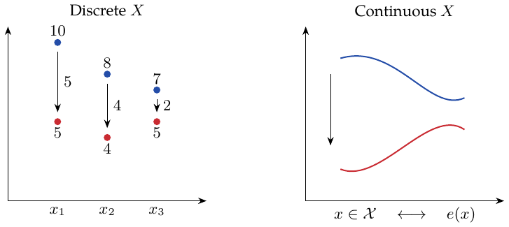
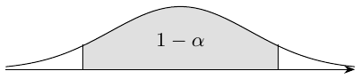
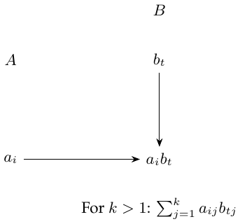
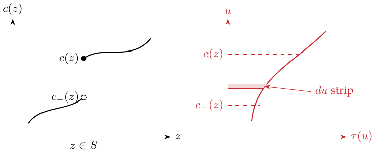
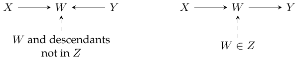
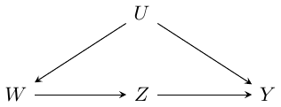

# STATS 361: Causal Inference

Lectures 1–14

Ming · English edition

# Lecture 1: Randomized Controlled Trials

Regression in an RCT analysis of the average treatment effect reduces variance; it does not play a role in identifying the ATE.

> <span style="color: #000000">Regression in an RCT</span> $`\textcolor{black}{\longrightarrow}`$ Variance reduction; ATE identification comes from assignment.

``` math
\Delta_i=Y_i(1)-Y_i(0),\qquad \tau=E[Y_i(1)-Y_i(0)].
```
Estimate and construct inference for $`\tau`$ using the difference-in-means estimator:
``` math
\widehat\tau_{\rm DM}=\frac1{n_1}\sum_{W_i=1}Y_i-\frac1{n_0}\sum_{W_i=0}Y_i,
\qquad n_w=|\{i:W_i=w\}|.
```
This estimator is consistent and unbiased under random assignment.

> <span style="color: #244DA8">Difference in means</span> $`\textcolor{blue}{\longrightarrow}`$ $`\widehat\tau_{\rm DM}`$

Assume IID sampling, finite second moments, and nonempty treatment groups. This lecture uses balanced assignment $`P(W=1)=1/2`$ and centered covariates $`E[X]=0`$. Normal approximations are asymptotic.

#### Supplement: assumptions.

``` math
Y_i=Y_i(W_i),\qquad W_i\perp\{Y_i(0),Y_i(1)\}.
```
The second condition is random assignment. SUTVA requires no interference between units and a well-defined version of each specified treatment. Together with consistency, this gives $`Y_i=Y_i(W_i)`$. Independent sampling is a separate assumption.

> <span style="color: #000000">$`Y_i=Y_i(W_i)`$; SUTVA</span> $`\textcolor{black}{\longrightarrow}`$ No interference and well-defined treatments.

## Linear outcome model and variance reduction

``` math
Y_i(w)=c_{(w)}+X_i\beta_{(w)}+\varepsilon_i(w),\quad
E[\varepsilon_i(w)\mid X_i]=0,\quad
\operatorname{Var}[\varepsilon_i(w)\mid X_i]=b^2.
```
<span style="color: #244DA8">The coefficients are fitted separately for the two treatment states.</span> Write $`A=\operatorname{Var}[X]`$ and <span style="color: #244DA8">$`\|v\|_A^2=v'Av`$</span>. The asymptotic variance is
``` math
V_{\rm DM}=4b^2+\|\beta_{(0)}+\beta_{(1)}\|_A^2
 +\|\beta_{(0)}-\beta_{(1)}\|_A^2.
```
Also,
``` math
\tau=c_{(1)}-c_{(0)}+E[X](\beta_{(1)}-\beta_{(0)}),\qquad
\widehat\tau_{\rm OLS}=\widehat c_{(1)}-\widehat c_{(0)}
 +\overline X(\widehat\beta_{(1)}-\widehat\beta_{(0)}).
```
The error decomposition is
``` math
\begin{aligned}
\widehat\tau_{\rm OLS}-\tau={}&(\widehat c_{(1)}-c_{(1)})-(\widehat c_{(0)}-c_{(0)})
 +\overline X(\beta_{(1)}-\beta_{(0)})\\
&+\overline X(\widehat\beta_{(1)}-\widehat\beta_{(0)}-\beta_{(1)}+\beta_{(0)}).
\end{aligned}
```
The first two terms have asymptotic approximations $`N(0,b^2/n_1)`$ and $`N(0,b^2/n_0)`$; the third has approximation $`N(0,\|\beta_{(1)}-\beta_{(0)}\|_A^2/n)`$; the last is $`O_p(1/n)`$. <span style="color: #244DA8">Slope-estimation uncertainty is negligible to first order.</span> Thus
``` math
\sqrt n(\widehat\tau_{\rm OLS}-\tau)\Rightarrow N(0,V_{\rm OLS}),\qquad
V_{\rm OLS}=4b^2+\|\beta_{(0)}-\beta_{(1)}\|_A^2,
```
``` math
V_{\rm DM}=V_{\rm OLS}+\|\beta_{(0)}+\beta_{(1)}\|_A^2.
```

## OLS under a general outcome regression

OLS can reduce asymptotic variance even when the outcome regression is nonlinear. Suppose
``` math
Y_i(w)=\mu_{(w)}(X_i)+\varepsilon_i(w),\quad
E[\varepsilon_i(w)\mid X_i]=0,\quad
\operatorname{Var}[\varepsilon_i(w)\mid X_i]=b^2.
```
For difference in means,
``` math
\sqrt n(\widehat\tau_{\rm DM}-\tau)\Rightarrow N(0,V_{\rm DM}),\quad
V_{\rm DM}=4b^2+2\operatorname{Var}[\mu_{(0)}(X_i)]
+2\operatorname{Var}[\mu_{(1)}(X_i)].
```
For OLS, the Huber–White calculation starts from the population projection
``` math
(c^*_{(w)},\beta^*_{(w)})=\arg\min_{c,\beta}
 E[(Y_i(w)-X_i\beta-c)^2].
```
The asymptotic projection calculation gives
``` math
\sqrt{n_w}\left\{\begin{pmatrix}\widehat c_{(w)}\\\widehat\beta_{(w)}\end{pmatrix}
-\begin{pmatrix}c^*_{(w)}\\\beta^*_{(w)}\end{pmatrix}\right\}
\Rightarrow N\left(0,Q^{-1}E[r_w^2qq^\mathsf T]Q^{-1}\right),
```
Here $`c^*_{(w)}=E[Y_i(w)]`$. Write $`q=(1,X^\mathsf T)^\mathsf T`$, $`Q=E[qq^\mathsf T]`$ is nonsingular, and $`r_w=Y(w)-c_w^*-X\beta_w^*`$. The sandwich covariance need not be block diagonal: $`E[r_wX]=0`$ does not imply $`E[r_w^2X]=0`$. With $`E[X]=0`$, the intercept variance is $`E[r_w^2]`$.[^1]

``` math
\operatorname{MSE}^*_{(w)}=E[(Y_i(w)-X_i\beta^*_{(w)}-c^*_{(w)})^2].
```
Therefore
``` math
\sqrt n(\widehat\tau_{\rm OLS}-\tau)\Rightarrow N(0,V_{\rm OLS}),\qquad
V_{\rm OLS}=V_{\rm DM}-\|\beta^*_{(0)}+\beta^*_{(1)}\|_A^2.
```
<span style="color: #C92B32">$`V_{\rm OLS}\le V_{\rm DM}`$ in this balanced-trial setting.</span> Strict reduction occurs when $`\|\beta^*_{(0)}+\beta^*_{(1)}\|_A^2>0`$. Equality holds when this squared norm is zero; for nonsingular $`A`$, this means $`\beta^*_{(0)}+\beta^*_{(1)}=0`$.

#### Personal observation.

OLS can be viewed as
``` math
\widehat\tau_{\rm OLS}=\frac1n\sum_{i=1}^n
\{(\widehat c_{(1)}+X_i\widehat\beta_{(1)})
 -(\widehat c_{(0)}+X_i\widehat\beta_{(0)})\}
=\frac1n\sum_i[\widehat\mu_{(1)}(X_i)-\widehat\mu_{(0)}(X_i)].
```
<span style="color: #244DA8">Here $`\widehat\mu_{(w)}(x)`$ is the fitted OLS value at $`x`$. It could be replaced with another method.</span>

# Lecture 2: Unconfoundedness and the Propensity Score

Unconfoundedness: the aim is to remove the influence of confounding factors. Propensity score: the probability of treatment given the covariates.

## Aggregating difference-in-means estimators

<span style="color: #C92B32">Simply weight by probability.</span> With discrete, numerically valued $`X_i`$, assume
``` math
\{Y_i(0),Y_i(1)\}\perp W_i\mid X_i=x,\qquad x\in\mathcal X.
```
<span style="color: #244DA8">Here $`x`$ is the grouping variable.</span> Define the group-wise ATE
``` math
\tau(x)=E[Y_i(1)-Y_i(0)\mid X_i=x].
```
Then
``` math
\begin{aligned}
\widehat\tau_{\rm AGG}&=\sum_{x\in\mathcal X}\frac{n_x}{n}\widehat\tau(x),\\
\widehat\tau(x)&=\frac1{n_{x1}}\sum_{X_i=x,W_i=1}Y_i
-\frac1{n_{x0}}\sum_{X_i=x,W_i=0}Y_i,\\
n_x&=|\{i:X_i=x\}|,\qquad
n_{xw}=|\{i:X_i=x,W_i=w\}|.
\end{aligned}
```
Let $`e(x)=P(W_i=1\mid X_i=x)`$. The within-group limit is
``` math
\begin{aligned}
\sqrt{n_x}(\widehat\tau(x)-\tau(x))
&\Rightarrow N\left(0,
\frac{\operatorname{Var}[Y_i(0)\mid X_i=x]}{1-e(x)}
+\frac{\operatorname{Var}[Y_i(1)\mid X_i=x]}{e(x)}\right)\\
&=N\left(0,\frac{b^2(x)}{e(x)(1-e(x))}\right),
\end{aligned}
```
where the second equality uses the common conditional variance assumption. Define $`\pi(x)=P(X_i=x),\quad\widehat\pi(x)=n_x/n`$. This fixed-stratum limit uses finitely many strata, positive population masses, treatment overlap within each stratum, and finite conditional second moments. Then
``` math
\begin{aligned}
\widehat\tau_{\rm AGG}={}&\sum_x\pi(x)\tau(x)
+\sum_x\pi(x)(\widehat\tau(x)-\tau(x))\\
&+\sum_x(\widehat\pi(x)-\pi(x))\tau(x)
+\sum_x(\widehat\pi(x)-\pi(x))(\widehat\tau(x)-\tau(x)).
\end{aligned}
```
<span style="color: #244DA8">The first term is $`\tau`$.</span> <span style="color: #244DA8">The second is annotated as asymptotically normal, with variance</span>

> 
> ``` math
> \sum_x\pi^2(x)\operatorname{Var}[\widehat\tau(x)].
> ```

<span style="color: #244DA8">The third has variance $`n^{-1}\operatorname{Var}[\tau(X_i)]`$; the last is $`O_p(1/n)`$.</span> Combining these terms gives

> <span style="color: #000000">Four-term aggregate-estimator expansion</span> $`\textcolor{black}{\longrightarrow}`$ Aggregate variance $`V_{\rm AGG}`$.

``` math
\sqrt n(\widehat\tau_{\rm AGG}-\tau)\Rightarrow N(0,V_{\rm AGG}),
```
``` math
\begin{aligned}
V_{\rm AGG}&=\operatorname{Var}[\tau(X_i)]
+\sum_{x\in\mathcal X}\pi^2(x)\frac1{\pi(x)}
\frac{b^2(x)}{e(x)(1-e(x))}\\
&=\operatorname{Var}[\tau(X_i)]
+E\left[\frac{b^2(X_i)}{e(X_i)(1-e(X_i))}\right].
\end{aligned}
```

## Continuous covariates and propensity scores

My intuition for unconfoundedness: given $`X_i`$, $`W_i`$ cannot “peek” at the potential outcomes. If
``` math
\{Y_i(0),Y_i(1)\}\perp W_i\mid X_i,
\quad e(x)=P(W_i=1\mid X_i=x),
```
then
``` math
\{Y_i(0),Y_i(1)\}\perp W_i\mid e(X_i).
```

#### Supplementary sketches and calculation.

<div class="center">



</div>

Conditioning and integrating gives
``` math
\begin{aligned}
&P(W_i=w\mid\{Y_i(0),Y_i(1)\},e(X_i))\\
&\quad=\int_{\mathcal X}P(W_i=w\mid\{Y_i(0),Y_i(1)\},X_i=x)
 dP(X_i=x\mid Y_i(0),Y_i(1),e(X_i))\\
&\quad=\int_{\mathcal X}P(W_i=w\mid X_i=x)dP(X_i=x\mid Y_i(0),Y_i(1),e(X_i))\\
&\quad=e(X_i)\mathbf1_{\{w=1\}}+(1-e(X_i))\mathbf1_{\{w=0\}}.
\end{aligned}
```
<span style="color: #244DA8">This is integration with respect to a conditional probability measure.</span>

## Propensity stratification

1.  Sort the observations so that $`\widehat e(X_{i_1})\leq\widehat e(X_{i_2})\leq\cdots\leq\widehat e(X_{i_n})`$.

2.  Split them into $`J`$ strata and estimate a difference in means within each stratum. If $`I_j`$ contains ranks $`\lfloor(j-1)n/J\rfloor+1`$ through $`\lfloor jn/J\rfloor`$, write
    ``` math
    \widehat\tau_j=\frac{\sum_{i\in I_j}W_iY_i}{\sum_{i\in I_j}W_i}
    -\frac{\sum_{i\in I_j}(1-W_i)Y_i}{\sum_{i\in I_j}(1-W_i)}.
    ```

    > <span style="color: #244DA8">Make treatment and control groups more similar</span> $`\textcolor{blue}{\longrightarrow}`$ Sort by $`\widehat e(X_i)`$ and form propensity-score strata.

3.  Average the stratum estimates: $`\widehat\tau_{\rm STRAT}=J^{-1}\sum_{j=1}^J\widehat\tau_j`$. <span style="color: #244DA8">With increasingly fine strata and adequate within-stratum sample sizes, this is consistent.</span> For consistency, let $`J`$ grow with $`n`$ so strata become finer while retaining enough treated and control observations, under overlap and uniform consistency of $`\widehat e`$. Fixed broad strata can leave residual confounding.

## Inverse-propensity weighting

``` math
\widehat\tau_{\rm IPW}=\frac1n\sum_{i=1}^n
\left\{\frac{W_iY_i}{\widehat e(X_i)}-\frac{(1-W_i)Y_i}{1-\widehat e(X_i)}\right\}.
```
Oracle IPW assumes $`e(x)`$ is perfectly known:
``` math
\widehat\tau^*_{\rm IPW}=\frac1n\sum_i
\left\{\frac{W_iY_i}{e(X_i)}-\frac{(1-W_i)Y_i}{1-e(X_i)}\right\}.
```
Suppose overlap holds, $`\eta\leq e(x)\leq1-\eta`$ for all $`x\in\mathcal X`$, and $`|Y_i|<M`$. If
``` math
\sup_{x\in\mathcal X}|e(x)-\widehat e(x)|=O_p(a_n)\longrightarrow0,
```
we obtain
``` math
|\widehat\tau_{\rm IPW}-\widehat\tau^*_{\rm IPW}|=O_p(a_nM/\eta).
```
<span style="color: #244DA8">Thus consistency of the oracle estimator transfers to estimated-propensity IPW.</span> Moreover,
``` math
E[\widehat\tau^*_{\rm IPW}]=E[Y_i(1)-Y_i(0)]=\tau.
```
<span style="color: #244DA8">With overlap, oracle IPW converges at the $`1/\sqrt n`$ scale.</span>

#### Variance calculation: supplementary model.

Use the model
``` math
\begin{aligned}
Y_i(0)&=c(X_i)-(1-e(X_i))\tau(X_i)+\varepsilon_i(0),\\
Y_i(1)&=c(X_i)+e(X_i)\tau(X_i)+\varepsilon_i(1),\\
E[\varepsilon_i(w)\mid X_i]&=0,\qquad
\operatorname{Var}[\varepsilon_i(w)\mid X_i=x]=b^2(x).
\end{aligned}
```
Then

> <span style="color: #000000">Outcome model</span> $`\textcolor{black}{\longrightarrow}`$ Oracle-IPW variance $`V_{\rm IPW^*}`$.

``` math
\begin{aligned}
n\operatorname{Var}[\widehat\tau^*_{\rm IPW}]
=V_{\rm IPW^*}
={}&E\left[\frac{c^2(X_i)}{e(X_i)(1-e(X_i))}\right]
+\operatorname{Var}[\tau(X_i)]\\
&+E\left[\frac{b^2(X_i)}{e(X_i)(1-e(X_i))}\right],\\
\sqrt n(\widehat\tau^*_{\rm IPW}-\tau)&\Rightarrow N(0,V_{\rm IPW^*}).
\end{aligned}
```

#### Personal comparison.

$`c(x)`$ describes the relationship between $`X`$ and $`Y`$, rather than the relationship between $`X`$ and $`\Delta Y`$. Compared with aggregation,
``` math
V_{\rm IPW^*}=V_{\rm AGG}+E\left[\frac{c^2(X_i)}{e(X_i)(1-e(X_i))}\right].
```

> <span style="color: #244DA8">$`V_{\rm IPW^*}-V_{\rm AGG}`$</span> $`\textcolor{blue}{\longrightarrow}`$ <span style="color: #244DA8">The excess variance vanishes exactly when $`c(X)=0`$ almost surely.</span>

Compared with linear modeling: IPW is based on $`\{Y_i(0),Y_i(1)\}\perp W_i\mid X_i`$, while the linear model relies on linearity. A linear outcome model also needs a causal identification argument, such as unconfoundedness; linearity alone is an estimation restriction.

# Lecture 3: Efficient Treatment Effect Estimation via Augmented IPW

Oracle IPW can have larger asymptotic variance than aggregation for discrete $`X`$, as the preceding comparison shows.

## Two characterizations of the ATE

1.  Using $`e(x)=P(W_i=1\mid X_i=x)`$, $`\tau=E[\widehat\tau^*_{\rm IPW}]`$, where the oracle estimator is as above.

2.  Using $`\mu_{(w)}(x)=E[Y_i(w)\mid X_i=x]`$,
    ``` math
    \tau(x)=\mu_{(1)}(x)-\mu_{(0)}(x),\quad
    \tau=E[\mu_{(1)}(X_i)-\mu_{(0)}(X_i)],
    ```
    which motivates
    ``` math
    \widehat\tau_{\rm REG}=\frac1n\sum_i[\widehat\mu_{(1)}(X_i)-\widehat\mu_{(0)}(X_i)].
    ```

## The augmented IPW estimator

``` math
\begin{aligned}
\widehat\tau_{\rm AIPW}=\frac1n\sum_i\bigg[&\widehat\mu_{(1)}(X_i)-\widehat\mu_{(0)}(X_i)
+W_i\frac{Y_i-\widehat\mu_{(1)}(X_i)}{\widehat e(X_i)}\\
&-(1-W_i)\frac{Y_i-\widehat\mu_{(0)}(X_i)}{1-\widehat e(X_i)}\bigg].
\end{aligned}
```

#### Personal intuition.

<span style="color: #244DA8">First use $`\mu(x)`$ to estimate the outcome, and then use IPW on the regression residuals. IPW makes the covariate composition of the data “fair.”</span>

## Double robustness

AIPW is consistent if either the outcome regressions $`\widehat\mu_{(w)}(x)`$ are consistent or $`\widehat e(x)`$ is consistent. Here overlap and integrability are assumed, and the other nuisance estimate must remain well behaved. For fitted functions, the expectation argument below is conditional on an independent training fold as well as the displayed covariates. Cross-fitting supplies this separation.

When $`\widehat\mu_{(w)}(x)\approx\mu_{(w)}(x)`$, the regression average is consistent and the weighted residual terms have mean approximately zero because
``` math
E[Y_i-\widehat\mu_{(W_i)}(X_i)\mid X_i,W_i]\approx0.
```
The propensity term is held fixed by this conditioning. When instead $`\widehat e(x)\approx e(x)`$, rearrange:
``` math
\begin{aligned}
\widehat\tau_{\rm AIPW}={}&\frac1n\sum_i\left[\frac{W_iY_i}{\widehat e(X_i)}
-\frac{(1-W_i)Y_i}{1-\widehat e(X_i)}\right]\\
&+\frac1n\sum_i\left[\widehat\mu_{(1)}(X_i)\left(1-\frac{W_i}{\widehat e(X_i)}\right)
-\widehat\mu_{(0)}(X_i)\left(1-\frac{1-W_i}{1-\widehat e(X_i)}\right)\right].
\end{aligned}
```
<span style="color: #244DA8">The first part is IPW.</span> <span style="color: #244DA8">The second has mean approximately zero since</span> $`E[1-W_i/\widehat e(X_i)\mid X_i]\approx0`$; conditioning holds the fitted outcome regression fixed.

## Semiparametric efficiency

AIPW attains the semiparametric efficiency bound among regular estimators in this nonparametric model. When the nuisance functions are estimated sufficiently accurately,
``` math
\sqrt n(\widehat\tau_{\rm AIPW}-\widehat\tau^*_{\rm AIPW})\longrightarrow_p0,
```
where the starred estimator is oracle AIPW. This oracle estimator is just an IID average, so the central limit theorem also applies to the estimated version:

> <span style="color: #244DA8">$`\sqrt n(\widehat\tau_{\rm AIPW}-\widehat\tau^*_{\rm AIPW})\to_p0`$</span> $`\textcolor{blue}{\longrightarrow}`$ The oracle IID central limit theorem transfers to estimated AIPW.

``` math
\sqrt n(\widehat\tau_{\rm AIPW}-\tau)\Rightarrow N(0,V^*),
```
``` math
V^*=\operatorname{Var}[\tau(X_i)]
+E\left[\frac{b_0^2(X_i)}{1-e(X_i)}\right]
+E\left[\frac{b_1^2(X_i)}{e(X_i)}\right].
```
<span style="color: #244DA8">This is a Cramer–Rao-type constraint: the best attainable variance among regular estimators.</span>

## AIPW and cross-fitting

Randomly split the data into two halves, $`I_1`$ and $`I_2`$. <span style="color: #244DA8">The annotation says to split the data and choose the halves at random.</span> Set
``` math
\widehat\tau_{\rm AIPW}=\frac{|I_1|}{n}\widehat\tau^{I_1}
+\frac{|I_2|}{n}\widehat\tau^{I_2},
```
``` math
\begin{aligned}
\widehat\tau^{I_1}=\frac1{|I_1|}\sum_{i\in I_1}\bigg[&\widehat\mu_{(1)}^{I_2}(X_i)-\widehat\mu_{(0)}^{I_2}(X_i)
+W_i\frac{Y_i-\widehat\mu_{(1)}^{I_2}(X_i)}{\widehat e^{I_2}(X_i)}\\
&-(1-W_i)\frac{Y_i-\widehat\mu_{(0)}^{I_2}(X_i)}{1-\widehat e^{I_2}(X_i)}\bigg].
\end{aligned}
```
Asymptotically, we can ignore the specific properties of the chosen machine-learning adjustment method and instead rely on:

1.  Overlap: $`\eta<e(x)<1-\eta`$ for all $`x\in\mathcal X`$, with $`\eta>0`$.

2.  Consistency of the nuisance estimators:
    ``` math
    \sup_x|\widehat\mu_{(w)}^{I_2}(x)-\mu_{(w)}(x)|\longrightarrow_p0,
    \quad \sup_x|\widehat e^{I_2}(x)-e(x)|\longrightarrow_p0.
    ```
    <span style="color: #244DA8">The chosen learning method must satisfy these consistency assumptions; consistency is not automatic for every method.</span>

3.  Risk decay for the outcome and propensity models:
    ``` math
    E[(\widehat\mu_{(w)}^{I_2}(X_i)-\mu_{(w)}(X_i))^2]\,
    E[(\widehat e^{I_2}(X_i)-e(X_i))^2]=o(1/n).
    ```
    <span style="color: #244DA8">If both are $`\sqrt n`$-consistent, the product is of order $`1/n^2`$. A simple sufficient approach is for both regression adjustments to converge at $`o(n^{-1/4})`$ in RMSE.</span>

#### Proof.

Write the oracle estimator as $`\widehat\tau^*=|I_1|\widehat\tau^{I_1,*}/n+|I_2|\widehat\tau^{I_2,*}/n`$. To establish $`\sqrt n(\widehat\tau_{\rm AIPW}-\widehat\tau^*)\to_p0`$, it suffices to show the corresponding result for the treated mean; the other components are analogous. Define
``` math
\widehat\tau^{I_1}=\widehat\mu^{I_1}_{(1)}-\widehat\mu^{I_1}_{(0)},\qquad
\widehat\mu^{I_1}_{(1)}=\frac1{|I_1|}\sum_{i\in I_1}
\left[\widehat\mu^{I_2}_{(1)}(X_i)+W_i\frac{Y_i-\widehat\mu^{I_2}_{(1)}(X_i)}{\widehat e^{I_2}(X_i)}\right].
```
Subtracting its oracle version gives
``` math
\begin{aligned}
\widehat\mu^{I_1}_{(1)}-\widehat\mu^{I_1,*}_{(1)}
={}&\frac1{|I_1|}\sum_{i\in I_1}
(\widehat\mu^{I_2}_{(1)}(X_i)-\mu_{(1)}(X_i))\left(1-\frac{W_i}{e(X_i)}\right)\\
&+\frac1{|I_1|}\sum_{i\in I_1}W_i(Y_i-\mu_{(1)}(X_i))
\left(\frac1{\widehat e^{I_2}(X_i)}-\frac1{e(X_i)}\right)\\
&-\frac1{|I_1|}\sum_{i\in I_1}W_i(\widehat\mu^{I_2}_{(1)}(X_i)-\mu_{(1)}(X_i))
\left(\frac1{\widehat e^{I_2}(X_i)}-\frac1{e(X_i)}\right).
\end{aligned}
```
<span style="color: #244DA8">The first contribution has conditional variance $`o_p(1)/n`$; the last is $`o_p(1/\sqrt n)`$.</span> If $`T_1`$ is the first average and $`\mathcal D_2`$ its training data,
``` math
E[T_1\mid\mathcal D_2]=0,\qquad E[T_1^2\mid\mathcal D_2]\le\frac{E[(\widehat\mu_1(X)-\mu_1(X))^2\mid\mathcal D_2]}{\eta|I_1|}=o_p(n^{-1}).
```
Thus $`T_1=o_p(n^{-1/2})`$. The second average is similar; Cauchy–Schwarz and the product-risk condition control the last.

For $`K`$ folds, use nuisance estimates trained without the fold $`k(i)`$ containing observation $`i`$:
``` math
\begin{aligned}
\widehat\tau_{\rm AIPW}=\frac1n\sum_i\bigg[&\widehat\mu_{(1)}^{(-k(i))}(X_i)-\widehat\mu_{(0)}^{(-k(i))}(X_i)
+W_i\frac{Y_i-\widehat\mu_{(1)}^{(-k(i))}(X_i)}{\widehat e^{(-k(i))}(X_i)}\\
&-(1-W_i)\frac{Y_i-\widehat\mu_{(0)}^{(-k(i))}(X_i)}{1-\widehat e^{(-k(i))}(X_i)}\bigg].
\end{aligned}
```

## Confidence intervals

#### Supplement: terminology.

The ordinary likelihood score is
``` math
S(\theta)=\frac{d\log L(\theta)}{d\theta},
```
where $`L(\theta)`$ is the likelihood. The empirical variance of $`n`$ sample scores is
``` math
\frac1{n-1}\sum_i(S_\theta(O_i)-\overline S_\theta)^2.
```
With nuisance parameters, the efficient score removes the nuisance-score component. For the ATE, the centered AIPW summand $`\psi_i^*-\tau`$ below is the efficient influence function, and its variance is the efficiency bound; this differs from a raw likelihood score, whose variance is Fisher information.

#### Variance estimation.

Define the oracle summand
``` math
\psi_i^*=\mu_{(1)}(X_i)-\mu_{(0)}(X_i)
+\frac{W_i(Y_i-\mu_{(1)}(X_i))}{e(X_i)}
-\frac{(1-W_i)(Y_i-\mu_{(0)}(X_i))}{1-e(X_i)}.
```
Its empirical variance converges to the efficient variance:
``` math
\frac1{n-1}\sum_i(\psi_i^*-\widehat\tau^*)^2\longrightarrow_p V^*.
```
Here $`\widehat\tau^*`$ is oracle AIPW.

> <span style="color: #244DA8">The non-cross-fitted oracle AIPW estimate</span> $`\textcolor{blue}{\longrightarrow}`$ $`\widehat\tau^*`$ in $`\sum_i(\psi_i^*-\widehat\tau^*)^2/(n-1)`$.

Replacing each nuisance function by the estimate trained outside $`k(i)`$ gives the cross-fitted summand $`\widehat\psi_i`$ and
``` math
\widehat V_{\rm AIPW}=\frac1{n-1}\sum_i(\widehat\psi_i-\widehat\tau_{\rm AIPW})^2\longrightarrow_p V^*.
```
The confidence interval drawn under a central normal probability region is

<div class="center">



</div>

The interval has asymptotic coverage $`1-\alpha`$:

``` math
\widehat\tau_{\rm AIPW}\ \pm\ \frac1{\sqrt n}\Phi^{-1}(1-\alpha/2)\sqrt{\widehat V_{\rm AIPW}}.
```

# Lecture 4: Estimating Treatment Heterogeneity

For observations $`(X_i,Y_i,W_i)`$ with $`X_i\in\mathcal X`$, we previously pursued the ATE $`E[Y_i(1)-Y_i(0)]`$. Heterogeneity analysis instead considers the conditional average treatment effect (CATE):
``` math
\tau(x)=E[Y_i(1)-Y_i(0)\mid X_i=x].
```

> <span style="color: #244DA8">Average for a category of $`X_i`$</span> $`\textcolor{blue}{\longrightarrow}`$ $`\tau(x)=E[Y_i(1)-Y_i(0)\mid X_i=x]`$.

## Regularization bias

Under $`\{Y_i(0),Y_i(1)\}\perp W_i\mid X_i`$,
``` math
\tau(x)=\mu_{(1)}(x)-\mu_{(0)}(x),\qquad
\mu_{(w)}(x)=E[Y_i\mid X_i=x,W_i=w].
```
A direct CATE estimator is $`\widehat\tau_T(x)=\widehat\mu_{(1)}(x)-\widehat\mu_{(0)}(x)`$.

#### Personal concern.

<span style="color: #244DA8">If there are too few observations for $`\widehat\mu_{(1)}`$, it may be heavily regularized (toward a straight line). If there are many observations for $`\widehat\mu_{(0)}`$, that fit may be accurate; then the difference $`\widehat\tau_T(x)`$ goes wrong because of the first fit.</span>

## Semiparametric modeling

``` math
Y_i(w)=f(X_i)+w\tau(X_i)+\varepsilon_i(w),\qquad
P(W_i=1\mid X_i)=e(X_i),\qquad \tau(x)=\psi(x)\beta.
```
<span style="color: #244DA8">$`f`$ is a function of $`X_i`$, and $`\psi(x)`$ is a nonparametric representation of $`X`$; $`\beta`$ is the treatment-effect coefficient.</span> Under unconfoundedness, the Robinson transformation is

> <span style="color: #000000">$`Y_i(w)=f(X_i)+w\tau(X_i)+\varepsilon_i(w)`$</span> $`\textcolor{black}{\longrightarrow}`$ <span style="color: #C92B32">Robinson</span>: subtract $`m(X_i)`$ and residualize $`W_i`$ by $`e(X_i)`$.

``` math
Y_i-m(X_i)=(W_i-e(X_i))\psi(X_i)\beta+\varepsilon_i,
\quad m(x)=E[Y_i\mid X_i=x]=f(x)+e(x)\tau(x),
```
with $`\varepsilon_i=\varepsilon_i(W_i)`$.

> <span style="color: #244DA8">$`\varepsilon_i=\varepsilon_i(W_i)`$</span> $`\textcolor{blue}{\longrightarrow}`$ The error in $`Y_i-m(X_i)=(W_i-e(X_i))\psi(X_i)\beta+\varepsilon_i`$.

Design a residual-on-residual OLS regression using
``` math
\widetilde Y_i^*=Y_i-m(X_i),\qquad
\widetilde Z_i^*=(W_i-e(X_i))\psi(X_i).
```
Regress $`\widetilde Y_i^*`$ on $`\widetilde Z_i^*`$ to obtain $`\widehat\beta_R^*`$ . <span style="color: #244DA8">These transformations use only the observed data and the nuisance functions; this is data preprocessing.</span> We obtain
``` math
\sqrt n(\widehat\beta_R^*-\beta)\Rightarrow N(0,V_R),
```
``` math
V_R=Q^{-1}E[ZZ^\mathsf T\varepsilon^2]Q^{-1}.
```
Under homoskedasticity, $`\operatorname{Var}(\varepsilon_i\mid X_i,W_i)=b^2`$ is constant and $`V_R`$ is the semiparametrically efficient variance for $`\beta`$. Under heteroskedasticity, the sandwich variance still applies but need not attain the efficiency bound. Here $`Z=(\widetilde Z_i^*)^\mathsf T`$, $`Q=E[ZZ^\mathsf T]`$ is nonsingular, and $`\varepsilon=\widetilde Y_i^*-Z^\mathsf T\beta`$. The normal equations give influence function $`Q^{-1}Z\varepsilon`$, so the middle factor uses the regression residual. Under conditional homoskedasticity this is $`b^2Q^{-1}`$.[^2]

#### Feasible cross-fitted version.

The preceding regression is idealized because $`m(X_i)`$ and $`e(X_i)`$ are unknown. Fit nonparametric regressions $`Y\sim X`$ and $`W\sim X`$; <span style="color: #244DA8">omit the fold containing observation $`i`$</span> when constructing
``` math
\widetilde Y_i=Y_i-\widehat m^{(-k(i))}(X_i),\qquad
\widetilde Z_i=(W_i-\widehat e^{(-k(i))}(X_i))\psi(X_i).
```
Regress $`\widetilde Y_i`$ on $`\widetilde Z_i`$ to obtain $`\widehat\beta_R`$. If both nuisance RMSEs are $`o_p(n^{-1/4})`$, we obtain
``` math
\sqrt n(\widehat\beta_R^*-\widehat\beta_R)\longrightarrow_p0.
```

## A loss function for treatment heterogeneity

The previous estimator assumes $`\tau(x)=\psi(x)\beta`$. Often the relationship is not linear, so use machine learning. With
``` math
\mu_{(w)}(x)=E[Y(w)\mid X=x],\quad
\varepsilon_i(w)=Y_i(w)-[\mu_{(0)}(X_i)+w\tau(X_i)],
```
unconfoundedness yields $`E[\varepsilon_i(w)\mid X_i,W_i]=0`$. <span style="color: #244DA8">Here $`\mu_{(0)}`$ plays the role of the previous $`f`$.</span> Again,
``` math
Y_i-m(X_i)=(W_i-e(X_i))\tau(X_i)+\varepsilon_i,
\quad m(x)=\mu_{(0)}(x)+e(x)\tau(x),\quad \varepsilon_i=\varepsilon_i(W_i).
```
Equivalently,
``` math
\tau(\cdot)=\arg\min_{t}E[((Y_i-m(X_i))-(W_i-e(X_i))t(X_i))^2].
```
<span style="color: #244DA8">If $`m`$ and $`e`$ are known, minimizing this gives $`\tau(\cdot)`$.</span> Indeed, $`L(t)-L(\tau)=E[e(X)(1-e(X))(t(X)-\tau(X))^2]`$, so the minimizer identifies $`\tau`$ where $`0<e(X)<1`$, up to null sets. The oracle penalized estimator is
``` math
\widehat\tau_R^*(\cdot)=\arg\min_t\left\{
\frac1n\sum_i[(Y_i-m(X_i))-(W_i-e(X_i))t(X_i)]^2+\Lambda_n(t)\right\}.
```

> <span style="color: #244DA8">Regularize the complexity of $`\tau(\cdot)`$</span> $`\textcolor{blue}{\longrightarrow}`$ $`\Lambda_n(\tau)`$: examples include lasso/ridge and neural networks.

<span style="color: #244DA8">Usually $`m`$ and $`e`$ are unknown, so cross-fit them; in an RCT $`e`$ is known by design while $`m`$ generally still needs estimation:</span>

> 
> ``` math
> \begin{aligned}
> \widehat L_n(t)&=\frac1n\sum_i
> [(Y_i-\widehat m^{(-k(i))}(X_i))-(W_i-\widehat e^{(-k(i))}(X_i))t(X_i)]^2,\\
> \widehat\tau_R&=\arg\min_t\{\widehat L_n(t)+\Lambda_n(t)\}.
> \end{aligned}
> ```
> For lasso, $`\widehat\tau(x)=x\widehat\beta`$, with
> ``` math
> \widehat\beta=\arg\min_\beta\left\{\frac1n\sum_i
> [(Y_i-\widehat m^{(-k(i))}(X_i))-(W_i-\widehat e^{(-k(i))}(X_i))X_i\beta]^2
> +\lambda\|\beta\|_1\right\}.
> ```

#### Personal supplementary observation.

With a constant treatment effect, $`Y_i(w)=f(X_i)+\tau w+\varepsilon_i`$ and $`E[\varepsilon_i\mid X_i,W_i]=0`$, the residual estimator is
``` math
\widehat\tau_R=\frac{\sum_i(Y_i-\widehat m^{(-k(i))}(X_i))(W_i-\widehat e^{(-k(i))}(X_i))}
{\sum_i(W_i-\widehat e^{(-k(i))}(X_i))^2}.
\tag{4.5}
```
The premise is that the nuisance components converge fast enough. Even if $`\tau`$ is not constant, this estimator converges to a nonnegatively weighted average of $`\tau(x)`$.

> <span style="color: #244DA8">$`\overline Y_{(1)}-\overline Y_{(0)}`$</span> $`\textcolor{blue}{\longrightarrow}`$ The nonnegative weighted average of $`\tau(x)`$ in the preceding observation.

When heterogeneity is small and overlap presents difficulties, use (4.5) as a replacement.

> <span style="color: #244DA8">Constant-coefficient residual regression and its weighted-effect interpretation</span> $`\textcolor{blue}{\longrightarrow}`$ R-loss for a flexible treatment-effect function.

The population target is
``` math
\frac{E[e(X)(1-e(X))\tau(X)]}{E[e(X)(1-e(X))]},
```
with a positive denominator. It emphasizes regions of overlap and equals the ATE under constant effects or when the overlap weight and $`\tau(X)`$ are uncorrelated. Deterministic-treatment regions remain unidentified.

# Lecture 5: Regression Discontinuity Designs

Introduce a cutoff using a running variable $`Z_i\in\mathbb R`$:
``` math
W_i=\mathbf1_{\{Z_i\geq c\}},\qquad c\text{ is the threshold.}
```
<span style="color: #244DA8">As $`Z_i\to c`$, observations near $`c`$ have similar characteristics and differ in whether they receive the intervention.</span> Let $`\mu_{(w)}(z)=E[Y_i(w)\mid Z_i=z]`$. If the two conditional means are continuous, the CATE at $`z=c`$ is
``` math
\tau_c=\mu_{(1)}(c)-\mu_{(0)}(c)
=\lim_{z\to c^+}E[Y_i\mid Z_i=z]-\lim_{z\to c^-}E[Y_i\mid Z_i=z].
```

#### Personal supplement: why does ordinary IPW not apply?

Earlier we assumed unconfoundedness $`\{Y_i(0),Y_i(1)\}\perp W_i\mid Z_i`$ and overlap $`\eta\leq P(W_i=1\mid Z_i)\leq1-\eta`$. In RDD, unconfoundedness holds, but overlap fails because the treatment probability given $`Z_i=z`$ is either zero or one. <span style="color: #244DA8">No positive $`\eta`$ makes this deterministic assignment satisfy overlap.</span> We must compare observations near $`c`$, using similarity rather than overlap. In this nonparametric smoothness class, failure of overlap prevents a uniform $`\sqrt n`$ rate for $`\tau_c`$. Its minimax error converges at a nonparametric rate depending on the smoothness of $`\mu_{(w)}(z)`$. For example, a uniformly bounded second derivative at $`c`$ allows an $`n^{-2/5}`$ estimation-error rate. The rate uses independent observations, positive continuous design density on both sides of $`c`$, a second-derivative bound near $`c`$, and bounded conditional variance. Stronger parametric restrictions can give different rates.

## Estimation via local linear regression

Choose a small bandwidth $`h_n\to0`$ and a symmetric weighting function $`K`$. Fit the two conditional means locally. The coefficient on $`W_i`$ in
``` math
\arg\min_{a,\tau,\beta_{(0)},\beta_{(1)}}\sum_i
K\left(\frac{|Z_i-c|}{h_n}\right)
[Y_i-a-\tau W_i-\beta_{(0)}(Z_i-c)_--\beta_{(1)}(Z_i-c)_+]^2
```
is $`\widehat\tau_c`$.

> <span style="color: #C92B32">Weight; negative side; positive side</span> $`\textcolor{red}{\longrightarrow}`$ $`K(|Z_i-c|/h_n)`$; $`(Z_i-c)_-`$; $`(Z_i-c)_+`$.

The intercept $`a`$ and slopes $`\beta_{(w)}`$ are nuisance parameters. Common kernels are the window function $`K(x)=\mathbf1_{\{|x|\leq1\}}`$ and triangular kernel $`K(x)=(1-|x|)_+`$.

## Estimator properties and smoothness

Quantify continuity by assuming $`\mu_{(w)}`$ is twice differentiable with a uniformly bounded second derivative:
``` math
\left|\frac{d^2}{dz^2}\mu_{(w)}(z)\right|\leq B,
\qquad z\in\mathbb R,\quad w\in\{0,1\}.
```
With only Lipschitz smoothness, $`|f(x)-f(y)|\le L|x-y|`$, functions may have corners, and local averaging can be appropriate when a local linear trend is unhelpful. If smoothness is stronger, with bounded derivatives of order $`k\geq3`$, higher-order local regression may improve the convergence rate.

<span style="color: #C92B32">Taylor-expand at $`c`$:</span>
``` math
\mu_{(w)}(z)=a_{(w)}+\beta_{(w)}(z-c)+\tfrac12\rho_{(w)}(z-c),
\qquad |\rho_{(w)}(u)|\leq Bu^2.
```
<span style="color: #C92B32">The last term is the remainder,</span> and $`\tau_c=a_{(1)}-a_{(0)}`$. Fit each side separately:
``` math
(\widehat a_{(1)},\widehat\beta_{(1)})=\arg\min_{a,\beta}
\sum_{Z_i\geq c}K\left(\frac{|Z_i-c|}{h_n}\right)[Y_i-a-\beta(Z_i-c)]^2,
```
and analogously on the control side; then $`\widehat\tau_c=\widehat a_{(1)}-\widehat a_{(0)}`$.

#### Closed-form weights for the window kernel.

On $`c\leq Z_i\leq c+h_n`$, write
``` math
\widehat a_{(1)}=\sum_i\gamma_iY_i,\qquad
\gamma_i=\frac{m_2-m_1(Z_i-c)}{N_+(m_2-m_1^2)},
```
where $`N_+=|\{i:c\le Z_i\le c+h_n\}|`$ and $`m_j=N_+^{-1}\sum_{c\le Z_i\le c+h_n}(Z_i-c)^j`$. Assume $`m_2-m_1^2>0`$. The factor $`N_+`$ normalizes the weights, so

``` math
\sum_i\gamma_i=1,\qquad \sum_i\gamma_i(Z_i-c)=0.
```

The decomposition is
``` math
\widehat a_{(1)}=a_{(1)}+\underbrace{\tfrac12\sum_i\gamma_i\rho_{(1)}(Z_i-c)}_{\text{\textcolor{red}{curvature bias}}}
+\underbrace{\sum_i\gamma_i(Y_i-\mu_{(1)}(Z_i))}_{\text{\textcolor{red}{sampling noise}}}.
```
The control intercept has an analogous decomposition. Local-linear weights can be negative, so the absolute curvature bias is bounded by $`\frac B2\sum_i|\gamma_i|(Z_i-c)^2`$. With regular local design this is $`O(h_n^2)`$.

> <span style="color: #C92B32">Curvature bias and sampling noise</span> $`\textcolor{red}{\longrightarrow}`$ <span style="color: #C92B32">Both terms need bounds.</span>

Curvature bias is bounded at order $`Bh_n^2`$, where $`B`$ bounds the second derivative and $`h_n`$ is the bandwidth. Sampling noise has mean zero; if $`\operatorname{Var}[Y_i\mid Z_i]\leq b^2`$, its variance is bounded by $`b^2\sum_i\gamma_i^2`$. If $`Z_i`$ has a continuous nonzero density $`f`$ near $`c`$,
``` math
b^2\sum_i\gamma_i^2\approx\frac{4b^2}{|\{i:c\leq Z_i\leq c+h_n\}|}
\approx\frac{4b^2}{f(c)nh_n}.
```
Thus squared bias is of order $`h_n^4`$ and variance is of order $`(nh_n)^{-1}`$, giving
``` math
\widehat\tau_c=\tau_c+O_p(n^{-2/5}),\qquad h_n\asymp n^{-1/5}.
```
<span style="color: #C92B32">Here $`n^{-2/5}`$ is the estimation error. With $`k`$-th order smoothness, $`h_n\asymp n^{-1/(2k+1)}`$.</span>

## Noise in the running variable

> <span style="color: #244DA8">May contain noise</span> $`\textcolor{blue}{\longrightarrow}`$ The running variable $`Z_i`$.

Introduce a latent $`U_i\sim G`$ and two conditions:

1.  A noisy running variable: assume $`Z_i\mid U_i\sim N(U_i,\nu^2)`$, with $`\nu>0`$.

2.  Unconfoundedness of the running variable: $`\{Y_i(0),Y_i(1)\}\perp Z_i\mid U_i`$.

With $`Y_i=Y_i(W_i)`$ and $`\{Y_i(0),Y_i(1)\}\perp W_i\mid U_i`$,
``` math
e(u)=P(W_i=1\mid U_i=u)=P(Z_i\geq c\mid U_i=u)
=1-\Phi\left(\frac{c-u}{\nu}\right),
```
``` math
\alpha_{(w)}(u)=E[Y_i(w)\mid U_i=u],\qquad
\tau(u)=E[Y_i(1)-Y_i(0)\mid U_i=u].
```
The annotation defines the standard normal CDF, The propensity expression follows from $`Z=U+\nu\xi`$, with $`\xi\sim N(0,1)`$ independent of $`U`$. Weight normalization alone does not remove confounding: the second integral vanishes when $`h_+=h_-`$, or under another condition making it zero.

<span style="color: #C92B32">$`\Phi(x)=(2\pi)^{-1/2}\int_{-\infty}^x e^{-t^2/2}\,dt`$.</span>

$`U_i`$ is unobserved, so we cannot directly use its propensity score. Consider a deconvolution-type estimator:

> <span style="color: #000000">Unobserved $`U_i`$: cannot directly use its propensity score</span> $`\textcolor{black}{\longrightarrow}`$ Deconvolution weights $`\gamma_+(z),\gamma_-(z)`$.

``` math
\widehat\tau_\gamma=\frac1n\sum_{Z_i\geq c}\gamma_+(Z_i)Y_i
-\frac1n\sum_{Z_i<c}\gamma_-(Z_i)Y_i.
```
Choose the weights to satisfy
``` math
E[\mathbf1_{\{Z_i\geq c\}}\gamma_+(Z_i)]
=E[\mathbf1_{\{Z_i<c\}}\gamma_-(Z_i)]=1.
```
Then
``` math
E[\widehat\tau_\gamma]
=\underbrace{\int h_+(u)\tau(u)\,dG(u)}_{\text{\textcolor{red}{weighted treatment effect}}}
+\underbrace{\int(h_+(u)-h_-(u))\alpha_{(0)}(u)\,dG(u)}_{\text{\textcolor{red}{confounding bias}}},
```
where the weighting functions are
``` math
h_+(u)=\int_c^\infty\gamma_+(z)\varphi_\nu(z-u)\,dz,\qquad
h_-(u)=\int_{-\infty}^c\gamma_-(z)\varphi_\nu(z-u)\,dz,
```

> 
> ``` math
> \varphi_\nu(z-u)=\frac1{\sqrt{2\pi\nu^2}}\exp\left[-\frac12\left(\frac{z-u}{\nu}\right)^2\right].
> ```

# Lecture 6: Finite-Sample Inference in RDDs

Finite-sample RDDs allow a discontinuous/discrete running variable or a more complex cutoff rule. The local-linear regression solution (6.2) can be written as a linear estimator,
``` math
\widehat\tau_c(\gamma)=\sum_{i=1}^n\gamma_iY_i.\tag{6.3}
```
The weights depend only on $`Z_i`$.

> <span style="color: #C92B32">The local-linear solution (6.2)</span> $`\textcolor{red}{\longrightarrow}`$ The linear estimator (6.3), whose properties follow below.

If
``` math
Y_i(w)=\mu_{(w)}(Z_i)+\varepsilon_i(w),\qquad
\varepsilon_i(w)\mid Z_i\sim N(0,b^2),
```
then, conditional on $`Z_1,\ldots,Z_n`$,
``` math
\widehat\tau_c(\gamma)\sim N(\widehat\tau_c^*(\gamma),b^2\|\gamma\|_2^2),
\qquad \widehat\tau_c^*(\gamma)=\sum_i\gamma_i\mu_{(W_i)}(Z_i).
```
Here $`W_i=\mathbf1_{\{Z_i\geq c\}}`$ and <span style="color: #C92B32">$`\|\gamma\|_2=(\gamma_1^2+\cdots+\gamma_n^2)^{1/2}`$ is the Euclidean norm.</span>

## Minimax linear estimation

<span style="color: #C92B32">Minimax means minimizing the worst-case MSE.</span> For a linear estimator, the conditional variance is directly accessible as $`b^2\|\gamma\|_2^2`$ under homoskedasticity. Its bias depends on unknown conditional means:
``` math
\operatorname{Bias}(\widehat\tau_c(\gamma)\mid Z_1,\ldots,Z_n)
=\sum_i\gamma_i\mu_{(W_i)}(Z_i)-[\mu_{(1)}(c)-\mu_{(0)}(c)].
```
A smoothness restriction $`|\mu_{(w)}''(z)|\leq B`$ bounds the bias by
``` math
I_B(\gamma)=\sup_{|\mu_{(w)}''|\leq B}
\left\{\sum_i\gamma_i\mu_{(W_i)}(Z_i)-[\mu_{(1)}(c)-\mu_{(0)}(c)]\right\}.
```
<span style="color: #244DA8">The supremum does not need an absolute value because the second-derivative class is symmetric.</span> Hence
``` math
|\operatorname{Bias}(\widehat\tau_c(\gamma)\mid Z_1,\ldots,Z_n)|\leq I_B(\gamma),
```
``` math
\operatorname{MSE}(\widehat\tau_c(\gamma)\mid Z_1,\ldots,Z_n)
\leq b^2\|\gamma\|_2^2+I_B^2(\gamma).
```
<span style="color: #C92B32">MSE = variance + squared bias; this bound does not depend on the unknown $`\mu`$.</span> Define
``` math
\gamma^B=\arg\min_\gamma\{b^2\|\gamma\|_2^2+I_B^2(\gamma)\},\qquad
\widehat\tau_c(\gamma^B)=\sum_i\gamma_i^B Y_i.
\tag{6.8}
```
<span style="color: #244DA8">Under the same curvature restriction, the optimized worst-case MSE is no larger than that of local-linear estimation.</span> Condition on the design and assume independent Gaussian errors with known variance $`b^2`$ and a valid curvature bound $`B`$. The minimax criterion minimizes worst-case MSE over this class, not MSE at every regression function. Discrete designs require feasible constraints; intervals may retain positive width.

## Deriving the minimax linear weights

Decompose
``` math
\mu_{(w)}(z)=a_{(w)}+\beta_{(w)}(z-c)+\rho_{(w)}(z),
```
where $`\rho_{(w)}(c)=\rho'_{(w)}(c)=0`$ and the second derivative is bounded by $`B`$. The intercepts and slopes are unrestricted, so $`I_B(\gamma)`$ can be infinite unless
``` math
\sum_i\gamma_iW_i=1,\qquad \sum_i\gamma_i=0,\qquad
\sum_i\gamma_i(Z_i-c)_+=0,\qquad \sum_i\gamma_i(Z_i-c)_-=0.
```
After these constraints, only the remainders need control. Rewrite (6.8) as
``` math
(\gamma^B,t)=\arg\min_{\gamma,t}\{b^2\|\gamma\|_2^2+B^2t^2\},
```
subject to
``` math
\sum_i\gamma_iW_i\rho_{(1)}(Z_i)+\sum_i\gamma_i(1-W_i)\rho_{(0)}(Z_i)\leq t
```
for every $`\rho_{(w)}`$ with $`\rho_{(w)}(c)=\rho'_{(w)}(c)=0`$ and $`|\rho''_{(w)}(z)|\leq1`$, together with
``` math
\sum_i\gamma_iW_i=1,\quad\sum_i\gamma_i=0,\quad
\sum_i\gamma_iW_i(Z_i-c)=0,\quad
\sum_i\gamma_i(1-W_i)(Z_i-c)=0.
\tag{6.10}
```
<span style="color: #244DA8">Solve the corresponding dual problem.</span>

> <span style="color: #244DA8">Primal minimax optimization (6.10)</span> $`\textcolor{blue}{\longrightarrow}`$ Transform to the dual problem to solve it.

#### Personal supplement: why do the weights sum to zero?

The final estimate is a difference. Split its sum into the treated and control parts:
``` math
\widehat\tau_c(\gamma)=\sum_i\gamma_i^{(1)}Y_i+\sum_i\gamma_i^{(2)}Y_i.
```
The treated weights sum to $`1`$ and the control weights sum to $`-1`$, so

> <span style="color: #C92B32">$`W=1`$ group; $`W=0`$ group</span> $`\textcolor{red}{\longrightarrow}`$ <span style="color: #C92B32">Weights sum to $`1`$ and $`-1`$, respectively; total sum $`0`$.</span>

> 
> ``` math
> \sum_i\gamma_i=1+(-1)=0,\quad
> \sum_i\gamma_i^{(1)}=\sum_i\gamma_iW_i=1,\quad
> \sum_i\gamma_i^{(2)}=\sum_i\gamma_i(1-W_i)=-1.
> ```

The sketch shows a weight profile with a negative spike just to the left of the threshold and a positive spike just to the right; farther away, the weights change sign and then approach zero.

<div class="center">


</div>

## Inference with linear estimators

Construct a confidence interval for $`\widehat\tau_c(\gamma^B)`$. Let
``` math
\mathrm{err}=\widehat\tau_c-\tau_c,\qquad
\mathrm{err}\mid Z_1,\ldots,Z_n\sim N(\mathrm{bias},b^2\|\gamma^B\|_2^2),
```
where $`|\mathrm{bias}|\leq Bt`$ from (6.10). By unimodality of the Gaussian distribution, for $`S\sim N(0,1)`$,
``` math
P(|\mathrm{err}|\geq\zeta)\leq P(|Bt+b\|\gamma^B\|_2S|\geq\zeta).
```
A confidence interval with conditional coverage at least $`1-\alpha`$ is
``` math
I_\alpha=(\widehat\tau_c(\gamma^B)-\zeta_\alpha^B,
\widehat\tau_c(\gamma^B)+\zeta_\alpha^B),
```
``` math
\zeta_\alpha^B=\inf\{\zeta:P(|Bt+b\|\gamma^B\|_2S|>\zeta)\leq\alpha\}.
\tag{6.13}
```
<span style="color: #244DA8">Conditioning on $`Z_i`$ makes this work for running variables with any distribution, including nonstandard RDD settings.</span>

#### Discrete running variables.

The restriction $`|\mu_{(w)}''(z)|\leq B`$ alone need not identify $`\tau_c`$, but (6.13) remains valid. For continuous $`Z_i`$, the interval shrinks at rate $`n^{-2/5}`$; for discrete $`Z_i`$, its length may not tend to zero. <span style="color: #244DA8">When $`c`$ is outside the support of the running variable, one needs an interpolating function representing $`\mu_{(w)}(z)`$ and satisfying the second-derivative bound.</span>

#### Multivariate running variables.

Examples include two- or three-dimensional regions and geographic boundaries. A scalar-cutoff RDD cannot be used directly; <span style="color: #244DA8">some reduce the problem to one-dimensional distance, which can lose relevant spatial information.</span> The minimax method can instead be extended directly to multiple dimensions.

## Beyond homoskedasticity

When the errors $`\varepsilon_i=Y_i-\mu_{(W_i)}(Z_i)`$ are no longer homoskedastic Gaussian with variance $`b^2`$, the exact normal statement (6.11) fails. Use a central limit theorem to justify
``` math
\widehat\tau_c(\gamma)\mid Z_1,\ldots,Z_n
\ \approx\ N\left(\widehat\tau_c^*(\gamma),
\sum_i\gamma_i^2\operatorname{Var}[Y_i\mid Z_i,W_i]\right).
\tag{6.14}
```
With a valid Gaussian approximation, confidence intervals can still be obtained. Estimate the conditional variance by
``` math
\widehat V_n=\sum_i\gamma_i^2(Y_i-\widehat\mu_{(W_i)}(Z_i))^2,
```
where the fitted mean comes from local-linear regression.

> <span style="color: #244DA8">Local-linear fitted mean</span> $`\textcolor{blue}{\longrightarrow}`$ $`\widehat\mu_{(W_i)}(Z_i)`$ in the residual-variance estimator.

> <span style="color: #244DA8">On independent evaluation data, if the fitted mean is wrong</span> $`\textcolor{blue}{\longrightarrow}`$ <span style="color: #244DA8">Expected squared residuals increase by the squared mean error.</span>

The minimax criterion (6.8) was for homoskedasticity; under heteroskedasticity, introduce individual variances $`b_i^2`$ into (6.10), the problem used to construct the dual. The residual-inflation intuition applies to independent evaluation data: expected squared residual is conditional variance plus squared mean error. In-sample overfitting can shrink residuals. Use valid leave-one-out or cross-fitted variance estimation and a weighted CLT with no dominant observation.

# Lecture 7: Balancing Estimators

Balance guides the construction of $`\widehat e(x)`$.

> <span style="color: #000000">Balance / the design principle for $`\widehat e(x)`$</span> $`\textcolor{black}{\longrightarrow}`$ Construct a balancing loss for propensity estimation; high-dimensional ATE estimation.

Two aims are constructing a balancing loss for propensity estimation, and estimating ATEs with high-dimensional covariates. IPW and AIPW use propensity scores; this lecture uses convex optimization to derive how to estimate $`e(x)`$.

## Review of IPW

For IID observations $`(X_i,Y_i,W_i)\in\mathcal X\times\mathbb R\times\{0,1\}`$, the goal is $`\tau=\mu_{(1)}-\mu_{(0)}`$, where $`\mu_{(w)}=E[Y_i(w)]`$. Assume
``` math
\{Y_i(0),Y_i(1)\}\perp W_i\mid X_i,\qquad
0<\eta\leq e(X_i)\leq1-\eta<1,
```
with $`e(x)=P(W_i=1\mid X_i=x)`$ and positive constant $`\eta`$. Estimate the treated mean using
``` math
\widehat\mu_{\rm IPW}(1)=\frac1n\sum_i\frac{W_iY_i}{\widehat e(X_i)}.
\tag{7.3}
```
A <span style="color: #244DA8">brief consistency argument</span> has three steps:

1.  Population balance: under unconfoundedness, $`\mu_{(1)}=E[W_iY_i/e(X_i)]`$.

2.  Oracle estimator: with the true $`e(x)`$ it is unbiased; overlap and $`E[Y(1)^2]<\infty`$ give finite variance.

3.  Feasible approximation: if the estimated propensities also satisfy overlap, the Cauchy–Schwarz inequality gives
    ``` math
    \begin{aligned}
    |\widehat\mu_{\rm IPW}(1)-\widehat\mu^*_{\rm IPW}(1)|
    &\leq\left[\frac1n\sum_i\left(\frac1{\widehat e(X_i)}-\frac1{e(X_i)}\right)^2\right]^{1/2}
    \left[\frac1n\sum_i(W_iY_i)^2\right]^{1/2}\\
    &\leq\frac1{\eta^2}\left[\frac1n\sum_i(\widehat e(X_i)-e(X_i))^2\right]^{1/2}
    \left[\frac1n\sum_i(W_iY_i)^2\right]^{1/2}.
    \end{aligned}
    ```
    <span style="color: #244DA8">Recall $`|a\cdot b|^2\leq\|a\|^2\|b\|^2`$. Under the product-rate condition, the analogous AIPW error is negligible relative to $`1/\sqrt n`$ as $`n\to\infty`$.</span>

## Population versus sample balance

Expand the conditional mean in a predefined basis:
``` math
\mu_{(w)}(x)=\sum_{j=1}^\infty\beta_{j(w)}\psi_j(x).
```

> <span style="color: #C92B32">Polynomial or Fourier basis</span> $`\textcolor{red}{\longrightarrow}`$ $`\psi_j(x)`$ in the conditional-mean expansion.

Under reasonable regularity conditions,
``` math
\mu_{(w)}=\sum_{j=1}^\infty\beta_{j(w)}E[\psi_j(X_i)].
```

> <span style="color: #000000">Take expectations on both sides</span> $`\textcolor{black}{\longrightarrow}`$ $`\mu_{(w)}=\sum_j\beta_{j(w)}E[\psi_j(X)]`$.

<span style="color: #C92B32">Could these regularity assumptions have a problem?</span>

#### Supplementary explanation.

A sufficient condition for exchanging sum and expectation is $`\sum_j|\beta_{j(w)}|E|\psi_j(X)|<\infty`$. Convergence of partial sums in $`L^1`$ also suffices; $`L^2`$ convergence under a probability distribution implies it. Pointwise convergence alone does not. Population balance can also be proved directly by conditioning on $`X`$.

With unconfoundedness, $`Y_i=\mu_{(W_i)}(X_i)+\varepsilon_i`$ and $`E[\varepsilon_i\mid X_i,W_i]=0`$. The population IPW argument is
``` math
\begin{aligned}
E\left[\frac{W_iY_i}{e(X_i)}\right]
&=E\left[\frac{W_i}{e(X_i)}\sum_j\beta_{j(1)}\psi_j(X_i)\right]\\
&=\sum_j\beta_{j(1)}E\left[\frac{W_i\psi_j(X_i)}{e(X_i)}\right]
=\sum_j\beta_{j(1)}E[\psi_j(X_i)]=\mu_{(1)}.
\end{aligned}
```

> <span style="color: #C92B32">The core: $`E[W_i\mid X_i]=e(X_i)`$</span> $`\textcolor{red}{\longrightarrow}`$ $`E[W_i\psi_j(X_i)/e(X_i)]=E[\psi_j(X_i)]`$.

Thus choose weights so that, in the sample,
``` math
\frac1n\sum_i\frac{W_i\psi_j(X_i)}{\widehat e(X_i)}
\approx\frac1n\sum_i\psi_j(X_i),\qquad j=1,2,\ldots.
\tag{7.8}
```

## A balancing loss for propensity estimation

Suppose the outcome model is linear, $`\mu_{(w)}(x)=x\beta_{(w)}`$, and the propensity model is logistic,
``` math
e(x)=\frac1{1+\exp(-x\theta)}.
```
<span style="color: #244DA8"> sample balance then involves only the covariates $`X_i`$, and the targeted balance concerns means.</span> Equation (7.8) becomes
``` math
\frac1n\sum_i(1+e^{-X_i\widehat\theta})W_iX_i=\frac1n\sum_iX_i.
\tag{7.9}
```
This is the KKT condition of the convex problem
``` math
\widehat\theta=\arg\min_\theta\frac1n\sum_i\ell_\theta(X_i,Y_i,W_i),\qquad
\ell_\theta(X_i,Y_i,W_i)=W_ie^{-X_i\theta}+(1-W_i)X_i\theta.
\tag{7.10}
```
It can therefore be solved by Newton descent.

> <span style="color: #000000">Balance equation (7.9) is the convex loss KKT condition</span> $`\textcolor{black}{\longrightarrow}`$ Newton descent when the loss has a suitable finite minimizer.

This serves as the balancing loss function. The Hessian $`n^{-1}\sum_iW_ie^{-X_i\theta}X_i^\mathsf TX_i`$ is positive semidefinite. A unique finite minimizer needs sufficient rank and existence; exact balance may fail if the target mean lies outside the treated covariate convex support. <span style="color: #244DA8">For arm-specific balance, one may fit two calibration losses, one per arm. The true treatment mechanism still has a single propensity $`e(x)`$ and control probability $`1-e(x)`$.</span>

## ATE estimation with high-dimensional confounders

Suppose $`X_i\in\mathbb R^p`$, possibly $`p\gg n`$, and $`\mu_{(w)}(x)=x\beta_{(w)}`$. In high dimensions, it is difficult to estimate $`e(x)`$ adequately; exact weights are not attainable, so seek approximate balance. By Holder’s inequality,
``` math
\begin{aligned}
&\frac1n\sum_i\frac{W_i\mu_{(1)}(X_i)}{\widehat e(X_i)}-\frac1n\sum_i\mu_{(1)}(X_i)\\
&\quad=\left(\frac1n\sum_i\frac{W_iX_i}{\widehat e(X_i)}-\frac1n\sum_iX_i\right)\beta_{(1)}\\
&\quad\leq\left\|\frac1n\sum_i\frac{W_iX_i}{\widehat e(X_i)}-\frac1n\sum_iX_i\right\|_\infty\|\beta_{(1)}\|_1.
\end{aligned}
```
<span style="color: #C92B32">The first norm measures imbalance.</span> <span style="color: #244DA8">Holder’s bound is</span> <span style="color: #244DA8">$`\sum_i|a_ib_i|\leq(\sum_i|a_i|^p)^{1/p}(\sum_i|b_i|^q)^{1/q}`$.</span>

#### Personal interpretation and questions.

<span style="color: #244DA8">Good inverse-probability weights make the worst case of imbalance as good as possible.</span> Two problems remain: (1) how to parameterize $`\widehat e(X_i)`$ to obtain sup-norm approximate balance; (2) the bound is meaningful only if $`\|\beta_{(1)}\|_1`$ is bounded. <span style="color: #244DA8">High-dimensional statistics usually assumes a sparse coefficient vector rather than constraining its $`1`$-norm directly.</span>

#### Supplement: norm reminders.

The zero-count is $`\|x\|_0=\sum_i\mathbf1\{x_i\ne0\}`$; it is not a norm. The $`1`$-norm is $`\sum_i|x_i|`$, the $`2`$-norm is $`(\sum_ix_i^2)^{1/2}`$, and the infinity norm is $`\max_i|x_i|`$. For $`p\ge1`$, $`\|x\|_p=(\sum_i|x_i|^p)^{1/p}`$. Holders inequality requires $`p,q\ge1`$ and $`1/p+1/q=1`$, including $`(1,\infty)`$. This endpoint bounds the absolute imbalance error above.

## Approximate balancing weights and regression augmentation

For a well-chosen tuning parameter $`\zeta`$, solve
``` math
\widehat\gamma=\arg\min_{\gamma_i\geq1}
\left\{\frac1{n^2}\|\gamma\|_2^2+
\zeta\left\|\frac1n\sum_i(\gamma_iW_i-1)X_i\right\|_\infty^2\right\}.
\tag{7.12}
```

> <span style="color: #C92B32">Squared $`L_2`$ size; imbalance; tuning weight</span> $`\textcolor{red}{\longrightarrow}`$ $`n^{-2}\|\gamma\|_2^2`$; the squared infinity norm; $`\zeta`$.

Then use $`1/\widehat e(X_i)=\widehat\gamma_i`$ as inverse-propensity weights. Sub-Gaussian concentration inequalities verify, for oracle weights, bounds of the form
``` math
\frac1{n^2}\|1/e(X_i)\|_2^2\leq\frac{\eta^{-2}}n,
\qquad
\left\|\frac1n\sum_i(\gamma_iW_i-1)X_i\right\|_\infty^2
=O_p\left(\frac{\eta^{-2}\log p}{n}\right).
```
$`\widehat e(X_i)`$ need not estimate $`e(X_i)`$ well; with a suitable $`\zeta`$, these inverse weights nonetheless satisfy a bias bound. Next augment the weighted estimator with high-dimensional regression to remove dependence on $`\|\beta_{(1)}\|_1`$. The augmented balancing estimator is
``` math
\widehat\mu_{\rm AB}(1)=\frac1n\sum_i
\left[\widehat\mu_{(1)}(X_i)+\widehat\gamma_iW_i(Y_i-\widehat\mu_{(1)}(X_i))\right],
\quad\widehat\mu_{(1)}(X_i)=X_i\widehat\beta_{(1)}.
\tag{7.14}
```
Its decomposition is
``` math
\begin{aligned}
\widehat\mu_{\rm AB}(1)={}&\underbrace{\frac1n\sum_iX_i\beta_{(1)}}_{\text{\textcolor{red}{mean of }}\textcolor{red}{\mu_{(1)}(X_i)}}
+\underbrace{\frac1n\sum_i\widehat\gamma_iW_i(Y_i-X_i\beta_{(1)})}_{\text{\textcolor{red}{mean-zero noise}}}\\
&+\left[\frac1n\sum_i(1-\widehat\gamma_iW_i)X_i\right](\widehat\beta_{(1)}-\beta_{(1)}).
\end{aligned}
```
The last term is bounded in magnitude by

> 
> ``` math
> \left\|\frac1n\sum_i(1-\widehat\gamma_iW_i)X_i\right\|_\infty
> \|\widehat\beta_{(1)}-\beta_{(1)}\|_1.
> ```

> <span style="color: #C92B32">Weights need only correct $`\beta_{(1)}-\widehat\beta_{(1)}`$, not the whole coefficient vector</span> $`\textcolor{red}{\longrightarrow}`$ The imbalance times regression-error remainder.

High-dimensional regression supplies a bound on this error: under sparsity $`\|\beta_{(1)}\|_0\leq k`$ and a restricted-eigenvalue condition, lasso achieves
``` math
\|\widehat\beta_{(1)}-\beta_{(1)}\|_1
=O_p\left(k\sqrt{\frac{\log p}{n}}\right).
```

#### Putting the steps together.

Suppose the design satisfies the conditions for this bound, $`\beta_{(1)}`$ is $`k`$-sparse, and $`k\ll\sqrt n/\log p`$.

1.  Fit lasso on the treated units; the coefficient $`1`$-norm error is $`o_p(1/\sqrt{\log p})`$.

2.  Fit $`\widehat\gamma`$ using (7.12), giving infinity-norm imbalance $`O_p(\sqrt{\log(p)/n})`$.

3.  Use (7.14), and insert these bounds into the decomposition:
    ``` math
    \widehat\mu_{\rm AB}(1)-\frac1n\sum_iX_i\beta_{(1)}
    =\frac1n\sum_i\widehat\gamma_iW_i(Y_i-X_i\beta_{(1)})+o_p(n^{-1/2}).
    \tag{7.17}
    ```
    <span style="color: #C92B32">The noise term is $`O_p(n^{-1/2})`$.</span> These rates use controlled sub-Gaussian covariates, appropriate lasso tuning, restricted eigenvalues and noise moments. Weights depend on $`(X,W)`$ rather than outcome noise. Studentization needs no dominant weighted residual and justification for substituting estimated coefficients.

A central limit theorem also holds:
``` math
\frac{\sum_i\widehat\gamma_iW_i(Y_i-X_i\beta_{(1)})}
{\sqrt{\sum_i\widehat\gamma_i^2W_i^2(Y_i-X_i\beta_{(1)})^2}}
\Rightarrow N(0,1).
```

#### Personal caveat.

> This is weaker than expected: it only gives a confidence interval for the sample average $`\overline\mu_{(1)}=n^{-1}\sum_iX_i\beta_{(1)}`$, not for $`\mu_{(1)}`$ itself. To obtain a result for the population mean, one possible route is to establish convergence of the estimated weights $`\widehat\gamma_i`$.

For the population target, also include $`n^{-1}\sum_i\mu_{(1)}(X_i)-E[\mu_{(1)}(X)]`$ and its joint limit with the weighted noise. Convergence of the weights to a stable function is one sufficient route.

# Lecture 8: Methods for Panel Data

Panel (longitudinal) data observe units $`i=1,\ldots,n`$ at times $`t=1,\ldots,T`$. Arrange these observations in a matrix with units down the rows and time points $`t_1,t_2,\ldots,T`$ across the columns.
``` math
\begin{array}{c|cccc}
 &t=t_1&t=t_2&\cdots&t=T\\\hline
 i=1&&&&\\i=2&&&&\\\vdots&&&&\\i=n&&&&
\end{array}
```

## A constant treatment-effect model

Outcomes are $`Y_{it}\in\mathbb R`$ and treatment assignments are $`W_{it}\in\{0,1\}`$. The basic model is
``` math
Y_{it}=Y_{it}(0)+W_{it}\tau,\qquad i=1,\ldots,n,\quad t=1,\ldots,T.
\tag{8.1}
```
This very basic model leaves out treatment heterogeneity and treatment dynamics. Here the treatment effect is the same for all units and all times; a unit’s outcome at $`t`$ depends only on its treatment at $`t`$, not on previous treatment. <span style="color: #C92B32">$`\tau`$ does not depend on $`i,t`$; past times do not enter.</span>

## The two-way model

``` math
Y_{it}=\alpha_i+\beta_t+W_{it}\tau+\varepsilon_{it},
\qquad E[\varepsilon\mid\alpha,\beta,W]=0.
\tag{8.2}
```
<span style="color: #C92B32">$`\alpha_i`$ and $`\beta_t`$ are unit and time shifts.</span> <span style="color: #C92B32">Strict exogeneity conditions on the entire treatment path and fixed effects: decisions cannot respond to idiosyncratic errors in any period. It is stronger than contemporaneous mean exogeneity.</span>

For example, with two periods, let one group have treatment path $`(0,0)`$ and another $`(0,1)`$. The closed-form difference-in-differences estimate is

> <span style="color: #244DA8">DID</span> $`\textcolor{blue}{\longrightarrow}`$ Difference of the two groups’ before–after differences.

``` math
\widehat\tau=\frac1{|\{i:W_{i2}=1\}|}\sum_{W_{i2}=1}(Y_{i2}-Y_{i1})
-\frac1{|\{i:W_{i2}=0\}|}\sum_{W_{i2}=0}(Y_{i2}-Y_{i1}).
```

#### Comments.

A limitation is that with large $`n,T`$ and general treatment-assignment distributions, model (8.2) may fail. Analogously, OLS with more than two periods is sometimes also called DID, although the two-group before/after shortcut no longer describes the general OLS coefficient. An advantage is the intuitive parallel-trends requirement (units differ only in $`\alpha_i`$); without parallel trends, it cannot be used. For a balanced panel, residualize on unit and time indicators: $`\widetilde W_{it}=W_{it}-\overline W_{i\cdot}-\overline W_{\cdot t}+\overline W_{\cdot\cdot}`$, and similarly for $`Y`$. If $`\sum_{it}\widetilde W_{it}^2>0`$,
``` math
\widehat\tau=\frac{\sum_{it}\widetilde W_{it}\widetilde Y_{it}}{\sum_{it}\widetilde W_{it}^2}.
```
Parallel trends here concern conditional mean paths rather than noisy realized outcomes.

#### Supplement: modeling the noise and estimating variance.

Treat the row vectors $`\varepsilon_i=(\varepsilon_{i1},\ldots,\varepsilon_{iT})`$ as IID across units, with $`\operatorname{Var}[\varepsilon_i]=\Sigma`$. Treating every $`\varepsilon_{it}`$ as independent is hard to justify and unreasonable. For $`T=2`$, estimate the variance of the differences directly:
``` math
\widehat{\operatorname{Var}}[\widehat\tau]
=\frac{\widehat{\operatorname{Var}}[Y_{i2}-Y_{i1}\mid W_{i2}=1]}{|\{i:W_{i2}=1\}|}
+\frac{\widehat{\operatorname{Var}}[Y_{i2}-Y_{i1}\mid W_{i2}=0]}{|\{i:W_{i2}=0\}|}.
\tag{8.4}
```
This remains robust when errors within a row/unit are correlated.

## Interactive panel models

Consider the interactive panel model
``` math
Y_{it}=A_{i\cdot}B_{t\cdot}^{\mathsf T}+W_{it}\tau+\varepsilon_{it},
 \qquad\mathbb E[\varepsilon\mid A,B,W]=0,\tag{8.5}
```
where $`A\in\mathbb R^{n\times k}`$, $`B\in\mathbb R^{T\times k}`$ and $`k`$ is a rank parameter. Equivalently,
``` math
Y_{it}=L_{it}+W_{it}\tau+\varepsilon_{it}
 \qquad\text{for a matrix of rank at most $k$ }L.
```

#### My matrix intuition.

Place the $`A`$ values down the rows and the $`B`$ values across the columns. For rank one, their intersection has entry $`a_i b_t`$; for $`k\ne1`$, the entry is a sum $`a_{i1}b_{t1}+a_{i2}b_{t2}+\cdots`$.

<div class="center">



</div>

To handle this model, consider synthetic control and synthetic differences-in-differences. Suppose $`W_{it}=1`$ exactly when $`i>n_0`$ and $`t>T_0`$. The diagram partitions the outcome matrix at row $`n_0`$ and column $`T_0`$, with only the bottom-right block treated.

<div class="center">


</div>

Fit the untreated units to the pretreatment trajectory of the treated group:
``` math
\sum_{i=1}^{n_0}\gamma_iY_{it}
 \approx\alpha+\frac1{n-n_0}\sum_{i=n_0+1}^nY_{it},
 \qquad t=1,\ldots,T_0.
```
<span style="color: #C92B32">The first group is never treated; the second is treated after $`T_0`$.</span> The intercept $`\alpha`$ plays a role similar to a fixed effect. Choose weights by
``` math
\begin{aligned}
 (\widehat\gamma,\widehat\alpha)\in
 \operatorname*{arg\,min}_{\gamma',\alpha}\quad&
 \left\|\sum_{i=1}^{n_0}\gamma'_iY_{i,1:T_0}
 -\frac1{n-n_0}\sum_{i=n_0+1}^nY_{i,1:T_0}
 -\alpha\mathbf1\right\|_2^2,\\
 \text{subject to}\quad&\sum_{i=1}^{n_0}\gamma'_i=1,
 \qquad\gamma'_i\ge0.
\end{aligned}
\tag{8.7}
```
<span style="color: #C92B32">The purpose of $`\gamma_i`$ is to create parallel trends, so that the latent $`A_i`$ terms can be balanced.</span>

Finally, estimate the treatment coefficient in the weighted two-way model:
``` math
(\widehat\tau,\widehat\alpha,\widehat\beta)
 \in\operatorname*{arg\,min}_{\tau',\alpha',\beta'}
 \sum_{i,t}\gamma_i
 (Y_{it}-\alpha'_i-\beta'_t-W_{it}\tau')^2,\tag{8.8}
```
where $`\gamma_i=1/(n-n_0)`$ for $`i>n_0`$.

> <span style="color: #C92B32">Treated-unit weights in the weighted regression</span> $`\textcolor{red}{\longrightarrow}`$ <span style="color: #C92B32">$`\gamma_i=1/(n-n_0)`$ for $`i>n_0`$.</span>

The closed-form treatment coefficient is
``` math
\begin{aligned}
 \widehat\tau={}&\frac1{n-n_0}\sum_{i=n_0+1}^n
 \left\{\frac1{T-T_0}\sum_{t=T_0+1}^TY_{it}
 -\frac1{T_0}\sum_{t=1}^{T_0}Y_{it}\right\}\\
 &-\sum_{i=1}^{n_0}\gamma_i
 \left\{\frac1{T-T_0}\sum_{t=T_0+1}^TY_{it}
 -\frac1{T_0}\sum_{t=1}^{T_0}Y_{it}\right\}.
\end{aligned}
```
<span style="color: #C92B32">This depends on $`T_0`$ and $`n`$.</span> Under an appropriate large-panel asymptotic regime, $`n_0,n_1,T\to\infty`$, the estimator is consistent. For consistency, pretreatment factors must reveal the directions relevant after treatment, with enough preperiod information and control of noise and weight concentration. A good preperiod fit alone is insufficient. Full synthetic DID also uses time weights and regularization; this display isolates the unit-weighting idea.

#### Another approach.

Synthetic control is not the only method for interactive fixed effects. For example, apply $`k`$-means clustering to the rows of the outcome matrix $`Y`$, then fit a time-varying baseline model separately for each group.

## Identification through exchangeability

Recall $`Y_{it}=Y_{it}(0)+W_{it}\tau`$. A design-based assumption is
``` math
Y_{i\cdot}(0)\perp W_{i\cdot}\mid S_i,
 \qquad S_i=\sum_{t=1}^TW_{it}.\tag{8.10}
```
One implication: consider a linear estimator
``` math
\widehat\tau=\sum_{i,t}\gamma_{it}Y_{it},\tag{8.11}
```
whose weight matrix depends only on $`W`$. Under (8.10), the untreated potential outcomes are exchangeable within a value of $`S_i`$, and
``` math
\mathbb E[\widehat\tau\mid W,\gamma]
 =\sum_{i,t}\gamma_{it}\mathbb E[Y_{it}(0)\mid S_i]
 +\tau\sum_{i,t}\gamma_{it}W_{it}.
```
Thus unbiasedness follows if
``` math
\sum_{i,t}\gamma_{it}W_{it}=1,
 \qquad
 \sum_{i:S_i=s}\gamma_{it}=0
 \quad\text{for every }t\text{ and }s\in\mathcal S,
```
where $`\mathcal S`$ is the support of $`S_i`$.

> <span style="color: #C92B32">Within a stratum, the conditional expectation is constant</span> $`\textcolor{red}{\longrightarrow}`$ $`\sum_{i:S_i=s}\gamma_{it}=0`$ removes $`\sum_i\gamma_{it}E[Y_{it}(0)\mid S_i]`$.

Assume IID rows and a common conditional mean $`E[Y_{it}(0)\mid S_i=s]=m_t(s)`$. The criterion $`\sum_{it}\gamma_{it}^2`$ corresponds to conditionally uncorrelated homoskedastic cells. With within-unit covariance $`\Sigma_i`$, use $`\sum_i\gamma_i^\mathsf T\Sigma_i\gamma_i`$. Feasible balancing weights remain unbiased even if that working variance model is wrong.

Choose $`\gamma`$ by minimizing variance under these unbiasedness constraints:
``` math
\begin{aligned}
 \gamma\in\operatorname*{arg\,min}_{\gamma'}\quad&\sum_{i,t}(\gamma'_{it})^2,\\
 \text{subject to}\quad&\sum_{i,t}\gamma'_{it}W_{it}=1,
 \quad\sum_{i:S_i=s}\gamma'_{it}=0\quad\text{for all }s,t.
\end{aligned}
\tag{8.14}
```
<span style="color: #244DA8">Roughly, we need variation in $`W_{it}`$ among units with the same $`S_i`$.</span>

#### Two sets of identifying restrictions.

Recall the two-way model
``` math
Y_{it}=\alpha_i+\beta_t+W_{it}\tau+\varepsilon_{it},
 \qquad\mathbb E[\varepsilon\mid\alpha,\beta,W]=0.\tag{8.2, recalled}
```
The estimator (8.11) is also unbiased under this model if
``` math
\sum_t\gamma_{it}=0\ \text{for every }i,
 \qquad\sum_i\gamma_{it}=0\ \text{for every }t,
 \qquad\sum_{i,t}\gamma_{it}W_{it}=1.
```
<span style="color: #C92B32">The first two equalities cancel the fixed effects $`\alpha_i`$ and $`\beta_t`$, and the third normalizes the treatment coefficient.</span>

Combine the restrictions to obtain a doubly robust estimator: minimize $`\sum_{i,t}\gamma_{it}^2`$ subject to
``` math
\sum_{i,t}\gamma_{it}W_{it}=1,
 \qquad\sum_{i:S_i=s}\gamma_{it}=0\quad\text{for all }s,t,
```
``` math
\sum_t\gamma_{it}=0\quad\text{for all }i,
 \qquad\sum_i\gamma_{it}=0\quad\text{for all }t.
```
It is unbiased if either (8.2) or (8.10) holds.

# Lecture 9: Instrumental variables regression

Instrumental variables regression addresses endogenous treatment effects, where $`Y_i(0)`$ and $`W_i`$ are dependent.

## A structural model

Start with a constant-effect model:
``` math
Y_i(w)=Y_i(0)+w\tau,\qquad Y_i=Y_i(W_i).\tag{9.1}
```
Unconfoundedness ordinarily means $`\{Y_i(w)\}\perp W_i`$; in (9.1), this is $`Y_i(0)\perp W_i`$. Rewrite the model as

> <span style="color: #000000">Constant-effect potential outcomes and unconfoundedness</span> $`\textcolor{black}{\longrightarrow}`$ $`Y_i=\alpha+W_i\tau+\varepsilon_i`$.

``` math
Y_i=\alpha+W_i\tau+\varepsilon_i,\tag{9.2}
```
where $`\alpha=\mathbb E[Y_i(0)]`$ and $`\varepsilon_i=Y_i(0)-\mathbb E[Y_i(0)]`$. Under unconfoundedness, $`\mathbb E[\varepsilon_i\mid W_i]=0`$, so OLS of $`Y_i`$ on $`W_i`$ estimates $`\tau`$.

Equation (9.2) still holds with confounding, but the conditional mean of $`\varepsilon_i`$ may depend on $`W_i`$. OLS then targets
``` math
\begin{aligned}
 \tau_{\mathrm{OLS}}
 &=\frac{\operatorname{Cov}(Y_i,W_i)}{\operatorname{Var}(W_i)}\\
 &=\frac{\operatorname{Cov}(\tau W_i+\varepsilon_i,W_i)}{\operatorname{Var}(W_i)}
 =\tau+\frac{\operatorname{Cov}(\varepsilon_i,W_i)}{\operatorname{Var}(W_i)}
 .
\end{aligned}
```
<span style="color: #C92B32">This ratio is the OLS coefficient.</span> The coefficient differs from $`\tau`$ when $`\operatorname{Cov}(\varepsilon,W)\ne0`$; dependence alone need not create linear bias. IV identification requires a nonzero first-stage covariance.

## Identification with an instrument

Introduce $`Z_i`$:
``` math
Y_i=\alpha+W_i\tau+\varepsilon_i,\qquad\varepsilon_i\perp Z_i,
 \qquad W_i=Z_i\gamma+\eta_i.\tag{9.4}
```
Since $`Z_i`$ is uncorrelated with $`\varepsilon_i`$,
``` math
\operatorname{Cov}(Y_i,Z_i)
 =\operatorname{Cov}(\tau W_i+\varepsilon_i,Z_i)
 =\tau\operatorname{Cov}(W_i,Z_i).
```
Hence
``` math
\tau=\frac{\operatorname{Cov}(Y_i,Z_i)}{\operatorname{Cov}(W_i,Z_i)},
 \qquad
 \widehat\tau=\frac{\widehat{\operatorname{Cov}}(Y_i,Z_i)}
 {\widehat{\operatorname{Cov}}(W_i,Z_i)}.
```

#### My checklist for an IV.

1.  **Exogenous:** $`\varepsilon_i\perp Z_i`$.

2.  **Relevant:** $`\operatorname{Cov}(W_i,Z_i)\ne0`$.

3.  **Exclusion restriction:** every effect of $`Z_i`$ on $`Y_i`$ must pass through $`W_i`$.

<div class="center">


</div>

## Optimal instruments

Allow a high-dimensional instrument $`Z_i\in\mathcal Z`$:
``` math
Y_i=\tau W_i+\varepsilon_i,\qquad\varepsilon_i\perp Z_i,
 \qquad Y_i,W_i\in\mathbb R.
```
For a function $`w:\mathcal Z\to\mathbb R`$,
``` math
\tau=\frac{\operatorname{Cov}(Y_i,w(Z_i))}
 {\operatorname{Cov}(W_i,w(Z_i))},\tag{9.8}
```
with nonzero denominator. Which transformation $`w(\cdot)`$ is optimal? The estimator is
``` math
\begin{aligned}
 \widehat\tau_w
 &=\frac{\widehat{\operatorname{Cov}}(Y_i,w(Z_i))}
 {\widehat{\operatorname{Cov}}(W_i,w(Z_i))}\\
 &=\frac{n^{-1}\sum_i(Y_i-\overline Y)(w(Z_i)-\overline{w(Z)})}
 {n^{-1}\sum_i(W_i-\overline W)(w(Z_i)-\overline{w(Z)})},
\end{aligned}
\tag{9.9}
```
where $`\overline Y=n^{-1}\sum_iY_i`$, with analogous definitions for the other averages. It solves the estimating equation
``` math
\frac1n\sum_i(w(Z_i)-\overline{w(Z)})
 \{Y_i-\overline Y-\widehat\tau_w(W_i-\overline W)\}=0.\tag{9.10}
```
The limit is
``` math
\sqrt n(\widehat\tau_w-\tau)\Rightarrow\mathcal N(0,V_w),
 \qquad
 V_w=\frac{\operatorname{Var}(\varepsilon_i)\operatorname{Var}(w(Z_i))}
 {\operatorname{Cov}(W_i,w(Z_i))^2}.\tag{9.11}
```
This limit uses IID observations, finite required moments, centered errors and nonzero limiting first-stage covariance. Its first-order term is
``` math
\sqrt n(\widehat\tau_w-\tau)=\frac{n^{-1/2}\sum_i(w(Z_i)-E[w(Z)])\varepsilon_i}{\operatorname{Cov}(W,w(Z))}+o_p(1).
```

Because $`Z_i\perp\varepsilon_i`$ and $`\mathbb E[\varepsilon_i]=0`$,
``` math
\operatorname{Var}\{\varepsilon_i(w(Z_i)-\mathbb E[w(Z_i)])\}
 =\operatorname{Var}(\varepsilon_i)\operatorname{Var}(w(Z_i)).
```
To minimize asymptotic variance, maximize the reciprocal ratio:

> <span style="color: #C92B32">Use the reciprocal of the variance-dependent ratio</span> $`\textcolor{red}{\longrightarrow}`$ The maximization defining $`w^*(\cdot)`$ below.

``` math
w^*(\cdot)\in\operatorname*{arg\,max}_{w'}
 \frac{\operatorname{Cov}(W_i,w'(Z_i))^2}{\operatorname{Var}(w'(Z_i))}.
```
A solution is
``` math
w^*(z)\propto\mathbb E[W_i\mid Z_i=z].
```

> <span style="color: #C92B32">$`w^*(z)\propto E[W_i\mid Z_i=z]`$</span> $`\textcolor{red}{\longrightarrow}`$ <span style="color: #C92B32">The best prediction of $`W_i`$ from $`Z_i`$.</span>

Writing $`m(Z)=E[W\mid Z]`$, Cauchy–Schwarz gives $`\operatorname{Cov}(W,w)^2=\operatorname{Cov}(m,w)^2\le\operatorname{Var}(m)\operatorname{Var}(w)`$. Equality holds for $`w=a+bm`$, $`b\ne0`$, if $`\operatorname{Var}(m)>0`$. This optimality uses the independence setup above.

#### Conditioning on covariates.

> The condition can be extended to $`\varepsilon_i\perp Z_i\mid X_i`$, giving
> ``` math
> \tau(x)=\frac{\operatorname{Cov}(Y_i,w(Z_i)\mid X_i=x)}
>  {\operatorname{Cov}(W_i,w(Z_i)\mid X_i=x)}.
> ```
> This motivates a doubly robust estimator of the average effect $`\tau=\mathbb E[\tau(X)]`$, and a random-forest estimator of $`\tau(\cdot)`$.

This equals $`\tau(x)`$ under $`Y=a(X)+W\tau(X)+\varepsilon`$, $`E[\varepsilon\mid Z,X]=0`$ and a nonzero conditional first stage. With unrestricted individual heterogeneity, a valid instrument need not identify the CATE; suitable monotonicity can instead identify a conditional local effect.

A useful reminder: for independent $`X_1,X_2`$,
``` math
\begin{aligned}
 \operatorname{Var}(X_1X_2)
 ={}&\operatorname{Var}(X_1)\operatorname{Var}(X_2)\\
 &+\mathbb E[X_2]^2\operatorname{Var}(X_1)
 +\mathbb E[X_1]^2\operatorname{Var}(X_2).
\end{aligned}
```

#### Starred supplement: estimating equations and the delta method.

If functions $`\psi_i`$ satisfy $`\mathbb E[\psi_i(\theta)]=0`$, and $`\widehat\theta`$ is estimated by
``` math
\frac1n\sum_{i=1}^n\psi_i(\widehat\theta)=0,
```
then, under differentiability, nonsingular derivative and moment conditions,
``` math
\sqrt n(\widehat\theta-\theta)\Rightarrow\mathcal N(0,V),
 \qquad
 V=\frac{\operatorname{Var}(\psi_i(\theta))}
 {\mathbb E[\psi_i'(\theta)]^2}.
```

## Cross-fitting and feasible estimation

The optimal instrument is $`w^*(z)=\mathbb E[W_i\mid Z_i=z]`$. The general procedure is:

1.  Fit a nonparametric first-stage regression to estimate $`\mathbb E[W_i\mid Z_i=z]`$, obtaining $`\widehat w(\cdot)`$.

2.  Use $`\widehat w(\cdot)`$ as the instrument in (9.9), obtaining $`\widehat\tau_w`$.

However, with many instruments this can create overfitting bias. If $`\widehat w(Z_i)`$ is fit using the entire data set, it need not be independent of $`\varepsilon_i`$: the fitted instrument can inherit the dependence of $`W_i`$ on $`\varepsilon_i`$.

#### My overfitting example.

> Let $`W_i=\alpha+\beta Z_i+\eta_i`$, with fitted value $`\widehat W_i=\widehat\alpha+\widehat\beta Z_i`$. The structural equation is $`Y_i=\gamma+\delta W_i+\varepsilon_i`$; substituting the fitted treatment gives
> ``` math
> Y_i=\gamma+\delta\widehat W_i+\{\varepsilon_i+\delta(W_i-\widehat W_i)\}.
> ```
>
> > <span style="color: #244DA8">Rewrite using fitted treatment $`\widehat W_i`$</span> $`\textcolor{blue}{\longrightarrow}`$ Return to $`Y_i=\gamma+\delta W_i+\varepsilon_i`$: the residual changes too.
>
> My concern is that an overfit first stage may learn the noise in $`W_i`$ that is related to $`\varepsilon_i`$, without removing this dependence.

If $`Z`$ is pure noise, relevance fails. Cross-fitting avoids reusing an observations own noise but cannot create a relevant instrument.

Use $`K`$-fold cross-fitting instead. With $`k(i)`$ the fold containing observation $`i`$,
``` math
\widehat\tau=
 \frac{\widehat{\operatorname{Cov}}(Y_i,\widehat w^{(-k(i))}(Z_i))}
 {\widehat{\operatorname{Cov}}(W_i,\widehat w^{(-k(i))}(Z_i))}.\tag{9.13}
```
The corresponding fitted instrument is independent of the observation’s error under the stated sampling setup. In particular, if $`\widehat w^{(-k(i))}(z)`$ is mean-square consistent for $`\mathbb E[W_i\mid Z_i=z]`$, then (9.13) is asymptotically equivalent to the oracle version of (9.9). Write this consistency as

> 
> ``` math
> \lim_{n\to\infty}\mathbb E[(\widehat w_n-\mathbb E[W\mid Z])^2]=0,
> ```

<span style="color: #C92B32">where $`n`$ is the sample size.</span> With a nonvanishing first stage, suitable moments and first-stage mean-square consistency, the cross-fitted estimator has the oracle limit. Independence is conditional on each training fold; overlapping training samples do not make all fitted observations mutually independent.

## Nonparametric instrumental variables regression

The previous model is linear in treatment $`W_i`$: $`Y_i=W_i\tau+\varepsilon_i`$.

Generalize it to
``` math
Y_i=g(W_i)+\varepsilon_i,\qquad Z_i\perp\varepsilon_i,
 \qquad Y_i,W_i\in\mathbb R,\quad Z_i\in\mathcal Z,
```
where $`g`$ is a general smooth function.

> **My concern:** we cannot simply run a nonparametric regression of $`Y_i`$ on $`W_i`$, because
> ``` math
> \mathbb E[Y_i\mid W_i=w]=g(w)+\mathbb E[\varepsilon_i\mid W_i=w],
> ```
> and the conditional error mean need not vanish.

Since $`Z_i\perp\varepsilon_i`$ and $`\mathbb E[\varepsilon_i]=0`$,
``` math
\begin{aligned}
 \mathbb E[Y_i\mid Z_i=z]
 &=\mathbb E[g(W_i)+\varepsilon_i\mid Z_i=z]\\
 &=\mathbb E[g(W_i)\mid Z_i=z]
 =\int_{\mathbb R}g(w)f(w\mid z)\,dw.
\end{aligned}
\tag{9.15}
```
Here $`f(w\mid z)`$ is the conditional density of $`W_i`$ given $`Z_i=z`$.

A learning procedure:

1.  Estimate $`\widehat f(w\mid z)`$ using cross-fitting.

2.  Choose a suitable function class $`\mathcal G`$ and minimize the loss to estimate $`g`$:
    ``` math
    \widehat g\in\operatorname*{arg\,min}_{g\in\mathcal G}
     \frac1n\sum_{i=1}^n\left\{
     Y_i-\int_{\mathbb R}g(w)\widehat f^{(-k(i))}(w\mid Z_i)\,dw
     \right\}^{\!2}.\tag{9.16}
    ```

To solve this in practice, approximate $`g`$ with a basis expansion,
``` math
g_K(w)=\sum_{k=1}^K\beta_k\psi_k(w),
```
where the $`\psi_k`$ are predetermined basis functions. As $`K`$ grows, $`g_K`$ better approximates $`g`$. Then
``` math
\widehat\beta\in\operatorname*{arg\,min}_\beta
 \frac1n\sum_{i=1}^n
 \{Y_i-\widehat m^{(-k(i))}(Z_i)^{\mathsf T}\beta\}^2,\tag{9.17}
```
with components
``` math
\widehat m_k^{(-k(i))}(Z_i)=
 \int_{\mathbb R}\psi_k(w)\widehat f^{(-k(i))}(w\mid Z_i)\,dw.
```
<span style="color: #244DA8">My understanding: consistent estimation of $`g(\cdot)`$ needs conditions. The integral equation (9.15) is complicated; the basis expansion (9.17) turns it into regression, with a cost in regularization. This connects to the cross-fitted first-stage idea in (9.13).</span>

> **Identification and regularization**
>
> Let $`(Th)(z)=E[h(W)\mid Z=z]`$. Identification requires injectivity on the chosen class: $`Th=0`$ implies $`h(W)=0`$ almost surely (completeness). Inversion may still be ill posed, so sieve dimension or other regularization must control instability and approximation error.

# Lecture 10: Local average treatment effects

Recall the Lecture 9 IV model:
``` math
Y_i=\alpha+W_i\tau+\varepsilon_i,\quad\varepsilon_i\perp Z_i,
 \qquad W_i=Z_i\gamma+\eta_i.\tag{10.1}
```
When $`Z_i`$ is binary,
``` math
\begin{aligned}
 \tau&=\frac{\operatorname{Cov}(Y_i,Z_i)}{\operatorname{Cov}(W_i,Z_i)}\\
 &=\frac{\mathbb E[Y_i\mid Z_i=1]-\mathbb E[Y_i\mid Z_i=0]}
 {\mathbb E[W_i\mid Z_i=1]-\mathbb E[W_i\mid Z_i=0]}.
\end{aligned}
\tag{10.2}
```

## Treatment effects under noncompliance

In an RCT with noncompliance, $`Y_i\in\mathbb R`$ is the ordinary outcome; <span style="color: #C92B32">$`W_i\in\{0,1\}`$ is the treatment actually received</span> and is not randomized; <span style="color: #C92B32">$`Z_i\in\{0,1\}`$ is randomized treatment assignment.</span>

The constant $`\tau`$ in (10.1) may not be appropriate, and treatment receipt may be related to the treatment effect. Define potential treatment receipt $`W_i(0),W_i(1)`$, with $`W_i=W_i(Z_i)`$ and $`Y_i=Y_i(W_i(Z_i))`$.

The IV validity assumptions are:

- **Exclusion restriction:** $`Y_i(w,z)=Y_i(w)`$. Assignment affects the outcome only through treatment receipt.

- **Exogeneity:** $`\{Y_i(0),Y_i(1),W_i(0),W_i(1)\}\perp Z_i`$. Assignment is randomized.

- **Relevance:** $`\mathbb E[W_i(1)-W_i(0)]\ne0`$. Assignment affects treatment receipt.

There are four compliance types:

<div class="center">

|              | $`W_i(1)=0`$ | $`W_i(1)=1`$ |
|:-------------|:------------:|:------------:|
| $`W_i(0)=0`$ | Never-taker  |   Complier   |
| $`W_i(0)=1`$ |    Defier    | Always-taker |

</div>

Assume there are no defiers, that is, **monotonicity**:

> 
> ``` math
> W_i(1)\ge W_i(0)\quad\text{for every }i.
> ```

Then
``` math
\begin{aligned}
 &\mathbb E[Y_i\mid Z_i=1]-\mathbb E[Y_i\mid Z_i=0]\\
 &\quad=\mathbb E[Y_i(W_i(1))\mid Z_i=1]
 -\mathbb E[Y_i(W_i(0))\mid Z_i=0]\\
 &\quad=\mathbb E[Y_i(W_i(1))-Y_i(W_i(0))]\\
 &\quad=\mathbb E[\mathbf1\{C_i=\mathrm{complier}\}
 (Y_i(1)-Y_i(0))].
\end{aligned}
```
If compliers exist, applying Bayes’ rule gives
``` math
\begin{aligned}
 \tau_{\mathrm{LATE}}
 &=\frac{\mathbb E[Y_i\mid Z_i=1]-\mathbb E[Y_i\mid Z_i=0]}
 {\mathbb E[W_i\mid Z_i=1]-\mathbb E[W_i\mid Z_i=0]}\\
 &=\mathbb E[Y_i(1)-Y_i(0)\mid C_i=\mathrm{complier}].
\end{aligned}
\tag{10.3}
```
<span style="color: #244DA8">This is the complier average treatment effect.</span> Assume $`0<P(Z=1)<1`$ and a positive complier share. This identifies the complier average effect, not the population ATE in general.

#### My comparison with the ATE.

> When the constant-effect model (10.1) fails and there are never-takers, always-takers, defiers, and so on, the individual contrast $`Y_i(1)-Y_i(0)`$ is not generally observable. In particular, a never-taker is never observed with $`W_i=1`$. The population ATE is $`\mathbb E[Y_i(1)-Y_i(0)]`$; the complier outcomes alone do not identify it.

## Supply and demand

For each market $`i=1,\ldots,n`$, let $`S_i(p,z)`$ be its supply curve and $`Q_i(p,z)`$ its demand curve, where price $`p\in\mathbb R`$ and the instrument $`z\in\{0,1\}`$. Assume supply is continuous and strictly increasing in price, demand is continuous and strictly decreasing, and the curves cross. The equilibrium price $`P_i`$ is the unique solution to
``` math
S_i(P_i,Z_i)=Q_i(P_i,Z_i).
```
Thus $`Z_i`$ is the IV, $`P_i`$ is treatment, and $`Q_i(P_i,Z_i)`$ is the outcome $`Y_i`$.

> 
> ``` math
> Z_i\longrightarrow S_i\longrightarrow P_i\longrightarrow Q_i(P_i).
> ```

Conditions:

- Exclusion: $`Q_i(p,z)=Q_i(p)`$ for every $`p,z`$.

- Exogeneity: $`\{Q_i(p),S_i(p,z)\}\perp Z_i`$.

- Relevance: $`\operatorname{Cov}(P_i,Z_i)\ne0`$.

- Monotonicity: $`S_i(p,1)\le S_i(p,0)`$ for all relevant $`p`$.

For the ordinary-integral formula below, assume demand is absolutely continuous on the affected price intervals, with enough integrability for Fubini. My broader thought is that monotone demand has a distributional derivative even without ordinary differentiability.
``` math
\begin{aligned}
 \tau_{\mathrm{LATE}}
 &=\frac{\mathbb E[Q_i\mid Z_i=1]-\mathbb E[Q_i\mid Z_i=0]}
 {\mathbb E[P_i\mid Z_i=1]-\mathbb E[P_i\mid Z_i=0]}\\
 &=\frac{\displaystyle\int
 \mathbb E[Q_i'(p)\mid P_i(0)\le p\le P_i(1)]
 P[P_i(0)\le p\le P_i(1)]\,dp}
 {\displaystyle\int P[P_i(0)\le p\le P_i(1)]\,dp}.
\end{aligned}
```
<span style="color: #C92B32">The denominator is the total weight.</span>

> **Supplementary explanation: distributional derivatives**
>
> For merely monotone demand the derivative is a signed measure $`dQ_i`$, and $`Q_i(P_i(1))-Q_i(P_i(0))=\int_{(P_i(0),P_i(1)]}dQ_i`$. This includes singular continuous changes that an ordinary derivative density need not capture.

#### Derivation.

``` math
\begin{aligned}
 &\mathbb E[Q_i\mid Z_i=1]-\mathbb E[Q_i\mid Z_i=0]\\
 &\quad=\mathbb E[Q_i(P_i(1))\mid Z_i=1]
 -\mathbb E[Q_i(P_i(0))\mid Z_i=0]\\
 &\quad=\mathbb E[Q_i(P_i(1))-Q_i(P_i(0))]\\
 &\quad=\mathbb E\left[\int_{P_i(0)}^{P_i(1)}Q_i'(p)\,dp\right]\\
 &\quad=\int\mathbb E[Q_i'(p)\mid P_i(0)\le p\le P_i(1)]
 P[P_i(0)\le p\le P_i(1)]\,dp.
\end{aligned}
```

> <span style="color: #C92B32">Fubini: interchange integration order</span> $`\textcolor{red}{\longrightarrow}`$ $`E[\int Q_i'(p)\,dp]`$ becomes an integral of the expectation.

## Threshold crossing and willingness to pay

Suppose each subject has an unobserved endogenous variable $`U_i`$ such that
``` math
W_i=\mathbf1\{U_i\ge c(Z_i)\},
```
where $`c(z)`$ is a cutoff function depending on the instrument. Normalize the latent rank as $`U_i\sim\operatorname{Unif}[0,1]`$, giving
``` math
c(z)=1-P(W_i=1\mid Z_i=z).
```
Use $`U\perp Z`$ and effective cutoffs $`c(z)\in[0,1]`$. The uniform rank normalization is direct for a continuous latent distribution; atoms require a separate argument.

The IV setup imposes:

1.  Potential outcomes $`Y_i(0),Y_i(1)`$ with $`Y_i=Y_i(W_i)`$: <span style="color: #244DA8">the instrument has no direct route to the outcome.</span>

2.  $`\{Y_i(0),Y_i(1),U_i\}\perp Z_i`$: <span style="color: #244DA8">exogeneity.</span>

3.  $`c(Z_i)`$ has a nontrivial distribution: <span style="color: #244DA8">relevance.</span>

4.  $`c(z)`$ is càdlàg (right-continuous with left limits) and nondecreasing. <span style="color: #244DA8">Then $`W_i`$ is nonincreasing in $`Z_i`$.</span> Reversing the instrument orientation gives the earlier complier interpretation. Both IV covariances reverse sign together, leaving the ratio unchanged.

Define the marginal treatment effect (MTE)
``` math
\tau(u)=\mathbb E[Y_i(1)-Y_i(0)\mid U_i=u].\tag{10.6}
```
The IV estimand is a weighted average of $`\tau(u)`$. Let $`Z_i\sim\mathcal N(0,1)`$, with density $`\varphi`$. Let $`S\subset\mathbb R`$ be the discontinuity set of $`c`$, and
``` math
c_-(z)=\lim_{a\uparrow z}c(a).
```
If $`c`$ has only absolutely continuous variation and jumps, the representation is
``` math
\tau_{\mathrm{LATE}}=
 \frac{\displaystyle\sum_{z\in S}
 \left\{\int_{c_-(z)}^{c(z)}\tau(u)\,du\right\}\varphi(z)
 +\int_{\mathbb R\setminus S}\tau(c(z))c'(z)\varphi(z)\,dz}
 {\displaystyle\sum_{z\in S}(c(z)-c_-(z))\varphi(z)
 +\int_{\mathbb R\setminus S}c'(z)\varphi(z)\,dz}.
```
This displays the IV estimand as a convex average of marginal treatment effects.

#### My explanation of the weights.

The drawing plots $`c(z)`$ against $`z`$ with an open dot at the left limit and a filled dot at the value after a jump. The jump location belongs to $`S`$.

<div class="center">



</div>

<span style="color: #C92B32">At a jump, integrate $`\tau(u)`$ over the strip from $`c_-(z)`$ to $`c(z)`$ and multiply by $`\varphi(z)`$.</span> <span style="color: #C92B32">On the continuous part, evaluate the treatment effect at $`u=c(z)`$ and weight it by $`c'(z)\varphi(z)`$.</span>

> <span style="color: #C92B32">Gaussian density factor</span> $`\textcolor{red}{\longrightarrow}`$ $`\varphi(z)`$.

> <span style="color: #C92B32">Treatment effect at $`u=c(z)`$</span> $`\textcolor{red}{\longrightarrow}`$ $`\tau(c(z))`$.

> <span style="color: #C92B32">Weight</span> $`\textcolor{red}{\longrightarrow}`$ $`c'(z)\varphi(z)`$.

<span style="color: #C92B32">The denominator adds the total weight.</span> The factor $`\varphi(z)`$ is a density value, not $`P(Z=z)`$. A jump receives weight $`(c(z)-c_-(z))\varphi(z)`$ before normalization. The second sketch marks a thin $`du`$ strip within the jump interval, making its contribution explicit.

#### A thought about monotonicity.

A bounded monotone cutoff has bounded variation, represented by its Stieltjes measure $`dc`$. If it is also absolutely continuous,
``` math
c(z)=c_0+\int_{-\infty}^z c'(a)\,da,
```
with $`c'\ge0`$. Monotonicity alone does not make the ordinary derivative integral capture jumps or singular continuous variation.

## Single jumps, multiple jumps, and continuous cutoffs

#### Example 1: one jump.

For a cutoff otherwise constant with a single jump,
``` math
c(z)=c_0+\delta_1\mathbf1\{z\ge z_1\},
```
the groups are (the middle group is a complier group after reversing instrument orientation)
``` math
\begin{array}{ll}
 \text{Never-taker:}&U_i<c_0,\\
 \text{Switcher:}&c_0\le U_i<c_0+\delta_1,\\
 \text{Always-taker:}&U_i\ge c_0+\delta_1.
 \end{array}
```

For $`K`$ jumps,
``` math
c(z)=c_0+\sum_{k=1}^K\delta_k\mathbf1\{z\ge z_k\},
```
and
``` math
\tau_{\mathrm{LATE}}=
 \frac{\displaystyle\sum_{k=1}^K
 \mathbb E[\tau(U_i)\mid c_-(z_k)\le U_i<c(z_k)]
 (c(z_k)-c_-(z_k))\varphi(z_k)}
 {\displaystyle\sum_{k=1}^K(c(z_k)-c_-(z_k))\varphi(z_k)}.
```
It is a convex combination of the average effects in the switching strata. The weights depend on the size of each stratum in $`U`$ space and on $`\varphi(z_k)`$.

#### Example 2: a continuous cutoff.

If $`c(z)`$ is absolutely continuous, the formula becomes
``` math
\tau_{\mathrm{LATE}}=
 \frac{\displaystyle\int_{\mathbb R}\tau(c(z))c'(z)\varphi(z)\,dz}
 {\displaystyle\int_{\mathbb R}c'(z)\varphi(z)\,dz}.
```
The covariance derivation is
``` math
\begin{aligned}
 \operatorname{Cov}(Y_i,Z_i)
 &=\operatorname{Cov}(Y_i(0)+(Y_i(1)-Y_i(0))W_i,Z_i)\\
 &=\operatorname{Cov}((Y_i(1)-Y_i(0))W_i,Z_i)\\
 &=\operatorname{Cov}((Y_i(1)-Y_i(0))\mathbf1\{U_i\ge c(Z_i)\},Z_i)\\
 &=\operatorname{Cov}(\tau(U_i)\mathbf1\{U_i\ge c(Z_i)\},Z_i).
\end{aligned}
```
Define
``` math
H(z)=\mathbb E[\tau(U_i)\mathbf1\{U_i\ge c(z)\}].
```
For standard Gaussian $`Z_i`$ and absolutely continuous $`H`$ with the required integrability, Gaussian integration by parts gives
``` math
\operatorname{Cov}(H(Z_i),Z_i)=\mathbb E[H'(Z_i)].
```

#### My question: distributional derivatives.

Does $`H'(z)`$ denote the distributional derivative of $`H(\cdot)`$? My attempt is to combine the jump and continuous contributions:
``` math
-H'\;\stackrel{?}{=}\;
\begin{cases}
\left\{\displaystyle\int_{c_-(z)}^{c(z)}\tau(u)\,du\right\}\delta_z,&z\in S,\\
\tau(c(z))c'(z),&\text{elsewhere}.
\end{cases}
```
I am thinking of a Dirac delta at $`z`$: its mass is concentrated at one point and its total mass is $`1`$. This piecewise expression is my tentative shorthand mixing a measure with a density.

> **Supplementary derivation: write the derivative as a measure**
>
> Let $`F(u)=\int_0^u\tau(v)\,dv`$. Since $`H=F(1)-F\circ c`$, the complete expression is $`-dH=d(F\circ c)`$. At a jump $`z`$, its mass is $`\int_{c_-(z)}^{c(z)}\tau(u)\,du`$; on an absolutely continuous part its density is $`\tau(c(z))c'(z)`$. A singular continuous part may also be present. A Dirac delta is a measure or distribution, not an ordinary function. For a nonconstant, right-continuous, nondecreasing $`[0,1]`$-valued cutoff, integrable $`\tau`$ and the required covariance moments, Gaussian integration by parts gives
> ``` math
> \tau_{\rm IV}=\frac{\int_{\mathbb R}\varphi(z)\,d[F(c(z))]}{\int_{\mathbb R}\varphi(z)\,dc(z)}.
> ```
> Both covariances carry a minus sign, which cancels in the ratio. This retains my jump-strip interpretation while including variation that an ordinary integral can miss.[^3]

## Estimating the marginal treatment effect

At a smooth point of $`c(z)`$,
``` math
\tau(c(z))=
 \frac{\displaystyle\frac d{dz}\mathbb E[Y_i\mid Z_i=z]}
 {\displaystyle\frac d{dz}P(W_i=1\mid Z_i=z)}.\tag{10.12}
```
Assume the derivatives are well behaved, the numerator and denominator can be estimated, and the denominator is nonzero. This identifies latent ranks reached by the instrument propensity support. At the target require $`c'(z)\ne0`$ and $`F'(c(z))=\tau(c(z))`$ for $`F(u)=\int_0^u\tau(v)\,dv`$; continuity of $`\tau`$ there is sufficient.

#### Proof.

``` math
\begin{aligned}
 \mathbb E[Y_i\mid c(Z_i)=c]
 &=\mathbb E[Y_i(0)+\mathbf1\{U_i\ge c\}(Y_i(1)-Y_i(0))
 \mid c(Z_i)=c]\\
 &=\mathbb E[Y_i(0)+\mathbf1\{U_i\ge c\}(Y_i(1)-Y_i(0))]\\
 &=\mathbb E[Y_i(0)]+\int_c^1\tau(u)\,du.
\end{aligned}
```
The last step is marked “Fubini.” Therefore
``` math
\tau(c)=-\frac d{dc}\mathbb E[Y_i\mid c(Z_i)=c].
```
By the chain rule,
``` math
\frac d{dz}\mathbb E[Y_i\mid Z_i=z]
 =\left.\frac d{dc}\mathbb E[Y_i\mid c(Z_i)=c]\right|_{c=c(z)}c'(z).
```
Since $`U_i\sim\operatorname{Unif}(0,1)`$ independently of $`Z_i`$,
``` math
c'(z)=-\frac d{dz}P(W_i=1\mid Z_i=z).
```
Combining these identities gives (10.12), as required.

# Lecture 11: Policy learning

We study how to allocate treatment so as to maximize benefit. The decision is simply which group a person should enter: treatment or control.

A treatment policy is a mapping
``` math
\pi:\mathcal X\longrightarrow\{0,1\}.
```
An individual with characteristics $`X_i=x`$ is treated if and only if $`\pi(x)=1`$. The goal is to find a policy that maximizes expected utility:
``` math
V(\pi)=\mathbb E[Y_i(\pi(X_i))].
```
(Take $`Y_i=1`$ to be a good outcome.) For a policy class $`\Pi`$, define
``` math
\pi^*=\operatorname*{arg\,max}_{\pi'\in\Pi}V(\pi').
```
The regret of another policy is
``` math
R(\pi)=\sup_{\pi'\in\Pi}V(\pi')-V(\pi).
```
<span style="color: #C92B32">the loss is regret, rather than squared-error loss.</span> The objective is to learn a policy with a guaranteed upper bound on worst-case regret: a minimax regret criterion.

Assume IID observations $`(X_i,Y_i,W_i)\in\mathcal X\times\mathbb R\times\{0,1\}`$, $`i=1,\ldots,n`$, with
``` math
\{Y_i(0),Y_i(1)\}\perp W_i\mid X_i,\qquad Y_i=Y_i(W_i),
```
``` math
0<\eta\le e(X_i)\le1-\eta<1,\qquad e(x)=\mathbb P(W_i=1\mid X_i=x).
```
After learning $`\widehat\pi`$, set $`W_i=\widehat\pi(X_i)`$ and expect $`Y_i=Y_i(\widehat\pi(X_i))`$ to be large. **My observation:** once treatment is assigned this way, assignment has no randomness; we can no longer learn the causal effect from it in the same way.

Deployment data alone lose overlap: $`e(x)\in\{0,1\}`$. Earlier randomized data or additional assumptions may still support causal learning.

## Policy learning by empirical maximization

In general,
``` math
\widehat\pi=\operatorname*{arg\,max}_{\pi\in\Pi}\widehat V(\pi).
```
If $`e(x)`$ is known, an unbiased IPW choice is
``` math
\widehat V_{\mathrm{IPW}}(\pi)
 =\frac1n\sum_{i=1}^n
 \frac{\mathbf1\{W_i=\pi(X_i)\}Y_i}
 {\mathbb P[W_i=\pi(X_i)\mid X_i]},
 \qquad
 \widehat\pi_{\mathrm{IPW}}
 =\operatorname*{arg\,max}_{\pi\in\Pi}\widehat V_{\mathrm{IPW}}(\pi).
```
In words, retain observations whose treatment $`W_i`$ agrees with the policy $`\pi(X_i)`$, and weight their observed outcomes using the inverse assignment probability. Unconfoundedness gives
``` math
\begin{aligned}
 \mathbb E[\widehat V_{\mathrm{IPW}}(\pi)]
 &=\mathbb E\left[
 \frac{\mathbf1\{W_i=\pi(X_i)\}Y_i(\pi(X_i))}
 {\mathbb P[W_i=\pi(X_i)\mid X_i]}\right]\\
 &=\mathbb E\left[
 \mathbb E\left[\left.
 \frac{\mathbf1\{W_i=\pi(X_i)\}}
 {\mathbb P[W_i=\pi(X_i)\mid X_i]}\right|X_i\right]
 \mathbb E[Y_i(\pi(X_i))\mid X_i]\right]\\
 &=\mathbb E[Y_i(\pi(X_i))]=V(\pi).
\end{aligned}
```
<span style="color: #C92B32">The conditional expectation of the indicator divided by its probability is $`1`$.</span>
``` math
\textcolor{red}{\boxed{\textcolor{black}{E\left[\left.
 \frac{\mathbf1\{W_i=\pi(X_i)\}}{P[W_i=\pi(X_i)\mid X_i]}
 \right|X_i\right]}}}=\textcolor{red}{1}.
```

#### Analogy: unbiasedness of the ATE IPW estimator.

``` math
\begin{aligned}
 \mathbb E[\widehat\tau^*_{\mathrm{IPW}}]
 &=\mathbb E\left[\frac{W_iY_i}{e(X_i)}-
 \frac{(1-W_i)Y_i}{1-e(X_i)}\right]\\
 &=\mathbb E\left[\frac{W_iY_i(1)}{e(X_i)}-
 \frac{(1-W_i)Y_i(0)}{1-e(X_i)}\right]\\
 &=\mathbb E\left[
 \mathbb E\left[\left.\frac{W_iY_i(1)}{e(X_i)}\right|e(X_i)\right]
 -\mathbb E\left[\left.\frac{(1-W_i)Y_i(0)}{1-e(X_i)}\right|e(X_i)\right]
 \right]\\
 &=\mathbb E[Y_i(1)-Y_i(0)].
\end{aligned}
```
Thus it is unbiased for $`\tau`$.

## Policy learning as weighted classification

Decompose the value function:
``` math
V(\pi)=\underbrace{\mathbb E[Y_i(0)]}_{\textcolor{red}{E_0}}+
 \mathbb E[(Y_i(1)-Y_i(0))\pi(X_i)].
```
**My interpretation:** this displays the baseline outcome $`E_0`$ and the contribution from the treatment effects of people treated by $`\pi(\cdot)`$.

With $`\tau(x)`$ denoting the CATE, the policy advantage is
``` math
\begin{aligned}
 A(\pi)&=2\mathbb E[Y_i(\pi(X_i))]-\mathbb E[Y_i(0)+Y_i(1)]\\
 &=\mathbb E[(2\pi(X_i)-1)\tau(X_i)].
\end{aligned}
```
$`A(\pi)`$ is the advantage of $`\pi(\cdot)`$. The same $`\pi^*`$ maximizes $`A(\pi)`$ over $`\Pi`$.

Rewrite IPW: $`\widehat\pi_{\mathrm{IPW}}`$ maximizes
``` math
\begin{aligned}
 \widehat A_{\mathrm{IPW}}(\pi)
 &=2\widehat V_{\mathrm{IPW}}(\pi)
 -\frac1n\sum_{i=1}^n\left\{
 \frac{W_iY_i}{e(X_i)}+\frac{(1-W_i)Y_i}{1-e(X_i)}\right\}\\
 &=\frac1n\sum_{i=1}^n(2\pi(X_i)-1)
 \left\{\frac{W_iY_i}{e(X_i)}-
 \frac{(1-W_i)Y_i}{1-e(X_i)}\right\}.
\end{aligned}
\tag{11.10}
```
For fixed $`\pi`$, this estimates the advantage without bias.

This unbiasedness statement is for a fixed policy, or a policy learned from independent data; maximizing the estimate on the same sample need not preserve unbiasedness.

Write
``` math
\widehat A_{\mathrm{IPW}}(\pi)
 =\frac1n\sum_{i=1}^n(2\pi(X_i)-1)\Gamma_i^{\mathrm{IPW}},
 \qquad
 \Gamma_i^{\mathrm{IPW}}=
 \frac{W_iY_i}{e(X_i)}-\frac{(1-W_i)Y_i}{1-e(X_i)}.\tag{11.11}
```
Here $`\Gamma_i^{\mathrm{IPW}}`$ is the IPW score used in ATE estimation: $`\widehat\tau_{\mathrm{IPW}}=n^{-1}\sum_i\Gamma_i^{\mathrm{IPW}}`$. **My interpretation:** $`\widehat A_{\mathrm{IPW}}(\pi)`$ resembles the ATE IPW estimator. When $`\pi(X_i)=1`$, we “earn” that individual’s treatment effect; when $`\pi(X_i)=0`$, we “pay” that individual’s treatment effect.

For optimization, write
``` math
\widehat A_{\mathrm{IPW}}(\pi)
 =\frac1n\sum_{i=1}^n
 \underbrace{(2\pi(X_i)-1)\operatorname{sign}(\Gamma_i)}_{\textcolor{red}{\text{classification target}}}
 \underbrace{|\Gamma_i|}_{\textcolor{red}{\text{weight }\star}}.\tag{11.12}
```
<span style="color: #C92B32">The sign defines a classification target and $`|\Gamma_i|`$ is the weight .</span> Maximizing the advantage is equivalent to optimizing a weighted classification objective. <span style="color: #244DA8">In practice one often minimizes a weighted surrogate loss instead. But the estimator may be wrong.</span> See Wager (2020), *On regression tables for policy learning: Comment on a paper by Jiang, Song, Li and Zeng*.

The exact score minimizes weighted classification error because $`(2\pi(X_i)-1)\Gamma_i=|\Gamma_i|[1-2\mathbf1\{\pi(X_i)\ne\mathbf1\{\Gamma_i>0\}\}]`$. A surrogate loss need not retain that optimizer within a restricted policy class.

#### Supplement: complexity and a regret rate.

<span style="color: #C92B32">The VC dimension measures the complexity of $`\Pi`$; look up its precise definition.</span> If $`|Y_i|\le M`$, $`\eta\le e(X_i)\le1-\eta`$ (so the scores are bounded), and $`\Pi`$ has finite Vapnik–Chervonenkis dimension, then
``` math
R(\widehat\pi_{\mathrm{IPW}})
 =O_P\left(\frac M\eta\sqrt{\frac{\operatorname{VC}(\Pi)}n}\right),
 \quad
 \widehat\pi_{\mathrm{IPW}}=
 \operatorname*{arg\,max}_{\pi\in\Pi}\widehat A_{\mathrm{IPW}}(\pi).
```
<span style="color: #C92B32">This is an optimal convergence rate. What about superefficiency: after fixing $`\pi(x)`$, could convergence with $`n`$ observations be faster than $`\sqrt{\operatorname{VC}(\Pi)/n}`$?</span>

Here the rate is a worst-case learning rate. Faster regret at an easier distribution is compatible with it; estimating the value of a fixed policy is a separate problem.

## Efficient scoring rules for policy learning

Is there a better learning method? Observe that
``` math
\begin{aligned}
 A(\pi)&=2\mathbb E[Y_i(\pi(X_i))]-\mathbb E[Y_i(0)+Y_i(1)]\\
 &=\mathbb E[Y_i(\pi(X_i))]-\mathbb E[Y_i(1-\pi(X_i))].
\end{aligned}
```
Thus $`A(\pi)`$ is the ATE in an experiment comparing deployment of $`\pi(\cdot)`$ with deployment of its opposite policy.

Oracle IPW is feasible but inefficient. The oracle AIPW estimator uses an efficient score and reaches the semiparametric efficiency bound:
``` math
\widehat A^*_{\mathrm{AIPW}}(\pi)
 =\frac1n\sum_{i=1}^n(2\pi(X_i)-1)\Gamma_i^*,
```
``` math
\Gamma_i^*=\mu_1(X_i)-\mu_0(X_i)
 +W_i\frac{Y_i-\mu_1(X_i)}{e(X_i)}
 -(1-W_i)\frac{Y_i-\mu_0(X_i)}{1-e(X_i)}.
```
Assume further that there are $`o_P(n^{-1/4})`$-consistent regression adjustments $`\widehat\mu_w(x)`$ and $`\widehat e(x)`$. <span style="color: #C92B32">As $`n\to\infty`$, both nuisance-estimation errors are $`o_P(n^{-1/4})`$.</span> Construct a doubly robust estimator close to the efficient oracle:
``` math
\widehat A_{\mathrm{AIPW}}(\pi)
 =\frac1n\sum_{i=1}^n(2\pi(X_i)-1)\widehat\Gamma_i,
```
``` math
\begin{aligned}
 \widehat\Gamma_i={}&\widehat\mu_1^{(-k(i))}(X_i)
 -\widehat\mu_0^{(-k(i))}(X_i)\\
 &+W_i\frac{Y_i-\widehat\mu_1^{(-k(i))}(X_i)}
 {\widehat e^{(-k(i))}(X_i)}
 -(1-W_i)\frac{Y_i-\widehat\mu_0^{(-k(i))}(X_i)}
 {1-\widehat e^{(-k(i))}(X_i)}.
\end{aligned}
```
This too is a weighted classification objective. If $`\Pi`$ is a VC class, the feasible and oracle objectives are uniformly asymptotically equivalent faster than $`1/\sqrt n`$:
``` math
\sqrt n\sup_{\pi\in\Pi}
 \left|\widehat A_{\mathrm{AIPW}}(\pi)
 -\widehat A^*_{\mathrm{AIPW}}(\pi)\right|
 \xrightarrow{P}0.\tag{11.17}
```

Take these rates in $`L_2(P_X)`$, with cross-fitting, fixed finite VC dimension, bounded outcomes and estimated propensities bounded away from $`0`$ and $`1`$. In particular, $`\|\widehat e-e\|_2\max_w\|\widehat\mu_w-\mu_w\|_2=o_P(n^{-1/2})`$.

#### Continuation: regret and efficiency.

Combining the preceding result with empirical-process concentration gives
``` math
R(\widehat\pi_{\mathrm{AIPW}})
 =O_P\left(\sqrt{\frac{V^*\operatorname{VC}(\Pi)}n}\right),
 \quad
 \widehat\pi_{\mathrm{AIPW}}
 =\operatorname*{arg\,max}_{\pi\in\Pi}\widehat A_{\mathrm{AIPW}}(\pi),
```
``` math
V^*=\mathbb E[\tau^2(X_i)]
 +\mathbb E\left[\frac{\operatorname{Var}(Y_i(0)\mid X_i)}{1-e(X_i)}\right]
 +\mathbb E\left[\frac{\operatorname{Var}(Y_i(1)\mid X_i)}{e(X_i)}\right].
```
Athey and Wager (2017 preprint), *Policy learning with observational data*.

> <span style="color: #000000">The displayed $`V^*`$ decomposition.</span> $`\textcolor{black}{\longrightarrow}`$ This bound is optimal when the treatment effect just emerges from the noise.

<span style="color: #C92B32">Not quite right…</span> Here $`V^*=E[(\Gamma_i^*)^2]`$ and $`\operatorname{Var}((2\pi(X)-1)\Gamma_i^*)=V^*-A(\pi)^2`$. The optimality claim concerns a worst-case model; it is not a pointwise claim for every distribution.

## The role of the policy class

Start from a nonparametric model: $`\mu_w(x)`$ and $`e(x)`$ may be arbitrary. Then the Bayes-optimal treatment assignment rule is
``` math
\pi_{\mathrm{Bayes}}(x)=\mathbf1\{\tau(x)>0\}.
```
Our goal, however, is to work with a specified policy class $`\Pi`$, not necessarily to approximate this Bayes rule. Examples include linear decision rules, $`k`$-sparse decision rules, and decision trees of depth $`\ell`$. We do not require $`\pi_{\mathrm{Bayes}}\in\Pi`$.

Reasons:

1.  We use $`X_i`$ to make unconfoundedness plausible: $`\{Y_i(0),Y_i(1)\}\perp W_i\mid X_i`$. Access to a richer, appropriate set of pretreatment confounders can make this assumption more plausible; adding arbitrary variables, such as colliders, need not do so. For reliable modeling, it is preferable to use richer features and flexible nonparametric models for $`e(x)`$ and $`\mu_w(x)`$.

2.  A policy has a concrete form and practical restrictions: it may not use certain features; resources or treatment budgets may be limited; and the functional form of $`\pi(\cdot)`$ may be constrained.

# Lecture 12: Evaluating dynamic policies

This topic connects with reinforcement learning. We evaluate a dynamic policy: a policy that changes over time.

There are $`n`$ IID individuals $`i=1,\ldots,n`$ and times $`t=1,\ldots,T`$. At each time we observe time-varying covariates $`X_{it}`$ and a treatment $`W_{it}\in\{0,1\}`$. At the final time $`T`$, we additionally observe an outcome $`Y_i\in\mathbb R`$.

To reflect the dynamic structure, every time-varying observation may depend on all earlier treatments. For each $`X_{it}\in\mathcal X_t`$, define $`2^{t-1}`$ potential values $`X_{it}(w_{1:t-1})`$, with
``` math
X_{it}=X_{it}(W_{i,1:t-1}).
```
The final outcome has $`2^T`$ potential outcomes $`Y_i(w_{1:T})`$, and
``` math
Y_i=Y_i(W_{i,1:T}).
```
Similarly, write $`W_{it}=W_{it}(W_{i,1:t-1})`$: treatment at time $`t`$ depends on observed covariate history $`X_{i,1:t}`$ and past treatment values.

#### My intuition.

Picture one individual observed in successive columns $`1,\ldots,T`$, with covariates $`X_{i1},X_{i2},\ldots`$ and decisions $`W_{i1},W_{i2},\ldots`$. Make one decision at each time. The decision at time $`t`$ depends on what happened through $`t-1`$, and there are $`2^T`$ possible final outcomes.

> <span style="color: #000000">$`X_{i1},W_{i1};\ X_{i2},W_{i2};\ \ldots;\ X_{iT},W_{iT}`$</span> $`\textcolor{black}{\longrightarrow}`$ $`2^T`$ potential final outcomes $`Y_i(w_{1:T})`$

There are two types of estimand:

1.  Evaluate a fixed treatment sequence $`w\in\{0,1\}^T`$:
    ``` math
    V(w)=\mathbb E[Y_i(w)].
    ```

2.  Evaluate a policy with decision rules $`\pi_t`$ mapping the available history to $`\{0,1\}`$:
    ``` math
    \begin{aligned}
     V(\pi)=\mathbb E\bigl[Y_i\bigl(&\pi_1(X_{i1}),\\
     &\pi_2(X_{i1},\pi_1(X_{i1}),X_{i2}(\pi_1(X_{i1}))),\ldots\bigr)\bigr].
    \end{aligned}
    \tag{12.2}
    ```

> <span style="color: #C92B32">The second decision depends on covariate history and previous treatment values.</span> $`\textcolor{red}{\longrightarrow}`$ The arguments of $`\pi_2`$ in (12.2).

Both problems use potential treatment sequences to define the estimand, including interventions on the assignment distribution that generated the data.

Two natural unconfoundedness-type assumptions are considered:

1.  **Sequential unconfoundedness / sequential ignorability:**
    ``` math
    \{\text{potential outcomes after time }t\}\perp W_{it}
     \mid\{\text{history at time }t\}.
    ```
    At each time, treatment is unconfounded given the data collected up to that time.

2.  **Complete randomization:**
    ``` math
    \{\text{all potential outcomes}\}\perp W_{i,1:T}.
    ```
    This is not reasonable for the adaptive design considered here.

Identification also requires consistency and positive probabilities of the target actions at every history reachable under $`\pi`$. Complete randomization of whole sequences is another possible design, but generally does not describe adaptive assignment.

## Treatment–confounder feedback

An example of what can go wrong. All individuals have $`X_{i1}=0`$, and
``` math
\mathbb P(W_{i1}=1)=0.5,\qquad
 \mathbb P(W_{i2}=1\mid X_{i2}=1)=0.8,\qquad
 \mathbb P(W_{i2}=1\mid X_{i2}=0)=0.4.
```
The target compares always treating with never treating: $`\tau=\mathbb E[Y(1,1)-Y(0,0)]`$. Analysis shows
``` math
\mathbb E[Y_i\mid W_{i1}=0]=\mathbb E[Y_i\mid W_{i1}=1],
```
``` math
\mathbb E[Y_i\mid W_{i2}=0,W_{i1}=w_1,X_{i2}=x]
 =\mathbb E[Y_i\mid W_{i2}=1,W_{i1}=w_1,X_{i2}=x]
```
for every $`w_1,x`$.

The first mistake is to ignore adaptive sampling and use the ordinary difference in means,
``` math
\widehat\tau=\widehat{\mathbb E}[Y\mid W_1=W_2=1]
 -\widehat{\mathbb E}[Y\mid W_1=W_2=0].
```
The second mistake is to stratify on $`X_{i2}`$:
``` math
\begin{aligned}
 \widehat\tau_0&=\mathbb E[Y\mid W_1=W_2=1,X_{i2}=0]
 -\mathbb E[Y\mid W_1=W_2=0,X_{i2}=0],\\
 \widehat\tau_1&=\mathbb E[Y\mid W_1=W_2=1,X_{i2}=1]
 -\mathbb E[Y\mid W_1=W_2=0,X_{i2}=1],\\
 \widehat\tau&=\frac{n_0\widehat\tau_0+n_1\widehat\tau_1}{n_0+n_1}.
\end{aligned}
```
Why might one try this? We know a statement of the form $`Y_i(\cdots)\perp W_{i2}\mid X_{i2}`$. But the stratification would actually need
``` math
Y_i(\cdots)\perp(W_{i1},W_{i2})\mid X_{i2}.
```
Consider three types:

<div class="center">

| Type          | $`X_{i2}`$ if $`W_{i1}=0`$ | $`X_{i2}`$ if $`W_{i1}=1`$ |
|:--------------|:--------------------------:|:--------------------------:|
| Stable (1)    |             0              |             0              |
| Responder (2) |             1              |             0              |
| Acute (3)     |             1              |             1              |

</div>

By consistency, the group with $`W_1=1,X_{i2}=0`$ contains types (1) and (2), whereas $`W_1=0,X_{i2}=0`$ contains only type (1). The group with $`W_1=1,X_{i2}=1`$ contains type (3), whereas $`W_1=0,X_{i2}=1`$ contains types (2) and (3). Thus, even in a sequentially randomized experiment, this stratification does not control confounding.

## Sequential inference under sequential ignorability

Since simple stratification does not work, focus directly on estimating $`V(\pi)`$. Define the filtration
``` math
\mathcal F_t=\sigma(X_1,W_1,X_2,W_2,\ldots,W_{t-1},X_t),
```
which contains all information available before selecting treatment at time $`t`$. Let $`\mathbb E_\pi`$ denote expectation when treatment is assigned according to $`\pi`$. Then (12.2) becomes $`V(\pi)=\mathbb E_\pi[Y]`$.

Define the value function
``` math
V_{\pi,t}(X_1,W_1,\ldots,W_{t-1},X_t)
 =\mathbb E_\pi[Y\mid\mathcal F_t].
```
It measures the expected return from starting in the state represented by $`\mathcal F_t`$ and following $`\pi`$ thereafter. <span style="color: #C92B32">The overall policy value is $`V_{\pi,0}`$.</span>

By the tower property,
``` math
\begin{aligned}
 &\mathbb E_\pi[V_{\pi,t+1}(X_1,W_1,\ldots,W_t,X_{t+1})\mid\mathcal F_t]\\
 &\quad=\mathbb E_\pi[\mathbb E_\pi[Y\mid\mathcal F_{t+1}]\mid\mathcal F_t]\\
 &\quad=\mathbb E_\pi[Y\mid\mathcal F_t]
 =V_{\pi,t}(X_1,W_1,\ldots,W_{t-1},X_t).
\end{aligned}
\tag{12.6}
```

> **My interpretation:** given $`\mathcal F_t`$, the expected future return remains the same when we express it through time $`t+1`$. This connects with the Bellman equation,
> ``` math
> V(s)=R(s)+\gamma\sum_{s'}P(s'\mid s,a)V(s').
> ```

This is a Bellman analogy: for a fixed deterministic policy take $`a=\pi(s)`$. The history-based tower identity itself needs no Markov assumption or discount factor.

If we have a good estimate of $`V_{\pi,t+1}`$, seek a good estimate of $`V_{\pi,t}`$ and continue backward until we recover $`V(\pi)`$.

Write $`X_{T+1}=Y`$. The joint distribution factors as
``` math
P_\pi(X_1,W_1,\ldots,X_T,W_T,Y)
 =P_\pi(X_1)\prod_{t=1}^T
 P_\pi(W_t\mid\mathcal F_t)
 P_\pi(X_{t+1}\mid\mathcal F_t,W_t).
```
Unconfoundedness means that the non-treatment factors do not depend on the policy:
``` math
P_\pi(X_1)=P(X_1),\qquad
 P_\pi(X_{t+1}\mid\mathcal F_t,W_t)
 =P(X_{t+1}\mid\mathcal F_t,W_t),\quad\text{for all }\pi.
```

> <span style="color: #C92B32">The effect of treatment on the subsequent covariates does not depend on the selecting policy.</span> $`\textcolor{red}{\longrightarrow}`$ The invariant transition factor $`P(X_{t+1}\mid\mathcal F_t,W_t)`$.

## Inverse-propensity weighting

To make (12.6) useful with off-policy data, change measure: the actual data were not generated by $`\pi(\cdot)`$.
``` math
\begin{aligned}
 V_{\pi,t}
 &=\mathbb E_\pi[V_{\pi,t+1}\mid\mathcal F_t]\\
 &=\mathbb E\left[\left.
 \frac{P_\pi(W_t,X_{t+1}\mid\mathcal F_t)}
 {P(W_t,X_{t+1}\mid\mathcal F_t)}V_{\pi,t+1}
 \right|\mathcal F_t\right]\\
 &=\mathbb E\left[\left.
 \frac{P_\pi(W_t\mid\mathcal F_t)P_\pi(X_{t+1}\mid\mathcal F_t,W_t)}
 {P(W_t\mid\mathcal F_t)P(X_{t+1}\mid\mathcal F_t,W_t)}
 V_{\pi,t+1}\right|\mathcal F_t\right]\\
 &=\mathbb E\left[\left.
 \frac{\mathbf1\{W_t=\pi_t(\ldots,X_t)\}}
 {P[W_t=\pi_t(\ldots,X_t)\mid\mathcal F_t]}
 V_{\pi,t+1}\right|\mathcal F_t\right].
\end{aligned}
```

> <span style="color: #C92B32">Change from the observed policy to $`\pi`$; cancel the transition factors.</span> $`\textcolor{red}{\longrightarrow}`$ The two transition factors cancel.

Apply the change of measure at every $`t=1,\ldots,T`$. Since
``` math
V(\pi)=\mathbb E[V_{\pi,1}(X_1)],
```
``` math
V_{\pi,1}(X_1)=\mathbb E\left[\left.
 \frac{\mathbf1\{W_1=\pi_1(X_1)\}}
 {P[W_1=\pi_1(X_1)\mid\mathcal F_1]}
 V_{\pi,2}(X_1,W_1,X_2)\right|\mathcal F_1\right],
```

repeated substitution eventually leaves $`V_{\pi,T+1}=\mathbb E_\pi[Y\mid\mathcal F_{T+1}]=Y`$ and gives

``` math
V(\pi)=\mathbb E\left[
 \left\{\prod_{t=1}^T
 \frac{\mathbf1\{W_t=\pi_t(\ldots,X_t)\}}
 {P[W_t=\pi_t(\ldots,X_t)\mid\mathcal F_t]}\right\}Y\right].
```

> <span style="color: #C92B32">Should this condition on $`\mathcal F_1`$?</span> $`\textcolor{red}{\longrightarrow}`$ The matching probability $`P[W_1=\pi_1(X_1)\mid\mathcal F_1]`$.

Yes: the denominator must condition on $`\mathcal F_1`$. Independence of $`W_1`$ and $`X_1`$ alone does not make the matching probability constant when $`\pi_1(X_1)`$ varies.

An IPW estimator is
``` math
\widehat V_{\mathrm{IPW}}(\pi)=\frac1n\sum_{i=1}^n\gamma_{iT}(\pi)Y_i,
 \qquad
 \gamma_{it}(\pi)=\gamma_{i,t-1}(\pi)
 \frac{\mathbf1\{W_{it}=\pi_t(\ldots,X_{it})\}}
 {P[W_{it}=\pi_t(\ldots,X_{it})\mid\mathcal F_{it}]}.
```
The recursion starts at $`\gamma_{i0}(\pi)=1`$.

<span style="color: #C92B32">**My interpretation:** average outcomes matching $`\pi`$, and use IPW to remove the confounding effects of observed time-varying variables. If the weights, that is, each conditional assignment probability, are known, $`\widehat V_{\mathrm{IPW}}`$ is unbiased.</span>

## Backward regression adjustment

Use (12.6) and sequential unconfoundedness, iterating backward. At $`t=T`$,
``` math
\begin{aligned}
 V_{\pi,T}(X_1,W_1,\ldots,X_T)
 &=\mathbb E_\pi[Y\mid\mathcal F_T]\\
 &=\mathbb E_\pi[Y\mid\mathcal F_T,W_T=\pi_T(X_1,W_1,\ldots,X_T)]\\
 &=\mathbb E[Y\mid\mathcal F_T,W_T=\pi_T(X_1,W_1,\ldots,X_T)].
\end{aligned}
```
Learn $`\widehat V_{\pi,T}`$ directly by nonparametric regression. Given a reasonable estimate of the next value function,
``` math
V_{\pi,t}(X_1,W_1,\ldots,X_t)
 \approx\mathbb E[\widehat V_{\pi,t+1}(\ldots,X_{t+1})
 \mid\mathcal F_t,W_t=\pi_t(\ldots,X_t)].\tag{12.12}
```
Continue backward until an estimate of $`V(\pi)`$ is recovered.

> <span style="color: #244DA8">Unlike IPW, quantify how regression errors propagate through backward iteration.</span> $`\textcolor{blue}{\longrightarrow}`$ $`Q`$-learning

The displayed recursion evaluates a fixed policy. Optimal $`Q`$-learning additionally maximizes over actions; the error-propagation issue arises in both.

## A doubly robust estimator

We now have both IPW and regression. Equation (12.12) yields a value estimate $`\widehat V_{\pi,1}(X_1)`$, and hence
``` math
\widehat V_{\mathrm{REG}}(\pi)=\frac1n\sum_{i=1}^n\widehat V_{\pi,1}(X_{i1}).
```

> <span style="color: #000000">Backward regression (12.12)</span> $`\textcolor{black}{\longrightarrow}`$ $`\widehat V_{\pi,1}`$, then $`n^{-1}\sum_i\widehat V_{\pi,1}(X_{i1})`$

If we trust $`\widehat V_{\pi,2}`$ more than $`\widehat V_{\pi,1}`$, use it to debias the earlier estimate:
``` math
\widehat V(\pi)=\frac1n\sum_{i=1}^n\left[
 \widehat V_{\pi,1}(X_{i1})+
 \gamma_{i1}(\pi)\{
 \widehat V_{\pi,2}(X_{i1},W_{i1},X_{i2})
 -\widehat V_{\pi,1}(X_{i1})\}\right].
```

> <span style="color: #C92B32">Weight $`\gamma_{i1}`$; correction term.</span> $`\textcolor{red}{\longrightarrow}`$ $`\gamma_{i1}(\widehat V_{\pi,2}-\widehat V_{\pi,1})`$

``` math
\widehat V_{\mathrm{AIPW}}(\pi)
 =\frac1n\sum_{i=1}^n\left[
 \gamma_{iT}(\pi)Y_i+
 \sum_{t=1}^T\{\gamma_{i,t-1}(\pi)-\gamma_{it}(\pi)\}
 \widehat V_{\pi,t}(X_{i1},\ldots,X_{it})\right].
```
This generalizes AIPW from the nondynamic case.

> <span style="color: #000000">Continue the correction until $`V_{\pi,T+1}=Y`$.</span> $`\textcolor{black}{\longrightarrow}`$ The full sequential AIPW estimator above.

<span style="color: #C92B32">What conditions make the sequential AIPW estimator unbiased?</span>

> **Supplementary derivation: sequential double robustness**
>
> Let $`q_t`$ be fixed or independently trained value functions, $`q_{T+1}=Y`$, and $`\gamma_0=1`$. The summand equals
> ``` math
> q_1+\sum_{t=1}^T\gamma_t(q_{t+1}-q_t).
> ```
> If every treatment probability is correct, weighted expectations telescope to $`E_\pi[Y]`$ for arbitrary $`q_t`$; unbiased regressions are unnecessary. If every $`q_t=V_{\pi,t}`$, each residual has conditional mean zero under the target action, allowing positive predictable propensity models. Marginally unbiased fitted regressions alone do not suffice, especially when the same observations are reused. Estimated nuisances generally require consistency/product-rate conditions for asymptotic claims. See [Jiang and Li (2016)](https://proceedings.mlr.press/v48/jiang16.html).

# Lecture 13: Structural equation modeling

SEM means structural equation model. Recall the earlier equation $`Y_i=\alpha+W_i\tau+\varepsilon_i`$: set $`W_i=w`$ and observe $`Y_i(W_i=w)=\alpha+w\tau+\varepsilon_i`$.

## Nonparametric SEMs

Let $`(X_1,\ldots,X_p)`$ be $`p`$ random variables with joint distribution $`P`$. Suppose $`P`$ can be represented by a directed acyclic graph (DAG) $`G`$. This means that
``` math
P(X_1,\ldots,X_p)=\prod_{j=1}^p P(X_j\mid\operatorname{pa}_j),\tag{13.2}
```
where $`\operatorname{pa}_j`$ is the set of parents of $`X_j`$ in $`G`$. Equivalently,
``` math
\operatorname{pa}_j=\{X_i:E_{ij}=1\},
```
with $`E_{ij}`$ indicating an edge $`X_i\to X_j`$. Assume further that deterministic functions $`f_j`$, $`j=1,\ldots,p`$, yield
``` math
X_j=f_j(\operatorname{pa}_j,\varepsilon_j),\qquad
 \varepsilon_j\sim F_j,\quad\text{mutually independent}.\tag{13.3}
```
<span style="color: #C92B32">An SEM/DAG specifies each node through its parents and noise.</span>

> <span style="color: #C92B32">Even when upstream parent values change, $`f_j(\cdot)`$ does not change.</span> $`\textcolor{red}{\longrightarrow}`$ $`X_j=f_j(\operatorname{pa}_j,\varepsilon_j)`$

<span style="color: #244DA8">This gives a concrete meaning: $`f_j`$ can be viewed as the distributional index for $`X_j`$ conditional on its parents.</span>

A causal query externally sets the values of some nodes and examines how other nodes’ distributions change. For disjoint node sets $`W,Y\subset X`$, write the effect of setting $`W=w`$ on $`Y`$ as
``` math
P[Y\mid\operatorname{do}(W=w)].
```
In (13.3), delete the equations associated with $`W`$ and replace $`W`$ by $`w`$ in the other equations. For an intervention on $`X_j`$, for discrete variables the truncated factorization is
``` math
P[X\mid\operatorname{do}(X_j=x_j)]
 =\begin{cases}
 \displaystyle\frac{P[X]}{P[X_j=x_j\mid\operatorname{pa}_j]},&X_j=x_j,\\
 0,&\text{otherwise}.
 \end{cases}
```

> <span style="color: #244DA8">1?</span> $`\textcolor{blue}{\longrightarrow}`$ The denominator $`P[X_j=x_j\mid\operatorname{pa}_j]`$

The forced node has new probability mass $`1`$ at $`x_j`$. The denominator removes its old observational mechanism; it is not replaced by $`1`$.

## The do-calculus: separation and graph modifications

For disjoint node sets $`X,Y,Z`$, consider an undirected path $`p`$ between a node in $`X`$ and a node in $`Y`$. The path is blocked by $`Z`$ if it contains a node $`W`$ such that either:

1.  $`W`$ is a collider on $`p`$, and neither $`W`$ nor any descendant of $`W`$ is in $`Z`$; or

2.  $`W`$ is not a collider on $`p`$, and $`W\in Z`$.

The two path sketches (solid arrows are causal; dashed arrows link annotations):

<div class="center">



</div>

$`Z`$ $`d`$-separates the node sets when it blocks every path between them.

If $`Z`$ $`d`$-separates $`X`$ and $`Y`$, (13.2) implies $`X\perp Y\mid Z`$, written
``` math
(X\perp Y\mid Z)_G.
```
Graph notation:

- $`G_{\overline X}`$ deletes edges pointing into $`X`$.

- $`G_{\underline X}`$ deletes edges leaving $`X`$.

- $`G_{\underline X\overline Z}`$ deletes edges leaving $`X`$ and entering $`Z`$.

## The three rules

<span style="color: #C92B32">$`\operatorname{do}(X=x)`$ removes incoming edges, hence the overbar on $`X`$.</span> For disjoint node sets $`X,Y,Z,W`$:

1.  **Insertion/deletion of observations.** If
    ``` math
    (Y\perp Z\mid X,W)_{G_{\overline X}},
    ```
    then
    ``` math
    P[Y\mid\operatorname{do}(X=x),Z=z,W=w]
     =P[Y\mid\operatorname{do}(X=x),W=w].
    ```

2.  **Action/observation exchange.** If
    ``` math
    (Y\perp Z\mid X,W)_{G_{\overline X\underline Z}},
    ```
    then
    ``` math
    P[Y\mid\operatorname{do}(X=x),\operatorname{do}(Z=z),W=w]
     =P[Y\mid\operatorname{do}(X=x),Z=z,W=w].
    ```

3.  **Insertion/deletion of actions.** If
    ``` math
    (Y\perp Z\mid X,W)_{G_{\overline X\overline{Z(W)}}},
    ```
    where $`Z(W)`$ consists of nodes in $`Z`$ that are not ancestors of any node in $`W`$ in $`G_{\overline X}`$, then
    ``` math
    P[Y\mid\operatorname{do}(X=x),\operatorname{do}(Z=z),W=w]
     =P[Y\mid\operatorname{do}(X=x),W=w].
    ```

**My mnemonic.**

> <span style="color: #C92B32">The common $`\operatorname{do}(X=x)`$ and the extra bars/underlines.</span> $`\textcolor{red}{\longrightarrow}`$ The three do-calculus rules above.

<span style="color: #C92B32">All three rules contain $`\operatorname{do}(X=x)`$; the bar over $`X`$ supplies that intervention. Then, when the appropriate separation condition holds, deleting outgoing edges from $`Z`$ lets us exchange “do $`Z`$” with “control for $`Z`$.” Deleting incoming edges to $`Z(W)`$ lets us remove “do $`Z`$” entirely. $`Z(W)`$ is the part of $`Z`$ with no ancestry relation to $`W`$ of the prohibited kind.</span>

Repeatedly apply do-calculus to reduce a causal query to an observable query about $`P`$: an expression without the do-operator, depending only on observed random variables. Do-calculus is complete: if it cannot reduce the causal query to such an observational expression, the query is not nonparametrically identifiable in the stated SEM framework.

Completeness means that no valid reduction exists in the specified causal model and observed-variable set. An unsuccessful attempt alone does not establish nonidentification. Adjustment formulas also require the relevant support.

## Example 1: the back-door criterion

Take three disjoint node sets $`X,Y,W`$ and query $`P[Y\mid\operatorname{do}(W=w)]`$. Suppose $`X`$ contains no descendants of $`W`$ and $`X`$ $`d`$-separates $`W`$ and $`Y`$ after the outgoing edges of $`W`$ are removed:
``` math
(Y\perp W\mid X)_{G_{\underline W}}.\tag{13.8}
```
Then
``` math
\begin{aligned}
 P[Y\mid\operatorname{do}(W=w)]
 &=\sum_xP[X=x\mid\operatorname{do}(W=w)]
 P[Y\mid X=x,\operatorname{do}(W=w)]\\
 &=\sum_xP[X=x]P[Y\mid X=x,\operatorname{do}(W=w)]\\
 &=\sum_xP[X=x]P[Y\mid X=x,W=w].
\end{aligned}
\tag{13.9}
```
<span style="color: #C92B32">The second equality uses the fact that $`X`$ is not downstream of $`W`$; the last is rule 2. The first replacement is linked to $`(X\perp W)_{G_{\overline W}}`$.</span>

#### My interpretation of the graphical condition.

Think of $`W`$ and $`Y`$ as single nodes. Removing the outgoing arrows from $`W`$ removes its downstream causal influence on $`Y`$; what remains is the dependence that the adjustment set must block. <span style="color: #C92B32">If $`X`$ blocks every path between $`W`$ and $`Y`$ that points into $`W`$, it blocks the back-door paths.</span>

Suppose $`W`$ and $`Y`$ are single nodes and $`W`$ has no descendants other than $`Y`$ in $`G`$. Cutting the outgoing arrows of $`W`$ removes its downstream influence. Then (13.8) becomes
``` math
F_Y(w)\perp W\mid X,\qquad
 F_Y(w)=f_Y(w,X,\varepsilon_Y).\tag{13.10}
```

> <span style="color: #244DA8">Infer this graphically; a concrete conditional-independence argument.</span> $`\textcolor{blue}{\longrightarrow}`$ $`F_Y(w)\perp W\mid X`$ in (13.10)

<span style="color: #C92B32">All factors other than $`w`$ remain unspecified in $`X_j=f_j(\operatorname{pa}_j,\varepsilon_j)`$.</span>

## Example 2: the front-door criterion

<div class="center">



</div>

We want $`P[Y\mid\operatorname{do}(W=w)]`$. Since $`U`$ is unobserved, we cannot apply back-door adjustment using $`X=U`$. But suppose $`Z`$ fully mediates the effect of $`W`$ on $`Y`$ and is not affected by $`U`$.
``` math
\begin{aligned}
 P[Y\mid\operatorname{do}(W=w)]
 &=\sum_zP[Z=z\mid\operatorname{do}(W=w)]
 P[Y\mid Z=z,\operatorname{do}(W=w)]\\
 &=\sum_zP[Z=z\mid W=w]
 P[Y\mid Z=z,\operatorname{do}(W=w)].
\end{aligned}
```

> <span style="color: #C92B32">No back-door path connects $`W`$ to $`Z`$.</span> $`\textcolor{red}{\longrightarrow}`$ The replacement of $`\operatorname{do}(W=w)`$ by $`W=w`$ in the $`Z`$ factor.

Next,
``` math
\begin{aligned}
 P[Y\mid Z=z,\operatorname{do}(W=w)]
 &=P[Y\mid\operatorname{do}(Z=z),\operatorname{do}(W=w)]
 &&\text{\textcolor{red}{(rule 2)}}\\
 &=P[Y\mid\operatorname{do}(Z=z)]&&\text{\textcolor{red}{(rule 3)}}\\
 &=\sum_{w'}P[W=w']P[Y\mid Z=z,W=w']&&\text{\textcolor{red}{(back-door)}}.
\end{aligned}
```
Combining the steps,
``` math
P[Y\mid\operatorname{do}(W=w)]
 =\sum_zP[Z=z\mid W=w]
 \sum_{w'}P[W=w']P[Y\mid Z=z,W=w'].\tag{13.11}
```

> <span style="color: #C92B32">Overall $`W\to Y`$ effect.</span> $`\textcolor{red}{\longrightarrow}`$ $`W\to Z`$: $`P(Z=z\mid W=w)`$; $`Z\to Y`$: $`\sum_{w\prime}P(w\prime)P(Y\mid z,w\prime)`$

**My observation:** although this directly describes an intervention $`\operatorname{do}(W=w)`$, it still has to integrate over the observational distribution $`P[W=w']`$.

> <span style="color: #000000">Even an intervention on $`W`$ integrates an observational distribution.</span> $`\textcolor{black}{\longrightarrow}`$ The $`P[W=w']`$ factor in (13.11).

## Example 3: instrumental variables

<div class="center">


</div>

We would like to estimate $`P[Y\mid\operatorname{do}(W=w)]`$. In this graph, do-calculus alone does not identify the full intervention distribution; the instrument does not remove the unobserved $`W`$–$`Y`$ confounding.

For the LATE analysis, the graph alone does not suffice; monotonicity is an additional assumption. Even then, we may identify only a nonstandard causal quantity such as LATE. Encoding monotonicity in an SEM is itself complicated.

## SEMs and potential outcomes

For a two-node graph $`W\to Y`$, the two formulations coincide: the potential outcome $`Y_i(w)`$ and the SEM expression $`f_Y(w,\varepsilon_Y)`$ can be mapped one to one.

More generally, how do the formulations compare? Potential-outcome notation asks what $`Y`$ would be if specified variables were set to particular values. The SEM formulation is flexible enough to express nested operations. For the graph $`W\to Z\to Y`$ together with $`W\to Y`$, define
``` math
Z(w):=f_Z(w,\varepsilon_Z).
```

<div class="center">


</div>

The nested counterfactual is
``` math
Y(0,Z(1))
 =f_Y\bigl(w=0,z=f_Z(w=1,\varepsilon_Z),\varepsilon_Y\bigr).
```
<span style="color: #C92B32">Different counterfactual settings can be combined. Can potential-outcome notation do this without drawing a graph?</span>

Can the SEM identify effects of such nested operations? Is that additional power a drawback, or is the weaker potential-outcome model too restrictive?

> <span style="color: #C92B32">Identifiable?</span> $`\textcolor{red}{\longrightarrow}`$ The nested counterfactual $`Y(0,Z(1))`$.

Potential outcomes also express this as $`Y(0,Z(1))`$; no graph is required merely to define the nested variable. Identification depends on substantive assumptions, rather than the choice of notation.

For the fully observed graph with mutually independent structural errors and adequate support, $`E[Y(0,Z(1))]=\int E[Y\mid W=0,Z=z]\,dP(Z=z\mid W=1)`$. This uses cross-world independence from that SEM; latent mediator–outcome confounding or weaker assumptions can invalidate it.

# Lecture 14: Adaptive experiments

Adaptive experiments dynamically adjust the experimental design. Earlier fixed experiments worked in an IID setting, an assumption that is sometimes too restrictive.

## Setting and notation

There are actions $`k=1,\ldots,K`$ and subjects $`t=1,\ldots,T`$. Across subjects, potential outcomes are IID. Write
``` math
Y_t(k)\sim F_k,\qquad Y_t=Y_t(W_t),\qquad
 \mu_k=\mathbb E[Y_t(k)].
```
$`W_t`$ is the action selected for subject $`t`$, $`F_k`$ is the potential-outcome distribution for arm $`k`$, and $`\mu_k`$ is its mean. Define regret by
``` math
R_T=\sum_{t=1}^T(\mu^*-\mu_{W_t}),\qquad
 \mu^*=\sup_{1\le k\le K}\mu_k.
```
$`\mu^*`$ is the largest expected reward among the available actions. Regret is the expected reward lost by choosing a sequence of actions instead of always choosing the best action.

Define
``` math
n_{kt}=\sum_{j=1}^t\mathbf1\{W_j=k\},\qquad
 \widehat\mu_{kt}=\frac1{n_{kt}}\sum_{j=1}^t\mathbf1\{W_j=k\}Y_j.
```

> <span style="color: #000000">$`n_{kt}`$</span> $`\textcolor{black}{\longrightarrow}`$ Number of pulls of arm $`k`$ through time $`t`$.

> <span style="color: #000000">$`\widehat\mu_{kt}`$</span> $`\textcolor{black}{\longrightarrow}`$ Average reward of arm $`k`$.

<span style="color: #C92B32">These use the information collected from time $`1`$ through $`t`$.</span>

#### My restatement.

Think of $`T`$ similar, independent individuals. Each has $`K`$ treatment options and hence $`K`$ potential outcomes, with the same arm-specific distributions $`F_k`$. For each individual we observe only the outcome of the chosen treatment, $`Y_t=Y_t(W_t)`$. The vector $`\mu`$ collects expected rewards. Total regret adds, across the $`T`$ individuals, the difference between the chosen treatment and the best treatment; the best arm is the same arm throughout this setup.

In an ordinary randomized experiment, $`W_t`$ is uniform and nonadaptive over $`1,\ldots,K`$, so regret grows linearly with $`T`$:
``` math
R_T\sim T\sum_{k=1}^K\frac{\mu^*-\mu_k}{K}.
```
<span style="color: #244DA8">The summand average is the expected loss per individual.</span> The first objective of an adaptive experiment is sublinear regret.

> <span style="color: #C92B32">Regret should not grow linearly with the number of experiments or time; choices get closer to the optimum.</span> $`\textcolor{red}{\longrightarrow}`$ Sublinear regret.

This requires balancing *exploration* (trying things) with *exploitation* (using what is known).

## Optimism in the face of uncertainty

The upper confidence bound (UCB) method balances exploration and exploitation:

1.  Initialize by sampling each arm $`t_0`$ times: <span style="color: #C92B32">choose it and observe it $`t_0`$ times, for $`Kt_0`$ initial samples.</span>

2.  For each $`t=Kt_0+1,Kt_0+2,\ldots`$, use data collected through $`t-1`$ to construct a confidence interval $`\widehat U_{kt}`$ for each $`\mu_k`$.

3.  Select the action $`W_t`$ whose interval has the largest upper endpoint and observe $`Y_t=Y_t(W_t)`$.

<span style="color: #C92B32">Each new time point adds only one observation.</span>

To understand how UCB controls regret, simplify to Gaussian rewards:
``` math
Y_t(k)\sim\mathcal N(\mu_k,b^2),\tag{14.4}
```
with known $`b^2`$.

> <span style="color: #244DA8">Known variance simplifies the calculation.</span> $`\textcolor{blue}{\longrightarrow}`$ $`b^2`$ in the Gaussian UCB radius.

Use
``` math
\widehat U_{kt}=\widehat\mu_{k,t-1}
 \ \pm\ b\sqrt{\frac{4\log T}{n_{k,t-1}}}.\tag{14.5}
```
For $`t_0=1`$ and $`T\ge\max\{K,2\}`$, the regret upper bound is
``` math
R_T\le\sum_{k:\mu_k<\mu_{k^*}}
 \left\{\frac{16b^2\log T}{\mu_{k^*}-\mu_k}
 +(\mu_{k^*}-\mu_k)\right\},\tag{14.6}
```
with probability at least $`1-K/T`$, where $`k^*`$ denotes the best arm.

**My intuition about this bound.**

> <span style="color: #C92B32">The gap $`\mu_{k^*}-\mu_k`$ in the denominator.</span> $`\textcolor{red}{\longrightarrow}`$ <span style="color: #C92B32">Closer arms take longer to distinguish; far worse arms can be discarded quickly.</span>

<span style="color: #C92B32">UCB regret grows only logarithmically. A small gap $`\mu_{k^*}-\mu_k`$ appears to send the displayed bound to infinity. In practice there are two competing bounds: for a strong effect, UCB discards an arm when its interval is separated; for a weak effect, total regret is at most $`T(\mu_{k^*}-\mu_k)`$. Combining these gives a finite bound, and for uniformly bounded mean gaps it gives an order $`K\sqrt{T\log T}`$ upper bound.</span>

On the confidence event, each arm contributes at most $`\min\{T\Delta_k,16b^2\log T/\Delta_k+\Delta_k\}`$. The uniform $`O(K\sqrt{T\log T})`$ comparison uses fixed $`b`$ and uniformly bounded gaps; the initial pulls alone cost $`\sum_k\Delta_k`$.

## A regret bound for UCB

Write regret as
``` math
R_T=\sum_{k:\Delta_k>0}n_{kT}\Delta_k,\qquad \Delta_k=\mu^*-\mu_k.
```
The main task is to control how often UCB selects a suboptimal arm.

> <span style="color: #C92B32">This is also how I understand the design of UCB.</span> $`\textcolor{red}{\longrightarrow}`$ Control the number of pulls $`n_{kT}`$.

Let $`\zeta_{kj}`$ be the time of the $`j`$th pull of arm $`k`$. For each arm, imagine an IID reward stream $`Y'_\ell(k)\sim\mathcal N(\mu_k,b^2)`$, revealed one observation at a time when that arm is selected. Then
``` math
\begin{aligned}
 &P\left[\sup_{K<t\le T}\left\{
 \mu_k-\widehat\mu_{k,t-1}-b\sqrt{\frac{4\log T}{n_{k,t-1}}}\right\}\ge0\right]\\
 &\quad\le P\left[\sup_{1\le j\le n_{kT}}\left\{
 \mu_k-\widehat\mu_{k,\zeta_{kj}}-b\sqrt{\frac{4\log T}{j}}\right\}\ge0\right]\\
 &\quad=P\left[\sup_{1\le j\le n_{kT}}\left\{
 \mu_k-\frac1j\sum_{\ell=1}^jY'_\ell(k)-b\sqrt{\frac{4\log T}{j}}\right\}\ge0\right]\\
 &\quad\le P\left[\sup_{1\le j\le T}\left\{
 \mu_k-\frac1j\sum_{\ell=1}^jY'_\ell(k)-b\sqrt{\frac{4\log T}{j}}\right\}\ge0\right]
 \le\frac1T.
\end{aligned}
```

> <span style="color: #C92B32">Enlarging the index set can only increase the supremum and its event.</span> $`\textcolor{red}{\longrightarrow}`$ $`K<t\le T\ \leadsto\ 1\le j\le n_{kT}\ \leadsto\ 1\le j\le T`$

The reindexing replaces calendar time by the number of observations from the same arm. The final concentration step is the part I wanted to check.

#### My question about Hoeffding’s inequality.

For independent random variables $`Z_1,\ldots,Z_n`$ with $`Z_i\in[a,b]`$ almost surely, and $`s>0`$,
``` math
P\left(\frac1n\sum_{i=1}^n(Z_i-\mathbb E[Z_i])\ge s\right)
 \le\exp\left(-\frac{2ns^2}{(b-a)^2}\right).
```
The lower tail has the same bound, and the two-sided bound has a factor $`2`$.

> <span style="color: #C92B32">Almost surely bounded.</span> $`\textcolor{red}{\longrightarrow}`$ $`Z_i\in[a,b]`$

For events $`A_1,\ldots,A_n`$,
``` math
P(A_1\cup\cdots\cup A_n)\le\sum_{i=1}^nP(A_i).
```
I connect this union bound with the desired confidence level $`1-K/T`$.

**My attempted calculation:** perhaps it is enough to show
``` math
P\left(\mu_k-\frac1j\sum_{\ell=1}^jY'_\ell(k)
 -b\sqrt{\frac{4\log T}{j}}\ge0\right)\le\frac1T.
```
The left side can be written as
``` math
P\left(\frac1j\sum_{\ell=1}^jY'_\ell(k)-\mu_k
 \le-b\sqrt{\frac{4\log T}{j}}\right).
```
Trying to use the bounded-variable inequality leads me to the expression
``` math
\exp\left(-\frac{2j\,b^2(4\log T)/j}{(b-a)^2}\right)
 =\exp\left(-\frac{8b^2}{(b-a)^2}\log T\right)
 \ \overset{?}{\le}\ \frac1T.
```
<span style="color: #C92B32">But $`Y'_\ell(k)`$ is unbounded. Is the $`k`$ written incorrectly? I do not know how the last step is simplified; perhaps there is an unstated assumption.</span>

For the arm-count argument, we need a simultaneous event of probability at least $`1-K/T`$:
``` math
|\widehat\mu_{k,t-1}-\mu_k|
 \le b\sqrt{\frac{4\log T}{n_{k,t-1}}}
 \quad\text{for all }k,\ t=K+1,\ldots,T.\tag{14.8}
```

> **Supplementary derivation: the Gaussian concentration step**
>
> The Gaussian assumption supplies the tail bound, without bounded rewards. Let $`\overline Y'_{kj}=j^{-1}\sum_{\ell=1}^jY'_\ell(k)`$. For $`T\ge2`$,
> ``` math
> \sqrt j(\overline Y'_{kj}-\mu_k)/b\sim N(0,1),\qquad
>  P\left(|\overline Y'_{kj}-\mu_k|>b\sqrt{4\log T/j}\right)
>  =2\Phi(-2\sqrt{\log T})\le T^{-2}.
> ```
> The last inequality follows from the normal tail bound $`2\Phi(-x)\le2e^{-x^2/2}/(x\sqrt{2\pi})`$. A union bound over at most $`KT`$ arm/count pairs establishes (14.8). A bound of only $`1/T`$ for each count would not be enough before taking the union over counts. The $`b`$ denoting a Gaussian standard deviation is also distinct from an endpoint in the bounded-variable inequality. The lecture’s two occurrences of $`Y'_\ell(0)`$ in this derivation should read $`Y'_\ell(k)`$.

#### Continuing the arm-count argument.

On the event (14.8), write $`r_{kt}=b\sqrt{4\log T/n_{k,t-1}}`$. If $`W_t=k`$, the UCB rule gives
``` math
\begin{aligned}
 \mu^*&\le\widehat\mu_{k^*,t-1}+r_{k^*t}\\
 &\le\widehat\mu_{k,t-1}+r_{kt}\\
 &\le\mu_k+2r_{kt}.
\end{aligned}
```
The first and last steps use the two different sides of (14.8). Hence, for $`\Delta_k>0`$,
``` math
n_{k,t-1}\le\frac{16b^2\log T}{\Delta_k^2},\qquad
 n_{kT}\le\frac{16b^2\log T}{\Delta_k^2}+1.
```

> <span style="color: #C92B32">Confidence event (1), followed by UCB selecting $`k`$.</span> $`\textcolor{red}{\longrightarrow}`$ Pull-count threshold (2): $`n_{k,t-1}\le16b^2\log T/\Delta_k^2`$.

<span style="color: #C92B32">My interpretation: choosing arm $`k`$ means that its upper confidence endpoint must still exceed that of the best arm. Once its count passes the threshold, which grows only with $`\log T`$, this argument rules out choosing it again.</span>

The two sketches compare growth rates and illustrate crossing a threshold.

<div class="center">


</div>

Substituting the count bound into regret gives
``` math
R_T=\sum_{k:\Delta_k>0}\Delta_k n_{kT}
 \ \le\ \sum_{k:\Delta_k>0}\left\{\frac{16b^2\log T}{\Delta_k}+\Delta_k\right\}.
```

> <span style="color: #C92B32">The final additive gap $`\Delta_k`$.</span> $`\textcolor{red}{\longrightarrow}`$ The regret of the initial $`t_0=1`$ pull; the first term covers the remaining pulls.

## Adaptive randomization schemes

UCB has limitations. It is difficult to combine with methods developed for IID sampling and to extend to complicated sampling designs. Arm-specific variances $`b_k^2`$ can differ, requiring comparable confidence intervals based on different standard errors.

> <span style="color: #C92B32">UCB chooses $`W_t`$ using past observations.</span> $`\textcolor{red}{\longrightarrow}`$ Many familiar methods, including statistical tests and conditional-mean model fitting, use randomized IID data.

#### Thompson sampling.

This is an alternative to UCB: <span style="color: #C92B32">a heuristic algorithm based on Bayesian updating.</span>

1.  Choose a prior $`\Pi_{k,0}`$ for each potential-outcome distribution $`F_k`$.

2.  At time $`t`$, compute the posterior probability that arm $`k`$ is the best arm:
    ``` math
    e_{k,t-1}=P_{\Pi_{t-1}}(\mu_k=\mu^*).
    ```

3.  Randomly select an action:
    ``` math
    W_t\sim\operatorname{Categorical}(e_{\cdot,t-1}).
    ```

4.  Observe $`Y_t=Y_t(W_t)`$ and update the posterior to $`\Pi_t`$.

Thompson sampling and UCB have similar statistical behavior: they sample each arm periodically until they are essentially convinced that it is inferior.

> <span style="color: #C92B32">Posterior probability drops below $`1/T`$.</span> $`\textcolor{red}{\longrightarrow}`$ Essentially convinced that the arm is inferior.

Use a specified tie-breaking rule if the posterior permits tied best arms; the probabilities then sum to one. The $`1/T`$ comparison is an intuition, not a stopping rule of Thompson sampling.

In Thompson sampling the selected action is random, with adaptive randomization probabilities depending on past data. This connects naturally with causal inference.

> <span style="color: #000000">Thompson sampling chooses a random action using past-data-dependent probabilities.</span> $`\textcolor{black}{\longrightarrow}`$ Combine with causal inference.

Tuning the prior $`\Pi_0`$ can be more reasonable than tuning the UCB interval $`\widehat U_{kt}`$.

## Inference in adaptive experiments

Analyze data from UCB or Thompson sampling and provide confidence statements about the underlying problem parameters. This is much harder than in the IID setting.

Two natural estimators of $`\mu_k`$ are the sample average,
``` math
\widehat\mu_k^{\mathrm{AVG}}=\widehat\mu_{kT}
 =\frac1{n_{kT}}\sum_{t=1}^T\mathbf1\{W_t=k\}Y_t,\tag{14.11}
```
and, under Thompson sampling, the IPW estimator,

Here $`e_{tk}=P(W_t=k\mid\mathcal H_{t-1})>0`$ is computed before the current outcome, and equals the earlier $`e_{k,t-1}`$. These IPW/AW formulas require randomized exploration; deterministic UCB need not provide positive probabilities for every arm.

``` math
\widehat\mu_k^{\mathrm{IPW}}=\frac1T\sum_{t=1}^T
 \frac{\mathbf1\{W_t=k\}Y_t}{e_{tk}}.\tag{14.12}
```
Because the data collection is adaptive, these estimators need not have asymptotically normal limiting distributions, making confidence intervals difficult.

An adaptively weighted estimator can admit a Gaussian pivot: <span style="color: #C92B32">A Gaussian pivot approaches, or converges in distribution to, $`N(0,1)`$.</span>
``` math
\widehat\mu_k^{\mathrm{AW}}
 =\frac{\displaystyle\sum_{t=1}^T
 \frac{\mathbf1\{W_t=k\}Y_t}{\sqrt{e_{tk}}}}
 {\displaystyle\sum_{t=1}^T
 \frac{\mathbf1\{W_t=k\}}{\sqrt{e_{tk}}}}.\tag{14.13}
```
For example, suppose current potential outcomes are IID and independent of the past, $`0<b_k^2<\infty`$, $`E|Y_t(k)-\mu_k|^4<\infty`$, and predictable probabilities satisfy $`e_{tk}\ge ct^{-\alpha}`$ for $`c>0`$ and $`0\le\alpha<1`$. Then
``` math
\widehat V_k^{-1/2}(\widehat\mu_k^{\mathrm{AW}}-\mu_k)
 \ \Rightarrow\ \mathcal N(0,1),
```
where
``` math
\widehat V_k=
 \frac{\displaystyle\sum_{t=1}^T
 \left\{\frac{\mathbf1\{W_t=k\}(Y_t-\widehat\mu_k^{\mathrm{AW}})}
 {\sqrt{e_{tk}}}\right\}^{\!2}}
 {\displaystyle\left\{\sum_{t=1}^T
 \frac{\mathbf1\{W_t=k\}}{\sqrt{e_{tk}}}\right\}^{\!2}}.\tag{14.14}
```
**My explanation:** a CLT can be recovered because the estimator stabilizes variance. Its variance becomes controllable, allowing a central limit theorem.

#### Derivation: the martingale behind the estimator.

A martingale $`M_t`$ is adapted to the available history $`\mathcal H_t`$, satisfies $`E|M_t|<\infty`$, and obeys $`E[M_t\mid\mathcal H_{t-1}]=M_{t-1}`$. In particular, $`M_t`$ uses only information available through time $`t`$.

From (14.13),
``` math
\widehat\mu_k^{\mathrm{AW}}-\mu_k
 =\frac{\displaystyle\sum_{t=1}^T
 \frac{\mathbf1\{W_t=k\}(Y_t-\mu_k)}{\sqrt{e_{tk}}}}
 {\displaystyle\sum_{t=1}^T
 \frac{\mathbf1\{W_t=k\}}{\sqrt{e_{tk}}}}.
```
Let the partial sum in the numerator be
``` math
M_t=\sum_{j=1}^t
 \frac{\mathbf1\{W_j=k\}(Y_j-\mu_k)}{\sqrt{e_{jk}}}.
```
$`W_t`$ is randomized using the information available before time $`t`$ and is independent of $`Y_t(k)`$ given the past. Therefore $`M_t`$ is a martingale:

> 
> ``` math
> \mathbb E[M_{t+1}\mid M_1,\ldots,M_t]=M_t,\qquad \text{for all }t.
> ```

By the weighting scheme,
``` math
\operatorname{Var}[M_t\mid M_1,\ldots,M_{t-1}]=b_k^2,
 \qquad b_k^2=\operatorname{Var}[Y_t(k)].\tag{14.18}
```
Conditioning on the previous partial sum makes this the conditional variance of the new increment as well.

A martingale CLT gives, provided $`e_{tk}`$ does not decay too quickly,
``` math
\frac{M_T}{\sqrt{Tb_k^2}}\Rightarrow\mathcal N(0,1).
```
<span style="color: #C92B32"> adaptively weighted CLT; finite second moments; the sampling probability $`e_{tk}`$ should decay more slowly than $`1/t`$. This excludes the most aggressive strongly efficient exploration regimes that pull an arm only on the order of $`\log T`$ times.</span>

> **Supplementary conditions for the martingale pivot**
>
> One transparent sufficient regime is $`0<b_k^2<\infty`$, $`E|Y_t(k)-\mu_k|^4<\infty`$, predictable $`e_{tk}\ge c t^{-\alpha}`$ with $`c>0`$, $`0\le\alpha<1`$, and current potential outcomes independent of past data. For $`D_t=\mathbf1\{W_t=k\}(Y_t-\mu_k)/\sqrt{e_{tk}}`$,
> ``` math
> E[D_t\mid\mathcal H_{t-1}]=0,\quad E[D_t^2\mid\mathcal H_{t-1}]=b_k^2,\quad
>  T^{-2}\sum_{t\le T}E[D_t^4]=O(T^{\alpha-1})\to0.
> ```
> This gives a martingale Lyapunov condition and concentration of $`T^{-1}\sum D_t^2`$. The AW denominator has predictable mean scale at least $`T^{1-\alpha/2}`$ and fluctuations $`O_P(\sqrt T)`$, giving consistency and permitting fitted residuals in the variance. These conditions are sufficient, not necessary. See [Hadad et al. (2021)](https://pmc.ncbi.nlm.nih.gov/articles/PMC8054003/) for broader conditions.

Next,
``` math
\frac1{Tb_k^2}\sum_{t=1}^T
 \left\{\frac{\mathbf1\{W_t=k\}(Y_t-\widehat\mu_k^{\mathrm{AW}})}
 {\sqrt{e_{tk}}}\right\}^{\!2}
 \xrightarrow{P}1.
```
This is a concentration step; again require the probabilities not to decay too fast. The denominators in $`\widehat\mu_k^{\mathrm{AW}}-\mu_k`$ and $`\widehat V_k^{1/2}`$ cancel, yielding the Gaussian pivot above.

> <span style="color: #000000">The denominators of $`\widehat\mu_k^{\mathrm{AW}}-\mu_k`$ and $`\widehat V_k^{1/2}`$ cancel.</span> $`\textcolor{black}{\longrightarrow}`$ The Gaussian pivot in (14.14).

[^1]: The off-diagonal blocks in lecture (1.16) need not vanish.

[^2]: Lecture (4.6) also needs the residual in this factor.

[^3]: The bounded-variation discussion in Lecture 10, footnote 4, also needs this measure interpretation.
